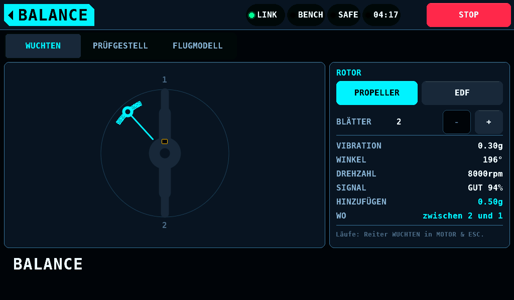

# Auswuchten

[English](Balance.md) · **Deutsch**

Diese Seite beschreibt, wie du BALANCE einrichtest, die Sensoren
platzierst und geeignete Sensoren auswählst.

Ein Auswuchtergebnis besteht aus einem Betrag und einem Winkel. Das
Verfahren nutzt einen Vibrationssensor und optional einen Indexsensor mit
einem Impuls pro Umdrehung. Zwei Platzierungsfehler verfälschen das Ergebnis,
ohne dass die Anzeige darauf hinweist: Eine nachgiebige Befestigung filtert
die vom Vibrationssensor erfasste Lagerbewegung. Eine Indexmarke auf einem
Blatt liefert einen Impuls pro Blatt statt eines Impulses pro Umdrehung.

## Den Bildschirm einrichten

Stelle die Blattzahl (2 bis 6) und den Rotortyp ein. Die Seite rechnet den
gemessenen Winkel zusätzlich in eine Blattangabe um („zwischen Blatt zwei und
drei“).

`-` und `+` ändern die Blattzahl sofort beim Aufsetzen des Fingers. Ein
Tipp auf die Zahl öffnet das Tastenfeld über beiden Karten: 1008 x 428px,
mit Tasten von 242 x 72px und einer Unterkante 4px über dem Alarmband. OK
übernimmt Werte von 2 bis 6. Bei jeder anderen Zahl bleibt das Tastenfeld
offen und zeigt den gültigen Bereich in der Warnfarbe. ABBRECHEN, OK ohne
Eingabe, das Home-Feld und ein Reiter schließen es ohne Änderung.

Ohne verbundenen Auswuchtknoten sind die Anzeigewerte (Vibration 0,42g,
Winkel 265°, zuzufügende Masse 0,35g) feste Werte und keine Messung. Die
Kennzeichnung SIMULIERT und der Text „Nicht gemessen.“ stehen darunter im
selben Statusfeld wie im Menü. Nur der Reiter WUCHTEN trägt diese
Kennzeichnung. Mit verbundenem Knoten zeigt der Reiter dessen Messwerte
([Messen mit dem Auswuchtknoten](#messen-mit-dem-auswuchtknoten)).

Bei einem Impeller wird die Korrektur als Winkel auf der Nabe angegeben, weil
eine Blattspitze im Kanal nicht erreichbar ist:

## Sensorplatzierung am Prüfstand

- Die Indexmarke gehört auf die Motorglocke, nicht auf einen Spinner. Die
  Glocke dreht mit der Welle, ist starr, ist bei jedem Propeller vorhanden und
  lässt sich von unten beobachten, wo nichts die Sichtlinie des Sensors
  kreuzt. Ein Sensor, der von vorn auf einen Spinner zielt, blickt durch die
  Propellerebene und zählt Blätter.
- Die Marke ist ein Stiftstrich, kein Reflexband. Alles, was auf die Glocke
  geklebt wird, ist Masse auf dem Teil, das ausgewuchtet wird. Ein dunkler
  Strich auf heller Glocke und ein heller Strich (ein Lackstift) auf
  dunkler Glocke funktionieren beide mit dem Auswuchtknoten.
- Den Strich in Linie mit Blatt 1 ziehen. Der Bildschirm zählt Blätter und
  Winkel ab der Marke.
- Winkel zählen ab der Marke in der Reihenfolge, in der die Punkte den
  Indexsensor passieren, also gegen die Drehrichtung.
- Der Vibrationssensor gehört auf ein starres Teil, so nah am Lager wie
  möglich. Eine nachgiebige Befestigung ist ein Tiefpassfilter.

## Sensorplatzierung am fertigen Modell

- Der Beschleunigungssensor gehört flach auf den Motorspant, nicht auf die
  Motorhaube. Die Haube ist eine Verkleidung, oft gummigelagert, und bewegt
  sich gegenüber dem Motorträger.
- Ein flach montierter Dreiachssensor hat zwei Achsen in der Spantebene, quer
  zur Welle. Verwende eine dieser beiden Achsen; die dritte bleibt unberücksichtigt.
- Die Indexmarke gehört auf die Glocke. Ein Spinner wird für den Transport
  abgenommen und in einem anderen Winkel wieder aufgesetzt, was die
  Phasenreferenz der vorherigen Auswuchtung ungültig macht.
- Zurre das Flugzeug fest. Ein frei stehendes Modell wirkt wie eine Feder
  in Reihe mit der Messung.

## Sensorauswahl

Ohne Indeximpuls gibt es keine Phasenreferenz, und gewuchtet wird nach der
Vier-Lauf-Methode: ein Grundlauf, danach eine Probemasse bei 0°, 120° und
240°. Die Methode misst keine Phase, eine konstante Sensorverzögerung wirkt
sich also nicht aus. Sie braucht Bandbreite: bei 10 000rpm (revolutions per
minute, Umdrehungen pro Minute) liegt die Grundfrequenz bei 167Hz, die eine
IMU (Inertial Measurement Unit, Trägheitssensor), die fusionierte Lagedaten
mit 100Hz liefert, nicht auflösen kann. Nimm einen analogen Sensor (Piezo oder
analoger Beschleunigungssensor), den ein ADC (Analog-Digital-Wandler)
abtastet. Der Auswuchtknoten trägt einen Beschleunigungssensor ADXL335 oder
ADXL337 und tastet ihn mit seinem eigenen ADC ab.

Mit Indeximpuls halbiert sich die Zahl der Läufe, und nur die Schwankung der
Sensorverzögerung zählt; ein konstanter Anteil kürzt sich heraus, weil der
Probelauf die ganze Kette mitmisst. Ein analoger Sensor hat etwa 15µs
Verzögerung, unter 1° bei 10 000rpm. Der ADXL des Auswuchtknotens mit seinen
4,7nF-Filterkondensatoren hat etwa 150µs, 9° bei 10 000rpm, bei einer
Drehzahl konstant. Eine fusionierte IMU hat etwa 5ms
Verzögerung, weder konstant noch spezifiziert, das sind 300° bei 10 000rpm.

## Was die Messung braucht

Die Messung benötigt einen Beschleunigungssensor und optional einen
Indexsensor. Der Auswuchtknoten trägt beide ([Die Sensorknoten](Nodes-de.md),
"Der Auswuchtknoten"): eine Achse eines ADXL335 oder ADXL337 und ein Modul
TCRT5000 an einem ESP32-C6, an eigener Zelle, mit einem Bericht über
Bluetooth LE alle 250ms. Ein Bericht enthält die Drehzahl, die Amplitude von
1x in mg und ihre Phase ab dem Index, die Amplituden von 2x und der
Blattfrequenz, den Effektivwert, eine Güte und Flags. Ohne Index nimmt der
Knoten die Drehzahl über seine Characteristic CONTROL und meldet nur die
Amplitude.

## Messen mit dem Auswuchtknoten

Der Auswuchtknoten misst nur. Er steuert keinen Ausgang, sein Verlust bei
ARMED ist kein Fehler, und seine Tasten gehen auch bei ARMED.

1. SETUP > WIRELESS > AUSWUCHTKNOTEN: Auswuchtknoten EIN, dann Knoten
   suchen (10s, nur bei SAFE: eine Suche bei ARMED wird abgelehnt, und das
   Schalten auf ARMED beendet eine laufende). Gebundener Knoten listet die
   gefundenen Knoten, `rcbench-bal-XXXX`; Tippen bindet einen und behält
   ihn über einen Neustart. Knotenakku zeigt die Zelle aus den
   STATUS-Paketen, die der Knoten neben seinen Berichten sendet.
2. Blattzahl und Rotorart auf BALANCE einstellen. Das Panel schreibt die
   Blattzahl an den Knoten (BLADES).
3. Testmasse (0.01g bis 20.00g, Vorgabe 0.50g) auf die Masse setzen, die
   für die Testläufe aufgeklebt wird. Eine nach den Läufen geänderte
   Testmasse löst die Läufe mit der neuen Masse neu und schreibt eine neue
   CSV-Zeile.
4. Auf MOTOR & ESC > WUCHTEN 2 LÄUFE (braucht die Indexmarke) oder 4 LÄUFE
   wählen. Den Motor mit festem Gas laufen lassen. REFERENZ drücken: das
   Panel mittelt die nächsten 8 Berichte, 2s. Anhalten, die Testmasse auf
   Linie mit Blatt 1 aufkleben, mit gleichem Gas laufen lassen und TEST 0°
   drücken. Bei 4 LÄUFE für die letzten zwei Läufe die Masse auf 120° und
   240° ab Blatt 1 setzen, gegen die Drehrichtung.
5. Das Feld zeigt `HINZU 0.35g  WO zwischen 1 und 2` und schreibt eine
   Zeile in `BENCH/BALANCE/BALANCE.CSV`. Die Zeile darunter sagt, was aus
   der Zeile wurde: `Zeile wartet auf die Karte`, `Geschrieben:
   BENCH/BALANCE/BALANCE.CSV` oder `NICHT geschrieben: keine Karte/Fehler`;
   `SCHWACH 12% Wirkung: geschrieben` trägt dasselbe bei einem schwachen
   Ergebnis. BALANCE zeigt dasselbe HINZUFÜGEN und WO und markiert die
   Stelle am Rotor.

Der Reiter WUCHTEN mit verbundenem Knoten:

| Zeile | Zeigt |
| --- | --- |
| VIBRATION | den Betrag der 1x-Komponente in g (mg des Berichts / 1000); ADC-Zählwerte bei einem Piezo; `--` ohne gezählte Umdrehung |
| WINKEL | die Phase der 1x-Komponente ab der Indexmarke, gegen die Drehrichtung; `--` ohne Index |
| DREHZAHL | die Drehzahl des Berichts; `--` ohne gezählte Umdrehung |
| SIGNAL | das Gütewort, unten |
| HINZUFÜGEN, WO | die Korrektur der Läufe, `--` bevor alle Läufe aufgenommen sind |

Ein Bericht, der älter als 1000ms ist (4 Berichtsperioden), zeigt in jedem
Messwert `--`, nie einen alten Wert. Eine abgerissene Verbindung bei
Auswuchtknoten EIN und gebundenem Knoten zeigt dasselbe `--` und behält
HINZUFÜGEN und WO der aufgenommenen Läufe, auf BALANCE und auf
MOTOR & ESC > WUCHTEN. Das Modell und SIMULIERT erscheinen nur bei
Auswuchtknoten AUS oder ohne gebundenen Knoten.

Ein neuer Bericht zeichnet auf dem Reiter WUCHTEN die vier Werte der
Messzeilen neu und sonst nichts; eine neue Korrektur oder ein Knoten, der
kommt oder geht, zeichnet den Bildschirm neu. Die Reiter PRÜFGESTELL und
FLUGMODELL übernehmen nichts vom Knoten.

Das Gütewort ist das erste zutreffende, von oben nach unten:

| Wort | Wann |
| --- | --- |
| `SENSORPEGEL` | der Gleichanteil des Beschleunigungssensors liegt außerhalb seines Fensters (`RCNODE_BF_DC_OK` gelöscht): kein Sensor oder ein Verdrahtungsfehler |
| `ÜBERSTEUERT` | ein ADC-Wert am Ende seines Bereichs |
| `DREHZAHLBEREICH` | No-Index-Modus: die geschriebene Drehzahl ergibt eine Umdrehung außerhalb des Bereichs |
| `INDEX VERLOREN` | die längste Umdrehung verging ohne Indexflanke |
| `KEIN INDEX` | No-Index-Modus ohne gezählte Umdrehung |
| `KEINE UMDREHUNG` | keine Umdrehung gezählt |
| `EINSCHWINGEN` | weniger als 2 Umdrehungen hinter der Güte |
| `KEIN WINKEL` | No-Index-Modus: der Betrag gilt, der Winkel nicht |
| `GUT n%` | Güte 90% oder mehr |
| `MITTEL n%` | 70% bis 89% |
| `SCHLECHT n%` | unter 70% |

**Ohne Index.** Nach 2 Berichten in Folge ohne Indexflanke schreibt das
Panel höchstens alle 250ms die Drehzahl des Prüfstands an den Knoten (RPM),
aus der Telemetrie des ESC oder vom Phasenabgriff, und wieder 0 mit dem
ersten Bericht mit Flanke. Ein simulierter Prüfstand liefert keine
Drehzahl. Die Vier-Lauf-Methode braucht nur die Beträge und geht in diesem
Modus; die Zwei-Lauf-Methode lehnt einen Bericht ohne Index ab.

**Ein Lauf bricht sofort ab** bei 1000ms ohne Bericht, einem Bericht, den
der Knoten als unbrauchbar kennzeichnet, einem Bericht ohne Index (zwei
Läufe) oder einer Drehzahl mehr als 5% neben dem ersten Bericht des Laufs.
Die unbrauchbaren Berichte, in der Reihenfolge, in der das Wort gewählt
wird:

| Wort | Der Bericht |
| --- | --- |
| `SENSORFEHLER` | der Gleichanteil des Beschleunigungssensors außerhalb seines Fensters: kein Sensor oder ein Verdrahtungsfehler |
| `ÜBERSTEUERT` | ein ADC-Wert am Ende seines Bereichs |
| `DREHZAHLBEREICH` | No-Index-Modus: die geschriebene Drehzahl ergibt eine Umdrehung außerhalb des Bereichs |
| `INDEXFEHLER` | die längste Umdrehung verging ohne Indexflanke, oder eine Flanke wurde verworfen |
| `MODUS GEÄNDERT` | der Indexmodus oder die Blattzahl änderte sich im Bericht |
| `KEINE UMDREHUNG` | keine Umdrehung gezählt |

Ein Bericht, dessen Güte noch nicht eingeschwungen ist oder dessen
Blattfrequenz nicht gilt, zählt weiter: Betrag und Phase der
1x-Komponente gelten. Ein Testlauf bricht auch ab,
wenn seine mittlere Drehzahl mehr als 5% von der des Referenzlaufs
abweicht (`ANDERE DREHZAHL`): der Löser nimmt nur Läufe einer Drehzahl.
Ein vor der Referenz aufgenommener Testlauf wird an ihr gemessen, sobald
sie fertig ist, und eine neu aufgenommene Referenz lässt jeden Testlauf
abbrechen, der mehr als 5% von ihrer Drehzahl abweicht. Seine Taste zeigt den Grund;
erneut drücken.

**Die Läufe gehören zu einem Knoten und einem Rotor.** LÖSCHEN leert alle
Läufe, und ebenso jede dieser Änderungen, mit HINZUFÜGEN und WO: die
andere Methode (2 LÄUFE oder 4 LÄUFE), BLÄTTER, PROPELLER oder EDF,
Auswuchtknoten AUS oder EIN, ein Knoten mit anderer Adresse gebunden und
ein Neustart des Knotens. Einen Neustart des Knotens erkennt das Panel bei
jedem Verbindungsaufbau: die Uhr des Knotens in INFO liegt mehr als 2s
neben dem Stand, den die Uhr des letzten Berichts und die seither
vergangene Zeit des Panels ergeben. Ein Update des Knotens auf UPDATES,
das installiert, startet ihn mit seinem neuen Image neu, und die
Verbindung, die zurückkommt, erkennt diesen Neustart, seine Läufe leeren
sich also; ein Update, das ohne Installation endet, startet nichts neu und
behält sie, da das Halten des Updates Auswuchtknoten EIN lässt. Ein
Neustart des Panels beginnt ohne Läufe. Eine abgerissene Verbindung und ein erneutes Verbinden desselben
Knotens behalten die Läufe, und ein Entbinden behält sie, bis ein anderer
Knoten gebunden wird. Der Reiter BALANCE folgt keinem Motor- oder
ESC-Profil, und ein Profilwechsel behält die Läufe.

**Die CSV-Zeile.** `BENCH/BALANCE/BALANCE.CSV` erhält in einer neuen Datei
eine Kopfzeile und je Lösung eine Zeile: Methode, Testmasse, Einheit (g
oder counts für ADC-Zählwerte), Betrag, Winkel (zwei Läufe) und Drehzahl jedes Laufs, den
Status des Lösers (`OK`, `WEAK`, `NO_EFFECT`, `INCONSISTENT`, `BAD_INPUT`),
die zuzufügende Masse, ihren Winkel, die Blattzahl und die zwei Blätter,
zwischen denen sie liegt. Ohne Karte entfällt die Zeile mit einer
Konsolenzeile, und die Zeile unter HINZU sagt `NICHT geschrieben`. Eine
Datei, deren letztes Byte kein Zeilenende ist, eine durch Stromausfall
oder gezogene Karte abgeschnittene Zeile, erhält vor der nächsten Zeile
ein Zeilenende, so beginnt die nächste Zeile eine eigene.

**Die Verbindung.** Das Panel liest INFO, sobald die Verbindung steht, und
übernimmt Berichte nur von einem Knoten, dessen INFO die Rolle Auswuchten
und Protokoll 1 nennt. Eine Suche listet einen Knoten nach der Rolle in
seinen Herstellerdaten, nie nach dem Namen allein; der Name kommt aus dem
Advertising oder der Scan Response. Die Zelle kommt aus den
STATUS-Paketen, die der Knoten auf STREAM sendet; die Characteristic
STATUS bleibt für ein Telefon, das Panel liest sie nicht.
CONTROL-Schreibzugriffe (BLADES, RPM) liegen mindestens 250ms auseinander,
so bleibt auf demselben Funk Platz für ein Dial. Einrichtung,
Blattumrechnung und beide Platzierungsanleitungen funktionieren ohne den
Knoten.

**Aktuelle Einschränkungen.**

- FILES sieht `BALANCE.CSV` nicht als belegt, während eine Zeile angehängt
  wird. Die Dateiregeln (`shared/files/fm_rules.c`) markieren nur das
  gerade geschriebene Log und das Fehlerprotokoll als belegt. Ein Löschen
  oder Verschieben der Datei in den wenigen ms eines Anhängens kann diese
  Zeile verlieren; die Zeile unter HINZU sagt dann nur `NICHT geschrieben`,
  wenn das Schreiben selbst fehlschlägt.
