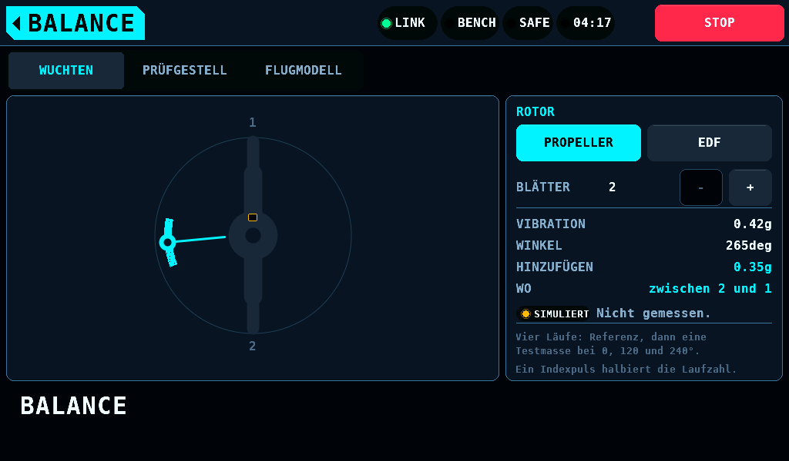
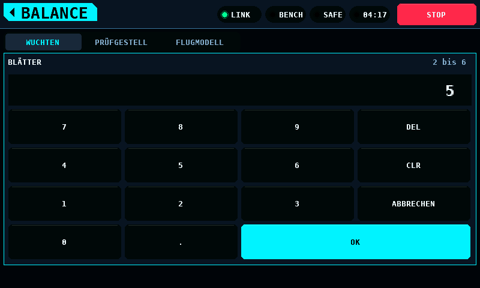
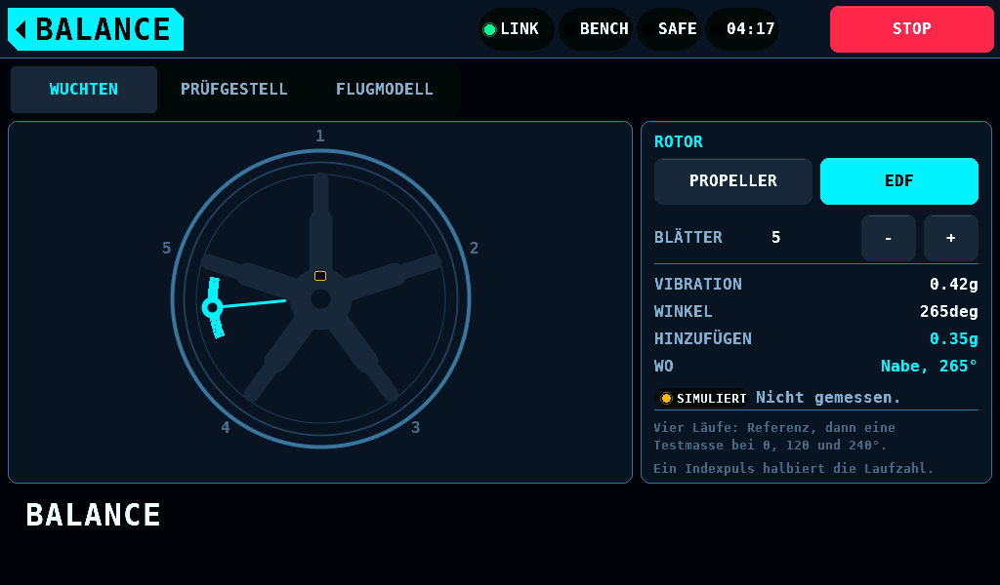
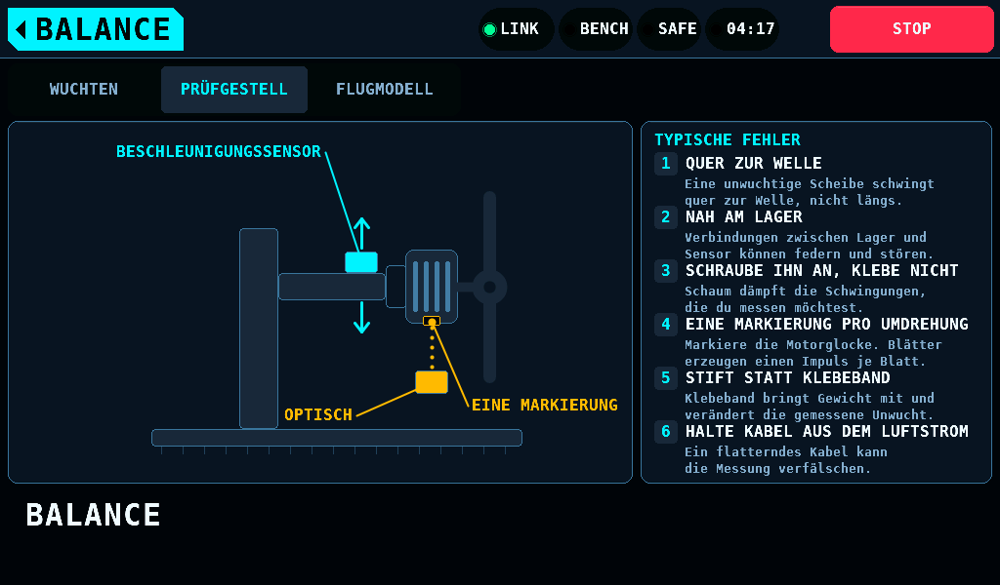
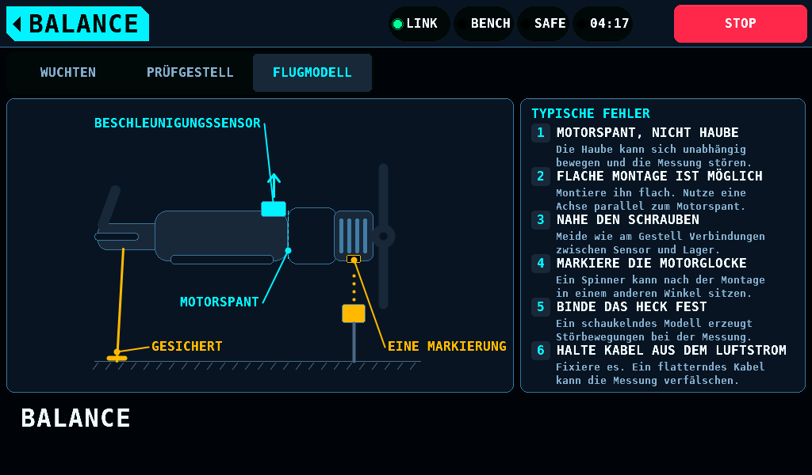

# Auswuchten

[English](Balance.md) · **Deutsch**

Diese Seite beschreibt, wie du BALANCE einrichtest, die Sensoren
platzierst und geeignete Sensoren auswählst.

Ein Auswuchtergebnis besteht aus einem Betrag und einem Winkel. Das
Verfahren nutzt einen Vibrationssensor und optional einen Indexsensor mit
einem Impuls pro Umdrehung. Zwei Platzierungsfehler verfälschen das Ergebnis,
ohne dass die Anzeige darauf hinweist: Eine nachgiebige Befestigung filtert
die vom Vibrationssensor erfasste Lagerbewegung. Eine Indexmarke auf einem
Blatt liefert einen Impuls pro Blatt statt eines Impulses pro Umdrehung.

## Den Bildschirm einrichten

Stelle die Blattzahl (2 bis 6) und den Rotortyp ein. Die Seite rechnet den
gemessenen Winkel zusätzlich in eine Blattangabe um („zwischen Blatt zwei und
drei“).

`-` und `+` ändern die Blattzahl sofort beim Aufsetzen des Fingers. Ein
Tipp auf die Zahl öffnet das Tastenfeld über beiden Karten: 1008 x 428px,
mit Tasten von 242 x 72px und einer Unterkante 4px über dem Alarmband. OK
übernimmt Werte von 2 bis 6. Bei jeder anderen Zahl bleibt das Tastenfeld
offen und zeigt den gültigen Bereich in der Warnfarbe. ABBRECHEN, OK ohne
Eingabe, das Home-Feld und ein Reiter schließen es ohne Änderung.

Die Anzeigewerte (Vibration 0,42g, Winkel 265°, zuzufügende Masse 0,35g) sind
feste Werte und keine Messung. Die Kennzeichnung SIMULIERT und der Text „Nicht
gemessen.“ stehen darunter im selben Statusfeld wie im Menü. Nur der
Reiter WUCHTEN trägt diese Kennzeichnung.

Bei einem Impeller wird die Korrektur als Winkel auf der Nabe angegeben, weil
eine Blattspitze im Kanal nicht erreichbar ist:

## Sensorplatzierung am Prüfstand

- Die Indexmarke gehört auf die Motorglocke, nicht auf einen Spinner. Die
  Glocke dreht mit der Welle, ist starr, ist bei jedem Propeller vorhanden und
  lässt sich von unten beobachten, wo nichts die Sichtlinie des Sensors
  kreuzt. Ein Sensor, der von vorn auf einen Spinner zielt, blickt durch die
  Propellerebene und zählt Blätter.
- Die Marke ist ein Stiftstrich, kein Reflexband. Alles, was auf die Glocke
  geklebt wird, ist Masse auf dem Teil, das ausgewuchtet wird.
- Der Vibrationssensor gehört auf ein starres Teil, so nah am Lager wie
  möglich. Eine nachgiebige Befestigung ist ein Tiefpassfilter.

## Sensorplatzierung am fertigen Modell

- Der Beschleunigungssensor gehört flach auf den Motorspant, nicht auf die
  Motorhaube. Die Haube ist eine Verkleidung, oft gummigelagert, und bewegt
  sich gegenüber dem Motorträger.
- Ein flach montierter Dreiachssensor hat zwei Achsen in der Spantebene, quer
  zur Welle. Verwende eine dieser beiden Achsen; die dritte bleibt unberücksichtigt.
- Die Indexmarke gehört auf die Glocke. Ein Spinner wird für den Transport
  abgenommen und in einem anderen Winkel wieder aufgesetzt, was die
  Phasenreferenz der vorherigen Auswuchtung ungültig macht.
- Zurre das Flugzeug fest. Ein frei stehendes Modell wirkt wie eine Feder
  in Reihe mit der Messung.

## Sensorauswahl

Ohne Indeximpuls gibt es keine Phasenreferenz, und gewuchtet wird nach der
Vier-Lauf-Methode: ein Grundlauf, danach eine Probemasse bei 0°, 120° und
240°. Die Methode misst keine Phase, eine konstante Sensorverzögerung wirkt
sich also nicht aus. Sie braucht Bandbreite: bei 10 000rpm (revolutions per
minute, Umdrehungen pro Minute) liegt die Grundfrequenz bei 167Hz, die eine
IMU (Inertial Measurement Unit, Trägheitssensor), die fusionierte Lagedaten
mit 100Hz liefert, nicht auflösen kann. Schließe einen analogen Sensor (Piezo oder
analoger Beschleunigungssensor) an den ADC (Analog-Digital-Wandler) des
IOmcu an.

Mit Indeximpuls halbiert sich die Zahl der Läufe, und nur die Schwankung der
Sensorverzögerung zählt; ein konstanter Anteil kürzt sich heraus, weil der
Probelauf die ganze Kette mitmisst. Ein analoger Sensor hat etwa 15µs
Verzögerung, unter 1° bei 10 000rpm. Eine fusionierte IMU hat etwa 5ms
Verzögerung, weder konstant noch spezifiziert, das sind 300° bei 10 000rpm.

## Was die Messung braucht

Die Messung benötigt einen Beschleunigungssensor und optional einen
Indexsensor am IOmcu. Keiner von beiden ist bestückt. Die Seite zeigt
deshalb simulierte Werte und trägt die Kennzeichnung SIMULIERT. Einrichtung, Blattumrechnung und beide
Platzierungsanleitungen funktionieren ohne die Sensoren.
