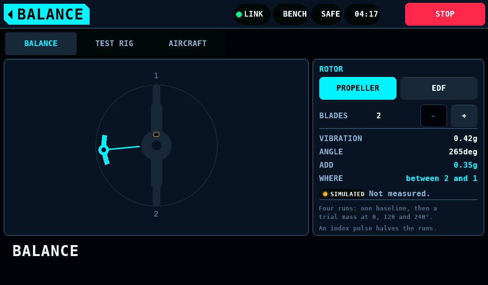
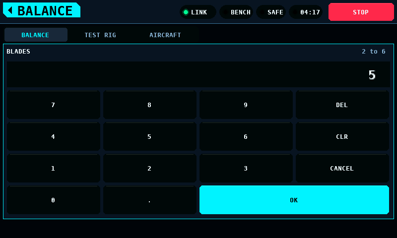
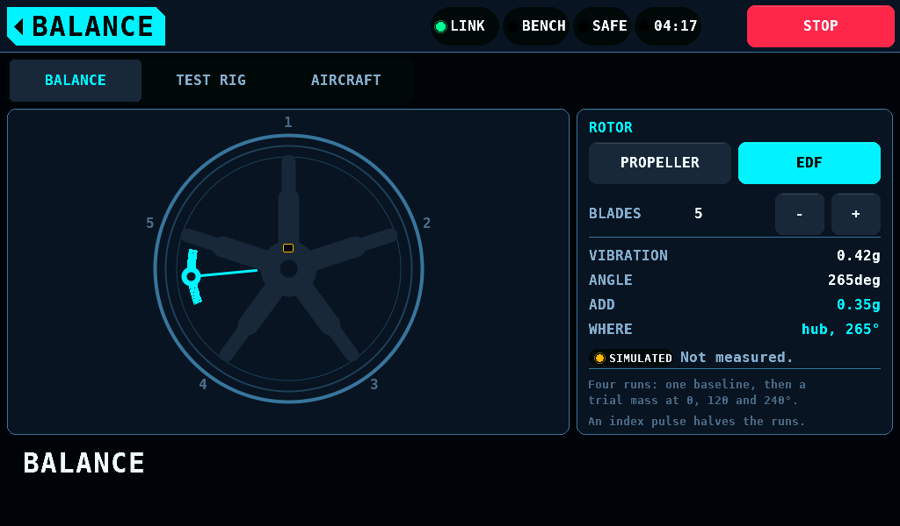
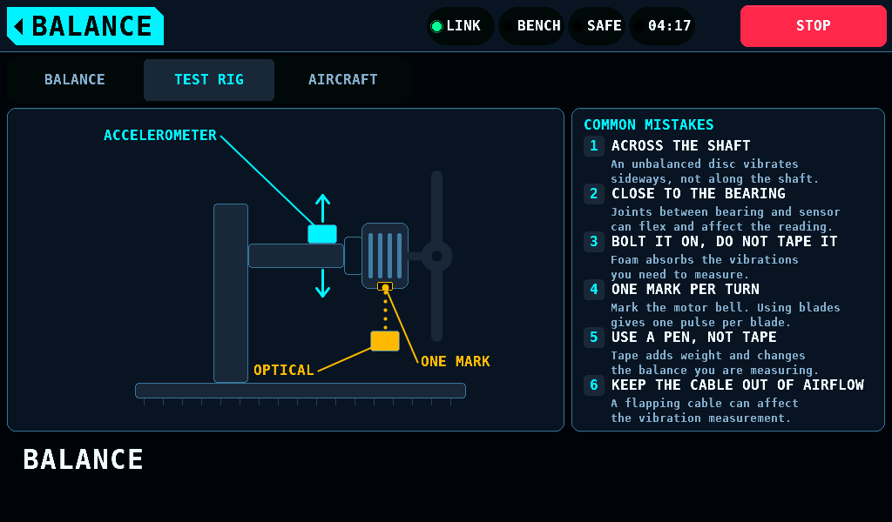
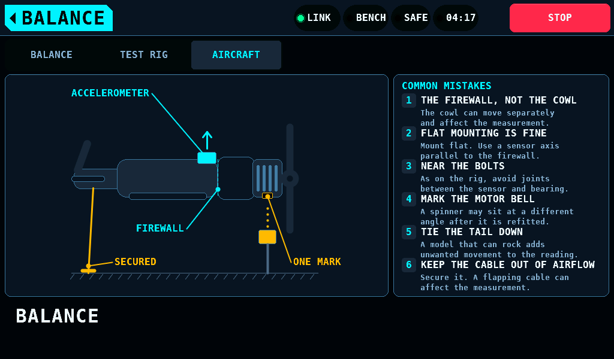
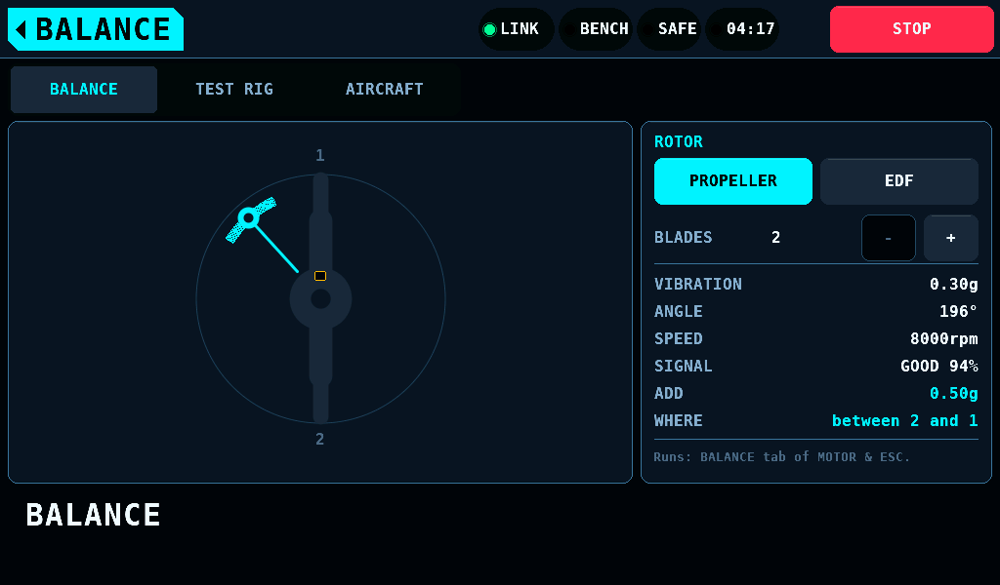

# Balancing

**English** · [Deutsch](Balance-de.md)

This page explains how to set up BALANCE, place the sensors and select
suitable sensors.

A balance result consists of a magnitude and an angle. The procedure uses
a vibration sensor and, optionally, an index sensor that provides one pulse
per revolution. Two placement errors produce a wrong result with no visible sign on
screen: a vibration sensor on a compliant mount measures a filtered version of
the bearing's motion, and an index mark on a blade produces one pulse per blade
instead of one per revolution.

## Screen setup

Set the blade count (2 to 6) and the rotor type. The screen converts the
measured angle into a blade reference ("between blades two and three") in
addition to the angle.

Press `-` or `+` to change the blade count immediately. A tap on the count opens the
keypad over both cards, 1008 x 428px with keys of 242 x 72px, its foot
4px above the alert band. OK takes 2 to 6; any other count keeps the
keypad open and names the range in the warning colour. CANCEL, OK with
nothing typed, the home tag and a tab close it and change nothing.

Without a linked balance node the readings (vibration 0.42g, angle 265°,
mass to add 0.35g) are fixed values and not a measurement. A SIMULATED mark
and the words "Not measured." stand under them, in the same pill the menu
uses. Only the BALANCE pane carries the mark. With a node linked the pane
shows its readings instead ([Measuring with the balance
node](#measuring-with-the-balance-node)).

For a ducted fan the correction is given as an angle on the hub, because a
blade tip inside a duct is not accessible:

## Sensor placement on a test rig

- The index mark goes on the motor bell, not on a spinner. The bell rotates
  with the shaft, is rigid, is present with any propeller, and can be observed
  from below where nothing crosses the sensor's line of sight. A sensor aimed
  at a spinner from the front looks across the disc and counts blades.
- The mark is a pen line, not reflective tape. Anything attached to the bell is
  mass on the part being balanced. A dark line on a bright bell and a bright
  line (a paint pen) on a dark bell both work with the balance node.
- Draw the mark in line with blade 1. The screen counts blades and angles
  from the mark.
- Angles count from the mark in the order points pass the index sensor, which
  is against the direction of rotation.
- The vibration sensor goes on a rigid part as close to the bearing as
  possible. A compliant mount is a low-pass filter.

## Sensor placement on a complete aircraft

- The accelerometer goes flat on the firewall, not on the cowl. The cowl is a
  fairing, often rubber-mounted, and moves relative to the motor mount.
- A three-axis sensor mounted flat has two axes in the firewall's plane, across
  the shaft. Use one of those and ignore the third.
- The index mark goes on the bell. A spinner is removed for transport and
  refitted at a different angle, which invalidates the phase reference of the
  previous balance.
- Tie the aircraft down. A free-standing airframe is a spring in series with
  the measurement.

## Sensor selection

Without an index pulse there is no phase reference and balancing uses the
four-run method: a baseline run, then a trial mass at 0°, 120° and 240°. The
method does not measure phase, so a constant sensor delay does not affect it.
It needs bandwidth: at 10,000rpm (revolutions per minute) the fundamental is
167Hz, which an IMU (inertial measurement unit) streaming fused orientation at
100Hz cannot resolve. Use an analogue sensor (piezo or analogue accelerometer)
sampled by an ADC (analogue-to-digital converter). The balance node carries an
ADXL335 or ADXL337 accelerometer and samples it with its own ADC.

With an index pulse the number of runs halves, and only the variation of the
sensor delay matters; a constant delay cancels because the trial run measures
the whole chain. An analogue sensor has a delay of about 15µs, under 1° at
10,000rpm. The balance node's ADXL with its 4.7nF filter capacitors has about
150µs, 9° at 10,000rpm, constant at one rpm. A fused IMU has about 5ms of delay, neither constant nor
specified, which is 300° at 10,000rpm.

## What the measurement needs

An accelerometer and, optionally, an index sensor. The balance node carries
both ([The sensor nodes](Nodes.md), "The balance node"): an ADXL335 or
ADXL337 axis and a TCRT5000 module on an ESP32-C6, on its own cell, sending a
report over Bluetooth LE every 250ms. A report holds the rpm, the 1x
magnitude in mg and its phase from the index, the 2x and blade-pass
magnitudes, the rms, a quality figure and flags. Without an index the node
takes the rpm over its CONTROL characteristic and reports the magnitude only.

## Measuring with the balance node

The balance node is a measurement. It drives no output, its loss while
ARMED is no error, and its keys work while ARMED.

1. SETUP > WIRELESS > BALANCE NODE: Balance node ON, then Scan for node
   (10s, SAFE only: a scan while ARMED is refused, and a switch to ARMED
   stops a running one). Bound node lists the nodes found, `rcbench-bal-XXXX`;
   a tap binds one and keeps it over a restart. Node battery shows the cell,
   read every 5s.
2. Set the blade count and the rotor type on BALANCE. The panel writes the
   blade count to the node (BLADES).
3. Set Trial mass (0.01g to 20.00g, 0.50g by default) to the mass you tape
   on for the trial runs.
4. On MOTOR & ESC > BALANCE choose 2 RUNS (needs the index mark) or 4 RUNS.
   Run the motor at one throttle. Press BASELINE: the panel averages the
   next 8 reports, 2s. Stop, tape the trial mass in line with blade 1, run
   at the same throttle and press TRIAL 0°. With 4 RUNS, move the mass to
   120° and 240° from blade 1, against the direction of rotation, for the
   last two runs.
5. The pane shows `ADD 0.35g  WHERE between 1 and 2` and writes a row to
   `BENCH/BALANCE/BALANCE.CSV`. BALANCE shows the same ADD and WHERE and
   marks the place on the rotor.

The BALANCE pane with a node linked:

| Row | Shows |
| --- | --- |
| VIBRATION | the 1x magnitude, g (the report's mg / 1000); ADC counts with a piezo |
| ANGLE | the 1x phase from the index mark, against the rotation; `--` without the index |
| SPEED | the rpm of the report; `--` without a counted revolution |
| SIGNAL | the quality word, below |
| ADD, WHERE | the correction of the runs, `--` before every run is taken |

A report older than 1000ms (4 report periods) shows `--` in every reading,
never an old value. The node gone shows the model and SIMULATED again.

The quality word is the first that holds, top down:

| Word | When |
| --- | --- |
| `SENSOR LEVEL` | the accelerometer's DC level is out of its window (`RCNODE_BF_DC_OK` clear): no sensor, or a wiring fault |
| `CLIPPED` | an ADC sample at an end of its range |
| `RPM RANGE` | no-index mode: the rpm written gives a revolution out of range |
| `INDEX LOST` | the longest revolution passed without an index edge |
| `NO INDEX` | no-index mode without a counted revolution |
| `NO REVOLUTION` | no revolution counted |
| `SETTLING` | fewer than 2 revolutions behind the quality |
| `NO ANGLE` | no-index mode: the magnitude holds, the angle does not |
| `GOOD n%` | quality 90% or more |
| `FAIR n%` | 70% to 89% |
| `POOR n%` | under 70% |

**Without an index.** After 2 reports in a row without an index edge, the
panel writes the bench's rpm to the node every 250ms at most (RPM), from the
ESC's telemetry or the phase tap, and 0 again with the first report that has
an edge. A simulated bench gives no rpm. The four-run method needs only the
magnitudes and works in this mode; the two-run method refuses a report
without the index.

**A run fails** on 1000ms without a report, a report without a counted
revolution, a report without the index (two runs) or an rpm more than 5%
away from the run's first report. Its key shows why; press it again.

**The CSV row.** `BENCH/BALANCE/BALANCE.CSV` gets a header in a new file and
one row each time the runs are solved: the method, the trial mass, the unit
(`g` or `counts`), each run's magnitude, angle (two runs) and rpm, the
solver's status (`OK`, `WEAK`, `NO_EFFECT`, `INCONSISTENT`, `BAD_INPUT`), the
mass to add, its angle, the blade count and the two blades it falls between.
A row without a card is dropped with a console line.

**The link.** The panel reads INFO after the link comes up and takes reports
only from a node whose INFO names the balance role and protocol 1. It reads
STATUS every 5s for the cell. CONTROL writes (BLADES, RPM) go 250ms apart at
the least, so the link leaves room for a Dial on the same radio. The
setup, the blade arithmetic and both placement guides work without the
node.
