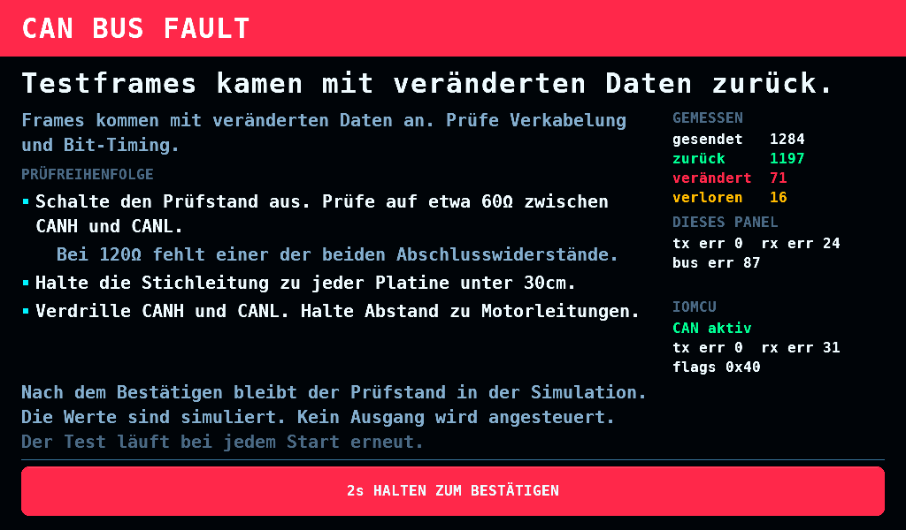
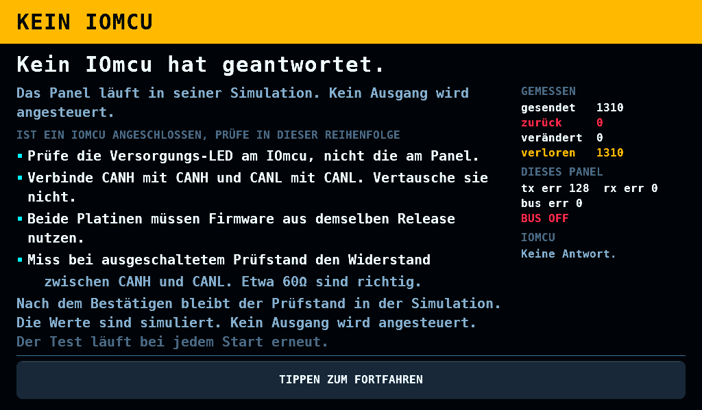

# Den Link in Betrieb nehmen

[English](Bringup.md) · **Deutsch**

Diese Seite erklärt, wie du die Frame-Übertragung über den CAN-Bus
(Controller Area Network) zwischen beiden Platinen prüfst und den
Diagnosebericht auswertest. Die Verkabelung steht unter
[Der Link](Link-de.md).

## Echo-Selbsttest

Der Selbsttest prüft, ob Frames unverändert über den Bus übertragen
werden. Er benutzt kein Page-Protokoll. Das Panel sendet einen Testframe,
der IOmcu schickt ihn zurück, und das Panel vergleicht ihn Byte für Byte.
Besteht der Test, obwohl der Link nicht funktioniert, liegt der Fehler
oberhalb der Leitung.

### IOmcu

Eine Konfiguration ist nicht nötig. Der IOmcu startet CAN beim Boot und
meldet, ob der Controller antwortet. Er bleibt bereit, Testframes
zurückzusenden. Diese Prüfung benötigt einen Registerzugriff je
Schleifendurchlauf. Beantwortet werden nur Frames an eine Page, die in
der Page Map nicht belegt ist.

Boot-Ausgabe auf der USB-Konsole (Universal Serial Bus) des IOmcu,
alle 3s wiederholt:

    rcbench-iomcu: CAN up, 1000000 bit/s, 0 requests served, 0 self-test echoes, tx_err 0 rx_err 0 eflg 0x00 tx_drop 0

`requests served` zählt Link-Page-Anfragen, die das Panel gesendet und der
IOmcu beantwortet hat. `self-test echoes` zählt Testframes und steht auf
0, solange der CAN-Selbsttest des Panels nicht läuft. `tx_drop` zählt
Antwortframes, deren Übertragung nach 1000 Versuchen bei vollem
Sendepuffer aufgegeben wurde. Das Panel wartet dann bis zum Timeout
seines Austauschs. Die ersten beiden Zähler zeigen zusammen, welche
Seite ausfällt:

| Requests | Panel zeigt | Lesart |
| --- | --- | --- |
| steigend | `VERBINDUNG` | funktioniert |
| unverändert | `KEINE VERBINDUNG` | es kommt nichts an — das Panel sendet nichts, oder die Verkabelung ist offen |
| steigend | `KEINE VERBINDUNG` | die Anfragen kommen an, die Antworten nicht zurück |

`CAN did not answer on SPI` heißt, dass der Controller nach dem Reset nicht
den Configuration Mode gemeldet hat. Der Fehler liegt an SPI (Serial
Peripheral Interface; Modul nicht bestückt, Verdrahtung an GPIO 8 bis GPIO 12),
nicht am CAN-Bus.

### Panel

Der Test läuft bei jedem Start während des Startbildschirms und vor dem
Identity-Poll. So kann das Panel einen Busfehler erkennen, bevor es auf
eine Antwort mit der Gerätekennung wartet.

Zuerst fragt das Panel den IOmcu bis zu 5000ms lang nach seinem Status.
Bei der ersten Antwort startet der Test. Der IOmcu öffnet CAN, nachdem
er beim Start das Netzteil ausgeschaltet hat. Dieser Vorgang dauert bis
zu 3500ms, wenn der PD mini gleichzeitig mit dem IOmcu versorgt wird.
Bleibt die Antwort innerhalb von 5000ms aus, läuft der Test trotzdem
und meldet den Bus ohne Antwort. Der Test selbst dauert 1200ms.
`bus_err` zählt nur Busfehler während des Tests, nicht während der
Wartezeit.

Ein anderes Urteil als `Alle Testframes kamen korrekt zurück.` bringt das Panel auf den
[Bus-Fehler-Bildschirm](#der-bus-fehler-bildschirm) statt ins Menü. Es muss
nichts aktiviert werden, und es wird keine Konsole gebraucht.

Die Einzelheiten stehen auf der Konsole. Sie liegt auf UART0 (Universal
Asynchronous Receiver-Transmitter 0), mit USB-Serial-JTAG (der eingebauten
USB-Seriell- und Debug-Bridge des ESP32-P4) als Zweitkonsole. Welche der
zwei USB-C-Buchsen der Platine zu welcher führt, ist nicht verfolgt. Die
Sendeleitung des CAN-Transceivers liegt an GPIO22 (General-Purpose
Input/Output 22), seine Empfangsleitung an GPIO21; keiner der beiden trägt
sonst etwas. Der Takt des Controllers ist der 40-MHz-Quarz. Ausgegeben wird:

    I (…) can: 1000000 bit/s: brp 2, tseg1 14, tseg2 5, sjw 4, sample point 75.0%
    I (…) rcbench: CAN self-test: the IOmcu answered after 3ms
    I (…) rcbench: CAN self-test: every probe came back intact
    I (…) rcbench:   sent 2024 echoed 2024 corrupt 0 lost 0 stale 0  (transmit queue full 0 times)
    I (…) rcbench:   round trip min 334 max 1356 us
    I (…) rcbench:   panel  tx_err 0 rx_err 0 bus_err 0
    I (…) rcbench:   iomcu  CAN up, 2024 echoes, 0 overflow(s), tx_err 0 rx_err 0 flags 0x00

Die letzte Zeile zeigt den Status des IOmcu, den das Panel vor und nach
der Echophase über den Bus abfragt. Die Differenz der beiden Messwerte
ergibt die Zahl der während des Tests gesendeten Echos. Das Panel
vergleicht sie mit der Zahl der empfangenen Echos.

### Befunde

| Befund | Bedeutung | Prüfen |
| --- | --- | --- |
| `Kein Testframe kam zurück.` (Konsole: `no probe came back`) | nichts kommt durch | CANH/CANL vertauscht; Gegenseite versorgt; gleiche Bitrate an beiden Enden; Abschlusswiderstände an beiden Enden |
| `Testframes kamen mit veränderten Daten zurück.` (Konsole: `probes come back altered`) | Frames kommen durch und kommen falsch an | Sample Point oder Bit Timing; ein fehlender Abschluss reflektiert |
| `Einige Testframes gingen verloren.` (Konsole: `probes cross, and not all of them`) | grenzwertiger Bus | Timing, ein Abschluss, oder ein für die Rate zu langer Bus |
| `Testframes gingen ohne Busfehler verloren.` (Konsole: `probes go missing without a bus error`) | Frames kamen unversehrt an und wurden nicht rechtzeitig gelesen | ein Empfangspuffer ist übergelaufen; kein Verdrahtungsfehler. Mit dem Overflow-Zähler des IOmcu vergleichen |
| `Alle Testframes kamen korrekt zurück.` (Konsole: `every probe came back intact`) | die Leitung ist in Ordnung | ein verbleibender Fehler liegt oberhalb der Leitung |

Die Konsole schreibt die englischen Urteile. Startbildschirm und
Bus-Fehler-Bildschirm zeigen die deutschen aus der Tabelle; jedes passt in
29 Zellen.

Treten veränderte und verlorene Frames gemeinsam auf, wird zuerst die
Veränderung gemeldet. Ein grenzwertiger Bus kann beides verursachen;
veränderte Daten weisen auf die Ursache hin.

Der Verlust wird am Busfehlerzähler des Controllers aufgeteilt. Frames, die
mit Busfehlern verloren gingen, wurden auf der Leitung beschädigt (Abschluss,
Timing, Länge). Frames, die mit null Busfehlern verloren gingen, kamen
unversehrt an und wurden von einem Empfänger verworfen, der nicht rechtzeitig
gelesen hat.

Erreicht der Sendefehlerzähler während des Tests 128, meldet die Firmware
einmalig eine frühe Warnung. Fehlende Quittierungen sind eine mögliche
Ursache; andere Sendefehler erhöhen den Zähler ebenfalls. Dieser Wert allein
belegt nicht, dass der IOmcu am Bus fehlt; siehe [Bus off](Link-de.md#bus-off).

### Der Bus-Fehler-Bildschirm

Ein anderes Urteil als `Alle Testframes kamen korrekt zurück.` wird auf dem Panel vor
dem Menü gezeigt, denn der Fehler ist von jedem anderen Bildschirm aus
unsichtbar: ein Bus, der keine Frames trägt, sieht genauso aus wie ein
IOmcu, der nicht bestückt ist, und beides sieht aus wie ein Prüfstand,
der einfach keine Zahlen zeigt.

Die Überschrift zeigt den Befund. Darunter stehen die Prüfungen nach
steigendem Aufwand geordnet. Die rechte Spalte zeigt die Zähler beider
Seiten. `zurück` ist grün, sobald ein Frame zurückkam. `BUS OFF` heißt,
dass das Panel keine Frames sendet.

Halte die Taste am unteren Rand zwei Sekunden lang, um die Seite zu
verlassen. Geste und Überblendung entsprechen ARM. Die Haltebedingung soll verhindern, dass eine kurze Berührung,
etwa durch einen Ärmel, den Fehlerbildschirm schließt.

Die Bestätigung behebt den Fehler nicht und schaltet den Test nicht ab.
Der Prüfstand läuft in der Simulation und steuert keinen Ausgang an.
Beim nächsten Start wird der Test erneut ausgeführt.

Die Testframe-Nutzdaten durchlaufen rein dominante, rein rezessive und
beide alternierenden Bitmuster. CAN fügt nach fünf gleichen Bits ein
komplementäres Bit ein. Lange Folgen desselben Pegels können einen
grenzwertigen Bus zum Scheitern bringen.

## Link-Bericht

Nach der Inbetriebnahme fragt das Panel die Identity-Page des IOmcu jede
Sekunde ab, bis er antwortet. Danach fragt es die Bench-Page mit 20Hz
und die Status-Page alle 500ms ab. Bei ausgefallenem Link gibt es alle
5s eine Diagnose aus, bei bestehendem Link einmal pro Minute.

Die Control-Task erzeugt den Heartbeat, erfasst die Zähler und übergibt
sie der Logger-Task zum Formatieren und Ausgeben. Bis zu 7 Zeilen
brauchen auf der Konsole 50ms oder mehr; die Heartbeat-Grenze liegt bei
150ms. Die Warteschlange fasst 2 Berichte. Blockiert der Kartenzugriff
den Logger und ist die Warteschlange voll, gibt die Control-Task den
Bericht selbst aus. Dabei geht keine Zeile verloren. Die Heartbeat-Lücke
bei Ausgabe durch die Logger-Task ist nicht gemessen.

    I (…) rcbench: LINK answers arrive too late
    W (…) rcbench:   check: a reply slower than the poll timeout, or a stalled far end
    I (…) rcbench:   last 60s  polls 1200 replies 1197 timeouts 3 stale 3 nack 0  iomcu frames 1200 crc 0 resync 0 refused 0
    I (…) rcbench:   panel  polls 36000 replies 35990 timeouts 10 stale 7 nack 0 crc 0 resync 0
    I (…) rcbench:   iomcu  frames 36000 crc 0 resync 0 refused 0
    I (…) rcbench:   round trip min 620 avg 700 max 1400 us

Die Diagnose und die Zeile `last` gelten für das Fenster seit dem
vorigen Bericht: 60s, solange der Link läuft, 5s, solange er ausgefallen
ist, und beim ersten Bericht die Zeit seit dem Start. Die Zeilen `panel`
und `iomcu` sind Summen seit dem Start. Ein Schub später Antworten bei
einem Ausfall des IOmcu ist die Diagnose des Berichts, der ihn enthält;
der nächste Bericht eines gesunden Links sagt `link healthy`. Ein Fenster
mit weniger als 4 Polls sagt `link healthy`; ein ausgefallener Link wird
etwa einmal pro Sekunde abgefragt, sein 5s-Fenster hält also 4 oder 5
Polls. Ein Zähler des IOmcu unter seinem Wert beim vorigen Bericht zählt
wieder ab 0 (der IOmcu ist neu gestartet, oder ein 16-Bit-Statusregister
ist übergelaufen), und das Fenster nimmt seinen neuen Wert. `crc` und
`resync` des IOmcu sind Stände, keine Zählungen, und stehen in der Zeile
`last` so, wie sie gelesen wurden: siehe unten.

| Diagnose | Bedeutung |
| --- | --- |
| `no reply to any poll` | IOmcu versorgt; CANH/CANL; Bitrate; Abschlusswiderstände |
| `answering, wrong protocol` | beide Enden aus demselben Baum flashen |
| `requests land, answers do not` | die Gegenseite hört das Panel, das Panel hört sie nicht: ihr Sendepfad |
| `frames arrive corrupt` | Bit Timing oder Sample Point zwischen den beiden Enden uneinig |
| `answers arrive too late` | eine Antwort langsamer als der Poll-Timeout, oder eine hängende Gegenseite |
| `works, and not every time` | grenzwertiges Timing, oder eine Pollperiode enger als die Umlaufzeit |

`nack` in der Panel-Zeile zählt Anfragen, die der IOmcu mit einem NACK
(Negative Acknowledgement) beantwortet hat. Ein NACK bestätigt die
Kommunikation über den Link, lässt die Werte der Page aber unverändert
([Frames](Link-de.md#frames)).
Eine Einstellung aus SETUP, die eine Page ablehnt, zählt je
einmal: ein Schreiben je abgelehntem Wert, das erst wieder geschrieben wird,
wenn sich der Wert ändert. Wer auf SETUP durch Zeilen schaltet, zählt also
ein NACK für jeden Wert, den der IOmcu ablehnt (Abgriff-Pause 2ms mit
Tiefster Ton 400Hz, oder PD mini RX auf dem SCL des Sensorbusses), und
keines für die Werte, die er übernimmt. Ein Pin, der abgelehnt wurde, weil
etwas anderes ihn hält, wird alle 5s erneut angeboten und zählt jedes Mal
einmal. `timeouts`, `stale` und `crc` sind die Spalten, die einen Linkfehler
zählen.

Die Spalten `crc` und `resync` der IOmcu-Zeile tragen den Empfangs- und
den Sendefehlerzähler des XL2515 (Statusregister `LINK_ST_CRC_ERRORS` und
`LINK_ST_RESYNCS`). Jeder liegt zwischen 0 und 255, steigt mit einem
fehlerhaften Frame und fällt mit einem guten; beide gelten so, wie sie beim
Bericht stehen, im Fenster wie in den Summen. Die letzte Zahl der Zeile ist die der CAN-Frames, die der
IOmcu seit dem Einschalten empfangen und nicht dekodiert hat
(`LINK_ST_REFUSED_LO` und `LINK_ST_REFUSED_HI`, Protokoll 4.21; 0 von einem
älteren IOmcu). Siehe [Abgelehnte Frames](Link-de.md#abgelehnte-frames).

## Warum der IOmcu zuletzt gestartet ist

Beim Start und danach alle 3s nennt die Konsole des IOmcu, warum der IOmcu
zuletzt gestartet ist, mit jedem Rohwert:

    rcbench-iomcu: reset FLASH_UPDATE (chip_reset 0x00010000 reason 0x1 boot 0x010104FF params 0x101FD000 0x00000000 scratch 0x101FD000 0x00000000)

Die Zeile beim Start geht meist hinaus, bevor ein Host den USB-Port
geöffnet hat; die Zeile alle 3s wiederholt sie. `chip_reset` ist POWMAN
CHIP_RESET, `reason` WATCHDOG REASON, `boot` das Boot-Wort des Boot-ROM
(0xttppbbdd: TBYB-Flags, Partition, Boot-Typ, Diagnose-Partition; `boot
none`, wenn das Boot-ROM keines lieferte), `params` seine Reboot-Parameter,
`scratch` WATCHDOG SCRATCH2 und SCRATCH3. Die Firmware liest sie einmal
beim Boot und setzt SCRATCH2 und SCRATCH3 danach auf 0. Die längste Zeile
hat 153 Byte mit ihrem LF.

CHIP_RESET ändert sich nur bei einem Reset auf Chip-Ebene, und seine Bits
sind nur lesbar (RP2350-Datenblatt, Abschnitte 7.3 und 7.4, Tabelle 489).
Der Reboot des Boot-ROM setzt das System über die Power-on State Machine
zurück, nicht den Chip: nach einem Update über CAN liest CHIP_RESET noch
HAD_POR vom Einschalten, wie in der Zeile oben. Ein Reset auf Chip-Ebene
setzt den Watchdog zurück, also heißt `reason 0x0`, dass CHIP_RESET zu
diesem Start gehört. `reset_cause_decode()` in `shared/safety/reset_cause.c`
wählt das Wort; die erste passende Zeile gilt:

| Wort | Register | Ursache |
| --- | --- | --- |
| `FLASH_UPDATE` | Boot-Typ 4 | das Update über CAN, eine auf das BOOTSEL-Laufwerk kopierte UF2, `picotool load -x` |
| `RAM_IMAGE` | Boot-Typ 3 | ein in den SRAM geladenes Image |
| `BOOTSEL_REBOOT` | Boot-Typ 2; oder reason ungleich 0, Boot-Typ 0, scratch 0xFFFFFFFF 0x00000000 | zurück aus BOOTSEL über `picotool reboot`, das picotool auch nach jedem mit `-f` ausgeführten Befehl sendet. Der Weg in BOOTSEL ist die 1200-Baud-Anfrage oder die Reset-Anfrage von picotool über USB |
| `SW_RESET` | reason 0x2 | der Watchdog sofort von Software ausgelöst |
| `WATCHDOG` | reason 0x1 | der Watchdog ist abgelaufen: der 16,7-s-TBYB-Timer (Try Before You Buy) des Boot-ROM nach einem Update, das das Panel nicht gekauft hat, oder ein Reboot mit anderen Parametern |
| `POR` | reason 0, HAD_POR (Bit 16) | Spannung angelegt |
| `BOR` | reason 0, HAD_BOR (Bit 17) | Brown-out-Detektor |
| `RUN_PIN` | reason 0, HAD_RUN_LOW (Bit 18) | RUN-Pin auf Low: der Reset-Taster oder ein Host, der RUN zieht |
| `GLITCH` | reason 0, HAD_GLITCH_DETECT (Bit 26) | Glitch-Detektor der Versorgung |
| `DEBUGGER` | reason 0, HAD_DP_RESET_REQ, HAD_RESCUE, HAD_HZD_SYS_RESET_REQ (Bits 19, 21, 27) | ein Reset durch einen Debugger |
| `POWER_DOWN` | reason 0, HAD_SWCORE_PD (Bit 25) | Power-down des Switched Core |
| `WATCHDOG` | reason 0, ein HAD_WATCHDOG_*-Bit (22, 23, 24, 28) | ein Watchdog, den POWMAN WDSEL den Chip zurücksetzen lässt; diese Firmware setzt keines |
| `UNKNOWN` | nichts davon | keine Ursache aufgezeichnet |

Der Reboot des Boot-ROM lässt den Watchdog im Timer-Modus laufen, also liest
jeder Reboot durch ihn `reason 0x1`. Ein Warm-Reset eines Kerns durch einen
Debugger löscht REASON ohne Reset auf Chip-Ebene, und der Start danach liest
sich als der Reset auf Chip-Ebene davor. Die Zeilen `BOOTSEL_REBOOT` und
`WATCHDOG` folgen dem Quelltext des RP2350-Boot-ROM und von picotool 2.x.

## Was festzuhalten ist

Notiere die Umlaufzeit, die Fehlerzähler beider Seiten und den
Overflow-Zähler des IOmcu. Die Pollperiode muss die Umlaufzeit
berücksichtigen. Die Zähler zeigen, ob der Bus oder die Software die
Kommunikation begrenzt.

Prüfe bei versorgten Platinen außerdem mit dem Oszilloskop, ob GPIO28
(`PANEL_HEARTBEAT_PIN`) Flanken mit der unter
[Sicherheit](Safety-de.md) vorgegebenen Rate erzeugt. GPIO28 ist IO28
des 12-poligen Headers P3.
