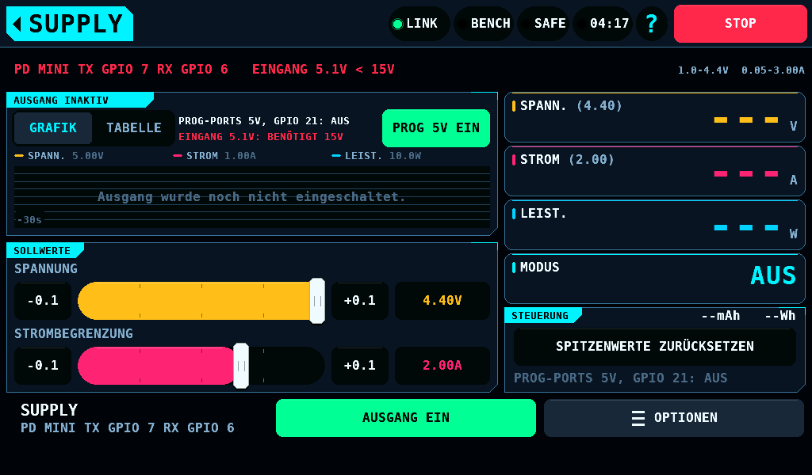
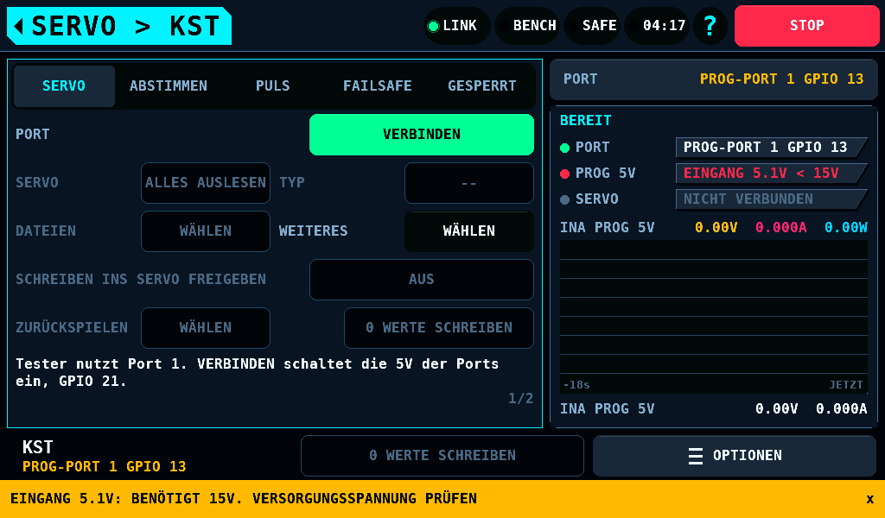
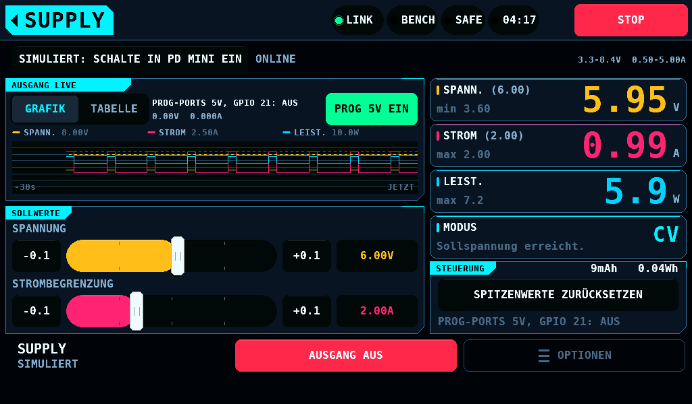
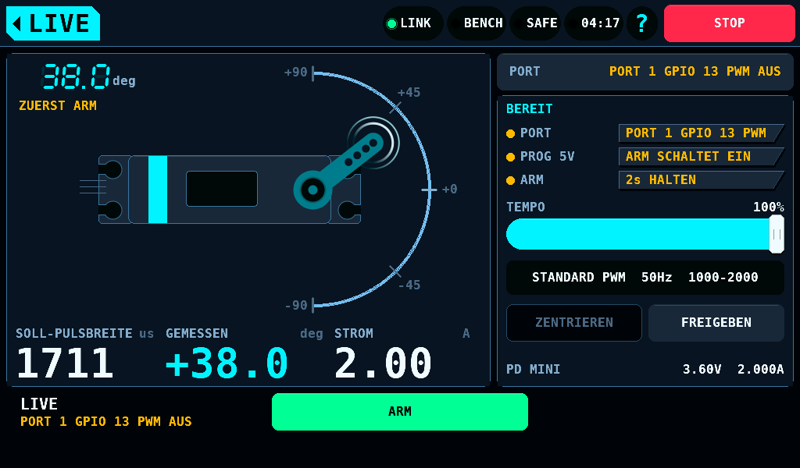
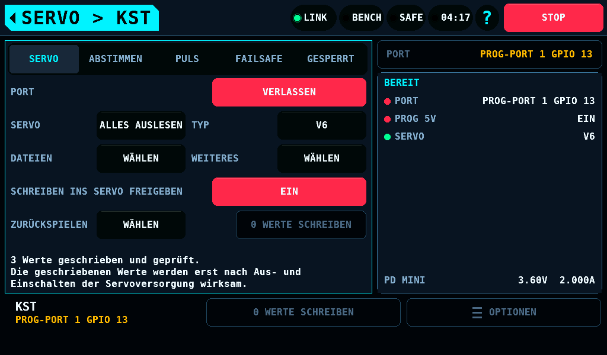
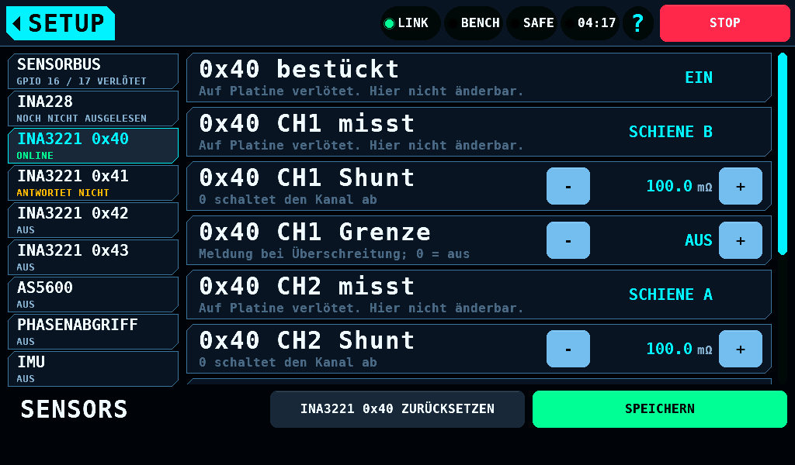
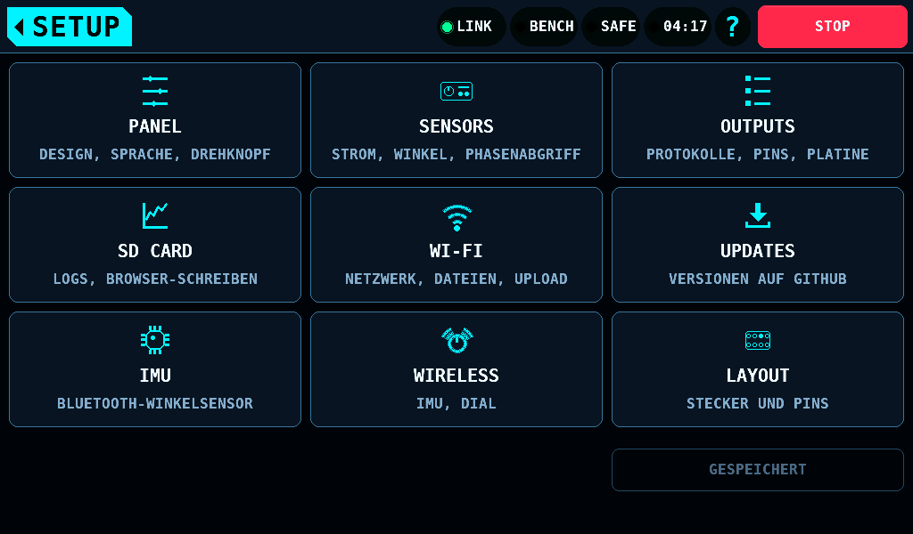
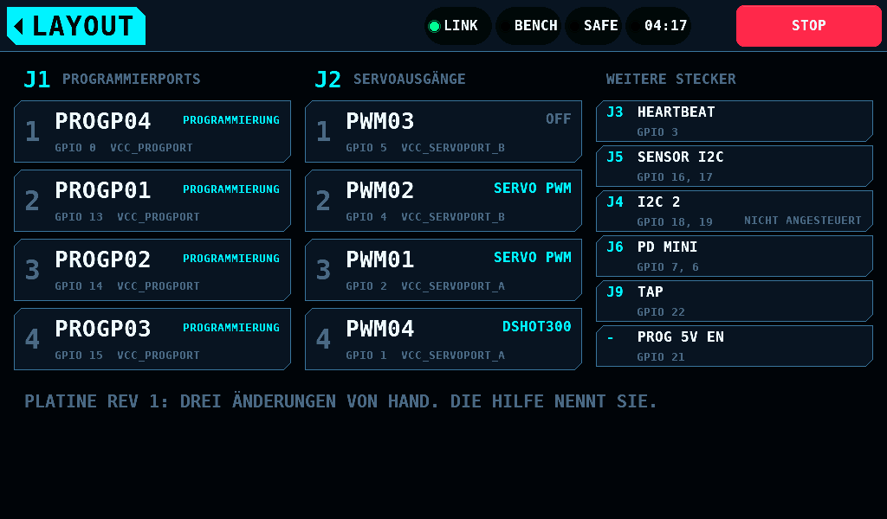

[English](Carrier.md) | **Deutsch**

# Der rbmod-Carrier

Der rbmod-Carrier trägt das Waveshare-Modul RP2350-CAN und verbindet
jede Leitung mit einem festen GPIO (General-Purpose Input/Output).
Diese Pin-Zuordnung lässt sich am Panel nicht ändern. Der IOmcu auf dem
Carrier verwendet das eigene Image `rcbench-iomcu-rbmod` und meldet
Board 2 in Register 5 von IDENTITY
([Link: Boards mit verlöteten Pins](Link-de.md#boards-mit-verlöteten-pins)).

## Pins

| Signal | GPIO | Stecker |
| --- | --- | --- |
| PROGP01, PROGP02, PROGP03, PROGP04 | 13, 14, 15, 0 | J1 |
| PWM01, PWM02, PWM03, PWM04 | 2, 4, 5, 1 | J2 |
| SDA01 / SCL01, der Sensorbus (I2C0) | 16 / 17 | J5 |
| SDA02 / SCL02 (I2C1) | 18 / 19 | J4 |
| PDMINI TX / RX | 7 / 6 | J6 |
| TAP | 22 | J9 |
| PROGP_5V_EN, der Enable der 5V der Programmierports | 21 | keiner |
| HEARTBEAT | 3 | J3 |
| CAN (Controller Area Network) | 8 bis 12 | auf dem Modul |
| unbenutzt, reserviert | 20, 26, 27, 28 | keiner |

GPIO 26 bis GPIO 28 sind ADC-Pins (Analog-Digital-Wandler) und nicht 5V-fest.
Keine Servoleitung liegt auf ihnen.

Der zweite I2C-Bus (Inter-Integrated Circuit) auf J4 wird in diesem Release
nicht betrieben.

## Die Stecker J1 und J2

Jede Position hat die Anschlüsse Signal, + und GND. In jeder
Signalleitung liegt ein Serienwiderstand von 120Ω.

| J1 Position | Signal | GPIO | Schiene + |
| --- | --- | --- | --- |
| 1 | PROGP04 | 0 | VCC_PROGPORT |
| 2 | PROGP01 | 13 | VCC_PROGPORT |
| 3 | PROGP02 | 14 | VCC_PROGPORT |
| 4 | PROGP03 | 15 | VCC_PROGPORT |

| J2 Position | Signal | GPIO | Schiene + |
| --- | --- | --- | --- |
| 1 | PWM03 | 5 | VCC_SERVOPORT_B |
| 2 | PWM02 | 4 | VCC_SERVOPORT_B |
| 3 | PWM01 | 2 | VCC_SERVOPORT_A |
| 4 | PWM04 | 1 | VCC_SERVOPORT_A |

Die Reihenfolge der Positionen folgt dem Layout.

PWM02 (GPIO 4) und PWM03 (GPIO 5) teilen sich einen PWM-Slice
(Pulsweitenmodulation) und verwenden dieselbe Pulsrate. PWM04 (GPIO 1) teilt Slice 0 mit PROGP04
(GPIO 0), und PROGP02 (GPIO 14) teilt Slice 7 mit PROGP03 (GPIO 15). Ab
Protokoll 4.36 treibt der Servotester den Puls des gewählten
Programmierports ([Der Programmierport](#der-programmierport)). Die
Zuordnung von PWM01 bis PWM04 hat Vorrang: Ein PWM-Ausgang auf PWM04
setzt PROGP04 auf FUNC NONE zurück. Solange PWM04 einen PWM-Ausgang
trägt, gibt PROGP04 keinen Puls aus. Nur der gewählte Port läuft als
SERVO PWM, PROGP02 und PROGP03 pulsen also nie zusammen.

## Der Programmierport

Die Servoprogrammierung für KST und Hitec teilt sich einen
Programmierport mit dem Servotester. Das Panel speichert die Auswahl
über Neustarts hinweg in SERVO-TESTER (SET_SERVO_TARGET): 1 bis 4 wählen
PROGP01 bis PROGP04, 0 wählt die Servoausgänge. Wähle den Port an einer
dieser Stellen:

- in der Zeile PORT der Programmer, vor VERBINDEN: ein Tipp auf die
  Beschriftung der Zeile öffnet PROGP01 bis PROGP04 mit ihrem GPIO
  ([Servo-Programmer: Der Port auf dem rbmod-Carrier](ServoProgrammer-de.md#der-port-auf-dem-rbmod-carrier));
- mit der Taste PORT auf jeder Funktionsseite von SERVO: ein Tipp öffnet
  OUTPUTS und PROG-PORT 1, PROG-PORT 2, PROG-PORT 3 und PROG-PORT 4 über der linken Karte
  ([Bildschirme: SERVO](Screens-de.md#servo));
- in einem Eintrag PROG PORT auf SETUP > OUTPUTS, SERVO-TESTER PORT n
  ([Bildschirme: Auf dem rbmod-Carrier](Screens-de.md#auf-dem-rbmod-carrier)).

| Regel | Wert |
| --- | --- |
| Protokoll des IOmcu | 4.36 oder neuer; ein älterer Carrier hält jede FUNC auf NONE, und das Panel bietet keine Wahl an |
| FUNC des gewählten Ports | SERVO PWM, vom Panel erbeten; die anderen drei NONE |
| FUNC, die der IOmcu nimmt | NONE oder SERVO PWM; DShot wird mit BAD_VALUE abgelehnt |
| FUNC beim Start des IOmcu | NONE auf jedem Port; das Panel bittet erneut um SERVO PWM |
| Gesperrt | ARMED oder ARMED angefordert, ein Test, ein Sweep oder ein Endlagenlauf, ein Programmer, der einen Port hält |
| PROGP04 | nicht angeboten, solange PWM04 einen PWM-Ausgang trägt: `PROGP04 TEILT PWM-SLICE 0 MIT PWM04 (GPIO 1)` |
| Puls | nur solange PROG 5V EIN zeigt. PORT-PWM EIN wird bei ausgeschaltetem PROG 5V angenommen, und OUTPUTS zeigt `PORT-PWM EIN: ARM AUF SERVO SCHALTET PROG 5V UND PULSE EIN`; AUSGANG in den Einstellungen von SERVO zeigt `PROG 5V AUS: ARM SCHALTET ES EIN`, und die Karte BEREIT eines Servotests, von RUDER AUTO und eines Endlagenlaufs zeigt `PROG 5V AUS: START SCHALTET ES EIN` |
| Versorgung | die festen 5V von M7 an GPIO 21; die Spannungsstufen eines Servotests erreichen die Servoschienen, nicht den Port, ein Test dort wird also mit `PROG-PORTS LAUFEN MIT FESTEN 5V: KEINE STUFEN` abgelehnt |
| Strom | INA3221 0x40 CH3 misst alle vier Ports zusammen |

Ein Puls auf einem Programmierport läuft nur, solange die Bank ARMED ist.
Jeder Fehler, ein STOP und ein stiller Link schalten die Bank ab, und der
nächste Frame des Ports ist 0 (`test_outputs_hw_ports`). Jeder Fehler, ein
verlorener Heartbeat und ein stiller Link schalten außerdem GPIO 21 aus.
Ein PROG 5V AUS von Hand beendet den Puls ebenso: das Panel fordert den
Puls nur an, solange das Feld EIN zeigt.

Das Panel schaltet den Puls des Ports nur bei SAFE ein, wie auf jedem
Board; aus schaltet es ihn sofort. Ein bei ARMED eingeschaltetes PROG 5V
lässt den Puls bis zum nächsten SAFE aus: der Endlagenlauf zeigt dann
`PORT-PWM EIN, WARTET AUF SAFE: DISARM, DANN ARM`.

PORT-PWM liegt auf OUTPUTS. Das Feld PROG 5V liegt auf SUPPLY; SERVO
schaltet die 5V über ARM und ARM + START
([Das Feld PROG 5V](#das-feld-prog-5v)). Ein von SERVO eingeschaltetes
PROG 5V bleibt von einer SERVO-Seite zur nächsten an, den Hub
eingeschlossen. Das Verlassen von SERVO schaltet es aus.

Auf LIVE, SWEEP und RUDER zeigen die Zeilen PORT und VERSORGUNG der
Karte BEREIT bei SAFE mit PORT-PWM oder PROG 5V aus `ARM SCHALTET EIN` in
Gelb. Das 2s-Halten von ARM schaltet dann PORT-PWM EIN und PROG 5V EIN,
wartet bis zu 1000ms auf ihre Rückmeldung, schaltet auf ARMED und wartet
bis zu 500ms auf ARMED. Ein Schritt, der scheitert, nennt sich im
Alarmband und schaltet alle Ausgänge aus. DISARM schaltet den Prüfstand
auf SAFE und PROG 5V aus
([Servo: ARM schaltet die Versorgung](Servo-de.md#arm-schaltet-die-versorgung-auf-live-sweep-und-ruder)).

RUDER AUTO und ENDLAGENLAUF brauchen keinen Schritt von Hand: ihr 2s
HALTEN: ARM + START schaltet bei SAFE PORT-PWM EIN, dann PROG 5V EIN,
wartet bis zu 1000ms auf die Rückmeldung EIN von PROG 5V, das PWM-Bit des
Ports (bei SAFE gesetzt) und ein INA3221-Messfenster, das nach beiden
begann, schaltet ARM, wartet bis zu 500ms auf ARMED und startet den Lauf.
Der Puls läuft ab dem ARM ([Servo: AUTO-Endpoints](Servo-de.md#auto-endpoints),
[Servo: Starten](Servo-de.md#starten)). Ihre Karte BEREIT zeigt bei SAFE
`START SCHALTET EIN` auf den Zeilen PROG 5V und PORT-PWM. Ein
fehlgeschlagener Schritt nennt sich im Alarmband und endet mit dem
Prüfstand SAFE, PROG 5V aus.

## Versorgung

| Teil | Eingang | Ausgang | Geschaltet von |
| --- | --- | --- | --- |
| M6, USB-C-PD-Trigger (Power Delivery) | USB-C | das Netz +15V | sein DIP-Schalter stellt 5V, 9V, 12V, 15V oder 20V |
| M7, Buck | das Netz +15V | 5V, VCC_PROGPORT_DCDC: die Programmierports an J1 | EN an GPIO 21, mit einem Pull-down an EN |
| M8, Buck | das Netz +15V | +5V: VBUS des Moduls und J7 | immer an |
| PD mini, an J8 | sein eigener Eingang | VCC_PDMINI: die Servoschienen A und B an J2 | die SUPPLY-Page |

M7 versorgt die Programmierports mit festen 5V, unabhängig vom PD mini.
Während einer KST- oder Hitec-Sitzung kannst du den PD mini weiter
bedienen: SUPPLY nimmt AUSGANG EIN und
Sollwerte an, die es während einer Sitzung auf anderen Platinen
ablehnt. KST- und Chaservo-Servos werden mit 5V programmiert. Auf dem
Carrier kann die Servoprogrammierung die Spannung der Programmierports
nicht ändern. Ihre Liste WEITERES zeigt
`PROGRAMMIERSPANNUNG: 5V FEST, GPIO 21` und bietet keine Einstellung für
Spannung oder Strom an.

Die Servoprogrammierung für KST und Hitec schaltet GPIO 21 während einer
Sitzung über die Page PROG_SUPPLY ein und aus (Link 4.32). Manuell
schaltest du sie im Feld PROG 5V unter LIVE auf SUPPLY: Halte PROG 5V EIN für 2s oder tippe auf
PROG 5V AUS. Das ist bei SAFE und ARMED möglich, wie AUSGANG EIN
des PD mini. Das Feld nennt den Pin,
`PROG-PORTS 5V, GPIO 21: AUS`, und zeigt das letzte Fenster von 50ms an
0x40 CH3 mit seiner Leistung, `5.02V  0.120A  0.60W`, und rechts davon
eine Grafik der Fenster von 72 x 20px
([Der Strommonitor](#der-strommonitor)). Solange
die Sitzung eines Programmers die 5V hält, nimmt das Feld keinen Druck an
und zeigt `BELEGT VON PROG-PORT n`. SUPPLY zeigt den Zustand auch unter
OUTPUT: `PROG-PORTS 5V, GPIO 21: EIN` oder `AUS`. Jeder Fehler, ein verlorener
Heartbeat und ein stummer Link schalten sie aus; ein Schreiben in den
Speicher des Servos hält sie an, bis es endet, höchstens 10000ms
([Sicherheit, Die 5V der Programmierports auf dem Carrier](Safety-de.md#die-5v-der-programmierports-auf-dem-carrier)).

Der IOmcu treibt GPIO 21 ab der ersten Anweisung von `main()` low. Solange
der IOmcu GPIO 21 nicht treibt (im Reset, im BOOTSEL, ohne Versorgung),
hält der Pull-down an EN M7 aus.

### Die Eingangsversorgung

Der DIP-Schalter von M6 steht auf dem Carrier auf 15V. M7 macht die 5V der
Programmierports aus dem Netz +15V, also lässt eine Eingangsquelle, die
stattdessen 5V liefert, M7 unter 5V: ein VERBINDEN von KST oder Hitec
findet dann kein Servo.

Der PD mini an J8 läuft aus demselben Eingang und meldet seine
Eingangsspannung. Der IOmcu liest sie alle 500ms, solange der PD mini
aktiviert ist und antwortet, mit seinem Ausgang ein oder aus; das Panel
liest die Page SUPPLY alle 100ms. Solange dieser Messwert unter 13,5V liegt
(`PROG5V_INPUT_MIN_MV`: 15V weniger 10%, Raum für den Messwert und den
Spannungsabfall im Kabel), warnt das Panel und lehnt ab:

| Wo | Was es zeigt oder tut |
| --- | --- |
| Das Warnband, einmal, sobald der Messwert unter 13,5V fällt, zurückgenommen bei 13,5V oder mehr | `EINGANG 5.1V: BENÖTIGT 15V. VERSORGUNGSSPANNUNG PRÜFEN` |
| Die Kopfzeile von SUPPLY, rot | `PD MINI TX GPIO 7 RX GPIO 6   EINGANG 5.1V < 15V` |
| Die zweite Zeile des Felds PROG 5V, rot | `EINGANG 5.1V: BENÖTIGT 15V` |
| PROG 5V EIN | Nimmt kein Halten an; das Warnband nennt den Eingang. Ein Eingang, der während der 2s Halten niedrig wird, beendet es ebenso, und der Steuer-Task lehnt ein ON ab, das ihn bei niedrigem Eingang erreicht, und schreibt nichts. |
| Die Zeile PROG 5V der Karte BEREIT auf KST, HITEC, ENDLAGENLAUF und RUDER AUTO, rot | `EINGANG 5.1V < 15V`; ein Tippen nennt den Eingang im Warnband. |
| VERBINDEN auf KST und HITEC | Nimmt kein Halten an; das Warnband nennt den Eingang. Ein Eingang, der während der 2s Halten niedrig wird, beendet es ebenso. Die Sitzung bleibt in PWM, die 5V aus. |
| ARM + START auf ENDLAGENLAUF und RUDER AUTO | Abgelehnt mit `PROG 5V: EINGANG 5.1V: BENÖTIGT 15V. VERSORGUNGSSPANNUNG PRÜFEN`; kein Ausgang wird geschaltet. |
| Die Schritte von ARM und ARM + START, die PROG 5V schalten, auf jeder SERVO-Ansicht | Ein Eingang, der nach dem Halten niedrig wird, bis zum und im Rücklesen, beendet sie sofort: alle Ausgänge aus, die Fehlerzeile nennt den Eingang. |
| Das VERBINDEN eines Endlagenlaufs oder von RUDER AUTO nach START | Abgelehnt, solange der Eingang niedrig ist; der Lauf endet. |

Die Volt stehen in Zehnteln, abgerundet: 13,49V liest `13.4V`. Ohne
Messwert des PD mini warnt der Eingang nicht: PD mini deaktiviert, nicht
bestückt, ohne Antwort oder sein Messwert älter als 1500ms. Diesen Fall
deckt die Prüfung nach PROG 5V EIN ab
([PROG 5V fehlt oder ausgefallen](#prog-5v-fehlt-oder-ausgefallen)). Rev 1
hat keinen anderen Messwert des Eingangs ([Nacharbeit Rev 1](#nacharbeit-rev-1)).

| Ein ON, das nicht greift | Warnung |
| --- | --- |
| kein lebender Heartbeat (NOT_ARMED) | `PROG-Ports 5V nicht eingeschaltet: der IOmcu hat keinen Heartbeat.` |
| ein Port hält die 5V (BAD_VALUE) | `PROG-Ports 5V nicht eingeschaltet: ein Programmierport belegt sie.` |
| keine Antwort; das OFF folgt | `PROG-Ports 5V EIN nicht bestätigt. Prüfe die Verbindung.` |
| über verlorene Touch-Ereignisse hinweg; der Prüfstand geht auf SAFE | `Touch-Signal beim Einschalten verloren. PROG-Ports 5V aus.` |
| ein Druck, solange ein Port die 5V hält oder die Page UNBEKANNT liest | `PROG-Ports 5V: von einem Programmierport belegt oder nicht ausgelesen.` |

### Das Feld PROG 5V

Das Feld PROG 5V auf SUPPLY schaltet die 5V von Hand: PROG 5V EIN ist ein
Halten von 2s, PROG 5V AUS ein Tipp. SERVO hat kein Feld: ARM auf LIVE,
SWEEP und RUDER und ARM + START auf ENDLAGENLAUF und RUDER AUTO schalten
die 5V ein, und auf KST und HITEC schaltet ein Tippen auf die Zeile der
Versorgung in der Karte BEREIT sie aus. Das Panel beurteilt das ON,
wie es AUSGANG EIN des PD mini beurteilt:

- Es gilt bei SAFE und bei ARMED; ein Wechsel nach ARMED wird nicht verlangt.
- Es verfällt, wenn nach dem vollendeten Halten ein STOP, ein AUS oder ein
  Touch-Verlust kam, und solange ein Port die 5V hält. Ein Fehler, ein AUS
  oder ein Neustart des Links nach Beginn des Haltens lehnt es ebenfalls
  ab, auch wenn dieses OFF schon geschrieben ist (`prog_supply_link_cuts()`).
- Es wird einmal als OUTPUT 1 geschrieben und nicht wiederholt. Der IOmcu
  lehnt es ohne lebenden Heartbeat ab (NOT_ARMED) und solange ein Port die
  5V hält (BAD_VALUE); beides und keine Antwort melden eine Warnung
  (die Tabelle oben). Ein ON ohne Antwort
  zieht ein OFF nach: der IOmcu kann es genommen haben.
- Ein ON über verlorene Touch-Ereignisse hinweg ist ein Fehler: SAFE, die
  5V aus.
- Ein Fehler, PROG 5V AUS und das Verlassen der Ansicht, deren Feld sie
  einschaltete, schreiben OFF, Letzteres auch bei einem ON unterwegs. Ein
  Fehler verwirft ein ungeschriebenes ON. Das OFF ist auch ein Flag, wie
  AUSGANG AUS: eine volle Warteschlange verliert es nicht.
- Solange ein Port die 5V hält, nimmt das Feld keinen Druck an.
- Firmware-Installation, IOmcu-Update, Flash-Schreiben und WLAN zählen das
  ON ab dem Einreihen in die Warteschlange (`supplies_live_or_coming()`).

### PROG 5V fehlt oder ausgefallen

INA3221 0x40 CH3 misst VCC_PROGPORT_DCDC, den Ausgang von M7. Das Panel
überwacht ihn bei jedem ON, das die Page PROG_SUPPLY liest: dem des
Felds PROG 5V, dem ON von ARM und von ARM + START und dem einer KST- oder
Hitec-Sitzung. Die Page muss GPIO 21 als eingeschaltet melden oder das ON
des Panels bestätigt haben, und der Heartbeat muss laufen. Die
Überwachung beurteilt jedes Fenster von 50ms nach seiner mittleren
Busspannung:

- **Fehlt:** kein Fenster mit 4750mV oder mehr bis 200ms nach dem ON
  (`PROG5V_MIN_MV`, 5V weniger 5%, die Untergrenze der 5V von USB;
  `PROG5V_REACH_MS`, die Leseperiode der Page). Das erste neue Fenster,
  das bei oder nach 200ms gelesen wird, entscheidet. Aus einem Eingang von
  5V kann M7 keine 5V machen; was er dann liefert, ist nicht gemessen.
- **Ausgefallen:** nachdem ein Fenster 4750mV oder mehr gelesen hat, zwei
  aufeinanderfolgende neue Fenster unter 3000mV (`PROG5V_LOST_MV`), beide
  frühestens 500ms nach dem ON gelesen.

Nur der Start muss 4750mV erreichen. Unter der Last eines Servos ziehen
der Shunt und die Lastregelung von M7 den Messwert gegen 4750mV, und ein
Lauf wird dafür nicht gestoppt. 3000mV liegen unter der
Unterspannungsabschaltung von M7 bei 3,25V: ein abgeschalteter Ausgang
fällt auf nahe 0V.

Der Regler von M7, am ehesten ein JoulWatt JW5068A (am Modul nicht
bestätigt), schaltet seinen Ausgang bei Überspannung (über 6,0V für 20us)
oder Unterspannung (unter 3,25V für 200us) ab und hält ihn aus. Er startet
erst wieder, wenn EN umschaltet. Die bekannte Ursache auf dem Carrier ist
die Abschaltung bei Überspannung: ein Servo an einem Programmierport, das
bremst, speist Energie in die 5V zurück, die M7 nicht aufnehmen kann. Eine
Z-Diode an der Schiene nimmt sie auf einer nachgearbeiteten Platine auf
([Nacharbeit Rev 1](#nacharbeit-rev-1), Punkt 3). Die Page PROG_SUPPLY
meldet GPIO 21 dabei weiterhin als eingeschaltet.

Beides ist ein Prüfstandsfehler:

- SAFE, alle Ausgänge aus und das OFF der Page
  ([Sicherheit, Fehler](Safety-de.md#fehler)). Das nächste PROG 5V EIN
  schaltet EN um und hebt die Abschaltung von M7 auf.
- Das Band, fehlt: `PROG 5V FEHLT: 3.1V NACH 200ms. VERSORGUNGSSPANNUNG PRÜFEN`;
  ausgefallen: `PROG 5V ausgefallen: INA3221 0x40 CH3 misst 0.12V trotz EIN. Alle Ausgänge aus.`
- Die Konsole, englisch: `PROG 5V missing: INA3221 0x40 CH3 read 3.10V
  200ms after ON. All outputs off.` oder `PROG 5V lost: INA3221 0x40 CH3
  read 0.12V, 0.08V in 2 windows, 640ms after ON. All outputs off.`
- Ein Fehler je ON: keiner mehr, bis die 5V aus und wieder ein waren.

Die 200ms zählen ab dem Moment, in dem das Panel das ON sieht: dem
bestätigten Schreiben des ON aus dem Feld oder dem ersten Lesen der Page,
das das ON einer Sitzung zeigt. Ein Fenster dauert 50ms, und das Panel
liest alle 40ms eines, also werden in 200ms mindestens zwei ganze Fenster
nach dem ON gelesen. Zwei Fenster für einen Ausfall halten das Absinken
eines belasteten Ports vom Auslösen ab. Jedes Fenster zählt einmal, nach
seiner Nummer. Ein verlangtes AUS, von Hand oder durch einen Fehler,
startet die 500ms neu und hält ein fehlendes 5V bis dahin zurück: die
Page liest die 5V bis zu ihrem nächsten Lesen als ein, höchstens 200ms.

Eine KST- oder Hitec-Sitzung schaltet die 5V selbst aus und ein: ein
Schienenzyklus von KST hält sie 1000ms aus, der Einstieg eines klassischen
Hitec 500ms. Das Panel sieht GPIO 21 nur bei seinen Lesungen der Page, alle
200ms. Solange eine Sitzung die 5V hält, wartet ein Befund auf ein Lesen
der Page nach ihm, das GPIO 21 noch als ein liest; ein Lesen, das sie als
aus zeigt, oder ein Fenster, das nicht niedrig ist (4750mV oder mehr,
bevor die 5V kamen, 3000mV oder mehr danach), verwirft ihn. Das Fenster
wird zuerst beurteilt: das Panel liest in einem Durchlauf PROG_SUPPLY vor
den Fenstern, also verwirft ein wieder gutes Fenster den Befund auch im
selben Durchlauf wie das Lesen der Page, das ihn bestätigen würde. Der
Fehler einer Sitzung kommt deshalb bis zu 200ms später als der des Felds.

Die Regel ist `shared/safety/prog5v_lost.c` unter `test_prog5v_lost`;
`test_prog5v_wire` treibt sie mit den Pages wie das Panel.

Aktuelle Einschränkungen:

- Die Überwachung benötigt einen INA3221-Kanal für PROG 5V und
  ausgelesene Fenster dieses Kanals. Sie fehlt bei ungültiger Map,
  fehlender Kanalzuordnung oder ausbleibenden Fenstern, etwa weil das
  Bauteil offline oder der Link unterbrochen ist. Auf einer Platine
  ohne Schalter PROG_SUPPLY fehlt die Überwachung von PROG 5V ebenfalls.
- Eine Sitzung, die die 5V zwischen zwei Lesungen der Page (unter 200ms)
  aus- und wieder einschaltet und sie über das Lesen nach einem Befund
  aus lässt, löst die Überwachung aus. Keine Sitzung der Firmware
  schaltet sie kürzer als 500ms aus, außer dem Einstieg eines Hitec der
  D-Serie mit einer Auszeit von 0ms.
- Eine Last, die die 5V zwei Fenster lang unter 3000mV hält, etwa ein
  blockiertes Servo über der Stromgrenze von M7, ist ein Ausfall. Die
  Stromgrenze von M7 ist nicht gemessen.
- Die Erkennungszeit auf der Hardware ist nicht gemessen. Nach der Regel
  sind es für fehlende 5V 200ms bis etwa 240ms nach dem ON und für einen
  Ausfall 2 neue Fenster nach dem Ausfall, etwa 100ms, dazu die 500ms
  nach dem ON; unter einer Sitzung bis zu 200ms mehr.

## Der Strommonitor

Ein INA3221 (M5) am Sensorbus auf Adresse 0x40 überwacht die drei
Versorgungen. Sein VS liegt an +3,3V, und der Carrier verbindet sein VPU mit VCC. Die
I2C-Pull-ups des Moduls hängen an VPU und sind damit die Pull-ups von Bus 1:
die Firmware betreibt Bus 1 (GPIO 16 SDA, GPIO 17 SCL) mit abgeschalteten
Pad-Pulls des RP2350.

| Kanal | Von | Nach |
| --- | --- | --- |
| CH1 | VCC_PDMINI | VCC_SERVOPORT_B, J2 Positionen 1 und 2 |
| CH2 | VCC_PDMINI | VCC_SERVOPORT_A, J2 Positionen 3 und 4 |
| CH3 | VCC_PROGPORT_DCDC (M7) | VCC_PROGPORT, J1 |

Bauteil und Kanalzuordnungen sind fest. Auf SENSE_MAP hält der IOmcu
das Bauteil als bestückt markiert und jeden Kanal seiner Schiene
zugeordnet. Er lehnt Maps ab, die eine dieser Zuordnungen ändern
([Link, Boards mit verlöteten Pins](Link-de.md#boards-mit-verlöteten-pins)).
SETUP > SENSORS zeigt diese Zeilen ohne Tasten zum Bearbeiten:

| Zeile | Zeigt |
| --- | --- |
| 0x40 bestückt | EIN |
| 0x40 CH1 misst | SCHIENE B (PWM03, PWM02) |
| 0x40 CH2 misst | SCHIENE A (PWM01, PWM04) |
| 0x40 CH3 misst | PROG PORTS 5V (PROGP01 bis PROGP04) |

- Shunts und Grenzen lassen sich wie an jedem Prüfstand einstellen: Shunt
  AUS oder 5,0 bis 1000,0mΩ, Vorgabe 100,0mΩ; Grenze AUS oder 10 bis
  32767mA ([Bildschirme: SENSORS](Screens-de.md#sensors-die-ina3221-bausteine)).
  Der Shuntwert von M5 auf dem Carrier steht hier nicht fest; 100,0mΩ ist
  der des DAOKAI-Moduls.
- 0x41 bis 0x43 sind frei für Bausteine an J5.
- Der Kanal, der mit 1kHz gelesen wird und den der Servotest und der
  Bildschirm SERVO lesen, ist die Schiene des niedrigsten GPIO, den der
  Servotester als SERVO PWM treibt: CH2 für GPIO 1 oder GPIO 2, CH1 für
  GPIO 4 oder GPIO 5. Mit SERVO PWM auf beiden Schienen liest er nur die
  Schiene des niedrigsten GPIO. Mit einem Programmierport als Ziel des
  Testers ist es CH3.
- Mit PORT auf den Ausgängen des Prüfstands und keinem als SERVO PWM
  zugeordneten Ausgang überwacht kein Kanal das Ziel, und keiner wird mit
  1kHz gelesen. Der Endlagenlauf meldet dann `KEIN SERVO-PWM-PIN` und RUDER
  AUTO `AUTO PROGRAMMIERT EIN SERVO AM PROG-PORT`, jeweils vor jeder
  Zeile zum INA3221 ([Servo](Servo-de.md#auto-endpoints)).
- SERVO benennt das Messgerät nach seiner Schiene: `INA SCHIENE A` in der
  Schienenzeile unter jeder BEREIT-Karte und über dem Plot der Schiene,
  `INA3221 SCHIENE A` in der Zeile MESSGERÄT der Karten TEST, ENDLAGENLAUF
  und RUDER AUTO.
  Das Band nennt die Schiene eines Kanals über seiner Grenze:
  `INA3221 0x40 CH2 (SCHIENE A) über der Grenze von 0.80A.`. Die Zeile
  ÜBERWACHT VON jedes Programmierports nennt CH3, `INA3221 PROG 5V`. Die
  Spalten der Laufaufzeichnung heißen `rail b`, `rail a` und `prog 5v`.
- Ein IOmcu-Image älter als Protokoll 4.33 lehnt die Map des Carriers ab:
  0x40 zeigt `VOM IOMCU NICHT ÜBERNOMMEN`, bis der IOmcu das Image des
  Panels fährt.

## Das Image

| Build | Dateien | Release-Asset |
| --- | --- | --- |
| `cmake -S firmware/iomcu -B firmware/iomcu/build-rbmod -DIOMCU_BOARD=rbmod` | `rcbench-iomcu-rbmod-install.uf2`, `rcbench-iomcu-rbmod.uf2`, `rcbench-iomcu-rbmod-pt.uf2`, `rcbench-iomcu-rbmod.bin`, `rcbench-iomcu-rbmod.elf` | `rcbench-iomcu-rbmod-vX.Y.Z.zip` |

Verwende für die erste Installation die Install-UF2 (USB Flashing
Format) über USB, wie unter
[Erster Lauf](FirstRun-de.md#aus-den-release-assets) beschrieben. Danach
bietet das Panel jedem IOmcu das Image für dessen gemeldetes Board an.

## Am Panel

Das Panel liest Board 2 vom IOmcu und zeigt die Pins des Carriers als
fest:

- SETUP > OUTPUTS zeigt PWM01 bis PWM04 als die vier Zellen des Rasters.
  Ein Flächen- und ein Gasprotokoll auf PWM02 und PWM03 zusammen werden
  mit Namen abgelehnt. Die Einträge PROG PORT nennen PROGP01 bis PROGP04
  und ihren GPIO, bieten keinen Pin und keine Funktion an und bieten ab
  Protokoll 4.36 SERVO-TESTER und PORT-PWM an
  ([Der Programmierport](#der-programmierport);
  [Bildschirme: Auf dem rbmod-Carrier](Screens-de.md#auf-dem-rbmod-carrier)).
- SETUP > SENSORS zeigt Sensor SDA und SCL sowie Tap pin auf den Pins des
  Carriers, ohne Tasten und ohne Tastenfeld, der Eintrag SENSORBUS lautet
  `GPIO 16 / 17 VERLÖTET`, und 0x40 ist bestückt mit seinen drei Kanälen auf
  den Schienen, ohne Tasten ([Der Strommonitor](#der-strommonitor)).
- Der Abschnitt PD MINI der SUPPLY-Optionen zeigt PD mini TX und RX auf den Pins des Carriers, ohne
  Tasten und ohne Tastenfeld.
- Eine Kachel LAYOUT öffnet LAYOUT: J1 und J2 in ihrer
  Positionsfolge mit Rolle, GPIO, Netz am + und dem gebundenen
  Protokoll jeder Position, und die weiteren Stecker
  ([Bildschirme: Layout](Screens-de.md#layout)).

## Nacharbeit Rev 1

Jede Platine der Rev 1 benötigt drei manuelle Änderungen. Das
Carrier-Image setzt voraus, dass die Punkte 1 und 2 umgesetzt sind;
Punkt 3 setzt es nicht voraus. Bei Rev 2 sind die Punkte 1 und 2 im
Platinenlayout enthalten. Die Lösung für Punkt 3 ist bei Rev 2 noch
offen: ein Wandler ohne verriegelnde Abschaltung oder eine
Klemmschaltung auf der Platine.

Rev 2 ergänzt außerdem, geplant, einen Spannungsteiler vom Netz +15V an
GPIO 26 (ADC0, auf dem Carrier seit Punkt 1 unbenutzt): 100kΩ oben, 10kΩ
unten und 100nF am Pin. Er liest 1,36V bei 15V, 1,82V bei 20V (die höchste
DIP-Einstellung von M6) und 0,45V bei 5V, alles unter den 3,3V des Pins.
Damit kann das Panel ab dem Einschalten vor einer niedrigen
Eingangsversorgung warnen, auch ohne bestückten PD mini. Rev 1 hat keinen
solchen Teiler, und die Firmware liest GPIO 26 nicht: auf Rev 1 kommt die
Warnung aus dem Eingangsmesswert des PD mini
([Die Eingangsversorgung](#die-eingangsversorgung)).

| # | Änderung | Grund | Die Firmware verlässt sich darauf |
| --- | --- | --- | --- |
| 1 | PROGP03 (J1 Position 4, über R4) wechselt von GPIO 26 auf GPIO 15: die Leiterbahn wird unter dem Serienwiderstand R4 getrennt, und ein Fädeldraht läuft von R4 zu GPIO 15. | GPIO 26 ist ein ADC-Pin und nicht 5V-fest. Ein Pull-up von Hitec oder KST legt die Servoversorgung auf die Programmierleitung. | PROG PORT 3 ist auf jedem Carrier GPIO 15. GPIO 26 bleibt unbenutzt. |
| 2 | Ein Pull-down von 2kΩ bis 5kΩ von EN an M7 (das Netz von GPIO 21) nach GND. | EN des Buck-Moduls liest offen als an. Ohne den Pull-down sind die 5V der Programmierports an, solange der IOmcu im Reset, im BOOTSEL oder ohne Versorgung ist. | Die Versorgung der Programmierports ist aus, solange GPIO 21 nicht high getrieben wird. |
| 3 | Eine Z-Diode 5,6V mit 2W oder 5W vom Ausgang von M7 (VCC_PROGPORT_DCDC) nach GND, Kathode an der Schiene, zum Beispiel SMBJ5339B-TP (5,6V 5W, Gehäuse SMB). | Ein bremsendes Servo speist Energie in PROG 5V zurück. M7 kann keinen Strom aufnehmen und schaltet ab, wenn sein Ausgang etwa 6,0V für 20us überschreitet. Die Z-Diode nimmt die Rückspeisung auf. | Nein. Der Fehler PROG 5V ausgefallen ([PROG 5V fehlt oder ausgefallen](#prog-5v-fehlt-oder-ausgefallen)) meldet ein abgeschaltetes M7 mit oder ohne die Z-Diode. |

Grenzen von Punkt 3:

- Die Überspannungsschwelle von M7 liegt bei 115% bis 125% des Ausgangs,
  5,75V bis 6,25V bei 5,00V. Eine Z-Diode 5,6V mit ±5% leitet bei 5,32V
  bis 5,88V.
- Die Klemmspannung steigt mit dem rückgespeisten Strom um den
  dynamischen Widerstand der Z-Diode. Typische Datenblattwerte beim
  Prüfstrom sind etwa 1Ω für eine 5W-Z-Diode und etwa 5Ω für eine
  1W-Z-Diode. Je 100mA über dem Prüfstrom kommen bei der 5W-Z-Diode etwa
  0,1V hinzu, bei der 1W-Z-Diode etwa 0,5V; die Klemmspannung der
  5W-Z-Diode bleibt also bei höherer Rückspeisung niedriger. Bei einer
  2W-Z-Diode hängt der Wert vom Teil ab; hier ist kein 2W-Teil genannt.
- Rückspeisung von mehreren hundert mA ist nicht gemessen. Ob ein
  größeres Servo M7 mit einer der beiden Z-Dioden weiter abschaltet, ist
  nicht gemessen.
