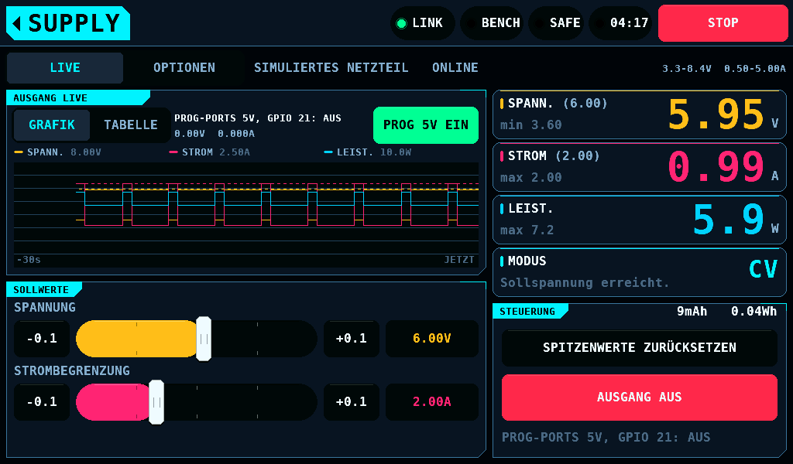
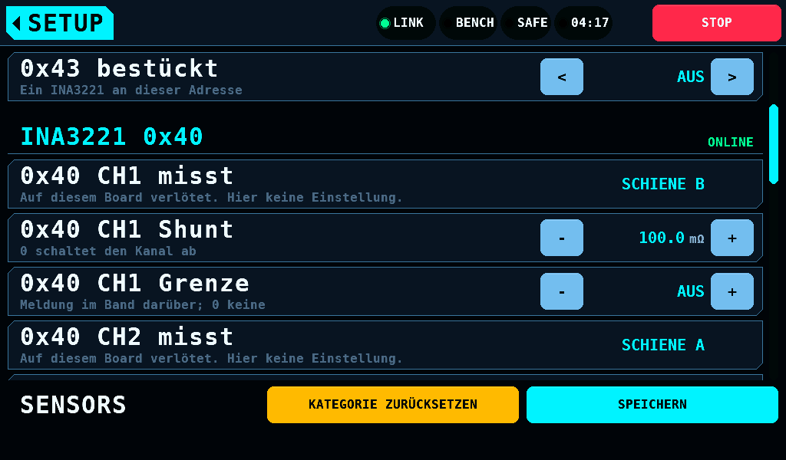
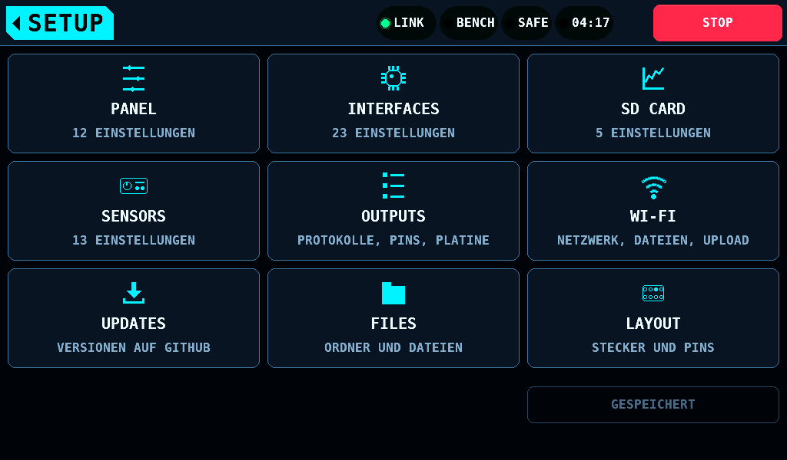
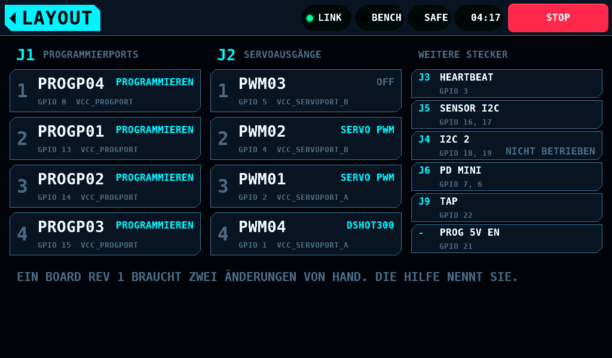

[English](Carrier.md) | **Deutsch**

# Der rbmod-Carrier

Der rbmod-Carrier ist eine Platine, die das Waveshare-Modul RP2350-CAN trägt
und jede Leitung auf einen festen GPIO (General-Purpose Input/Output) legt.
Er ist eine feste Konfiguration: am Panel wird kein Pin gewählt. Der IOmcu
auf dem Carrier läuft mit einem eigenen Image, `rcbench-iomcu-rbmod`, und
meldet Board 2 in Register 5 von IDENTITY ([Link: Boards mit verlöteten
Pins](Link-de.md#boards-mit-verlöteten-pins)).

## Pins

| Signal | GPIO | Stecker |
| --- | --- | --- |
| PROGP01, PROGP02, PROGP03, PROGP04 | 13, 14, 15, 0 | J1 |
| PWM01, PWM02, PWM03, PWM04 | 2, 4, 5, 1 | J2 |
| SDA01 / SCL01, der Sensorbus (I2C0) | 16 / 17 | J5 |
| SDA02 / SCL02 (I2C1) | 18 / 19 | J4 |
| PDMINI TX / RX | 7 / 6 | J6 |
| TAP | 22 | J9 |
| PROGP_5V_EN, der Enable der 5V der Programmierports | 21 | keiner |
| HEARTBEAT | 3 | J3 |
| CAN (Controller Area Network) | 8 bis 12 | auf dem Modul |
| unbenutzt, reserviert | 20, 26, 27, 28 | keiner |

GPIO 26 bis GPIO 28 sind ADC-Pins (Analog-Digital-Wandler) und nicht 5V-fest.
Keine Servoleitung liegt auf ihnen.

Der zweite I2C-Bus (Inter-Integrated Circuit) auf J4 wird in diesem Release
nicht betrieben.

## Die Stecker J1 und J2

Jede Position ist Signal, + und GND. Jedes Signal hat einen
Serienwiderstand von 120Ω.

| J1 Position | Signal | GPIO | Schiene + |
| --- | --- | --- | --- |
| 1 | PROGP04 | 0 | VCC_PROGPORT |
| 2 | PROGP01 | 13 | VCC_PROGPORT |
| 3 | PROGP02 | 14 | VCC_PROGPORT |
| 4 | PROGP03 | 15 | VCC_PROGPORT |

| J2 Position | Signal | GPIO | Schiene + |
| --- | --- | --- | --- |
| 1 | PWM03 | 5 | VCC_SERVOPORT_B |
| 2 | PWM02 | 4 | VCC_SERVOPORT_B |
| 3 | PWM01 | 2 | VCC_SERVOPORT_A |
| 4 | PWM04 | 1 | VCC_SERVOPORT_A |

Die Reihenfolge der Positionen folgt dem Layout.

PWM02 (GPIO 4) und PWM03 (GPIO 5) sind ein PWM-Slice (Pulsweitenmodulation)
und laufen mit einer Framerate. PWM04 (GPIO 1) teilt Slice 0 mit PROGP04
(GPIO 0). Ein Programmierport trägt auf dem Carrier kein PWM-Signal, der
geteilte Slice schränkt also nichts ein.

## Versorgung

| Teil | Eingang | Ausgang | Geschaltet von |
| --- | --- | --- | --- |
| M6, USB-C-PD-Trigger (Power Delivery) | USB-C | das Netz +15V | sein DIP-Schalter stellt 5V, 9V, 12V, 15V oder 20V |
| M7, Buck | das Netz +15V | 5V, VCC_PROGPORT_DCDC: die Programmierports an J1 | EN an GPIO 21, mit einem Pull-down an EN |
| M8, Buck | das Netz +15V | +5V: VBUS des Moduls und J7 | immer an |
| PD mini, an J8 | sein eigener Eingang | VCC_PDMINI: die Servoschienen A und B an J2 | die SUPPLY-Page |

Die Programmierports laufen aus den festen 5V von M7, nicht aus dem PD mini.
Eine KST- oder Hitec-Sitzung lässt den PD mini der bedienenden Person:
SUPPLY und die Zeile SOLL des SERVO-Bildschirms nehmen während einer
Sitzung AUSGANG EIN und Sollwerte an, die sie auf anderen Platinen
abweisen. KST- und Chaservo-Servos programmieren mit 5V. Auf dem Carrier stellen die
Programmer die Spannung der Programmierports nicht ein: ihre Liste MORE
zeigt `PROGRAMMIERSPANNUNG: 5V FEST, GPIO 21` und bietet weder Spannung
noch Strom an.

Die Programmer für KST und Hitec schalten GPIO 21 für eine Sitzung ein und
aus, über die Page PROG_SUPPLY (Link 4.32). Das Panel hat keine Taste
dafür. SUPPLY zeigt den Zustand unter OUTPUT:
`PROG-PORTS 5V, GPIO 21: EIN` oder `AUS`. Jeder Fehler, ein verlorener
Heartbeat und ein stummer Link schalten sie aus; ein Schreiben in den
Speicher des Servos hält sie an, bis es endet, höchstens 10000ms
([Sicherheit, Die 5V der Programmierports auf dem Carrier](Safety-de.md#die-5v-der-programmierports-auf-dem-carrier)).

Der IOmcu treibt GPIO 21 ab der ersten Anweisung von `main()` low. Solange
der IOmcu GPIO 21 nicht treibt (im Reset, im BOOTSEL, ohne Versorgung),
hält der Pull-down an EN M7 aus.

## Der Strommonitor

Ein INA3221 (M5) am Sensorbus auf Adresse 0x40 überwacht die drei
Versorgungen. Sein VS liegt an +3.3V, und der Carrier verbindet sein VPU mit VCC. Die
I2C-Pull-ups des Moduls hängen an VPU und sind damit die Pull-ups von Bus 1:
die Firmware betreibt Bus 1 (GPIO 16 SDA, GPIO 17 SCL) mit abgeschalteten
Pad-Pulls des RP2350.

| Kanal | Von | Nach |
| --- | --- | --- |
| CH1 | VCC_PDMINI | VCC_SERVOPORT_B, J2 Positionen 1 und 2 |
| CH2 | VCC_PDMINI | VCC_SERVOPORT_A, J2 Positionen 3 und 4 |
| CH3 | VCC_PROGPORT_DCDC (M7) | VCC_PROGPORT, J1 |

Das Bauteil und seine Kanäle sind fest. Der IOmcu hält das Bauteil auf der
Page SENSE_MAP bestückt und jeden Kanal auf seiner Schiene und lehnt eine
Map ab, die eins davon verschiebt
([Link, Boards mit verlöteten Pins](Link-de.md#boards-mit-verlöteten-pins)).
SETUP > SENSORS zeigt die Zeilen ohne Tasten:

| Zeile | Zeigt |
| --- | --- |
| 0x40 bestückt | EIN |
| 0x40 CH1 misst | SCHIENE B (PWM03, PWM02) |
| 0x40 CH2 misst | SCHIENE A (PWM01, PWM04) |
| 0x40 CH3 misst | PROG PORTS 5V (PROGP01 bis PROGP04) |

- Die Shunts und die Grenzen sind Einstellungen wie an jeder Bench: Shunt
  AUS oder 5.0 bis 1000.0mΩ, Vorgabe 100.0mΩ; Grenze AUS oder 10 bis
  32767mA ([Bildschirme: SENSORS](Screens-de.md#sensors-die-ina3221-bausteine)).
  Der Shuntwert von M5 auf dem Carrier steht hier nicht fest; 100.0mΩ ist
  der des DAOKAI-Moduls.
- 0x41 bis 0x43 sind frei für Bausteine an J5.
- Der Kanal, der mit 1kHz gelesen wird und den der Servotest und der
  Bildschirm SERVO lesen, ist die Schiene des niedrigsten GPIO, den der
  Servotester als SERVO PWM treibt: CH2 für GPIO 1 oder GPIO 2, CH1 für
  GPIO 4 oder GPIO 5. Mit SERVO PWM auf beiden Schienen liest er nur die
  Schiene des niedrigsten GPIO. Mit einem Programmierport als Ziel des
  Testers ist es CH3.
- SERVO und der Limit-Lauf nennen das Messgerät nach seiner Schiene:
  `INA SCHIENE A` über dem Plot, `INA3221 SCHIENE A` auf der Karte TEST.
  Das Band nennt die Schiene eines Kanals über seiner Grenze:
  `INA3221 0x40 CH2 (SCHIENE A) über der Grenze von 0.80A.`. Die Zeile
  ÜBERWACHT VON jedes Programmierports nennt CH3, `INA3221 PROG 5V`. Die
  Spalten des Laufprotokolls heißen `rail b`, `rail a` und `prog 5v`.
- Ein IOmcu-Image älter als Protokoll 4.33 lehnt die Map des Carriers ab:
  0x40 zeigt `VOM IOMCU NICHT ÜBERNOMMEN`, bis der IOmcu das Image des
  Panels fährt.

## Das Image

| Build | Dateien | Release-Asset |
| --- | --- | --- |
| `cmake -S firmware/iomcu -B firmware/iomcu/build-rbmod -DIOMCU_BOARD=rbmod` | `rcbench-iomcu-rbmod-install.uf2`, `rcbench-iomcu-rbmod.uf2`, `rcbench-iomcu-rbmod-pt.uf2`, `rcbench-iomcu-rbmod.bin`, `rcbench-iomcu-rbmod.elf` | `rcbench-iomcu-rbmod-vX.Y.Z.zip` |

Das erste Laden ist die Install-UF2 (USB Flashing Format) über USB, wie in
[Erster Lauf](FirstRun-de.md#aus-den-release-assets). Danach bietet das
Panel jedem IOmcu das Image des Boards an, das er meldet.

## Am Panel

Das Panel liest Board 2 vom IOmcu und zeigt die Pins des Carriers als
fest:

- SETUP > OUTPUTS zeigt PWM01 bis PWM04 als die vier Zellen des Rasters.
  Ein Flächen- und ein Gasprotokoll auf PWM02 und PWM03 zusammen werden
  mit Namen abgelehnt. Die Einträge PROG PORT nennen PROGP01 bis PROGP04
  und ihren GPIO, bieten keinen Pin und keine Funktion an und zeigen
  keinen Tester
  ([Bildschirme: Auf dem rbmod-Carrier](Screens-de.md#auf-dem-rbmod-carrier)).
- SETUP > INTERFACES zeigt Sensor SDA und SCL, Tap pin sowie PD mini TX
  und RX auf den Pins des Carriers, ohne Tasten und ohne Keypad.
- SETUP > SENSORS zeigt 0x40 bestückt und seine drei Kanäle auf den
  Schienen, ohne Tasten ([Der Strommonitor](#der-strommonitor)).
- Die Kachel PICK A PIN öffnet LAYOUT: J1 und J2 in ihrer
  Positionsfolge mit Rolle, GPIO, Netz am + und dem gebundenen
  Protokoll jeder Position, und die weiteren Stecker
  ([Bildschirme: Layout](Screens-de.md#layout)).

## Nacharbeit Rev 1

Jede Platine der Rev 1 braucht zwei Änderungen von Hand. Das Image des
Carriers setzt beide voraus. Eine Platine der Rev 2 trägt die zwei
Änderungen im Kupfer.

| # | Änderung | Grund | Die Firmware verlässt sich darauf |
| --- | --- | --- | --- |
| 1 | PROGP03 (J1 Position 4, über R4) wechselt von GPIO 26 auf GPIO 15: die Leiterbahn wird unter dem Serienwiderstand R4 getrennt, und ein Fädeldraht läuft von R4 zu GPIO 15. | GPIO 26 ist ein ADC-Pin und nicht 5V-fest. Ein Pull-up von Hitec oder KST legt die Servoversorgung auf die Programmierleitung. | PROG PORT 3 ist auf jedem Carrier GPIO 15. GPIO 26 bleibt unbenutzt. |
| 2 | Ein Pull-down von 2kΩ bis 5kΩ von EN an M7 (das Netz von GPIO 21) nach GND. | EN des Buck-Moduls liest offen als an. Ohne den Pull-down sind die 5V der Programmierports an, solange der IOmcu im Reset, im BOOTSEL oder ohne Versorgung ist. | Die Versorgung der Programmierports ist aus, solange GPIO 21 nicht high getrieben wird. |
