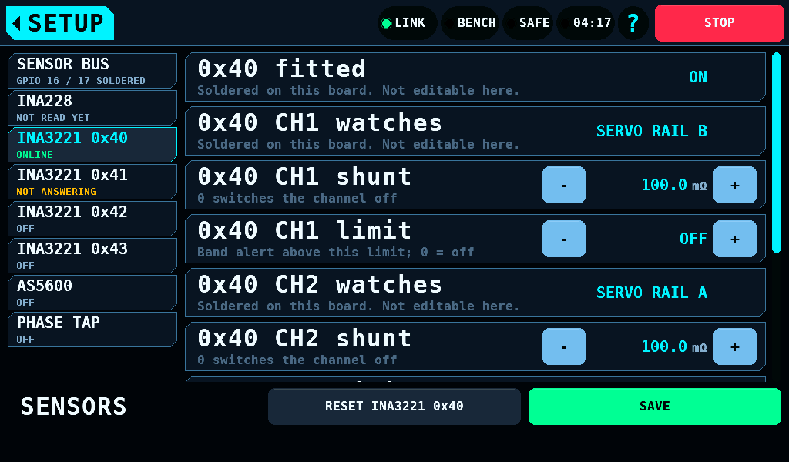
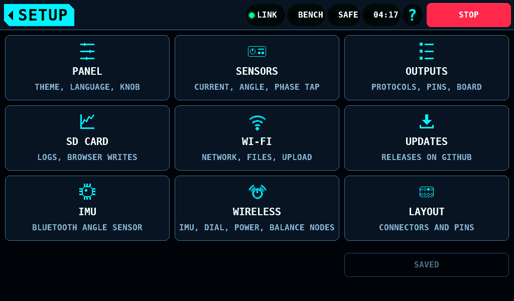

**English** | [Deutsch](Carrier-de.md)

# The rbmod carrier

The rbmod carrier holds the Waveshare RP2350-CAN module and connects
each lead to a fixed GPIO (general-purpose input/output). The panel
cannot change these pin assignments. The carrier's IOmcu runs its own
image, `rcbench-iomcu-rbmod`, and reports board 2 in IDENTITY register 5
([Link: Boards with soldered pins](Link.md#boards-with-soldered-pins)).

## Pins

| Signal | GPIO | Connector |
| --- | --- | --- |
| PROGP01, PROGP02, PROGP03, PROGP04 | 13, 14, 15, 0 | J1 |
| PWM01, PWM02, PWM03, PWM04 | 2, 4, 5, 1 | J2 |
| SDA01 / SCL01, the sensor bus (I2C0) | 16 / 17 | J5 |
| SDA02 / SCL02 (I2C1) | 18 / 19 | J4 |
| PDMINI TX / RX | 7 / 6 | J6 |
| TAP | 22 | J9 |
| PROGP_5V_EN, the enable of the programming ports' 5V | 21 | none |
| HEARTBEAT | 3 | J3 |
| CAN (Controller Area Network) | 8 to 12 | on the module |
| unused, reserved | 20, 26, 27, 28 | none |

GPIO 26 to GPIO 28 are ADC (analog-to-digital converter) pins and not 5V
tolerant. No servo line is on them.

The second I2C (Inter-Integrated Circuit) bus on J4 is not driven in this
release.

## Connectors J1 and J2

Each position is signal, + and GND. Every signal has a 120Ω series
resistor.

| J1 position | Signal | GPIO | + rail |
| --- | --- | --- | --- |
| 1 | PROGP04 | 0 | VCC_PROGPORT |
| 2 | PROGP01 | 13 | VCC_PROGPORT |
| 3 | PROGP02 | 14 | VCC_PROGPORT |
| 4 | PROGP03 | 15 | VCC_PROGPORT |

| J2 position | Signal | GPIO | + rail |
| --- | --- | --- | --- |
| 1 | PWM03 | 5 | VCC_SERVOPORT_B |
| 2 | PWM02 | 4 | VCC_SERVOPORT_B |
| 3 | PWM01 | 2 | VCC_SERVOPORT_A |
| 4 | PWM04 | 1 | VCC_SERVOPORT_A |

The position order is set for the layout.

PWM02 (GPIO 4) and PWM03 (GPIO 5) are one PWM (pulse-width modulation)
slice and run at one frame rate. PWM04 (GPIO 1) shares slice 0 with
PROGP04 (GPIO 0), and PROGP02 (GPIO 14) shares slice 7 with PROGP03
(GPIO 15). From protocol 4.36 the servo tester drives the chosen
programming port's pulse ([The programming port](#the-programming-port)).
The binding of PWM01 to PWM04 comes first: a PWM output bound on PWM04
sets PROGP04 back to FUNC NONE, and while PWM04 carries a PWM output,
PROGP04 takes no pulse. Only the chosen port runs as SERVO PWM, so
PROGP02 and PROGP03 never pulse together.

## The programming port

The KST and Hitec programmers share a programming port with the servo
tester. The panel stores the choice across restarts in SERVO TESTER
(SET_SERVO_TARGET): 1 to 4 select PROGP01 to PROGP04; 0 selects the servo
outputs. Choose the port in either of these places:

- the programmers' PORT row, before CONNECT: a tap on the row's label
  opens PROGP01 to PROGP04 with their GPIO
  ([Servo programmer: The port on the rbmod carrier](ServoProgrammer.md#the-port-on-the-rbmod-carrier));
- a PROG PORT entry on SETUP > OUTPUTS, SERVO TESTER PORT n
  ([Screens: On the rbmod carrier](Screens.md#on-the-rbmod-carrier)).

| Rule | Value |
| --- | --- |
| IOmcu protocol | 4.36 or later; an older carrier holds every FUNC at NONE, and the panel offers no choice |
| FUNC of the chosen port | SERVO PWM, asked by the panel; the other three NONE |
| FUNC taken by the IOmcu | NONE or SERVO PWM; DShot is refused with BAD_VALUE |
| FUNC at an IOmcu start | NONE on every port; the panel asks for SERVO PWM again |
| Locked | ARMED or asked to arm, a test, a sweep or a limit run, a programmer holding a port |
| PROGP04 | not offered while PWM04 carries a PWM output: `PROGP04 SHARES PWM SLICE 0 WITH PWM04 (GPIO 1)` |
| Pulse | only while the PROG 5V box reads ON; PORT PWM ON, a servo test and a limit run are refused with `PROG 5V OFF: SWITCH IT ON IN THE PROG 5V BOX` |
| Supply | M7's fixed 5V on GPIO 21; a servo test's voltage steps reach the servo rails, not the port, so a test there is refused with `PROG PORTS RUN AT 5V FIXED: NO STEPS` |
| Current | INA3221 0x40 CH3 reads all four ports together |

A pulse on a programming port runs only while the bank is ARMED. Every
error, a STOP and a silent link disarm the bank, and the port's next frame
is 0 (`test_outputs_hw_ports`). Every error, a lost heartbeat and a silent
link also switch GPIO 21 off. A PROG 5V OFF by hand stops the pulse as
well: the panel asks for the pulse only while the box reads ON.

The panel switches the port's pulse on only while the bench is SAFE, as
on every board; it switches it off at once. Switch PROG 5V on first, then
ARM. A PROG 5V switched on while ARMED leaves the pulse off until the next
SAFE: AUTO on RUDDER and the limit run then read
`PORT PWM ON, WAITING FOR SAFE: DISARM, THEN ARM`. While SAFE with the box
off both read `PROG 5V OFF: SWITCH IT ON IN THE PROG 5V BOX` before
`ARM FIRST`.

## Power

| Part | Input | Output | Switched by |
| --- | --- | --- | --- |
| M6, USB-C PD (Power Delivery) trigger | USB-C | the +15V net | its DIP switch sets 5V, 9V, 12V, 15V or 20V |
| M7, buck | the +15V net | 5V, VCC_PROGPORT_DCDC: the programming ports on J1 | EN on GPIO 21, with a pull-down on EN |
| M8, buck | the +15V net | +5V: the module's VBUS and J7 | always on |
| PD mini, on J8 | its own input | VCC_PDMINI: the servo rails A and B on J2 | the SUPPLY page |

M7's fixed 5V supplies the programming ports independently of the PD
mini. During a KST or Hitec session, the operator retains control of the
PD mini: SUPPLY and the SERVO screen's SET row accept OUTPUT ON and set
points that they would refuse during a session on other boards. KST and
Chaservo servos are programmed at 5V. On the carrier, the programmers
cannot change the programming-port voltage. Their MORE list reads
`PROGRAMMING VOLTAGE: 5V FIXED, GPIO 21` and offers no voltage or current
setting.

The KST and Hitec programmers switch GPIO 21 on and off for a session,
through the PROG_SUPPLY page (link 4.32). The PROG 5V box on SERVO's
output card and on SUPPLY's LIVE task switches it by hand: PROG 5V ON is a
2s hold, PROG 5V OFF a tap, taken with the bench SAFE or ARMED, as the PD
mini's OUTPUT ON is. The box names the pin, `PROG PORTS 5V, GPIO 21: OFF`,
and shows the last 50ms window of 0x40 CH3, `5.02V  0.120A`
([The current monitor](#the-current-monitor)). While a programmer's
session holds the 5V the box takes no press and reads
`HELD BY PROG PORT n`. SUPPLY also shows the state under OUTPUT:
`PROG PORTS 5V, GPIO 21: ON` or `OFF`.
Every error, a lost heartbeat and a silent link switch it off; a write to
the servo's memory keeps it on until the write ends, 10000ms at most
([Safety, The carrier's programming-port 5V](Safety.md#the-carriers-programming-port-5v)).

The IOmcu drives GPIO 21 low from the first statement of `main()`. While
the IOmcu does not drive GPIO 21 (in reset, in BOOTSEL, unpowered), the
pull-down on EN holds M7 off.

| An ON that does not take | Alert |
| --- | --- |
| no live heartbeat (NOT_ARMED) | `PROG ports 5V not switched on: the IOmcu has no heartbeat.` |
| a port holds the 5V (BAD_VALUE) | `PROG ports 5V not switched on: a programming port holds it.` |
| no answer; the OFF follows | `PROG ports 5V ON not confirmed. Check the link.` |
| taken across lost touch events; the bench goes SAFE | `Touch signal lost while switching on. PROG ports 5V off.` |
| a press while a port holds the 5V or the page reads NOT READ | `PROG ports 5V: held by a programming port, or not read.` |

### The PROG 5V box

The PROG 5V box on SERVO and SUPPLY switches the 5V by hand: PROG 5V ON is
a 2s hold, PROG 5V OFF a tap. The panel judges the ON as it judges the PD
mini's OUTPUT ON:

- It is taken with the bench SAFE or ARMED; no switch to ARMED is asked.
- It is dropped when a STOP, an OFF or a touch loss came after the hold
  completed, and while a port holds the 5V. An error, an OFF or a restart
  of the link after the hold began refuses it as well, also once that OFF
  is written (`prog_supply_link_cuts()`).
- It is written once as OUTPUT 1 and not repeated. The IOmcu refuses it
  without a live heartbeat (NOT_ARMED) and while a port holds the 5V
  (BAD_VALUE); each, and no answer, gets an alert
  (the table above). An ON without an answer owes an
  OFF: the IOmcu may have taken it and lost its reply.
- An ON taken across lost touch events is an error: SAFE, the 5V off.
- An error, PROG 5V OFF and leaving the screen whose box switched it on
  write OFF, the last also while the ON is still on its way. An error
  drops an ON not yet written. The OFF is a flag beside its queue entry,
  as the PD mini's OUTPUT OFF is, so a full queue does not drop it.
- While a port holds the 5V the box takes no press.
- A firmware install, an IOmcu update, a flash write and the Wi-Fi count
  the ON from the moment it is queued (`supplies_live_or_coming()`).

### PROG 5V lost

M7's controller, most likely a JoulWatt JW5068A (not confirmed on the
module), latches its output off on an over-voltage (over 6.0V for 20us) or
an under-voltage (under 3.25V for 200us). It starts again only when EN is
toggled. The known cause on the carrier is the over-voltage latch: a servo
on a programming port that brakes feeds energy back into the 5V, which M7
cannot sink. A zener on the rail absorbs it on a reworked board
([Rev 1 rework](#rev-1-rework), item 3). The PROG_SUPPLY page then still
reads GPIO 21 on.

The panel monitors 0x40 CH3 while its own ON remains active. The page
must report the 5V as on or have acknowledged ON, no programming port
may hold the supply, and the heartbeat must be running. The panel
reports a bench error after two consecutive new 50ms windows with mean
bus voltage below 3000mV, provided both are read at least 500ms after ON:

- SAFE, every output off, and the page's OFF
  ([Safety, Errors](Safety.md#errors)). The next PROG 5V ON toggles EN and
  clears M7's latch.
- The band: `PROG 5V lost: INA3221 0x40 CH3 read 0.12V while ON. All
  outputs off.`
- The console: `PROG 5V lost: INA3221 0x40 CH3 read 0.12V, 0.08V in 2
  windows, 640ms after ON. All outputs off.`
- One error an ON: none again until the 5V has been off and on.

According to the datasheet, the converter latches off after 200us below
3.25V, and its output then falls close to 0V. The 3000mV threshold and
two-window requirement distinguish that condition from voltage sag
under load. Each window is counted once by its number. The panel polls
about every 50ms, and the IOmcu closes a window every 50ms, so a window
can be read twice. An OFF request, whether from the operator or an error,
restarts the 500ms interval: the page can still report the 5V as on
until its next read, at most 200ms later.
The rule is `shared/safety/prog5v_lost.c` under `test_prog5v_lost`;
`test_prog5v_wire` drives it with the pages as the panel does.

Current limitations:

- Without an INA3221 channel watching PROG 5V there is no watch: no map in
  force with a channel set to watch PROG 5V, or no window of that channel
  read (the part offline, the link down). A board without the PROG_SUPPLY
  switch has no watch either.
- While a KST, Hitec or ESC wire session holds the 5V there is no watch:
  the session switches it off and on itself.
- The detection time on hardware is not measured. By the rule it is 2 new
  windows after the collapse, about 100ms, plus the 500ms after the ON.

## The current monitor

An INA3221 (M5) on the sensor bus at address 0x40 watches the three
supplies. Its VS is +3.3V, and the carrier ties its VPU to VCC. The module's I2C
pull-ups hang on VPU, so they are bus 1's pull-ups: the firmware runs bus 1
(GPIO 16 SDA, GPIO 17 SCL) with the RP2350's pad pulls off.

| Channel | From | To |
| --- | --- | --- |
| CH1 | VCC_PDMINI | VCC_SERVOPORT_B, J2 positions 1 and 2 |
| CH2 | VCC_PDMINI | VCC_SERVOPORT_A, J2 positions 3 and 4 |
| CH3 | VCC_PROGPORT_DCDC (M7) | VCC_PROGPORT, J1 |

The part and channel assignments are fixed. On SENSE_MAP, the IOmcu
keeps the part marked as fitted and each channel assigned to its rail.
It refuses maps that change either assignment
([Link, Boards with soldered pins](Link.md#boards-with-soldered-pins)).
SETUP > SENSORS shows these rows without editing keys:

| Row | Reads |
| --- | --- |
| 0x40 fitted | ON |
| 0x40 CH1 watches | SERVO RAIL B (PWM03, PWM02) |
| 0x40 CH2 watches | SERVO RAIL A (PWM01, PWM04) |
| 0x40 CH3 watches | PROG PORTS 5V (PROGP01 to PROGP04) |

- The shunts and the limits are settings, as on any bench: shunt OFF or
  5.0 to 1000.0mΩ, 100.0mΩ by default; limit OFF or 10 to 32767mA
  ([Screens: SENSORS](Screens.md#sensors-the-ina3221-parts)). The shunt
  value of M5 on the carrier is not stated here; 100.0mΩ is the DAOKAI
  module's.
- 0x41 to 0x43 are free for parts on J5.
- The channel read at 1kHz, which the servo test and the SERVO screen
  read, is the rail of the lowest GPIO the servo tester drives as SERVO
  PWM: CH2 for GPIO 1 or GPIO 2, CH1 for GPIO 4 or GPIO 5. With SERVO PWM
  on both rails it reads only the rail of the lowest GPIO. With a
  programming port as the tester's target it is CH3.
- With TARGET on the bench's outputs and no output bound as SERVO PWM no
  channel watches the target, and none is read at 1kHz. The limit run
  then reads `NO SERVO PWM PIN` and AUTO on RUDDER
  `AUTO PROGRAMS A SERVO ON THE PROG PORT`, each before any line about the
  INA3221 ([Servo](Servo.md#auto-end-points)).
- SERVO and the limit run name the meter by its rail: `INA RAIL A` over
  the plot, `INA3221 RAIL A` on the TEST card. The band names the rail of
  a channel over its limit:
  `INA3221 0x40 CH2 (SERVO RAIL A) over its 0.80A limit.`. Each
  programming port's WATCHED BY line names CH3, `INA3221 PROG 5V`. The run
  log's columns are `rail b`, `rail a` and `prog 5v`.
- An IOmcu image older than protocol 4.33 refuses the carrier's map: 0x40
  reads `NOT ACCEPTED BY THE IOMCU` until the IOmcu runs the panel's
  image.

## The image

| Build | Files | Release asset |
| --- | --- | --- |
| `cmake -S firmware/iomcu -B firmware/iomcu/build-rbmod -DIOMCU_BOARD=rbmod` | `rcbench-iomcu-rbmod-install.uf2`, `rcbench-iomcu-rbmod.uf2`, `rcbench-iomcu-rbmod-pt.uf2`, `rcbench-iomcu-rbmod.bin`, `rcbench-iomcu-rbmod.elf` | `rcbench-iomcu-rbmod-vX.Y.Z.zip` |

For the first load, use the install UF2 (USB Flashing Format) over USB,
as described in [First run](FirstRun.md#from-the-release-assets). The
panel subsequently offers each IOmcu the image for its reported board.

## On the panel

The panel reads board 2 from the IOmcu and shows the carrier's pins as
fixed:

- SETUP > OUTPUTS shows PWM01 to PWM04 as the four cells of the grid. A
  surface and a throttle protocol on PWM02 and PWM03 together are refused
  by name. The PROG PORT entries name PROGP01 to PROGP04 and their GPIO,
  offer no pin and no function, and from protocol 4.36 offer SERVO TESTER
  and PORT PWM ([The programming port](#the-programming-port);
  [Screens: On the rbmod carrier](Screens.md#on-the-rbmod-carrier)).
- SETUP > SENSORS shows Sensor SDA and SCL and Tap pin at the carrier's pins,
  with no keys and no keypad, the SENSOR BUS entry reads
  `GPIO 16 / 17 SOLDERED`, and 0x40 reads fitted with its three channels on
  the rails, with no keys ([The current monitor](#the-current-monitor)).
- SUPPLY's PD MINI tab shows PD mini TX and RX at the carrier's pins, with no
  keys and no keypad.
- A LAYOUT tile opens LAYOUT: J1 and J2 in their position order
  with each position's role, GPIO, net on its + and the protocol bound
  on it, and the other connectors
  ([Screens: Layout](Screens.md#layout)).

## Rev 1 rework

Every rev 1 board requires three manual changes. The carrier image
assumes that items 1 and 2 are complete; it does not rely on item 3.
Rev 2 implements items 1 and 2 in the board layout. The solution for
item 3 remains open for rev 2: a converter that does not latch off, or
a clamp implemented on the board.

| # | Change | Reason | The firmware relies on it |
| --- | --- | --- | --- |
| 1 | PROGP03 (J1 position 4, through R4) moves from GPIO 26 to GPIO 15: the trace is cut under the series resistor R4, and a bodge wire runs from R4 to GPIO 15. | GPIO 26 is an ADC pin and not 5V tolerant. A Hitec or KST pull-up puts the servo supply on the programming line. | PROG PORT 3 is GPIO 15 on every carrier. GPIO 26 stays unused. |
| 2 | A pull-down of 2kΩ to 5kΩ from M7's EN (the GPIO 21 net) to GND. | The buck module's EN reads open as on. Without the pull-down the programming ports' 5V is on while the IOmcu is in reset, in BOOTSEL or unpowered. | The programming ports' supply is off whenever GPIO 21 is not driven high. |
| 3 | A 5.6V 1W zener from M7's output (VCC_PROGPORT_DCDC) to GND, cathode at the rail. | A braking servo feeds energy back into PROG 5V. M7 cannot sink current and latches off when its output passes about 6.0V for 20us. The zener absorbs the feedback. | No. The PROG 5V lost error ([PROG 5V lost](#prog-5v-lost)) reports a latched M7 with or without the zener. |

Item 3's limits:

- M7's over-voltage threshold is 115% to 125% of the output, 5.75V to
  6.25V on 5.00V. A 5.6V zener of ±5% conducts at 5.32V to 5.88V.
- Above a few hundred mA of feedback the clamp voltage rises past the
  trip point, so a larger servo can still latch M7 (not measured).
