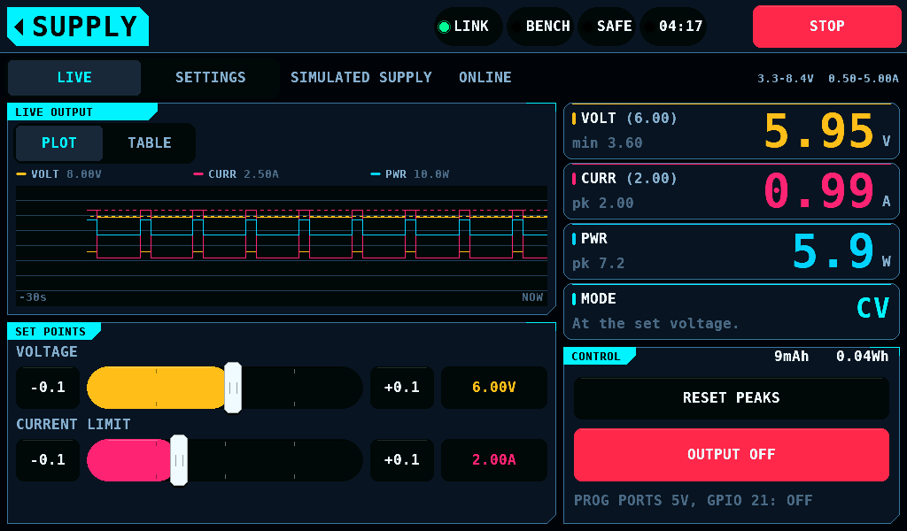
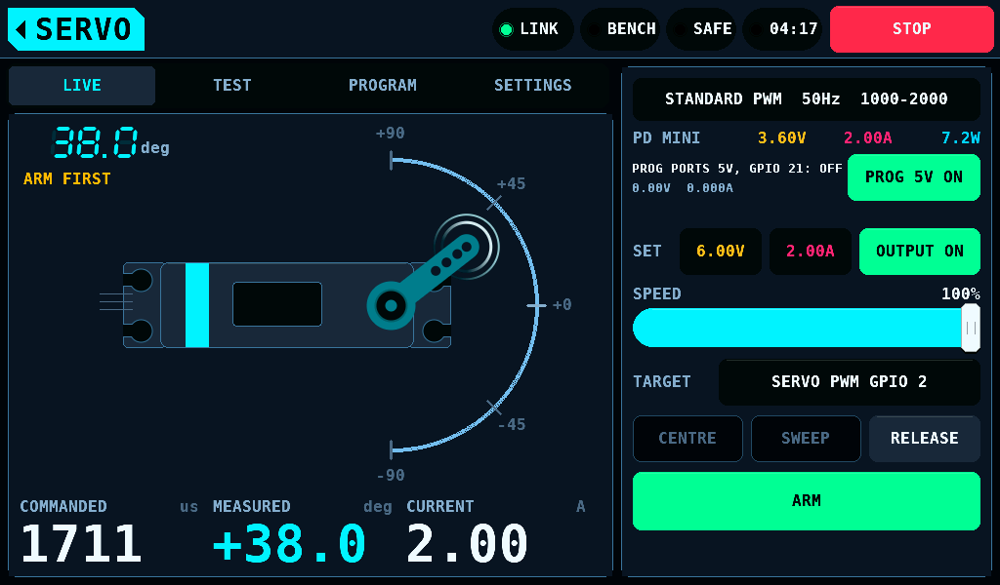
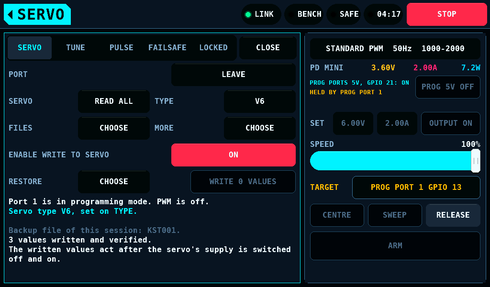
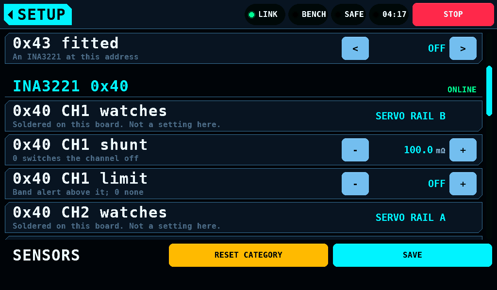
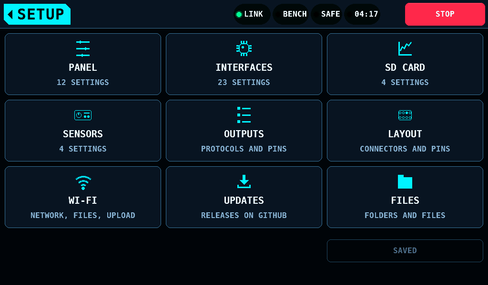
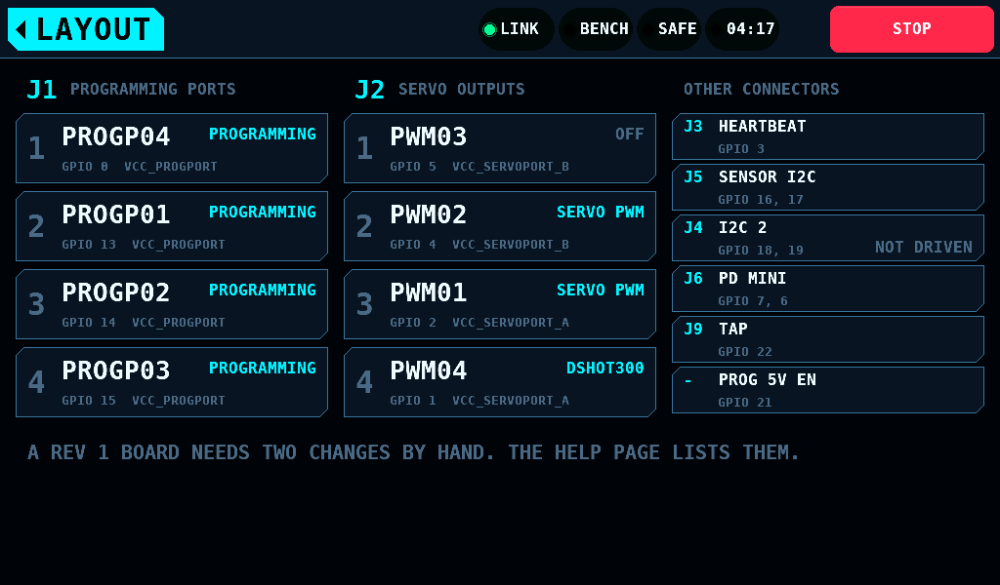

**English** | [Deutsch](Carrier-de.md)

# The rbmod carrier

The rbmod carrier is a board that holds the Waveshare RP2350-CAN module and
wires every lead to a fixed GPIO (general-purpose input/output). It is a
fixed configuration: no pin is chosen on the panel. The IOmcu on the carrier
runs an image of its own, `rcbench-iomcu-rbmod`, and reports board 2 on
IDENTITY register 5 ([Link: Boards with soldered
pins](Link.md#boards-with-soldered-pins)).

## Pins

| Signal | GPIO | Connector |
| --- | --- | --- |
| PROGP01, PROGP02, PROGP03, PROGP04 | 13, 14, 15, 0 | J1 |
| PWM01, PWM02, PWM03, PWM04 | 2, 4, 5, 1 | J2 |
| SDA01 / SCL01, the sensor bus (I2C0) | 16 / 17 | J5 |
| SDA02 / SCL02 (I2C1) | 18 / 19 | J4 |
| PDMINI TX / RX | 7 / 6 | J6 |
| TAP | 22 | J9 |
| PROGP_5V_EN, the enable of the programming ports' 5V | 21 | none |
| HEARTBEAT | 3 | J3 |
| CAN (Controller Area Network) | 8 to 12 | on the module |
| unused, reserved | 20, 26, 27, 28 | none |

GPIO 26 to GPIO 28 are ADC (analog-to-digital converter) pins and not 5V
tolerant. No servo line is on them.

The second I2C (Inter-Integrated Circuit) bus on J4 is not driven in this
release.

## Connectors J1 and J2

Each position is signal, + and GND. Every signal has a 120Ω series
resistor.

| J1 position | Signal | GPIO | + rail |
| --- | --- | --- | --- |
| 1 | PROGP04 | 0 | VCC_PROGPORT |
| 2 | PROGP01 | 13 | VCC_PROGPORT |
| 3 | PROGP02 | 14 | VCC_PROGPORT |
| 4 | PROGP03 | 15 | VCC_PROGPORT |

| J2 position | Signal | GPIO | + rail |
| --- | --- | --- | --- |
| 1 | PWM03 | 5 | VCC_SERVOPORT_B |
| 2 | PWM02 | 4 | VCC_SERVOPORT_B |
| 3 | PWM01 | 2 | VCC_SERVOPORT_A |
| 4 | PWM04 | 1 | VCC_SERVOPORT_A |

The position order is set for the layout.

PWM02 (GPIO 4) and PWM03 (GPIO 5) are one PWM (pulse-width modulation)
slice and run at one frame rate. PWM04 (GPIO 1) shares slice 0 with
PROGP04 (GPIO 0). A programming port carries no PWM signal on the carrier,
so the shared slice limits nothing.

## Power

| Part | Input | Output | Switched by |
| --- | --- | --- | --- |
| M6, USB-C PD (Power Delivery) trigger | USB-C | the +15V net | its DIP switch sets 5V, 9V, 12V, 15V or 20V |
| M7, buck | the +15V net | 5V, VCC_PROGPORT_DCDC: the programming ports on J1 | EN on GPIO 21, with a pull-down on EN |
| M8, buck | the +15V net | +5V: the module's VBUS and J7 | always on |
| PD mini, on J8 | its own input | VCC_PDMINI: the servo rails A and B on J2 | the SUPPLY page |

The programming ports run from M7's fixed 5V, not from the PD mini. A KST
or Hitec session leaves the PD mini to the operator: SUPPLY and the SERVO
screen's SET row take OUTPUT ON and set points through a session, which on
other boards they refuse. KST and
Chaservo servos program at 5V. On the carrier the programmers do not set the
programming ports' voltage: their MORE list reads
`PROGRAMMING VOLTAGE: 5V FIXED, GPIO 21` and offers no voltage or current.

The KST and Hitec programmers switch GPIO 21 on and off for a session,
through the PROG_SUPPLY page (link 4.32). The PROG 5V box on SERVO's
output card and on SUPPLY's LIVE task switches it by hand: PROG 5V ON is a
2s hold, PROG 5V OFF a tap, taken with the bench SAFE or ARMED, as the PD
mini's OUTPUT ON is. The box names the pin, `PROG PORTS 5V, GPIO 21: OFF`,
and shows the last 50ms window of 0x40 CH3, `5.02V  0.120A`
([The current monitor](#the-current-monitor)). While a programmer's
session holds the 5V the box takes no press and reads
`HELD BY PROG PORT n`. SUPPLY also shows the state under OUTPUT:
`PROG PORTS 5V, GPIO 21: ON` or `OFF`.
Every error, a lost heartbeat and a silent link switch it off; a write to
the servo's memory keeps it on until the write ends, 10000ms at most
([Safety, The carrier's programming-port 5V](Safety.md#the-carriers-programming-port-5v)).

The IOmcu drives GPIO 21 low from the first statement of `main()`. While
the IOmcu does not drive GPIO 21 (in reset, in BOOTSEL, unpowered), the
pull-down on EN holds M7 off.

| An ON that does not take | Alert |
| --- | --- |
| no live heartbeat (NOT_ARMED) | `PROG ports 5V not switched on: the IOmcu has no heartbeat.` |
| a port holds the 5V (BAD_VALUE) | `PROG ports 5V not switched on: a programming port holds it.` |
| no answer; the OFF follows | `PROG ports 5V ON not answered. Check the link.` |
| taken across lost touch events; the bench goes SAFE | `Touch signal lost while switching on. PROG ports 5V off.` |
| a press while a port holds the 5V or the page reads NOT READ | `PROG ports 5V: held by a programming port, or not read.` |

### The PROG 5V box

The PROG 5V box on SERVO and SUPPLY switches the 5V by hand: PROG 5V ON is
a 2s hold, PROG 5V OFF a tap. The panel judges the ON as it judges the PD
mini's OUTPUT ON:

- It is taken with the bench SAFE or ARMED; no switch to ARMED is asked.
- It is dropped when a STOP, an OFF or a touch loss came after the hold
  completed, and while a port holds the 5V.
- It is written once as OUTPUT 1 and not repeated. The IOmcu refuses it
  without a live heartbeat (NOT_ARMED) and while a port holds the 5V
  (BAD_VALUE); each, and no answer, gets an alert
  (the table above). An ON without an answer owes an
  OFF: the IOmcu may have taken it and lost its reply.
- An ON taken across lost touch events is an error: SAFE, the 5V off.
- An error, PROG 5V OFF and leaving the screen whose box switched it on
  write OFF, the last also while the ON is still on its way. An error
  drops an ON not yet written. The OFF is a flag beside its queue entry,
  as the PD mini's OUTPUT OFF is, so a full queue does not drop it.
- While a port holds the 5V the box takes no press.

## The current monitor

An INA3221 (M5) on the sensor bus at address 0x40 watches the three
supplies. Its VS is +3.3V, and the carrier ties its VPU to VCC. The module's I2C
pull-ups hang on VPU, so they are bus 1's pull-ups: the firmware runs bus 1
(GPIO 16 SDA, GPIO 17 SCL) with the RP2350's pad pulls off.

| Channel | From | To |
| --- | --- | --- |
| CH1 | VCC_PDMINI | VCC_SERVOPORT_B, J2 positions 1 and 2 |
| CH2 | VCC_PDMINI | VCC_SERVOPORT_A, J2 positions 3 and 4 |
| CH3 | VCC_PROGPORT_DCDC (M7) | VCC_PROGPORT, J1 |

The part and its channels are fixed. The IOmcu keeps the part fitted and
each channel on its rail on the SENSE_MAP page and refuses a map that moves
either ([Link, Boards with soldered pins](Link.md#boards-with-soldered-pins)).
SETUP > SENSORS shows the rows without keys:

| Row | Reads |
| --- | --- |
| 0x40 fitted | ON |
| 0x40 CH1 watches | SERVO RAIL B (PWM03, PWM02) |
| 0x40 CH2 watches | SERVO RAIL A (PWM01, PWM04) |
| 0x40 CH3 watches | PROG PORTS 5V (PROGP01 to PROGP04) |

- The shunts and the limits are settings, as on any bench: shunt OFF or
  5.0 to 1000.0mΩ, 100.0mΩ by default; limit OFF or 10 to 32767mA
  ([Screens: SENSORS](Screens.md#sensors-the-ina3221-parts)). The shunt
  value of M5 on the carrier is not stated here; 100.0mΩ is the DAOKAI
  module's.
- 0x41 to 0x43 are free for parts on J5.
- The channel read at 1kHz, which the servo test and the SERVO screen
  read, is the rail of the lowest GPIO the servo tester drives as SERVO
  PWM: CH2 for GPIO 1 or GPIO 2, CH1 for GPIO 4 or GPIO 5. With SERVO PWM
  on both rails it reads only the rail of the lowest GPIO. With a
  programming port as the tester's target it is CH3.
- SERVO and the limit run name the meter by its rail: `INA RAIL A` over
  the plot, `INA3221 RAIL A` on the TEST card. The band names the rail of
  a channel over its limit:
  `INA3221 0x40 CH2 (SERVO RAIL A) over its 0.80A limit.`. Each
  programming port's WATCHED BY line names CH3, `INA3221 PROG 5V`. The run
  log's columns are `rail b`, `rail a` and `prog 5v`.
- An IOmcu image older than protocol 4.33 refuses the carrier's map: 0x40
  reads `NOT ACCEPTED BY THE IOMCU` until the IOmcu runs the panel's
  image.

## The image

| Build | Files | Release asset |
| --- | --- | --- |
| `cmake -S firmware/iomcu -B firmware/iomcu/build-rbmod -DIOMCU_BOARD=rbmod` | `rcbench-iomcu-rbmod-install.uf2`, `rcbench-iomcu-rbmod.uf2`, `rcbench-iomcu-rbmod-pt.uf2`, `rcbench-iomcu-rbmod.bin`, `rcbench-iomcu-rbmod.elf` | `rcbench-iomcu-rbmod-vX.Y.Z.zip` |

The first load is the install UF2 (USB Flashing Format) over USB, as in
[First run](FirstRun.md#from-the-release-assets). After that the panel
offers each IOmcu the image of the board it reports.

## On the panel

The panel reads board 2 from the IOmcu and shows the carrier's pins as
fixed:

- SETUP > OUTPUTS shows PWM01 to PWM04 as the four cells of the grid. A
  surface and a throttle protocol on PWM02 and PWM03 together are refused
  by name. The PROG PORT entries name PROGP01 to PROGP04 and their GPIO,
  offer no pin and no function, and show no tester
  ([Screens: On the rbmod carrier](Screens.md#on-the-rbmod-carrier)).
- SETUP > INTERFACES shows Sensor SDA and SCL, Tap pin and PD mini TX and
  RX at the carrier's pins, with no keys and no keypad.
- SETUP > SENSORS shows 0x40 fitted and its three channels on the rails,
  with no keys ([The current monitor](#the-current-monitor)).
- The PICK A PIN tile opens LAYOUT: J1 and J2 in their position order
  with each position's role, GPIO, net on its + and the protocol bound
  on it, and the other connectors
  ([Screens: Layout](Screens.md#layout)).

## Rev 1 rework

Every rev 1 board needs two changes by hand. The carrier's image assumes
both are done. A rev 2 board carries the two changes in copper.

| # | Change | Reason | The firmware relies on it |
| --- | --- | --- | --- |
| 1 | PROGP03 (J1 position 4, through R4) moves from GPIO 26 to GPIO 15: the trace is cut under the series resistor R4, and a bodge wire runs from R4 to GPIO 15. | GPIO 26 is an ADC pin and not 5V tolerant. A Hitec or KST pull-up puts the servo supply on the programming line. | PROG PORT 3 is GPIO 15 on every carrier. GPIO 26 stays unused. |
| 2 | A pull-down of 2kΩ to 5kΩ from M7's EN (the GPIO 21 net) to GND. | The buck module's EN reads open as on. Without the pull-down the programming ports' 5V is on while the IOmcu is in reset, in BOOTSEL or unpowered. | The programming ports' supply is off whenever GPIO 21 is not driven high. |
