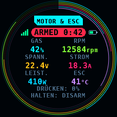
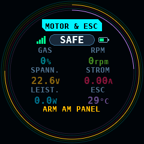
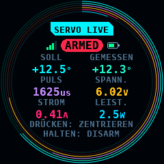
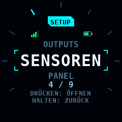
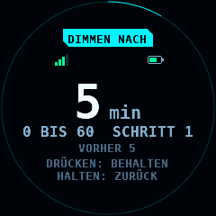
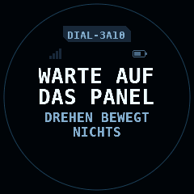
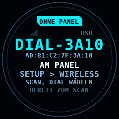
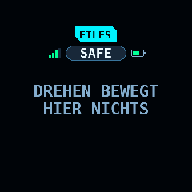

# Das M5Stack Dial

<sub>[English](Dial.md) · **Deutsch**</sub>

Das M5Stack Dial v1.1 ist ein runder Drehknopf mit einem Display von
240 x 240 Pixeln. In rcbench ist es ein kabelloser Knopf für das Panel über
Bluetooth LE (Low Energy, BLE). Sein Display zeigt, worauf der Knopf wirkt.
Diese Seite beschreibt seine Firmware (`firmware/dial`) und das Protokoll
zwischen ihm und dem Panel (`protocols/dialknob`).

Was es gibt: das Protokollmodul mit seinen Host-Tests und die Firmware des
Dial: die Selbsthaltung, den Encoder, die Tasten, das Touch-Glas, den Klick
pro Rastung, die Faces auf dem Display, das BLE-Peripheral mit seinem
gebundenen Panel und die USB-Konsole; und die Seite des Panels: SETUP >
WIRELESS > DIAL, Suche und Bindung, der Link mit seiner Verlustregel, die
Drehung auf MOTOR & ESC und SERVO LIVE, die Bildschirmtaste, die Navigation
der Menüs und Listen des Panels mit SET eines Werts und der Strom des
Panel-Bildschirms zum Dial ([Das Panel](#das-panel)). Die Bildschirme der
Programmer (KST, Hitec, ESC), das BLE-Update und das Pairing folgen in
späteren Schritten.

M5Stack, Dial und Stamp-S3A sind Namen ihres Inhabers und seiner Produkte,
Bluetooth ist eine Marke ihres Inhabers. rcbench ist unabhängig: Es ist
nicht mit ihnen verbunden, nicht von ihnen empfohlen und nicht von ihnen
gefördert. Die Namen sagen, mit welchem Gerät das Panel spricht.
[Rechtliche Hinweise und Haftungsausschluss](../README-de.md#rechtliche-hinweise-und-haftungsausschluss)
enthält den Hinweis des Projekts.

## Das Gerät

| Teil | Was es ist | Pins |
| --- | --- | --- |
| Modul | Stamp-S3A, das Modul des Dial: ESP32-S3FN8, 8MB Flash im Gehäuse, kein PSRAM (Pseudo-Static RAM) | |
| Display | GC9A01, 1,28 Zoll, 240 x 240, SPI (Serial Peripheral Interface) mit 40MHz | DC GPIO4, MOSI GPIO5, SCLK GPIO6, CS GPIO7, Reset GPIO8, Hintergrundlicht GPIO9 |
| Touch | FT3267 an I2C-Adresse 0x38, 400kHz, alle 20ms abgefragt | SDA GPIO11, SCL GPIO12, Interrupt GPIO14 (nicht benutzt) |
| Encoder | 16 Rastungen pro Umdrehung, 4 Quadratur-Zählschritte pro Rastung, am PCNT (dem Pulszähler) | A GPIO41, B GPIO40 |
| Bildschirmtaste | unter dem Glas, alle 5ms abgefragt, 20ms entprellt | GPIO42 |
| Stamp-Taste | die Taste des Moduls; beim Reset gehalten startet sie den ROM-Download-Modus | GPIO0 |
| Summer | ein Klick von 3ms mit 4.000Hz pro Rastung | GPIO3 |
| Selbsthaltung | high hält das Dial an, nachdem WAKE losgelassen ist | GPIO46 |
| Testmarke | 1ms high pro eingespeister Rastung, nur im Test-Build | GPIO1 (PORT.B G1) |
| Akku | eine LiPo-Zelle mit 1.000mAh oder weniger an der MX1.25-Buchse, auf der Platine geladen | der Messpin ist unbekannt |

Die Zelle bleibt bei 1.000mAh oder weniger, bis der Ladestrom gemessen ist:
Der Lader (TP4057 im Text des Schaltplans) und sein Strom sind nicht
bestätigt.

## Sicherheit

Das Dial ist kein Sicherheitsgerät. Diese Regeln gehören dem Panel, und
das Panel wendet sie an ([Das Panel](#das-panel)):

- Ein Ereignis des Dial schaltet nie Spannung oder Leistung ein. ARM,
  SUPPLY ON, PROG 5V und WRITE bleiben die 2s-Holds des Panels. STOP gibt es
  nur am Panel.
- Der Link ist relativ: Jedes EVENT trägt den Rastungszähler des Dial, nie
  einen Wert. Das erste Paket nach einem Connect, ein Paket mehr als 300ms
  nach dem vorigen und ein Sprung um mehr als 16 Rastungen bewegen nichts.
- Ein Dial, das im Zustand ARMED verloren geht, ist ein Fehler: 1.000ms ohne
  Paket oder der Disconnect schalten den Prüfstand SAFE und alle Ausgänge
  ab. 500ms ohne Paket sind DEGRADED, ein Hinweis. Eine Verbindung, die noch
  kein EVENT gesendet hat, während das Panel den Dienst sucht, ist kein
  Verlust.
- Der Verlust gilt in beide Richtungen. Bleiben die Pakete des Panels aus,
  zeigt das Dial nach 500ms LINK VERLOREN und sendet ab dann kein EVENT
  mehr. Das Panel sieht LOST 1.000ms nach dem letzten EVENT, und ein
  Prüfstand im Zustand ARMED geht auf SAFE. Nach weiteren 500ms beendet das
  Dial den Link und sendet nichts mehr, bis es wieder verbunden ist und das
  erste Paket des Panels kam.
- Die Bildschirmtaste im Zustand ARMED: Ein Tippen setzt das Gas auf MOTOR
  auf 0% und auf SERVO auf CENTER; ein Halten von 1s macht DISARM.
- Kein BLE-Scan im Zustand ARMED: Die Funkzeit eines Scans würde dem Link
  fehlen, der den Knopf trägt.
- Navigation nur bei SAFE: Ein SELECT ist ein Tippen von einem Frame, es
  vollendet also kein 2s-Halten, und bei ARMED bewegt das Dial keinen Fokus
  weg von dem Ausgang, den es treibt
  ([Navigation und SET](#navigation-und-set)).

Die Regeln des Links und ihre Zeiten stehen im Protokollmodul, jede mit
einem Host-Test
([protocols/dialknob](https://github.com/subtilitas/rcbench/blob/main/protocols/dialknob/README.md)).

## Flashen über USB

Das Release enthält `rcbench-dial-merged-<version>.bin` für Offset 0x0 und
`rcbench-dial-<version>.bin`, die Anwendung allein, mit ihren
SHA-256-Summen in `SHA256SUMS`.

1. Das Image prüfen: `sha256sum -c SHA256SUMS --ignore-missing` im Ordner
   mit dem Image und `SHA256SUMS`.
2. Die USB-C-Buchse des Dial mit dem Rechner verbinden. Ein Dial, auf dem
   diese Firmware läuft, setzt esptool über den USB-Serial/JTAG-Port in den
   ROM-Download-Modus. Eines, auf dem sie nicht läuft: die Stamp-Taste
   (GPIO0) beim Einstecken des Kabels halten.
3. Flashen:

   ```bash
   python -m esptool --chip esp32s3 -p /dev/ttyACM0 -b 460800 \
     write-flash 0x0 rcbench-dial-merged-0.23.12.bin
   ```

   esptool 5 schreibt den Befehl `write-flash`, esptool 4 `write_flash`.
4. Das Dial startet neu und zeigt `NICHT GEBUNDEN` und seinen Namen, `DIAL-`
   und die letzten 4 Hex-Ziffern seiner Adresse.

Das zusammengeführte Image schreibt die Partitionstabelle, also wird der
NVS (Non-Volatile Storage) bei 0x9000 neu geschrieben, und das gebundene
Panel ist vergessen.

Aus den Quellen, mit ESP-IDF (Espressif Internet-of-Things Development
Framework) v6.1:

```bash
cd firmware/dial
idf.py -B build -D SDKCONFIG=build/sdkconfig build
idf.py -B build -p /dev/ttyACM0 flash monitor
# der Test-Build mit den Hooks der Konsole
idf.py -B build-hooks -D SDKCONFIG=build-hooks/sdkconfig -D RCBENCH_DIAL_HOOKS=ON build
```

Die Partitionstabelle (`firmware/dial/partitions.csv`) enthält den NVS, zwei
Anwendungsslots von 3.072kB und ihre otadata. Das veröffentlichte Image hat
817.280 Bytes, 26,0% eines Slots; die sieben Fonts der Faces sind 243.194
Bytes davon und die Ring-Tabellen 25.032. Sein statischer RAM: 212.822 von
341.760 Bytes internem DRAM und IRAM, darunter der Frame von 115.200 Bytes.
Den Heap, den NimBLE zur Laufzeit nimmt, hat niemand gemessen; das Log beim
Start und `status` nennen den freien internen Heap und seinen Tiefstwert
seit dem Start.

## Binden

Das Dial sendet im Advertising die UUID (Universally Unique Identifier) des
dialknob-Dienstes und seinen Namen in der Scan Response. Ungebunden sendet
es alle 100ms, und jedes Central darf sich verbinden. Das erste Central, das
EVENT abonniert, ist sein gebundenes Panel: Das Dial behält die Adresse des
Panels im NVS, nimmt ab dann über die Accept List des BLE-Controllers nur
noch eine Verbindung von dieser Adresse an und sendet alle 500ms. Ein Scan
listet ein gebundenes Dial weiterhin.

Ein Halten der Bildschirmtaste von 10s vergisst das gebundene Panel, ebenso
`forget` auf der Konsole. Das Dial piept, beendet einen Link und sendet
wieder für jeden. Die HOLD-Geste nach 1s geht dabei an das Panel.

Protokollversion 1 hat kein Pairing und keine Verschlüsselung: Ein Gerät in
Reichweite, das sich zuerst verbindet oder die gebundene Adresse fälscht,
wird angenommen.

## Das Panel

SETUP > WIRELESS > DIAL enthält die Zeilen des Dial
([Bildschirme](Screens-de.md#wireless-die-imu-und-das-dial)): Dial EIN oder AUS
(ab Werk AUS), DIAL SUCHEN, GEBUNDENES DIAL und die Schritte einer Rastung,
0.5%, 1%, 2% oder 5% Gas (ab Werk 1%) und 0.5°, 1°, 2° oder 5° Hornwinkel (ab
Werk 1°). Das erste Dial EIN startet Bluetooth LE auf dem ESP32-C6 des
Boards, wie das erste IMU EIN; es läuft bis zum Neustart des Panels. Das
Dial und die IMU sind zwei Clients der Bluetooth-LE-Central des Panels, mit
einem Connect oder Scan zur Zeit zwischen ihnen.

### Suchen und Binden

DIAL SUCHEN sucht 10.000ms und listet bis zu 8 Geräte, die den
dialknob-Dienst senden, das stärkste zuerst, mit Namen und RSSI. Ist der
Prüfstand ARMED oder wartet ein Arm, wird die Suche abgelehnt, und das Band
zeigt `KEINE DIAL-SUCHE BEI ARMED: ERST AUF SAFE SCHALTEN`; bevor Bluetooth LE
läuft, zeigt es `BLUETOOTH NICHT BEREIT: KEINE DIAL-SUCHE`. Eine bei SAFE
gestartete Suche endet beim Schalten auf ARMED, und DIAL SUCHEN zeigt
`DURCH ARM BEENDET`. Ein Tippen auf ein gefundenes Dial bindet es: Das Panel behält Adresse und Namen in SETUP
(`dial_ble`, `dial_name`) und fragt nach dem Speichern. Es ist immer ein
Dial gebunden oder keins. Das Panel verbindet sich über die Adresse mit ihm,
ohne Suche, bei Dial EIN, beim Start und nach jedem Verlust.

### Der Link

Der Connect fragt nach einem Intervall von 30 bis 50ms, Latenz 0 und einem
Supervision Timeout von 4.000ms, den Werten der IMU. Nach dem Connect sucht
das Panel den Dienst, abonniert EVENT und liest INFO. Ein gebundenes Gerät
ohne den Dienst zeigt `GEBUNDEN: KEIN DIAL` und wird nicht genommen. Ein
Dial, dessen INFO eine andere Protokollversion als 1 nennt, zeigt
`ANDERES PROTOKOLL n`; seine EVENTs werden gezählt und verworfen. Bis INFO
gelesen ist, werden EVENTs ebenfalls verworfen. Ein INFO, das sich nicht
lesen oder dekodieren lässt, ist ein fehlgeschlagener GATT-Schritt: Der
Link endet, und das Panel verbindet sich nach 1.000ms erneut. Rastungen und
PRESS erreichen den Bildschirm nur, solange der Link `VERBUNDEN` oder
`GESTÖRT` ist; ein HOLD, der nur entschärft, in jedem Zustand.

Die Verlustregel läuft auf der eigenen Uhr des Panels, nicht auf dem
Supervision Timeout:

| Zeit ohne EVENT | Zustand | Bei SAFE | Bei ARMED oder wartendem Arm |
| --- | --- | --- | --- |
| 0 bis 499ms | `VERBUNDEN` | | |
| 500 bis 999ms | `GESTÖRT` | Band: `DIAL: 500ms KEIN EREIGNIS` | Band: `DIAL: 500ms KEIN EREIGNIS` |
| 1.000ms, oder der Disconnect | `DIAL VERLOREN` | Band: `DIAL VERLOREN` | ein Fehler: SAFE, alle Ausgänge aus, Band: `DIAL BEI ARMED VERLOREN: AUF SAFE GESCHALTET, ALLE AUSGÄNGE AUS` |

Die Uhr startet mit dem ersten EVENT einer Verbindung; eine Verbindung,
die noch keins gesendet hat, während das Panel den Dienst sucht, ist also
kein Verlust. Jeder Verlust ist ein Fehler. Dial AUS in SETUP beendet den
Link ohne Fehler.

### Der Knopf und die Taste

Eine Rastung am Dial nimmt den Weg des eigenen Knopfs des Panels, mit
denselben Regeln: relativ, durch denselben Drehungs-Tracker, nichts bewegt
sich, solange der Prüfstand SAFE ist, und Drehungen bei SAFE werden nicht
für das ARM aufgehoben. Auf MOTOR & ESC verstellt eine Rastung das Gas um
den Gas-Schritt, auf SERVO LIVE das Horn um den Servo-Schritt. Die
Bildschirme aus [Navigation und SET](#navigation-und-set) nehmen die Drehung
als Schritt des Fokus; alle anderen nehmen keine an.

| Geste | MOTOR & ESC, ARMED | SERVO LIVE, ARMED | SAFE, oder ein anderer Bildschirm |
| --- | --- | --- | --- |
| PRESS: Bildschirmtaste vor 1.000ms losgelassen | Gas 0% | CENTER | nichts |
| HOLD: Bildschirmtaste 1.000ms gedrückt | DISARM | DISARM; eine laufende Folge ARM + START endet mit allen Ausgängen aus, auch vor ARMED | nichts; BACK auf einem Bildschirm, den das Dial navigiert |

Auf MOTOR & ESC schaltet ein HOLD auch DISARM, solange ein ARM unterwegs
ist, angefragt und noch nicht bestätigt, und beendet einen ESC-STICK-Lauf
wie ABORT, auch in ARMING: Nach einem HOLD wird der Prüfstand nie scharf.
Ein PRESS zählt nur in einem Frame mit einer Drehung oder einem Druck, den
das Panel nimmt; ein HOLD immer. Ein Frame ohne Eingabe lässt eine offene
Hilfeblase offen. Die gehaltenen Zustände von Taste und Touch im EVENT werden nie als
Druck oder Berührung gelesen, eine am Dial gehaltene Taste ist also kein
Halten am Panel: ARM und jedes andere 2s-Halten bleiben beim Panel.

### Navigation und SET

Solange das Dial verbunden und der Prüfstand SAFE ist, navigiert es diese
Bildschirme:

| Bildschirm | Einträge, in Drehrichtung |
| --- | --- |
| das Menü | seine 8 Kacheln, Zeile für Zeile |
| die Kacheln von SETUP | die Kacheln, dann SAVE, solange Speichern angeboten ist |
| eine Liste von SETUP | ihre Zeilen, dann RESET und SAVE; auf SENSORS und WIRELESS zuerst die Einträge links |
| SERVO | die 8 Kacheln, dann SETTINGS; die offene SETTINGS-Liste wie eine Liste von SETUP |
| OUTPUTS, Platinenansicht | das Feld der Protokollliste, CLEAR ALL, solange angeboten, dann je eine Pin-Taste |
| eine offene Auswahlliste | ihre Zeilen, der Fokus auf der gültigen |
| die Warnung beim Verlassen | STAY, DISCARD, SAVE |

| Geste | Navigation | SET |
| --- | --- | --- |
| Drehen | der Fokus geht eine Rastung einen Eintrag weiter und läuft an beiden Enden um; eine Zeile außer Sicht rollt herein | der Wert geht eine Rastung einen Schritt, innerhalb seines Bereichs |
| PRESS | SELECT: ein Tippen auf den Eintrag im Fokus | KEEP |
| HOLD | BACK: was das Home-Tag tut, eine Auswahlliste oder das Ziffernfeld schließt | CANCEL: der Wert wie vorher |

Das Panel zeichnet einen 2px-Rahmen in der Akzentfarbe um den Eintrag im
Fokus. Der Rahmen hebt die Pixel darunter je Framebuffer auf und setzt sie
zurück, wenn er weiterzieht: Eine Rastung zeichnet die zwei Rahmen neu,
nie den Bildschirm. Kein Rahmen erscheint und das Dial nimmt nicht am
Bildschirm teil, solange das Dial OFF oder nicht verbunden ist, der
Prüfstand ARMED ist, die Bildschirmhilfe oder das Screenshot-Popup offen
ist oder die Texttastatur offen ist.

Ein SELECT ist ein Tippen: ein DOWN und ein UP in der Mitte des Eintrags im
selben Frame. Die Zeile im Fokus rollt zuerst ins Bild, auch wenn ein Finger
die Liste seitdem gerollt hat; ein Punkt neben dem Eintrag oder außer Sicht
wird nie getippt, und der Druck tut dann nichts. Ein 2s-Halten am Panel braucht den Kontakt 2s lang über
Frames, also wird vom Dial aus kein Halten vollendet: ARM, Spannung EIN,
WRITE n VALUES und das Löschen bleiben beim Panel. Ein SELECT auf eine
Halte-Taste wie CLEAR ALL auf OUTPUTS zeigt den Hinweis, den das Panel bei
jedem Tippen zeigt. Auf den Kacheln von SERVO beendet ein HOLD zuerst eine
laufende Folge ARM + START, wie auf jedem SERVO-Bildschirm; BACK folgt nur,
wo es nichts gestoppt hat.

SET:

- eine Zahl, die das Ziffernfeld nimmt: SELECT tippt ihren Wert, und das
  Ziffernfeld öffnet sich. Die Drehung schreibt den Wert in die Eingabe, um
  den Schritt der Einstellung und innerhalb ihres Bereichs; eine Drehung an
  einem Ende bleibt dort stehen. Eine Einstellung mit einer AUS-Lücke (etwa
  ein INA3221-Shunt, AUS oder 5.0 bis 1000.0mΩ) nimmt eine Rastung von AUS
  zu ihrem kleinsten Wert und eine zurück, wie viele Rastungen ein Frame
  auch bringt. PRESS ist das OK des Ziffernfelds, mit
  seinen Prüfungen; HOLD ist CANCEL.
- ein Ein/Aus oder eine Liste von Optionen: SELECT startet SET auf der
  Zeile. Jede Rastung tippt ihre Taste `-` oder `+`, höchstens 16 je Frame;
  Ein/Aus und Optionslisten laufen um wie ihre Tasten; das VALUE-Face zeigt
  die Stelle einer Optionsliste von 0 bis zu ihrer letzten Option. PRESS behält den
  Wert; HOLD tippt die andere Taste so oft, wie ein Tippen den Wert geändert
  hat.

Dimmen nach: Eine Drehung, ein PRESS oder ein HOLD des Dial weckt ein
gedimmtes Panel und startet seine Minuten neu, wie eine Berührung. Auf
einem gedimmten Panel mit ruhendem Prüfstand tut die Eingabe, die es
geweckt hat, sonst nichts: Sie öffnet, bewegt und stellt nichts ein. Auf
einem Prüfstand, der nicht ruht, wirkt sie sofort; ein PRESS für 0% oder
CENTER auf einem ARMED-Prüfstand wird also nie verschluckt, und ein HOLD
auf MOTOR & ESC oder einem SERVO-Bildschirm wirkt immer.

Das Dial zeigt das NAV-Face, solange es den Fokus bewegt, mit dem Namen des
Bildschirms, dem Eintrag im Fokus zwischen den Einträgen davor und danach
und seiner Stelle in der Liste. In SET zeigt es das VALUE-Face mit dem
Namen der Einstellung als Titel. Auf dem Menü bleibt das Face HOME und
zeichnet die Kacheln als Liste.

### Der Strom

Das Panel schreibt seinen Bildschirm in Panel-Paketen zum Dial, eines zur
Zeit:

| Paket | Wann |
| --- | --- |
| SCREEN | Face, Titel, Sprache oder Flags geändert, oder 5.000ms nach dem letzten |
| VALUE_META, VALUE | auf MOTOR & ESC und SERVO LIVE und in SET, wenn sich Bereich, Schritt oder Wert ändern |
| NAV | solange das Dial navigiert: wenn sich der Eintrag im Fokus, der davor oder danach oder die Liste ändert; eine Zeile je Paket |
| SCALE | auf MOTOR & ESC und SERVO LIVE: beim Betreten und bei jedem Connect, dann wenn sich ein Vollausschlag ändert, höchstens alle 200ms |
| LIVE_MOTOR, LIVE_SERVO | auf MOTOR & ESC und SERVO LIVE, alle 50ms (20Hz) |
| STATE | ARMED, DEGRADED oder ein Schritt geändert, 200ms ohne Paket, oder 1.000ms nach dem letzten STATE |

Jeder Connect sendet das ganze Modell erneut, SCREEN zuerst. Die Faces sind
MOTOR, SERVO, HOME (das Menü), NAV und VALUE
([Navigation und SET](#navigation-und-set)); jeder andere Bildschirm sendet
seinen Titel und den Zustand des Prüfstands. SCREEN trägt das Flag
NAVIGATES, solange das Dial navigiert. LIVE_MOTOR trägt das Gas und die
Messwerte, die der Prüfstand meldet: Spannung, Strom, Leistung, Drehzahl,
die Temperatur von ESC und Motor. LIVE_SERVO trägt den Puls, den
befohlenen Winkel, den gemessenen Winkel, wenn die Winkelquelle einen
meldet, und Spannung und Strom der Servoschiene aus dem Kanal des Servos.

SCALE gibt den Ringen des Dial ihre Vollausschläge; 0 ist unbekannt, und
dieser Ring zeigt nur seine Spur:

| Vollausschlag | Quelle |
| --- | --- |
| Drehzahl | die Spitze des Laufs; vor der ersten Spitze der RPM-Vollausschlag des MOTOR-Plots |
| Spannung | Spannung max von SUPPLY, solange der Ausgang von SUPPLY an ist; sonst der VOLT-Vollausschlag des MOTOR-Plots |
| Strom | Überstrom von SUPPLY, solange der Ausgang von SUPPLY an ist und die Auslösung gesetzt ist; sonst der CURR-Vollausschlag des MOTOR-Plots |
| Servoweg, Pulsenden | WEG, PULS MIN und PULS MAX des Servoprofils |
| Spannung, Strom der Servoschiene | Spannung max und Überstrom von SUPPLY, solange der Ausgang von SUPPLY an ist; sonst 0 |

### Die Konsole

Das Log des Panels nennt das Dial mit dem Tag `dial`:

```text
I (…) dial: Dial ON: starting Bluetooth LE
I (…) dial: scan for 10000ms
W (…) dial: scan refused: the bench is ARMED (1 refused)
I (…) dial: bound A0:B1:C2:7F:3A:10 R DIAL-3A10
I (…) dial: link 6 -> 10, error 0 code 0x0, protocol 1
I (…) dial: 50 events in 1000ms, 12 detents, rtt 41ms, repeats 0 skipped 0 stale 0 glitches 0, refused 0 unread 0, 20 writes, 0 events dropped
E (…) dial: Dial lost while ARMED: an error, the bench to SAFE (1)
```

Die Link-Zeile nennt die Zustände als Zahl: 0 AUS, 1 STARTET, 2 KEIN
BLUETOOTH, 3 C6 AUSGEFALLEN, 4 KEIN DIAL GEBUNDEN, 5 SUCHE, 6 VERBINDE,
7 KEIN DIAL, 8 WARTET, 9 ANDERES PROTOKOLL, 10 VERBUNDEN, 11 GESTÖRT,
12 VERLOREN. Die Zählerzeile kommt einmal pro Sekunde, solange der Link
steht: EVENTs und Rastungen der Sekunde, die Umlaufzeit von einem STATE
bis zum ersten EVENT, das es zurückgibt (die des Links, plus bis zu 200ms
bis zum nächsten EVENT des Dial), die wiederholten, übersprungenen, veralteten und gesprungenen
Pakete des Drehungs-Trackers, EVENTs, die wegen ihrer Form abgelehnt und
vor INFO verworfen wurden, geschriebene Panel-Pakete und Ereignisse, die
die Bluetooth-LE-Queue verworfen hat.

## Die Faces

Das Display zeigt, worauf der Knopf wirkt. `shared/dial` zeichnet jedes Face
aus den Paketen des Panels (SCREEN, NAV, VALUE_META, VALUE, LIVE_MOTOR,
LIVE_SERVO, STATE und SCALE) und aus dem eigenen Zustand des Dial: gebunden
oder nicht, der Link, sein RSSI und seine Versorgung. Es zeichnet mit dem
Rasterizer des Panels (`shared/gfx`), den Fonts des Panels und der dunklen
Palette aus `shared/ui/ui_theme.c` in einen RGB565-Frame von 240 x 240
Pixeln. Die Bilder auf dieser Seite sind das Rendering dieses Codes auf
einem Rechner, aus den festen Modellen in `test/host/dial_models.h`;
`tools/render_dial.py --check` hält sie in der CI beim aktuellen Rendering.

Jedes Face hat dieselbe Ausstattung:

| Element | Wo | Was |
| --- | --- | --- |
| Titel-Tag | mittlere Zeile 42, 20px hoch | der Name des Panel-Bildschirms im Font 8x16 auf dem Akzent; gedimmt, solange der Link verloren ist; ein Titel, der über Radius 101 hinausreicht, wird gekürzt |
| Zustandspille | mittlere Zeile 66, 19px hoch | `SAFE`, oder `ARMED` mit der Laufuhr (`0:42`, ab 1h `1h05`) auf MOTOR & ESC; im Font 10x20, im Font 8x16, wenn die Symbole daneben Radius 101 verlassen würden |
| Link-Balken | 6px links der Pille | 4 Balken, 3px breit: 4 ab -60dBm, 3 ab -70dBm, 2 ab -80dBm, darunter 1; gelb, solange das Panel den Link als DEGRADED markiert; keine ohne Verbindung |
| Akku | 6px rechts der Pille | 18 x 9px, gefüllt von 3.300 bis 4.200mV; ein Strich, solange der Messwert unbekannt ist; `USB` an seiner Stelle, solange der Messwert unbekannt ist und ein USB-Host den Port liest, wo die Zeile Platz hat |
| Hinweise | mittlere Zeilen 183 und 197, ab Zeile 176, unter den unteren Zellen | was Drücken und Halten hier tun, im Font 8x16 |

Eine Zeile steht im größten Font ihrer Kette, in dem ihre Tinte auf ihrer
Höhe innerhalb von Radius 100 um die Mitte des Displays liegt, umbrochen auf
die Zeilen, die ihr Block erlaubt. Eine Zeile, die in keinen Font passt,
verliert ihren letzten Teil, Teile stehen zwei Leerzeichen auseinander, bis
der Rest passt; ein Teil mit einer Ziffer fällt ganz weg, so erscheint nie
eine Zahl zum Teil. `test_dial_fit` hält jeden String jedes Face, auf
Englisch und auf Deutsch und mit jedem Feld an seinen Enden, innerhalb von
Radius 100, innerhalb seiner Zelle, innerhalb der Zeilen, die ein
Neuzeichnen für ihn löscht, außerhalb des Löschrechtecks jeder fremden
Zelle und abseits jedes anderen Strings.

### Die Messwerte: MOTOR & ESC und SERVO





Sechs Messwerte in drei Reihen von zwei gleichen Zellen von 78 x 31px, die
Spalten bei x 76 und 164, die Reihen bei y 100, 133 und 166, jede Zelle
innerhalb von Radius 100. Eine Zelle enthält den Namen des Messwerts im Font
8x16, gedimmt, darunter den Wert im Font 10x20 mit seiner Einheit im Font
8x16, beide in der Farbe des Messwerts. Ein Messwert ohne sein Gültig-Bit
zeigt `--`. Solange der Prüfstand SAFE ist, stehen die Werte in halber
Stärke, und die erste Hinweiszeile lautet `ARM AM PANEL` in Gelb.

| Face | Messwerte, in Reihenfolge | Hinweise bei ARMED |
| --- | --- | --- |
| MOTOR & ESC | Gas, Drehzahl, Spannung, Strom, Leistung, ESC-Temperatur | `DRÜCKEN: 0%`, `HALTEN: DISARM` |
| SERVO | Soll-Winkel, gemessener Winkel, Puls, Spannung, Strom und Leistung der Schiene | `DRÜCKEN: MITTE`, `HALTEN: DISARM` |

Um die Zellen läuft je Messwert ein Ring, in der Reihenfolge des Rasters,
der erste außen: Radius 118 nach innen im Abstand von 3px bis 103, 3px
außerhalb des Kreises der Zellen. Ein Ring ist 1px breit und
kantengeglättet: Das Pixel, dessen Mitte im Abstand d von der Mitte des
Displays liegt, nimmt die Farbe des Rings mit der Deckung
clamp(1 - |d - r|, 0, 1). Der Bogen läuft von 12 Uhr im Uhrzeigersinn über
den Anteil des Messwerts an seinem Endwert; der Rest des Kreises ist die
Spur, die Farbe des Messwerts zu 22% auf den Hintergrund gemischt. Die
Endwerte kommen aus dem SCALE-Paket des Panels:

| Messwert | Farbe | Endwert |
| --- | --- | --- |
| Gas | ACCENT | 100% |
| Drehzahl | RPM | SCALE `rpm`: die Spitze des Laufs, sonst der Endwert des Plots |
| Spannung | VOLT | SCALE `mv` |
| Strom | CURR | SCALE `ca`, nach Betrag |
| Leistung | POWER | SCALE `mv` x `ca` |
| ESC-Temperatur | LILAC | 120°C |
| Soll-Winkel | ACCENT | -`travel` bis +`travel`: die Mitte ist ein halber Ring |
| gemessener Winkel | TEAL | -`travel` bis +`travel` |
| Puls | LILAC | `us_min` bis `us_max` |
| Spannung, Strom, Leistung der Schiene | VOLT, CURR, POWER | SCALE `rail_mv`, `rail_ca`, ihr Produkt |

Ein Endwert von 0 oder kein SCALE seit dem Verbinden lässt seinen Ring bei
der Spur; ebenso ein Messwert ohne sein Gültig-Bit.

### Eine Liste und ein Wert




Eine Liste (NAV) zeigt die Zeile vor der fokussierten, die fokussierte Zeile
im Font 20x36 zwischen den Eckklammern des Akzents, die Zeile danach und
`4 / 9`. Bis zu 24 Zeilen erscheinen als Striche am Rand über 270°, der
fokussierte im Akzent; eine längere Liste zeigt ihre Stelle als Ring bei
Radius 112. Hinweise: `DRÜCKEN: ÖFFNEN`, `HALTEN: ZURÜCK`.

Ein Wert (VALUE_META, VALUE) zeigt die Zahl im Ziffern-Font 32x44 mit ihrer
Einheit, den Bereich (`0 BIS 60`), den Schritt und den Wert beim Eintritt
(`SCHRITT 1  VORHER 5`) und einen Ring bei Radius 118 vom Minimum zum
Maximum. Ein Bereich, der zu breit für seine Zeile ist, fällt weg; eine zu
breite Schrittzeile verliert zuerst `VORHER`. Zahl und Bereich werden
gelb, wenn das Panel die letzte Drehung an einer Grenze abgelehnt hat.
Hinweise im SET-Modus: `DRÜCKEN: BEHALTEN`, `HALTEN: ZURÜCK`; davor:
`DRÜCKEN: ÄNDERN`, `HALTEN: ZURÜCK`.

### Der Link und das Binden






500ms ohne Paket vom Panel, nachdem auf dieser Verbindung eines kam, sendet
das Dial kein EVENT und kein Keepalive mehr. Die Uhr des Panels zählt ab dem
letzten EVENT: Das Panel sieht DEGRADED 500ms und LOST 1.000ms nach dem
letzten EVENT und schaltet einen Prüfstand im Zustand ARMED bei LOST auf
SAFE. Ab diesen 500ms zeigt das Face `LINK VERLOREN`,
`KEINE DREHUNG GESENDET`, `PRÜFSTAND WIRD SAFE` und `ARM AM PANEL` in
einem gestrichelten roten Rand, der Titel gedimmt. Das Dial beendet den
Link 500ms später; dann zeigt das Face `LINK VERLOREN`,
`DER PRÜFSTAND IST SAFE`, `ALLE AUSGÄNGE AUS` und `ARM AM PANEL`. Verbunden
ohne Paket vom Panel oder gebunden und nicht verbunden zeigt es
`WARTE AUF DAS PANEL` und `DREHEN BEWEGT NICHTS`, mit dem Namen des Dial auf
dem gedimmten Titel-Tag; bis zum ersten Paket des Panels geht kein EVENT.
Pakete ohne SCREEN zeigen `WARTE AUF DAS PANEL` allein, mit der Pille aus
STATE, wenn STATE kam.
Ohne gebundenes Panel zeigt es `OHNE PANEL`, seinen Namen und seine Adresse,
wo es am Panel gebunden wird (`AM PANEL`, `SETUP > WIRELESS`,
`SCAN, DIAL WÄHLEN`) und `BEREIT ZUM SCAN`. Auf einem Bildschirm, auf dem
der Knopf nichts tut, und auf HOME ohne Listenzeilen zeigt es den Titel,
SAFE oder ARMED und `DREHEN BEWEGT HIER NICHTS`.

Die eigenen Worte der Faces folgen der Sprache des Panels, Englisch oder
Deutsch, aus dem SCREEN-Paket; vor dem ersten SCREEN die letzte Sprache, die
das Panel gab, nach einem Start Englisch. Es sind die Einträge
`UI_DIAL_TEXT` in `shared/text/include/ui_text.def`.

### Was eine Änderung kostet

Die Face-Task zeichnet alle 50ms, was sich seit dem Frame davor geändert
hat: eine Zelle, die Zeile der Pille, den Rumpf einer Liste oder eines
Werts, die Hinweise, und von einem Ring nur die Pixel zwischen seinem alten
und seinem neuen Ende. Jedes Neuzeichnen löscht nur innerhalb von Radius
102, berührt also nie einen Ring, einen Strich oder den Rand; Ringe und
Striche werden auf die Hintergrundfarbe gemalt, ein Neuzeichnen gleicht also
dem ersten. `test_dial_face` hält das Zeichnen der Änderungen über Folgen
jedes Face Pixel für Pixel gleich dem vollen Zeichnen desselben Modells. Ein
Damage-Record sammelt die geschriebenen Rechtecke, höchstens 8, und nur sie
gehen über SPI. Der ganze Frame geht bei einem Wechsel des Face und alle
10.000ms.

| Änderung | Gesendete Pixel | Bei 40MHz (gerechnet, nicht gemessen) |
| --- | ---: | ---: |
| Drehzahl um 300rpm: ihre Zelle und der Bogen ihres Rings | 3.920 | 1,6ms |
| Gas um 1% | 3.968 | 1,6ms |
| Laufuhr um 1s: die Zeile der Pille | 5.696 | 2,3ms |
| fünf Messwerte auf einmal | 19.040 | 7,6ms |
| der Fokus einer Liste um eine Zeile | 23.152 | 9,3ms |
| der ganze Frame | 57.600 | 23,0ms |

Die Ring-Tabellen enthalten jedes Pixel, das ein Ring berührt, nach Winkel
sortiert: 8.344 Pixel für die sechs Ringe, je 3 Bytes, 25.032 Bytes
konstante Daten im Flash. `tools/gen_dial_rings.py` rechnet sie mit der
Arithmetik von `gfx_ring_build()` und schreibt `shared/dial/dial_rings.c`;
CI ruft es mit `--check` auf, und `test_dial_face` hält die Datei Pixel für
Pixel gleich der Ausgabe von `gfx_ring_build()`. Ein volles Neuzeichnen
eines Rings mischt etwa 1.490 Pixel, eine Bewegung um 1% einer Umdrehung bei
Radius 118 etwa 15. Beides ist auf dem Gerät nicht gemessen.

Die Bilder stammen aus der Mathematik-Bibliothek des Rechners. Ring-Tabellen
und Fonts sind auf dem Gerät dieselben Bytes, aber den Endwinkel eines Rings
und den gestrichelten Rand rechnet das Gerät zur Laufzeit mit seiner eigenen
Mathematik-Bibliothek, die anders runden kann: Das Antialiasing auf dem
Gerät kann von den Bildern um eine Deckungsstufe abweichen.

## Die Konsole

Die Konsole ist der USB-Serial/JTAG-Port der USB-C-Buchse, mit dem Prompt
`dial>` und dem Log auf demselben Port.

| Befehl | Was er tut |
| --- | --- |
| `status` | Name, Adresse, Firmware- und Protokollversion, das gebundene Panel, der Link und sein RSSI (Received Signal Strength Indication), die EVENT-Zähler, die Klick-Einstellung, der Akkuwert, der freie interne Heap und sein Tiefstwert seit dem Start |
| `sound on` / `sound off` | der Klick pro Rastung; das SCREEN-Paket des Panels setzt ihn ebenfalls, Standard ON |
| `forget` | das gebundene Panel vergessen, wie das Halten von 10s |
| `help` | die Befehle |

Der Test-Build (`RCBENCH_DIAL_HOOKS=ON`) fügt die Hooks hinzu. Jeder speist
ein, als hätte die Hardware es getan. Das veröffentlichte Image enthält
keinen Code von ihnen; CI schlägt fehl, wenn doch.

| Befehl | Was er tut |
| --- | --- |
| `turn <n>` | n Rastungen, -1.000 bis 1.000, eine alle 20ms, jede in einem eigenen EVENT; GPIO1 (PORT.B G1) geht für 1ms high, wenn dieses EVENT an den BLE-Stack übergeben ist. Ohne Link geht kein EVENT, und GPIO1 bleibt low |
| `press` | eine PRESS-Geste |
| `hold` | eine HOLD-Geste |
| `tap <x> <y>` | ein TAP auf das Glas bei x, y, 0 bis 239 |
| `batt <mV>` | der Akkuwert, den STATUS trägt, 2.000 bis 5.000mV; 0 setzt ihn auf unbekannt zurück |
| `drop` | den Link beenden; das Dial sendet wieder Advertising |
| `ping` | sofort ein EVENT, mit dem Echo der Uhr des letzten STATE |

Die Dokumentation des Dial und M5Unified nennen die zwei Pins von PORT.B in
verschiedener Reihenfolge; GPIO1 ist in beiden Fällen der Pin dieser Nummer.

## Grenzen

- Das Dial navigiert nur die Bildschirme aus
  [Navigation und SET](#navigation-und-set). Auf LOGS, FILES, WI-FI,
  UPDATES, IMU, der Rasteransicht von OUTPUTS, den Programmern (KST, Hitec,
  ESC) und den eigenen Listen und Reitern der Prüfstandsbildschirme bewegt
  es keinen Fokus; ein HOLD tut dort auf einem SAFE-Prüfstand nichts.
- Eine Liste nimmt den Fokus für 64 Einträge, RESET und SAVE darunter; die
  letzten Zeilen einer längeren Liste erreicht das Dial nicht.
- Ein Pixel, das der Bildschirm unter dem Rahmen genau in der Farbe des
  Rahmens malt (der Akzent mit gekipptem untersten Bit), gilt als Rahmen
  und wird zurückgesetzt, wenn der Rahmen weiterzieht.
- Das Wasserzeichen eines simulierten Prüfstands blendet über den Rahmen;
  wo es das tut, bleiben die Pixel des Rahmens stehen, wenn er weiterzieht,
  bis der Bildschirm dort neu zeichnet.
- Das ARMED-Flag des Panels für die Verlustregel und die Ablehnung der Suche
  gehört dem Control-Task und wird vom Bluetooth-Task gelesen; es kann einen
  Control-Durchlauf, etwa 5ms, alt sein.
- LIVE_SERVO trägt keinen Messwert der Position oder des Stroms eines
  Feedback-Servos.
- Eine Servoschiene, die PROG 5V speist, hat in SCALE keinen Vollausschlag:
  0, ihre Ringe zeigen nur ihre Spur.
- Eine IMU-Suche (SETUP > IMU oder IMU SUCHEN auf SERVO) wird bei ARMED nicht
  abgelehnt. Ihre Wirkung auf die Pakete eines verbundenen Dial ist nicht
  gemessen.
- Das Panel hat keinen Konsolenbefehl, der eine Drehung oder einen Druck des
  Dial einspeist; das macht der Test-Build des Dial von seiner Seite aus.
- Die Spannung des Akkus ist unbekannt: Keine Quelle nennt den Pin, den sie
  erreicht. STATUS trägt 0 und das Flag "Akku unbekannt". Der Zustand des
  Laders ist ebenfalls unbekannt.
- Welche Drehrichtung des Encoders hochzählt, ist nicht gemessen, ebenso
  wenig, wo in seinen 4 Zählschritten der Encoder einrastet. Im Uhrzeigersinn
  positiv ist die Regel des Protokolls. Eine Rastung wechselt 3 Zählschritte
  von ihrer Mitte, also klickt ein Encoder, der zwischen zwei Zählschritten
  ruht, nie.
- Die Startzeit des Touch-Controllers nach dem gemeinsamen Reset ist mit
  300ms angenommen, der Wert der FT5x06-Familie; an diesem Teil nicht
  gemessen.
- Ob GPIO46 eine Rolle spielt, solange USB das Dial versorgt, ist nicht
  bestätigt.
- Ein Panic oder ein Software-Reset im Akkubetrieb gibt GPIO46 für den Reset
  wahrscheinlich frei und schaltet das Dial ab; nicht bestätigt.
- `forget` oder das Halten von 10s mit dem gebundenen Panel in Reichweite:
  Das Panel kennt die Adresse des Dial noch, verbindet sich wieder und
  abonniert, und das Dial bindet es erneut. Um ein anderes Panel zu binden,
  zuerst das Dial am alten Panel lösen.
- Zeichen außerhalb von ASCII, des Gradzeichens und der deutschen
  Buchstaben erscheinen als `?`.
- Das Senden eines ganzen Frames dauert bei 40MHz etwa 23ms (gerechnet,
  nicht gemessen). Das Neuzeichnen eines Rings ist auf dem Gerät nicht
  gemessen.
- Das Face eines Werts zeigt keine Kategorie: Kein Paket trägt eine.
- Nichts in dieser Firmware oder in der Seite des Panels ist mit einem Dial
  gelaufen: Das Dial ist bestellt, nicht geliefert. Die Latenz von der
  Drehung zum Ausgang über Funk ist nicht gemessen; die Station misst sie
  mit dem Test-Build, sobald das Dial an ihrem USB hängt.
- Noch kein Schlaf, keine Stufen des Hintergrundlichts und keine
  Abschaltung: Das Dial bleibt an, bis RST gedrückt wird oder die Zelle leer
  ist. Die Laufzeit mit einer Zelle ist nicht gemessen.
