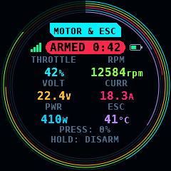
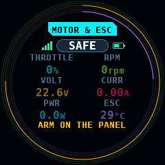
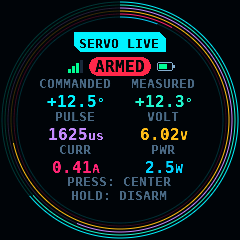
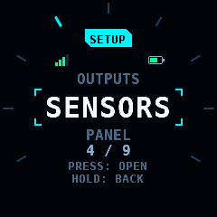
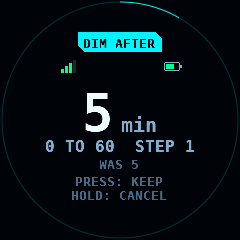
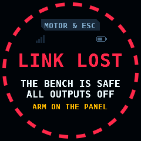
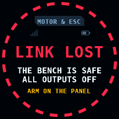
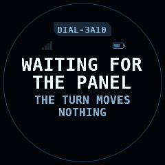
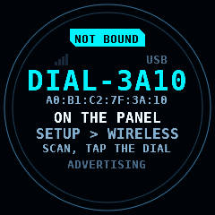
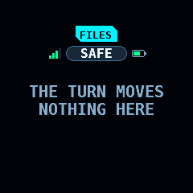

# The M5Stack Dial

<sub>**English** · [Deutsch](Dial-de.md)</sub>

The M5Stack Dial v1.1 is a round knob with a 240 x 240 pixel display. In
rcbench it is a wireless knob for the panel over Bluetooth LE (Low Energy,
BLE). Its display shows what the knob acts on. This page covers its
firmware (`firmware/dial`) and the protocol between it and the panel
(`protocols/dialknob`).

What exists: the protocol module with its host tests; the Dial's
firmware: the power latch, the encoder, the buttons, the touch glass, the
click per detent, the faces on the display, the BLE peripheral with its
bound panel, and the USB console; and the panel's side: SETUP > WIRELESS >
DIAL, the scan and the bind, the link with its loss rule, the turn on
MOTOR & ESC and SERVO LIVE, the screen button, the navigation of the
panel's menus and lists with SET of a value, and the stream of the panel's
screen to the Dial ([The panel](#the-panel)). The programmers' screens (KST,
Hitec, ESC), the BLE update and pairing are later slices.

M5Stack, Dial and Stamp-S3A are names of their owner and its products, and
Bluetooth is a trademark of its owner. rcbench is independent: it is not
affiliated with, endorsed by or sponsored by them. The names say which
device the panel talks to.
[Legal notice and disclaimer](../README.md#legal-notice-and-disclaimer) holds
the project's notice.

## The device

| Part | What it is | Pins |
| --- | --- | --- |
| Module | the Dial's Stamp-S3A: ESP32-S3FN8, 8MB flash in the package, no PSRAM (pseudo-static RAM) | |
| Display | GC9A01, 1.28 inch, 240 x 240, SPI (serial peripheral interface) at 40MHz | DC GPIO4, MOSI GPIO5, SCLK GPIO6, CS GPIO7, reset GPIO8, backlight GPIO9 |
| Touch | FT3267 at I2C address 0x38, 400kHz, polled every 20ms | SDA GPIO11, SCL GPIO12, interrupt GPIO14 (not used) |
| Encoder | 16 detents a turn, 4 quadrature counts a detent, on PCNT (the pulse counter) | A GPIO41, B GPIO40 |
| Screen button | under the glass, polled every 5ms, debounced 20ms | GPIO42 |
| Stamp button | the module's button; held at reset, ROM download mode | GPIO0 |
| Buzzer | a 3ms click at 4,000Hz per detent | GPIO3 |
| Power latch | high keeps the Dial on after WAKE is let go | GPIO46 |
| Test mark | 1ms high per injected detent, test build only | GPIO1 (PORT.B G1) |
| Battery | a single LiPo cell of 1,000mAh or less on the MX1.25 socket, charged on the board | the reading pin is unknown |

The cell is held to 1,000mAh or less until the charge current is measured:
the charger (TP4057 in the schematic text) and its current are not
confirmed.

## Safety

The Dial is not a safety device. These rules are the panel's, and the
panel applies them ([The panel](#the-panel)):

- A Dial event never enables voltage or power. ARM, SUPPLY ON, PROG 5V and
  WRITE stay the panel's 2s holds. STOP is on the panel only.
- The link is relative: each EVENT carries the Dial's detent counter, never
  a value. The first packet after a connect, a packet more than 300ms after
  the one before and a jump of more than 16 detents move nothing.
- A Dial lost while ARMED is an error: 1,000ms without a packet, or the
  disconnect, switches the bench SAFE and every output off. 500ms without a
  packet is DEGRADED, a notice. A connection that has sent no EVENT yet,
  while the panel discovers the service, is no loss.
- The loss is the same in both directions. When the panel's packets stop,
  the Dial shows LINK LOST after 500ms and from then sends no EVENT, so the
  panel sees LOST 1,000ms after the last EVENT and an ARMED bench goes
  SAFE. After 500ms more the Dial ends the link and sends nothing until it
  is connected again and the panel's first packet came.
- The screen button while ARMED: a tap sets the throttle to 0% on MOTOR and
  CENTER on SERVO; a 1s hold DISARMs.
- No BLE scan while ARMED: a scan's radio time would starve the link that
  carries the knob.
- Navigation only while SAFE: a SELECT is a tap of one frame, so it
  completes no 2s hold, and while ARMED the Dial moves no focus away from
  the output it drives ([Navigation and SET](#navigation-and-set)).

The link rules and their timing are in the protocol module, with a host test
each ([protocols/dialknob](https://github.com/subtilitas/rcbench/blob/main/protocols/dialknob/README.md)).

## Flashing over USB

The release carries `rcbench-dial-merged-<version>.bin` for offset 0x0 and
`rcbench-dial-<version>.bin`, the application alone, with their SHA-256
sums in `SHA256SUMS`.

1. Check the image: `sha256sum -c SHA256SUMS --ignore-missing` in the
   folder with the image and `SHA256SUMS`.
2. Connect the Dial's USB-C socket to the computer. A Dial that runs this
   firmware is reset into the ROM download mode by esptool over the USB
   Serial/JTAG port. A Dial that does not: hold the Stamp button (GPIO0)
   while plugging in the cable.
3. Flash:

   ```bash
   python -m esptool --chip esp32s3 -p /dev/ttyACM0 -b 460800 \
     write-flash 0x0 rcbench-dial-merged-0.23.12.bin
   ```

   esptool 5 spells the command `write-flash`; esptool 4 `write_flash`.
4. The Dial restarts and shows `NOT BOUND` and its name, `DIAL-` and the last
   4 hex digits of its address.

The merged image writes the partition table, so the NVS (non-volatile
storage) at 0x9000 is written anew and the bound panel is forgotten.

From the source, with ESP-IDF (Espressif Internet-of-Things Development
Framework) v6.1:

```bash
cd firmware/dial
idf.py -B build -D SDKCONFIG=build/sdkconfig build
idf.py -B build -p /dev/ttyACM0 flash monitor
# the test build, with the console's hooks
idf.py -B build-hooks -D SDKCONFIG=build-hooks/sdkconfig -D RCBENCH_DIAL_HOOKS=ON build
```

The partition table (`firmware/dial/partitions.csv`) holds NVS, two
application slots of 3,072kB and their otadata. The released image is
817,280 bytes, 26.0% of a slot; the seven fonts of the faces are 243,194
bytes of it and the ring tables 25,032. Its static RAM: 212,822 of 341,760
bytes of internal DRAM and IRAM, the frame of 115,200 bytes among them. The
heap that NimBLE takes at run time is not measured; the log at start and
`status` give the internal heap free and its lowest since the start.

## Bind

The Dial advertises the dialknob service UUID (universally unique
identifier) with its name in the scan response. Unbound, it advertises
every 100ms and any central may connect. The first central that subscribes
to EVENT is its bound panel: the Dial keeps the panel's address in NVS and
from then on takes a connection from that address only, through the BLE
controller's accept list, and advertises every 500ms. A scan still lists a
bound Dial.

A 10s hold of the screen button forgets the bound panel; so does `forget` on
the console. The Dial beeps, ends a link, and advertises to anyone again.
The 1s HOLD gesture goes to the panel on the way.

There is no pairing and no encryption in protocol version 1: a device in
range that connects first, or that spoofs the bound address, is taken.

## The panel

SETUP > WIRELESS > DIAL holds the Dial's rows
([Screens](Screens.md#wireless-the-imu-and-the-dial)): Dial ON or OFF (OFF by
default), SCAN FOR DIAL, BOUND DIAL, and the steps of a detent, 0.5%, 1%, 2%
or 5% of throttle (1% by default) and 0.5°, 1°, 2° or 5° of horn angle (1° by
default). The first Dial ON starts Bluetooth LE on the board's ESP32-C6,
as the first IMU ON does; it runs until the panel restarts. The Dial and the
IMU are two clients of the panel's Bluetooth LE central, one connect or scan
at a time between them.

### Scan and bind

SCAN FOR DIAL scans 10,000ms and lists up to 8 devices that advertise the
dialknob service, strongest first, with name and RSSI. While the bench is
ARMED, or an arm waits, the scan is refused and the band reads
`NO DIAL SCAN WHILE ARMED: SWITCH TO SAFE FIRST`; before Bluetooth LE runs it
reads `BLUETOOTH IS NOT READY: NO DIAL SCAN`. A scan started while SAFE
stops at the switch to ARMED, and SCAN FOR DIAL reads `STOPPED BY ARM`. A
tap on a found Dial binds it:
the panel keeps its address and name in SETUP (`dial_ble`, `dial_name`) and
asks for a save. One Dial is bound at a time. The panel connects to it by
its address, without a scan, at Dial ON, at start-up and after each loss.

### The link

The connect asks for an interval of 30 to 50ms, latency 0 and a supervision
timeout of 4,000ms, the IMU's figures. After the connect the panel finds
the service, subscribes to EVENT and reads INFO. A bound device without the
service reads `BOUND: NOT A DIAL` and is not taken. A Dial whose INFO names
another protocol version than 1 reads `OTHER PROTOCOL n`; its EVENTs are
counted and dropped. Until INFO is read, EVENTs are dropped too. An INFO
that does not read or decode is a failed GATT step: the link ends and the
panel connects again after 1,000ms. Detents and PRESSes reach the screen
only while the link is `CONNECTED` or `DEGRADED`; a HOLD, which only
disarms, in any state.

The loss rule runs on the panel's own clock, not on the supervision timeout:

| Time without an EVENT | State | While SAFE | While ARMED or an arm waits |
| --- | --- | --- | --- |
| 0 to 499ms | `CONNECTED` | | |
| 500 to 999ms | `DEGRADED` | band: `DIAL: NO EVENT FOR 500ms` | band: `DIAL: NO EVENT FOR 500ms` |
| 1,000ms, or the disconnect | `DIAL LOST` | band: `DIAL LOST` | an error: SAFE, all outputs off, band: `DIAL LOST WHILE ARMED: SWITCHED TO SAFE, ALL OUTPUTS OFF` |

The clock starts at the first EVENT of a connection, so a connection that
has sent none, while the panel discovers the service, is no loss. Each loss
is one error. Dial OFF in SETUP ends the link without an error.

### The knob and the button

A detent turned on the Dial goes the path of the panel's own knob, with the
same rules: relative, through the same turn tracker, nothing moves while
the bench is SAFE, and turns made while SAFE are not kept for the ARM. On
MOTOR & ESC a detent moves the throttle by the throttle step. On SERVO LIVE
it moves the horn by the servo step. The screens of
[Navigation and SET](#navigation-and-set) take the turn as a move of the
focus; every other screen takes none.

| Gesture | MOTOR & ESC, ARMED | SERVO LIVE, ARMED | SAFE, or another screen |
| --- | --- | --- | --- |
| PRESS: the screen button released before 1,000ms | throttle 0% | CENTER | nothing |
| HOLD: the screen button down for 1,000ms | DISARM | DISARM; an ARM + START sequence under way ends with every output off, also before ARMED | nothing; BACK on a screen the Dial navigates |

On MOTOR & ESC a HOLD also DISARMs while an ARM is on its way, asked and
not yet confirmed, and ends an ESC STICK run as ABORT does, in ARMING too:
the bench never arms after a HOLD. A PRESS counts only in a frame with a
turn or a press that the panel takes; a HOLD always. A frame without input
leaves an open help bubble open.
The EVENT's held button and touch states are never read as a press or a
touch, so a button held down on the Dial is no hold on the panel: ARM and
every other 2s hold stay the panel's own.

### Navigation and SET

While the Dial is linked and the bench is SAFE, it navigates these screens:

| Screen | Items, in turn order |
| --- | --- |
| the menu | its 8 tiles, row by row |
| SETUP's tiles | the tiles, then SAVE while a save is offered |
| a SETUP list | its rows, then RESET and SAVE; on SENSORS and WIRELESS the entries on the left first |
| SERVO | the 8 tiles, then SETTINGS; the open SETTINGS list as a SETUP list |
| OUTPUTS, board view | the protocol list's face, CLEAR ALL while offered, then a pin button each |
| an open choice list | its rows, the focus on the one in force |
| the leave warning | STAY, DISCARD, SAVE |

| Gesture | Navigation | SET |
| --- | --- | --- |
| turn | the focus moves one item a detent and wraps at either end; a row out of sight scrolls into it | the value moves one step a detent, inside its range |
| PRESS | SELECT: a tap on the focused item | KEEP |
| HOLD | BACK: what the home tag does, a choice list or the keypad closes | CANCEL: the value as it was |

The panel draws a 2px ring in the accent colour round the focused item. The
ring keeps the pixels under it per frame buffer and puts them back when it
moves: a detent repaints the two rings, never the screen. No ring shows and
the Dial takes no part in the screen while the Dial is OFF or not linked,
while the bench is ARMED, while the screen guide or the screenshot popup is
open, or with the text keyboard open.

A SELECT is one tap: a DOWN and an UP at the middle of the item in the same
frame. The focused row is scrolled into view first, also when a finger
scrolled the list since; a tap point off the item or out of sight is never
tapped, and the press then does nothing. A 2s hold on the panel needs the contact down for 2s of frames, so no
hold completes from the Dial: ARM, voltage ON, WRITE n VALUES and the deletes
stay the panel's. A SELECT on a hold button, such as CLEAR ALL on OUTPUTS,
shows the hint the panel shows for any tap. On SERVO's tiles a HOLD first
ends an ARM + START sequence under way, as on every SERVO screen; BACK
follows only where it stopped nothing.

SET:

- a number the keypad takes: SELECT taps its value, and the keypad opens.
  The turn writes the value into the entry, by the setting's step and inside
  its range; a turn at an end stops there. A setting with an OFF gap (such
  as an INA3221 shunt, OFF or 5.0 to 1000.0mΩ) takes one detent from OFF to
  its lowest value and one back, however many detents a frame brings. PRESS is the keypad's OK, with
  its checks; HOLD is CANCEL.
- an on/off or a list of options: SELECT starts SET on the row. Each detent
  taps its `-` or `+` key, at most 16 a frame; an on/off and an option list
  wrap as their keys do; the VALUE face shows an option list's place from 0
  to its last option. PRESS keeps the value; HOLD taps the other key as
  often as a tap changed the value.

Dim after: a turn, PRESS or HOLD of the Dial wakes a dimmed panel and
starts its minutes again, as a touch does. On a dimmed panel with the bench
idle the input that woke it does nothing else: it opens, moves and sets
nothing. On a bench that is not idle it acts at once, so a PRESS for 0% or
CENTER on an ARMED bench is never swallowed, and a HOLD on MOTOR & ESC or a
SERVO screen always acts.

The Dial shows the NAV face while it moves the focus, with the screen's name,
the focused item between the items before and after it, and its place in
the list. In SET it shows the VALUE face with the setting's name as the
title. On the menu the face stays HOME and draws the tiles as a list.

### The stream

The panel writes its screen to the Dial in panel packets, one at a time:

| Packet | When |
| --- | --- |
| SCREEN | the face, the title, the language or the flags changed, or 5,000ms after the last |
| VALUE_META, VALUE | on MOTOR & ESC and SERVO LIVE, and in SET, when the range, the step or the value changed |
| NAV | while the Dial navigates: when the focused item, the item before or after it, or the list changed; one row a packet |
| SCALE | on MOTOR & ESC and SERVO LIVE: on entry and at each connect, then when a full scale changed, at most every 200ms |
| LIVE_MOTOR, LIVE_SERVO | on MOTOR & ESC and SERVO LIVE, every 50ms (20Hz) |
| STATE | ARMED, DEGRADED or a step changed, 200ms without any packet, or 1,000ms after the last STATE |

Each connect sends the whole model again, SCREEN first. The faces are MOTOR,
SERVO, HOME (the menu), NAV and VALUE ([Navigation and SET](#navigation-and-set));
every other screen sends its title and the bench's state. SCREEN carries
the NAVIGATES flag while the Dial navigates. LIVE_MOTOR carries the throttle and the readings the bench
reports: voltage, current, power, RPM, the ESC's and the motor's
temperature. LIVE_SERVO carries the pulse, the commanded angle, the
measured angle when the angle source reports one, and the servo rail's
voltage and current from the servo's channel.

SCALE gives the Dial's rings their full scales; 0 is not known, and that
ring shows its track only:

| Full scale | Source |
| --- | --- |
| speed | the run's peak; before the first peak, the MOTOR plot's RPM full scale |
| voltage | SUPPLY's Voltage max while SUPPLY's output is on; else the MOTOR plot's VOLT full scale |
| current | SUPPLY's Current trip while SUPPLY's output is on and the trip is set; else the MOTOR plot's CURR full scale |
| servo travel, pulse ends | the servo profile's TRAVEL, PULSE MIN and PULSE MAX |
| servo rail voltage, current | SUPPLY's Voltage max and Current trip while SUPPLY's output is on; else 0 |

### The console

The panel's log names the Dial with the tag `dial`:

```text
I (…) dial: Dial ON: starting Bluetooth LE
I (…) dial: scan for 10000ms
W (…) dial: scan refused: the bench is ARMED (1 refused)
I (…) dial: bound A0:B1:C2:7F:3A:10 R DIAL-3A10
I (…) dial: link 6 -> 10, error 0 code 0x0, protocol 1
I (…) dial: 50 events in 1000ms, 12 detents, rtt 41ms, repeats 0 skipped 0 stale 0 glitches 0, refused 0 unread 0, 20 writes, 0 events dropped
E (…) dial: Dial lost while ARMED: an error, the bench to SAFE (1)
```

The link line gives the states by number: 0 OFF, 1 STARTING, 2 NO BLUETOOTH,
3 C6 FAILED, 4 NO DIAL BOUND, 5 SCANNING, 6 CONNECTING, 7 NOT A DIAL, 8
WAITING, 9 OTHER PROTOCOL, 10 CONNECTED, 11 DEGRADED, 12 LOST. The counters
line comes once a second while linked: EVENTs and detents in the second,
the round trip from a STATE to the first EVENT that echoes it (the link's,
plus up to 200ms until the Dial's next EVENT), the turn tracker's repeated, skipped,
stale and glitch packets, EVENTs refused for their form and dropped before
INFO, panel packets written, and events the Bluetooth LE queue dropped.

## The faces

The display shows what the knob acts on. `shared/dial` draws each face from
the panel's packets (SCREEN, NAV, VALUE_META, VALUE, LIVE_MOTOR, LIVE_SERVO,
STATE and SCALE) and from the Dial's own state: bound or not, the link, its
RSSI and its supply. It draws with the panel's rasteriser (`shared/gfx`),
the panel's fonts and the dark palette of `shared/ui/ui_theme.c`, into one
RGB565 frame of 240 x 240 pixels. The images on this page are that code's
render on a computer, from the fixed models in `test/host/dial_models.h`;
`tools/render_dial.py --check` holds them to the current render in CI.

Every face has the same furniture:

| Element | Where | What |
| --- | --- | --- |
| title tag | middle row 42, 20px tall | the panel screen's name in the 8x16 face on the accent; dimmed while the link is lost; a title wider than radius 101 allows is cut |
| state pill | middle row 66, 19px tall | `SAFE`, or `ARMED` with the run clock (`0:42`, from 1h `1h05`) on MOTOR & ESC; in the 10x20 face, in the 8x16 face when the icons beside it would leave radius 101 |
| link bars | 6px left of the pill | 4 bars, 3px wide: 4 at -60dBm or more, 3 at -70dBm, 2 at -80dBm, 1 below; amber while the panel marks the link DEGRADED; none while not connected |
| battery | 6px right of the pill | 18 x 9px, filled from 3,300 to 4,200mV; a dash while the reading is unknown; `USB` in its place while the reading is unknown and a USB host reads the port, where the row has room |
| press hints | middle rows 183 and 197, from row 176 down, below the bottom cells | what a press and a hold do here, in the 8x16 face |

A line is drawn in the largest font of its chain in which its ink lies
inside radius 100 of the display's center at its height, wrapped onto the
lines its block allows. A line that fits in no font drops its last part,
parts being two spaces apart, until the rest fits; a part with a digit is
dropped whole, so no number is ever shown in part. `test_dial_fit` holds
every string of every face, in English and in German and with every field
at its ends, inside radius 100, inside its cell, inside the rows a repaint
clears for it, out of every cell's clear rectangle but its own, and off
every other string.

### The readings: MOTOR & ESC and SERVO





Six readings in three rows of two equal cells of 78 x 31px, the columns at
x 76 and 164, the rows at y 100, 133 and 166, every cell inside radius 100.
A cell holds the reading's name in the 8x16 face, dimmed, and below it the
value in the 10x20 face with its unit in the 8x16 face, both in the
reading's colour. A reading without its valid bit shows `--`. While the
bench is SAFE the values are drawn at half strength and the first hint line
reads `ARM ON THE PANEL` in amber.

| Face | Readings, in order | Hints while ARMED |
| --- | --- | --- |
| MOTOR & ESC | throttle, speed, voltage, current, power, ESC temperature | `PRESS: 0%`, `HOLD: DISARM` |
| SERVO | commanded angle, measured angle, pulse, the rail's voltage, current and power | `PRESS: CENTER`, `HOLD: DISARM` |

Around the cells runs one ring per reading, in the grid's order, the first
outermost: radius 118 inward at a pitch of 3px to 103, 3px outside the
cells' circle. A ring is 1px wide and antialiased: the pixel whose center
lies at distance d from the display's center takes the ring's colour with
coverage clamp(1 - |d - r|, 0, 1). The arc runs from 12 o'clock clockwise
over the reading's share of its full scale; the rest of the circle is the
track, the reading's colour mixed 22% onto the background. The full scales
come from the panel's SCALE packet:

| Reading | Colour | Full scale |
| --- | --- | --- |
| throttle | ACCENT | 100% |
| speed | RPM | SCALE `rpm`: the run's peak, else the plot's full scale |
| voltage | VOLT | SCALE `mv` |
| current | CURR | SCALE `ca`, by magnitude |
| power | POWER | SCALE `mv` x `ca` |
| ESC temperature | LILAC | 120°C |
| commanded angle | ACCENT | -`travel` to +`travel`: the center is half a ring |
| measured angle | TEAL | -`travel` to +`travel` |
| pulse | LILAC | `us_min` to `us_max` |
| rail voltage, current, power | VOLT, CURR, POWER | SCALE `rail_mv`, `rail_ca`, their product |

A full scale of 0, or no SCALE since the connect, leaves its ring at the
track; so does a reading without its valid bit.

### A list and a value




A list (NAV) shows the row before the focused one, the focused row in the
20x36 face between the accent's corner brackets, the row after it, and
`4 / 9`. Up to 24 rows show as ticks on the rim over 270°, the focused one
in the accent; a longer list shows its place as a ring at radius 112.
Hints: `PRESS: OPEN`, `HOLD: BACK`.

A value (VALUE_META, VALUE) shows the number in the 32x44 numeral face with
its unit, the range (`0 TO 60`), the step and the value on entry
(`STEP 1  WAS 5`) and one ring at radius 118 from the minimum to the
maximum. A range too wide for its line is left out; a step line too wide
drops `WAS` first. The number and the range turn
amber when the panel refused the last turn at a limit. Hints in SET mode:
`PRESS: KEEP`, `HOLD: CANCEL`; before it: `PRESS: SET`, `HOLD: BACK`.

### The link and the bind







500ms without a packet from the panel, after one came on this connection,
the Dial sends no EVENT and no keepalive; the panel's clock counts from the
last EVENT, so the panel sees DEGRADED 500ms and LOST 1,000ms after the
last EVENT, and switches an ARMED bench SAFE at LOST. From that 500ms
the face shows `LINK LOST`, `NO TURN IS SENT`, `THE BENCH GOES SAFE` and
`ARM ON THE PANEL` inside a dashed red rim, the title dimmed. The Dial ends
the link 500ms later; the face then shows `LINK LOST`,
`THE BENCH IS SAFE`, `ALL OUTPUTS OFF` and `ARM ON THE PANEL`. Connected
with no packet from the panel yet, or bound and not connected, it shows
`WAITING FOR THE PANEL` and `THE TURN MOVES NOTHING`, with the Dial's name
on the dimmed title tag; no EVENT goes until the panel's first packet.
Packets without a SCREEN yet show `WAITING FOR THE PANEL` alone, with the
pill from STATE when STATE came. Without a bound panel it
shows `NOT BOUND`, its name and address, where to bind it on the panel
(`ON THE PANEL`, `SETUP > WIRELESS`, `SCAN, TAP THE DIAL`) and
`ADVERTISING`. On a screen the knob does nothing on, and on HOME without
list rows, it shows the title, SAFE or ARMED and
`THE TURN MOVES NOTHING HERE`.

The faces' own words follow the panel's language, English or German, from
the SCREEN packet; before the first SCREEN the last language the panel
gave, English after a start. They are the `UI_DIAL_TEXT` entries of
`shared/text/include/ui_text.def`.

### What a change costs

The face task draws every 50ms what changed since the frame before: a
cell, the pill's row, the list or value body, the hints, and of a ring only
the pixels between its old and its new end. Every repaint clears only
inside radius 102, so it never touches a ring, a tick or the rim; the
rings and the ticks are painted onto the background colour, so a repaint
equals the first paint. `test_dial_face` holds a draw of what changed to a
full draw of the same model, pixel for pixel, over sequences of every face.
A damage record collects the rectangles written, at most 8, and only those
go over SPI. The whole frame goes at a face change and every 10,000ms.

| Change | Pixels sent | At 40MHz (arithmetic, not measured) |
| --- | ---: | ---: |
| speed by 300rpm: its cell and its ring's arc | 3,920 | 1.6ms |
| throttle by 1% | 3,968 | 1.6ms |
| the run clock by 1s: the pill's row | 5,696 | 2.3ms |
| five readings at once | 19,040 | 7.6ms |
| a list's focus by one row | 23,152 | 9.3ms |
| the whole frame | 57,600 | 23.0ms |

The ring tables hold every pixel a ring touches, sorted by angle: 8,344
pixels for the six rings, 3 bytes each, 25,032 bytes of const data in
flash. `tools/gen_dial_rings.py` computes them with the arithmetic of
`gfx_ring_build()` and writes `shared/dial/dial_rings.c`; CI runs it with
`--check`, and `test_dial_face` holds the file to `gfx_ring_build()`'s
output pixel by pixel. A full repaint of one ring blends about 1,490
pixels; a move by 1% of a turn at radius 118 about 15. Neither is measured
on the device.

The images come from the computer's math library. The ring tables and the
fonts are the same bytes on the device, but a ring's end angle and the
dashed rim are computed at run time with the device's math library, whose
rounding can differ: the device's antialiasing may differ from the images
by one coverage step.

## The console

The console is the USB Serial/JTAG port of the USB-C socket, with the
prompt `dial>` and the log on the same port.

| Command | What it does |
| --- | --- |
| `status` | name, address, firmware and protocol version, the bound panel, the link and its RSSI (received signal strength indication), the EVENT counts, the click setting, the battery reading, the internal heap free and its lowest since the start |
| `sound on` / `sound off` | the click per detent; the panel's SCREEN packet sets it as well, default ON |
| `forget` | forget the bound panel, as the 10s hold |
| `help` | the commands |

The test build (`RCBENCH_DIAL_HOOKS=ON`) adds the hooks. Each injects as if
the hardware did it. The released image holds none of their code; CI fails
when it does.

| Command | What it does |
| --- | --- |
| `turn <n>` | n detents, -1,000 to 1,000, one every 20ms, each in its own EVENT; GPIO1 (PORT.B G1) goes high for 1ms when that EVENT is handed to the BLE stack. With no link no EVENT goes and GPIO1 stays low |
| `press` | a PRESS gesture |
| `hold` | a HOLD gesture |
| `tap <x> <y>` | a TAP on the glass at x, y, 0 to 239 |
| `batt <mV>` | the battery reading STATUS carries, 2,000 to 5,000mV; 0 takes it back to unknown |
| `drop` | end the link; the Dial advertises again |
| `ping` | an EVENT at once, with the echo of the last STATE's clock |

PORT.B's two pins are named in a different order by the Dial's
documentation and by M5Unified; GPIO1 is the pin by number either way.

## Limits

- The Dial navigates the screens of [Navigation and SET](#navigation-and-set)
  only. On LOGS, FILES, WI-FI, UPDATES, IMU, OUTPUTS' grid view, the
  programmers (KST, Hitec, ESC) and the bench screens' own lists and tabs it
  moves no focus; a HOLD there does nothing on a SAFE bench.
- A list takes focus for 64 items, RESET and SAVE among them; the last rows
  of a longer list are not reached from the Dial.
- A pixel the screen paints in exactly the ring's colour (the accent with
  its lowest bit flipped) under the ring is taken for the ring and put back
  when the ring moves.
- The watermark over a simulated bench blends over the ring; where it does,
  the ring's pixels are left when the ring moves, until the screen repaints
  there.
- The panel's ARMED flag for the loss rule and the scan's refusal is the
  control task's, read by the Bluetooth task; it can be one control pass,
  about 5ms, old.
- LIVE_SERVO carries no reading of a feedback servo's position or current.
- A servo rail fed by PROG 5V has no full scale in SCALE: 0, its rings show
  their track only.
- An IMU scan (SETUP > IMU, or SEARCH FOR IMU on SERVO) is not refused while
  ARMED. Its effect on a linked Dial's packets is not measured.
- The panel has no console command that injects a Dial turn or press; the
  Dial's test build does that from the Dial's side.
- The battery's voltage is unknown: no source names the pin it reaches.
  STATUS carries 0 and its "battery unknown" flag. The charger's state is
  unknown as well.
- Which way of the encoder counts up is not measured, nor where in its 4
  counts the encoder rests. Clockwise positive is the protocol's rule. A
  detent moves 3 counts from its center, so an encoder that rests between
  two counts never clicks.
- The touch controller's start-up time after the shared reset is taken as
  300ms, the FT5x06 family's; not measured on this part.
- Whether GPIO46 matters while USB powers the Dial is not confirmed.
- A panic or a software reset on battery probably releases GPIO46 for the
  reset and switches the Dial off; not confirmed.
- `forget`, or the 10s hold, with the bound panel in range: the panel still
  holds the Dial's address, connects again and subscribes, and the Dial
  binds it again. To bind another panel, unbind the Dial on the old one
  first.
- Characters outside ASCII, the degree sign and the German letters draw as
  `?`.
- The flush of a whole frame takes about 23ms at 40MHz (arithmetic, not
  measured). A ring's repaint is not measured on the device.
- The value face shows no category: no packet carries one.
- Nothing in this firmware or in the panel's side has run with a Dial: the
  Dial is ordered, not delivered. The turn-to-output latency over the air is
  not measured; the station measures it with the test build once the Dial
  is on its USB.
- No sleep, no backlight steps and no auto-off yet: the Dial stays on until
  RST is pressed or the cell is empty. Runtime on a cell is not measured.
