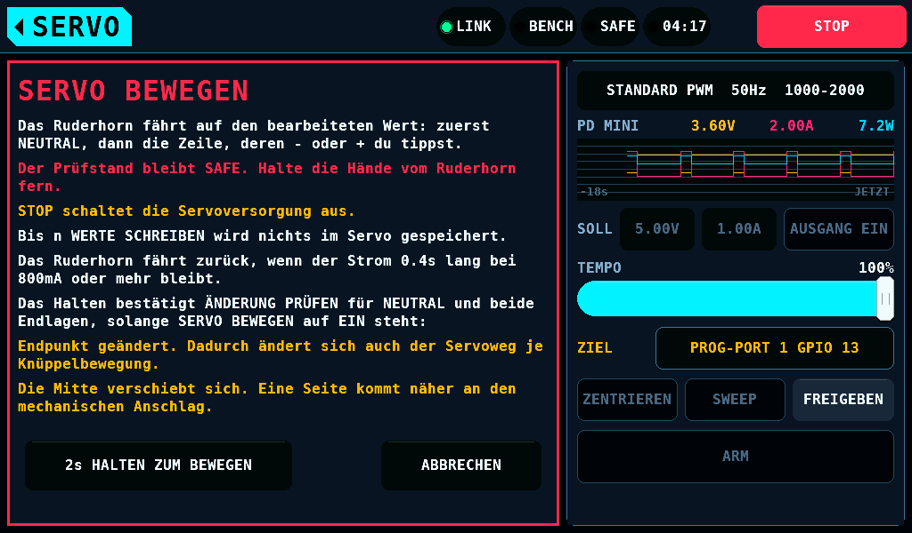
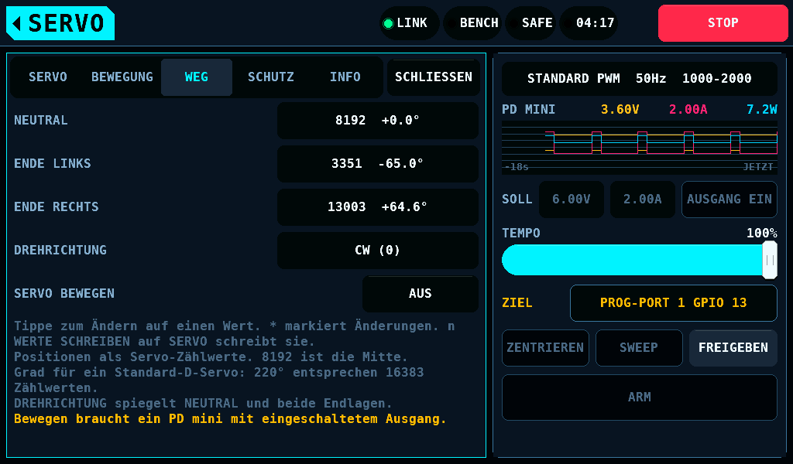
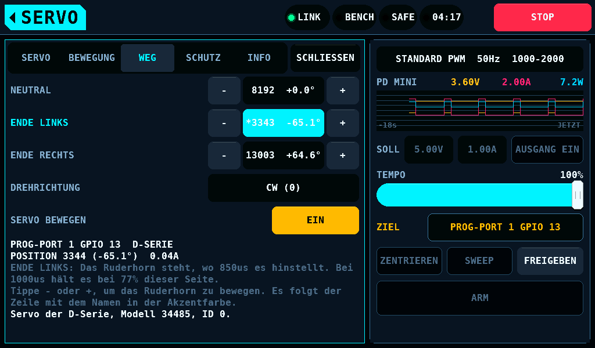
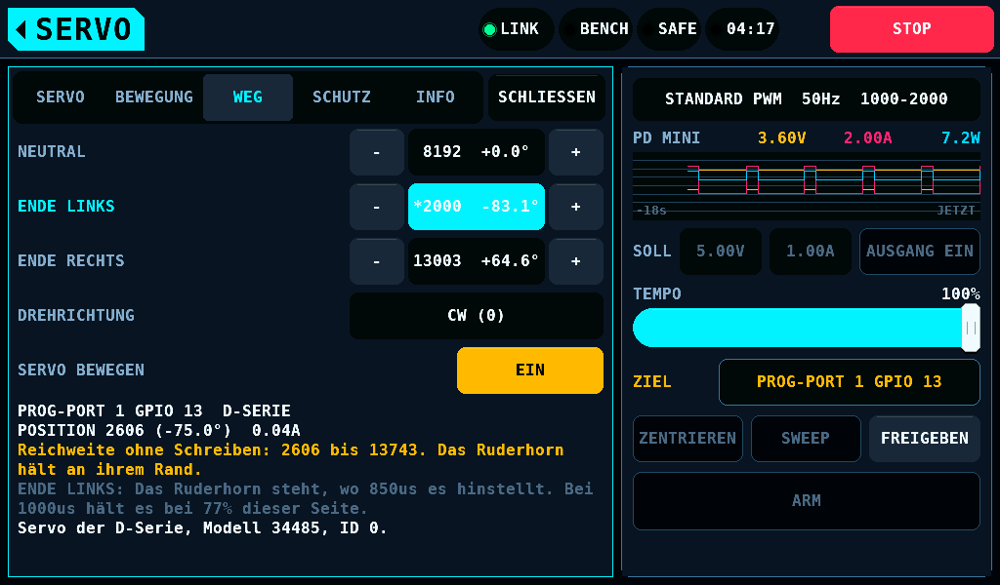
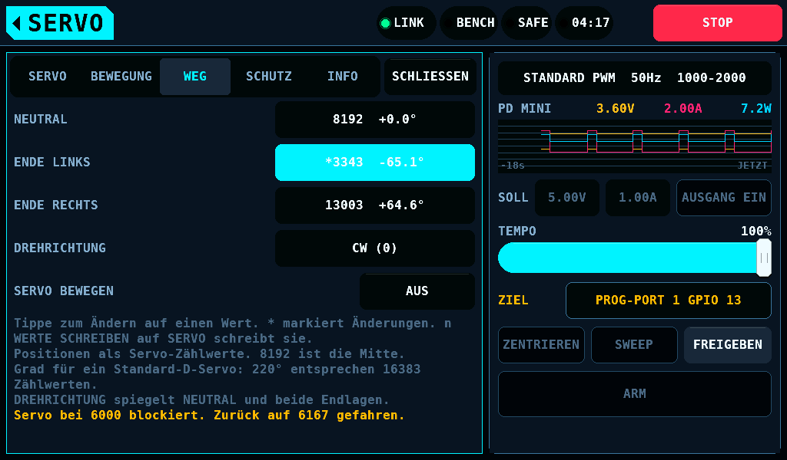

# SERVO BEWEGEN in der Hitec-Programmierung

[English](HitecMove.md) · **Deutsch**

SERVO BEWEGEN fährt das Ruderhorn eines Servos der D-Serie auf die
bearbeitete Position, in der gehaltenen Sitzung, während der Prüfstand
SAFE bleibt, in der Sitzung der
[Servoprogrammierung für Hitec-Servos](HitecProgrammer-de.md). Es schreibt
nur Register 0x1E, das Ziel, ins RAM (Arbeitsspeicher) des Servos und
speichert nie: ein Wert erreicht den Speicher des Servos nur über
[n WERTE SCHREIBEN](HitecProgrammer-de.md#schreiben). Die Regel des Prüfstands für diese
Bewegung steht unter
[Ein Hitec-Servo bewegt sich bei SAFE](Safety-de.md#ein-hitec-servo-bewegt-sich-bei-safe).
Klassische Servos haben keine Zeile SERVO BEWEGEN.

Die Zeile steht unter DREHRICHTUNG auf WEG. Ein Tippen auf AUS öffnet die
Seite SERVO BEWEGEN: die Risiken, die Blockierschwelle der Stromgrenze der
Sitzung und die beiden Warnungen von ÄNDERUNG PRÜFEN, die das Halten
bestätigt. **2s HALTEN ZUM BEWEGEN** schaltet es ein; ein Loslassen vor 2s
zeigt `Halte 2s, um das Servo zu bewegen.` im Alarmband und startet
nichts.

Es wird abgelehnt, und nichts wird gesendet:

| Bedingung | Zeile |
| --- | --- |
| Kein PD mini antwortet der HITEC-Seite mit eingeschaltetem Ausgang und einem Messwert. Das gilt auch für den rbmod-Carrier: seine festen 5V haben keinen Strommesswert, und das PD mini versorgt dort nicht die Ports | `Bewegen braucht ein PD mini mit eingeschaltetem Ausgang.` |
| DREHRICHTUNG ist im Servo oder im Entwurf nicht CW (im Uhrzeigersinn) | `Schreibe zuerst DREHRICHTUNG CW. SERVO BEWEGEN ist nur mit CW gemessen.` |
| ENDE LINKS, NEUTRAL und ENDE RECHTS sind nicht aufsteigend gespeichert | `SERVO BEWEGEN braucht ein Servo der D-Serie mit ENDE LINKS, NEUTRAL und ENDE RECHTS aufsteigend gespeichert.` |
| Ein ALLES AUSLESEN steht aus, ein Vermerk eines Schreibvorgangs steht, eine Anfrage an die Karte oder ein Lauf ist unterwegs, ein STOP ist gesetzt, der Port ist gestoppt | die Zeile des Grundes, wie beim Schreiben |

Solange es an ist:

1. Der Start liest Register 0x0C, die Position, und 0x1E, 0x50, 0x52 und
   0x56. Eine Position mehr als 50 Zählwerte außerhalb der Reichweite
   beendet es, ohne dass sich etwas bewegt hat:
   `Das Servo steht bei 2555, außerhalb seiner Reichweite. SERVO BEWEGEN steht auf AUS.`
2. Jeder Durchlauf schreibt 0x1E, wartet 20ms und liest 0x0C. Die
   kommandierte Position ist der Wert der verfolgten Zeile im Entwurf, zu
   Beginn NEUTRAL. Sie ändert sich je Durchlauf höchstens um 150
   Zählwerte (2.0°) und bleibt in der Reichweite: den Positionen der Ziele
   0 und 6000 über die gespeicherten Endlagen, 2606 bis 13743 bei einem
   D485HW im Werkszustand. Im Host-Modell dauert ein Durchlauf 106ms bei
   einem Frame von 16ms und 132ms bei einem von 33ms.
3. NEUTRAL, ENDE LINKS und ENDE RECHTS zeigen Tasten `-` und `+` mit
   56 x 48px um den Wert. Eine Taste ändert beim Drücken um 8 Zählwerte
   (0.11°), wiederholt nach 0.45s mit 8Hz und ab 1.8s mit 30Hz und macht
   ihre Zeile zur verfolgten; deren Name steht in der Akzentfarbe. Ein
   Tippen auf den Wert öffnet das Tastenfeld. Das Halten ist die
   Zustimmung, die ÄNDERUNG PRÜFEN verlangt: diese Änderungen öffnen keine
   Seite. Die Reihenfolge ENDE LINKS unter NEUTRAL unter ENDE RECHTS
   bleibt eine harte Regel. Die anderen Zeilen nehmen keine Änderung an.
4. Die Hinweise zeigen den Port mit seinem GPIO (General-Purpose
   Input/Output),
   `POSITION 3344 (-65.1°)` mit dem AS5600-Winkel, wo SERVO einen zeigt,
   und dem Strom des PD mini, die Reichweite, wo der verfolgte Wert
   außerhalb liegt, und bei einer Endlage
   `ENDE LINKS: Das Ruderhorn steht, wo 850us es hinstellt. Bei 1000us hält es bei 77% dieser Seite.`

Ein Durchlauf wird beurteilt wie unter
[Sicherheit](Safety-de.md#ein-hitec-servo-bewegt-sich-bei-safe)
beschrieben. Eine Blockierung fährt das Ruderhorn auf die letzte freie
Position, 75 Zählwerte (1.0°) zur Neutralstellung hin, und beendet die
Schleife wie AUS. Eine Blockierung ist kein Fehler: die Versorgung bleibt
an.

| Blockierung | Zeile |
| --- | --- |
| Die Position hängt bei einem Kommando, das steht oder nach außen geht, 2 Durchläufe hintereinander mehr als 150 Zählwerte nach | `Servo bei 6000 blockiert. Zurück auf 6167 gefahren.` |
| Der Strom des PD mini bleibt 400ms lang bei 80% der Stromgrenze der Sitzung oder darüber, 800mA bei den voreingestellten 1000mA | `Strom 0.4s lang bei 800mA oder mehr. Zurück auf 6167 gefahren.` |
| Der AS5600-Winkel bewegt sich um weniger als die Hälfte einer kommandierten Änderung von 3° oder mehr | `Der AS5600-Winkel folgt nicht. Zurück auf 6167 gefahren.` |

Das Ende, nach einem Tippen auf EIN, einem Reiterwechsel, SCHLIESSEN, dem
Home-Tag, einem Bildschirmwechsel, einem ABBRECHEN oder einer Blockierung:
der laufende Durchlauf endet, 0x1E = 3000, das Servo startet neu
(0x46 = 1) mit 1000ms, die 21 Register und 0x1E, 0x50, 0x52 und 0x56
werden gelesen. Der Satz der Schleife, 0x1E, 0x50, 0x52, 0x54, 0x56,
0xB0, 0xB2 und 0xC2, und jedes Register, das ein Schreiben sendet,
zusammen 16, werden mit dem Start verglichen. Die Zeile zeigt währenddessen
WARTEN; das Ende dauert im Host-Modell 2.6s bei einem Frame von 16ms.
Gleich meldet
`SERVO BEWEGEN steht auf AUS. Die gespeicherten Werte sind unverändert zurückgelesen.`
Eine Abweichung meldet
`Servowerte haben sich bei SERVO BEWEGEN geändert. Tippe auf ALLES AUSLESEN.`,
schaltet SCHREIBEN INS SERVO FREIGEBEN aus und lehnt ein Schreiben bis
ALLES AUSLESEN ab. SCHLIESSEN und das Home-Tag verlassen die
Programmierung erst nach dem Ende: tippe sie erneut.

Ein hartes Ende hat keine Endfolge. Es schaltet SCHREIBEN INS SERVO
FREIGEBEN aus, und SERVO zeigt
`Nach SERVO BEWEGEN sind die Servowerte nicht bekannt. Tippe vor dem Schreiben auf ALLES AUSLESEN.`
bis ALLES AUSLESEN. Jedes harte Ende außer einem ABBRECHEN während des
Endes ist ein Fehler: alle Ausgänge gehen aus, die Versorgung des Servos
und mit ihr sein RAM eingeschlossen ([Sicherheit, Fehler](Safety-de.md#fehler)).

| Ereignis | Zeile |
| --- | --- |
| STOP, gedrückt oder vom Prüfstand selbst | `Gestoppt. Der Pin ist frei. Halte STOP 2s, um den STOP zurückzusetzen.` |
| Ein Schalten auf SAFE am Prüfstand | `Gestoppt. Der Pin ist frei. Tippe auf AUFHEBEN zum Fortsetzen oder auf VERLASSEN.` |
| Die Verbindung verstummt | wie bei einer verlorenen Verbindung ([STOP, SAFE und eine verlorene Verbindung](HitecProgrammer-de.md#stop-safe-und-eine-verlorene-verbindung)) |
| Der Ausgang des PD mini liest aus oder liefert keinen Messwert | `Die Servoversorgung ist aus. SERVO BEWEGEN ist beendet.` |
| Ein AS5600-Messwert vom Start fehlt | `Der AS5600 liefert keinen Messwert mehr. SERVO BEWEGEN ist beendet.` |
| Ein Positionslesen scheitert in 3 Versuchen | `Auslesen bei Adresse 0x0C fehlgeschlagen. Tippe auf ALLES AUSLESEN.` |
| ABBRECHEN während des Endes | `Der Vorgang wurde abgebrochen.`, kein Fehler |

## Bekannte Grenzen

- Die Strombeurteilung liest den Strom des PD mini, der etwa 0.3s
  nachläuft ([Servo](Servo-de.md)); die Fenster des INA3221 werden nicht
  verwendet.
- Die Zahlen der Schleife sind am Prüfstand nicht gemessen. Jede mit dem
  Prüfstandsschritt des Hitec-Plans, der sie misst:

| Zahl | Wert | Prüfstandsschritt |
| --- | --- | --- |
| Ziele 400, 3000, 5600 auf den gespeicherten Endlagen; die Linie darüber hinaus, die Reichweite 2606 bis 13743 | `HITEC_LIVE_D_T_MID` 3000, `HITEC_LIVE_D_T_HALF` 2600 | L0.1 |
| ein Neustart verwirft das Ziel im RAM und liest 0x1E = 3000 | der Neustart des Endes | L0.2 |
| die Dauer eines Durchlaufs am Prüfstand | 106ms bis 132ms im Host-Modell | L0.3 |
| die Beurteilung von Nachlauf, Strom und AS5600 an einem blockierten Ruderhorn | `HITEC_LIVE_LAG_FREE` 50, `HITEC_LIVE_LAG_BIND` 150, `HITEC_LIVE_LAG_PASSES` 2, `HITEC_LIVE_BACK` 75 Zählwerte; `HITEC_LIVE_STALL_PCT` 80%, `HITEC_LIVE_STALL_MS` 400ms; `HITEC_LIVE_ENC_MIN_CDEG` 3° | L0.4 |
| die Versorgung aus nach STOP während der Schleife | verlangt innerhalb 500ms | L0.5 |
| ob das Servo sein Ziel ohne Frames hält | | L0.6 |
| der Puls eines Ziels und mit ihm 850us, 2150us und 77% im Hinweis zur Endlage | `HITEC_LIVE_D_US_ZERO` 750us, `HITEC_LIVE_D_T_PER_US` 4 | L0.7 |
| die Abbildung eines CCW-Servos | abgelehnt | L0.8 |
| die Änderung je Durchlauf | `HITEC_LIVE_SLEW` 150 Zählwerte, gewählt | S-L3 |
