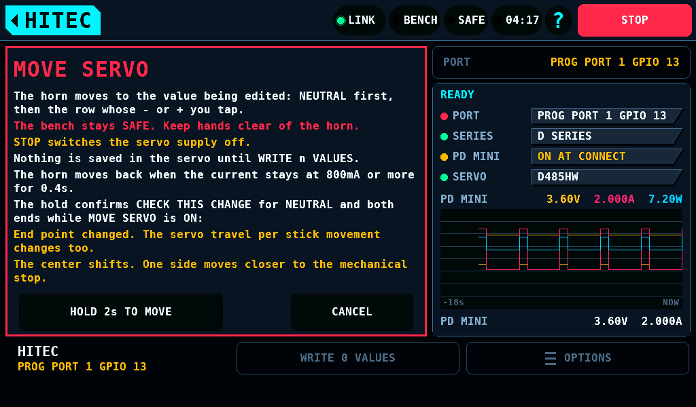
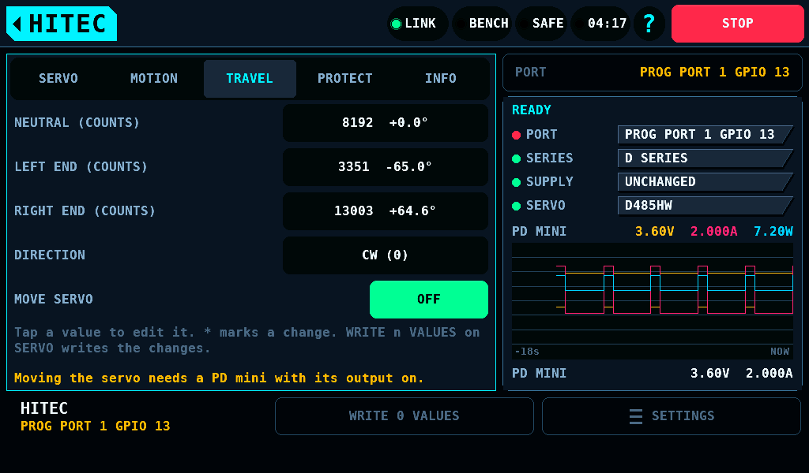
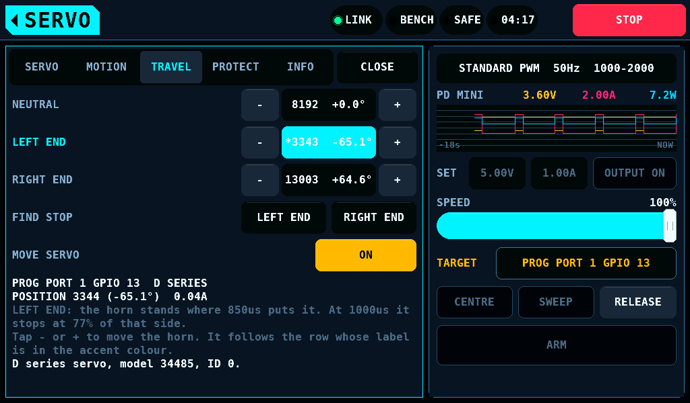
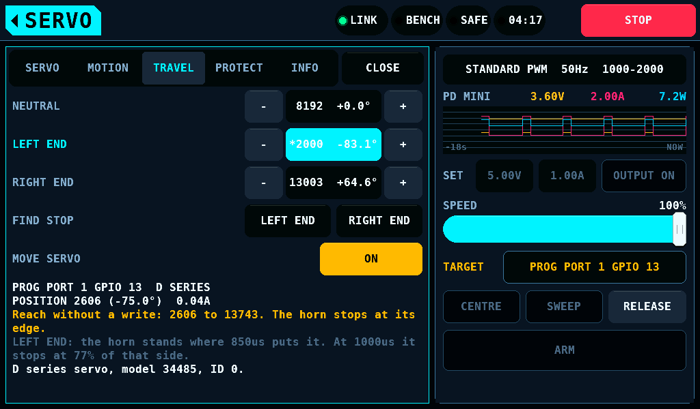
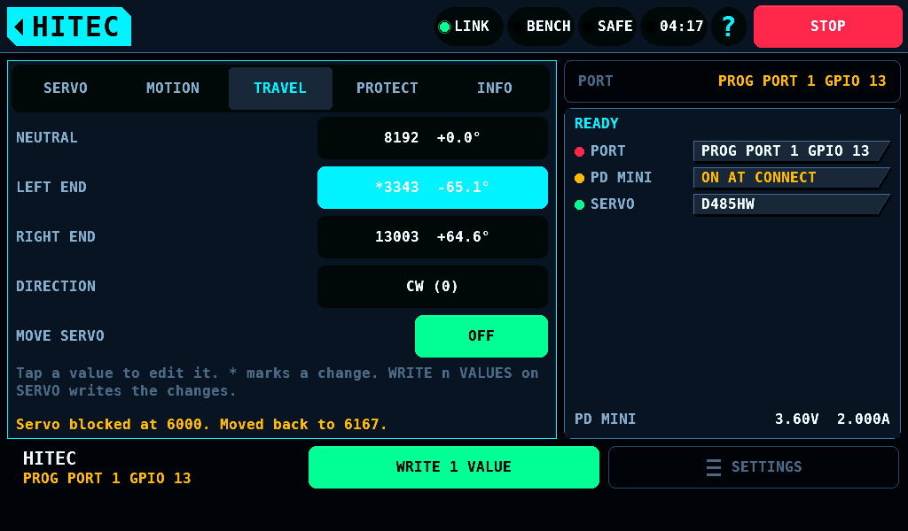
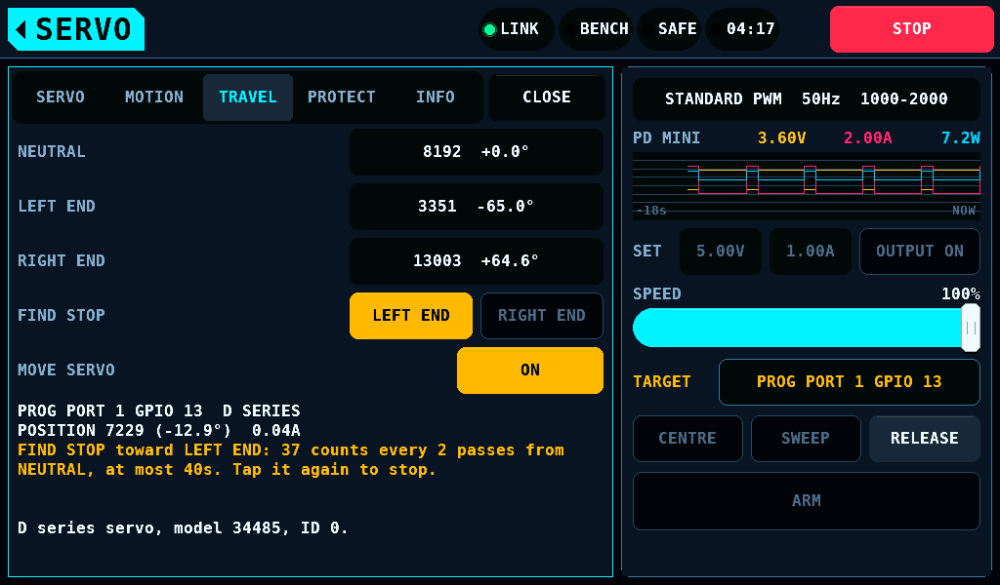
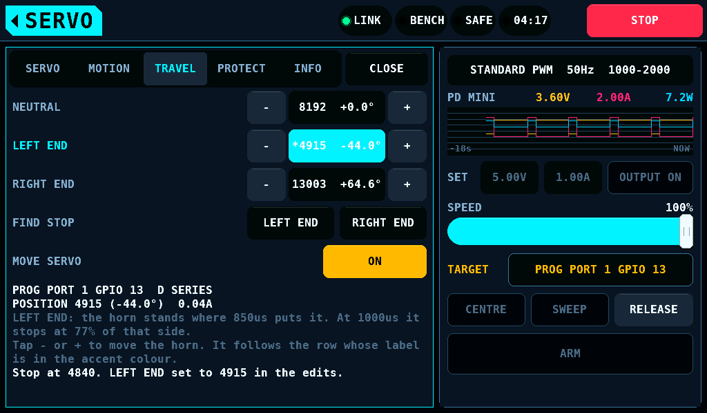

# MOVE SERVO on the Hitec programmer

**English** · [Deutsch](HitecMove-de.md)

MOVE SERVO moves the horn of a D series servo to the position being
edited, inside the held session of the
[Servo programmer for Hitec servos](HitecProgrammer.md), while the bench
stays SAFE. It writes only register 0x1E, the target, to the servo's RAM
(random-access memory), and never saves: a value reaches the servo's
memory only through [WRITE n VALUES](HitecProgrammer.md#writing).
The bench's rule for this motion is
[A Hitec servo moved while SAFE](Safety.md#a-hitec-servo-moved-while-safe).
Classic servos have no MOVE SERVO row.

The row sits under DIRECTION on TRAVEL. A tap on OFF opens the MOVE SERVO
page: the risks, the stall level of the session's current limit, and the
two warnings of CHECK THIS CHANGE the hold confirms. **HOLD 2s TO MOVE**
switches it on; a release before 2s shows `Hold 2s to move the servo.` in
the alert band and starts nothing.

It is refused, with nothing sent:

| Condition | Line |
| --- | --- |
| No PD mini answers the HITEC page with its output on and a reading. This includes the rbmod carrier: its fixed 5V has no current reading, and the PD mini there does not feed the ports | `Moving the servo needs a PD mini with its output on.` |
| DIRECTION is not CW (clockwise) in the servo, or not CW in the draft | `Write DIRECTION CW first. MOVE SERVO is measured on CW only.` |
| LEFT END, NEUTRAL and RIGHT END as stored do not ascend | `MOVE SERVO needs a D series servo with LEFT END, NEUTRAL and RIGHT END stored in ascending order.` |
| A READ ALL is owed, a record of a write stands, a request of the card or a run is under way, STOP is latched, the port is stopped | the line of the reason, as for a write |

While it is on:

1. The start reads register 0x0C, the position, and 0x1E, 0x50, 0x52 and
   0x56. A position more than 50 counts outside the reach ends it with
   nothing moved: `The servo stands at 2555, outside its reach. MOVE SERVO is OFF.`
2. Each pass writes 0x1E, waits 20ms and reads 0x0C. The commanded
   position is the draft's value of the followed row, NEUTRAL at the
   start. It moves 150 counts (2.0°) a pass at most and stays inside the
   reach: the positions of targets 0 and 6000 through the stored ends,
   2606 to 13743 on a factory D485HW. In the host model a pass takes
   106ms at a frame of 16ms and 132ms at one of 33ms.
3. NEUTRAL, LEFT END and RIGHT END show `-` and `+` keys of 56 x 48px
   around the value. A key steps 8 counts (0.11°) on the press, repeats
   after 0.45s at 8Hz and at 30Hz from 1.8s, and makes its row the
   followed one; the followed row's label is in the accent colour. A tap
   on the value opens the keypad. The hold is the consent CHECK THIS
   CHANGE asks for: these edits open no page. The order LEFT END below
   NEUTRAL below RIGHT END stays a hard rule. The other rows take no edit.
4. The notes show the port with its GPIO (general-purpose input/output), `POSITION 3344 (-65.1°)` with
   the AS5600 angle where SERVO shows one and the PD mini's current, the
   reach where the followed value lies outside it, and for an end point
   `LEFT END: the horn stands where 850us puts it. At 1000us it stops at 77% of that side.`

A pass is judged as in [Safety](Safety.md#a-hitec-servo-moved-while-safe).
A bind moves the horn back to the last free position less 75 counts
(1.0°) toward NEUTRAL and ends the loop as MOVE OFF does. A bind is no
error: the supply stays on.

| Bind | Line |
| --- | --- |
| The position lags more than 150 counts behind a command standing still or moving outward on 2 passes in a row | `Servo blocked at 6000. Moved back to 6167.` |
| The PD mini's current stays at 80% of the session's current limit or above for 400ms, 800mA of the default 1000mA | `Current at 800mA or more for 0.4s. Moved back to 6167.` |
| The AS5600 angle moves less than half of a commanded change of 3° or more | `The AS5600 angle does not follow. Moved back to 6167.` |

The end, after a tap on ON, a tab change, CLOSE, the home tag, a change of
screen, an ABORT or a bind: the pass under way ends, 0x1E = 3000, the
servo restarts (0x46 = 1) with 1000ms, the 21 registers and 0x1E, 0x50,
0x52 and 0x56 are read. The loop's set, 0x1E, 0x50, 0x52, 0x54, 0x56,
0xB0, 0xB2 and 0xC2, and every register a write sends, 16 in all, are
held against the start. The row reads WAIT
meanwhile; the end takes 2.6s at a frame of 16ms in the host model.
Equal says `MOVE SERVO is OFF. The stored values read back unchanged.`
A difference says `Servo values changed during MOVE SERVO. Tap READ ALL.`,
switches ENABLE WRITE TO SERVO off and refuses a write until READ ALL.
CLOSE and the home tag leave the programmer only after the end: tap them
again.

A hard end has no end sequence. It switches ENABLE WRITE TO SERVO off,
and SERVO says
`After MOVE SERVO the servo's values are not known. Tap READ ALL before writing.`
until READ ALL. Every hard end but an ABORT during the end is an error:
every output goes off, the servo's supply with its RAM included
([Safety, Errors](Safety.md#errors)).

| Event | Line |
| --- | --- |
| STOP, pressed or the bench's own | `Stopped. The pin is released. Hold STOP 2s to reset the STOP.` |
| A switch to SAFE at the bench | `Stopped. The pin is released. Tap CLEAR to go on, or LEAVE.` |
| The link goes silent | as for a lost link ([STOP, SAFE and a lost link](HitecProgrammer.md#stop-safe-and-a-lost-link)) |
| The PD mini's output reads off or gives no reading | `The servo supply went off. MOVE SERVO ended.` |
| An AS5600 reading at the start is gone | `The AS5600 reading stopped. MOVE SERVO ended.` |
| A position read fails on 3 tries | `Read failed at address 0x0C. Tap READ ALL.` |
| ABORT during the end | `The operation was aborted.`, no error |

## FIND STOP

FIND STOP searches for the mechanical stop of one side and sets LEFT END
or RIGHT END in the draft. It writes nothing to the servo.

While MOVE SERVO's loop runs, the FIND STOP row takes DIRECTION's place on
TRAVEL: DIRECTION is CW for the whole loop, since MOVE SERVO is refused
otherwise. The row has two keys of 126 x 48px, LEFT END and RIGHT END.

1. A tap on a key starts the search after the pass under way. The key
   turns the warning colour. The other key, the `-` and `+` keys and the
   keypad take no tap until the search ends.
2. The horn moves to NEUTRAL at 150 counts a pass.
3. From NEUTRAL the command moves 37 counts (0.5°) outward every 2
   passes, up to the reach's edge: 2606 or 13743 on a factory D485HW.
   Each pass is judged as a pass of MOVE SERVO. From NEUTRAL to the left
   edge of a factory D485HW that is 151 steps, 32s at 106ms a pass.
4. The note says
   `FIND STOP toward LEFT END: 37 counts every 2 passes from NEUTRAL, at most 40s. Tap it again to stop.`

The search ends in one of these ways. Then the passes of MOVE SERVO go on
toward the followed row.

| End | Draft | Line |
| --- | --- | --- |
| A bind past NEUTRAL | LEFT END or RIGHT END = the last free position, 75 counts (1.0°) toward NEUTRAL, marked `*`; that row is followed | `Stop at 4840. LEFT END set to 4915 in the edits.` |
| A bind whose end point would not lie outside NEUTRAL | unchanged | `Stop at 8152, too close to NEUTRAL. The edits are unchanged.` |
| The reach's edge with no bind | unchanged | `No stop found up to 2606.` |
| 40s after the tap, the way to NEUTRAL included | unchanged | `No stop found in 40s. The search ended at 3100.` |
| A second tap on the key | unchanged | `FIND STOP ended. The edits are unchanged.` |

The end point found takes CHECK THIS CHANGE's end-point rule as an edit
with `-` and `+` does: the hold of MOVE SERVO confirmed it. WRITE n VALUES
writes it after MOVE OFF.

A bind on the way to NEUTRAL is MOVE SERVO's bind: the horn moves back and
the loop ends. A tap on ON, a tab change, CLOSE, the home tag, a change of
screen and an ABORT end the search with the loop's end. STOP, a switch to
SAFE at the bench, the supply off and the other hard ends stay hard ends.
A bind of the search is no error: the supply stays on.

## Current limitations

- The current judge reads the PD mini's current, which lags about 0.3s
  ([Servo](Servo.md)); the INA3221's windows are not used.
- The figures of the loop are not measured on the bench. Each one and the
  station step of the Hitec plan that measures it:

| Figure | Value | Station step |
| --- | --- | --- |
| targets 400, 3000, 5600 on the stored ends; the line past them, the reach 2606 to 13743 | `HITEC_LIVE_D_T_MID` 3000, `HITEC_LIVE_D_T_HALF` 2600 | L0.1 |
| a reboot drops the RAM target and reads 0x1E = 3000 | the end's restart | L0.2 |
| the pass's period at the bench | 106ms to 132ms in the host model | L0.3 |
| the lag, current and AS5600 judges on a blocked horn | `HITEC_LIVE_LAG_FREE` 50, `HITEC_LIVE_LAG_BIND` 150, `HITEC_LIVE_LAG_PASSES` 2, `HITEC_LIVE_BACK` 75 counts; `HITEC_LIVE_STALL_PCT` 80%, `HITEC_LIVE_STALL_MS` 400ms; `HITEC_LIVE_ENC_MIN_CDEG` 3° | L0.4 |
| the supply off after STOP during the loop | within 500ms asked | L0.5 |
| the servo's hold of its target with no frames | | L0.6 |
| the pulse of a target, and with it the 850us, 2150us and 77% of the end note | `HITEC_LIVE_D_US_ZERO` 750us, `HITEC_LIVE_D_T_PER_US` 4 | L0.7 |
| the mapping of a CCW servo | refused | L0.8 |
| the slew per pass | `HITEC_LIVE_SLEW` 150 counts, chosen | S-L3 |
| FIND STOP's stop within 0.5° of a block, its step and its cap | `HITEC_LIVE_FIND_STEP` 37 counts, `HITEC_LIVE_FIND_PASSES` 2, `HITEC_LIVE_FIND_MS` 40000ms, chosen | S-L6 |
