# Servoprogrammierung für Hitec-Servos

<sub>[English](HitecProgrammer.md) · **Deutsch**</sub>

Die Programmierung liest die Einstellungen eines Hitec-Servos über seine
Signalleitung, zeigt sie decodiert und so, wie sie gespeichert sind, und
schreibt geänderte Werte zurück. Vor dem ersten Schreiben einer Sitzung
speichert sie das Servo, wie sie es vorfand, in einer Backup-Datei auf der
Karte, und vor jedem Schreiben vermerkt sie die Werte des Servos. Sie
speichert die Einstellungen eines Servos in einer Datei, lädt eine Datei in
die Änderungen und schreibt das Backup der Sitzung zurück. Sie öffnet sich aus ihrer Zeile `Hitec-Servos` unter
**PROGRAMMIEREN** der [Seite SERVO](Screens-de.md#servo), eine Ebene tiefer,
und deckt die linke Spalte samt den Reitern der Leiste ab. **SCHLIESSEN**
oder die Home-Tag führt zur Liste von PROGRAMMIEREN zurück, solange die
Programmierung keinen Port hält. Die Zeile ist mit `IOMCU OHNE SERVO PWM`
ausgegraut und öffnet nichts, solange der IOmcu, die RP2350-Platine, kein
Servo-PWM (Pulsweitenmodulation) meldet, also auch, wenn kein IOmcu
antwortet.

Hitec ist ein Name oder eine Marke seines Inhabers. rcbench ist unabhängig:
es ist mit ihm weder verbunden noch von ihm unterstützt oder gefördert. Der
Name sagt, mit welchen Servos die Programmierung arbeitet.
[Rechtliche Hinweise und Haftungsausschluss](../README-de.md#rechtliche-hinweise-und-haftungsausschluss)
enthält den Hinweis des Projekts.

Zwei Serien werden gelesen und geschrieben:

| Serie | Servos | Leitung | Gelesen | Geschrieben |
| --- | --- | --- | --- | --- |
| D-SERIE | D485HW und die übrigen Servos der D-Serie | 115.200bit/s, invertiert | 21 Register | die Register jeder geänderten Einstellung im Abstand von 20ms, das Speichern (0x70 = 0xFFFF), 100ms, der Neustart (0x46 = 1), 1000ms, dann die 21 Register zurückgelesen |
| KLASSISCH | HS-5xxx und HS-7xxx | 19.200bit/s | 100 Zellen: 0x00 bis 0x23, 0x30 bis 0x53, der Name 0x60 bis 0x6F, das Datum 0x70 bis 0x73, die Seriennummer 0x80 bis 0x87, und die Version | jede geänderte Zelle, dann der Ausgleich in Zelle 0x1C, jede mit `+ +` beantwortet, im Abstand von 2ms; dann die Zellen 0x00 bis 0x23 zurückgelesen |

Das Registermodell und seine Codierungen stammen von 1 D485HW (20.10.2026)
und von je 1 HS-5645MG, HS-7955TG und HS-5955TG (18.10. bis 20.10.2026)
([`protocols/hitec`](../protocols/hitec/README.md)). Die Page, auf der sie
läuft, beschreibt
[Der Programmierport für Servos von Hitec](LinkHitec-de.md).


## Voraussetzungen

- Der IOmcu spricht Protokoll 4.23 oder neuer. Mit einem älteren sagt der
  Reiter SERVO `Nicht verfügbar: Der IOmcu hat keinen Hitec-Port.` und
  `IOmcu auf Version 0.21.1 oder neuer aktualisieren.`
- SERVO-TESTER unter SETUP > OUTPUTS steht auf einem Port, PORT 1, PORT 2,
  PORT 3 oder PORT 4, und der Port nennt einen Pin. Mit OUTPUTS lautet die Zeile PORT
  `KEIN PROG-PORT GESETZT`, und VERBINDEN sagt `Zum Programmieren muss das
  Servo am Programmierport angeschlossen sein.`
- Der Prüfstand ist SAFE. VERBINDEN wird abgelehnt bei ARMED, bei einem
  angeforderten Schalten auf ARMED und mit einem Finger auf ARM: `Zuerst
  DISARM tippen. Bei ARMED kann der Port nicht übernommen werden.` Ein
  gesetzter STOP lehnt es ebenfalls ab: `Ein STOP ist gesetzt. Er wird beim
  nächsten Schalten auf ARMED aufgehoben.`
- Ein klassisches Servo geht nur beim Einschalten in den Programmiermodus,
  also schaltet der Prüfstand seine Versorgung aus und ein: VERBINDEN für
  KLASSISCH braucht ein PD mini, das antwortet, sonst `Klassische Servos
  brauchen ein PD mini: Der Prüfstand schaltet die Versorgung.`
- Ein Servo der D-Serie antwortet auf der Leitung so, wie SETUP >
  Hitec-D-Empfang unter WEITERES es einstellt, PULL-UP oder PRECHARGE
  ([Empfangsmodus](LinkHitec-de.md#empfangsmodus)). VERBINDEN wartet, bis
  der IOmcu diesen Modus hält: `Empfangsart im IOmcu noch nicht gesetzt.
  Erneut versuchen.`
- Die Programmierspannung ist die Einstellung, die auch die
  KST-Programmierung nutzt (SET_SERVO_PROG_V, WEITERES >
  PROGRAMMIERSPANNUNG), für eine Hitec-Sitzung 4,8V bis 6,0V: eine höhere
  Einstellung läuft mit 6,0V, und der Reiter SERVO sagt
  `Hitec-Programmierung läuft mit höchstens 6.0V.` Die Strombegrenzung liegt
  bei 50mA bis 3000mA. Beide müssen innerhalb der Grenzen von SUPPLY liegen,
  sonst sagt VERBINDEN `Programmierspannung oder -strom überschreitet die
  SUPPLY-Grenzen.`

## Der Reiter SERVO

| Zeile | Was sie tut |
| --- | --- |
| PORT | Zwei Zeilen: der Port und sein GPIO mit der Serie, `PROG-PORT 1 GPIO 13  D-SERIE`, dann die Empfangsart und die Versorgung, die VERBINDEN einstellt, `RX PRECHARGE  5.0V 1000mA` (`VERSORGUNG UNVERÄNDERT` für ein Servo der D-Serie ohne PD mini). Die Taste lautet VERBINDEN, ABBRECHEN, solange der Port in den Programmiermodus geht oder ein Lesen läuft, WARTEN, VERLASSEN, solange der Port gehalten ist, und PORT FREIGEBEN, solange eine andere Sitzung ihn hält |
| SERIE | D-SERIE oder KLASSISCH, vor VERBINDEN gewählt; bei den Einstellungen von SERVO gehalten (SET_HITEC_SERIES). Solange der Port gehalten ist, nennt die Zeile PORT die Serie, und DATEIEN steht an dieser Stelle |
| DATEIEN | Solange der Port gehalten ist: die Servodateien auf der Karte, Speichern und Laden ([Servodateien](#servodateien)) |
| SERVO | Das gelesene Modell, `D485HW` oder `HS-5645MG`; ALLES AUSLESEN liest die Werte der Serie erneut |
| WEITERES | Programmierspannung und Strombegrenzung, jede auf dem Tastenfeld, solange der Tester den Port hat. Solange der Port gehalten ist: ÄNDERUNGEN VERWERFEN, wenn eine Änderung besteht, PRÜFSUMME REPARIEREN bei einer falschen klassischen Prüfsumme und WERKSEINSTELLUNG für ein gelesenes klassisches Servo ([WERKSEINSTELLUNG](#werkseinstellung)) |
| NACH STOP | CLEAR nach einem Schalten auf SAFE am Prüfstand: der IOmcu löscht das Flag STOPPED des Ports, und das Lesen geht weiter, oder der Einstieg von vorn, wo die Versorgung ausging |
| SCHREIBEN INS SERVO FREIGEBEN | Der Schreibschalter, AUS oder EIN ([Der Schreibschalter](#der-schreibschalter)) |
| ZURÜCKSPIELEN | Das Backup der Sitzung zurück ins Servo, solange es vom Servo abweicht ([Zurückspielen des Backups der Sitzung](#zurückspielen-des-backups-der-sitzung)); solange ein Vermerk zu einem unterbrochenen Schreibvorgang besteht: die Werte davor zurück ins Servo, oder der Vermerk verworfen ([Der Vermerk eines Schreibvorgangs](#der-vermerk-eines-schreibvorgangs)) |
| n WERTE SCHREIBEN | Der Entwurf ins Servo ([Schreiben](#schreiben)); `1 WERT SCHREIBEN` für einen, aus ohne |

Unter den Zeilen sagt die Zustandszeile, was der Port gerade tut, und die
letzte Meldung steht am Fuß der Hinweise. Jedes Bedienelement ist 48px hoch
oder mehr und endet 4px über dem Alert-Band; die Maße sind die der
KST-Programmierung ([Seiten](Screens-de.md#programmierer)).


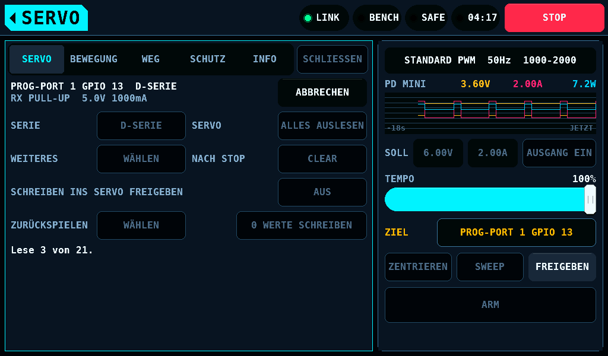

## VERBINDEN

1. OPEN: der IOmcu nimmt den Port aus PWM. 50ms kein Puls, dann gehört die
   Leitung dem Leitungstreiber, losgelassen.
2. Der Einstieg:
   - D-Serie: POWER mit der Programmierspannung und einer Auszeit von 0ms,
     wo ein PD mini antwortet, dann 1000ms, bis das Servo gestartet ist.
     Ohne PD mini läuft das Servo an der Versorgung, wie sie ist.
   - Klassisch: POWER mit ausgeschalteter Versorgung, 500ms ab der Lesung,
     die sie aus zeigt ([VERLASSEN](#verlassen) nennt die ganze Auszeit),
     dann ein, und ein LISTEN auf das `+` des Servos; sein zweites `+` folgt 250ms bis
     267ms später; 0x67 liest dann die Version.
3. ALLES AUSLESEN: die Werte der Serie, jede Adresse mit 3 Versuchen.
4. Das Modell wird erkannt: D-Serie an Register 0x00 (34485 ist der
   D485HW), klassisch an den Namenszellen. Die Meldung nennt es:
   `Servo der D-Serie, Modell 34485, ID 0.` oder
   `Klassisches Servo HS-5645MG, Version 0x16.` Ein Modell, das das
   Registermodell nicht kennt, wird im Aufbau des nächstliegenden gelesen,
   und der Reiter SERVO sagt welches: `Modell unbekannt. Die Felder werden
   wie beim D485HW gelesen.`

Im Host-Modell (`test_hitec_prog`) dauert VERBINDEN bei der D-Serie 2,4s,
davon 1,2s der Einstieg, und bei einem klassischen Servo 4,2s bei 16ms je
Frame und 7,6s bei 33ms: ein klassisches Lesen braucht 2 Frames je Zelle.
Am Prüfstand sind diese Zeiten nicht gemessen.

Solange der Port gehalten ist:

- ARM ist ausgegraut. Ein Druck darauf schaltet nichts und zeigt
  `ARMED gesperrt: Die Servoprogrammierung belegt einen Port.` im
  Alert-Band, auf SERVO wie auf MOTOR & ESC. STOP wirkt. DISARM hat nichts
  zu beenden: der Prüfstand kann nicht ARMED sein, solange der Port
  gehalten ist.
- Sollwerte und AUSGANG EIN der Zeile SOLL und der Seite SUPPLY nehmen
  keinen Druck an; ein Druck darauf sagt `Servoprogrammierung belegt das
  Netzteil: Sollwerte und EIN gesperrt.` AUSGANG AUS wirkt. Ab Protokoll
  4.29 hält der IOmcu seine SUPPLY-Page zusätzlich von OPEN bis CLOSE
  ([Die Versorgung, solange ein Port gehalten ist](LinkHitec-de.md#die-versorgung-solange-ein-port-gehalten-ist)).
  Die Sollwerte von vor VERBINDEN kommen nach dem Verlassen zurück, sobald
  der Ausgang aus ist, oder über die Frage von SERVO auf den eingeschalteten
  Ausgang nach einem Verlassen, das ihn eingeschaltet lässt
  ([VERLASSEN](#verlassen);
  [Servo-Programmierer, Die Versorgung](ServoProgrammer-de.md#die-versorgung)).
- Die Zeile für KST- und Chaservo-Servos und die Zeile ZIEL von MOTOR & ESC
  nehmen keinen Druck an, und ESC STICK startet keinen Lauf.

## Die Wertereiter

BEWEGUNG, WEG, SCHUTZ und INFO zeigen den Entwurf: was das letzte
vollständige Lesen fand, mit den noch nicht geschriebenen Änderungen. Ein
Wert, der zu seiner Codierung passt, steht decodiert, mit dem gespeicherten
Wert in Klammern daneben, `CW (0)`; einer, der zu keiner bekannten
Codierung passt, steht als `RAW 1234` in der Warnfarbe. Ein schreibbarer
Wert nimmt einen Tipp an, solange der Port gehalten und nicht gestoppt ist
([Ändern](#ändern)).

| Reiter | D-Serie | Klassisch |
| --- | --- | --- |
| BEWEGUNG | SPEED, DEAD BAND, SOFT START | SPEED, DEAD BAND, AUFLÖSUNG |
| WEG | NEUTRAL, ENDE LINKS, ENDE RECHTS in Servo-Zählern mit Grad (220° über 16383 Zähler, 8192 die Mitte), DREHRICHTUNG | MITTE in Mikrosekunden, ENDE LINKS, ENDE RECHTS als Rohwerte (Einheit unbekannt), DREHRICHTUNG |
| SCHUTZ | FAILSAFE (AUS, KRAFTLOS oder eine Position in Mikrosekunden), ÜBERLASTSCHUTZ, SMART SENSOR, EMPFINDLICHKEIT (roh) | FAILSAFE, FAILSAFE-POSITION, ÜBERLASTSCHUTZ |
| INFO | MODELL, ID, POSITION und die Register 0x04, 0x22, 0x8A, 0x8C, 0xD4 und 0xD6 roh | MODELL, VERSION, DATUM, SERIENNR., PRÜFSUMME |

Ein klassisches Abbild, dessen Zellen 0x00 bis 0x1C modulo 256 nicht 0
ergeben, zeigt PRÜFSUMME `FALSCH` und den Hinweis `Prüfsumme der gespeicherten
Werte 0x00-0x1C falsch. Servo folgt PWM evtl. nicht, zieht evtl. Strom bis
zur Grenze.` Ein HS-7955TG mit falscher Prüfsumme
zog unter ARM und SWEEP 0,88 bis 0,89A, an der Grenze des PD mini von
1,00A, die Spannung fiel auf 4,0 bis 4,2V; mit richtiger Prüfsumme zieht es
0,12 bis 0,28A (ein Servo, einmal gemessen). WEITERES > PRÜFSUMME
REPARIEREN schreibt den Ausgleich in 0x1C.

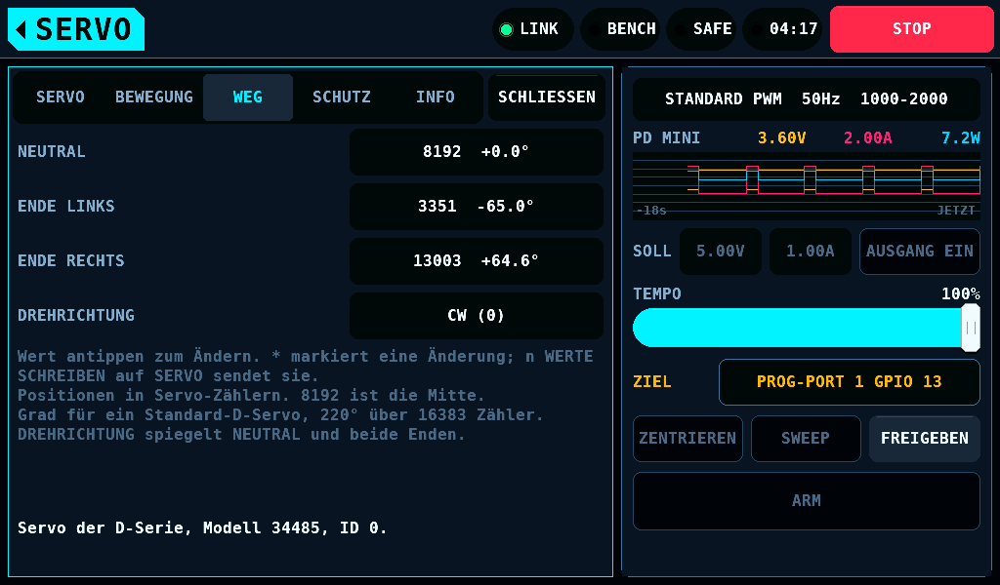
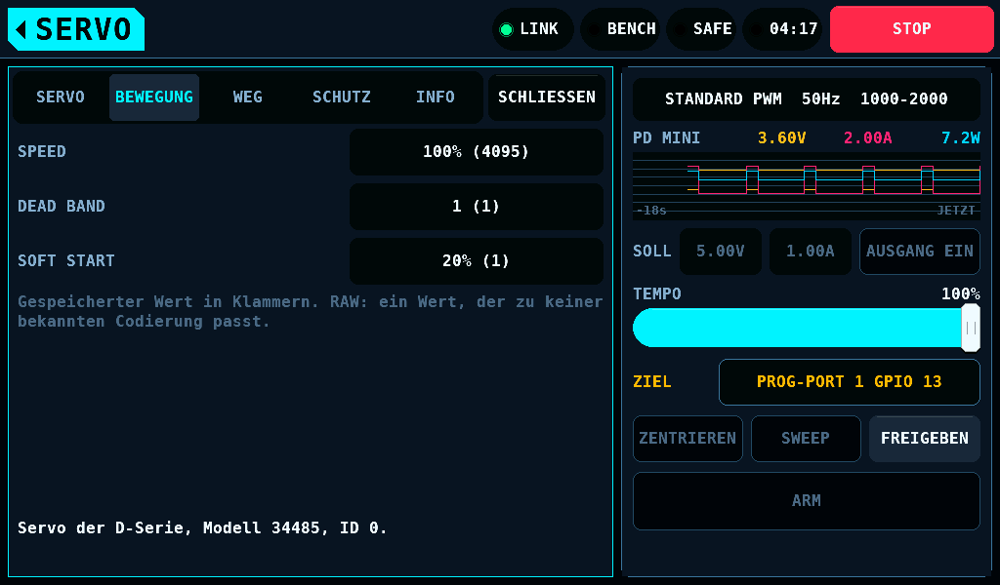
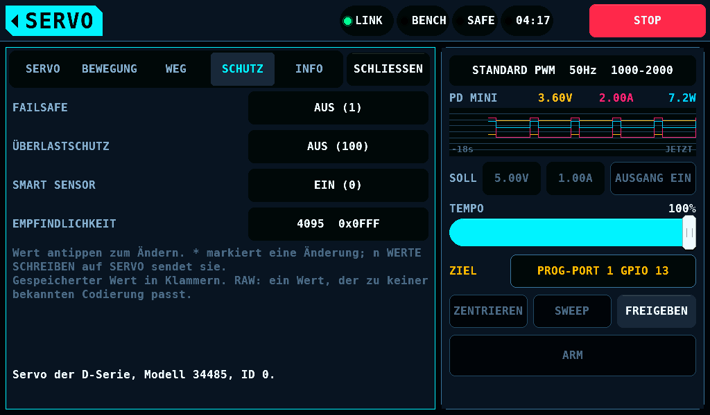
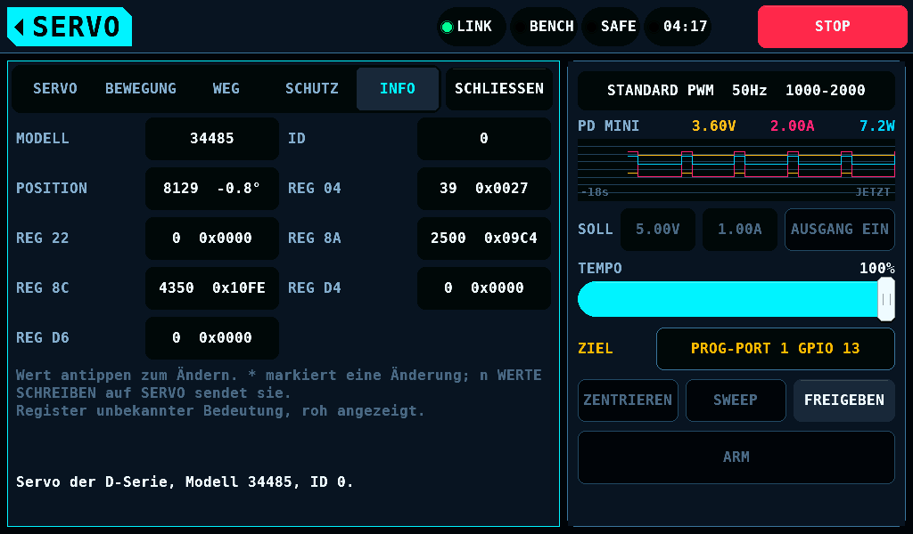

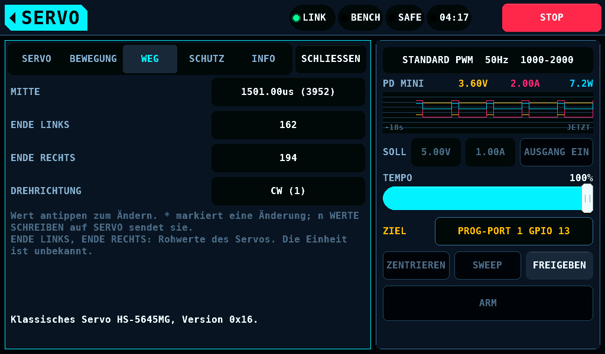
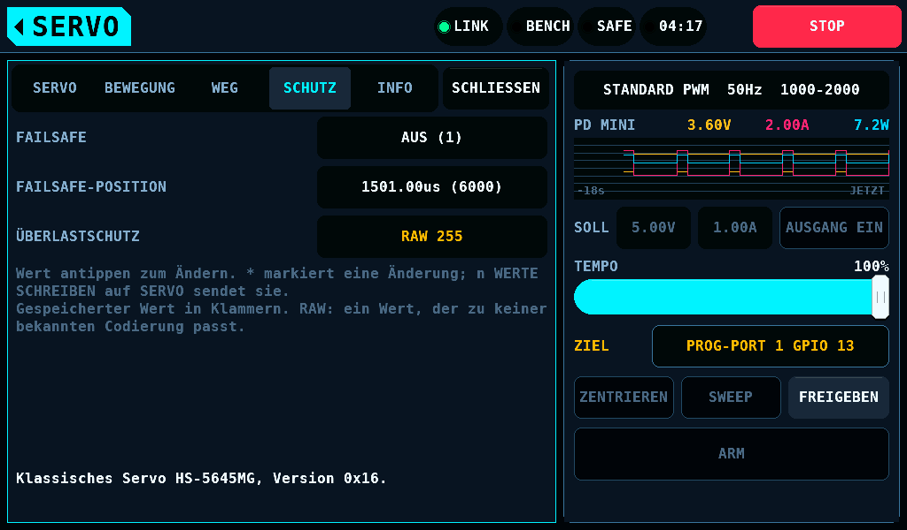
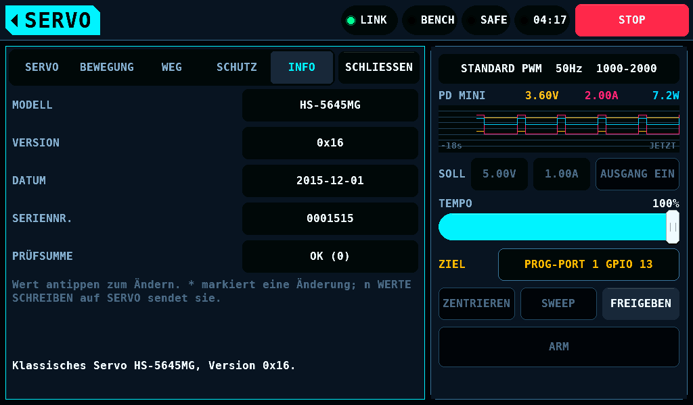

## Ändern

Ein Wert wird im Entwurf auf dem Panel geändert. Vor
[n WERTE SCHREIBEN](#schreiben) erreicht nichts das Servo. Ein Wert, der
vom Servo abweicht, ist doppelt markiert: mit `*` davor und mit der
Akzentfüllung.

| Parameter | Eingabe | Werte |
| --- | --- | --- |
| D-Serie SPEED | Tastenfeld | 10% bis 100% in Schritten von 10% |
| D-Serie DEAD BAND, klassisch DEAD BAND | Liste | Stufen 1 bis 5 |
| D-Serie SOFT START | Liste | 20%, 40%, 60%, 80%, 100% |
| D-Serie NEUTRAL, ENDE LINKS, ENDE RECHTS | Tastenfeld | 1 bis 16383 Zähler; ENDE LINKS unter NEUTRAL unter ENDE RECHTS |
| D-Serie DREHRICHTUNG, klassisch DREHRICHTUNG | Liste | CW, CCW |
| D-Serie FAILSAFE | Liste, dann das Tastenfeld für POSITION | AUS, KRAFTLOS oder eine Position von 900us bis 2100us |
| D-Serie ÜBERLASTSCHUTZ, klassisch ÜBERLASTSCHUTZ | Liste | AUS, 10% bis 50% in Schritten von 10% |
| D-Serie SMART SENSOR, klassisch FAILSAFE | Liste | EIN, AUS |
| D-Serie ID | Tastenfeld | 0 bis 255 |
| klassisch SPEED | Tastenfeld | 10% bis 100% in Schritten von 10% |
| klassisch MITTE | Tastenfeld | 900,00us bis 2100,00us in Schritten von 0,25us |
| klassisch ENDE LINKS, ENDE RECHTS | Tastenfeld | 0 bis 255, roh |
| klassisch FAILSAFE-POSITION (HS-5xxx) | Tastenfeld | 900,00us bis 2100,00us in Schritten von 0,25us |

Bereiche und Schritte sind die von `protocols/hitec/hitec_reg.c`. Das
Tastenfeld zeigt den Bereich; einen Wert, den kein Schritt ergibt, oder
einen, der die Reihenfolge der Positionen der D-Serie bricht, lehnt das
Tastenfeld mit dem Grund ab: `Diesen Wert nimmt die Einstellung nicht an.`
oder `ENDE LINKS, NEUTRAL und ENDE RECHTS müssen aufsteigen.` Eine Änderung
schreibt die Nebenwirkungen, die auch die Programmiergeräte von Hitec
schreiben: DREHRICHTUNG der D-Serie spiegelt NEUTRAL und beide Enden, eine
klassische MITTE setzt beide Endpunkte auf 0x10, eine klassische
DREHRICHTUNG tauscht sie und übernimmt die Failsafe-Position aus den
Werkszellen 0x49 und 0x4A, und jede klassische Änderung gleicht Zelle 0x1C
im Entwurf aus. Eine DREHRICHTUNG der D-Serie, die weder als 0 noch als 1
gespeichert ist, wird allein geändert, ohne Spiegeln. Ein roh
gespeicherter Wert wird durch den Wert der Tabelle ersetzt, den eine
Änderung setzt; ÄNDERUNGEN VERWERFEN unter WEITERES bringt den Rohwert in
den Entwurf zurück.

### Ein Wert, der einen zweiten Blick braucht

Ein Wert, der eine Regel der folgenden Tabelle bricht, öffnet ÄNDERUNG PRÜFEN mit der Zeile
des Felds, `SPEED: 100% -> 20%`, der Wert des Servos zuerst, und einer
Zeile je Regel. **2s HALTEN ZUM ÜBERNEHMEN** übernimmt ihn; **ABBRECHEN**
oder die Home-Tag lässt den Entwurf, wie er war.

| Regel | Warnung |
| --- | --- |
| SPEED unter 30% | `Ein zu langsames Servo kann zum Kontrollverlust über das Modell führen.` |
| DEAD BAND unter dem des Servos | `Ein schmales Dead Band kann Pendeln und Erwärmung verursachen.` |
| ÜBERLASTSCHUTZ ausgeschaltet | `Ohne Überlastschutz erhitzt sich ein blockiertes Servo.` |
| ein Endpunkt, der von dem des Servos abweicht | `Endpunkt geändert. Dadurch ändert sich auch der Servoweg je Knüppelbewegung.` |
| NEUTRAL oder MITTE, die von der des Servos abweicht | `Die Mitte verschiebt sich. Eine Seite kommt näher an den mechanischen Anschlag.` |
| DREHRICHTUNG umgekehrt | `Drehrichtung umgekehrt. Prüfe vor dem Flug alle Ruder.` |
| eine Failsafe-Position mehr als 300us von 1500us entfernt | `Die Failsafe-Position liegt weit von der Mitte entfernt.` |

Eine für einen Wert bestätigte Regel gilt für diesen Wert und für Werte,
die auf derselben Seite näher am Wert des Servos liegen. Ein Wert weiter
vom Wert des Servos entfernt oder auf dessen anderer Seite fragt erneut:
ENDE LINKS 3351, bestätigt bei 3300, nimmt 3301 an und fragt bei 3299 und
bei 3352. „Der Wert des Servos" ist der des letzten vollständigen Lesens.
Ein Schreiben, ein Lesen und ÄNDERUNGEN VERWERFEN beenden jede Bestätigung.
Ein gespeicherter Wert, der zu keiner Codierung passt, ist kein Wert zum
Vergleichen: jede Änderung daran fragt.

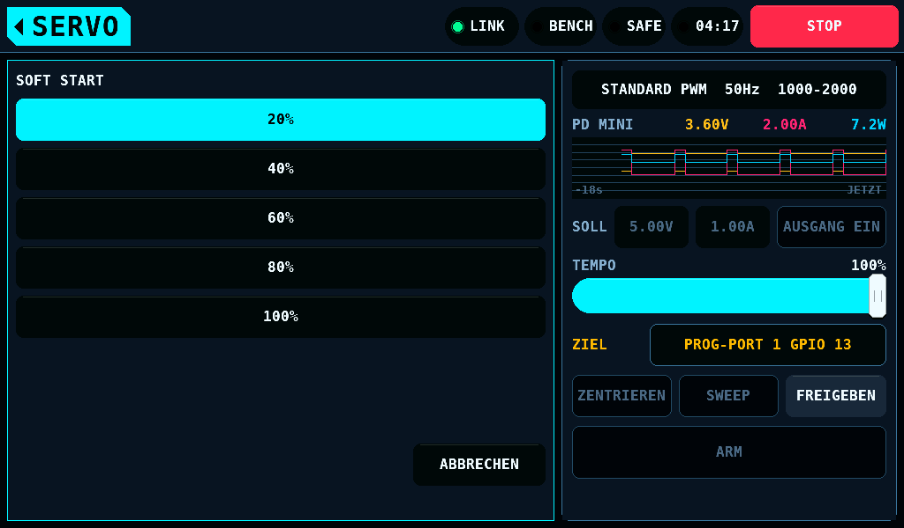
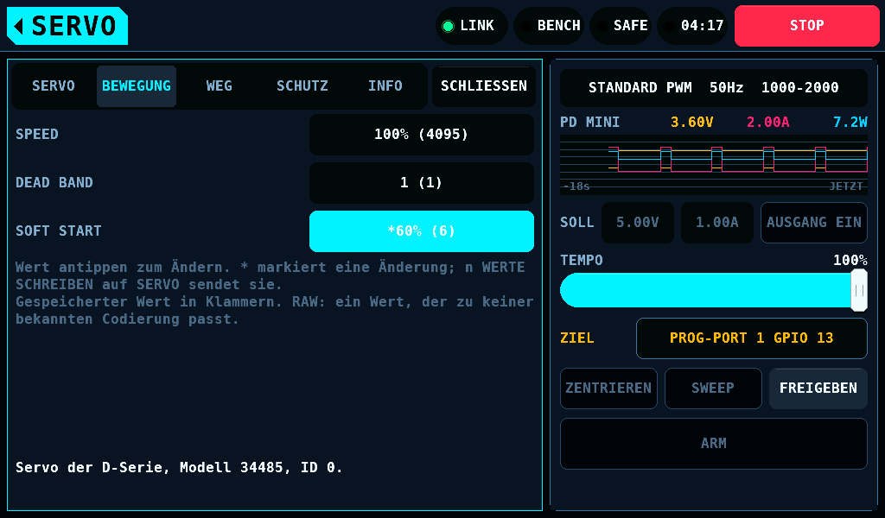
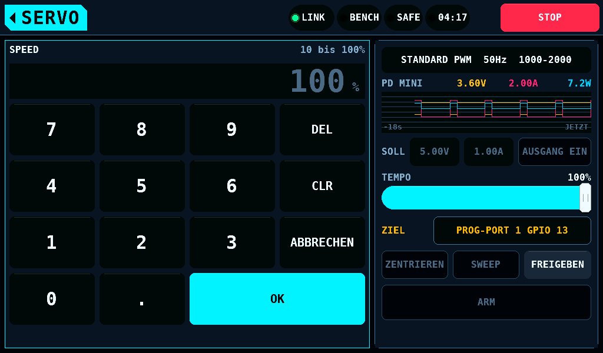
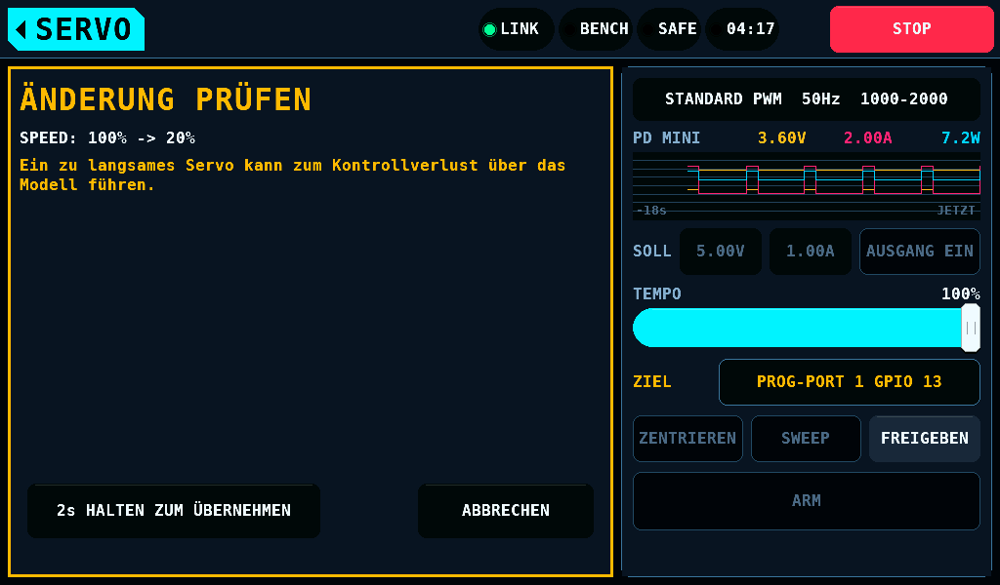

## Der Schreibschalter

**SCHREIBEN INS SERVO FREIGEBEN** steht zu Beginn auf AUS. Ein Tipp auf
**AUS** öffnet eine Seite, die die Risiken nennt; **2s HALTEN ZUM
FREIGEBEN** schaltet ihn ein. Ein Tipp auf **EIN** schaltet ihn sofort aus.
Ein Tipp auf **n WERTE SCHREIBEN**, ZURÜCKSPIELEN, PRÜFSUMME REPARIEREN
oder WERKSEINSTELLUNG bei ausgeschaltetem Schalter öffnet dieselbe Seite:
ihr Halten schaltet den Schalter ein und schreibt nichts.

Der Schalter geht aus:

- bei jedem Aufruf der Seite SERVO,
- bei jedem VERBINDEN und jedem VERLASSEN,
- wenn die Verbindung zum IOmcu abbricht,
- bei einem STOP und bei einem Schalten auf SAFE am Prüfstand,
- wenn ein Schreiben nicht geprüft endet,
- wenn ein Lesen andere Werte findet als die gehaltenen.

Er geht nur ein, wenn der Port gehalten, das Servo im Programmiermodus und
gelesen, der Port nicht gestoppt, der Prüfstand SAFE und kein STOP gesetzt
ist.

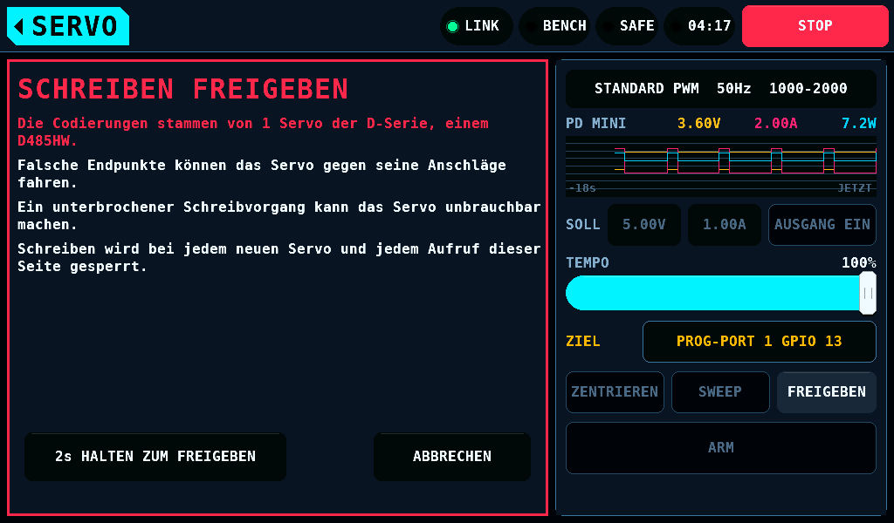

## Schreiben

**n WERTE SCHREIBEN** zählt die Werte, in denen der Entwurf vom Servo
abweicht. Ein Tipp öffnet die Schreibseite: die geänderten Werte,
`SOFT START: 20% -> 60%`, in der Reihenfolge der Reiter, höchstens 6 und
die Zahl der übrigen; `Halte das Ruderhorn frei. Löse das Gestänge.` und
`Teste das Servo am Prüfstand, bevor du es ins Modell einbaust.` beim
ersten Schreiben nach VERBINDEN und bei jedem Schreiben, das DREHRICHTUNG,
NEUTRAL, MITTE oder einen Endpunkt ändert; was die Serie tut; die
Backup-Datei oder die Zeilen ohne Backup-Datei ([Das Backup vor dem ersten
Schreiben](#das-backup-vor-dem-ersten-schreiben)); und wo die Werte vor dem
Schreiben vermerkt werden. **2s HALTEN ZUM SCHREIBEN** startet es.

1. Das zweite Lesen dessen, wovon der Plan abhängt
   ([Das zweite Lesen](#das-zweite-lesen)). Zwei Lesevorgänge, die
   voneinander abweichen, beenden das Schreiben hier, ohne dass etwas
   gesendet wird.
2. Die Backup-Datei, vor dem ersten Schreiben der Sitzung mit eingelegter
   Karte. Das Schreiben wartet bis zu 5000ms auf die Karte.
3. Der Vermerk: die Werte des Servos, die Werte, die das Schreiben
   hinterlassen soll, die Serie, der Port und sein GPIO. Mit eingelegter
   Karte geht er zuerst nach `BENCH/HITEC/CONF/HITEC.TXT`, und das
   Schreiben wartet darauf: eine Karte, die ihn nicht innerhalb von 3000ms
   annimmt, beendet das Schreiben mit `Datei nicht auf Karte gespeichert.
   Keine Werte ins Servo geschrieben.` Ohne Karte bleibt der Vermerk im
   Arbeitsspeicher. Ein Text, der von vor dem Schreiben noch auf der Karte
   unterwegs ist, der Vermerk eines abgebrochenen Schreibens oder der
   Text, der einen Vermerk löscht, gibt nichts frei: das Schreiben geht
   los, sobald die Karte seinen eigenen Vermerk angenommen hat, und die
   3000ms zählen ab dem Start des Schreibens.
4. Der Plan von `hitec_plan()`: nur die Einstellungen, die sich ändern.
   D-Serie: die Register der Einstellung, wie das HFP-30 sie schreibt, im
   Abstand von 20ms, dann das Speichern, 100ms, der Neustart und 1000ms.
   Klassisch: jede Zelle einer geänderten Einstellung, dann der Ausgleich
   in Zelle 0x1C, jede mit `+ +` beantwortet, mit 3 Versuchen.
5. Das Zurücklesen: der Satz von 21 Registern der D-Serie oder die
   klassischen Zellen 0x00 bis 0x23, gegen den Entwurf gehalten.
6. `2 Werte geschrieben und geprüft.` oder `1 Wert geschrieben und
   geprüft.` beendet es und löscht den Vermerk. Der Schalter bleibt ein.

Im Host-Modell (`test_hitec_prog_reread`) dauert ein Schreiben eines Werts
bei der D-Serie 3,2s bei 16ms je Frame und 3,5s bei 33ms, bei einem
klassischen Servo 2,4s und 4,9s, das zweite Lesen eingeschlossen. Am
Prüfstand sind diese Zeiten nicht gemessen.

Das Schreiben wird abgelehnt bei ARMED oder einem angeforderten Schalten
auf ARMED, mit gesetztem STOP, an einem gestoppten Port, ohne gelesenes
Servo, mit ausgeschaltetem Schalter, ohne Änderung, solange ein Vermerk
eines früheren Schreibens besteht und solange eine Anfrage an die Karte
(DATEIEN, Speichern oder Laden) auf ihre Antwort wartet. Port, Prüfstand, STOP, Einstieg und
Schalter werden erneut geprüft, wenn die Karte den Vermerk angenommen hat:
ein inzwischen ausgeschalteter Schalter, ein STOP oder ein Finger auf ARM
beendet das Schreiben, bevor ein Schritt hinausgeht, mit der Meldung der
Ablehnung, und löscht seinen Vermerk, auch auf der Karte. Solange das
Schreiben auf die Karte wartet, geht der Schalter nicht wieder ein.


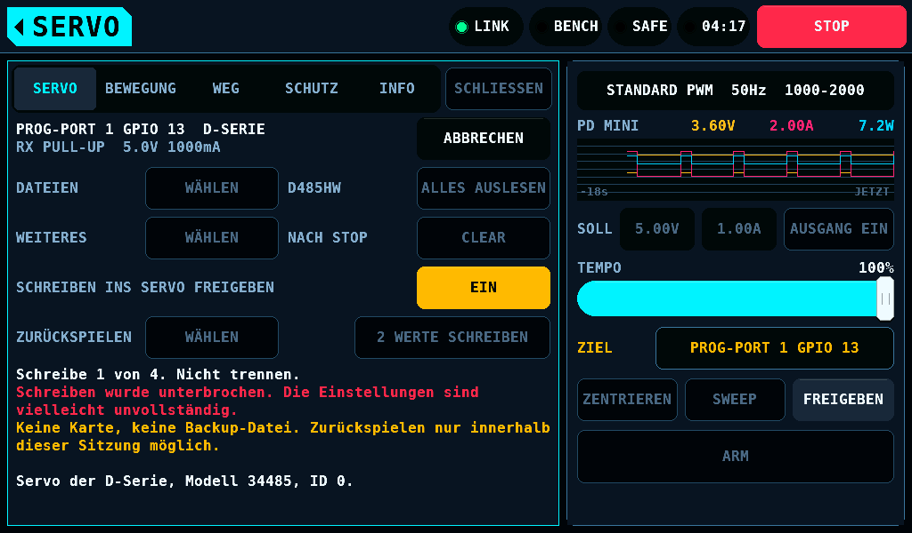

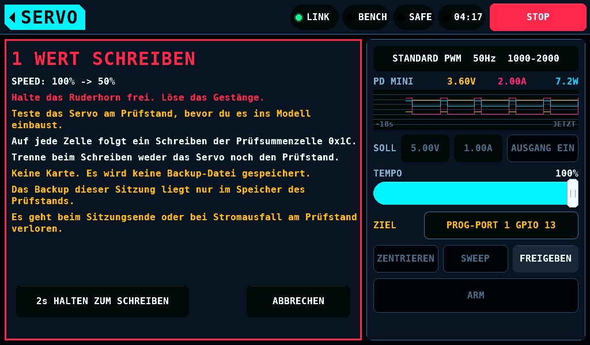

### Das zweite Lesen

Eine klassische Antwort trägt keine Prüfsumme: ein falsch gelesener Wert
erreicht den Plan unbemerkt. Eine Lesung am Prüfstand zeigte Zelle 0x17 als
0x04, wo das Servo 0x05 hielt. Jedes Schreiben liest deshalb die Adressen,
von denen sein Plan abhängt, ein zweites Mal, nach seinem Halten und bevor
sein Plan läuft, und vergleicht sie mit dem Lesen, aus dem der Plan
entsteht:

| Schreiben | Erneut gelesen |
| --- | --- |
| Klassisch: n WERTE SCHREIBEN, die Werte einer geladenen Datei, PRÜFSUMME REPARIEREN, ZURÜCKSPIELEN eines Vermerks oder des Backups der Sitzung | Zellen 0x00 bis 0x23, der Ausgleich 0x1C eingeschlossen: 36 |
| Klassisch: WERKSEINSTELLUNG | Zellen 0x00 bis 0x23 und der Werksblock 0x30 bis 0x53, aus dem ihre Werte stammen: 72 |
| D-Serie: jedes Schreiben | die 12 Register, die ein Plan schreibt (`hitec_writable()`): 0x32, 0x44, 0x4C, 0x4E, 0x54, 0x5E, 0x60, 0x6C, 0x9C, 0xB0, 0xB2, 0xC2 |

Eine Antwort der D-Serie trägt eine Summe, und die D-Serie wird trotzdem
zweimal gelesen. Die Statuszeile lautet `Zweites Lesen vor dem Schreiben:
5 von 36.`, und **ABBRECHEN** steht in der Zeile PORT.

- Die Lesevorgänge stimmen in jeder Adresse überein: das Schreiben geht
  weiter mit der Backup-Datei, dem Vermerk und dem Plan.
- Sie weichen in einer Adresse ab: `Zwei Lesevorgänge weichen bei 0x17 ab:
  mit ALLES AUSLESEN neu lesen.` Die erste abweichende Adresse wird
  genannt. Nichts wird geplant, vermerkt, gespeichert oder gesendet; das
  gelesene Servo bleibt das erste Lesen, und die Änderungen und der
  Schalter bleiben. Ein erneutes **n WERTE SCHREIBEN** vergleicht ein neues
  zweites Lesen mit demselben ersten. **ALLES AUSLESEN** nimmt ein neues
  erstes Lesen.
- **ABBRECHEN**, ein STOP oder ein fehlgeschlagenes Lesen während des
  zweiten Lesens beendet das Schreiben ebenso, mit `Der Vorgang wurde
  abgebrochen.`, der Zeile des STOP oder `Lesen bei Adresse 0x17
  fehlgeschlagen. ALLES AUSLESEN antippen.`

Die Zeit, die das zweite Lesen hinzufügt, gemessen im Host-Modell
(`test_hitec_prog_reread`) vom Ende des Haltens bis zum Ende des Lesens:

| Erneut gelesen | Frame von 16ms | Frame von 33ms |
| --- | --- | --- |
| Klassisch, 36 Zellen | 1152ms | 2376ms |
| Klassisch WERKSEINSTELLUNG, 72 Zellen | 2304ms | 4752ms |
| D-Serie, 12 Register | 704ms | 792ms |

Ein klassisches Lesen braucht 2 Frames je Zelle. Am Prüfstand sind diese
Zeiten nicht gemessen.

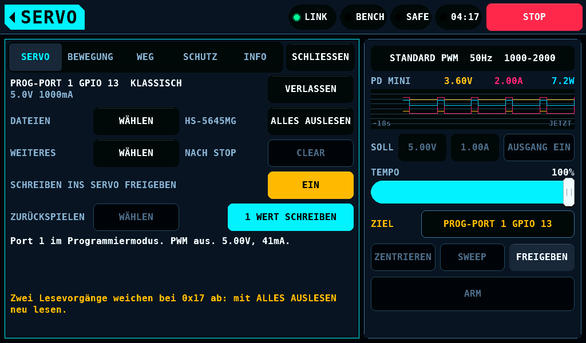

| Meldung | Das Servo |
| --- | --- |
| `Servowerte stimmen nach dem Schreiben nicht. ALLES AUSLESEN antippen.` | hält Werte, die das Zurücklesen anders als im Entwurf fand; der Vermerk bleibt |
| `Schreiben bei Register 0x54 unterbrochen. ALLES AUSLESEN antippen.` | hat die Register der D-Serie davor angenommen; nichts ist gespeichert |
| `Schreiben vor dem Speichern im Servo unterbrochen. ALLES AUSLESEN antippen.` | hat die Register angenommen, ungespeichert |
| `Schreiben nach dem Speichern, vor dem Neustart unterbrochen. ALLES AUSLESEN antippen.` | hat sie gespeichert; der Neustart steht aus |
| `Alle Werte gesendet; ihre Prüfung wurde unterbrochen. ALLES AUSLESEN antippen.` | hat alle angenommen; das Zurücklesen endete nicht |
| `Schreiben bei gespeichertem Wert 0x06 unterbrochen. ALLES AUSLESEN antippen.` und `Die Prüfsumme ist evtl. falsch: Servo folgt PWM evtl. nicht, zieht evtl. Strom bis zur Grenze der Versorgung.` | hält vielleicht die neue Zelle ohne ihren Ausgleich |
| `Gespeicherter Wert 0x06 ist geschrieben, seine Prüfsumme in 0x1C nicht. ALLES AUSLESEN antippen.` und dieselbe zweite Zeile | hält die neue Zelle und den alten Ausgleich: die Prüfsumme ist falsch |
| `Ein Schreibvorgang endete ungeprüft. Vor dem nächsten ALLES AUSLESEN antippen.` | ein Schreiben, bei dem ein Schritt hinausging, lässt offen, was das Servo hält; ALLES AUSLESEN kommt vor dem nächsten Schreiben |

Ein Schreiben, das anders als geprüft endet, schaltet den Schalter aus.

## Der Vermerk eines Schreibvorgangs

Der Vermerk besteht vom Start eines Schreibens, bis das Schreiben geprüft
endet, das Schreiben endet, bevor ein Schritt das Servo erreicht hat, ein
ZURÜCKSPIELEN geprüft endet oder er verworfen wird. Mit Karte
wird er beim nächsten Start des Panels wieder gelesen: ein Panel, das
während eines Schreibens neu startet, behält ihn. Dann sagt das
Meldungsband `Schreiben wurde unterbrochen. Die Einstellungen sind
vielleicht unvollständig.` und `Benutze das Servo nicht. An GPIO 13
anschließen und ALLES AUSLESEN tippen.`, und der Reiter SERVO behält die
erste Zeile, bis ein Servo gelesen ist. Das nächste vollständige Lesen
vergleicht das Servo mit dem Vermerk, Adresse für Adresse über die
Adressen, die ein Schreiben ändert:

| Das Servo hält | Meldung | ZURÜCKSPIELEN bietet |
| --- | --- | --- |
| die Werte vor dem Schreiben | `Ist dies das Servo, dessen Schreibvorgang an GPIO 13 unterbrochen wurde?` `Es enthält die alten Werte. Ist es dasselbe Servo, den Vermerk unter ZURÜCKSPIELEN verwerfen.` | das Zurückspielen, das dann nichts sendet und den Vermerk löscht, und das Verwerfen |
| die Werte, die das Schreiben hinterlassen sollte | dieselbe erste Zeile und `Es enthält die neuen Werte. Ist es dasselbe Servo, den Vermerk unter ZURÜCKSPIELEN verwerfen.` | das Zurückspielen und das Verwerfen |
| von beiden etwas | `Das Servo enthält alte und neue Werte gemischt.` `Benutze dieses Servo nicht. ZURÜCKSPIELEN schreibt die Werte vor dem Schreibvorgang zurück.` | das Zurückspielen und das Verwerfen |
| eine andere Serie, einen anderen Port oder ein anderes Modell der D-Serie, oder einen Wert, der keiner von beiden ist | `Der unterbrochene Schreibvorgang betraf ein anderes Servo.` `Es war an GPIO 13 angeschlossen. Vermerk unter ZURÜCKSPIELEN verwerfen.` | nur das Verwerfen |

Der klassische Ausgleich 0x1C wird nicht verglichen: ein Schreiben, das
zwischen einer Zelle und ihrem Ausgleich abbricht, hinterlässt dort einen
dritten Wert. ZURÜCKSPIELEN schreibt die Werte vor dem Schreiben als
eigenes Schreiben zurück, mit dem Schalter, der Halteseite `ZURÜCKSPIELEN`
und ihrem Zurücklesen; der Vermerk bleibt, bis das geprüft endet.
`Vermerk zum unterbrochenen Schreibvorgang verwerfen.` entfernt ihn ohne
Schreiben. Solange ein Vermerk besteht, werden n WERTE SCHREIBEN und
PRÜFSUMME REPARIEREN abgelehnt: `Schreiben und PRÜFSUMME REPARIEREN warten
auf den Vermerk: unter ZURÜCKSPIELEN zurückspielen oder verwerfen.`
Die Dateiverwaltung zeigt `HITEC.TXT` und `HITEC.NEW` nur mit INFO: eine
Änderung von Hand könnte falsche Werte an ein Servo senden.

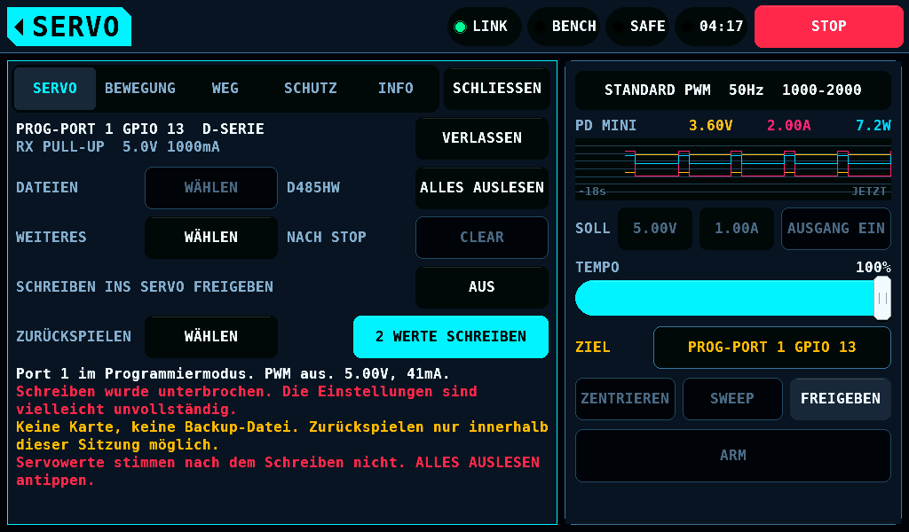
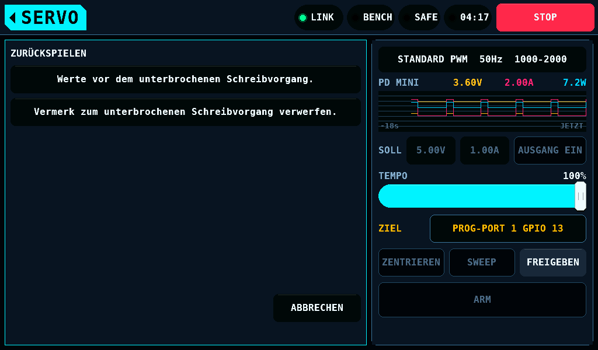

## Servodateien

Eine Servodatei ist eine Textdatei im Ordner `BENCH/HITEC/CONF` der
SD-Karte des Panels, `<Name>.TXT`, neben dem Vermerk `HITEC.TXT`. Das Panel
legt beim ersten Speichern jede fehlende Ebene des Ordners an: `BENCH`,
`BENCH/HITEC`, dann `BENCH/HITEC/CONF`. Eine Datei hält den Satz, den ALLES
AUSLESEN liest: 21 Register eines Servos der D-Serie, 100 Zellen eines
klassischen Servos und seine Version.

```
RCBENCH HITEC 1
series=D
model=D485HW
image=86B500271FC1000000000000000100010FFF000000010FFF000009C410FE006432CB0D17200000000000
backup=0
check=1E29
```

| Zeile | Inhalt |
| --- | --- |
| 1 | `RCBENCH HITEC 1`, das Format; der Vermerk hat dieselbe erste Zeile und `port=` als dritte |
| `series=` | `D` oder `C` |
| `model=` | der Name des Modells, `D485HW` oder `HS-5645MG`; `D series 34999` für eine Modellnummer der D-Serie, die das Registermodell nicht nennt; die Namenszellen wie gelesen für einen anderen klassischen Namen; `?` für keinen. 1 bis 20 druckbare Zeichen |
| `image=` | D-Serie: die Register in der Reihenfolge, in der ALLES AUSLESEN sie liest, je 4 Hexadezimalziffern, 84 Ziffern. Klassisch: die Zellen 0x00 bis 0x23, 0x30 bis 0x53, 0x60 bis 0x6F, 0x70 bis 0x73 und 0x80 bis 0x87, je 2 Ziffern, 200 Ziffern |
| `version=` | nur klassisch, 2 Ziffern, wo das Lesen eine fand |
| `backup=` | `1` für eine Backup-Datei ([Das Backup vor dem ersten Schreiben](#das-backup-vor-dem-ersten-schreiben)), `0` für jedes andere Speichern |
| `check=` | die CRC-16 (zyklische Redundanzprüfung) aller Bytes vor dieser Zeile, 4 Ziffern |

Zeilen enden nur mit LF (Zeilenvorschub), die Ziffern sind Großbuchstaben.
Eine Datei eines D485HW hat 149 Bytes, eine eines HS-5645MG 279 Bytes; das
Panel liest höchstens 320 Bytes. Eine Datei, deren Prüfsumme nicht stimmt
oder deren Zeilen nicht diese in dieser Reihenfolge sind, wird ganz
abgelehnt: eine von Hand bearbeitete Datei wird nicht geladen. Eine Datei
ohne die Zeile `backup=` wird geladen; sie zählt als Backup-Datei, wenn ihr
Name ein vorgeschlagener Name ist, `HITEC001` bis `HITEC999`.

**DATEIEN** öffnet die Liste. Sie nimmt einen Tipp an, wenn der Port
gehalten, das Servo im Programmiermodus und gelesen ist, kein Lesen nach
einem Schreiben aussteht, der Port nicht gestoppt, der Prüfstand SAFE und
kein STOP gesetzt ist; sonst sagt der Tipp, warum nicht. Speichern und
Laden gehen auch mit ausgeschaltetem Schreibschalter: eine Datei ändert den
Entwurf im Panel, nie das Servo.

Der erste Eintrag speichert. Darunter stehen die Dateien nach Namen
sortiert, 5 je Seite, jede mit dem Modell, das ihre Datei nennt. Die
Dateien mit einem vorgeschlagenen Namen, `HITEC` und 3 Ziffern, stehen
zusammen an der Stelle von `HITEC000`, die höchste Nummer zuerst. Bei mehr
als 5 Dateien zählt sie der Titel, `DATEIEN 1 BIS 5 VON 7`, und `Weitere
Dateien anzeigen.` blättert weiter, nach der letzten zurück zur ersten
Seite. Das Panel fragt die Karte nach jeder Seite und wartet höchstens
5000ms darauf: sonst `Die Karte lässt sich nicht lesen.`


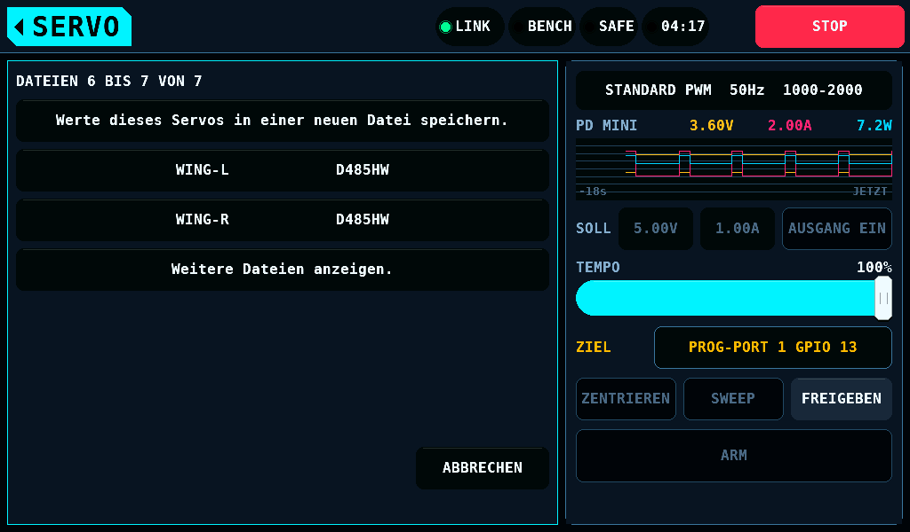
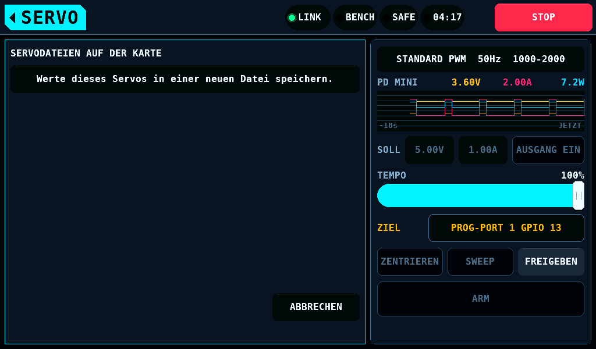

### Speichern

`Werte dieses Servos in einer neuen Datei speichern.` öffnet die Tastatur
mit dem nächsten freien vorgeschlagenen Namen, `HITEC001` bis `HITEC999`.
Die Tastatur nimmt bis zu 16 Zeichen: A bis Z, 0 bis 9, `-`, `_` und den
Punkt. **OK** speichert das Servo, wie es zuletzt gelesen wurde; eine
Änderung im Entwurf steht nicht in der Datei. Die Kartenseite prüft den
Namen und ersetzt nie eine Datei. Namen werden ohne Groß- und
Kleinschreibung verglichen. Eine Datei mit längerem Namen, bis 32 Zeichen,
wird gelistet und geladen.

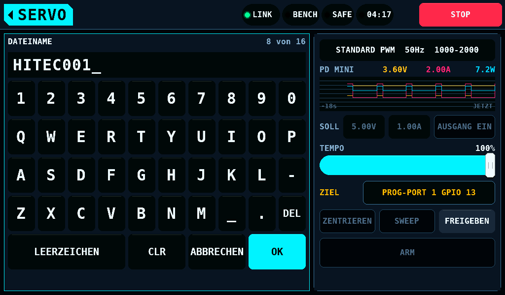
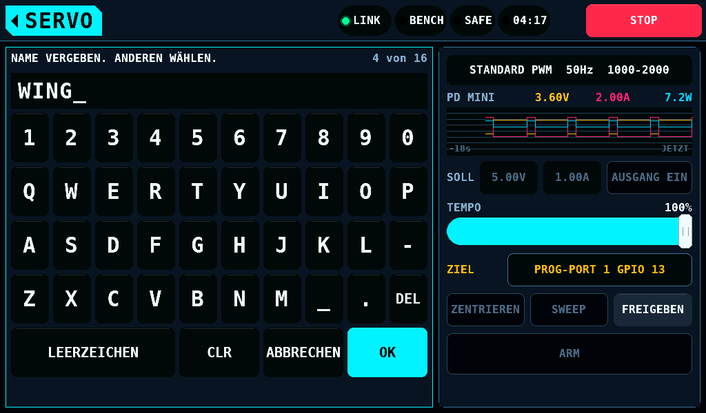

| Ergebnis | Angezeigt |
| --- | --- |
| Gespeichert | `Servowerte auf der Karte gespeichert: WING-L.` |
| Ein Punkt am Anfang oder Ende, oder ein reservierter Name: `HITEC`, `CON`, `PRN`, `AUX`, `NUL`, `COM1` bis `COM9`, `LPT1` bis `LPT9`, allein oder vor einem Punkt | die Tastatur öffnet sich wieder unter `UNGÜLTIGER NAME`; `Ungültiger Name: reserviert oder mit einem Punkt am Anfang oder Ende.` |
| Eine Datei hat den Namen | die Tastatur öffnet sich wieder unter `NAME VERGEBEN. ANDEREN WÄHLEN.`; `Dieser Dateiname ist bereits vergeben. Keine Datei wurde ersetzt.` |
| Keine Karte | `Keine Karte. Nichts gespeichert oder ins Servo geschrieben.` |
| Karte voll, oder `HITEC001` bis `HITEC999` beim Backup vor einem Schreiben alle vergeben | `Karte voll. Nichts gespeichert oder ins Servo geschrieben.` |
| Die Karte ist schreibgeschützt, oder `BENCH`, `BENCH/HITEC` oder `BENCH/HITEC/CONF` ist auf der Karte eine Datei und kein Ordner | `Speichern nicht möglich: Karte schreibgeschützt oder BENCH/HITEC/CONF kein Ordner.` |
| Die Karte scheitert am Schreiben der Datei oder antwortet nicht innerhalb von 5000ms | `Schreibfehler auf der Karte. Keine Werte ins Servo geschrieben.` |

Ein Speichern, das die Karte nach den 5000ms abschließt, ist die Datei, die
sie angelegt hat; die Zeile bleibt, wie sie war.

### Das Backup vor dem ersten Schreiben

Das Backup der Sitzung ist das erste vollständige Lesen nach VERBINDEN,
gehalten im Arbeitsspeicher des Panels. Ein späteres Lesen desselben
Servos lässt es, wie es ist. Ein Lesen, das ein anderes Servo findet, macht
dieses Lesen zum Backup. Ein klassisches Servo ist ein anderes Servo durch
einen anderen Namen, ein anderes Datum, eine andere Seriennummer oder
Version. Ein Servo der D-Serie ist ein anderes Servo durch eine andere
Modellnummer oder wenn das Lesen die Kette der Sitzung bricht. Der Port ist
gehalten, also schreibt nur die Sitzung das Servo, und ein Lesen der
D-Serie ist vom Servo des Lesens davor, wenn:

- kein Schreiben der Sitzung ungeprüft ist und jedes Register, das ein
  Schreiben sendet, den Wert des Lesens davor hält; oder
- ein Schreiben ungeprüft ist (seine Prüfung scheiterte, oder es wurde
  unterbrochen) und der Vermerk dieses Schreibens die Werte erklärt: das
  Lesen findet die Werte vor dem Schreiben, seine neuen Werte oder von
  beiden etwas ([Der Vermerk eines
  Schreibvorgangs](#der-vermerk-eines-schreibvorgangs)). Ist der Vermerk
  verworfen, entscheiden die Werte, gegen die Werte, die die gescheiterte
  Prüfung zurückgelesen hat.

Die Kette vergleicht mit dem Lesen davor, nicht mit dem Backup: die eigenen
geprüften Schreibvorgänge der Sitzung, die ID 0x32 eingeschlossen,
erhalten sie. Ein Lesen eines anderen Servos sagt

```
Andere Werte als beim letzten Auslesen: als anderes Servo genommen.
Sein Backup sind die jetzt ausgelesenen Werte.
```

Die Zeile der Backup-Datei entfällt, ZURÜCKSPIELEN bietet das Backup des
ersten Servos nicht an, und das erste Schreiben auf das neue Servo
speichert eine eigene Backup-Datei. Besteht ein Vermerk, steht seine Zeile
an der Stelle dieser beiden. VERLASSEN, das nächste VERBINDEN, eine
verlorene Verbindung und ein Neustart des Panels beenden das Backup; das
erste Lesen der nächsten Sitzung ist ihr Backup ohne diese Zeilen. Eine
Datei, die die
Karte für ein Backup anlegt, oder ein Speichern von Hand zählt nur für das
Backup, das bei der Anfrage bestand: eine späte Antwort nach VERLASSEN und
VERBINDEN oder nach dem Lesen eines anderen Servos speichert nichts für das
neue.

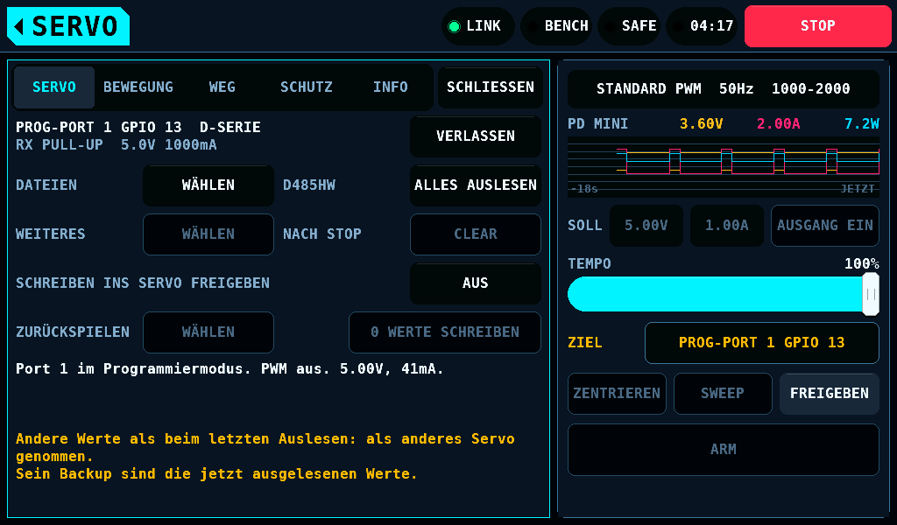

Das erste Schreiben einer Sitzung, das einen Schritt sendet, n WERTE
SCHREIBEN, PRÜFSUMME REPARIEREN, ein ZURÜCKSPIELEN oder WERKSEINSTELLUNG,
speichert zuerst das Backup ohne Nachfrage in eine neue Datei unter dem
nächsten vorgeschlagenen Namen. Die Schreibseite sagt `Die bisherigen
Servowerte werden vor dem Schreiben in einer neuen Kartendatei gesichert.`
und die Zustandszeile `Backup-Datei wird auf der Karte gespeichert.`,
solange die Karte arbeitet. Das Servo erhält nichts, bevor die Karte die
Datei hält. Eine Karte, die voll oder schreibgeschützt ist, die am
Schreiben scheitert, die zwischen Anfrage und Datei den Steckplatz verlässt
oder die nicht innerhalb von 5000ms antwortet, beendet das Schreiben mit
den Zeilen der Tabelle oben, und nichts wird ins Servo geschrieben.
ABBRECHEN und STOP, während die Karte arbeitet, beenden das Schreiben
ebenso. Eine Datei, die die Karte nach den 5000ms anlegt, hält das Backup
trotzdem; das Schreiben geht nicht von selbst weiter. Der Reiter SERVO
nennt dann die Datei: `Backup-Datei dieser Sitzung: HITEC003.` Ein
Speichern von Hand vor dem ersten Schreiben zählt als diese Datei, solange
das Servo noch die Werte des Backups hält. Ein Speichern von Hand nach
einem Schreiben hält die geschriebenen Werte und lässt die Zeile, wie sie
ist. Die Backup-Datei und jedes Speichern von Hand des Servos, wie die
Sitzung es vorfand, vor dem ersten Schreiben tragen `backup=1`; jedes andere
Speichern trägt `backup=0`. Eine Backup-Datei bringt mehr zurück als eine
Einstellung ([Laden einer Backup-Datei](#laden-einer-backup-datei)).

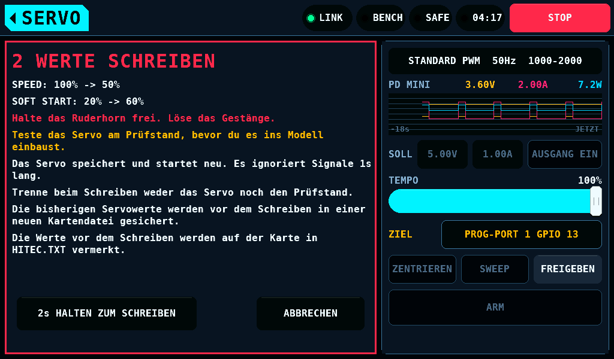
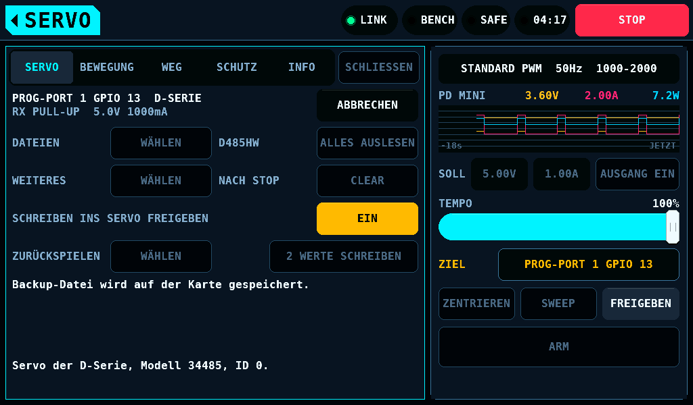
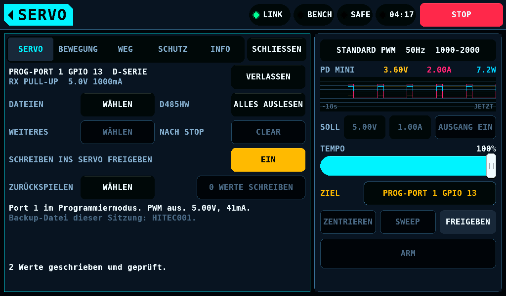

#### Ohne Karte

Ohne eingehängte Karte ist das Schreiben nicht gesperrt. Die Schreibseite
trägt drei weitere Zeilen:

```
Keine Karte. Es wird keine Backup-Datei gespeichert.
Das Backup dieser Sitzung liegt nur im Speicher des Prüfstands.
Es geht beim Sitzungsende oder bei Stromausfall am Prüfstand verloren.
```

Nach dem Schreiben zeigt der Reiter SERVO `Keine Karte, keine
Backup-Datei. Zurückspielen nur innerhalb dieser Sitzung möglich.` Eine
später in der Sitzung eingelegte Karte erhält das Backup mit dem nächsten
Schreiben: die Datei hält das Servo, wie die Sitzung es vorfand, nicht wie
es gerade steht. Eine Karte, die den Steckplatz verlässt, nachdem die
Backup-Datei gespeichert ist, lässt spätere Schreibvorgänge zu; die
Schreibseite sagt dann `Keine Karte. Die bisherigen Werte bleiben nur im
Arbeitsspeicher.` Eine Karte im Steckplatz, die sich nicht einhängen
lässt, zählt als keine Karte, und die Zeilen nennen an Stelle von `Keine
Karte`, was das Panel fand, wie bei der KST-Programmierung ([Ohne
Karte](ServoProgrammer-de.md#ohne-karte)).


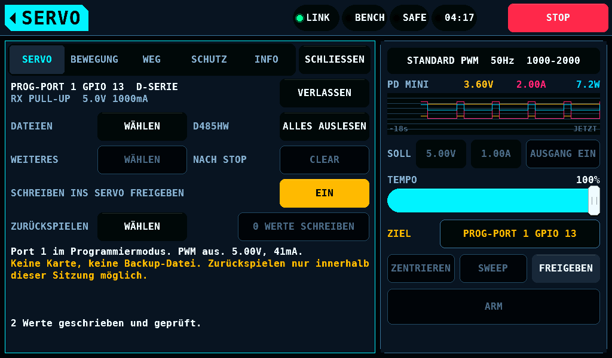

### Laden

Ein Tipp auf eine Datei lädt sie. Die Zellen oder Register jedes
änderbaren Werts werden zum Entwurf, so wie sie gespeichert sind: ein
Wert, der zu keiner Kodierung passt, kommt roh zurück. Ein klassischer
Entwurf erhält seinen Ausgleich in Zelle 0x1C berechnet. Die geänderten
Werte sind mit `*` markiert, **n WERTE SCHREIBEN** zählt sie, und nichts
erreicht das Servo vor dem Schreibschalter, der Schreibseite und ihrem
Halten von 2s.

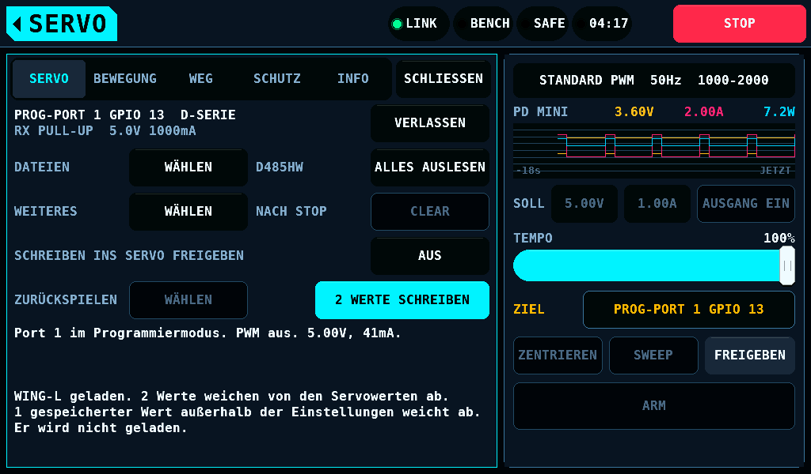

| Datei | Angezeigt |
| --- | --- |
| Geladen | `WING-L geladen. 2 Werte weichen von den Servowerten ab.` oder `WING-L geladen. 1 Wert weicht von den Servowerten ab.` |
| Hält die änderbaren Werte des Servos | `WING-L stimmt mit den Servowerten überein. Nichts zu schreiben.`; der Entwurf wird zu den Werten des Servos, und eine Änderung von vor dem Laden fällt samt ihren Bestätigungen weg |
| Werte außerhalb der änderbaren weichen ab | eine zweite Zeile: `2 gespeicherte Werte außerhalb der Einstellungen weichen ab. Sie werden nicht geladen.` oder `1 gespeicherter Wert außerhalb der Einstellungen weicht ab. Er wird nicht geladen.` |
| Eine Backup-Datei des gelesenen Servos, deren Werte außerhalb der änderbaren abweichen | DIESE DATEI PRÜFEN mit `Werte außerhalb der Einstellungen, auch geladen: 1.`; nach dem Halten dieselbe Zeile unter der Zeile des Ladens ([Laden einer Backup-Datei](#laden-einer-backup-datei)) |
| Von der anderen Serie | `Datei ist KLASSISCH, Servo ist D-SERIE. Nicht geladen.` |
| Vom anderen klassischen Layout | `Datei ist für HS-7xxx-Servos, dieses Servo ist HS-5xxx. Nicht geladen.` |
| Von einem anderen Modell desselben Layouts, oder jenseits einer weichen Regel | DIESE DATEI PRÜFEN, unten; `Bestätige die Warnungen, bevor du diese Datei lädst.` |
| Eine falsche Prüfsumme | `Datei beschädigt: Prüfsumme stimmt nicht. Nicht geladen.` `Eine von Hand bearbeitete Datei wird nicht geladen.` |
| Endet vor ihrer Prüfzeile | `Datei beschädigt: Sie endet vor ihrer Prüfzeile. Nicht geladen.` und dieselbe zweite Zeile |
| Eine Zeile, die nicht die fällige ist | `Zeile 5 ist nicht lesbar. Datei nicht geladen.` und dieselbe zweite Zeile |
| Keine Servodatei, oder größer als 320 Bytes | `Keine Servodatei. Nicht geladen.` |
| Die Karte lässt sich nicht lesen oder antwortet nicht innerhalb von 5000ms | `Die Karte lässt sich nicht lesen.` |

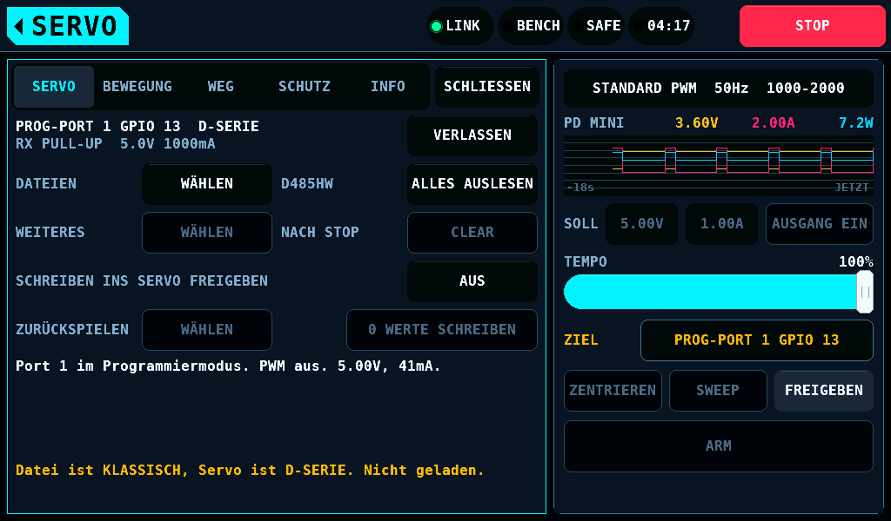
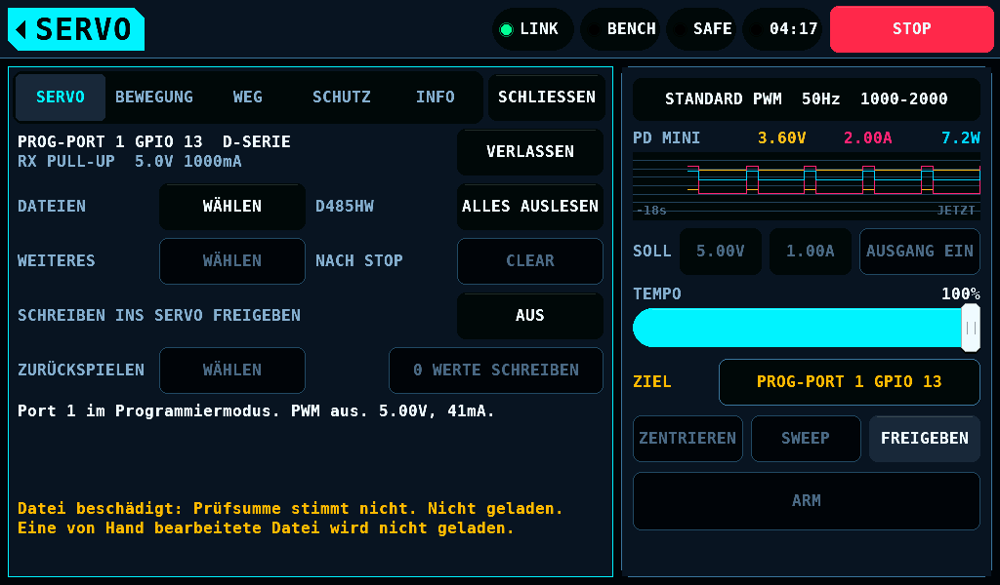

DIESE DATEI PRÜFEN öffnet sich, bevor etwas zum Entwurf wird, wenn die
Datei ein anderes Modell nennt, `Dateimodell D series 34999, Servomodell
D485HW.` und `Werte eines anderen Modells passen vielleicht nicht zu
diesem Servo.`, oder wenn ein Wert, den sie lädt, eine weiche Regel
überschreitet, die der eigene Wert des Servos einhält. Die Seite nennt die
Datei und die abweichenden Werte und dieselben Warnzeilen wie eine Änderung
jenseits dieser Regeln ([Ein Wert, der einen zweiten
Blick braucht](#ein-wert-der-einen-zweiten-blick-braucht)). Die Werte
weichen den Warnungen: die letzte Zeile, die passt, zählt den Rest, `und 3
weitere`, und keine Wertzeile bleibt, wo die Warnungen den Platz brauchen.
Warnungen, die dann noch nicht über die Haltetaste passen, kommen in einen
nächsten Teil der Seite unter der Zeile der Datei, hinter **2s HALTEN ZUM
FORTFAHREN**; eine Datei eines anderen Modells jenseits aller 7 Regeln
braucht auf Englisch 1 Teil und auf Deutsch 2. **2s HALTEN ZUM LADEN** im
letzten Teil übernimmt die Werte in den Entwurf, jede Regel für ihren Wert
bestätigt. **ABBRECHEN** und ZURÜCK lassen in jedem Teil den Entwurf, wie
er war.

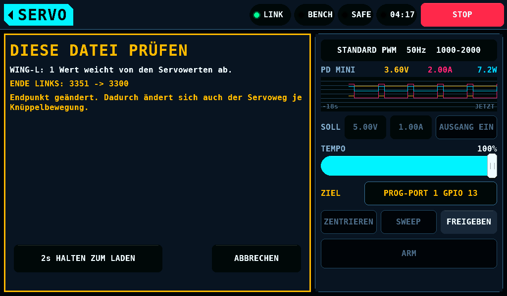
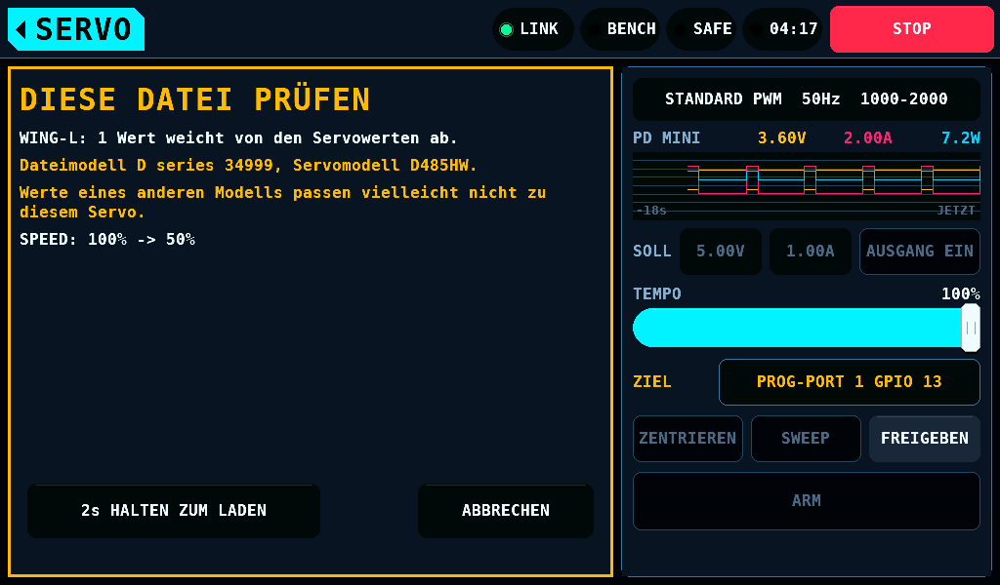
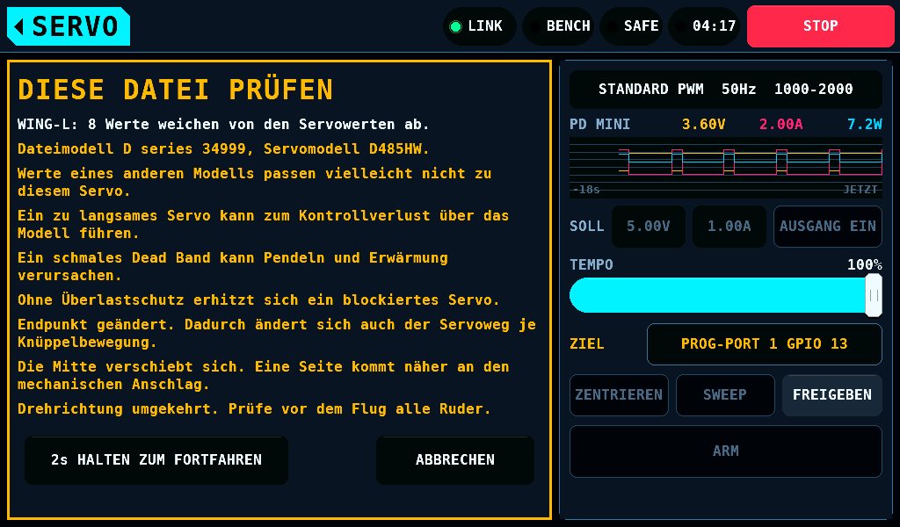
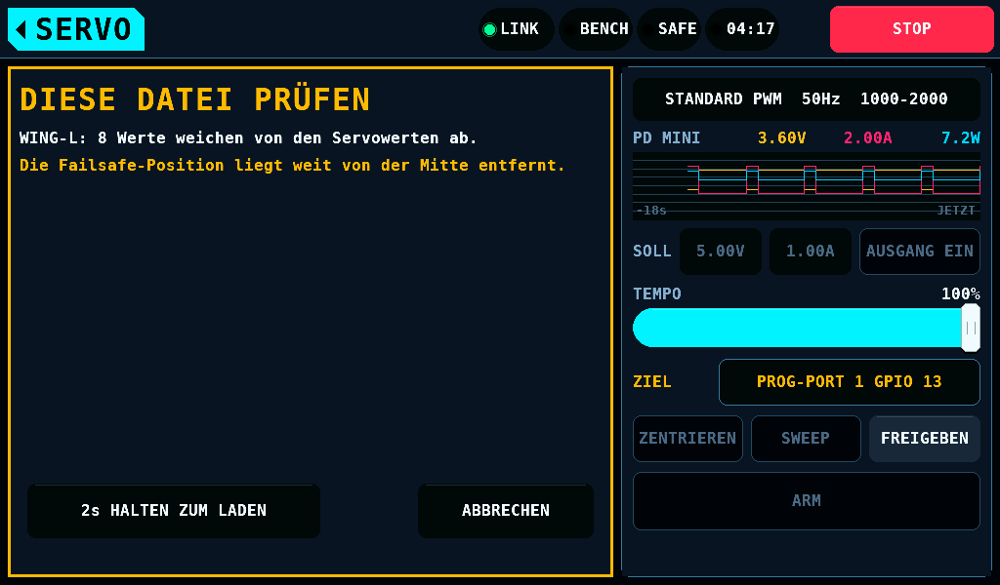

#### Was eine Datei nicht lädt

Ein Laden schreibt nur die änderbaren Werte. Diese bleiben, wie das Servo
sie hält: bei der D-Serie die Register 0x00 (das Modell), 0x04, 0x22, 0x64
(EMPFINDLICHKEIT), 0xD4 und 0xD6; bei einem klassischen Servo die Zellen
ohne änderbaren Wert in 0x00 bis 0x23, die Werkszellen 0x30 bis 0x53, der
Name, das Datum, die Seriennummer und die Version. Die Position der
D-Serie, Register 0x0C, und der klassische Ausgleich, Zelle 0x1C, werden
nicht gezählt. ZURÜCKSPIELEN des Backups der Sitzung schreibt die Zellen
und Register, die ein Laden lässt, und ebenso eine Backup-Datei des
gelesenen Servos.

#### Laden einer Backup-Datei

Eine Backup-Datei ist eine Datei mit `backup=1` oder eine Datei ohne Zeile
`backup=` unter einem vorgeschlagenen Namen, `HITEC001` bis `HITEC999`.
Eine Backup-Datei des gelesenen Servos lädt jede Adresse, die ein
Schreiben sendet, wie ZURÜCKSPIELEN des Backups der Sitzung: die
klassischen Zellen 0x00 bis 0x23 ohne den Ausgleich 0x1C und die 12
Register der D-Serie 0x32, 0x44, 0x4C, 0x4E, 0x54, 0x5E, 0x60, 0x6C, 0x9C,
0xB0, 0xB2 und 0xC2. Die Datei ist vom gelesenen Servo, wenn Serie und
Layout passen und:

| Serie | Verglichen mit dem gelesenen Servo |
| --- | --- |
| D-Serie | die Modellnummer, Register 0x00 |
| Klassisch | die Namenszellen 0x60 bis 0x6F, die Datumszellen 0x70 bis 0x73, die Seriennummernzellen 0x80 bis 0x87 und die Version |

Eine Backup-Datei eines anderen Servos und jede Datei mit `backup=0` lädt
wie jede andere Datei. Jedes der 12 Register der D-Serie ist ein änderbarer
Wert; eine Backup-Datei der D-Serie lädt also, was jede Datei lädt.

WERKSEINSTELLUNG eines HS-7955TG ändert Zelle 0x22, AUFLÖSUNG, die keine
Änderung erreicht. Nach VERLASSEN ist das Backup der Sitzung weg; die vor
WERKSEINSTELLUNG gespeicherte Backup-Datei `HITEC001` bringt 0x22 mit den 4
Werten der Zellen 0x08, 0x13, 0x14 und 0x1B zurück.

Weicht eine klassische Zelle außerhalb der änderbaren Werte ab, öffnet
sich zuerst DIESE DATEI PRÜFEN mit `Werte außerhalb der
Einstellungen, auch geladen: 1.`. **2s HALTEN ZUM LADEN** übernimmt die
Zellen in den Entwurf, und die Meldung zeigt dieselbe Zeile unter
`HITEC001 geladen. 5 Werte weichen von den Servowerten ab.` Eine Zelle, die
keine Wertzeile nennt, zählt als Wert von **n WERTE SCHREIBEN**; die
Schreibseite zeigt `Werte außerhalb der Einstellungen, auch
geschrieben: 1.`, und das Schreiben sendet die Zelle. ZURÜCKSPIELEN,
PRÜFSUMME REPARIEREN und WERKSEINSTELLUNG warten darauf wie auf eine
Änderung; ÄNDERUNGEN VERWERFEN verwirft sie.


## Zurückspielen des Backups der Sitzung

**ZURÜCKSPIELEN** bietet `Backup der zuerst in dieser Sitzung ausgelesenen
Werte.` an, solange das Backup in einer Adresse, die ein Schreiben sendet,
vom Servo abweicht: jedes Register der D-Serie und jede klassische Zelle
0x00 bis 0x23, die ein Plan schreibt, rohe Werte eingeschlossen. Ein Tipp
öffnet ZURÜCKSPIELEN: die Werte, die sich ändern, `Dieses Backup wird ohne
Prüfung der Grenzwerte zurückgespielt.`, die Zahl der klassischen Zellen
ohne änderbaren Wert, die es zurückschreibt, `Werte außerhalb
der Einstellungen, auch zurückgespielt: 1.`, und die Zeilen der
Backup-Datei. **2s HALTEN ZUM ZURÜCKSPIELEN** schreibt es als Schreiben:
zuerst die Backup-Datei, wenn keine es hält, der Vermerk, die Schritte und
das Zurücklesen. Es endet mit `Backup zurückgespielt und geprüft.` Es
braucht den Schalter und keine offene Änderung. Besteht ein Vermerk eines
unterbrochenen Schreibens, behält es diesen und braucht zuerst dessen
Vergleich durch ALLES AUSLESEN, wie ZURÜCKSPIELEN des Vermerks.

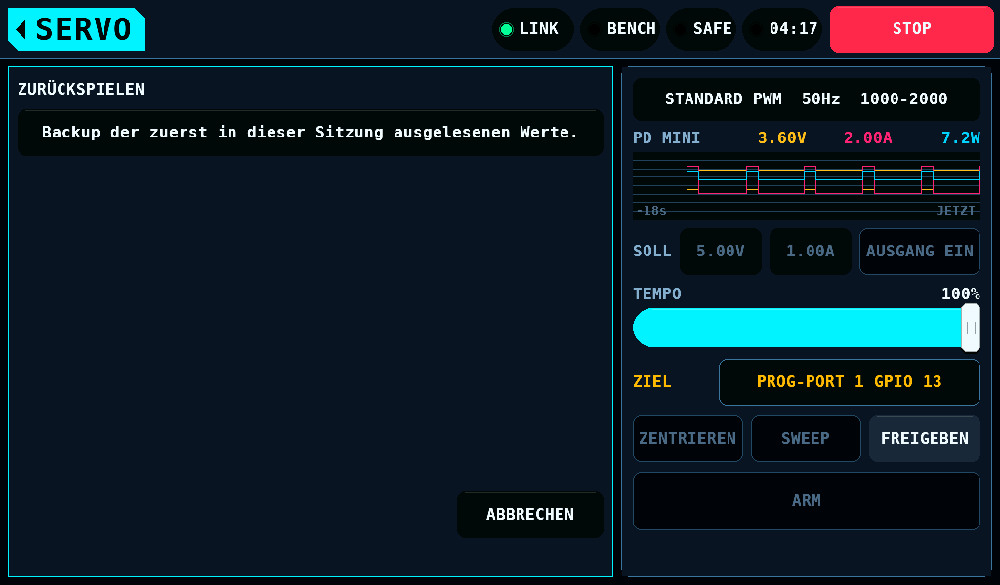


## WERKSEINSTELLUNG

Nur klassische Servos. Ein klassisches Servo hält seine Werkswerte in den
Zellen 0x30 bis 0x53, im selben Aufbau wie seine Einstellungen in den
Zellen 0x00 bis 0x23. Das Zurücksetzen des HPP-21 Plus kopiert sie
darüber, am Prüfstand am 18.10.2026 für das HS-5645MG und das HS-7955TG
mitgeschnitten. WERKSEINSTELLUNG unter WEITERES plant dieselbe Kopie aus
den eigenen Werkszellen des Servos, wie gelesen, mit berechnetem
Ausgleich, und öffnet eine Seite mit `Alle Einstellungen gehen auf
Werkswerte zurück.`, `Quelle sind die eigenen gespeicherten Werkswerte 0x30-0x53
des Servos.`, den Werten, die sich ändern, der Zahl der Zellen ohne
Einstellung, die sie schreibt, `Werte außerhalb der Einstellungen,
auch geschrieben: 1.`, der Zeile zum Ruderhorn und den Zeilen der Backup-Datei. **2s HALTEN ZUM SCHREIBEN** schreibt sie als
Schreiben und endet mit `Werkswerte geschrieben und geprüft.` Sie braucht
den Schalter, keine offene Änderung und keinen Vermerk. Sie wird
angeboten, solange eine Zelle von 0x00 bis 0x23, die ein Schreiben sendet,
von ihrer Werkszelle abweicht, auch eine, die keine Einstellung nennt; ein
Servo, dessen Zellen die Werkswerte schon halten, erhält `Kein Wert weicht
vom Servo ab.`

Ein Servo der D-Serie hat keine WERKSEINSTELLUNG: sein Rücksetzbefehl
(Register 0x6E = 0x0F0F, wie das HFP-30 ihn sendet) hinterlässt Werte, die
vor dem Senden nicht bekannt sind; die Schreibseite kann sie nicht nennen,
und das Zurücklesen hat nichts, wogegen es sie hält.

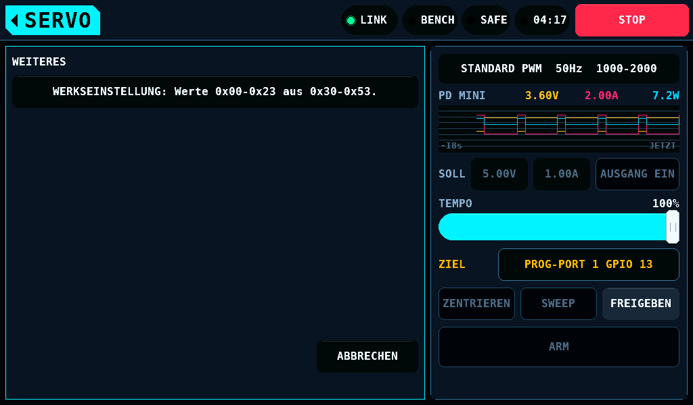
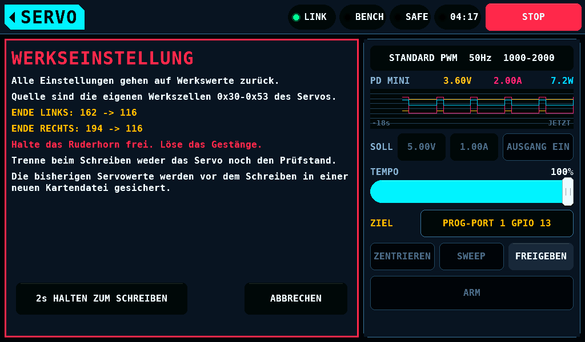
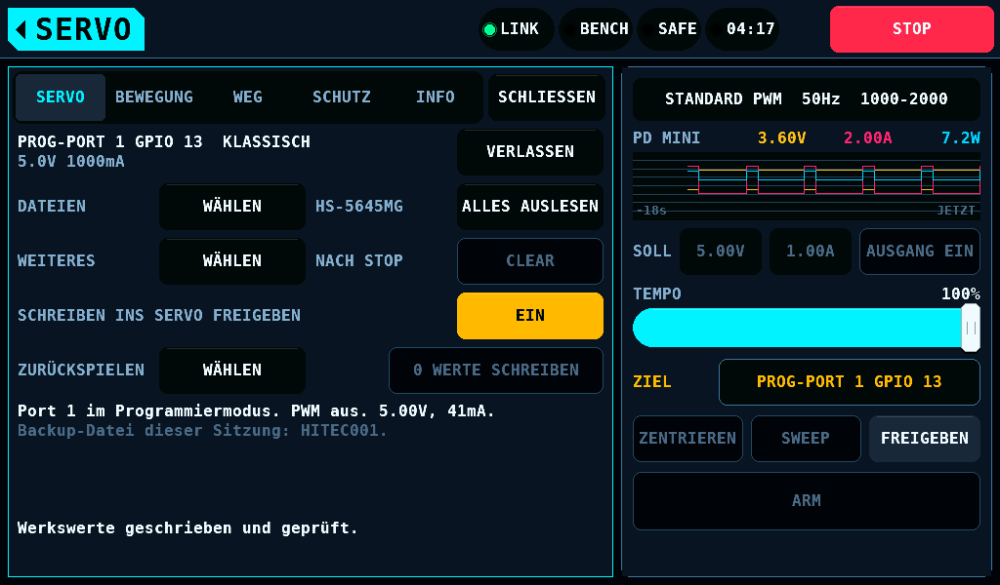
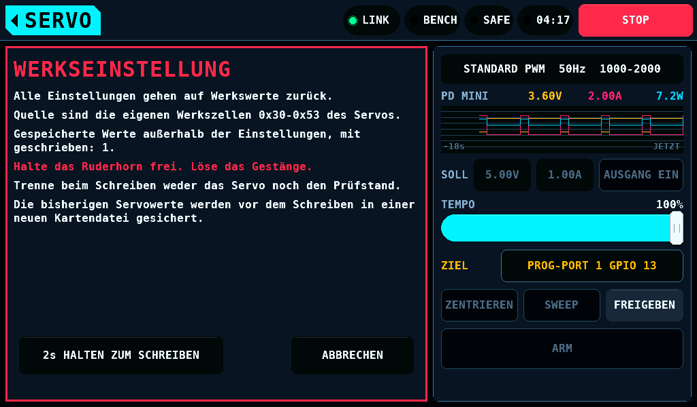

## PRÜFSUMME REPARIEREN

Ein klassisches Servo, dessen Zellen 0x00 bis 0x1C modulo 256 nicht 0
ergeben, zeigt PRÜFSUMME `FALSCH`, und der Reiter SERVO sagt
`WEITERES > PRÜFSUMME REPARIEREN schreibt den gespeicherten Wert 0x1C.` PRÜFSUMME
REPARIEREN unter WEITERES öffnet eine Seite, die den Wert der Zelle und den
Ausgleich nennt, `Schreibt gespeicherten Wert 0x1C: 0x5F -> 0x5E. Die gespeicherten Werte 0x00-0x1C ergeben dann 0.`; ihr Halten schreibt
den Ausgleich allein, mit seinem Vermerk und dem Zurücklesen der Zellen
0x00 bis 0x23. Es braucht den Schalter, keine bestehende Änderung (n WERTE
SCHREIBEN schreibt den Ausgleich mit den Änderungen) und keinen Vermerk.

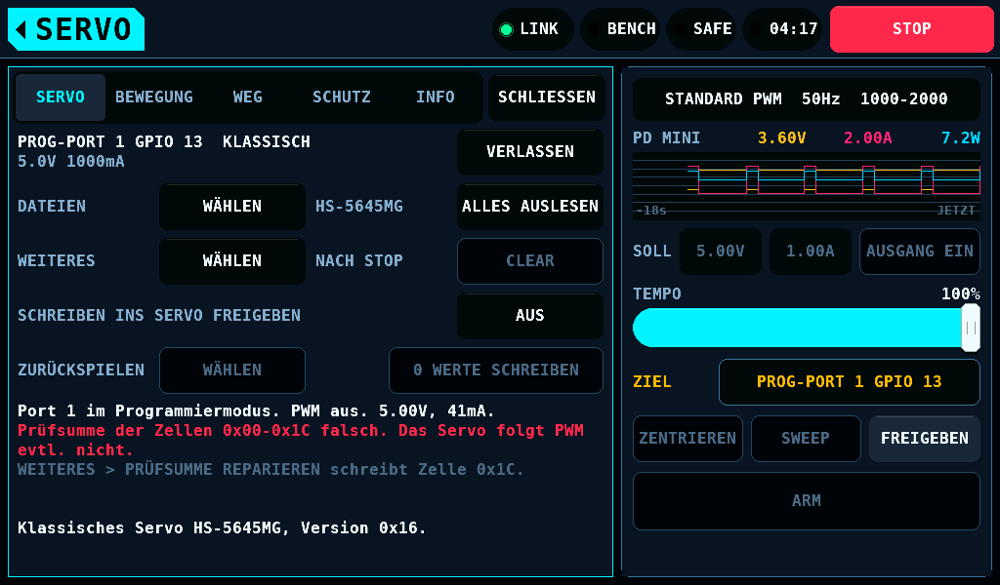
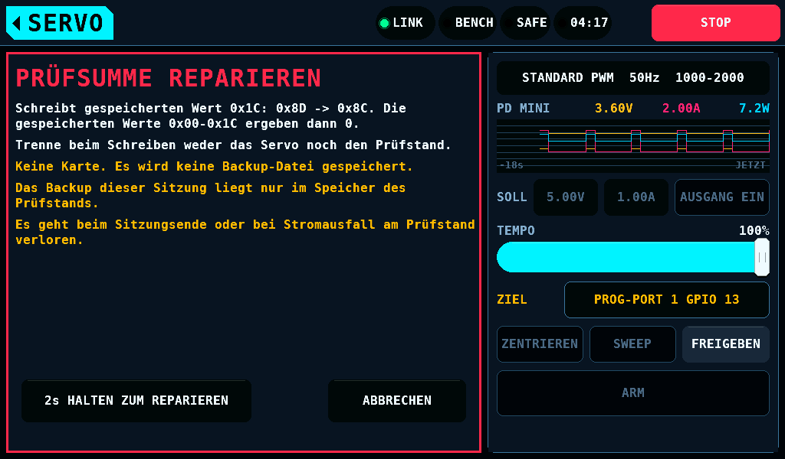

## VERLASSEN

SCHLIESSEN, die Home-Tag oder VERLASSEN in der Zeile PORT öffnet
PROGRAMMIERMODUS VERLASSEN; 2s Halten auf `2s HALTEN ZUM VERLASSEN`
verlässt ihn:

- D-Serie: ein Neustart des Servos (Register 0x46 = 1), das danach 1s lang
  Signale ignoriert; die Versorgung bleibt unverändert.
- Klassisch: die Versorgung aus und wieder ein. Die Auszeit von 500ms
  zählt ab der Lesung des PD mini, die den Ausgang aus zeigt; der Treiber
  sendet sie 250ms nach dem Ausschalten (`PDMINI_CONFIRM_MS`). Das
  Einschalten folgt nach den Lesungen der Sollwerte und des aktiven Slots
  durch den Treiber. Der Ausgang ist etwa 760ms aus: 762ms gemessen an
  einem Modul, an der Schwelle von 1,4V eines Logikanalysators. Wie viel
  davon die eigene Schaltzeit des Moduls ist, ist nicht gemessen.

Dann CLOSE: der Port ist wieder in PWM, und die Meldung sagt
`Der Port ist wieder im Testermodus.` VERLASSEN wird auch an einem
gestoppten Port, bei ARMED und mit gesetztem STOP angenommen: den Neustart
lehnt ein gestoppter Port ab, das CLOSE wird immer angenommen.

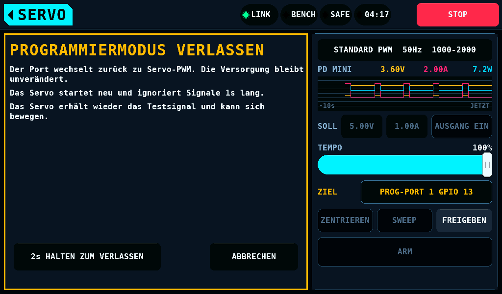
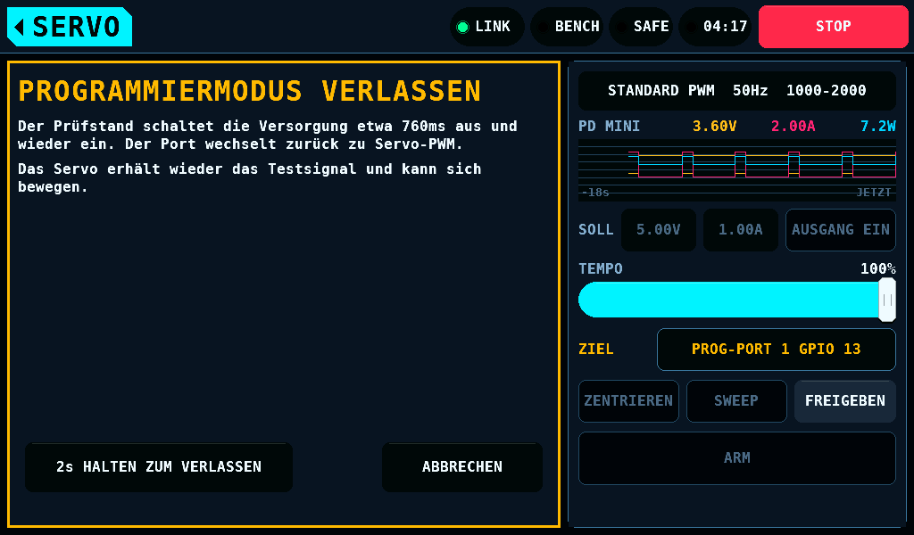

Beide Serien beenden ein Verlassen mit eingeschaltetem Ausgang des PD mini,
bei der Programmierspannung und der Strombegrenzung der Sitzung. Wo die
Sollwerte von vor VERBINDEN davon abweichen, fragt SERVO, sobald der Port
wieder in PWM ist: `Deine Versorgungs-Sollwerte 5.50V 2.00A am
eingeschalteten Ausgang wiederherstellen?`, unter AUSGANG IST
EINGESCHALTET, mit der Änderung jedes abweichenden Sollwerts.

- **JA** gibt dem eingeschalteten Ausgang beide Sollwerte von vor
  VERBINDEN. Eine Spannung, die von 6,0V oder darunter über 6,0V steigt,
  öffnet zuerst NUR HV-SERVOS, und **2s HALTEN ZUM ÜBERNEHMEN** gibt beide
  Sollwerte; sein ABBRECHEN behält die der Sitzung.
- **NEIN** behält die Sollwerte der Sitzung. Die von vor VERBINDEN kommen
  beim nächsten Ausschalten des Ausgangs zurück.

Die Frage kommt einmal je Verlassen, und nicht:

- solange ein Programmier-Port das Netzteil hält, der von KST oder von
  Hitec; ein Port, der das Netzteil nimmt, während sie steht, schließt sie;
- solange ein Tastenfeld, eine Liste, eine Warnung oder eine andere Frage
  von SERVO offen ist oder AUSGANG EIN gehalten wird: sie folgt, sobald
  diese geschlossen sind;
- nachdem der Ausgang zwischen dem Verlassen und der Frage ausging, ein
  Fehler ihn ausschaltete oder ein STOP kam; ein Ausschalten, das
  angefordert wird, während sie steht, AUSGANG AUS eingeschlossen,
  schließt sie, bevor der Ausgang aus liest;
- innerhalb eines Endlagenlaufs, dessen Lesesitzung durch dasselbe
  Verlassen geht;
- wenn sich nach dem Verlassen ein Sollwert änderte oder die Sollwerte von
  vor VERBINDEN, auf die SUPPLY-Grenzen gehalten, denen der Sitzung
  gleichen;
- bei jedem anderen Ende des Haltens des Ports am Netzteil: PORT
  FREIGEBEN, ein STOP, ein Fehler, ein verlorener Link, ein Neustart des
  Panels oder des IOmcu, ein Port, den der IOmcu ohne Verlassen
  zurückgibt, oder Ports, die auf ihre eigene Versorgung wechseln, während
  eine Sitzung den PD mini hält. Bei eingeschaltetem Ausgang bleiben die
  Sollwerte der Sitzung dann bis zum nächsten Ausschalten.

Die Frage steht nur auf SERVO. Endet ein Verlassen, während eine andere
Seite angezeigt wird, kommt die Frage, sobald SERVO wieder
angezeigt wird, solange der Ausgang eingeschaltet bleibt. Bleibt sie
unbeantwortet, wenn SERVO verlassen wird, ist sie weg, wie bei NEIN.

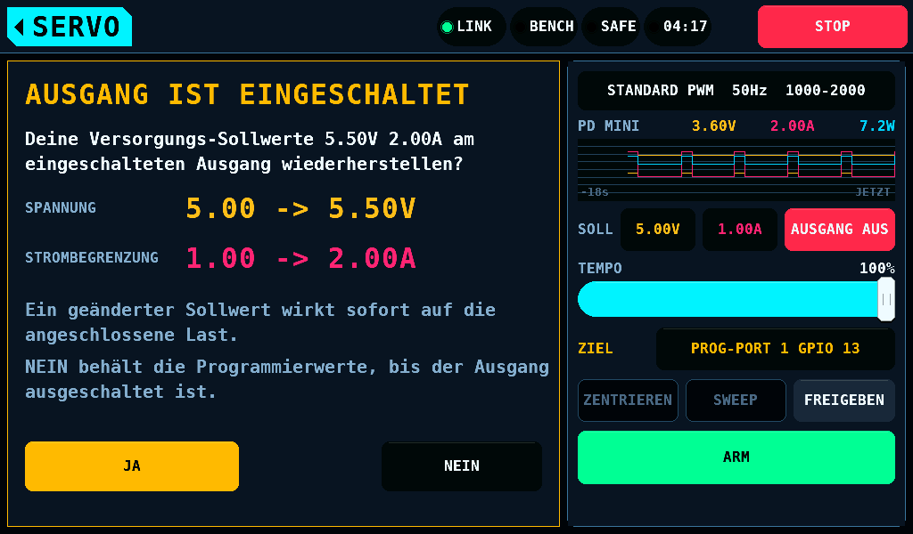
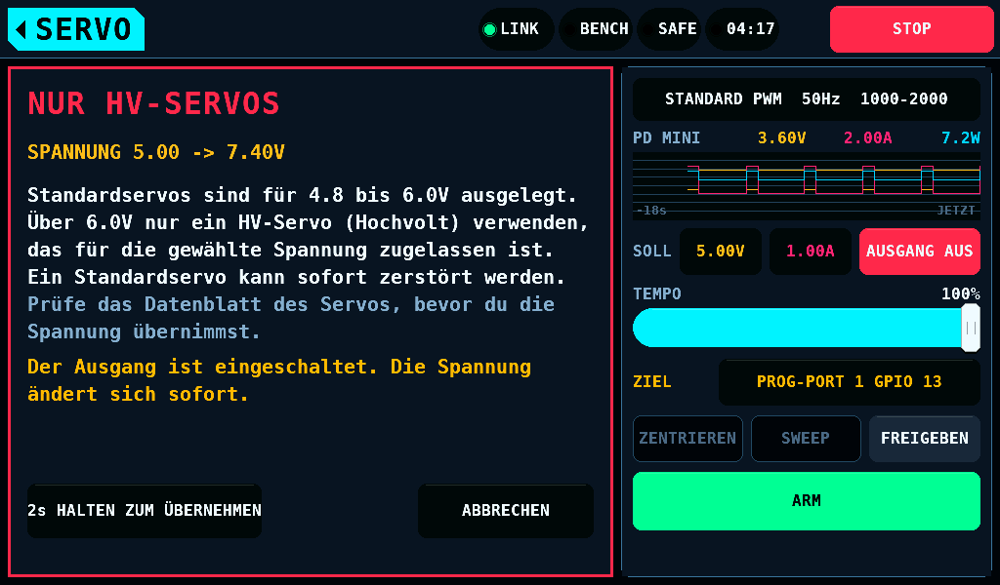

## STOP, SAFE und eine verlorene Verbindung

| Ereignis | Der Port | Was der Bediener tut |
| --- | --- | --- |
| STOP, gedrückt oder vom Prüfstand selbst | Der IOmcu bricht die Transaktion nach dem Frame auf der Leitung ab, behält den Port mit losgelassenem Pin und setzt STOPPED. Das Panel setzt den Stopp und hält den Heartbeat zurück | `Gestoppt. Der Pin ist freigegeben. VERLASSEN, dann einmal auf ARMED schalten, um den STOP aufzuheben.`, und keine Zeile bietet CLEAR an. CLEAR und ALLES AUSLESEN werden bei gesetztem STOP abgelehnt: der IOmcu würde das CLEAR als UNSAFE ablehnen. VERLASSEN, dann ARM und DISARM, dann VERBINDEN |
| Ein Schalten auf SAFE am Prüfstand allein | STOPPED, kein gesetzter Stopp | `Gestoppt. Der Pin ist freigegeben. CLEAR zum Fortsetzen oder VERLASSEN.` CLEAR setzt das Lesen fort |
| ABBRECHEN | Der Vorgang endet; der Port bleibt gehalten | ALLES AUSLESEN erneut, oder VERLASSEN |
| Die Verbindung verstummt | Der Failsafe des IOmcu löst aus, und der Port bleibt gehalten; das Modul des Panels zählt ihn nicht als seinen | Sobald die Verbindung zurück ist, sagt die Programmierung `Port von einer anderen Hitec-Sitzung belegt.` und bietet PORT FREIGEBEN an |
| Das Panel startet neu | Wie bei einer verlorenen Verbindung | Wie bei einer verlorenen Verbindung |
| Ein Fehler des Prüfstands ([Sicherheit, Fehler](Safety-de.md#fehler)) oder ein Vorgang, der in einer Störung des Servos oder der Leitung endet: kein Servo, eine falsche Antwort beim Einstieg, ein gescheitertes Lesen, ein klassisches Schreiben ohne Antwort, ein Zurücklesen mit Abweichung, ein Schritt, den der Decoder abwies | Ein laufendes Schreiben endet zuerst: der IOmcu hält die Versorgung bis zu seinem letzten Schritt und 150ms danach an, höchstens 10000ms. Dann geht der Ausgang des PD mini aus, und der Port bleibt ohne ihn gehalten: das ON eines POWER wird abgewiesen. Ein IOmcu älter als Link 4.31 lässt die Versorgung an ([Die Versorgung eines Programmierports](Safety-de.md#die-versorgung-eines-programmierports)) | VERLASSEN, dann VERBINDEN |

Eine Sitzung, die endet, nimmt die Zeilen über das mit, was sie hielt: das
Auslesen, eine verglichene oder geladene Datei, die Ablehnung einer Änderung und
worauf ein Schreiben wartet. Was geschah, bleibt: ein Schreiben und seine
Prüfung, eine gespeicherte Datei, eine abgelehnte Datei, wie ein Vorgang endete
und jede Zeile in der Gefahrenfarbe.

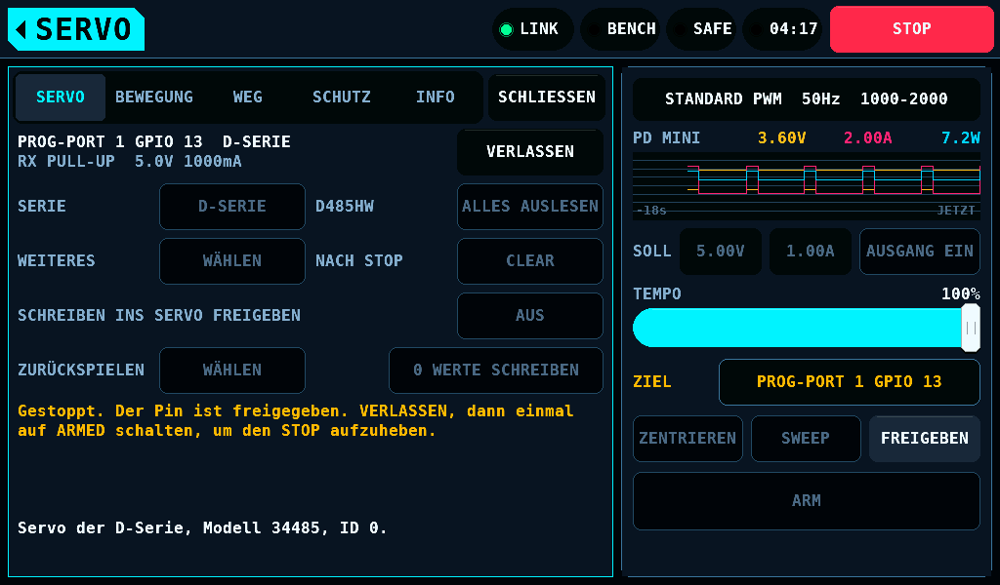

## Ein Port, den eine andere Sitzung hält

Ein Port, den die HITEC-Page hält und den dieses Panel nicht geöffnet hat,
von der Prüfstandskonsole geöffnet oder über eine verlorene Verbindung oder
einen Neustart des Panels gehalten, lässt die Hitec-Zeile aktiv: die
Programmierung öffnet sich mit der Zeile PORT
`PROG-PORT 1 GPIO 13  ANDERWEITIG BELEGT` und `Eine andere Hitec-Sitzung
belegt ihn.` PORT FREIGEBEN öffnet eine Seite; 2s Halten auf
`2s HALTEN ZUM FREIGEBEN` sendet CLOSE, das der IOmcu annimmt, ob er dem
Heartbeat traut oder nicht. Die Versorgung bleibt unverändert. Danach hebt
ein Schalten auf ARMED den ausgelösten Failsafe des IOmcu auf wie nach
jedem Stopp: ARM wird nur abgelehnt, solange der Port gehalten ist.


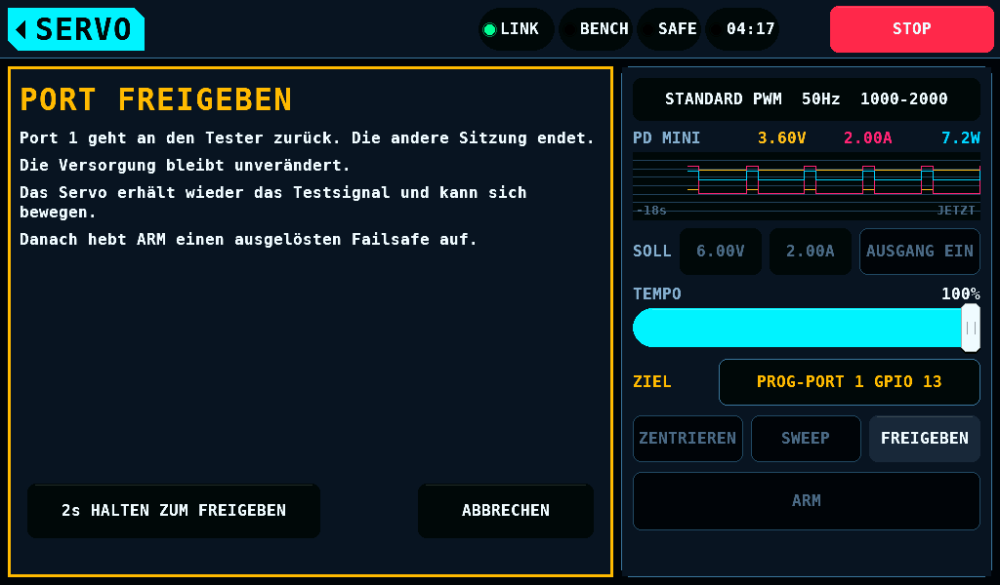
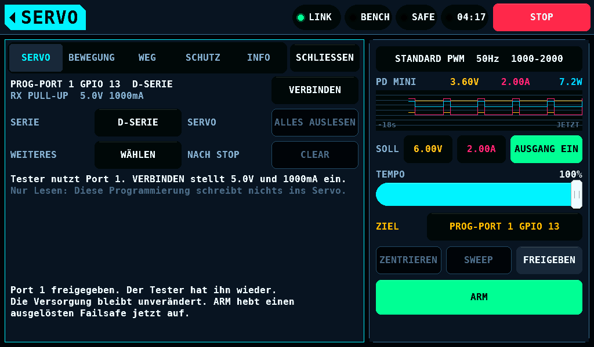

## Meldungen

| Zeile | Wann |
| --- | --- |
| `Kein Servo der D-Serie antwortet. Stecker, Empfangsart und Serie prüfen.` | beim letzten von 3 Versuchen eines Lesens der D-Serie kam kein Byte |
| `Kein klassisches Servo hat nach dem Einschalten geantwortet. Stecker und Serie prüfen.` | innerhalb von 2s nach dem Einschalten kam kein `+` |
| `Die Antwort des Servos auf den Einstieg war falsch. Serie prüfen.` | es kamen Bytes, die nicht zum Einstieg passen |
| `Fehlerhafte Antwort vom Servo (Code 14). Lese erneut.` | ein Versuch schlug fehl; der Code ist der des Decoders (`hitec_rx_t`) |
| `Lesen bei Adresse 0x32 fehlgeschlagen. ALLES AUSLESEN antippen.` | jeder Versuch an einer Adresse schlug fehl |
| `Zwei Lesevorgänge weichen bei 0x17 ab: mit ALLES AUSLESEN neu lesen.` | das zweite Lesen vor einem Schreiben weicht vom Lesen ab, aus dem der Plan entsteht ([Das zweite Lesen](#das-zweite-lesen)) |
| `Vom IOmcu abgelehnt: Sein Failsafe ist ausgelöst.` | OPEN oder CLEAR mit UNSAFE abgelehnt |
| `Der IOmcu hat die Sitzung beendet. Der Port ist wieder im Testermodus.` | der Port ging ohne Befehl dieses Panels zurück in PWM |
| `Keine rechtzeitige Antwort vom IOmcu. Der Vorgang ist beendet.` | ein Befehl wurde nicht innerhalb von 2000ms angenommen, oder eine Anfrage hatte nach 30.000ms kein Ergebnis |
| `Die Versorgung folgte der POWER-Anfrage nicht. PD mini prüfen.` | POWER endete mit SUPPLY |
| `Der IOmcu kann die Leitung dieses Ports nicht ansteuern.` | OPEN fand keine freie Leitung |
| `Der IOmcu hat die Anfrage abgelehnt (Code 7).` | eine Ablehnung ohne eigene Meldung |

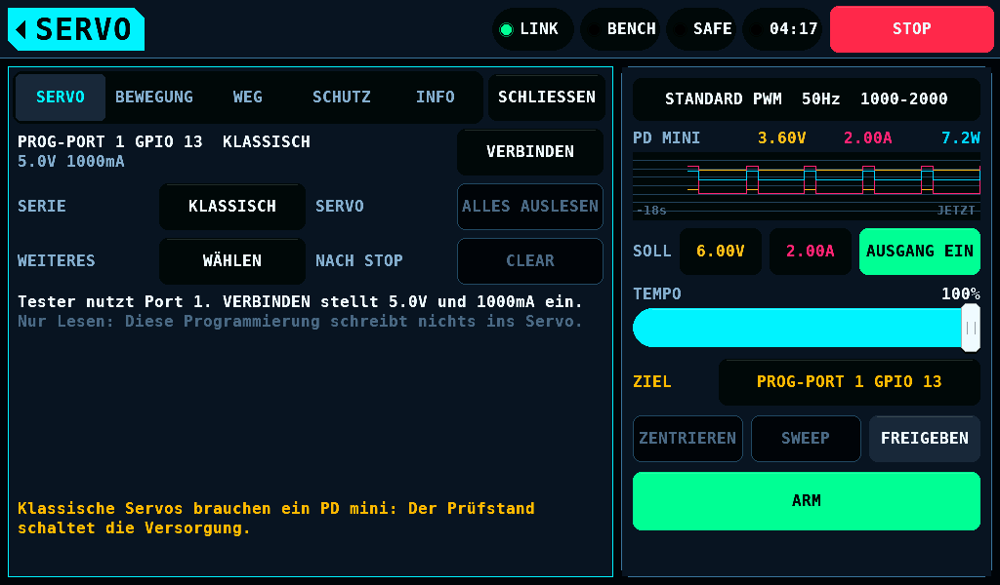
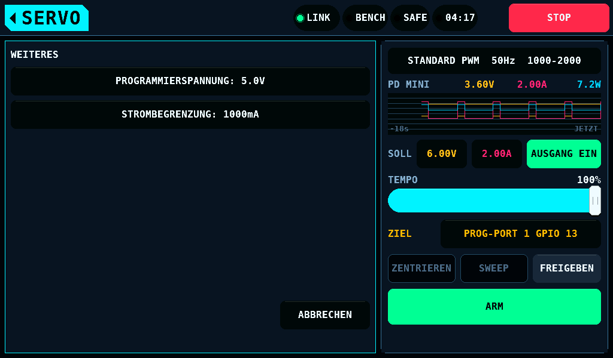

## Hitec-D-Empfang

WEITERES listet Hitec-D-Empfang, solange der Tester den Port hat, wie SERIE nur
dann ein Tippen nimmt. Seine Liste bietet zwei Modi, im NVS unter `hitec_rx`:

| Modus | Die Leitung | Hinweis |
| --- | --- | --- |
| PULL-UP (Vorgabe) | ein Widerstand von 2,2kΩ von der Signalleitung zur Servoversorgung hebt die Leitung, und der IOmcu liest sie losgelassen | `PULL-UP braucht 2.2kΩ an der Signalleitung` |
| PRECHARGE | kein Widerstand; der IOmcu treibt das Pad alle 1086,7ns für 100,0ns auf High und tastet es 113,3ns nach dem Loslassen ab | `PRECHARGE: kein Pull-up an der Signalleitung` |

Ein fehlender oder unlesbarer gespeicherter Wert ist PULL-UP. Das Panel schreibt
den Modus bei jedem Link-Aufbau und nach jeder Änderung auf die HITEC-Page, ARMED
oder nicht. Der IOmcu nimmt ihn beim nächsten OPEN einer Leitung der D-Serie und
ändert nichts, was läuft. In einer Sitzung gibt es keine Änderung: WEITERES listet
die Zeile dann nicht, die Portzeile zeigt den Modus (`RX PULL-UP`), und eine
Liste, die beim Start einer Sitzung noch offen ist, schließt. VERLASSEN, Modus
setzen, VERBINDEN. VERBINDEN wartet, bis der IOmcu den Modus hält: `Empfangsart im
IOmcu noch nicht gesetzt. Erneut versuchen.` classic-Servos (HS-5xxx, HS-7xxx)
brauchen keins davon und übergehen ihn. Die Einstellung erreicht die Leitungen
dieser Programmierung und die der [Prüfstandskonsole](BenchConsole-de.md).

Unter den beiden Modi sagt die Liste, was der IOmcu nicht hält:

| Die Zeile lautet | Solange |
| --- | --- |
| `Vom IOmcu nicht übernommen.` | der Wert noch nicht bestätigt ist oder der IOmcu ihn abgewiesen hat |
| `IOmcu älter als 0.22.0: empfängt mit PULL-UP.` | PRECHARGE eingestellt ist und der IOmcu Protokoll 4.23 spricht: er hat kein Register für den Modus |
| `IOmcu älter als 0.21.1: keine Hitec-Leitung.` | PRECHARGE eingestellt ist und der IOmcu Protokoll 4.22 oder älter spricht: er hat keine HITEC-Seite |

Keine Zeile, solange kein IOmcu antwortet, und keine für PULL-UP an einem älteren
IOmcu.


## Bekannte Grenzen

- Klassische Schreibvorgänge über den IOmcu sind an einem Servo gelaufen,
  einem HS-7955TG (Prüfstand, 25.10.2026): Zelle 0x02 und der Ausgleich
  0x1C, über einen Aus- und Einschaltvorgang erhalten. Jede andere Zelle,
  die Zellen 0x1D bis 0x23, die ein Schreiben ohne Ausgleich sendet, und der
  Datenspeicherbefehl 0x64 sind nicht getestet; die Programmierung sendet
  kein 0x64. Ein Schreiben an ein Servo mit falscher Prüfsumme und
  PRÜFSUMME REPARIEREN sind an keinem Servo getestet.
- Die Schreibvorgänge der D-Serie sind an 1 Servo gemessen, einem D485HW,
  aus den mitgeschnittenen Schreibvorgängen des HFP-30; Schreibvorgänge von
  rcbench an ein Servo der D-Serie sind nur im Host-Modell getestet. Ob ein
  durch Stromausfall abgebrochenes Speichern den Flash des Servos heil
  lässt, ist nicht gemessen. Geschriebene, nicht gespeicherte Werte gehen
  beim nächsten Ausschalten des Servos verloren, und der Einstieg der
  D-Serie bei VERBINDEN schaltet die Versorgung aus und ein.
- Die Regeln von ÄNDERUNG PRÜFEN vergleichen mit dem letzten vollständigen
  Lesen, nicht mit dem Backup der Sitzung.
- Das Backup der Sitzung liegt im Arbeitsspeicher des Panels: VERLASSEN,
  VERBINDEN, eine verlorene Verbindung und ein Neustart des Panels beenden
  es. Nach einer verlorenen Verbindung ist das Backup der neuen Sitzung das
  Servo, wie sie es dann vorfindet, mit den Werten des unterbrochenen
  Schreibens; der Vermerk des Schreibens und die Backup-Datei der alten
  Sitzung halten die Werte davor.
- Zwei Servos der D-Serie desselben Modells werden nur an ihren Werten
  unterschieden. Ein zweites D485HW, dessen Register, die ein Schreiben
  sendet, die Werte des letzten Lesens des ersten halten, behält das Backup
  des ersten, und ZURÜCKSPIELEN des Backups der Sitzung schreibt die Werte
  des ersten hinein. Welches Register, wenn überhaupt, sich zwischen zwei
  Exemplaren eines Modells unterscheidet, ist nicht gemessen.
- Eine außerhalb des Panels geschriebene oder bearbeitete Servodatei wird
  nicht geladen.
- Der Vermerk wird nur beim Start des Panels von der Karte gelesen. Eine
  später eingelegte Karte wird nicht nach einem gelesen, und ein Vermerk
  ohne eingelegte Karte bleibt im Arbeitsspeicher und ist nach einem
  Neustart des Panels weg. Eine Karte, die den Text ablehnt, der einen
  Vermerk löscht, behält den Vermerk: der nächste Start des Panels meldet
  dieses Schreiben als unterbrochen.
- NEUTRAL, ENDE LINKS und ENDE RECHTS werden als Zahlen auf dem Tastenfeld
  geändert; das Servo fährt beim Ändern nicht dorthin, und das Tastenfeld
  hat keine Tasten `-`/`+`.
- WERKSEINSTELLUNG wird für die D-Serie nicht angeboten; bei einem
  klassischen Servo ist sie die Kopie der Zellen 0x30 bis 0x53 durch das
  HPP-21 Plus, nur im Host-Modell getestet.
- Die Prüfstandsschritte S6 bis S8 und S10 bis S11 (Schreiben an ein
  D485HW und ein klassisches Servo, eine während eines Schreibens
  getrennte Verbindung) sind nicht gelaufen.
- Das POWER des Einstiegs der D-Serie mit einer Auszeit von 0ms schaltet
  den Ausgang des PD mini aus und wieder ein: das Servo startet bei jedem
  VERBINDEN neu.
- Ein klassisches Lesen braucht 2 Frames der Anzeige je Zelle; bei 33ms je
  Frame dauern 100 Zellen im Host-Modell 6,6s.
- Die Prüfstandsschritte S1 bis S5 des Plans (ein D485HW bei PRECHARGE und
  PULL-UP, die klassischen HS-5645MG und HS-7955TG, STOP und ein gezogenes
  Verbindungskabel während ALLES AUSLESEN, ARM und SUPPLY bei gehaltenem
  Port) sind nicht gelaufen.
