# Servoprogrammierung für Hitec-Servos

<sub>[English](HitecProgrammer.md) · **Deutsch**</sub>

Die Servoprogrammierung liest die Einstellungen eines Hitec-Servos über
seine Signalleitung aus, zeigt sie decodiert und als gespeicherte Werte
und schreibt geänderte Werte zurück. Vor dem ersten Schreiben einer
Sitzung speichert sie die ursprünglichen Einstellungen in einer
Backup-Datei, wenn eine Karte eingebunden ist. Vor jedem Schreiben legt
sie einen Vermerk mit den aktuellen Werten des Servos an. Du kannst
Einstellungen auch in einer Datei speichern, eine Datei in den Entwurf
laden und das Backup der Sitzung zurückspielen.

Öffne `Hitec-Servos` unter **PROGRAMMIEREN** auf der
[Seite SERVO](Screens-de.md#servo). Die Servoprogrammierung öffnet sich eine
Ebene tiefer und deckt die linke Spalte samt den Reitern der Leiste ab.
**SCHLIESSEN** oder die Home-Markierung führt zur Liste von PROGRAMMIEREN
zurück, solange die Servoprogrammierung keinen Port hält. Die Zeile ist mit
`IOMCU OHNE SERVO PWM` ausgegraut und lässt sich nicht öffnen, solange der
IOmcu, die RP2350-Platine, kein Servo-PWM (Pulsweitenmodulation) meldet.
Das gilt auch, wenn kein IOmcu antwortet.

Hitec ist ein Name oder eine Marke des jeweiligen Inhabers. rcbench ist
unabhängig: Es ist mit diesem Inhaber weder verbunden noch von ihm
unterstützt oder gefördert. Der Name bezeichnet die Servos, die die
Servoprogrammierung unterstützt.
[Rechtliche Hinweise und Haftungsausschluss](../README-de.md#rechtliche-hinweise-und-haftungsausschluss)
enthält den Hinweis des Projekts.

Zwei Serien werden gelesen und geschrieben:

| Serie | Servos | Leitung | Gelesen | Geschrieben |
| --- | --- | --- | --- | --- |
| D-SERIE | D485HW und die übrigen Servos der D-Serie | 115.200bit/s, invertiert | 21 Register | die Register jeder geänderten Einstellung im Abstand von 20ms, das Speichern (0x70 = 0xFFFF), 100ms, der Neustart (0x46 = 1), 1000ms, dann die 21 Register zurückgelesen |
| KLASSISCH | HS-5xxx und HS-7xxx | 19.200bit/s | 100 Zellen: 0x00 bis 0x23, 0x30 bis 0x53, der Name 0x60 bis 0x6F, das Datum 0x70 bis 0x73, die Seriennummer 0x80 bis 0x87, und die Version | jede geänderte Zelle, dann der Ausgleich in Zelle 0x1C, jede mit `+ +` beantwortet, im Abstand von 2ms; dann die Zellen 0x00 bis 0x23 zurückgelesen |

Das Registermodell und seine Codierungen stammen von 1 D485HW (20.10.2026)
und von je 1 HS-5645MG, HS-7955TG und HS-5955TG (18.10. bis 20.10.2026)
([`protocols/hitec`](../protocols/hitec/README.md)). Die Protokoll-Page beschreibt
[Der Programmierport für Servos von Hitec](LinkHitec-de.md).

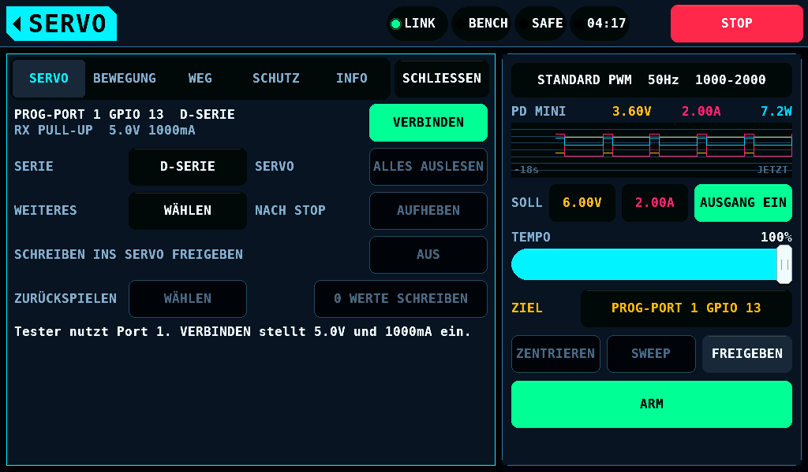

## Voraussetzungen

- Der IOmcu spricht Protokoll 4.23 oder neuer. Mit einem älteren sagt der
  Reiter SERVO `Nicht verfügbar: Der IOmcu hat keinen Hitec-Port.` und
  `Aktualisiere den IOmcu auf Version 0.21.1 oder neuer.`
- SERVO-TESTER unter SETUP > OUTPUTS steht auf einem Port, PORT 1, PORT 2,
  PORT 3 oder PORT 4, und der Port nennt einen Pin. Mit OUTPUTS lautet die Zeile PORT
  `KEIN PROG-PORT GESETZT`, und VERBINDEN sagt `Zum Programmieren muss das
  Servo am Programmierport angeschlossen sein.`
  Auf dem rbmod-Carrier mit einem IOmcu ab Protokoll 4.36 wählt die Zeile
  PORT den Port: ein Tipp auf ihre Beschriftung öffnet PROGP01 bis
  PROGP04, und VERBINDEN ohne Port sagt `Tippe auf die PORT-Zeile und wähle einen Programmierport.` ([Servo-Programmer: Der Port auf dem
  rbmod-Carrier](ServoProgrammer-de.md#der-port-auf-dem-rbmod-carrier)).
- Der Prüfstand ist SAFE. VERBINDEN wird abgelehnt bei ARMED, bei einem
  angeforderten Schalten auf ARMED und mit einem Finger auf ARM: `Tippe zuerst auf DISARM. Bei ARMED kann der Port nicht übernommen werden.` Ein
  gesetzter STOP lehnt es ebenfalls ab: `Ein STOP ist gesetzt. Halte STOP 2s, um ihn zurückzusetzen.`
- Ein klassisches Servo geht nur beim Einschalten in den Programmiermodus.
  Der Prüfstand muss seine Versorgung deshalb aus- und einschalten können.
  VERBINDEN für KLASSISCH braucht entweder ein antwortendes PD mini oder
  die schaltbare feste 5V-Versorgung des rbmod-Carriers. Ohne beides erscheint
  `Klassische Servos
  brauchen ein PD mini: Der Prüfstand schaltet die Versorgung.`
- Hitec-D-Empfang unter WEITERES legt den Empfangsmodus für die D-Serie
  fest: PULL-UP oder PRECHARGE
  ([Empfangsmodus](LinkHitec-de.md#empfangsmodus)). VERBINDEN wartet, bis
  der IOmcu diesen Modus hält: `Empfangsart im IOmcu noch nicht gesetzt. Versuche es erneut.`
- Wenn das PD mini das Servo versorgt, gilt die Programmierspannung der
  KST-Servoprogrammierung (SET_SERVO_PROG_V, WEITERES >
  PROGRAMMIERSPANNUNG). Eine Hitec-Sitzung verwendet 4,8V bis 6,0V: Eine
  höhere Einstellung wird auf 6,0V begrenzt, und der Reiter SERVO sagt
  `Hitec-Programmierung läuft mit höchstens 6.0V.` Die Strombegrenzung liegt
  bei 50mA bis 3000mA. Beide müssen innerhalb der Grenzen von SUPPLY liegen,
  sonst sagt VERBINDEN `Programmierspannung oder -strom überschreitet die
  SUPPLY-Grenzen.` Der rbmod-Carrier verwendet stattdessen seine feste
  5V-Versorgung. Die Sollwerte des PD mini und die SUPPLY-Grenzen gelten
  nicht für diese Versorgung.

## Der Reiter SERVO

| Zeile | Was sie tut |
| --- | --- |
| PORT | Zwei Zeilen: der Port und sein GPIO mit der Serie, `PROG-PORT 1 GPIO 13  D-SERIE`, auf dem rbmod-Carrier öffnet ein Tipp darauf vor VERBINDEN die Liste der Programmierports, dann die Empfangsart und die Versorgung, die VERBINDEN einstellt, `RX PRECHARGE  5.0V 1000mA` (`VERSORGUNG UNVERÄNDERT` bei einem Servo der D-Serie ohne PD mini und ohne feste 5V-Versorgung des Carriers). Die Taste lautet VERBINDEN, ABBRECHEN, während der Port in den Programmiermodus wechselt oder Werte ausgelesen werden, WARTEN, VERLASSEN, solange der Port gehalten ist, und PORT FREIGEBEN, solange eine andere Sitzung ihn hält |
| SERIE | D-SERIE oder KLASSISCH, vor VERBINDEN gewählt; in den SERVO-Einstellungen gespeichert (SET_HITEC_SERIES). Solange der Port gehalten ist, nennt die Zeile PORT die Serie, und DATEIEN steht an dieser Stelle |
| DATEIEN | Solange der Port gehalten ist: die Servodateien auf der Karte, Speichern und Laden ([Servodateien](#servodateien)) |
| SERVO | Das ausgelesene Modell, `D485HW` oder `HS-5645MG`; ALLES AUSLESEN liest die Werte der Serie erneut aus |
| WEITERES | Programmierspannung und Strombegrenzung, jede auf dem Tastenfeld, solange der Tester den Port hat. Solange der Port gehalten ist: ÄNDERUNGEN VERWERFEN, wenn eine Änderung besteht, PRÜFSUMME REPARIEREN bei einer falschen klassischen Prüfsumme und WERKSEINSTELLUNG für ein gelesenes klassisches Servo ([WERKSEINSTELLUNG](#werkseinstellung)) |
| NACH STOP | AUFHEBEN nach dem Schalten auf SAFE am Prüfstand: Der IOmcu löscht das Flag STOPPED des Ports. Das Auslesen geht weiter; war die Versorgung ausgeschaltet, beginnt der Einstieg erneut |
| SCHREIBEN INS SERVO FREIGEBEN | Der Schreibschalter, AUS oder EIN ([Der Schreibschalter](#der-schreibschalter)) |
| ZURÜCKSPIELEN | Das Backup der Sitzung zurück ins Servo, solange es vom Servo abweicht ([Zurückspielen des Backups der Sitzung](#zurückspielen-des-backups-der-sitzung)); solange ein Vermerk zu einem unterbrochenen Schreibvorgang besteht: die Werte davor zurück ins Servo, oder der Vermerk verworfen ([Der Vermerk eines Schreibvorgangs](#der-vermerk-eines-schreibvorgangs)) |
| n WERTE SCHREIBEN | Der Entwurf ins Servo ([Schreiben](#schreiben)); `1 WERT SCHREIBEN` für einen, aus ohne |

Unter den Zeilen zeigt die Statuszeile den aktuellen Vorgang des Ports.
Die letzte Meldung steht unter den Hinweisen. Jedes Bedienelement ist
mindestens 48px hoch und endet 4px über dem Meldungsband, wie bei der
KST-Servoprogrammierung ([Seiten](Screens-de.md#programmierer)).

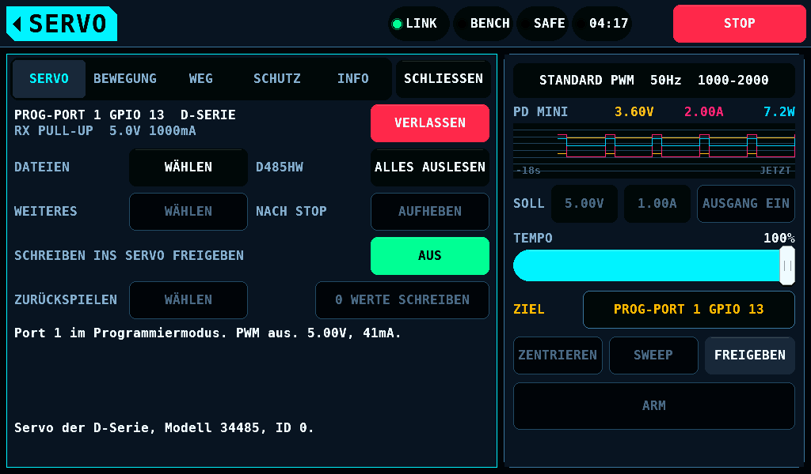
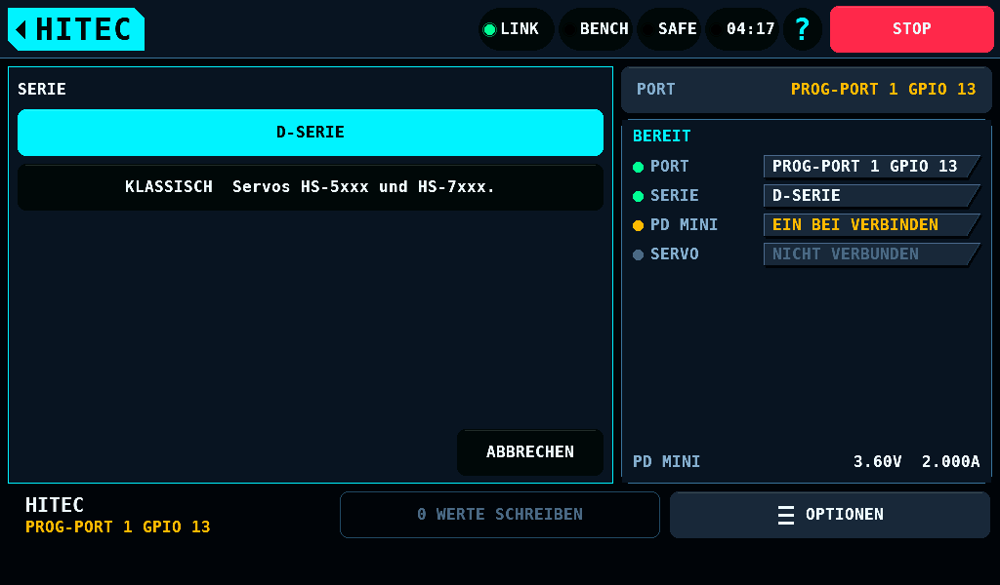
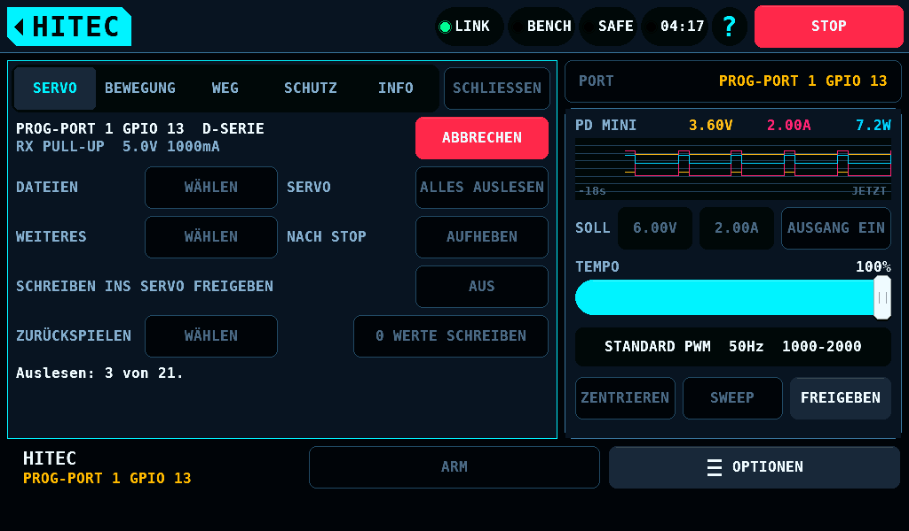

## VERBINDEN

1. OPEN: Der IOmcu beendet PWM am Port. Nach 50ms ohne Pulse übernimmt der
   Leitungstreiber die freigegebene Leitung.
2. Der Einstieg:
   - D-Serie: Bei schaltbarer Versorgung folgt auf POWER mit einer Auszeit
     von 0ms eine Startwartezeit von 1000ms. Dazu verwendet der Prüfstand
     die Programmierspannung eines antwortenden PD mini oder die feste
     5V-Versorgung des Carriers. Ohne beides bleibt die externe Versorgung
     unverändert.
   - Klassisch: POWER schaltet die Versorgung aus. Ab der Bestätigung,
     dass sie aus ist, vergehen 500ms ([VERLASSEN](#verlassen) nennt die
     gesamte Auszeit). Dann wird sie eingeschaltet, und LISTEN wartet auf
     das `+` des Servos. Sein zweites `+` folgt 250ms bis 267ms später;
     anschließend liest 0x67 die Version aus.
3. ALLES AUSLESEN: die Werte der Serie, jede Adresse mit 3 Versuchen.
4. Das Modell wird erkannt: D-Serie an Register 0x00 (34485 ist der
   D485HW), klassisch an den Namenszellen. Die Meldung nennt es:
   `Servo der D-Serie, Modell 34485, ID 0.` oder
   `Klassisches Servo HS-5645MG, Version 0x16.` Ein Modell, das das
   Registermodell nicht kennt, wird im Aufbau des nächstliegenden gelesen,
   und der Reiter SERVO sagt welches: `Modell unbekannt. Die Felder werden wie beim D485HW interpretiert.`

Im Host-Modell (`test_hitec_prog`) dauert VERBINDEN bei der D-Serie 2,4s,
davon 1,2s der Einstieg, und bei einem klassischen Servo 4,2s bei 16ms je
Frame und 7,6s bei 33ms: ein klassisches Lesen braucht 2 Frames je Zelle.
Am Prüfstand sind diese Zeiten nicht gemessen.

Solange der Port gehalten ist:

- ARM ist ausgegraut. Ein Druck darauf schaltet nichts und zeigt
  `ARMED gesperrt: Die Servoprogrammierung belegt einen Port.` im
  Alert-Band, auf SERVO wie auf MOTOR & ESC. STOP wirkt. DISARM hat nichts
  zu beenden: der Prüfstand kann nicht ARMED sein, solange der Port
  gehalten ist.
- Wenn das PD mini die Programmierports versorgt, sind seine Sollwerte und
  AUSGANG EIN in der Zeile SOLL und auf der Seite SUPPLY gesperrt. Ein Tipp
  darauf zeigt `Servoprogrammierung belegt das
  Netzteil: Sollwerte und EIN gesperrt.` AUSGANG AUS wirkt. Ab Protokoll
  4.29 hält der IOmcu seine SUPPLY-Page zusätzlich von OPEN bis CLOSE
  ([Die Versorgung, solange ein Port gehalten ist](LinkHitec-de.md#die-versorgung-solange-ein-port-gehalten-ist)).
  Die Sollwerte von vor VERBINDEN kommen nach dem Verlassen zurück, sobald
  der Ausgang aus ist, oder über die Frage von SERVO auf den eingeschalteten
  Ausgang nach einem Verlassen, das ihn eingeschaltet lässt
  ([VERLASSEN](#verlassen);
  [Servoprogrammierung, Die Versorgung](ServoProgrammer-de.md#die-versorgung)).
  Die feste 5V-Versorgung des Carriers sperrt das PD mini nicht.
- Die Zeile für KST- und Chaservo-Servos und die Zeile ZIEL von MOTOR & ESC
  nehmen keinen Druck an, und ESC STICK startet keinen Lauf.

## Die Wertereiter

BEWEGUNG, WEG, SCHUTZ und INFO zeigen den Entwurf: die zuletzt vollständig
ausgelesenen Werte mit den noch nicht geschriebenen Änderungen. Bekannte
Codierungen werden decodiert angezeigt, mit dem gespeicherten Wert in
Klammern daneben, etwa `CW (0)`. Ein Wert mit unbekannter Codierung erscheint
als `RAW 1234` in der Warnfarbe. Du kannst einen schreibbaren Wert antippen,
solange der Port gehalten und nicht gestoppt ist
([Ändern](#ändern)).

| Reiter | D-Serie | Klassisch |
| --- | --- | --- |
| BEWEGUNG | TEMPO, DEAD BAND, SOFT START | TEMPO, DEAD BAND, AUFLÖSUNG |
| WEG | NEUTRAL, ENDE LINKS, ENDE RECHTS in Servo-Zählern mit Grad (220° über 16383 Zähler, 8192 die Mitte), DREHRICHTUNG, [SERVO BEWEGEN](#servo-bewegen) | MITTE in Mikrosekunden, ENDE LINKS, ENDE RECHTS als Rohwerte (Einheit unbekannt), DREHRICHTUNG |
| SCHUTZ | FAILSAFE (AUS, KRAFTLOS oder eine Position in Mikrosekunden), ÜBERLASTSCHUTZ, SMART SENSOR, EMPFINDLICHKEIT (roh) | FAILSAFE, FAILSAFE-POSITION, ÜBERLASTSCHUTZ |
| INFO | MODELL, ID, POSITION und die Register 0x04, 0x22, 0x8A, 0x8C, 0xD4 und 0xD6 roh | MODELL, VERSION, DATUM, SERIENNR., PRÜFSUMME |

Ein klassisches Abbild, dessen Zellen 0x00 bis 0x1C modulo 256 nicht 0
ergeben, zeigt PRÜFSUMME `FALSCH` und den Hinweis `Prüfsumme für 0x00-0x1C falsch. Das Servo kann PWM ignorieren und Strom bis zur Strombegrenzung ziehen.` Ein HS-7955TG mit falscher Prüfsumme
zog unter ARM und SWEEP 0,88 bis 0,89A, an der Grenze des PD mini von
1,00A, die Spannung fiel auf 4,0 bis 4,2V; mit richtiger Prüfsumme zieht es
0,12 bis 0,28A (ein Servo, einmal gemessen). WEITERES > PRÜFSUMME
REPARIEREN schreibt den Ausgleich in 0x1C.

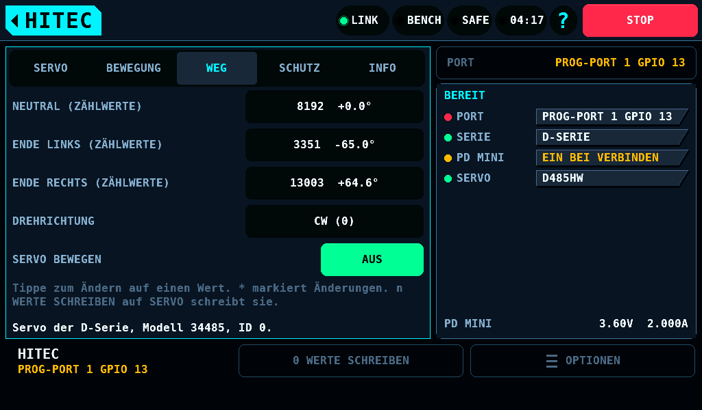
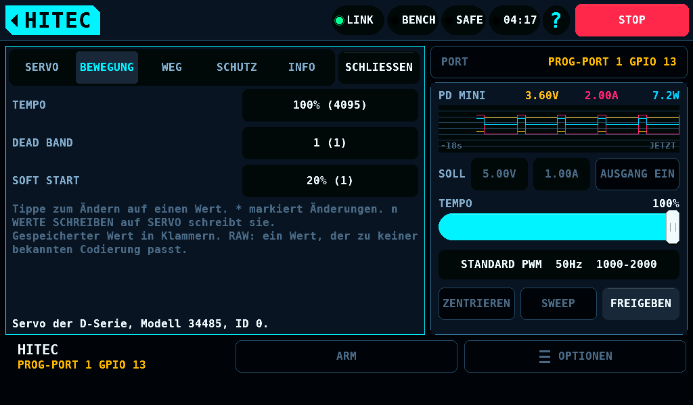
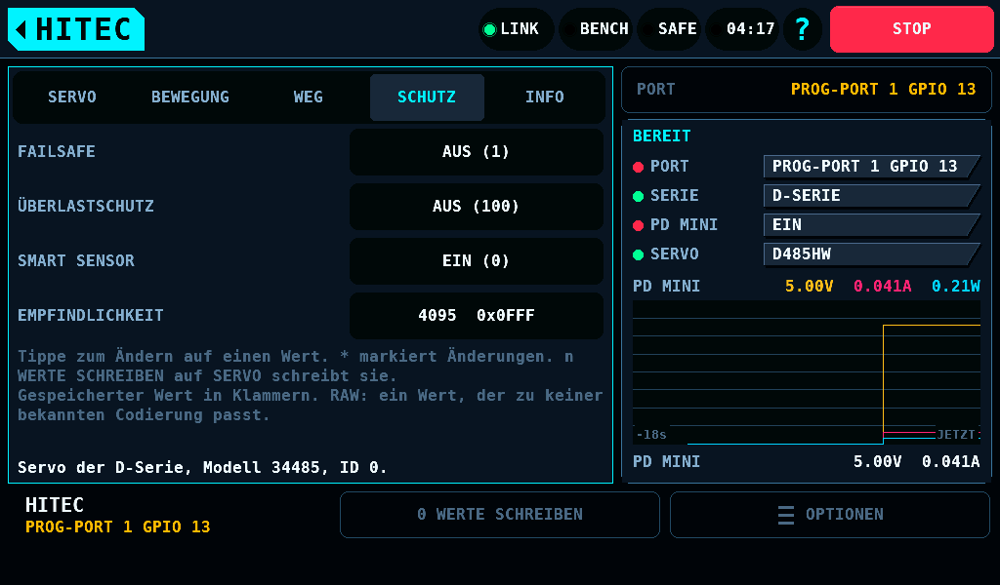
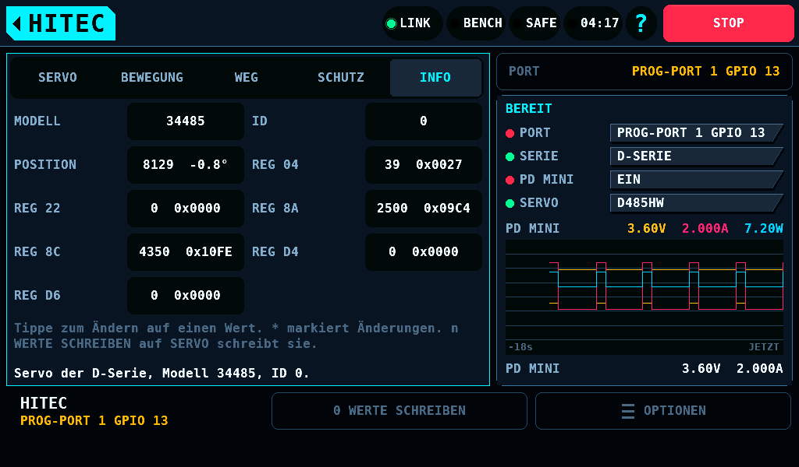
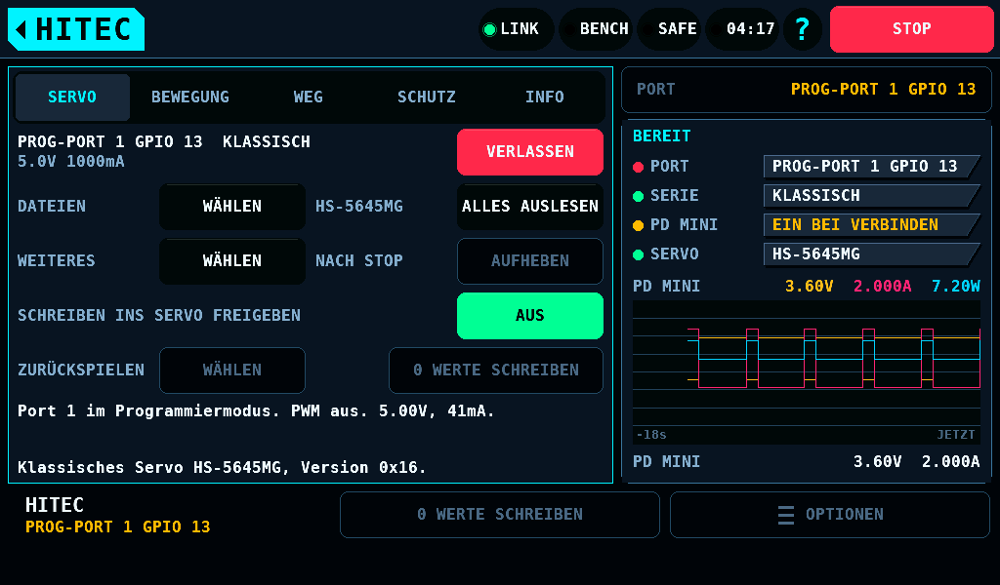
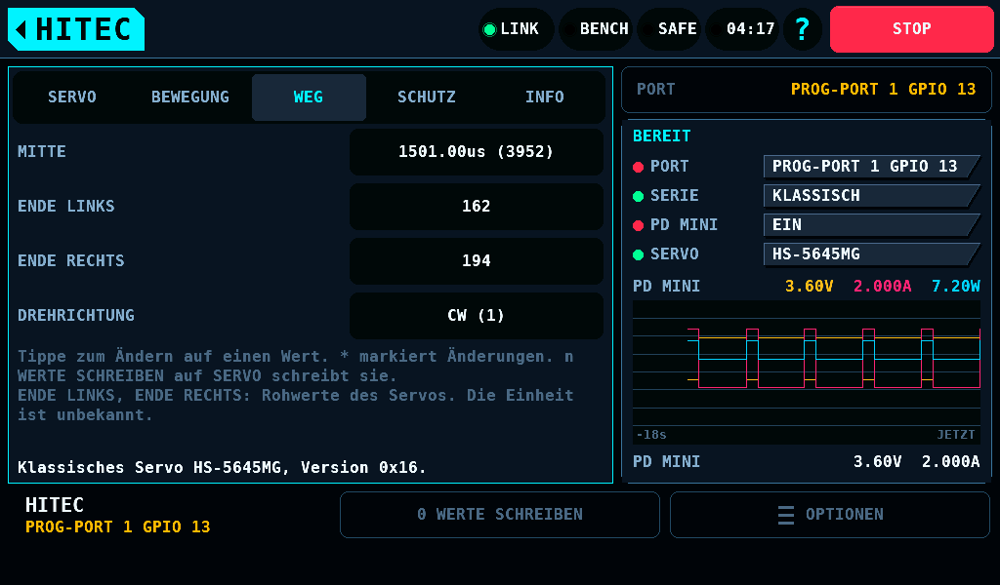
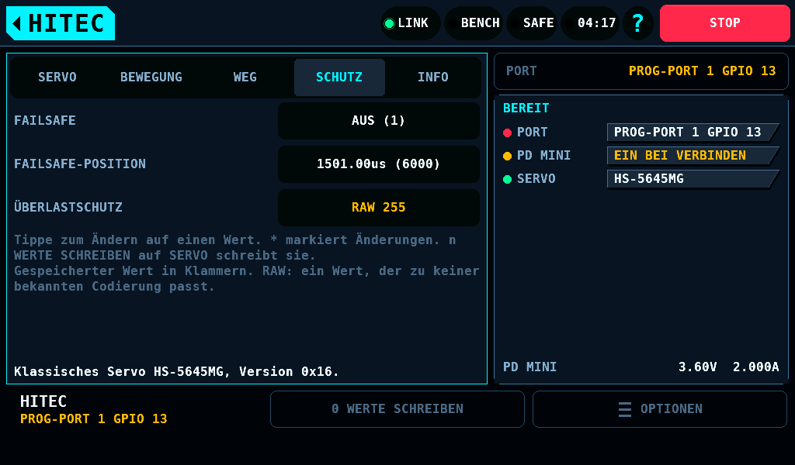
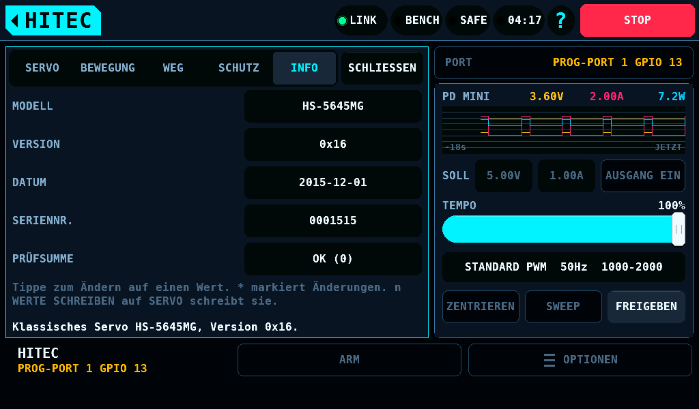

## Ändern

Ein Wert wird im Entwurf auf dem Panel geändert. Vor
[n WERTE SCHREIBEN](#schreiben) erreicht nichts das Servo. Ein Wert, der
vom Servo abweicht, ist doppelt markiert: mit `*` davor und mit der
Akzentfüllung.

| Parameter | Eingabe | Werte |
| --- | --- | --- |
| D-Serie TEMPO | Tastenfeld | 10% bis 100% in Schritten von 10% |
| D-Serie DEAD BAND, klassisch DEAD BAND | Liste | Stufen 1 bis 5 |
| D-Serie SOFT START | Liste | 20%, 40%, 60%, 80%, 100% |
| D-Serie NEUTRAL, ENDE LINKS, ENDE RECHTS | Tastenfeld | 1 bis 16383 Zähler; ENDE LINKS unter NEUTRAL unter ENDE RECHTS |
| D-Serie DREHRICHTUNG, klassisch DREHRICHTUNG | Liste | CW, CCW |
| D-Serie FAILSAFE | Liste, dann das Tastenfeld für POSITION | AUS, KRAFTLOS oder eine Position von 900us bis 2100us |
| D-Serie ÜBERLASTSCHUTZ, klassisch ÜBERLASTSCHUTZ | Liste | AUS, 10% bis 50% in Schritten von 10% |
| D-Serie SMART SENSOR, klassisch FAILSAFE | Liste | EIN, AUS |
| D-Serie ID | Tastenfeld | 0 bis 255 |
| klassisch TEMPO | Tastenfeld | 10% bis 100% in Schritten von 10% |
| klassisch MITTE | Tastenfeld | 900,00us bis 2100,00us in Schritten von 0,25us |
| klassisch ENDE LINKS, ENDE RECHTS | Tastenfeld | 0 bis 255, roh |
| klassisch FAILSAFE-POSITION (HS-5xxx) | Tastenfeld | 900,00us bis 2100,00us in Schritten von 0,25us |

Bereiche und Schritte sind in `protocols/hitec/hitec_reg.c` festgelegt.
Das Tastenfeld zeigt den Bereich. Es lehnt Werte außerhalb der zulässigen
Schritte und Positionen der D-Serie in falscher Reihenfolge mit einer
Begründung ab: `Dieser Wert ist für diese Einstellung nicht zulässig.`
oder `ENDE LINKS, NEUTRAL und ENDE RECHTS müssen in aufsteigender Reihenfolge liegen.`

Eine Änderung passt auch abhängige Werte im Entwurf an, wie die
Programmiergeräte von Hitec. DREHRICHTUNG der D-Serie spiegelt NEUTRAL und
beide Enden. Bei klassischen Servos setzt MITTE beide Endpunkte auf 0x10;
DREHRICHTUNG tauscht sie und übernimmt die Failsafe-Position aus den
Werkszellen 0x49 und 0x4A. Jede klassische Änderung berechnet den Ausgleich
in Zelle 0x1C neu. Eine DREHRICHTUNG der D-Serie, die weder als 0 noch als 1
gespeichert ist, wird allein geändert, ohne Spiegelung. Änderst du einen
Rohwert, ersetzt ihn der gewählte Tabellenwert. ÄNDERUNGEN VERWERFEN unter
WEITERES stellt den Rohwert im Entwurf wieder her.

### Ein Wert, der einen zweiten Blick braucht

Ein Wert, der eine Regel der folgenden Tabelle bricht, öffnet ÄNDERUNG PRÜFEN mit der Zeile
des Felds, `TEMPO: 100% -> 20%`, der Wert des Servos zuerst, und einer
Zeile je Regel. **2s HALTEN ZUM ÜBERNEHMEN** übernimmt ihn; **ABBRECHEN**
oder die Home-Markierung lässt den Entwurf, wie er war.

| Regel | Warnung |
| --- | --- |
| TEMPO unter 30% | `Ein zu langsames Servo kann zum Kontrollverlust über das Modell führen.` |
| DEAD BAND unter dem des Servos | `Ein kleiner DEAD BAND-Wert kann Pendeln und Erwärmung verursachen.` |
| ÜBERLASTSCHUTZ ausgeschaltet | `Ohne Überlastschutz erhitzt sich ein blockiertes Servo.` |
| ein Endpunkt, der von dem des Servos abweicht | `Endpunkt geändert. Dadurch ändert sich auch der Servoweg je Knüppelbewegung.` |
| NEUTRAL oder MITTE, die von der des Servos abweicht | `Die Mitte verschiebt sich. Eine Seite kommt näher an den mechanischen Anschlag.` |
| DREHRICHTUNG umgekehrt | `Drehrichtung umgekehrt. Prüfe vor dem Flug alle Ruder.` |
| eine Failsafe-Position mehr als 300us von 1500us entfernt | `Die Failsafe-Position liegt weit von der Mitte entfernt.` |

Eine Bestätigung gilt für diesen Wert und für Werte, die auf derselben
Seite näher am Wert des Servos liegen. Ein größerer Abstand oder ein
Wechsel auf die andere Seite erfordert eine neue Bestätigung. Steht ENDE
LINKS beispielsweise auf 3300 und bestätigst du 3351, wird 3301 ohne
Rückfrage übernommen; 3299 und 3352 musst du erneut bestätigen. Verglichen
wird mit dem zuletzt vollständig ausgelesenen Wert. Schreiben, Auslesen
oder ÄNDERUNGEN VERWERFEN löscht alle Bestätigungen. Ein gespeicherter Wert
mit unbekannter Codierung lässt sich nicht vergleichen. Deshalb musst du
jede Änderung daran bestätigen.

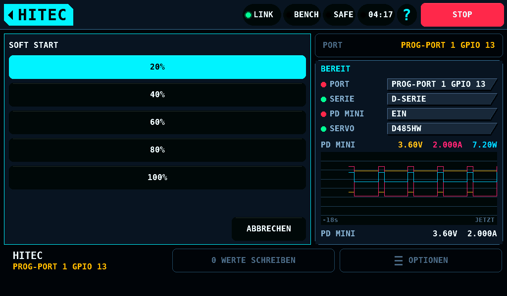
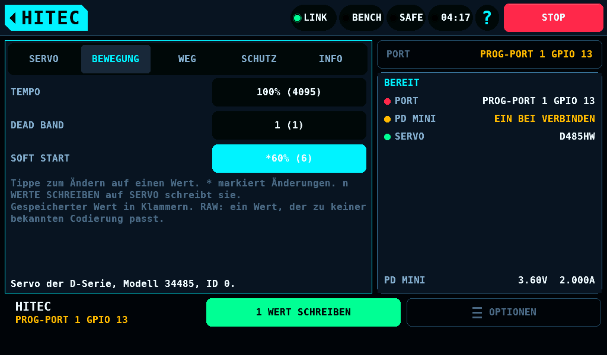
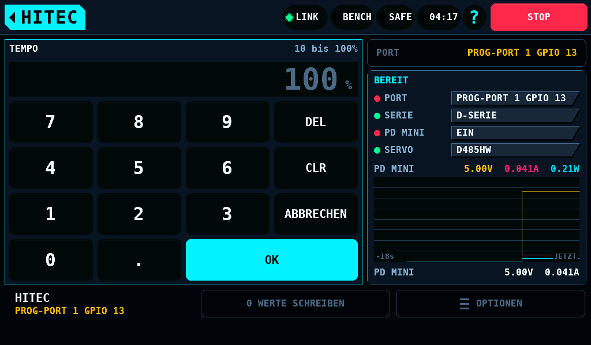
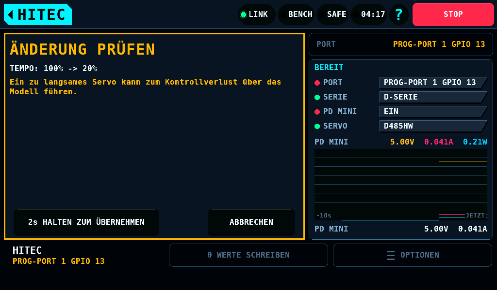

## SERVO BEWEGEN

SERVO BEWEGEN, die Zeile unter DREHRICHTUNG auf WEG eines Servos der
D-Serie, fährt das Ruderhorn auf das bearbeitete NEUTRAL, ENDE LINKS oder
ENDE RECHTS, in der gehaltenen Sitzung, während der Prüfstand SAFE bleibt.
Es braucht ein PD mini mit eingeschaltetem Ausgang und DREHRICHTUNG CW,
und 2s Halten schaltet es ein. Es speichert nie.
Solange es läuft, sucht ANSCHLAG SUCHEN an der Stelle von DREHRICHTUNG
den Anschlag einer Seite und setzt ENDE LINKS oder ENDE RECHTS im
Entwurf, ohne zu schreiben.
[SERVO BEWEGEN in der Hitec-Programmierung](HitecMove-de.md) beschreibt die
Seite, die Tasten `-`/`+`, die Beurteilung, das Ende, ANSCHLAG SUCHEN und
jede Ablehnung und Meldung.

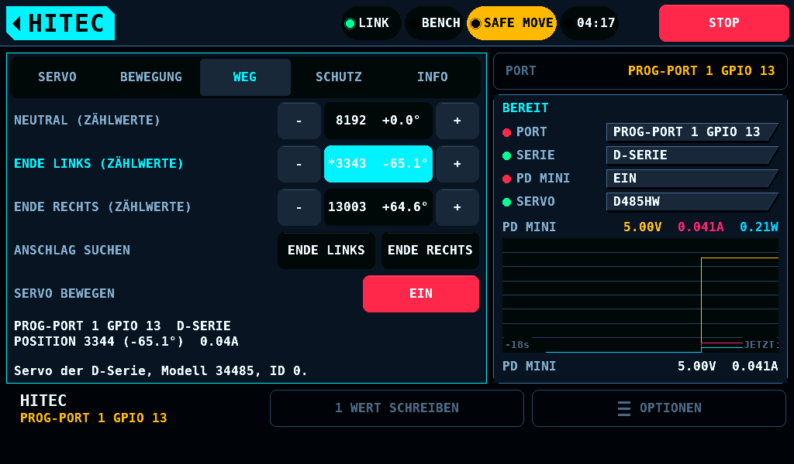

## Der Schreibschalter

**SCHREIBEN INS SERVO FREIGEBEN** steht zu Beginn auf AUS. Ein Tipp auf
**AUS** öffnet eine Seite, die die Risiken nennt; **2s HALTEN ZUM
FREIGEBEN** schaltet ihn ein. Ein Tipp auf **EIN** schaltet ihn sofort aus.
Ein Tipp auf **n WERTE SCHREIBEN**, ZURÜCKSPIELEN, PRÜFSUMME REPARIEREN
oder WERKSEINSTELLUNG bei ausgeschaltetem Schalter öffnet dieselbe Seite:
Halte dort die Taste, um das Schreiben freizugeben. Dabei wird noch nichts
ins Servo geschrieben.

Der Schalter geht aus:

- bei jedem Aufruf der Seite SERVO,
- bei jedem VERBINDEN und jedem VERLASSEN,
- wenn die Verbindung zum IOmcu abbricht,
- bei einem STOP und bei einem Schalten auf SAFE am Prüfstand,
- wenn ein Schreibvorgang ohne erfolgreiche Prüfung endet,
- wenn beim Auslesen andere Werte gefunden werden als die gespeicherten.

Er lässt sich nur einschalten, wenn der Port gehalten und nicht gestoppt
ist, das Servo im Programmiermodus ausgelesen wurde, der Prüfstand SAFE
ist und kein STOP gesetzt ist.

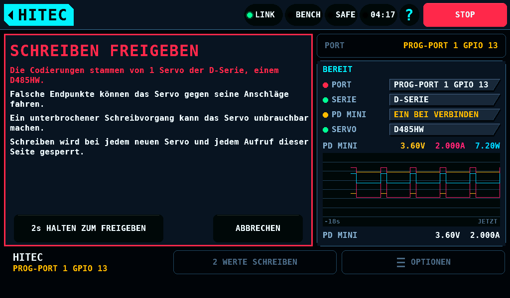

## Schreiben

**n WERTE SCHREIBEN** zählt die Unterschiede zwischen Entwurf und Servo.
Tippe darauf, um die Schreibseite zu öffnen. Sie zeigt höchstens 6 geänderte
Werte in der Reihenfolge der Reiter, etwa `SOFT START: 20% -> 60%`, und
anschließend die Anzahl der übrigen.

Beim ersten Schreiben nach VERBINDEN und bei jedem Schreiben, das
DREHRICHTUNG, NEUTRAL, MITTE oder einen Endpunkt ändert, erscheinen
`Halte das Ruderhorn frei. Löse das Gestänge.` und
`Teste das Servo am Prüfstand, bevor du es ins Modell einbaust.` Die Seite
erklärt außerdem den Schreibablauf der Serie, nennt die Backup-Datei oder
erklärt, warum keine vorhanden ist ([Das Backup vor dem ersten
Schreiben](#das-backup-vor-dem-ersten-schreiben)), und zeigt, wo die Werte
vor dem Schreiben vermerkt werden. **2s HALTEN ZUM SCHREIBEN** startet den
Schreibvorgang.

1. Das zweite Lesen dessen, wovon der Plan abhängt
   ([Das zweite Lesen](#das-zweite-lesen)). Zwei Lesevorgänge, die
   voneinander abweichen, beenden das Schreiben hier, ohne dass etwas
   gesendet wird.
2. Die Backup-Datei, vor dem ersten Schreiben der Sitzung mit eingelegter
   Karte. Das Schreiben wartet bis zu 5000ms auf die Karte.
3. Der Vermerk: die Werte des Servos, die Werte, die das Schreiben
   hinterlassen soll, die Serie, der Port und sein GPIO. Mit eingelegter
   Karte geht er zuerst nach `BENCH/HITEC/CONF/HITEC.TXT`, und das
   Schreiben wartet darauf: eine Karte, die ihn nicht innerhalb von 3000ms
   annimmt, beendet das Schreiben mit `Datei nicht auf Karte gespeichert.
   Keine Werte ins Servo geschrieben.` Ohne Karte bleibt der Vermerk im
   Arbeitsspeicher. Der Abschluss einer älteren Kartenanfrage gibt diesen
   Schreibvorgang nicht frei. Das gilt auch für den Vermerk eines
   abgebrochenen Schreibvorgangs und für das Löschen eines Vermerks. Erst
   wenn sein eigener Vermerk gespeichert ist, beginnt das Schreiben ins
   Servo. Die 3000ms zählen ab dem Start des Schreibvorgangs.
4. Der Plan von `hitec_plan()`: nur die Einstellungen, die sich ändern.
   D-Serie: die Register der Einstellung, wie das HFP-30 sie schreibt, im
   Abstand von 20ms, dann das Speichern, 100ms, der Neustart und 1000ms.
   Klassisch: jede Zelle einer geänderten Einstellung, dann der Ausgleich
   in Zelle 0x1C, jede mit `+ +` beantwortet, mit 3 Versuchen.
5. Zur Prüfung werden die 21 Register der D-Serie oder die klassischen
   Zellen 0x00 bis 0x23 erneut ausgelesen und mit dem Entwurf verglichen.
6. `2 Werte geschrieben und geprüft.` oder `1 Wert geschrieben und
   geprüft.` beendet es und löscht den Vermerk. Der Schalter bleibt ein.

Im Host-Modell (`test_hitec_prog_reread`) dauert ein Schreiben eines Werts
bei der D-Serie 3,2s bei 16ms je Frame und 3,5s bei 33ms, bei einem
klassischen Servo 2,4s und 4,9s, das zweite Lesen eingeschlossen. Am
Prüfstand sind diese Zeiten nicht gemessen.

Das Schreiben wird abgelehnt bei ARMED oder einem angeforderten Schalten
auf ARMED, mit gesetztem STOP, an einem gestoppten Port, ohne gelesenes
Servo, mit ausgeschaltetem Schalter, ohne Änderung, solange ein Vermerk
eines früheren Schreibens besteht und solange eine Anfrage an die Karte
(DATEIEN, Speichern oder Laden) auf ihre Antwort wartet. Port, Prüfstand, STOP, Einstieg und
Schalter werden erneut geprüft, wenn die Karte den Vermerk angenommen hat:
ein inzwischen ausgeschalteter Schalter, ein STOP oder ein Finger auf ARM
beendet das Schreiben, bevor ein Schritt hinausgeht, mit der Meldung der
Ablehnung, und löscht seinen Vermerk, auch auf der Karte. Solange das
Schreiben auf die Karte wartet, geht der Schalter nicht wieder ein.

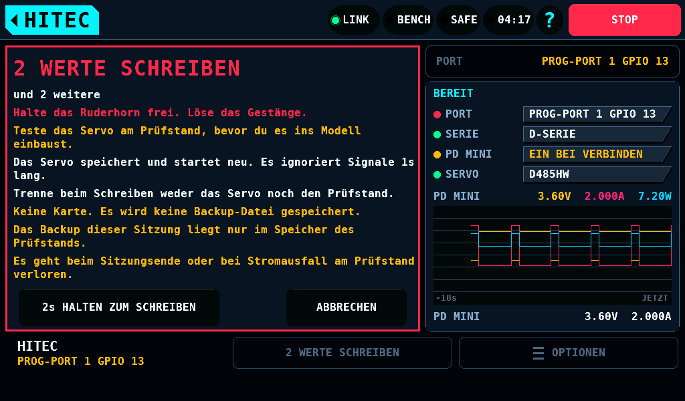
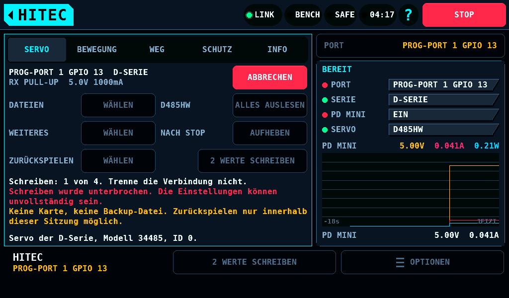
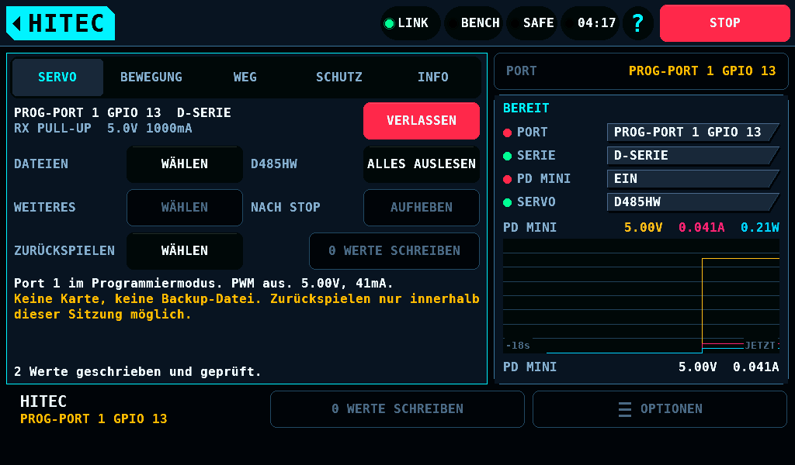
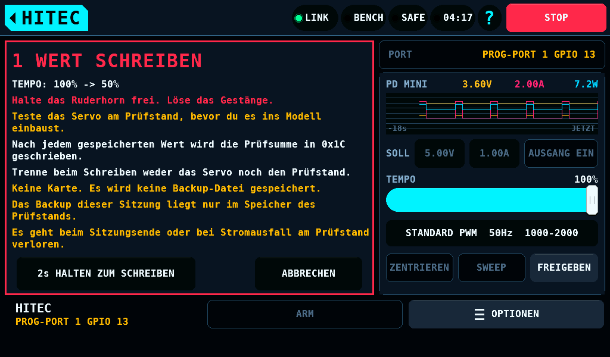

### Das zweite Lesen

Eine klassische Antwort enthält keine Prüfsumme. Ein falsch ausgelesener
Wert kann deshalb unbemerkt in den Plan eingehen. Beim Auslesen am Prüfstand
ergab Zelle 0x17 einmal 0x04, obwohl das Servo 0x05 enthielt. Vor jedem
Schreiben werden daher alle Adressen, von denen der Plan abhängt, erneut
ausgelesen: nach der Haltebestätigung und vor dem Ausführen des Plans. Die
Werte werden mit denen verglichen, aus denen der Plan erstellt wurde:

| Schreiben | Erneut gelesen |
| --- | --- |
| Klassisch: n WERTE SCHREIBEN, die Werte einer geladenen Datei, PRÜFSUMME REPARIEREN, ZURÜCKSPIELEN eines Vermerks oder des Backups der Sitzung | Zellen 0x00 bis 0x23, der Ausgleich 0x1C eingeschlossen: 36 |
| Klassisch: WERKSEINSTELLUNG | Zellen 0x00 bis 0x23 und der Werksblock 0x30 bis 0x53, aus dem ihre Werte stammen: 72 |
| D-Serie: jedes Schreiben | die 12 Register, die ein Plan schreibt (`hitec_writable()`): 0x32, 0x44, 0x4C, 0x4E, 0x54, 0x5E, 0x60, 0x6C, 0x9C, 0xB0, 0xB2, 0xC2 |

Eine Antwort der D-Serie trägt eine Summe, und die D-Serie wird trotzdem
zweimal gelesen. Die Statuszeile lautet `Zweites Auslesen vor dem Schreiben: 5 von 36.`, und **ABBRECHEN** steht in der Zeile PORT.

- Die Lesevorgänge stimmen in jeder Adresse überein: das Schreiben geht
  weiter mit der Backup-Datei, dem Vermerk und dem Plan.
- Sie weichen in einer Adresse ab: `Zwei Auslesevorgänge weichen bei 0x17 ab. Lies mit ALLES AUSLESEN erneut aus.` Die erste abweichende Adresse wird
  genannt. Nichts wird geplant, vermerkt, gespeichert oder gesendet; das
  erste Ausleseergebnis bleibt die Grundlage. Änderungen und Schreibfreigabe
  bleiben erhalten. Ein erneutes **n WERTE SCHREIBEN** vergleicht ein neues
  zweites Ausleseergebnis mit demselben ersten. **ALLES AUSLESEN** ersetzt
  die Grundlage durch ein neues vollständiges Ausleseergebnis.
- **ABBRECHEN**, ein STOP oder ein fehlgeschlagenes Lesen während des
  zweiten Lesens beendet das Schreiben ebenso, mit `Der Vorgang wurde
  abgebrochen.`, der Zeile des STOP oder `Auslesen bei Adresse 0x17 fehlgeschlagen. Tippe auf ALLES AUSLESEN.`

Die Zeit, die das zweite Lesen hinzufügt, gemessen im Host-Modell
(`test_hitec_prog_reread`) vom Ende des Haltens bis zum Ende des Lesens:

| Erneut gelesen | Frame von 16ms | Frame von 33ms |
| --- | --- | --- |
| Klassisch, 36 Zellen | 1152ms | 2376ms |
| Klassisch WERKSEINSTELLUNG, 72 Zellen | 2304ms | 4752ms |
| D-Serie, 12 Register | 704ms | 792ms |

Ein klassisches Lesen braucht 2 Frames je Zelle. Am Prüfstand sind diese
Zeiten nicht gemessen.

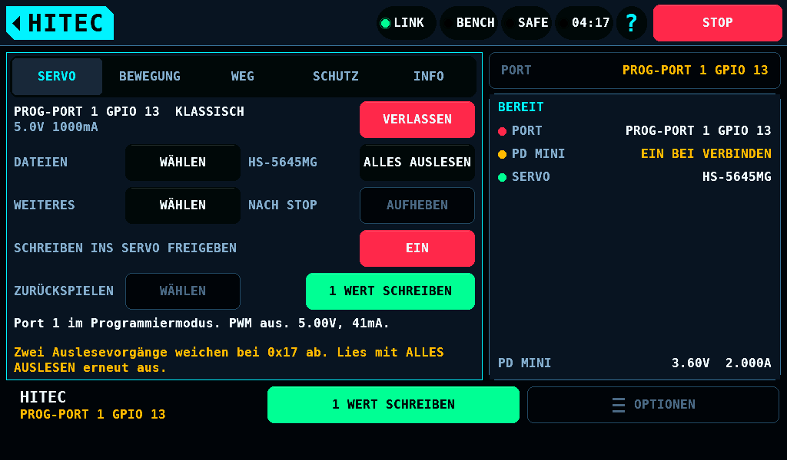

| Meldung | Das Servo |
| --- | --- |
| `Servowerte stimmen nach dem Schreiben nicht überein. Tippe auf ALLES AUSLESEN.` | hält Werte, die das Zurücklesen anders als im Entwurf fand; der Vermerk bleibt |
| `Schreiben bei Register 0x54 unterbrochen. Tippe auf ALLES AUSLESEN.` | hat die Register der D-Serie davor angenommen; nichts ist gespeichert |
| `Schreiben vor dem Speichern im Servo unterbrochen. Tippe auf ALLES AUSLESEN.` | hat die Register angenommen, ungespeichert |
| `Schreiben nach dem Speichern, vor dem Neustart unterbrochen. Tippe auf ALLES AUSLESEN.` | hat sie gespeichert; der Neustart steht aus |
| `Alle Werte gesendet. Ihre Prüfung wurde unterbrochen. Tippe auf ALLES AUSLESEN.` | hat alle angenommen; das Zurücklesen endete nicht |
| `Schreiben bei gespeichertem Wert 0x06 unterbrochen. Tippe auf ALLES AUSLESEN.` und `Prüfsumme möglicherweise falsch. Das Servo kann PWM ignorieren und Strom bis zur Strombegrenzung ziehen.` | hält vielleicht die neue Zelle ohne ihren Ausgleich |
| `Gespeicherter Wert 0x06 ist geschrieben, seine Prüfsumme in 0x1C nicht. Tippe auf ALLES AUSLESEN.` und dieselbe zweite Zeile | hält die neue Zelle und den alten Ausgleich: die Prüfsumme ist falsch |
| `Ein Schreibvorgang ist ungeprüft. Tippe vor dem nächsten Schreiben auf ALLES AUSLESEN.` | ein Schreiben, bei dem ein Schritt hinausging, lässt offen, was das Servo hält; ALLES AUSLESEN kommt vor dem nächsten Schreiben |

Ein Schreiben, das anders als geprüft endet, schaltet den Schalter aus.

## Der Vermerk eines Schreibvorgangs

Der Vermerk besteht vom Start eines Schreibens, bis das Schreiben geprüft
endet, das Schreiben endet, bevor ein Schritt das Servo erreicht hat, ein
ZURÜCKSPIELEN geprüft endet oder er verworfen wird. Mit Karte
wird er beim nächsten Start des Panels wieder gelesen: ein Panel, das
während eines Schreibens neu startet, behält ihn. Dann sagt das
Meldungsband `Schreiben wurde unterbrochen. Die Einstellungen können unvollständig sein.` und `Benutze das Servo nicht. Schließe es an GPIO 13 an und tippe auf ALLES AUSLESEN.`, und der Reiter SERVO behält die
erste Zeile, bis ein Servo gelesen ist. Das nächste vollständige Lesen
vergleicht das Servo mit dem Vermerk, Adresse für Adresse über die
Adressen, die ein Schreiben ändert:

| Das Servo hält | Meldung | ZURÜCKSPIELEN bietet |
| --- | --- | --- |
| die Werte vor dem Schreiben | `Ist dies das Servo, dessen Schreibvorgang an GPIO 13 unterbrochen wurde?` `Es enthält die alten Werte. Ist es dasselbe Servo, verwirf den Vermerk unter ZURÜCKSPIELEN.` | das Zurückspielen, das dann nichts sendet und den Vermerk löscht, und das Verwerfen |
| die Werte, die das Schreiben hinterlassen sollte | dieselbe erste Zeile und `Es enthält die neuen Werte. Ist es dasselbe Servo, verwirf den Vermerk unter ZURÜCKSPIELEN.` | das Zurückspielen und das Verwerfen |
| von beiden etwas | `Das Servo enthält alte und neue Werte gemischt.` `Benutze dieses Servo nicht. ZURÜCKSPIELEN stellt die Werte vor dem Schreibvorgang wieder her.` | das Zurückspielen und das Verwerfen |
| eine andere Serie, einen anderen Port oder ein anderes Modell der D-Serie, oder einen Wert, der keiner von beiden ist | `Der unterbrochene Schreibvorgang betraf ein anderes Servo.` `Es war an GPIO 13 angeschlossen. Verwirf den Vermerk unter ZURÜCKSPIELEN.` | nur das Verwerfen |

Der klassische Ausgleich 0x1C wird nicht verglichen: ein Schreiben, das
zwischen einer Zelle und ihrem Ausgleich abbricht, hinterlässt dort einen
dritten Wert. ZURÜCKSPIELEN schreibt die Werte vor dem Schreiben als
eigenes Schreiben zurück, mit dem Schalter, der Halteseite `ZURÜCKSPIELEN`
und ihrem Zurücklesen; der Vermerk bleibt, bis das geprüft endet.
`Verwirf den Vermerk zum unterbrochenen Schreibvorgang.` entfernt ihn ohne
Schreiben. Solange ein Vermerk besteht, werden n WERTE SCHREIBEN und
PRÜFSUMME REPARIEREN abgelehnt: `Schreiben und PRÜFSUMME REPARIEREN gesperrt. Spiele unter ZURÜCKSPIELEN Werte zurück oder verwirf den Vermerk.`
Die Dateiverwaltung zeigt `HITEC.TXT` und `HITEC.NEW` nur mit INFO: eine
Änderung von Hand könnte falsche Werte an ein Servo senden.

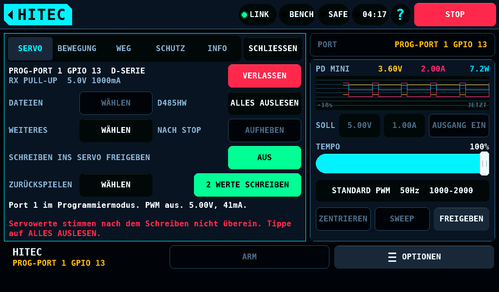
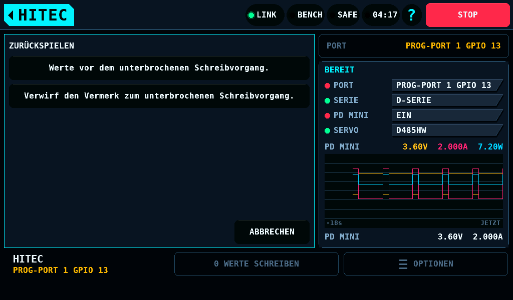

## Servodateien

Eine Servodatei ist eine Textdatei im Ordner `BENCH/HITEC/CONF` der
SD-Karte des Panels, `<Name>.TXT`, neben dem Vermerk `HITEC.TXT`. Das Panel
legt beim ersten Speichern jede fehlende Ebene des Ordners an: `BENCH`,
`BENCH/HITEC`, dann `BENCH/HITEC/CONF`. Eine Datei hält den Satz, den ALLES
AUSLESEN liest: 21 Register eines Servos der D-Serie, 100 Zellen eines
klassischen Servos und seine Version.

```
RCBENCH HITEC 1
series=D
model=D485HW
image=86B500271FC1000000000000000100010FFF000000010FFF000009C410FE006432CB0D17200000000000
backup=0
check=1E29
```

| Zeile | Inhalt |
| --- | --- |
| 1 | `RCBENCH HITEC 1`, das Format; der Vermerk hat dieselbe erste Zeile und `port=` als dritte |
| `series=` | `D` oder `C` |
| `model=` | der Name des Modells, `D485HW` oder `HS-5645MG`; `D series 34999` für eine Modellnummer der D-Serie, die das Registermodell nicht nennt; die Namenszellen wie gelesen für einen anderen klassischen Namen; `?` für keinen. 1 bis 20 druckbare Zeichen |
| `image=` | D-Serie: die Register in der Reihenfolge, in der ALLES AUSLESEN sie liest, je 4 Hexadezimalziffern, 84 Ziffern. Klassisch: die Zellen 0x00 bis 0x23, 0x30 bis 0x53, 0x60 bis 0x6F, 0x70 bis 0x73 und 0x80 bis 0x87, je 2 Ziffern, 200 Ziffern |
| `version=` | nur klassisch, 2 Ziffern, wo das Lesen eine fand |
| `backup=` | `1` für eine Backup-Datei ([Das Backup vor dem ersten Schreiben](#das-backup-vor-dem-ersten-schreiben)), `0` für jedes andere Speichern |
| `check=` | die CRC-16 (zyklische Redundanzprüfung) aller Bytes vor dieser Zeile, 4 Ziffern |

Zeilen enden nur mit LF (Zeilenvorschub). Hexadezimale Buchstaben stehen
in Großschreibung.
Eine Datei eines D485HW hat 149 Bytes, eine eines HS-5645MG 279 Bytes; das
Panel liest höchstens 320 Bytes. Eine Datei, deren Prüfsumme nicht stimmt
oder deren Zeilen nicht diese in dieser Reihenfolge sind, wird ganz
abgelehnt: eine von Hand bearbeitete Datei wird nicht geladen. Eine Datei
ohne die Zeile `backup=` wird geladen; sie zählt als Backup-Datei, wenn ihr
Name ein vorgeschlagener Name ist, `HITEC001` bis `HITEC999`.

**DATEIEN** öffnet die Liste. Sie nimmt einen Tipp an, wenn der Port
gehalten, das Servo im Programmiermodus und gelesen ist, kein Lesen nach
einem Schreiben aussteht, der Port nicht gestoppt, der Prüfstand SAFE und
kein STOP gesetzt ist; sonst sagt der Tipp, warum nicht. Speichern und
Laden gehen auch mit ausgeschaltetem Schreibschalter: eine Datei ändert den
Entwurf im Panel, nie das Servo.

Der erste Eintrag speichert. Darunter stehen die Dateien nach Namen
sortiert, 5 je Seite, jede mit dem Modell, das ihre Datei nennt. Die
Dateien mit einem vorgeschlagenen Namen, `HITEC` und 3 Ziffern, stehen
zusammen an der Stelle von `HITEC000`, die höchste Nummer zuerst. Bei mehr
als 5 Dateien zählt sie der Titel, `DATEIEN 1 BIS 5 VON 7`, und `Zeige weitere Dateien an.` blättert weiter, nach der letzten zurück zur ersten
Seite. Das Panel fragt die Karte nach jeder Seite und wartet höchstens
5000ms darauf: sonst `Die Karte lässt sich nicht lesen.`

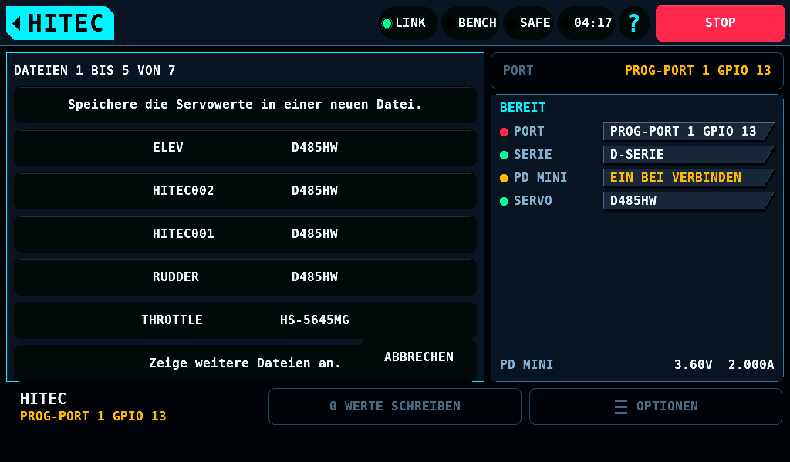
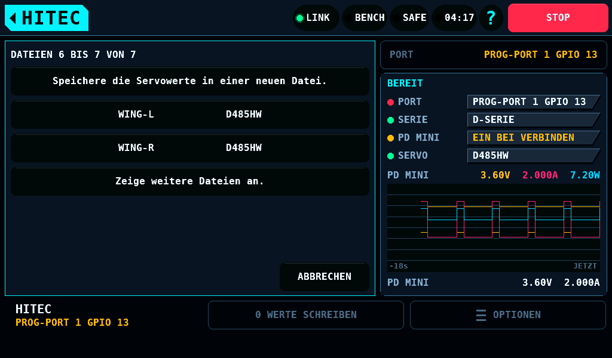
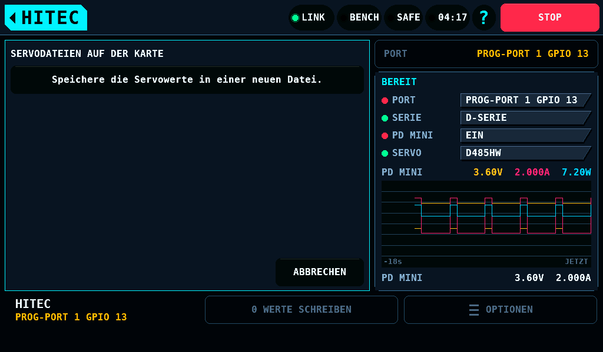

### Speichern

`Speichere die Servowerte in einer neuen Datei.` öffnet die Tastatur
mit dem nächsten freien vorgeschlagenen Namen, `HITEC001` bis `HITEC999`.
Die Tastatur nimmt bis zu 16 Zeichen: A bis Z, 0 bis 9, `-`, `_` und den
Punkt. **OK** speichert die zuletzt ausgelesenen Servowerte. Änderungen im
Entwurf stehen nicht in der Datei. Vor dem Speichern wird der Name geprüft;
vorhandene Dateien werden nicht ersetzt. Der Namensvergleich unterscheidet
nicht zwischen Groß- und Kleinschreibung. Dateien mit längeren Namen bis
32 Zeichen werden ebenfalls aufgelistet und geladen.

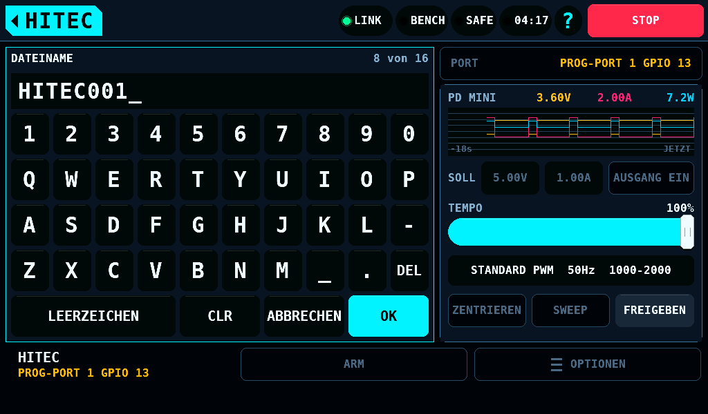
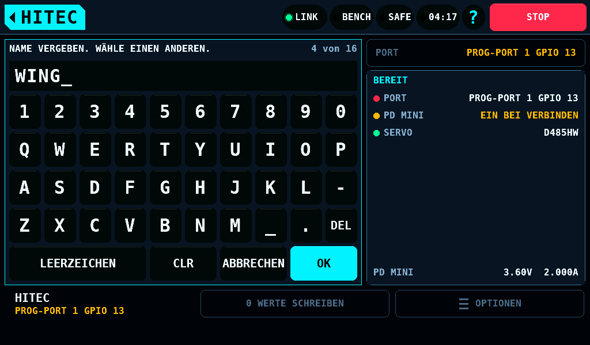

| Ergebnis | Angezeigt |
| --- | --- |
| Gespeichert | `Servowerte auf der Karte gespeichert: WING-L.` |
| Ein Punkt am Anfang oder Ende, oder ein reservierter Name: `HITEC`, `CON`, `PRN`, `AUX`, `NUL`, `COM1` bis `COM9`, `LPT1` bis `LPT9`, allein oder vor einem Punkt | die Tastatur öffnet sich wieder unter `UNGÜLTIGER NAME`; `Ungültiger Name: reserviert oder mit einem Punkt am Anfang oder Ende.` |
| Eine Datei hat den Namen | die Tastatur öffnet sich wieder unter `NAME VERGEBEN. WÄHLE EINEN ANDEREN.`; `Dieser Dateiname ist bereits vergeben. Keine Datei wurde ersetzt.` |
| Keine Karte | `Keine Karte. Nichts gespeichert oder ins Servo geschrieben.` |
| Karte voll, oder `HITEC001` bis `HITEC999` beim Backup vor einem Schreiben alle vergeben | `Karte voll. Nichts gespeichert oder ins Servo geschrieben.` |
| Die Karte ist schreibgeschützt, oder `BENCH`, `BENCH/HITEC` oder `BENCH/HITEC/CONF` ist auf der Karte eine Datei und kein Ordner | `Speichern nicht möglich: Karte schreibgeschützt oder BENCH/HITEC/CONF kein Ordner.` |
| Die Karte scheitert am Schreiben der Datei oder antwortet nicht innerhalb von 5000ms | `Schreibfehler auf der Karte. Keine Werte ins Servo geschrieben.` |

Schließt die Karte das Speichern erst nach dem Ablauf der 5000ms ab,
bleibt die angelegte Datei erhalten. Die angezeigte Meldung bleibt
unverändert.

### Das Backup vor dem ersten Schreiben

Das Backup der Sitzung enthält die ersten nach VERBINDEN vollständig
ausgelesenen Werte und liegt im Arbeitsspeicher des Panels. Wird beim
späteren Auslesen dasselbe Servo erkannt, bleibt es unverändert. Wird das
Servo als ein anderes behandelt, ersetzt das neue Ausleseergebnis das Backup.

Ein klassisches Servo gilt als anders, wenn Name, Datum, Seriennummer oder
Version abweichen. Ein Servo der D-Serie gilt als anders, wenn seine
Modellnummer abweicht oder seine Werte nicht zur Folge der Auslese- und
Schreibvorgänge dieser Sitzung passen. Der Port ist gehalten, also schreibt
nur diese Sitzung ins Servo. Ein Ausleseergebnis der D-Serie wird dem zuvor
ausgelesenen Servo zugeordnet, wenn:

- kein Schreiben der Sitzung ungeprüft ist und jedes Register, das ein
  Schreiben sendet, den Wert des Lesens davor hält; oder
- ein Schreiben ungeprüft ist (seine Prüfung scheiterte, oder es wurde
  unterbrochen) und der Vermerk dieses Schreibens die Werte erklärt: das
  Lesen findet die Werte vor dem Schreiben, seine neuen Werte oder von
  beiden etwas ([Der Vermerk eines
  Schreibvorgangs](#der-vermerk-eines-schreibvorgangs)). Ist der Vermerk
  verworfen, entscheiden die Werte, gegen die Werte, die die gescheiterte
  Prüfung zurückgelesen hat.

Der Vergleich bezieht sich auf das vorige Ausleseergebnis, nicht auf das
Backup. Erfolgreich geprüfte Schreibvorgänge der Sitzung, einschließlich
der ID 0x32, erhalten deshalb die Zuordnung. Wird ein Servo als ein anderes
behandelt, erscheint

```
Werte weichen vom letzten Auslesen ab. Wird als anderes Servo behandelt.
Sein Backup enthält die Werte dieses Auslesevorgangs.
```

Die Zeile der Backup-Datei entfällt, ZURÜCKSPIELEN bietet das Backup des
ersten Servos nicht an, und das erste Schreiben auf das neue Servo
speichert eine eigene Backup-Datei. Besteht ein Vermerk, steht seine Zeile
an der Stelle dieser beiden. VERLASSEN, das nächste VERBINDEN, eine
verlorene Verbindung und ein Neustart des Panels beenden das Backup; das
erste Lesen der nächsten Sitzung ist ihr Backup ohne diese Zeilen. Eine automatische oder manuelle Speicherung zählt nur für das Backup,
das bei der Anfrage bestand. Eine späte Antwort nach VERLASSEN und
VERBINDEN oder nach dem Auslesen eines anderen Servos gilt nicht als
Speicherung des neuen Backups.

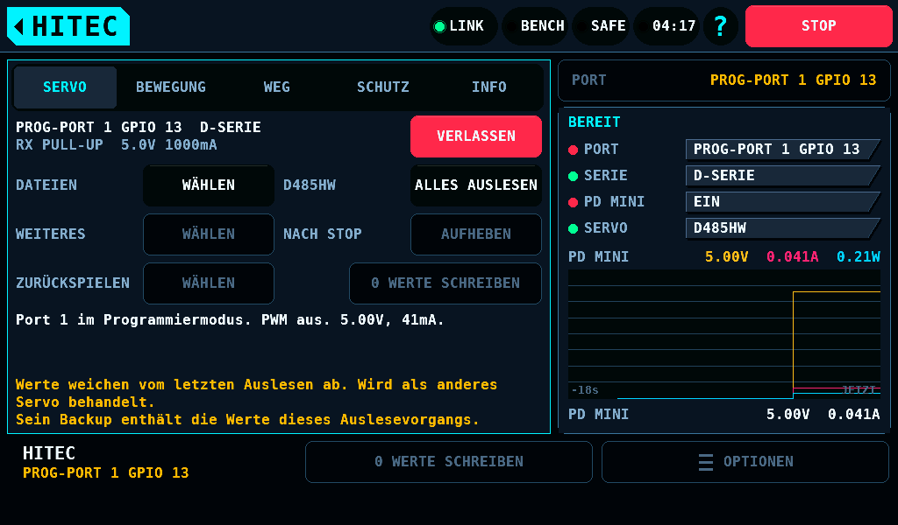

Ist eine Karte eingebunden, speichert der erste Schreibvorgang einer
Sitzung, der einen Schritt sendet, zuerst das Backup ohne Nachfrage in
einer neuen Datei unter dem nächsten vorgeschlagenen Namen. Das gilt für
n WERTE SCHREIBEN, PRÜFSUMME REPARIEREN, ZURÜCKSPIELEN und WERKSEINSTELLUNG. Die Schreibseite sagt `Die bisherigen
Servowerte werden vor dem Schreiben in einer neuen Kartendatei gesichert.`
und die Zustandszeile `Backup-Datei wird auf der Karte gespeichert.`,
solange die Karte arbeitet. Das Servo erhält nichts, bevor die Karte die
Datei hält. Eine Karte, die voll oder schreibgeschützt ist, die am
Schreiben scheitert, die zwischen Anfrage und Datei den Steckplatz verlässt
oder die nicht innerhalb von 5000ms antwortet, beendet das Schreiben mit
den Zeilen der Tabelle oben, und nichts wird ins Servo geschrieben.
ABBRECHEN und STOP, während die Karte arbeitet, beenden das Schreiben
ebenso. Eine Datei, die die Karte nach den 5000ms anlegt, hält das Backup
trotzdem; das Schreiben geht nicht von selbst weiter. Der Reiter SERVO
nennt dann die Datei: `Backup-Datei dieser Sitzung: HITEC003.` Ein
Speichern von Hand vor dem ersten Schreiben zählt als diese Datei, solange
das Servo noch die Werte des Backups hält. Ein Speichern von Hand nach
einem Schreiben hält die geschriebenen Werte und lässt die Zeile, wie sie
ist. Die Backup-Datei und jedes Speichern von Hand des Servos, wie die
Sitzung es vorfand, vor dem ersten Schreiben tragen `backup=1`; jedes andere
Speichern trägt `backup=0`. Eine passende klassische Backup-Datei kann auch gespeicherte Zellen ohne
änderbare Einstellung zurückspielen
([Laden einer Backup-Datei](#laden-einer-backup-datei)).

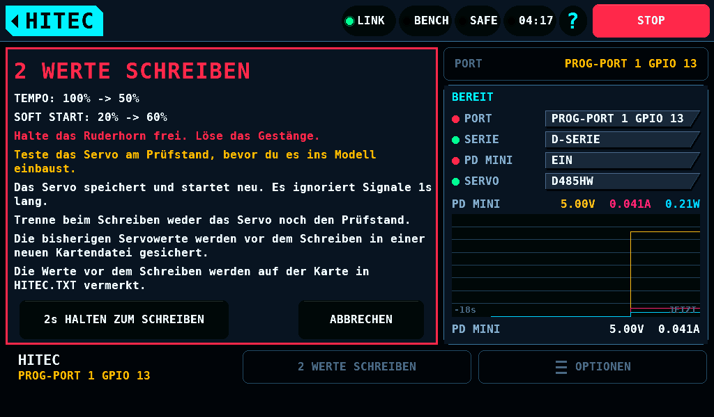
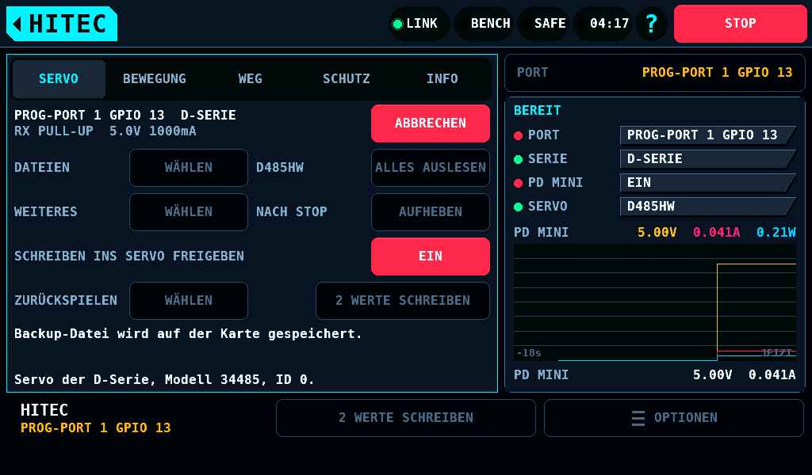
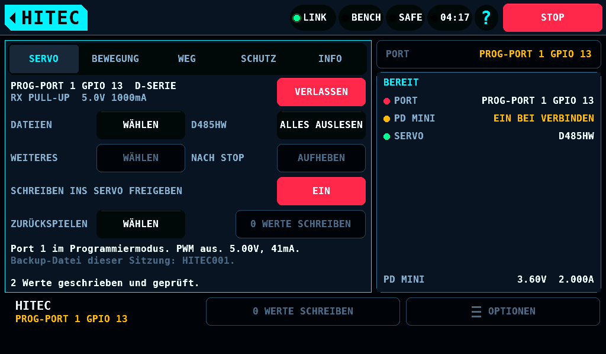

#### Ohne Karte

Ohne eingebundene Karte bleibt das Schreiben möglich. Die Schreibseite
zeigt drei zusätzliche Zeilen:

```
Keine Karte. Es wird keine Backup-Datei gespeichert.
Das Backup dieser Sitzung liegt nur im Speicher des Prüfstands.
Es geht beim Sitzungsende oder bei Stromausfall am Prüfstand verloren.
```

Nach dem Schreiben zeigt der Reiter SERVO `Keine Karte, keine
Backup-Datei. Zurückspielen nur innerhalb dieser Sitzung möglich.` Eine
später in der Sitzung eingelegte Karte erhält das Backup mit dem nächsten
Schreiben. Die Datei enthält die Werte vom Beginn der Sitzung. Wird die
Karte nach dem Speichern der Backup-Datei entfernt, bleiben weitere
Schreibvorgänge möglich. Die Schreibseite zeigt dann `Keine Karte. Die bisherigen Werte bleiben nur im
Arbeitsspeicher.` Eine eingelegte Karte, die sich nicht einbinden lässt,
gilt als nicht vorhanden. Anstelle von `Keine
Karte` nennt die Meldung die erkannte Ursache, wie bei der
KST-Servoprogrammierung ([Ohne
Karte](ServoProgrammer-de.md#ohne-karte)).


### Laden

Tippe auf eine Datei, um sie zu laden. Die Zellen oder Register jedes
änderbaren Werts werden unverändert in den Entwurf übernommen; unbekannte
Codierungen bleiben Rohwerte. Bei einem klassischen Entwurf wird der
Ausgleich in Zelle 0x1C neu berechnet. Geänderte Werte sind mit `*` markiert,
und **n WERTE SCHREIBEN** zählt sie. Das Servo erhält erst Werte, nachdem
du das Schreiben freigegeben und auf der Schreibseite 2s gehalten hast.

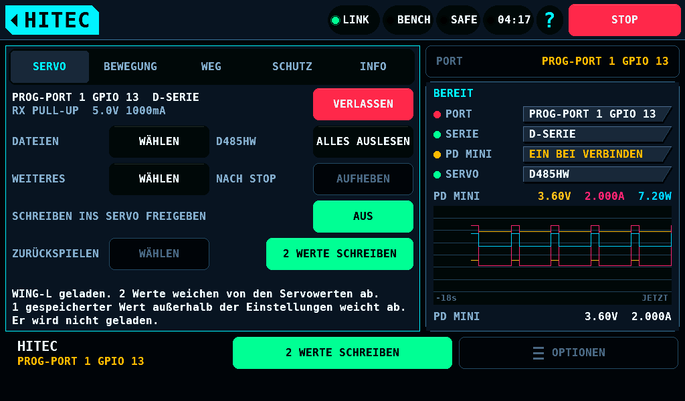

| Datei | Angezeigt |
| --- | --- |
| Geladen | `WING-L geladen. 2 Werte weichen von den Servowerten ab.` oder `WING-L geladen. 1 Wert weicht von den Servowerten ab.` |
| Hält die änderbaren Werte des Servos | `WING-L stimmt mit den Servowerten überein. Nichts zu schreiben.`; der Entwurf wird zu den Werten des Servos, und eine Änderung von vor dem Laden fällt samt ihren Bestätigungen weg |
| Werte außerhalb der änderbaren weichen ab | eine zweite Zeile: `2 gespeicherte Werte außerhalb der Einstellungen weichen ab. Sie werden nicht geladen.` oder `1 gespeicherter Wert außerhalb der Einstellungen weicht ab. Er wird nicht geladen.` |
| Eine Backup-Datei des gelesenen Servos, deren Werte außerhalb der änderbaren abweichen | DIESE DATEI PRÜFEN mit `Auch geladen: 1 Werte außerhalb der Einstellungen.`; nach dem Halten dieselbe Zeile unter der Zeile des Ladens ([Laden einer Backup-Datei](#laden-einer-backup-datei)) |
| Von der anderen Serie | `Datei ist KLASSISCH, Servo ist D-SERIE. Nicht geladen.` |
| Vom anderen klassischen Layout | `Datei ist für HS-7xxx-Servos, dieses Servo ist HS-5xxx. Nicht geladen.` |
| Von einem anderen Modell desselben Layouts, oder jenseits einer weichen Regel | DIESE DATEI PRÜFEN, unten; `Bestätige die Warnungen, bevor du diese Datei lädst.` |
| Eine falsche Prüfsumme | `Datei beschädigt: Prüfsumme stimmt nicht. Nicht geladen.` `Eine von Hand bearbeitete Datei wird nicht geladen.` |
| Endet vor ihrer Prüfzeile | `Datei beschädigt: Sie endet vor ihrer Prüfzeile. Nicht geladen.` und dieselbe zweite Zeile |
| Eine Zeile, die nicht die fällige ist | `Zeile 5 ist nicht lesbar. Datei nicht geladen.` und dieselbe zweite Zeile |
| Keine Servodatei, oder größer als 320 Bytes | `Keine Servodatei. Nicht geladen.` |
| Die Karte lässt sich nicht lesen oder antwortet nicht innerhalb von 5000ms | `Die Karte lässt sich nicht lesen.` |

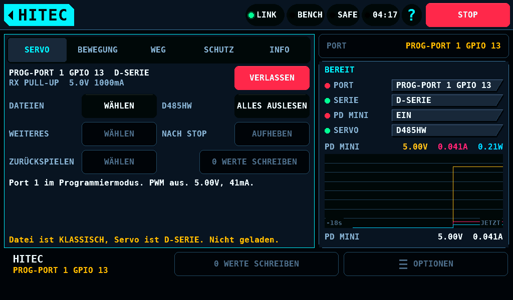
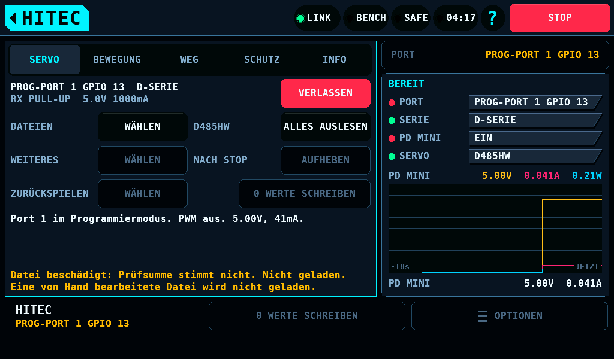

DIESE DATEI PRÜFEN öffnet sich vor dem Übernehmen in den Entwurf, wenn die
Datei ein anderes Modell nennt. Dann erscheinen `Dateimodell D series 34999, Servomodell
D485HW.` und `Werte eines anderen Modells eignen sich möglicherweise nicht für dieses Servo.`
Die Seite erscheint auch, wenn ein Dateiwert eine Warnregel auslöst, die
der aktuelle Servowert einhält. Sie nennt die Datei, die abweichenden Werte
und dieselben Warnungen wie beim Ändern einzelner Werte
([Ein Wert, der einen zweiten
Blick braucht](#ein-wert-der-einen-zweiten-blick-braucht)).

Warnungen haben Vorrang vor Wertzeilen. Die letzte passende Wertzeile zählt
die übrigen, etwa `und 3 weitere`; bei Bedarf entfallen alle Wertzeilen.
Passen die Warnungen trotzdem nicht über die Haltetaste, führt **2s HALTEN ZUM
FORTFAHREN** zum nächsten Teil. Der Dateiname bleibt darüber sichtbar.
Eine Datei eines anderen Modells, die alle 7 Regeln auslöst, braucht auf
Englisch 1 Teil und auf Deutsch 2. **2s HALTEN ZUM LADEN** im letzten Teil
übernimmt die Werte in den Entwurf und bestätigt jede Warnregel für ihren
Wert. **ABBRECHEN** und ZURÜCK lassen den Entwurf in jedem Teil unverändert.

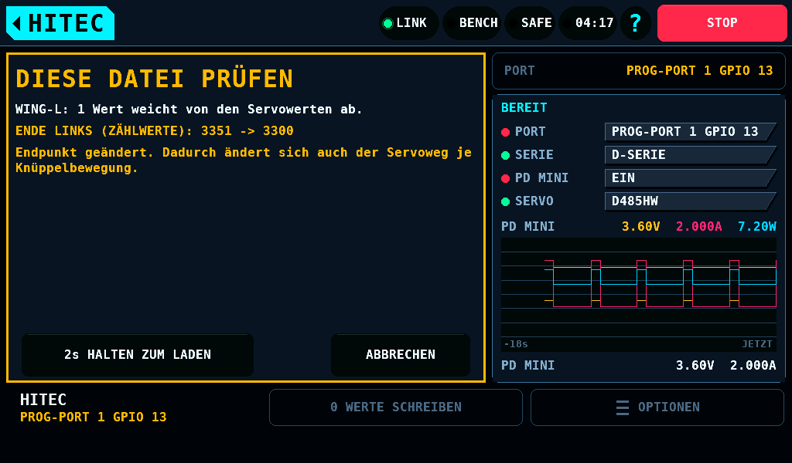
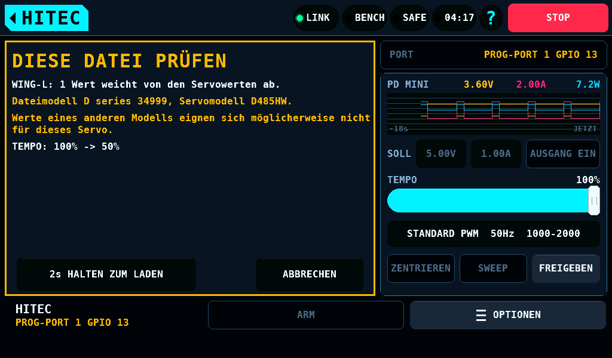
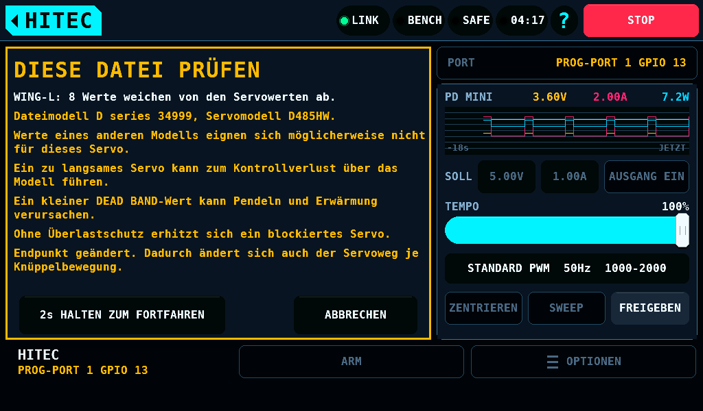
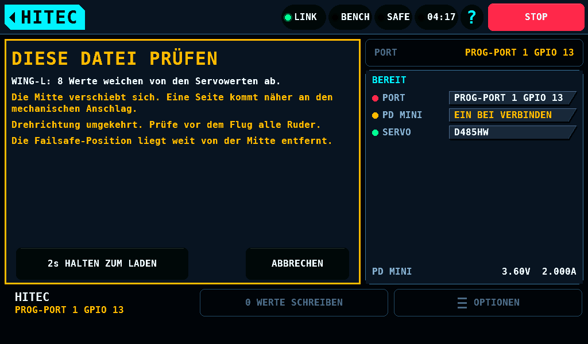

#### Was eine Datei nicht lädt

Eine normale Datei lädt nur änderbare Werte in den Entwurf. Das Schreiben
ins Servo ist ein eigener Schritt. Unverändert bleiben bei der D-Serie
die Register 0x00 (das Modell), 0x04, 0x22, 0x64 (EMPFINDLICHKEIT), 0xD4
und 0xD6; bei klassischen Servos die Zellen ohne änderbare Einstellung in
0x00 bis 0x23, die Werkszellen 0x30 bis 0x53, Name, Datum, Seriennummer
und Version. Die Position der D-Serie, Register 0x0C, und der klassische
Ausgleich, Zelle 0x1C, zählen nicht als Unterschiede. ZURÜCKSPIELEN des
Sitzungsbackups und eine passende Backup-Datei können zusätzlich sonst
nicht änderbare klassische Zellen übernehmen, die der Schreibplan
unterstützt. Der folgende Abschnitt beschreibt diesen Umfang.
Schreibgeschützte Identitäts- und Werksdaten werden dabei nicht geschrieben.

#### Laden einer Backup-Datei

Eine Backup-Datei ist eine Datei mit `backup=1` oder eine Datei ohne Zeile
`backup=` unter einem vorgeschlagenen Namen, `HITEC001` bis `HITEC999`.
Eine Backup-Datei des gelesenen Servos lädt jede Adresse, die ein
Schreiben sendet, wie ZURÜCKSPIELEN des Backups der Sitzung: die
klassischen Zellen 0x00 bis 0x23 ohne den Ausgleich 0x1C und die 12
Register der D-Serie 0x32, 0x44, 0x4C, 0x4E, 0x54, 0x5E, 0x60, 0x6C, 0x9C,
0xB0, 0xB2 und 0xC2. Die Datei wird dem ausgelesenen Servo zugeordnet, wenn Serie und Layout
passen und die folgenden Identitätsfelder übereinstimmen:

| Serie | Verglichen mit dem gelesenen Servo |
| --- | --- |
| D-Serie | die Modellnummer, Register 0x00 |
| Klassisch | die Namenszellen 0x60 bis 0x6F, die Datumszellen 0x70 bis 0x73, die Seriennummernzellen 0x80 bis 0x87 und die Version |

Eine Backup-Datei eines anderen Servos und jede Datei mit `backup=0` lädt
wie jede andere Datei. Jedes der 12 Register der D-Serie ist ein änderbarer
Wert; eine Backup-Datei der D-Serie lädt also, was jede Datei lädt.

WERKSEINSTELLUNG eines HS-7955TG ändert Zelle 0x22, AUFLÖSUNG, die keine
Änderung erreicht. Nach VERLASSEN ist das Backup der Sitzung weg; die vor
WERKSEINSTELLUNG gespeicherte Backup-Datei `HITEC001` bringt 0x22 mit den 4
Werten der Zellen 0x08, 0x13, 0x14 und 0x1B zurück.

Weicht eine klassische Zelle außerhalb der änderbaren Werte ab, öffnet
sich zuerst DIESE DATEI PRÜFEN mit `Auch geladen: 1 Werte außerhalb der Einstellungen.`. **2s HALTEN ZUM LADEN** übernimmt die
Zellen in den Entwurf, und die Meldung zeigt dieselbe Zeile unter
`HITEC001 geladen. 5 Werte weichen von den Servowerten ab.` Eine Zelle, die
keine Wertzeile nennt, zählt als Wert von **n WERTE SCHREIBEN**; die
Schreibseite zeigt `Auch geschrieben: 1 Werte außerhalb der Einstellungen.`, und das Schreiben sendet die Zelle. ZURÜCKSPIELEN,
PRÜFSUMME REPARIEREN und WERKSEINSTELLUNG warten darauf wie auf eine
Änderung; ÄNDERUNGEN VERWERFEN verwirft sie.

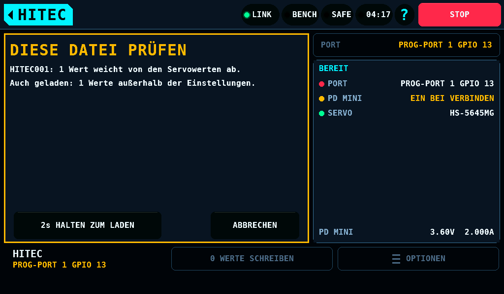

## Zurückspielen des Backups der Sitzung

**ZURÜCKSPIELEN** bietet `Backup der zuerst in dieser Sitzung ausgelesenen
Werte.` an, solange das Backup in einer Adresse, die ein Schreiben sendet,
vom Servo abweicht: jedes Register der D-Serie und jede klassische Zelle
0x00 bis 0x23, die ein Plan schreibt, rohe Werte eingeschlossen. Ein Tipp
öffnet ZURÜCKSPIELEN: die Werte, die sich ändern, `Dieses Backup wird ohne
Prüfung der Grenzwerte zurückgespielt.`, die Zahl der klassischen Zellen
ohne änderbaren Wert, die es zurückschreibt, `Auch zurückgespielt: 1 Werte außerhalb der Einstellungen.`, und die Zeilen der
Backup-Datei. **2s HALTEN ZUM ZURÜCKSPIELEN** schreibt es als Schreiben:
zuerst die Backup-Datei, wenn keine es hält, der Vermerk, die Schritte und
das Zurücklesen. Es endet mit `Backup zurückgespielt und geprüft.` Es
braucht den Schalter und keine offene Änderung. Besteht ein Vermerk eines
unterbrochenen Schreibens, behält es diesen und braucht zuerst dessen
Vergleich durch ALLES AUSLESEN, wie ZURÜCKSPIELEN des Vermerks.

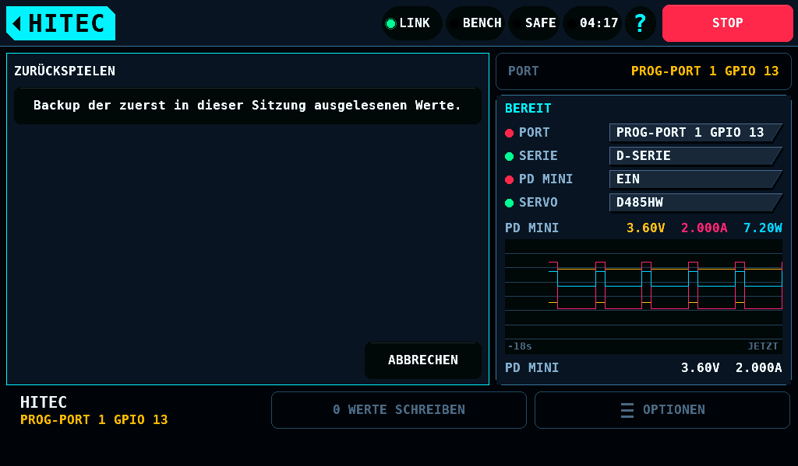
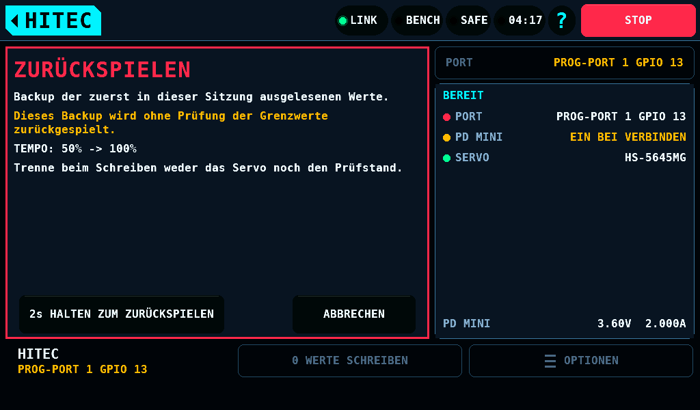

## WERKSEINSTELLUNG

Nur klassische Servos. Ein klassisches Servo hält seine Werkswerte in den
Zellen 0x30 bis 0x53, im selben Aufbau wie seine Einstellungen in den
Zellen 0x00 bis 0x23. Das Zurücksetzen des HPP-21 Plus kopiert sie
darüber, am Prüfstand am 18.10.2026 für das HS-5645MG und das HS-7955TG
mitgeschnitten. WERKSEINSTELLUNG unter WEITERES plant dieselbe Kopie aus
den eigenen Werkszellen des Servos, wie gelesen, mit berechnetem
Ausgleich, und öffnet eine Seite mit `Alle Einstellungen werden auf die Werkswerte zurückgesetzt.`, `Quelle sind die im Servo gespeicherten Werkswerte 0x30-0x53.`, den Werten, die sich ändern, der Zahl der Zellen ohne
Einstellung, die sie schreibt, `Auch geschrieben: 1 Werte außerhalb der Einstellungen.`, der Zeile zum Ruderhorn und den Zeilen der Backup-Datei. **2s HALTEN ZUM SCHREIBEN** schreibt sie als
Schreiben und endet mit `Werkswerte geschrieben und geprüft.` Sie braucht
den Schalter, keine offene Änderung und keinen Vermerk. Sie wird
angeboten, solange eine Zelle von 0x00 bis 0x23, die ein Schreiben sendet,
von ihrer Werkszelle abweicht, auch eine, die keine Einstellung nennt; ein
Servo, dessen Zellen die Werkswerte schon halten, erhält `Keine Werte weichen von den Servowerten ab.`

Die Servoprogrammierung bietet WERKSEINSTELLUNG für die D-Serie nicht an.
Der Rücksetzbefehl des Servos (Register 0x6E = 0x0F0F, wie vom HFP-30
gesendet) hinterlässt Werte, die vorher nicht bekannt sind. Die Schreibseite
kann sie deshalb nicht auflisten, und für die Prüfung fehlen erwartete
Vergleichswerte.

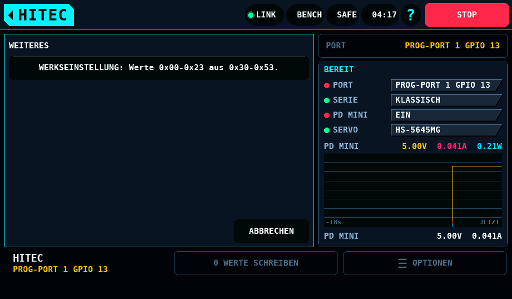
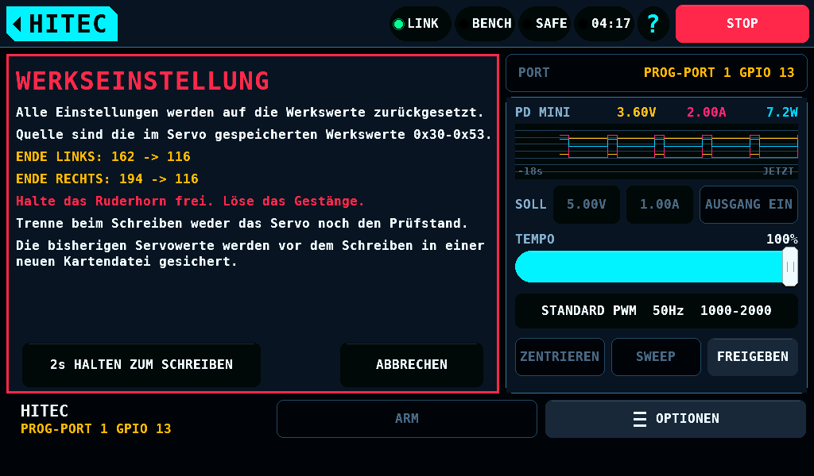
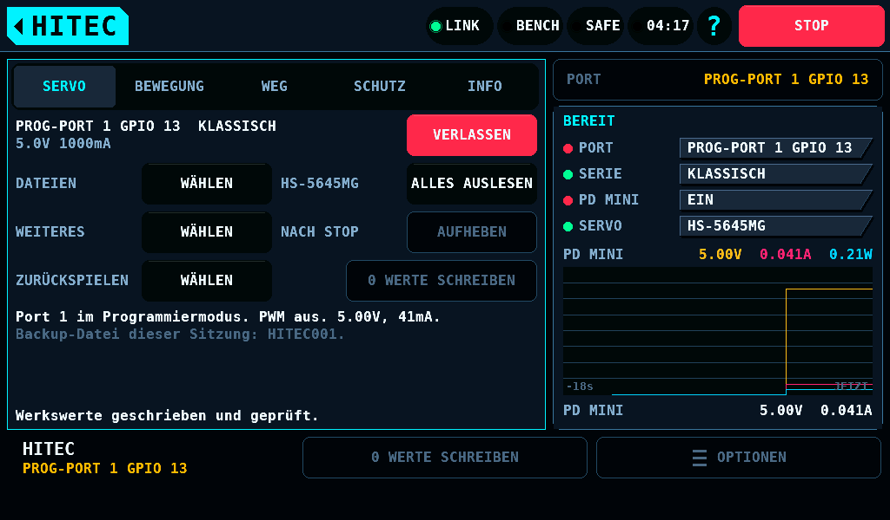
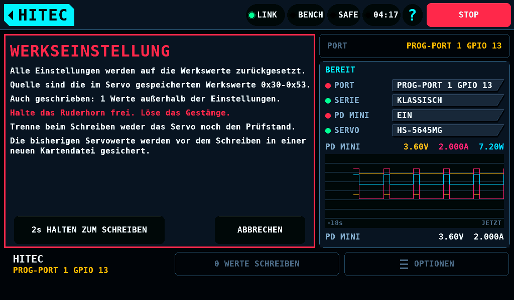

## PRÜFSUMME REPARIEREN

Ein klassisches Servo, dessen Zellen 0x00 bis 0x1C modulo 256 nicht 0
ergeben, zeigt PRÜFSUMME `FALSCH`, und der Reiter SERVO sagt
`WEITERES > PRÜFSUMME REPARIEREN schreibt den gespeicherten Wert 0x1C.` PRÜFSUMME
REPARIEREN unter WEITERES öffnet eine Seite, die den Wert der Zelle und den
Ausgleich nennt, `Schreibt Wert 0x1C: 0x5F -> 0x5E. Die Summe der Werte 0x00-0x1C ist danach 0.`; ihr Halten schreibt
den Ausgleich allein, mit seinem Vermerk und dem Zurücklesen der Zellen
0x00 bis 0x23. Es braucht den Schalter, keine bestehende Änderung (n WERTE
SCHREIBEN schreibt den Ausgleich mit den Änderungen) und keinen Vermerk.


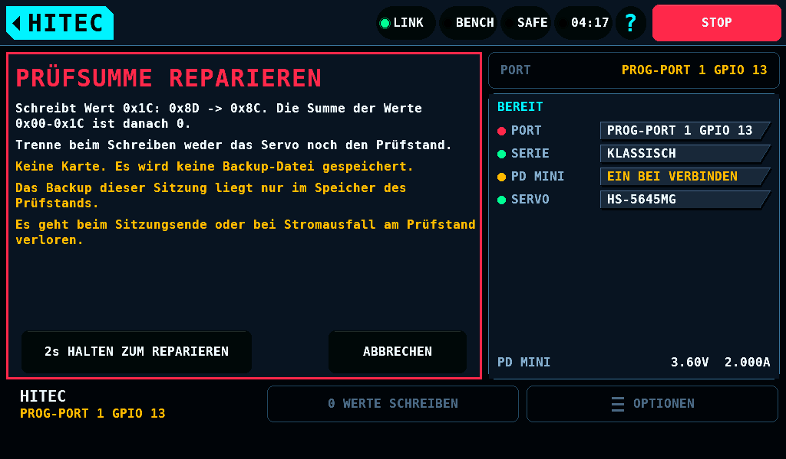

## VERLASSEN

SCHLIESSEN, die Home-Markierung oder VERLASSEN in der Zeile PORT öffnet
PROGRAMMIERMODUS VERLASSEN; 2s Halten auf `2s HALTEN ZUM VERLASSEN`
verlässt ihn:

- D-Serie: ein Neustart des Servos (Register 0x46 = 1), das danach 1s lang
  Signale ignoriert; die Versorgung bleibt unverändert.
- Klassisch: Das PD mini oder die feste 5V-Versorgung des Carriers wird
  aus- und eingeschaltet. Die Auszeit von 500ms beginnt mit der Bestätigung,
  dass der Ausgang aus ist. Beim PD mini sendet der Treiber die
  bestätigende Leseanfrage 250ms nach dem Ausschalten (`PDMINI_CONFIRM_MS`).
  Nach dem Auslesen der Sollwerte und des aktiven Slots schaltet er wieder
  ein. Der Ausgang des PD mini ist etwa 760ms aus: An einem Modul wurden
  762ms bei der Schwelle von 1,4V eines Logikanalysators gemessen. Der
  Anteil der eigenen Schaltzeit des Moduls ist nicht separat gemessen.

Dann CLOSE: der Port ist wieder in PWM, und die Meldung sagt
`Der Port ist wieder im Testermodus.` VERLASSEN wird auch an einem
gestoppten Port, bei ARMED und mit gesetztem STOP angenommen: den Neustart
lehnt ein gestoppter Port ab, das CLOSE wird immer angenommen.

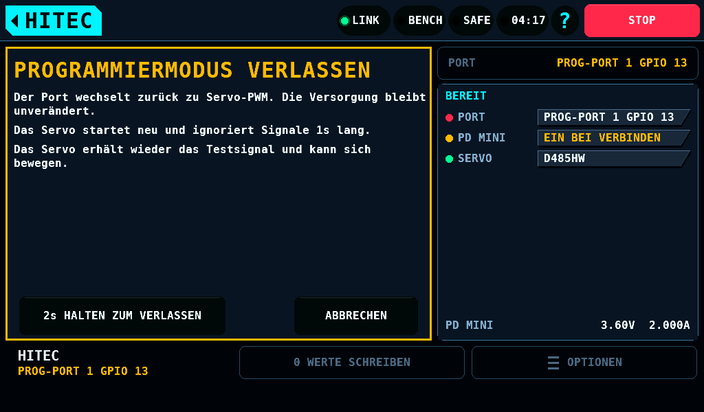


Wenn das PD mini das Servo versorgt, endet VERLASSEN bei beiden Serien
normalerweise mit eingeschaltetem Ausgang bei Programmierspannung und
Strombegrenzung der Sitzung. Weichen die Sollwerte von vor VERBINDEN davon
ab, fragt SERVO, sobald der Port wieder in PWM ist: `Netzteil-Sollwerte 5.50V 2.00A am eingeschalteten Ausgang wiederherstellen?`, unter AUSGANG IST
EINGESCHALTET, mit der Änderung jedes abweichenden Sollwerts.

- **JA** gibt dem eingeschalteten Ausgang beide Sollwerte von vor
  VERBINDEN. Eine Spannung, die von 6,0V oder darunter über 6,0V steigt,
  öffnet zuerst NUR HV-SERVOS, und **2s HALTEN ZUM ÜBERNEHMEN** gibt beide
  Sollwerte; sein ABBRECHEN behält die der Sitzung.
- **NEIN** behält die Sollwerte der Sitzung. Die von vor VERBINDEN kommen
  beim nächsten Ausschalten des Ausgangs zurück.

Die Frage kommt einmal je Verlassen, und nicht:

- solange ein KST- oder Hitec-Programmierport das Netzteil belegt; übernimmt
  ein Port das Netzteil bei geöffneter Frage, wird die Frage geschlossen;
- solange ein Tastenfeld, eine Liste, eine Warnung oder eine andere Frage
  von SERVO offen ist oder AUSGANG EIN gehalten wird: sie folgt, sobald
  diese geschlossen sind;
- nachdem der Ausgang zwischen dem Verlassen und der Frage ausging, ein
  Fehler ihn ausschaltete oder ein STOP kam; ein Ausschalten, das
  angefordert wird, während sie steht, AUSGANG AUS eingeschlossen,
  schließt sie bereits vor der Bestätigung, dass der Ausgang aus ist;
- innerhalb eines Endlagenlaufs, dessen Lesesitzung durch dasselbe
  Verlassen geht;
- wenn sich nach dem Verlassen ein Sollwert änderte oder die Sollwerte von
  vor VERBINDEN nach Begrenzung auf die SUPPLY-Grenzen denen der Sitzung
  gleichen;
- bei jedem anderen Ende des Haltens des Ports am Netzteil: PORT
  FREIGEBEN, ein STOP, ein Fehler, ein verlorener Link, ein Neustart des
  Panels oder des IOmcu, ein Port, den der IOmcu ohne Verlassen
  zurückgibt, oder Ports, die auf ihre eigene Versorgung wechseln, während
  eine Sitzung den PD mini hält. Bei eingeschaltetem Ausgang bleiben die
  Sollwerte der Sitzung dann bis zum nächsten Ausschalten.

Die Frage steht nur auf SERVO. Endet ein Verlassen, während eine andere
Seite angezeigt wird, kommt die Frage, sobald SERVO wieder
angezeigt wird, solange der Ausgang eingeschaltet bleibt. Bleibt sie
unbeantwortet, wenn SERVO verlassen wird, ist sie weg, wie bei NEIN.


## STOP, SAFE und eine verlorene Verbindung

| Ereignis | Der Port | Was der Bediener tut |
| --- | --- | --- |
| STOP, gedrückt oder vom Prüfstand selbst | Der IOmcu bricht die Transaktion nach dem Frame auf der Leitung ab, behält den Port mit losgelassenem Pin und setzt STOPPED. Das Panel setzt den Stopp und hält den Heartbeat zurück | `Gestoppt. Der Pin ist frei. Halte STOP 2s, um den STOP zurückzusetzen.`, und keine Zeile bietet AUFHEBEN an. AUFHEBEN und ALLES AUSLESEN werden bei gesetztem STOP abgelehnt: der IOmcu würde das CLEAR als UNSAFE ablehnen. Halte STOP 2s und schließe das Zurücksetzen ab. Danach setzt AUFHEBEN fort oder VERLASSEN beendet die Sitzung |
| Ein Schalten auf SAFE am Prüfstand allein | STOPPED, kein gesetzter Stopp | `Gestoppt. Der Pin ist frei. Tippe auf AUFHEBEN zum Fortsetzen oder auf VERLASSEN.` AUFHEBEN setzt das Auslesen fort |
| ABBRECHEN | Der Vorgang endet; der Port bleibt gehalten | ALLES AUSLESEN erneut, oder VERLASSEN |
| Die Verbindung verstummt | Der Failsafe des IOmcu löst aus, und der Port bleibt gehalten; das Modul des Panels zählt ihn nicht als seinen | Sobald die Verbindung zurück ist, sagt die Programmierung `Port von einer anderen Hitec-Sitzung belegt.` und bietet PORT FREIGEBEN an |
| Das Panel startet neu | Wie bei einer verlorenen Verbindung | Wie bei einer verlorenen Verbindung |
| Ein Fehler des Prüfstands ([Sicherheit, Fehler](Safety-de.md#fehler)) oder ein Vorgang, der in einer Störung des Servos oder der Leitung endet: kein Servo, eine falsche Antwort beim Einstieg, ein gescheitertes Lesen, ein klassisches Schreiben ohne Antwort, ein Zurücklesen mit Abweichung, ein Schritt, den der Decoder abwies | Ein laufendes Schreiben endet zuerst: der IOmcu hält die Versorgung bis zu seinem letzten Schritt und 150ms danach an, höchstens 10000ms. Dann wird die schaltbare Servoversorgung (PD mini oder feste 5V des Carriers) ausgeschaltet, und der Port bleibt ohne Versorgung gehalten: das ON eines POWER wird abgewiesen. Ein IOmcu älter als Link 4.31 lässt die Versorgung an ([Die Versorgung eines Programmierports](Safety-de.md#die-versorgung-eines-programmierports)) | VERLASSEN, dann VERBINDEN |

Am Sitzungsende entfallen Meldungen über den aktuellen Zustand: das
Auslesen, eine verglichene oder geladene Datei, eine abgelehnte Änderung
und einen wartenden Schreibvorgang. Ergebnisse bleiben sichtbar: ein
Schreibvorgang und seine Prüfung, eine gespeicherte oder abgelehnte Datei,
der Abschluss eines Vorgangs und jede Meldung in der Gefahrenfarbe.


## Ein Port, den eine andere Sitzung hält

Ein Port, den die HITEC-Page hält und den dieses Panel nicht geöffnet hat,
von der Prüfstandskonsole geöffnet oder über eine verlorene Verbindung oder
einen Neustart des Panels gehalten, lässt die Hitec-Zeile aktiv: die
Programmierung öffnet sich mit der Zeile PORT
`PROG-PORT 1 GPIO 13  ANDERWEITIG BELEGT` und `Eine andere Hitec-Sitzung
belegt ihn.` PORT FREIGEBEN öffnet eine Seite; 2s Halten auf
`2s HALTEN ZUM FREIGEBEN` sendet CLOSE, das der IOmcu annimmt, ob er dem
Heartbeat traut oder nicht. Die Versorgung bleibt unverändert. Der Port
muss freigegeben sein, bevor ARM möglich ist. Ist am Panel ein
STOP gesetzt, halte STOP 2s und schließe zuerst das Zurücksetzen ab. Sind
die normalen Voraussetzungen zum Schalten auf ARMED erfüllt, hebt dieses
Schalten den ausgelösten Failsafe des IOmcu auf.


## Meldungen

| Zeile | Wann |
| --- | --- |
| `Kein Servo der D-Serie antwortet. Prüfe Stecker, Empfangsart und Serie.` | beim letzten von 3 Versuchen eines Lesens der D-Serie kam kein Byte |
| `Kein klassisches Servo hat nach dem Einschalten geantwortet. Prüfe Stecker und Serie.` | innerhalb von 2s nach dem Einschalten kam kein `+` |
| `Unerwartete Antwort beim Einstieg in den Programmiermodus. Prüfe die Serie.` | es kamen Bytes, die nicht zum Einstieg passen |
| `Fehlerhafte Antwort vom Servo (Code 14). Werte werden erneut ausgelesen.` | ein Versuch schlug fehl; der Code ist der des Decoders (`hitec_rx_t`) |
| `Auslesen bei Adresse 0x32 fehlgeschlagen. Tippe auf ALLES AUSLESEN.` | jeder Versuch an einer Adresse schlug fehl |
| `Zwei Auslesevorgänge weichen bei 0x17 ab. Lies mit ALLES AUSLESEN erneut aus.` | das zweite Lesen vor einem Schreiben weicht vom Lesen ab, aus dem der Plan entsteht ([Das zweite Lesen](#das-zweite-lesen)) |
| `Vom IOmcu abgelehnt: Sein Failsafe ist ausgelöst.` | OPEN oder CLEAR mit UNSAFE abgelehnt |
| `Der IOmcu hat die Sitzung beendet. Der Port ist wieder im Testermodus.` | der Port ging ohne Befehl dieses Panels zurück in PWM |
| `Keine rechtzeitige Antwort vom IOmcu. Der Vorgang ist beendet.` | ein Befehl wurde nicht innerhalb von 2000ms angenommen, oder eine Anfrage hatte nach 30.000ms kein Ergebnis |
| `Das Netzteil hat den POWER-Befehl nicht ausgeführt. Prüfe den PD mini.` | POWER endete mit SUPPLY |
| `Der IOmcu kann die Leitung dieses Ports nicht ansteuern.` | OPEN fand keine freie Leitung |
| `Der IOmcu hat die Anfrage abgelehnt (Code 7).` | eine Ablehnung ohne eigene Meldung |


## Hitec-D-Empfang

Hitec-D-Empfang steht unter WEITERES zur Verfügung, solange der Tester den
Port hält. Auch SERIE lässt sich nur dann ändern. Die Liste bietet zwei
Modi, die im NVS unter `hitec_rx` gespeichert werden:

| Modus | Die Leitung | Hinweis |
| --- | --- | --- |
| PULL-UP (Vorgabe) | ein Widerstand von 2,2kΩ von der Signalleitung zur Servoversorgung zieht die Leitung auf High; der IOmcu liest sie bei freigegebenem Ausgang | `PULL-UP braucht 2.2kΩ an der Signalleitung` |
| PRECHARGE | kein Widerstand; der IOmcu treibt das Pad alle 1086,7ns für 100,0ns auf High und tastet es 113,3ns nach dem Loslassen ab | `PRECHARGE: kein Pull-up an der Signalleitung` |

Fehlt der gespeicherte Wert oder ist er unlesbar, gilt PULL-UP. Das Panel
schreibt den Modus bei jedem Verbindungsaufbau und nach jeder Änderung auf
die HITEC-Page, unabhängig von ARMED. Der IOmcu übernimmt ihn beim nächsten
OPEN einer Leitung der D-Serie; laufende Sitzungen bleiben unverändert.

Während einer Sitzung lässt sich der Modus nicht ändern: WEITERES zeigt
die Zeile nicht, und die Portzeile nennt den aktiven Modus (`RX PULL-UP`).
Eine beim Sitzungsstart noch offene Auswahlliste schließt sich. Wähle
VERLASSEN, stelle den Modus ein und wähle erneut VERBINDEN. VERBINDEN wartet
auf die Bestätigung des IOmcu: `Empfangsart im IOmcu noch nicht gesetzt. Versuche es erneut.`
Klassische Servos (HS-5xxx, HS-7xxx) benötigen keinen dieser Modi und
ignorieren die Einstellung. Sie gilt sowohl für Leitungen dieser
Servoprogrammierung als auch für die der [Prüfstandskonsole](BenchConsole-de.md).

Unter den beiden Modi sagt die Liste, was der IOmcu nicht hält:

| Die Zeile lautet | Solange |
| --- | --- |
| `Vom IOmcu nicht übernommen.` | der Wert noch nicht bestätigt ist oder der IOmcu ihn abgewiesen hat |
| `IOmcu älter als 0.22.0: empfängt mit PULL-UP.` | PRECHARGE eingestellt ist und der IOmcu Protokoll 4.23 spricht: er hat kein Register für den Modus |
| `IOmcu älter als 0.21.1: keine Hitec-Leitung.` | PRECHARGE eingestellt ist und der IOmcu Protokoll 4.22 oder älter spricht: er hat keine HITEC-Seite |

Keine Zeile, solange kein IOmcu antwortet, und keine für PULL-UP an einem älteren
IOmcu.


## Läufe

Ein Lauf ist eine Folge von Schreibvorgängen eines SERVO-Werkzeugs, ohne
eine eigene Bestätigungsseite für jeden Schreibvorgang, wie beim
Endlagenlauf eines KST-Servos
([Die Weggrenzen des Servos programmieren](Servo-de.md#die-weggrenzen-des-servos-programmieren)).
Die Servoprogrammierung bietet dafür eine Schnittstelle für Hitec-Servos
(`shared/bench/include/hitec_prog_run.h`,
`shared/ui/include/hitec_panel_run.h`). Der ENDLAGENLAUF des
SERVO-Bildschirms mit SERVO auf HITEC und AUTO auf RUDER starten Läufe
über sie ([Servo: Hitec-Servos](Servo-de.md#hitec-servos)).

Ein Lauf schreibt ENDE LINKS und ENDE RECHTS und sonst nichts, in
Wegeinheiten:

| Serie | Links | Rechts | Einheit | Ein Lauf nimmt |
| --- | --- | --- | --- | --- |
| D-SERIE | 0xC2 - 0xB2 | 0xB0 - 0xC2 | Zähler ab NEUTRAL 0xC2; 74,5 je Grad an einem Standardservo (Handbuch der D-Serie) | 1 bis zum kleineren von 0xC2 - 1 und 16383 - 0xC2: 8191 bei NEUTRAL 8192 |
| KLASSISCH | Zelle 0x14 an einem CW-Servo, 0x13 an einem CCW-Servo | Zelle 0x13 an einem CW-Servo, 0x14 an einem CCW-Servo | die Zelle roh | 0 bis 255 |

CW und CCW sind DREHRICHTUNG, wie gelesen: Register 0x5E der D-Serie,
Bit 0 der klassischen Zelle 0x1B. Ein Servo der D-Serie zählt in beiden
Richtungen gleich.

- Halte die Starttaste 2s, um einen Lauf zu starten. Damit bestätigst du
  auch die Warnregel von ÄNDERUNG PRÜFEN für die Änderungen des Laufs an
  ENDE LINKS und ENDE RECHTS. Jeder Schreibvorgang des Laufs schaltet
  SCHREIBEN INS SERVO FREIGEBEN für sich ein und am Ende wieder aus. Eine Änderung auf den Reitern der
  Programmierung öffnet auch während eines Laufs ÄNDERUNG PRÜFEN. Außerhalb
  eines Laufs schreibt die Schnittstelle nichts und sagt `Schreiben ist gesperrt. Aktiviere zuerst SCHREIBEN INS SERVO FREIGEBEN.`
- Ein Wert außerhalb des Bereichs wird abgelehnt, nicht begrenzt: nichts
  wird geändert, nichts gesendet, und der Schalter bleibt aus.
- Jeder Schreibvorgang eines Laufs ist ein Schreiben wie n WERTE SCHREIBEN:
  das zweite Lesen, der Vermerk auf der Karte, dann die Register der
  D-Serie im Abstand von 20ms, das Speichern (0x70 = 0xFFFF), 100ms, der
  Neustart (0x46 = 1), 1000ms und das Zurücklesen der 21 Register; oder
  jede klassische Zelle mit ihrem Ausgleich in 0x1C, dann das Zurücklesen
  der Zellen 0x00 bis 0x23. Ein Lauf zählt ein Schreiben als erledigt,
  wenn sein Zurücklesen beide Werte hält. Ein Schreiben, dessen
  Zurücklesen abweicht, lässt den Schritt des Laufs scheitern; die Werte,
  die das Servo hält, liest der Lauf aus diesem Zurücklesen.
- Die Backup-Datei: das erste Schreiben des Laufs, das einen Schritt
  sendet, speichert das Backup der Sitzung unter dem nächsten
  vorgeschlagenen Namen, HITEC001 bis HITEC999, bevor etwas ans Servo
  geht. Die Datei hält das Servo, wie der Lauf es vorfand. Eine spätere
  Sitzung desselben Laufs, nach VERLASSEN und VERBINDEN, speichert keine
  Datei: ihr eigenes Backup hält die früheren Schreibvorgänge des Laufs.
  Ohne Karte liegt das Backup nur im RAM, und VERLASSEN beendet es.
- ZURÜCKSPIELEN nach einem Lauf: lade die Backup-Datei des Laufs unter
  DATEIEN ([Laden einer Backup-Datei](#laden-einer-backup-datei)) und
  schreibe sie mit n WERTE SCHREIBEN. Sie bringt beide Enden zurück, mit
  jeder anderen Adresse, die ein Schreiben sendet. ZURÜCKSPIELEN des
  Sitzungsbackups stellt die Werte vom Beginn dieser Sitzung wieder her.
  In einer späteren Sitzung desselben Laufs enthalten sie bereits frühere
  Änderungen des Laufs.
- Das Ende des Laufs schaltet SCHREIBEN INS SERVO FREIGEBEN aus, verwirft
  den Entwurf und setzt Programmierspannung und -strom auf die Werte der
  Einstellungen zurück.
- Welche Hornstellung ein Ende der D-Serie an einem CCW-Servo ergibt und
  welche klassische Zelle an einem CCW-Servo welche Seite begrenzt, ist
  nicht gemessen; die Wegeinheiten folgen dem Registermodell
  (`protocols/hitec`).

## Bekannte Grenzen

- Klassische Schreibvorgänge über den IOmcu sind an einem Servo gelaufen,
  einem HS-7955TG (Prüfstand, 25.10.2026): Zelle 0x02 und der Ausgleich
  0x1C, über einen Aus- und Einschaltvorgang erhalten. Jede andere Zelle,
  die Zellen 0x1D bis 0x23, die ein Schreiben ohne Ausgleich sendet, und der
  Datenspeicherbefehl 0x64 sind nicht getestet; die Programmierung sendet
  kein 0x64. Ein Schreiben an ein Servo mit falscher Prüfsumme und
  PRÜFSUMME REPARIEREN sind an keinem Servo getestet.
- Das Schreibverhalten der D-Serie ist an 1 D485HW durch Mitschnitte des
  HFP-30 gemessen. Der IOmcu hat außerdem das ID-Register 0x32 und die
  Smart-Sensor-Register 0x6C und 0x44 eines D485HW geschrieben und erneut
  ausgelesen. Diese einzelnen Schreibvorgänge bestätigen keine vollständigen
  Schreibpläne oder Programmiersitzungen auf Hardware; diese sind im
  Host-Modell getestet. Ob ein Stromausfall beim Speichern den Flash des
  Servos unbeschädigt lässt, ist nicht gemessen. Geschriebene, noch nicht
  gespeicherte Werte gehen beim nächsten Ausschalten verloren. VERBINDEN
  schaltet die Versorgung der D-Serie aus und ein, wenn ein PD mini oder
  die feste 5V-Versorgung des Carriers verfügbar ist. Eine externe
  Versorgung bleibt unverändert.
- Die Regeln von ÄNDERUNG PRÜFEN vergleichen mit dem letzten vollständigen
  Lesen, nicht mit dem Backup der Sitzung.
- Das Backup der Sitzung liegt im Arbeitsspeicher des Panels: VERLASSEN,
  VERBINDEN, eine verlorene Verbindung und ein Neustart des Panels beenden
  es. Nach einer verlorenen Verbindung ist das Backup der neuen Sitzung das
  Servo, wie sie es dann vorfindet, mit den Werten des unterbrochenen
  Schreibens; der Vermerk des Schreibens und die Backup-Datei der alten
  Sitzung halten die Werte davor.
- Zwei Servos der D-Serie desselben Modells werden nur an ihren Werten
  unterschieden. Ein zweites D485HW, dessen Register, die ein Schreiben
  sendet, die Werte des letzten Lesens des ersten halten, behält das Backup
  des ersten, und ZURÜCKSPIELEN des Backups der Sitzung schreibt die Werte
  des ersten hinein. Welches Register, wenn überhaupt, sich zwischen zwei
  Exemplaren eines Modells unterscheidet, ist nicht gemessen.
- Eine außerhalb des Panels geschriebene oder bearbeitete Servodatei wird
  nicht geladen.
- Der Vermerk wird nur beim Start des Panels von der Karte gelesen.
  Später eingelegte Karten werden nicht nach einem Vermerk durchsucht.
  Ohne eingebundene Karte bleibt der Vermerk im Arbeitsspeicher und geht
  bei einem Neustart des Panels verloren. Scheitert das Löschen des
  Vermerks auf der Karte, bleibt er dort erhalten. Beim nächsten Start
  meldet das Panel diesen Schreibvorgang als unterbrochen.
- SERVO BEWEGEN bewegt nur Servos der D-Serie, nur mit CW und nur mit
  einem PD mini. MITTE und Endlagen klassischer Servos werden als Zahlen
  geändert; das Servo fährt nicht dorthin.
- WERKSEINSTELLUNG wird für die D-Serie nicht angeboten; bei einem
  klassischen Servo ist sie die Kopie der Zellen 0x30 bis 0x53 durch das
  HPP-21 Plus, nur im Host-Modell getestet.
- Die Prüfstandsschritte S6 bis S8 und S10 bis S11 (Schreiben an ein
  D485HW und ein klassisches Servo, eine während eines Schreibens
  getrennte Verbindung) sind nicht gelaufen.
- POWER beim Einstieg der D-Serie schaltet eine steuerbare Versorgung
  auch bei einer Auszeit von 0ms aus und wieder ein. Mit einem PD mini oder
  der festen 5V-Versorgung des Carriers startet das Servo daher bei jedem
  VERBINDEN neu.
- Ein klassisches Lesen braucht 2 Frames der Anzeige je Zelle; bei 33ms je
  Frame dauern 100 Zellen im Host-Modell 6,6s.
- Die Prüfstandsschritte S1 bis S5 des Plans (ein D485HW bei PRECHARGE und
  PULL-UP, die klassischen HS-5645MG und HS-7955TG, STOP und ein gezogenes
  Verbindungskabel während ALLES AUSLESEN, ARM und SUPPLY bei gehaltenem
  Port) sind nicht gelaufen.
