# Servo programmer for Hitec servos

<sub>**English** · [Deutsch](HitecProgrammer-de.md)</sub>

The programmer reads the settings of a Hitec servo over its signal wire,
shows them, decoded and as stored, and writes edited values back. Before
the first write of a session it saves the servo as found to a backup file
on the card, and before every write it records the servo's values. It
saves a servo's settings to a file, loads a file into the edits and writes
the session's backup back. It opens from its row
`Hitec servos` on **PROGRAM** of the [SERVO screen](Screens.md#servo), one
level down, and covers the left column, the strip's tabs with it. **CLOSE**
or the home tag returns to PROGRAM's list while the programmer holds no
port. The row is dimmed with `IOMCU HAS NO SERVO PWM` and opens nothing while
the IOmcu, the RP2350 board, reports no servo PWM (pulse-width modulation),
which includes no IOmcu answering.

Hitec is a name or trademark of its owner. rcbench is independent: it is
not affiliated with, endorsed by or sponsored by it. The name says which
servos the programmer works with.
[Legal notice and disclaimer](../README.md#legal-notice-and-disclaimer) holds
the project's notice.

Two series are read and written:

| Series | Servos | Wire | Read | Written |
| --- | --- | --- | --- | --- |
| D SERIES | D485HW and the other D series servos | 115,200bit/s, inverted | 21 registers | the registers of each changed setting 20ms apart, the save (0x70 = 0xFFFF), 100ms, the restart (0x46 = 1), 1000ms, then the 21 registers read back |
| CLASSIC | HS-5xxx and HS-7xxx | 19,200bit/s | 100 cells: 0x00 to 0x23, 0x30 to 0x53, the name 0x60 to 0x6F, the date 0x70 to 0x73, the serial 0x80 to 0x87, and the version | each changed cell, then the balance in cell 0x1C, each answered `+ +`, 2ms apart; then cells 0x00 to 0x23 read back |

The register model and its encodings come from 1 D485HW (2026-10-20) and
from 1 HS-5645MG, 1 HS-7955TG and 1 HS-5955TG (2026-10-18 to 2026-10-20)
([`protocols/hitec`](../protocols/hitec/README.md)). The page it runs on is
[The programming port for Hitec servos](LinkHitec.md).


## Constraints

- The IOmcu runs protocol 4.23 or later. With an older one the SERVO tab
  says `Unavailable: the IOmcu has no Hitec port.` and
  `Update the IOmcu to version 0.21.1 or later.`
- SERVO TESTER on SETUP > OUTPUTS is set to a port, PORT 1, PORT 2,
  PORT 3 or PORT 4, and
  the port names a pin. With OUTPUTS the PORT row reads `NO PROG PORT SET`
  and CONNECT says `Use the programming port to program a servo.`
- The bench is SAFE. CONNECT is refused on an ARMED bench, on one asked to
  arm and with a finger on ARM: `Tap DISARM first. The port cannot be taken
  over while ARMED.` A latched STOP refuses it too:
  `A STOP is latched. It clears with the next switch to ARMED.`
- A classic servo enters programming mode only at power-up, so the bench
  cycles its supply: CONNECT for CLASSIC needs a PD mini that answers,
  otherwise `Classic servos need a PD mini: the bench cycles the supply.`
- A D series servo answers on the line as SETUP > INTERFACES > Hitec D
  receive sets it, PULL-UP or PRECHARGE
  ([Receive mode](LinkHitec.md#receive-mode)). CONNECT waits until the
  IOmcu holds that mode: `Receive mode not set on the IOmcu yet. Try
  again.`
- The programming voltage is the setting the KST programmer uses
  (SET_SERVO_PROG_V, MORE > PROGRAMMING VOLTAGE), 4.8V to 6.0V for a Hitec
  session: a higher setting runs at 6.0V and the SERVO tab says
  `Hitec programming runs at 6.0V or less.` The current limit is 50mA to
  3000mA. Both have to lie inside the SUPPLY limits, or CONNECT says
  `Programming voltage or current exceeds the SUPPLY limits.`

## The SERVO tab

| Row | What it does |
| --- | --- |
| PORT | Two lines: the port and its GPIO with the series, `PROG PORT 1 GPIO 13  D SERIES`, then the receive mode and the supply CONNECT sets, `RX PRECHARGE  5.0V 1000mA` (`SUPPLY AS IT IS` for a D series servo with no PD mini). The button reads CONNECT, ABORT while the port moves into programming or a read runs, WAIT, LEAVE while the port is held, and RELEASE PORT while another session holds it |
| SERIES | D SERIES or CLASSIC, chosen before CONNECT; kept with the SERVO settings (SET_HITEC_SERIES). While the port is held the PORT row names the series and FILES takes this place |
| FILES | While the port is held: the servo files on the card, a save and a load ([Servo files](#servo-files)) |
| SERVO | The model read, `D485HW` or `HS-5645MG`; READ ALL reads the series' set again |
| MORE | The programming voltage and current limit, each on the keypad, while the tester holds the port. While the port is held: DISCARD EDITS with an edit standing, REPAIR CHECKSUM with a classic checksum that is wrong, and FACTORY DEFAULT for a classic servo read ([FACTORY DEFAULT](#factory-default)) |
| AFTER STOP | CLEAR after a switch to SAFE at the bench: the IOmcu clears the port's STOPPED flag and the read goes on, or the entry again where the supply went off |
| ENABLE WRITE TO SERVO | The write switch, OFF or ON ([The write switch](#the-write-switch)) |
| RESTORE | The session's backup back to the servo, while it differs from the servo ([Restore of the session's backup](#restore-of-the-sessions-backup)); while a record of an interrupted write stands: the values before it back to the servo, or the record discarded ([The record of a write](#the-record-of-a-write)) |
| WRITE n VALUES | The draft to the servo ([Writing](#writing)); `WRITE 1 VALUE` for one, off with none |

Under the rows the state line says what the port does, and the last
message stands at the foot of the notes. Every control is 48px tall or more
and ends 4px above the alert band; the geometry is the KST programmer's
([Screens](Screens.md#programmer)).


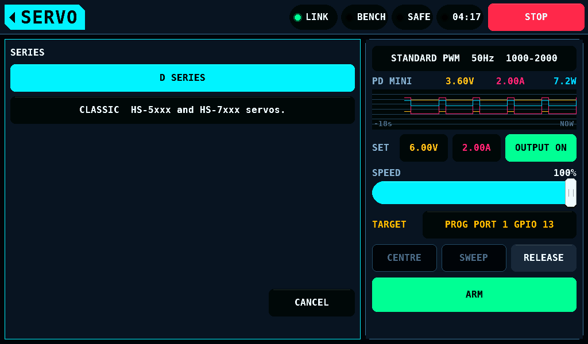
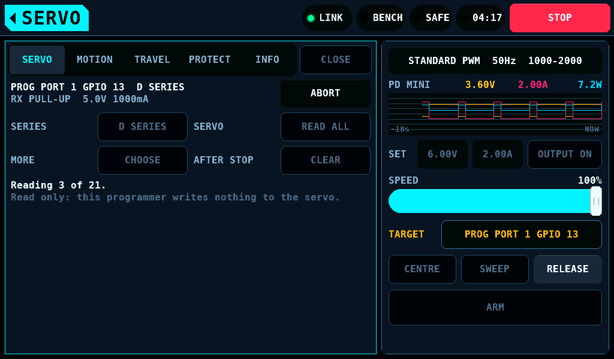

## CONNECT

1. OPEN: the IOmcu takes the port from PWM. No pulse for 50ms, then the line
   is the wire driver's, released.
2. The entry:
   - D series: POWER at the programming voltage with an off time of 0ms
     where a PD mini answers, then 1000ms for the servo to start. Without a
     PD mini the servo runs on the supply as it is.
   - Classic: POWER with the supply off, 500ms from the read that shows it
     off ([LEAVE](#leave) has the whole off time), then on, and a LISTEN
     for the servo's `+`; the servo's second `+` follows 250ms to 267ms
     later; 0x67 then reads the version.
3. READ ALL: the series' set, each address with 3 tries.
4. The model is identified: D series by register 0x00 (34485 is the
   D485HW), classic by the name cells. The message names it:
   `D series servo, model 34485, ID 0.` or
   `Classic servo HS-5645MG, version 0x16.` A model the register model does
   not name is read in the layout of the closest one, and the SERVO tab
   says which: `Model not known. The fields are read as on the D485HW.`

In the host model (`test_hitec_prog`) a D series CONNECT takes 2.4s, 1.2s of
it the entry, and a classic one 4.2s at a frame of 16ms and 7.6s at one of
33ms: a classic read takes 2 frames a cell. On the bench these times are
not measured.

While the port is held:

- ARM is drawn disabled. A press on it arms nothing and shows
  `Cannot switch to ARMED: a port is in use by the servo programmer.` in
  the alert band, on SERVO and on MOTOR & ESC alike. STOP works. DISARM has
  nothing to end: the bench cannot be ARMED while the port is held.
- The set points and OUTPUT ON of the SET row and of the SUPPLY screen take
  no press; a press on them says `Servo programming holds the supply: set
  points and ON are locked.` OUTPUT OFF works. From protocol 4.29 the IOmcu
  holds its SUPPLY page from OPEN to CLOSE as well
  ([The supply while a port is held](LinkHitec.md#the-supply-while-a-port-is-held)).
  The set points from before CONNECT come back after LEAVE once the output
  is off, or onto the live output through SERVO's question after a LEAVE
  that leaves it on ([LEAVE](#leave);
  [Servo programmer, The supply](ServoProgrammer.md#the-supply)).
- The KST and Chaservo row and MOTOR & ESC's TARGET row take no press, and
  ESC STICK does not start a run.

## The value tabs

MOTION, TRAVEL, PROTECT and INFO show the draft: what the last full read
found, with the edits not written yet. A value that fits its encoding shows
decoded with the stored value in brackets beside it, `CW (0)`; one that
fits no known encoding shows as `RAW 1234` in the warning colour. A
writable value takes a tap while the port is held and not stopped
([Editing](#editing)).

| Tab | D series | Classic |
| --- | --- | --- |
| MOTION | SPEED, DEAD BAND, SOFT START | SPEED, DEAD BAND, RESOLUTION |
| TRAVEL | NEUTRAL, LEFT END, RIGHT END in servo counts with degrees (220° over 16383 counts, 8192 the centre), DIRECTION | CENTRE in microseconds, LEFT END, RIGHT END as raw values (unit unknown), DIRECTION |
| PROTECT | FAILSAFE (OFF, LIMP, or a position in microseconds), OVERLOAD PROTECTION, SMART SENSOR, SENSITIVITY (raw) | FAILSAFE, FAILSAFE POSITION, OVERLOAD PROTECTION |
| INFO | MODEL, ID, POSITION, and registers 0x04, 0x22, 0x8A, 0x8C, 0xD4 and 0xD6 raw | MODEL, VERSION, DATE, SERIAL, CHECKSUM |

A classic image whose cells 0x00 to 0x1C do not sum to 0 modulo 256 shows
CHECKSUM `WRONG` and the note `Checksum of stored values 0x00-0x1C is wrong. The
servo may ignore PWM and draw current up to the supply limit.`
An HS-7955TG with a wrong checksum drew 0.88 to 0.89A under ARM and SWEEP,
at the PD mini's 1.00A limit, the supply falling to 4.0 to 4.2V; with a
correct checksum it draws 0.12 to 0.28A (one servo, measured once).
MORE > REPAIR CHECKSUM writes the balance in 0x1C.

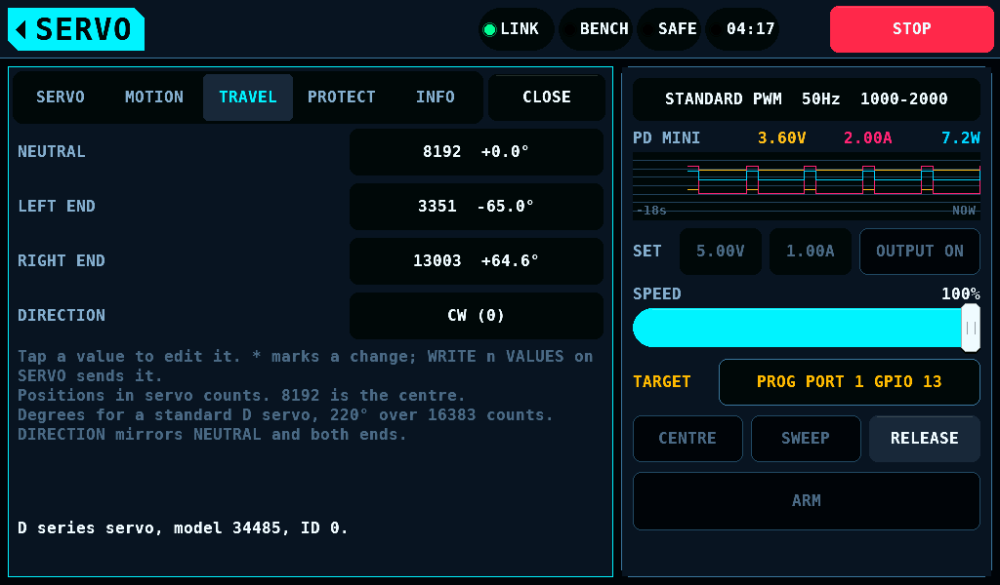
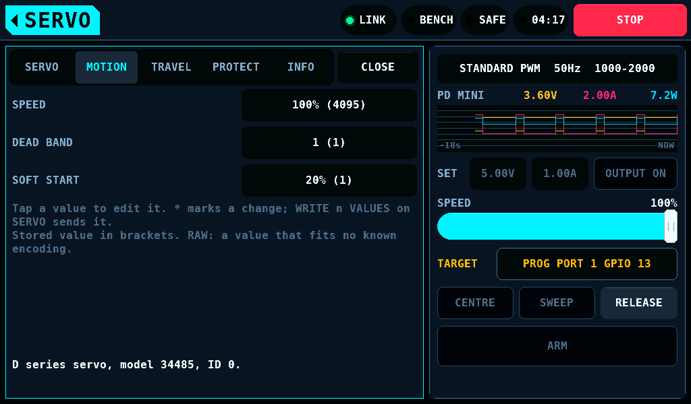
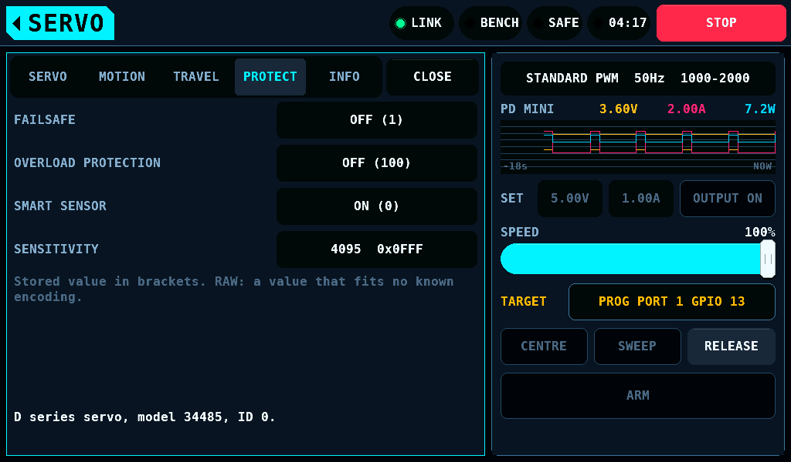
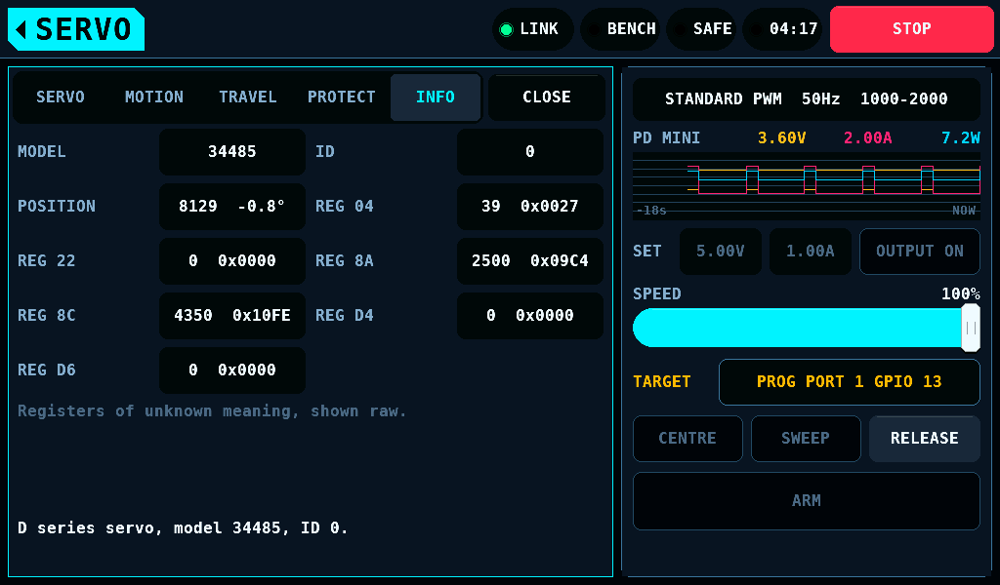
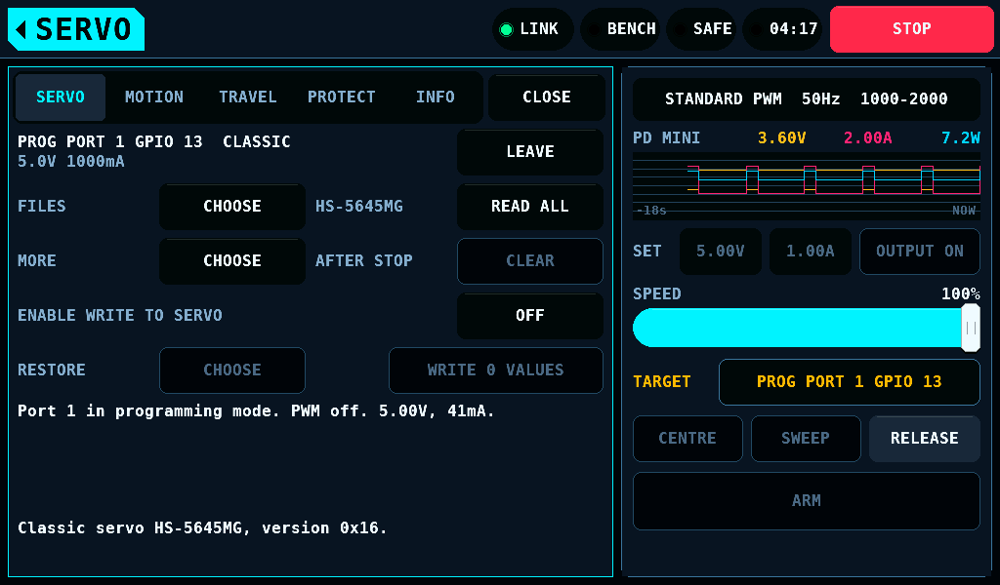
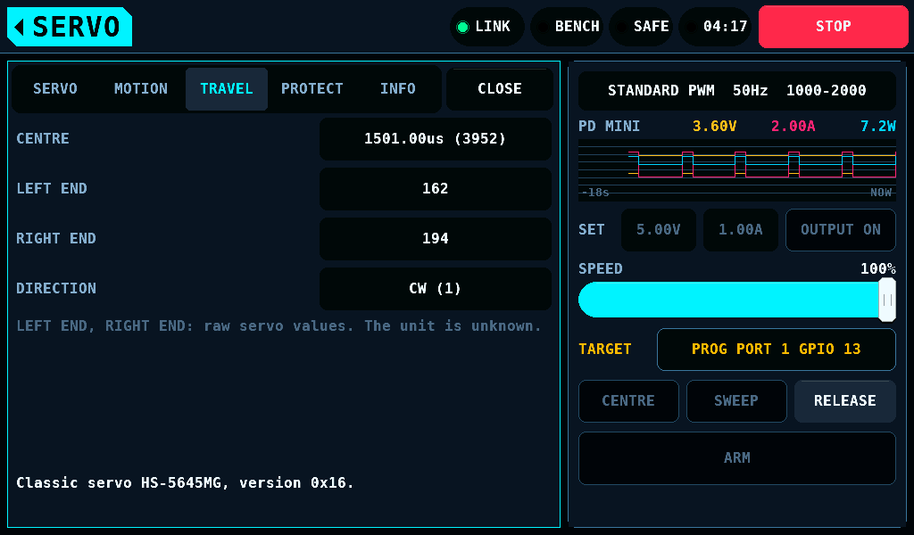
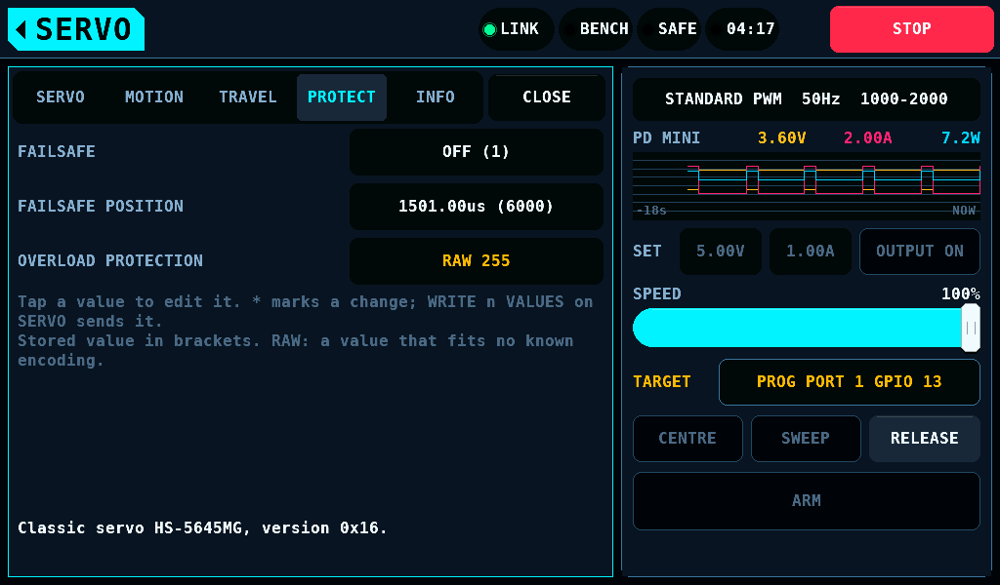
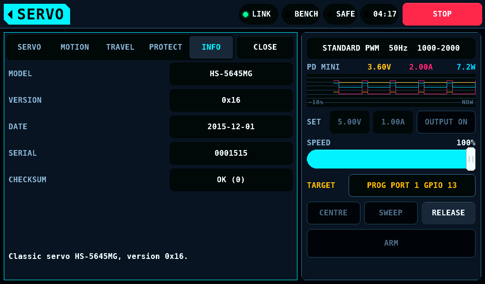

## Editing

A value is edited in the draft on the panel. Nothing reaches the servo
before [WRITE n VALUES](#writing). A value that differs from the servo's is
marked twice: by `*` before it and by the accent fill.

| Parameter | Editor | Values |
| --- | --- | --- |
| D series SPEED | keypad | 10% to 100% in steps of 10% |
| D series DEAD BAND, classic DEAD BAND | list | steps 1 to 5 |
| D series SOFT START | list | 20%, 40%, 60%, 80%, 100% |
| D series NEUTRAL, LEFT END, RIGHT END | keypad | 1 to 16383 counts; LEFT END below NEUTRAL below RIGHT END |
| D series DIRECTION, classic DIRECTION | list | CW, CCW |
| D series FAILSAFE | list, then the keypad for POSITION | OFF, LIMP, or a position of 900us to 2100us |
| D series OVERLOAD PROTECTION, classic OVERLOAD PROTECTION | list | OFF, 10% to 50% in steps of 10% |
| D series SMART SENSOR, classic FAILSAFE | list | ON, OFF |
| D series ID | keypad | 0 to 255 |
| classic SPEED | keypad | 10% to 100% in steps of 10% |
| classic CENTRE | keypad | 900.00us to 2100.00us in steps of 0.25us |
| classic LEFT END, RIGHT END | keypad | 0 to 255, raw |
| classic FAILSAFE POSITION (HS-5xxx) | keypad | 900.00us to 2100.00us in steps of 0.25us |

The ranges and steps are those of `protocols/hitec/hitec_reg.c`. The
keypad shows the range; a value no step gives, or one that breaks the order
of the D series positions, is refused on the keypad with the reason:
`Not a value this setting takes.` or `LEFT END, NEUTRAL and RIGHT END must
ascend.` An edit writes the side effects the vendor programmer writes: a D
series DIRECTION mirrors NEUTRAL and both ends, a classic CENTRE sets both
end points to 0x10, a classic DIRECTION swaps them and takes the failsafe
position from the factory cells 0x49 and 0x4A, and every classic edit
balances cell 0x1C in the draft. A D series DIRECTION stored as neither 0
nor 1 is changed alone, without the mirror. A value stored raw is replaced
by the value of the table an edit sets; DISCARD EDITS under MORE brings the
raw value back to the draft.

### A value that needs a second look

A value that breaks a soft rule opens CHECK THIS CHANGE with the field's
line, `SPEED: 100% -> 20%`, the servo's value first, and one line per rule.
**HOLD 2s TO APPLY** takes it; **CANCEL** or the home tag leaves the draft as
it was.

| Rule | Warning |
| --- | --- |
| SPEED below 30% | `A slow servo can cause loss of control of the model.` |
| DEAD BAND below the servo's | `A narrow dead band can cause back-and-forth movement and heat.` |
| OVERLOAD PROTECTION switched off | `Without overload protection a stalled servo heats up.` |
| an end point other than the servo's | `End point changed. The servo travel per stick movement changes too.` |
| NEUTRAL or CENTRE other than the servo's | `The centre shifts. One side moves closer to the mechanical stop.` |
| DIRECTION reversed | `Direction reversed. Check all control surfaces before flight.` |
| a failsafe position more than 300us from 1500us | `Failsafe position is far from the centre.` |

A rule confirmed for a value holds for that value and for values nearer the
servo's on the same side. A value further from the servo's, or on its other
side, asks again: LEFT END 3351 confirmed at 3300 takes 3301 and asks at
3299 and at 3352. "The servo's" is the value of the last full read. A
write, a read and DISCARD EDITS end every confirmation. A stored value that
fits no encoding is no value to compare with: every change of it asks.

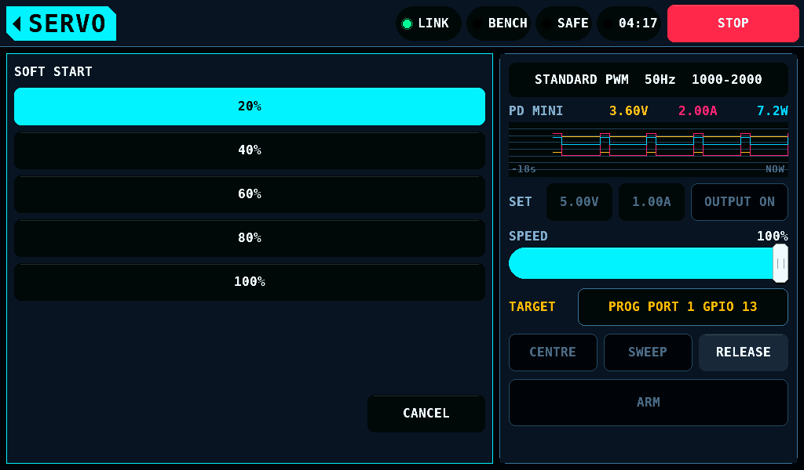
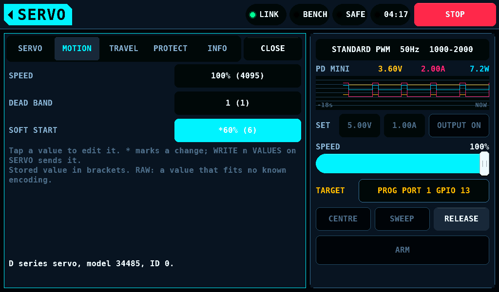
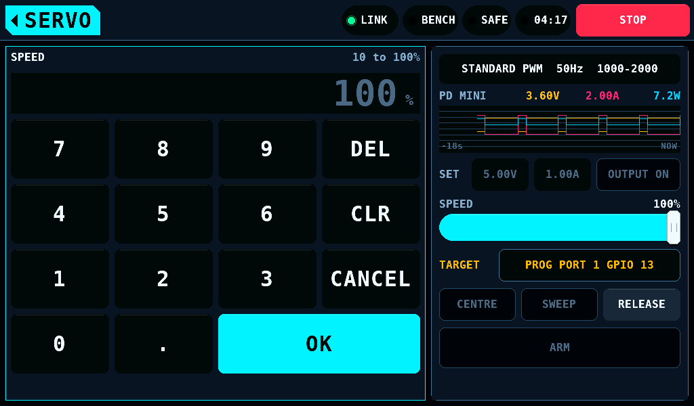
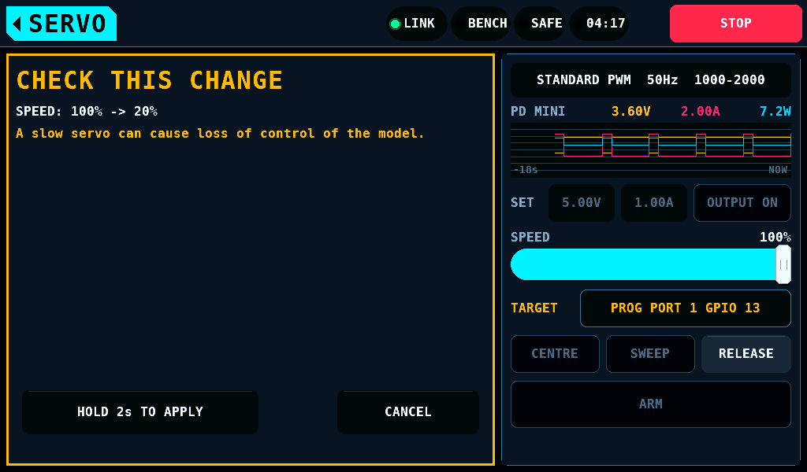

## The write switch

**ENABLE WRITE TO SERVO** is off by default. A tap on **OFF** opens a page
that names the risks; **HOLD 2s TO ENABLE** switches it on. A tap on **ON**
switches it off at once. A tap on **WRITE n VALUES**, RESTORE, REPAIR
CHECKSUM or FACTORY DEFAULT with the switch off opens the same page: its
hold switches the switch on and writes nothing.

The switch goes off:

- at every entry of the SERVO screen,
- at every CONNECT and every LEAVE,
- when the link to the IOmcu goes,
- at a STOP and at a switch to SAFE at the bench,
- when a write does not end verified,
- when a read finds other values than the ones held.

It goes on only with the port held, the servo in programming mode and read,
the port not stopped, the bench SAFE and no STOP latched.

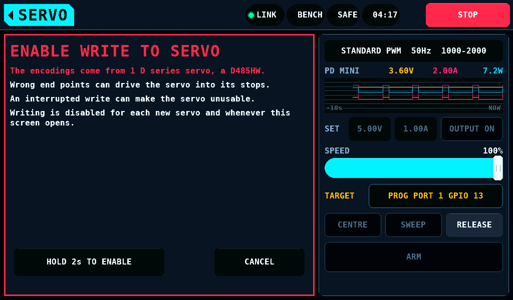

## Writing

**WRITE n VALUES** counts the values in which the draft differs from the
servo. A tap opens the write page: the changed values, `SOFT START: 20% ->
60%`, in the order of the tabs, 6 at most and the count of the rest;
`Keep the servo horn clear. Disconnect the linkage.` and `Test the servo on
the bench before fitting it to a model.` on the first write after CONNECT
and on every write that changes DIRECTION, NEUTRAL, CENTRE or an end point;
what the series does; the backup file or the lines of no backup file
([The backup before the first write](#the-backup-before-the-first-write));
and where the values before the write are recorded.
**HOLD 2s TO WRITE** starts it.

1. The second read of what the plan depends on
   ([The second read](#the-second-read)). Two reads that differ end the
   write here, with nothing sent.
2. The backup file, before the first write of the session with a card
   mounted. The write waits up to 5000ms for the card.
3. The record: the servo's values, the values the write is to leave, the
   series, the port and its GPIO. With a card mounted it goes to
   `BENCH/HITEC/CONF/HITEC.TXT` first, and the write waits for it: a card
   that does not take it within 3000ms ends the write with
   `Could not save the file to the card. Nothing was written to the servo.`
   Without a card the record is kept in RAM. A text still out on the card
   from before the write, the record of an aborted write or the text that
   clears a record, releases nothing: the write goes once the card has
   taken its own record, and the 3000ms count from the start of the write.
4. The plan of `hitec_plan()`: only the settings that change. D series: the
   setting's registers as the HFP-30 writes them, 20ms apart, then the save,
   100ms, the restart and 1000ms. Classic: each cell of a changed setting,
   then the balance in cell 0x1C, each answered `+ +` within 3 tries.
5. The read-back: the D series set of 21 registers, or classic cells 0x00
   to 0x23, held against the draft.
6. `2 values written and verified.`, or `1 value written and verified.`,
   ends it and clears the record. The switch stays on.

In the host model (`test_hitec_prog_reread`) a D series write of one value
takes 3.2s at a frame of 16ms and 3.5s at one of 33ms, and a classic one
2.4s and 4.9s, the second read included. On the bench these times are not
measured.

The write is refused on an ARMED bench or one asked to arm, with a STOP
latched, on a stopped port, with no servo read, with the switch off, with
no change, while a record of an earlier write stands, and while a request
of the card (FILES, a save or a load) waits for its answer. The port, the
bench, the STOP, the entry and the switch are checked again when the card
has taken the record: a switch turned off, a STOP or a finger on ARM in the
meantime ends the write before a step goes out, with the refusal's message,
and clears its record, on the card too. The switch does not go on again
while the write waits for the card.


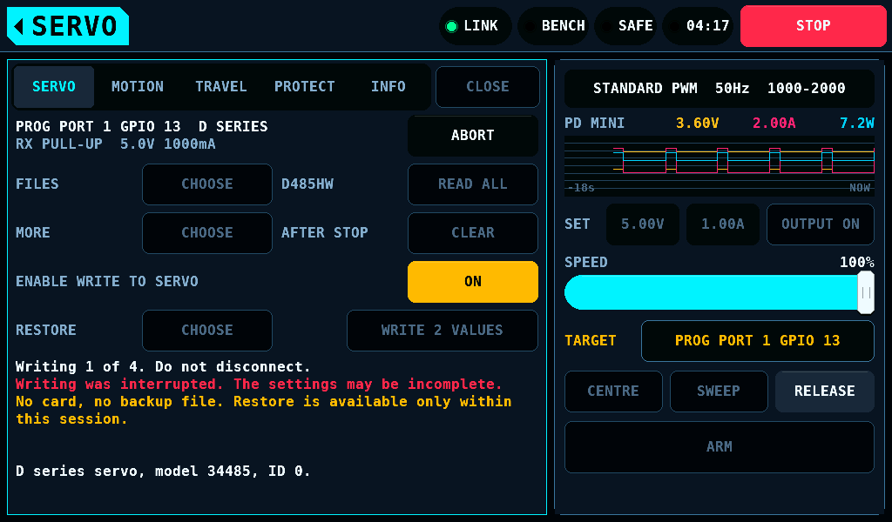
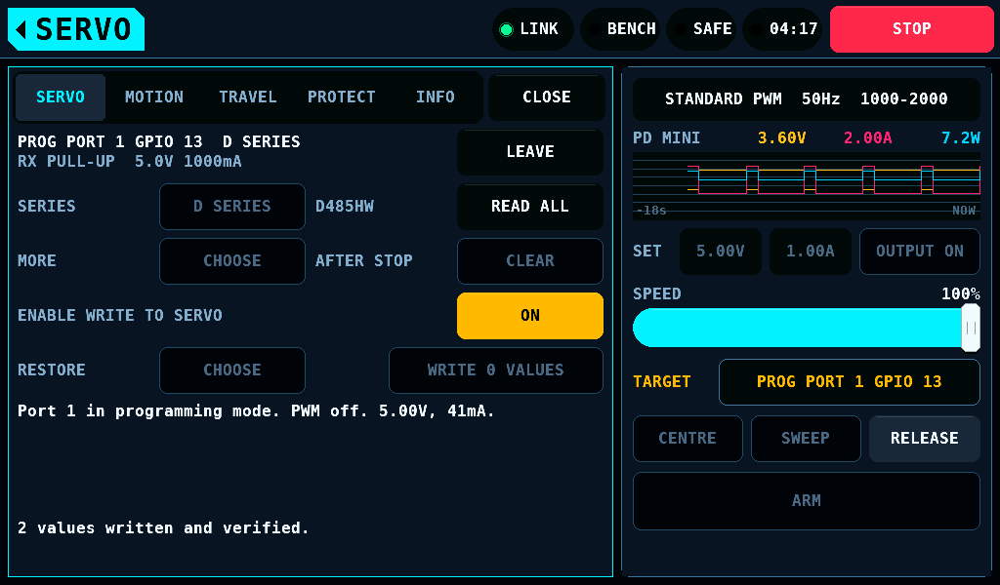
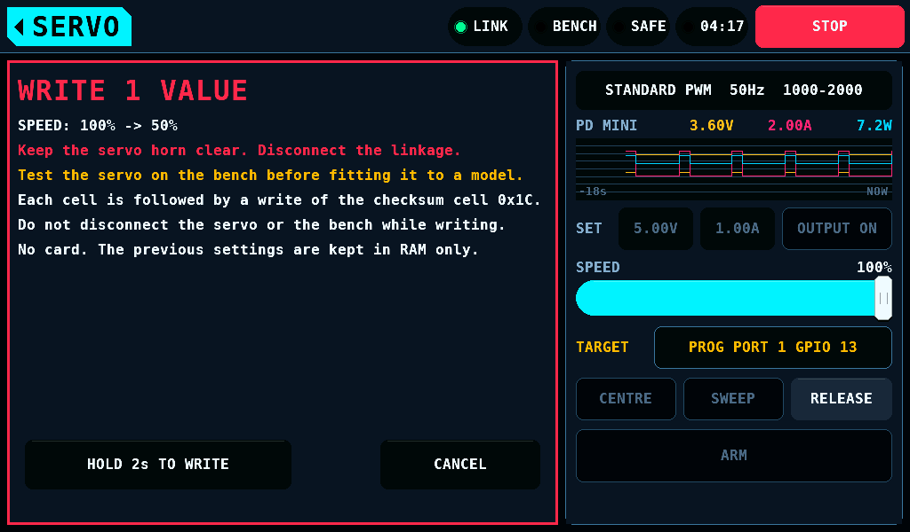

### The second read

A classic reply carries no checksum: a value read wrong reaches the plan
unseen. One station read showed cell 0x17 as 0x04 where the servo held
0x05. Every write therefore reads the addresses its plan depends on a
second time, after its hold and before it plans, and compares them with the
read the plan is made from:

| Write | Read again |
| --- | --- |
| Classic: WRITE n VALUES, a loaded file's values, REPAIR CHECKSUM, RESTORE of a record or of the session's backup | cells 0x00 to 0x23, the balance 0x1C included: 36 |
| Classic: FACTORY DEFAULT | cells 0x00 to 0x23 and the factory block 0x30 to 0x53 its values come from: 72 |
| D series: every write | the 12 registers a plan writes (`hitec_writable()`): 0x32, 0x44, 0x4C, 0x4E, 0x54, 0x5E, 0x60, 0x6C, 0x9C, 0xB0, 0xB2, 0xC2 |

A D series reply carries a sum, and the D series is read twice all the same.
The state line reads `Second read before the write: 5 of 36.`, and
**ABORT** is on the PORT row.

- The reads agree in every address: the write goes on with the backup file,
  the record and the plan.
- They differ in one address: `Two reads differ at 0x17: read again with
  READ ALL.` The first address that differs is named. Nothing is planned,
  recorded, saved or sent; the servo read stays the first read, and the
  edits and the switch stay. **WRITE n VALUES** tried again compares a new
  second read with the same first read. **READ ALL** takes a new first read.
- **ABORT**, a STOP or a read that fails during the second read ends the
  write the same way, with `The operation was aborted.`, the STOP's line or
  `Read failed at address 0x17. Tap READ ALL.`

The time the second read adds, measured in the host model
(`test_hitec_prog_reread`) from the end of the hold to the end of the read:

| Read again | Frame of 16ms | Frame of 33ms |
| --- | --- | --- |
| Classic, 36 cells | 1152ms | 2376ms |
| Classic FACTORY DEFAULT, 72 cells | 2304ms | 4752ms |
| D series, 12 registers | 704ms | 792ms |

A classic read takes 2 frames a cell. On the bench these times are not
measured.

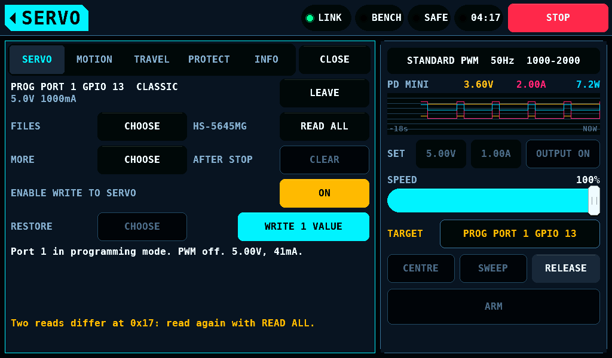

| Message | The servo |
| --- | --- |
| `Servo settings do not match after the write. Tap READ ALL.` | holds values the read-back found other than the draft's; the record stands |
| `Writing was interrupted at register 0x54. Tap READ ALL.` | took the D series registers before it; nothing is saved |
| `Writing was interrupted before the servo saved. Tap READ ALL.` | took the registers, unsaved |
| `Writing was interrupted after the save, before the restart. Tap READ ALL.` | saved them; the restart is owed |
| `Every value went out; their check was interrupted. Tap READ ALL.` | took all of them; the read-back did not end |
| `Writing was interrupted at stored value 0x06. Tap READ ALL.` and `The checksum may be wrong: the servo may ignore PWM and draw current up to the supply limit.` | may hold the new cell without its balance |
| `Stored value 0x06 is written, its checksum in 0x1C is not. Tap READ ALL.` and the same second line | holds the new cell and the old balance: the checksum is wrong |
| `A write did not end verified. Tap READ ALL before the next write.` | a write once a step went out leaves what the servo holds unknown; READ ALL comes before the next write |

A write that ends any way but verified switches the switch off.

## The record of a write

The record stands from the start of a write until the write ends verified,
the write ends before a step reached the servo, a RESTORE ends verified, or
it is discarded. With a card it is read again
at the panel's next start: a panel that restarts during a write keeps it.
Then the message band says `Writing was interrupted. The settings may be
incomplete.` and `Do not use the servo. Connect it to GPIO 13 and tap READ
ALL.`, and the SERVO tab keeps the first line until a servo is read. The next full read compares the servo with the
record, address by address over the addresses a write changes:

| The servo holds | Message | RESTORE offers |
| --- | --- | --- |
| the values before the write | `Is this the servo whose write was interrupted on GPIO 13?` `It has the old values. If this is the same servo, discard the record under RESTORE.` | the restore, which then sends nothing and clears the record, and the discard |
| the values the write was to leave | the same first line and `It has the new values. If this is the same servo, discard the record under RESTORE.` | the restore and the discard |
| some of each | `The servo contains both old and new settings.` `Do not use this servo. RESTORE writes the values before the write back.` | the restore and the discard |
| another series, port or D series model, or a value that is neither | `The interrupted write affected a different servo.` `It was connected to GPIO 13. Discard the record under RESTORE.` | the discard only |

The classic balance 0x1C is not compared: a write cut between a cell and its
balance leaves a third value there. RESTORE writes the values before the
write back as a write of its own, with the switch, the hold page `RESTORE`
and its read-back; the record stays until that ends verified. `Discard the
record of the interrupted write.` removes it without a write. While a
record stands WRITE n VALUES and REPAIR CHECKSUM are refused: `Writes and REPAIR
CHECKSUM wait for the record of an interrupted write: restore or discard it under RESTORE.` The file
manager shows `HITEC.TXT` and `HITEC.NEW` with INFO only: a hand edit could
send wrong values to a servo.

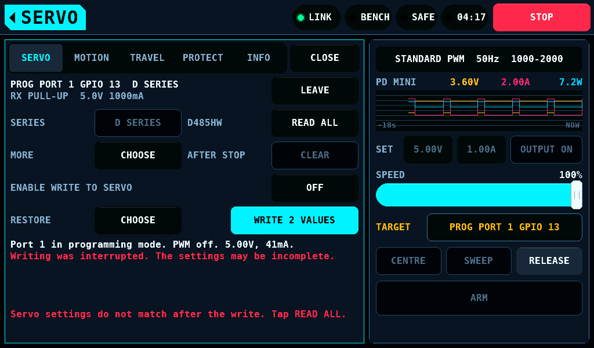
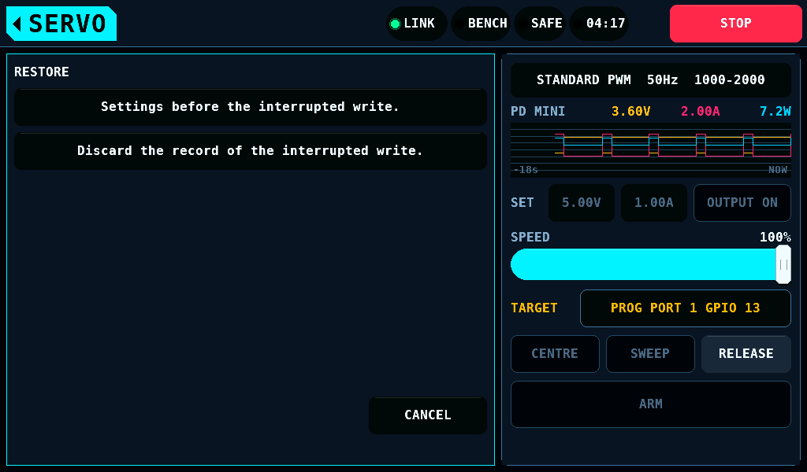

## Servo files

A servo file is a text file in the folder `BENCH/HITEC/CONF` of the
panel's SD card, `<name>.TXT`, beside the record `HITEC.TXT`. The panel
creates each missing level of the folder with the first save: `BENCH`,
`BENCH/HITEC`, then `BENCH/HITEC/CONF`. A file holds the set READ ALL
reads: 21 registers of a D series servo, 100 cells of a classic servo and
its version.

```
RCBENCH HITEC 1
series=D
model=D485HW
image=86B500271FC1000000000000000100010FFF000000010FFF000009C410FE006432CB0D17200000000000
backup=0
check=1E29
```

| Line | Content |
| --- | --- |
| 1 | `RCBENCH HITEC 1`, the format; the record has the same first line and `port=` as its third |
| `series=` | `D` or `C` |
| `model=` | the model's name, `D485HW` or `HS-5645MG`; `D series 34999` for a D series model number the register model does not name; the classic name cells as read for another classic name; `?` for none. 1 to 20 printable characters |
| `image=` | D series: the registers in the order READ ALL reads them, 4 hexadecimal digits each, 84 digits. Classic: cells 0x00 to 0x23, 0x30 to 0x53, 0x60 to 0x6F, 0x70 to 0x73 and 0x80 to 0x87, 2 digits each, 200 digits |
| `version=` | classic only, 2 digits, where the read found one |
| `backup=` | `1` for a backup file ([The backup before the first write](#the-backup-before-the-first-write)), `0` for every other save |
| `check=` | the CRC-16 (cyclic redundancy check) of every byte before this line, 4 digits |

Lines end in LF (line feed) alone, the digits are upper case. A D485HW file
is 149 bytes, an HS-5645MG file 279 bytes; the panel reads 320 bytes at
most. A file whose check does not match, or whose lines are not these in
this order, is refused whole: a file edited by hand does not load. A file
without the `backup=` line loads; it counts as a backup file when its name
is a proposed name, `HITEC001` to `HITEC999`.

**FILES** opens the list. It takes a tap with the port held, the servo in
programming mode and read, no read owed after a write, the port not
stopped, the bench SAFE and no STOP latched; otherwise the tap says why.
Saving and loading work with the write switch off: a file changes the
draft on the panel, never the servo.

The first entry saves. Below it stand the files sorted by name, 5 a page,
each with the model its file names. The files with a proposed name,
`HITEC` and 3 digits, stand together at the place of `HITEC000`, the
highest number first. With more than 5 files the title counts them,
`FILES 1 TO 5 OF 7`, and `Show more files.` turns the page, back to the
first after the last. The panel asks the card for each page and waits at
most 5000ms for it: `Cannot read the card.` otherwise.


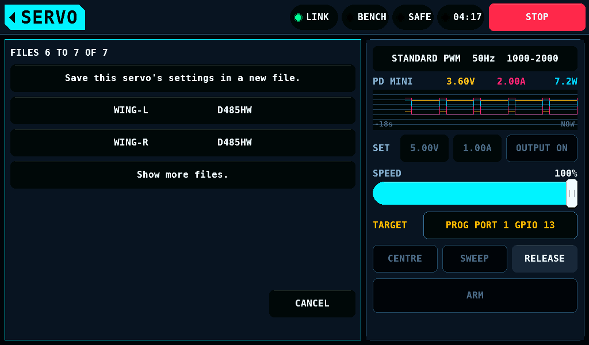
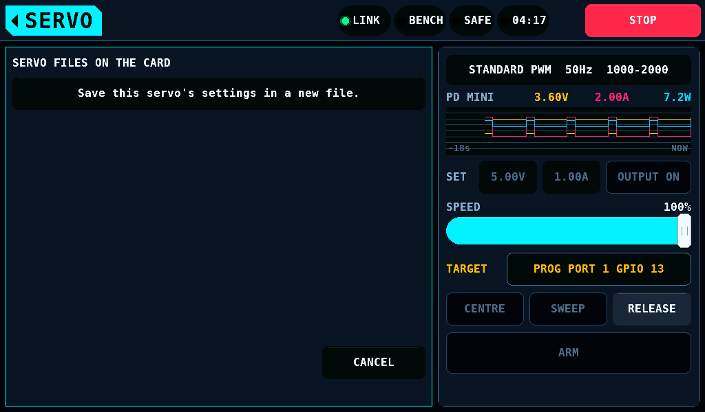

### Saving

`Save this servo's settings in a new file.` opens the keyboard with the next
free proposed name, `HITEC001` to `HITEC999`. The keyboard takes up to 16
characters: A to Z, 0 to 9, `-`, `_` and the full stop. **OK** saves the
servo as last read; an edit in the draft is not in the file. The card's
side checks the name and never replaces a file. Names compare without
case. A file with a longer name, up to 32 characters, is listed and loaded.

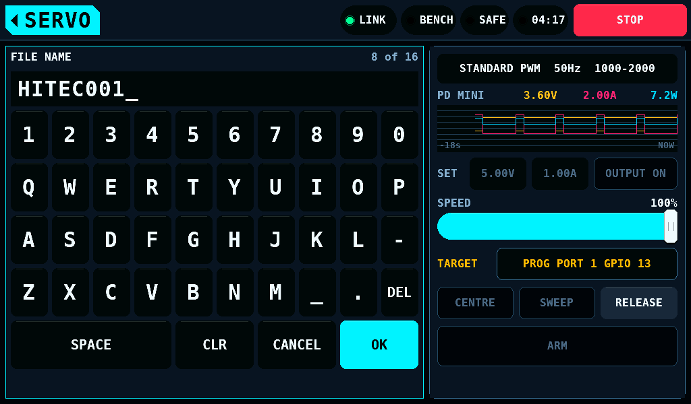
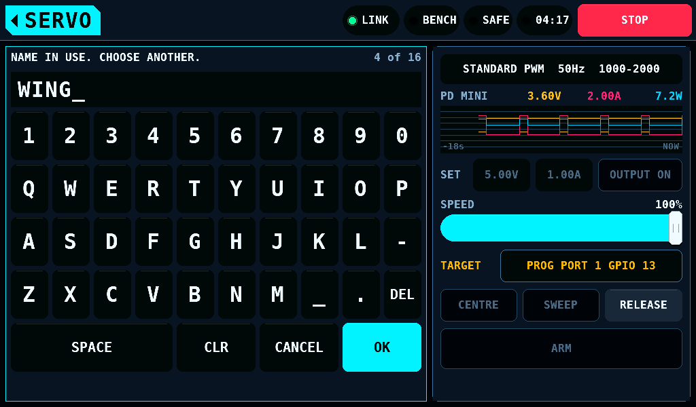

| Result | Shown |
| --- | --- |
| Saved | `Servo settings saved to the card: WING-L.` |
| A full stop at the start or the end, or a reserved name: `HITEC`, `CON`, `PRN`, `AUX`, `NUL`, `COM1` to `COM9`, `LPT1` to `LPT9`, alone or in front of a full stop | the keyboard opens again under `INVALID NAME`; `Invalid name: reserved name, or a dot at the start or end.` |
| A file has the name | the keyboard opens again under `NAME IN USE. CHOOSE ANOTHER.`; `This file name is already in use. No file was replaced.` |
| No card | `No card. Nothing saved or written to the servo.` |
| Card full, or `HITEC001` to `HITEC999` all taken at the backup before a write | `Card full. Nothing saved or written to the servo.` |
| The card is write protected, or `BENCH`, `BENCH/HITEC` or `BENCH/HITEC/CONF` on the card is a file and no folder | `Cannot save: card write-protected, or BENCH/HITEC/CONF is not a folder.` |
| The card fails the write of the file, or does not answer within 5000ms | `Card write error. Nothing was written to the servo.` |

A save the card ends after the 5000ms is the file it made; the line stays
as it was.

### The backup before the first write

The session's backup is the first full read after CONNECT, kept in the
panel's RAM. A later read of the same servo leaves it as it is. A read
that finds another servo makes that read the backup. A classic servo is
another servo by another name, date, serial or version. A D series servo
is another servo by another model number, or when the read breaks the
session's chain. The port is held, so only the session writes the servo,
and a D series read is of the servo read before it when:

- no write of the session is left unverified, and every register a write
  sends holds the value the read before found; or
- a write is left unverified (its check failed, or it was interrupted),
  and the record of that write explains the values: the read finds the
  values before the write, its new values, or some of each
  ([The record of a write](#the-record-of-a-write)). With the record
  discarded the values decide, against the values the failed check read
  back.

The chain compares with the read before, not with the backup: the
session's own verified writes, the ID 0x32 included, keep it. A read of
another servo says

```
Other values than the last read: taken as another servo.
Its backup is this read.
```

The backup file line goes, RESTORE does not offer the first servo's
backup, and the first write to the new servo saves a backup file of its
own. Where a record stands, its line takes the place of these two. LEAVE,
the next CONNECT, a lost link and a panel restart end the backup; the
first read of the next session is its backup without these lines.
A file the card makes for a backup, or a save by hand, counts only for the
backup that stood when it was asked for: a late answer after LEAVE and
CONNECT, or after another servo's read, saves nothing for the new one.

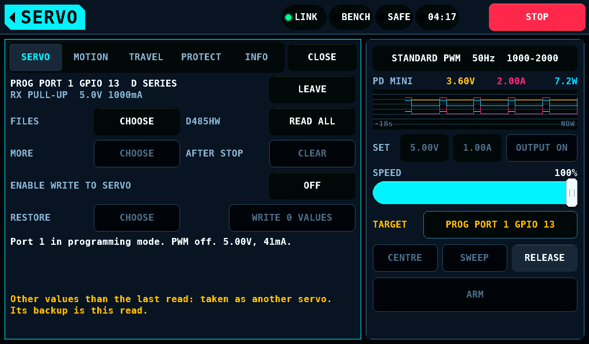

The first write of a session that sends a step, WRITE n VALUES, REPAIR
CHECKSUM, a RESTORE or FACTORY DEFAULT, saves the backup to a new file
under the next proposed name first, without asking. The write page says
`The current servo settings are saved to a new card file before writing.`
and the state line `Saving the backup file on the card.` while the card
works. The servo receives nothing before the card holds the file. A card
that is full, that is write protected, that fails the write, that leaves
the slot between the request and the file, or that does not answer within
5000ms ends the write with the lines of the table above, and nothing is
written to the servo. ABORT and STOP while the card works end the write
the same way. A file the card makes after the 5000ms holds the backup all
the same; the write does not go on its own. The SERVO tab then names the
file: `Backup file of this session: HITEC003.` A save by hand before the
first write counts as that file while the servo still holds the backup's
values. A save by hand after a write holds the written values and leaves
the line as it is. The backup file and every save by hand of the servo as
the session found it, before the first write, carry `backup=1`; every other
save carries `backup=0`. A backup file brings back more than a setting
([Loading a backup file](#loading-a-backup-file)).

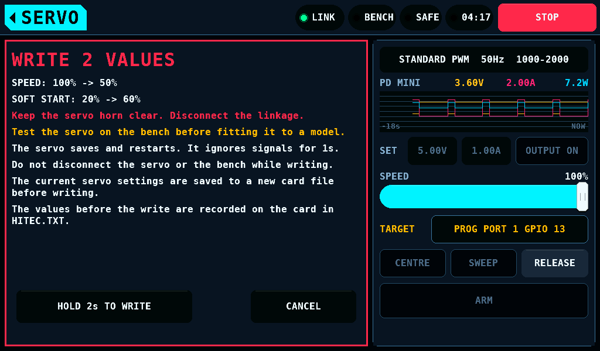
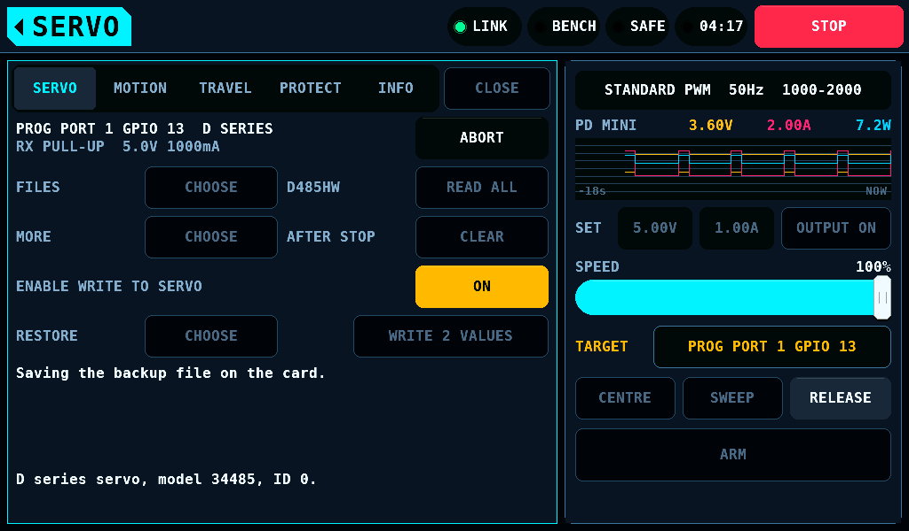
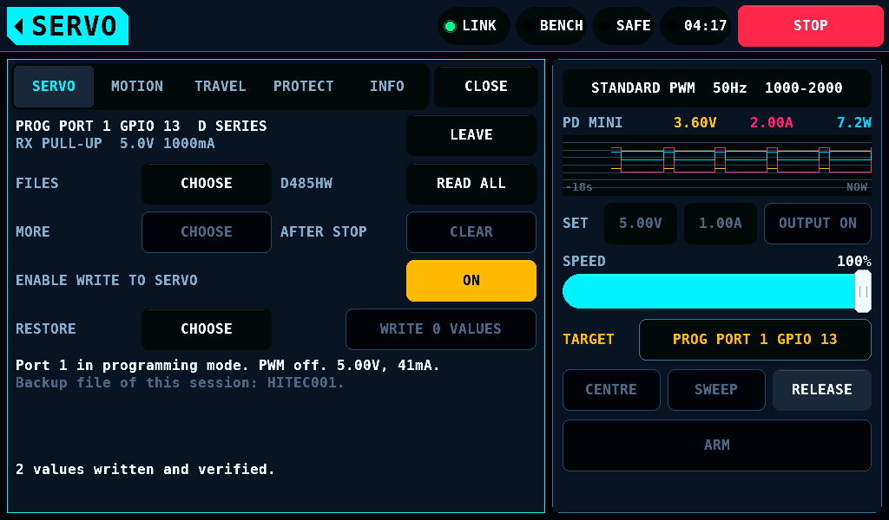

#### Without a card

With no card mounted the write is not blocked. The write page carries
three more lines:

```
No card. No backup file will be saved.
This session's backup is kept only in the bench's memory.
It is lost when the session ends or the bench loses power.
```

After the write the SERVO tab shows `No card, no backup file. Restore is
available only within this session.` A card put in later in the session
gets the backup with the next write: the file holds the servo as the
session found it, not as it stands. A card that leaves the slot after the
backup file is saved lets later writes go; the write page then says `No
card. The previous settings are kept in RAM only.` A card in the slot that
does not mount counts as no card, and the lines name what the panel found
in place of `No card`, as on the KST programmer
([Without a card](ServoProgrammer.md#without-a-card)).


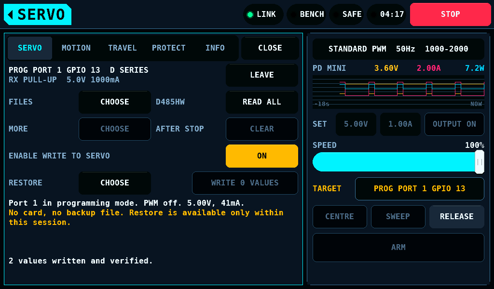

### Loading

A tap on a file loads it. The cells or registers of every editable value
become the draft, as stored: a value that fits no encoding comes back raw.
A classic draft gets its balance in cell 0x1C computed. The changed values
are marked `*`, **WRITE n VALUES** counts them, and nothing reaches the
servo before the write switch, the write page and its 2s hold.


| File | Shown |
| --- | --- |
| Loaded | `WING-L loaded. 2 values differ from the servo settings.`, or `WING-L loaded. 1 value differs from the servo settings.` |
| Holds the servo's editable values | `WING-L matches the servo settings. Nothing to write.`; the draft becomes the servo's values, and an edit made before the load is dropped with its confirmations |
| Values outside the editable ones differ | a second line: `2 stored values outside the settings differ. They are not loaded.`, or `1 stored value outside the settings differs. It is not loaded.` |
| A backup file of the servo read whose values outside the editable ones differ | CHECK THIS FILE with `Stored values outside the settings loaded too: 1.`; after the hold the same line under the loaded line ([Loading a backup file](#loading-a-backup-file)) |
| Of the other series | `File is CLASSIC, servo is D SERIES. Not loaded.` |
| Of the other classic layout | `File is for HS-7xxx servos, this servo is HS-5xxx. Not loaded.` |
| Of another model of the same layout, or past a soft rule | CHECK THIS FILE, below; `Confirm the warnings before loading this file.` |
| A wrong check | `File damaged: checksum mismatch. Not loaded.` `A file edited by hand does not load.` |
| Ends before its check line | `File damaged: it ends before its check line. Not loaded.` and the same second line |
| A line that is not the one due | `Cannot read line 5. File not loaded.` and the same second line |
| Not a servo file, or larger than 320 bytes | `Not a servo settings file. Not loaded.` |
| The card does not read, or does not answer within 5000ms | `Cannot read the card.` |

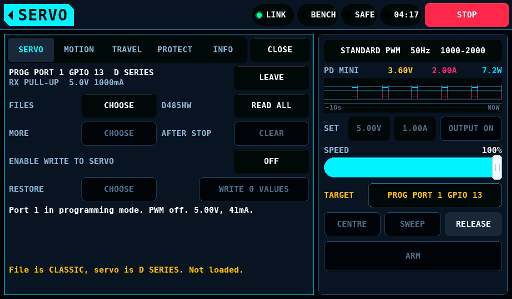
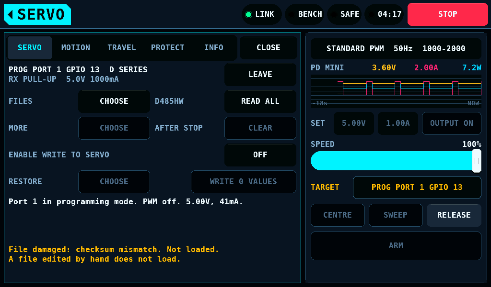

CHECK THIS FILE opens before anything becomes the draft when the file
names another model, `File model D series 34999, servo model D485HW.` and
`Values of another model may not suit this servo.`, or when a value it
loads passes a soft rule that the servo's own value keeps. The page names
the file and the values that differ, and the warning lines an edit past
those rules shows ([A value that needs a second
look](#a-value-that-needs-a-second-look)). The values give way to the
warnings: the last line that fits counts the rest, `and 3 more`, and no
value line is left where the warnings need the room. Warnings that still do
not fit above the hold button go to a next part of the page under the
file's line, behind **HOLD 2s TO CONTINUE**; a file of another model past
all 7 rules takes 1 part in English and 2 in German. **HOLD 2s TO LOAD** on
the last part takes the values into the draft, each rule confirmed for its
value. **CANCEL** and BACK on any part leave the draft as it was.

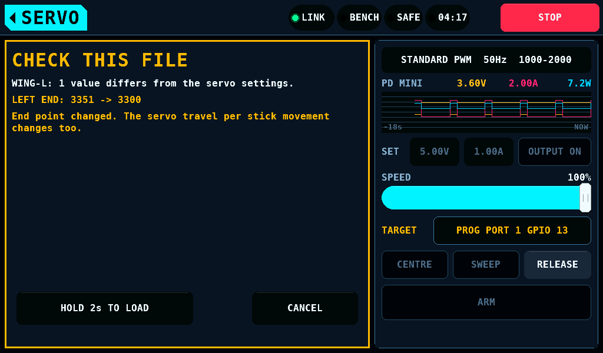
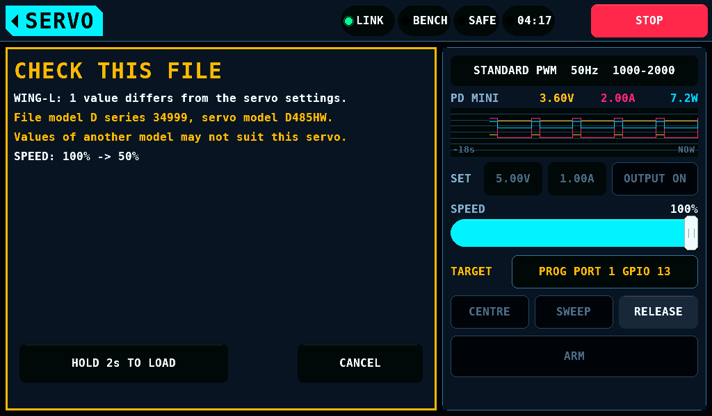
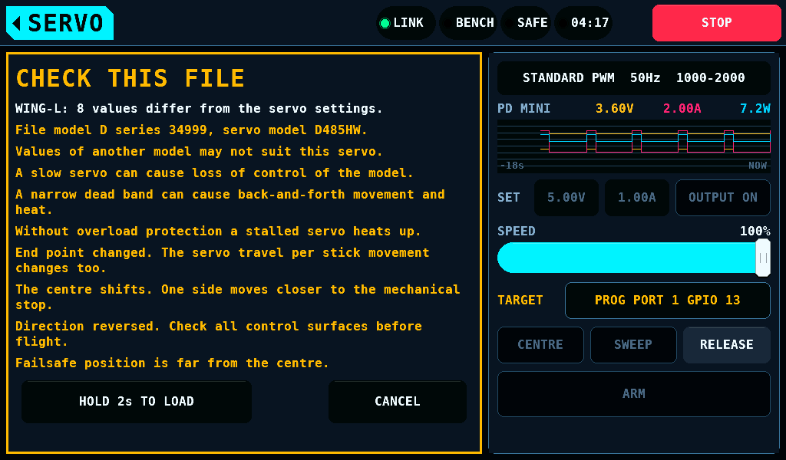
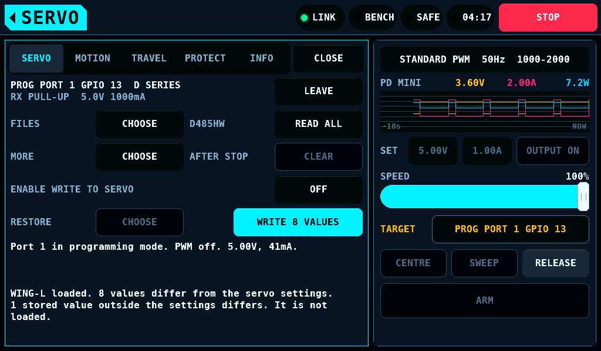

#### What a file does not load

A load writes the editable values only. These stay as the servo holds
them: D series register 0x00 (the model), 0x04, 0x22, 0x64 (SENSITIVITY),
0xD4 and 0xD6; classic cells of no editable value in 0x00 to 0x23, the
factory cells 0x30 to 0x53, the name, the date, the serial and the version.
The D series position, register 0x0C, and the classic balance, cell 0x1C,
are not counted. RESTORE of the session's backup writes the cells and
registers a load leaves, and so does a backup file of the servo read.

#### Loading a backup file

A backup file is a file with `backup=1`, or a file without a `backup=`
line under a proposed name, `HITEC001` to `HITEC999`. A backup file of the
servo read loads every address a write sends, as RESTORE of the session's
backup does: classic cells 0x00 to 0x23 without the balance 0x1C, and the
12 D series registers 0x32, 0x44, 0x4C, 0x4E, 0x54, 0x5E, 0x60, 0x6C, 0x9C,
0xB0, 0xB2 and 0xC2. The file is of the servo read when the series and the
layout match and:

| Series | Compared with the servo read |
| --- | --- |
| D series | the model number, register 0x00 |
| Classic | the name cells 0x60 to 0x6F, the date cells 0x70 to 0x73, the serial cells 0x80 to 0x87 and the version |

A backup file of another servo, and every file with `backup=0`, loads as
any other file. Each of the 12 D series registers is an editable value, so
a D series backup file loads what any file loads.

FACTORY DEFAULT of an HS-7955TG changes cell 0x22, RESOLUTION, which no
edit reaches. After LEAVE the session's backup is gone; the backup file
saved before FACTORY DEFAULT, `HITEC001`, brings 0x22 back with the 4
values of cells 0x08, 0x13, 0x14 and 0x1B.

When a classic cell outside the editable values differs, CHECK THIS FILE
opens first with `Stored values outside the settings loaded too: 1.`.
**HOLD 2s TO LOAD** takes the cells into the draft, and the message shows
the same line under `HITEC001 loaded. 5 values differ from the servo
settings.` A cell that no value line names counts as a value of **WRITE n
VALUES**; the write page shows `Stored values outside the settings written
too: 1.`, and the write sends the cell. RESTORE, REPAIR CHECKSUM and
FACTORY DEFAULT wait for it as for an edit; DISCARD EDITS drops it.

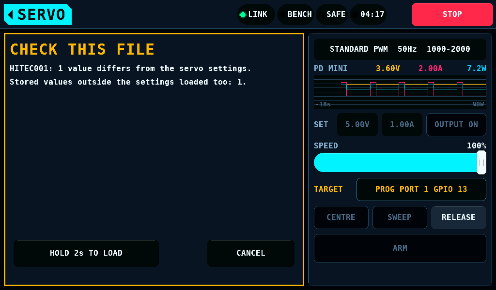

## Restore of the session's backup

**RESTORE** offers `Backup of the first settings read in this session.`
while the backup differs from the servo in an address a write sends:
every D series register and classic cell 0x00 to 0x23 that a plan writes,
raw values included. A tap opens RESTORE: the values that change, `This
backup will be restored without checking the limits.`, the count of
classic cells of no editable value it writes back, `Stored values outside
the settings restored too: 1.`, and the backup file's lines. **HOLD 2s TO
RESTORE** writes it as a write: the backup file first if none holds it,
the record, the steps and the read-back. It ends with `Backup restored and
verified.` It needs the switch and no edit standing. With a record of an
interrupted write standing it keeps that record and needs the record's
comparison by READ ALL first, as RESTORE of the record does.


## FACTORY DEFAULT

Classic servos only. A classic servo keeps its factory values in cells
0x30 to 0x53, the same layout as its settings in cells 0x00 to 0x23. The
HPP-21 Plus's reset copies them over, captured on the station on
2026-10-18 for the HS-5645MG and the HS-7955TG. FACTORY DEFAULT under MORE
plans the same copy from the servo's own factory cells as read, with the
balance computed, and opens a page with `All settings go back to the
factory values.`, `The source is the servo's own stored factory values 0x30-0x53.`,
the values that change, the count of cells no setting names that it
writes, `Stored values outside the settings written too: 1.`, the horn line and the
backup file's lines. **HOLD
2s TO WRITE** writes it as a write and ends with `Factory values written
and verified.` It needs the switch, no edit standing and no record. It is
offered while any cell of 0x00 to 0x23 that a write sends differs from its
factory cell, one no setting names included; a servo whose cells already
hold the factory values gets `No value differs from the servo's.`

A D series servo has no FACTORY DEFAULT: its reset command (register 0x6E
= 0x0F0F, as the HFP-30 sends it) leaves values that are not known before
it is sent, so the write page cannot name them and the read-back has
nothing to hold them against.

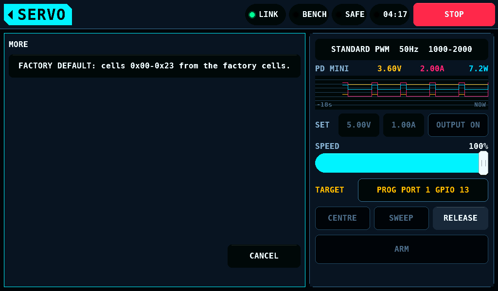
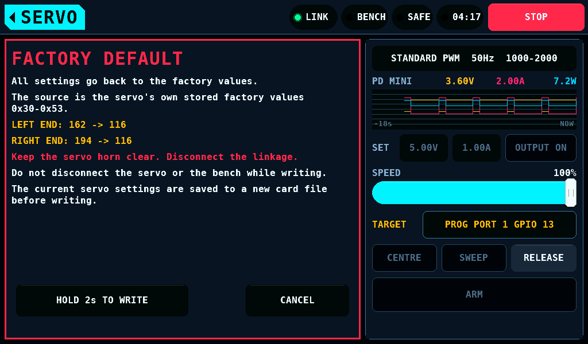

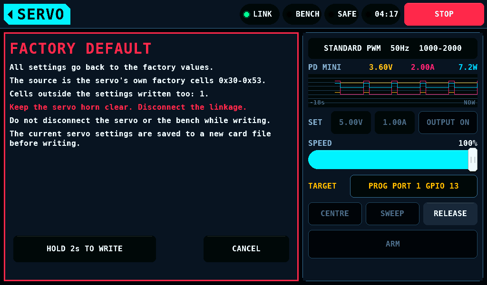

## REPAIR CHECKSUM

A classic servo whose cells 0x00 to 0x1C do not sum to 0 modulo 256 shows
CHECKSUM `WRONG`, and the SERVO tab says `MORE > REPAIR CHECKSUM writes stored
value 0x1C.` REPAIR CHECKSUM under MORE opens a page that names the cell's value
and the balance, `Writes stored value 0x1C: 0x5F -> 0x5E. Stored values 0x00-0x1C then sum to 0.`; its hold writes the
balance alone, with its record and the read-back of cells 0x00 to 0x23.
It needs the switch, no edit standing (WRITE n VALUES writes the balance
with the edits) and no record.

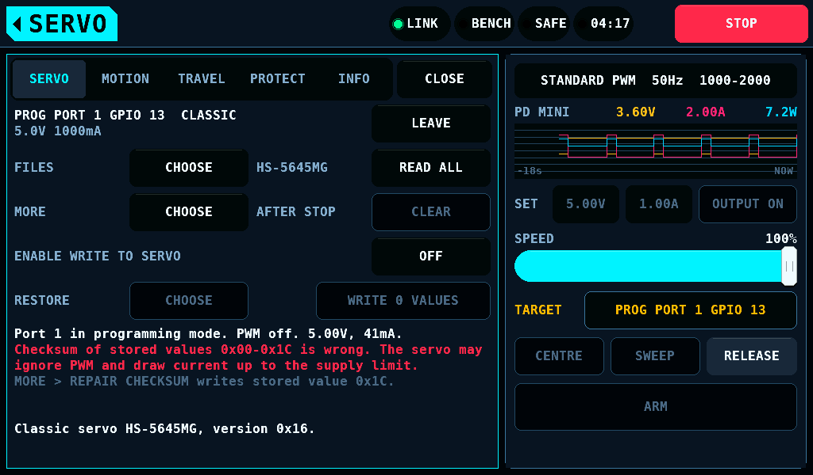
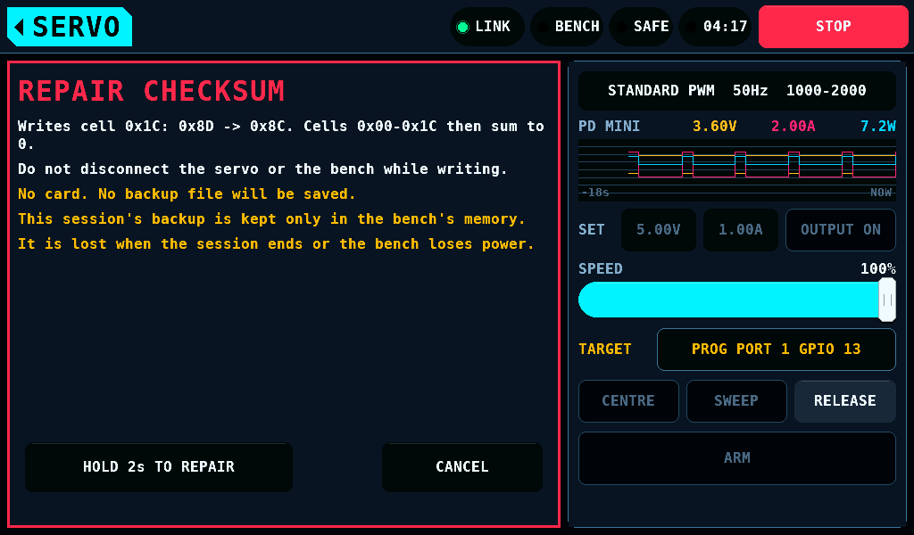

## LEAVE

CLOSE, the home tag or LEAVE on the PORT row opens LEAVE PROGRAMMING; a
hold of 2s on `HOLD 2s TO LEAVE` leaves:

- D series: a reboot of the servo (register 0x46 = 1), which then ignores
  signals for 1s; the supply stays as it is.
- Classic: the supply off and on again. The 500ms off time counts from
  the PD mini's read that shows the output off, which the driver sends
  250ms after the OFF (`PDMINI_CONFIRM_MS`). The ON goes after the
  driver's reads of the set points and the active slot. The output is off
  about 760ms: 762ms measured on one module, at the 1.4V threshold of a
  logic analyser. How much of it is the module's own switching time is not
  measured.

Then CLOSE: the port is back in PWM and the message says
`The port is back in tester mode.` LEAVE is taken on a stopped port, an
ARMED bench and with STOP latched: the reboot is refused by a stopped port,
and the CLOSE is always taken.

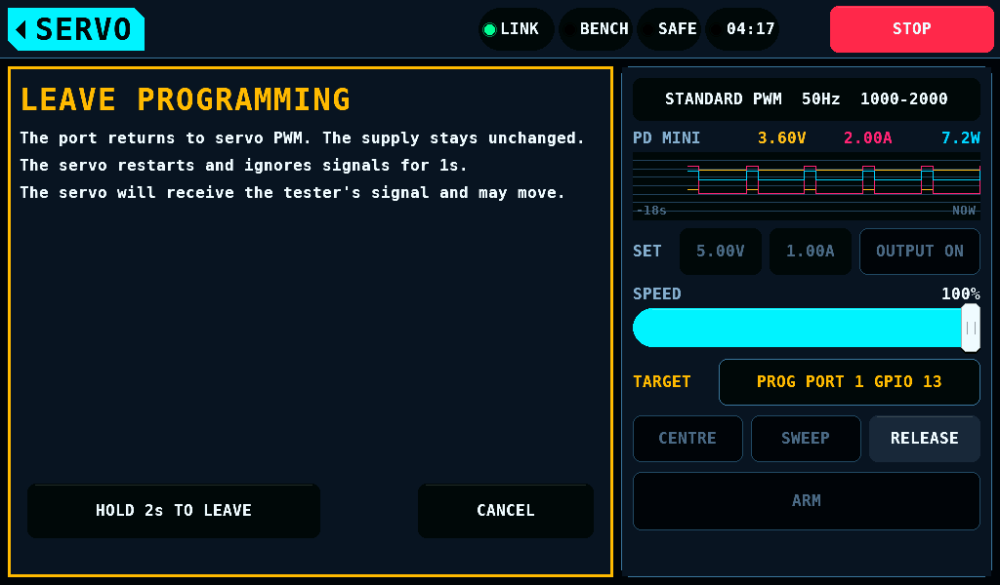
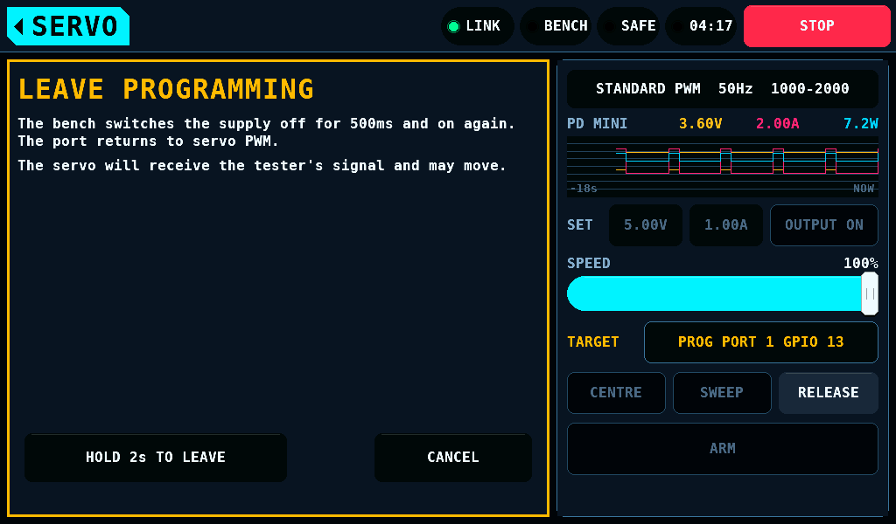

Both series end a LEAVE with the PD mini's output on, at the session's
programming voltage and current limit. Where the set points from before
CONNECT differ from them, SERVO asks once the port is back in PWM:
`Restore your supply set points 5.50V 2.00A on the live output?`, under
OUTPUT IS ON, with the change of each set point that differs.

- **YES** gives the live output both set points from before CONNECT. A
  voltage that rises from 6.0V or below to above it opens HV SERVOS ONLY
  first, and **HOLD 2s TO APPLY** gives both set points; its CANCEL keeps
  the session's.
- **NO** keeps the session's set points. The ones from before CONNECT come
  back at the output's next OFF.

The question is asked once per LEAVE, and not:

- while a programming port holds the supply, KST's or Hitec's; a port that
  takes the supply while it stands closes it;
- while a keypad, a list, a warning or another question of SERVO is open,
  or OUTPUT ON is held: it follows once they are closed;
- after the output went off, an error switched it off, or a STOP, between
  the LEAVE and the question; an OFF asked while it stands, OUTPUT OFF
  included, closes it before the output reads off;
- inside a limit run, whose read session leaves through the same LEAVE;
- when a set point changed after the LEAVE, or the set points from before
  CONNECT, held to the SUPPLY limits, equal the session's.

The question stands on SERVO only. A port that lets go while another
screen is shown is asked about when SERVO is shown again, while the output
stays on. Left unanswered when SERVO is left, the question is gone, as NO.

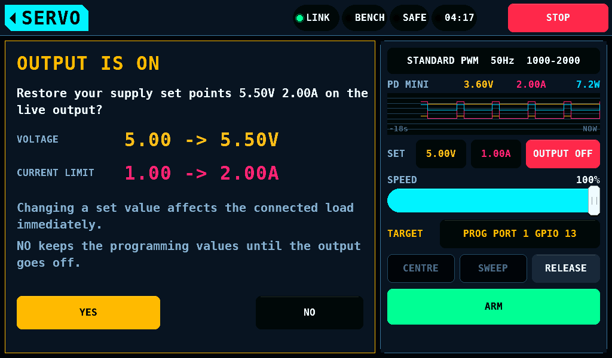
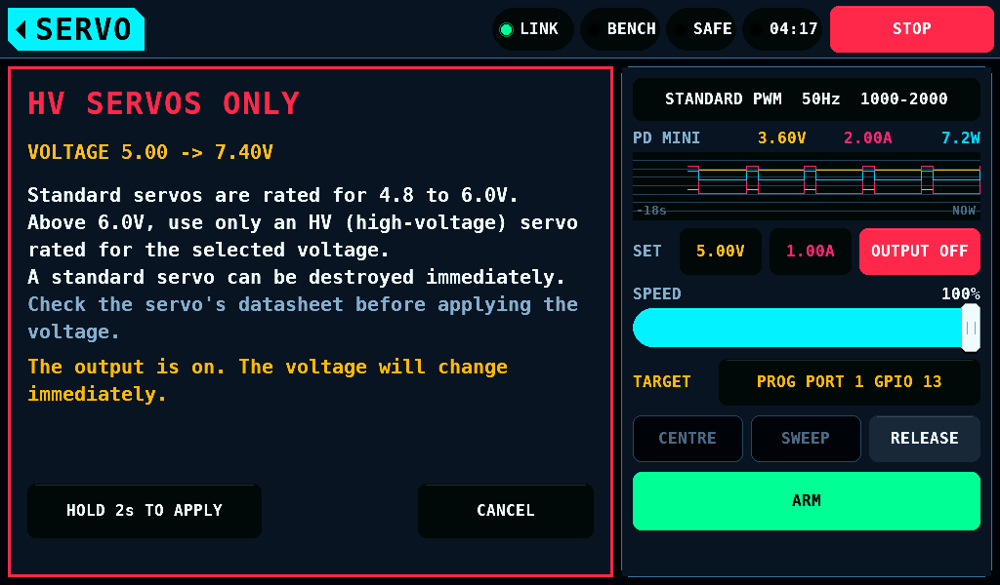

## STOP, SAFE and a lost link

| Event | The port | What the operator does |
| --- | --- | --- |
| STOP, pressed or the bench's own | The IOmcu cuts the transaction after the frame on the wire, keeps the port with the pin released and sets STOPPED. The panel latches the stop and withholds the heartbeat | `Stopped. The pin is released. LEAVE, then switch to ARMED once to clear the STOP.`, and no line offers CLEAR. CLEAR and READ ALL are refused with the STOP latched: the IOmcu would refuse the CLEAR as UNSAFE. LEAVE, then ARM and DISARM, then CONNECT |
| A switch to SAFE at the bench alone | STOPPED, no latch | `Stopped. The pin is released. Tap CLEAR to go on, or LEAVE.` CLEAR goes on with the read |
| ABORT | The operation ends; the port stays held | READ ALL again, or LEAVE |
| The link goes silent | The IOmcu's failsafe latches and the port stays held; the panel's module does not count it as its own | Once the link is back the overlay says `Port held by another Hitec session.` and offers RELEASE PORT |
| The panel starts again | As a lost link | As a lost link |
| An error of the bench ([Safety, Errors](Safety.md#errors)), or an operation that ends in a fault of the servo or the wire: no servo, a wrong entry answer, a failed read, a classic write without its answer, a read-back that differs, a step the decoder refused | A write under way ends first: the IOmcu keeps the supply on until its last step and 150ms after it, 10000ms at most. Then the PD mini's output goes off, and the port stays held without it: a POWER's ON is refused. An IOmcu older than link 4.31 keeps the supply on ([A programming port's supply](Safety.md#a-programming-ports-supply)) | LEAVE, then CONNECT |

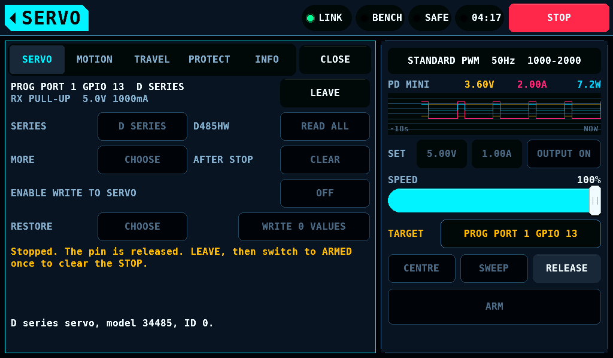

## A port another session holds

A port the HITEC page holds and this panel did not open, one the bench
console opened or one held over a lost link or a panel restart, keeps the
Hitec row live: the overlay opens with the PORT row
`PROG PORT 1 GPIO 13  HELD ELSEWHERE` and `Another Hitec session holds it.`
RELEASE PORT opens a page; a hold of 2s on `HOLD 2s TO RELEASE` sends CLOSE,
which the IOmcu takes whether or not it trusts the heartbeat. The supply
stays as it is. Then a switch to ARMED clears the IOmcu's latched failsafe
as after any stop: ARM is refused only while the port is held.


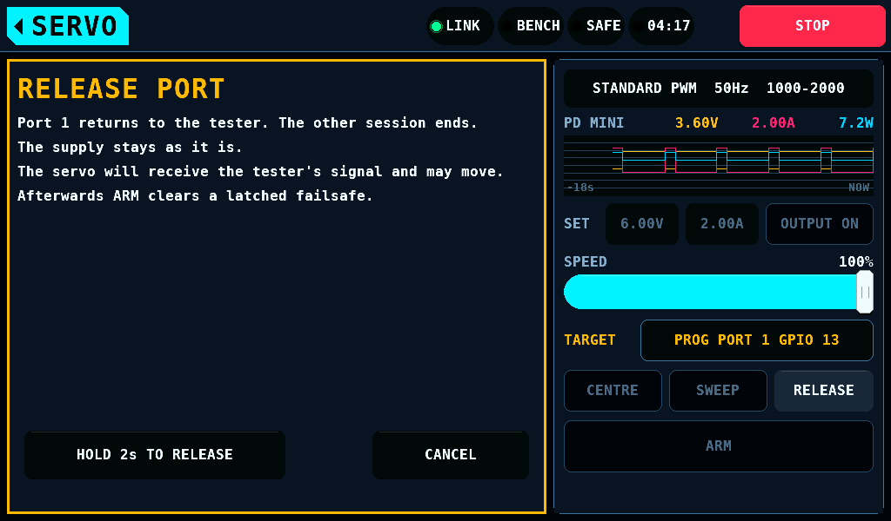
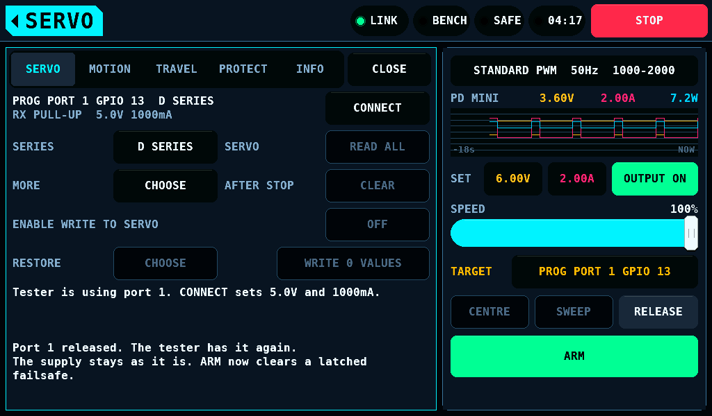

## Messages

| Line | When |
| --- | --- |
| `No D series servo answers. Check plug, receive mode and series.` | no byte came on the last of 3 tries of a D series read |
| `No classic servo answered after power-up. Check plug and series.` | no `+` came within 2s after the power-up |
| `The servo's answer to the entry was wrong. Check the series.` | bytes came that do not fit the entry |
| `Bad answer from the servo (code 14). Reading again.` | a try failed; the code is the decoder's (`hitec_rx_t`) |
| `Read failed at address 0x32. Tap READ ALL.` | every try of one address failed |
| `Two reads differ at 0x17: read again with READ ALL.` | the second read before a write differs from the read the plan is made from ([The second read](#the-second-read)) |
| `The IOmcu refused: its failsafe is latched.` | OPEN or CLEAR refused UNSAFE |
| `The IOmcu ended the session. The port is back in tester mode.` | the port went back to PWM with no command of this panel |
| `No answer from the IOmcu in time. The operation ended.` | a command not taken within 2000ms, or a request without an outcome within 30,000ms |
| `The supply did not follow the POWER request. Check the PD mini.` | POWER ended with SUPPLY |
| `The IOmcu cannot drive the line of this port.` | OPEN found no free line |
| `The IOmcu refused the request (code 7).` | a refusal with no message of its own |

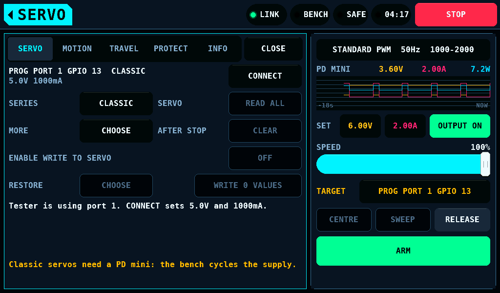


## Current limitations

- Classic writes through the IOmcu are run on one servo, an HS-7955TG
  (station, 2026-10-25): cell 0x02 and the balance 0x1C, kept over a power
  cycle. Every other cell, the cells 0x1D to 0x23, which a write sends
  without a balance, and the data memory command 0x64 are not tested;
  the programmer sends no 0x64. A write to a servo with a wrong checksum
  and REPAIR CHECKSUM are not tested on a servo.
- D series writes are measured on 1 servo, a D485HW, by the HFP-30's
  captured writes; writes from rcbench to a D series servo are tested in
  the host model only. Whether a save cut by a power loss leaves the
  servo's flash whole is not measured. Values written and not saved are
  lost at the servo's next power-off, and the D series entry of a CONNECT
  switches the supply off and on.
- The soft rules compare with the last full read, not with the session's
  backup.
- The session's backup lives in the panel's RAM: LEAVE, CONNECT, a lost
  link and a panel restart end it. After a lost link the new session's
  backup is the servo as found then, with the values of the cut write; the
  record of the write and the old session's backup file hold the values
  before it.
- Two D series servos of one model are told apart by their values only. A
  second D485HW whose registers a write sends hold the values of the first
  one's last read keeps the first one's backup, and RESTORE of the
  session's backup writes the first one's values into it. Which register,
  if any, differs between two units of one model is not measured.
- A servo file written or edited outside the panel does not load.
- The record is read from the card at the panel's start only. A card put
  in later is not read for one, and a record made with no card mounted is
  kept in RAM and is gone after a panel restart. A card that refuses the
  text that clears a record keeps the record: the next panel start reports
  that write as interrupted.
- NEUTRAL, LEFT END and RIGHT END are edited as numbers on the keypad; the
  servo does not move to them while they are edited, and the keypad has no
  `-`/`+` keys.
- FACTORY DEFAULT is not offered for the D series; for a classic servo it
  is the HPP-21 Plus's copy of cells 0x30 to 0x53, tested in the host
  model only.
- Station steps S6 to S8 and S10 to S11 (writes to a D485HW and a classic
  servo, a link cut during a write) are not run.
- The D series POWER of the entry with an off time of 0ms switches the PD
  mini's output off and on again: the servo restarts at every CONNECT.
- A classic read takes 2 render frames a cell; at 33ms a frame 100 cells
  take 6.6s in the host model.
- Station steps S1 to S5 of the plan (a D485HW at PRECHARGE and PULL-UP, the
  classic HS-5645MG and HS-7955TG, STOP and a pulled link cable during READ
  ALL, ARM and SUPPLY while held) are not run.
