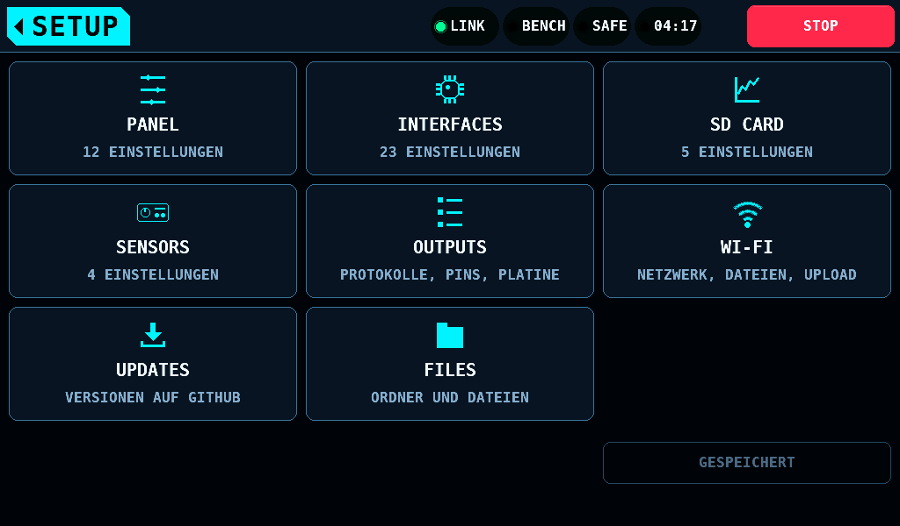

# Sprache der Oberfläche

[English](Language.md)

Das Panel zeigt seine Oberfläche auf Englisch oder auf Deutsch. SETUP,
PANEL, Sprache wählt sie (ENGLISH, DEUTSCH). Die Wahl gilt zusammen mit
dem Design, das nächste Bild erscheint in der neuen Sprache; nichts startet
neu. Sie liegt wie jede Einstellung im NVS (Non-Volatile Storage), sobald
SPEICHERN sie übernimmt.



## Was der Sprache folgt und was nicht

| Folgt der Sprache | Bleibt, wie es ist |
| --- | --- |
| Beschriftungen, Namen und Hilfetexte der Einstellungen, Alarme im Band, Warnfelder, Ablehnungshinweise, die Details des Splash | die Begriffe unter [Begriffe, die Englisch bleiben](#begriffe-die-englisch-bleiben) |
| der TXT-Bericht (reiner Text) des Servotests, in der Sprache beim Start des Laufs | die CSV-Datei (Comma-Separated Values) des Servotests: Kopfzeile und die Wörter in ihren Zeilen (`test`, `phase`, `mode`), damit Werkzeuge jeden Lauf gleich lesen |
| die Hinweise und Ablehnungen der Stick-Programmierung, und die Handgriffe eines ESC-Profils, wo das Profil sie auf Deutsch nennt (`action_de`) | Namen, Punkte und Werte der Profile des ESC (Electronic Speed Controller), die aus den Anleitungen stammen |
| | die Parameternamen des Programmers und ihre Werte, die der Firmware gehören, wie ihre Konfiguratoren sie zeigen |
| | das Konsolen-Log |

Aktuelle Einschränkungen:

- Ein Alarm, der schon im Band steht, bleibt in der Sprache, in der er
  entstand, bis er ersetzt, weggetippt oder nach 30s (`UI_ALERT_SHOW_S`)
  gelöscht wird. Der gehaltene Alarm für einen Touch-Controller, der beim
  Start nicht antwortete, entsteht in der Sprache aus dem NVS und bleibt bis
  zum Neustart; ohne Touch lässt sich die Sprache bis dahin nicht ändern.
- Die Meldezeile von LOGS (eine Datei, die sich nicht öffnen oder
  löschen ließ, eine gelöschte Datei) bleibt in ihrer Sprache, bis die
  nächste geöffnete oder gelöschte Datei sie ersetzt oder leert.
- Der Titel eines schon offenen Tastenfelds oder einer Auswahlliste bleibt
  in seiner Sprache, bis es sich schließt.
- Die Stick-Engine meldet eine Ablehnung auf Englisch, und die Seite findet
  die Übersetzung über dieses Englisch. Eine Ablehnung, die die Tabelle nicht
  kennt, erscheint auf Englisch. `test_text` prüft, dass jede Ablehnung der
  einkompilierten Profile einen deutschen Eintrag hat.

## Zahlen

Die Seiten, der TXT-Bericht und die CSV schreiben in jeder Sprache den
Dezimalpunkt: 7.4V, 0.05A. Es ist das Trennzeichen des Senders, der
ESC-Konfiguratoren und der eigenen Anzeige des Netzteils, und eine CSV mit
Dezimalkomma bräuchte ein anderes Feldtrennzeichen. Die deutschen Seiten
dieser Dokumentation schreiben im Fließtext das deutsche Dezimalkomma
(7,4V); ein Text, der vom Bildschirm zitiert wird, behält seinen Punkt
(`seit 1.5s kein Messwert`).

## Begriffe, die Englisch bleiben

Das sind die Wörter, die ein Bediener am Sender, in einem ESC-Konfigurator,
in einer Anleitung oder einem Datenblatt findet, und die
Sicherheitsbedienelemente, die in jeder Sprache gleich lauten. Ein
übersetztes ARM würde nicht zum Wort in der Anleitung neben dem Prüfstand
passen.

- Die Sicherheits- und Antriebsbedienung: ARM, DISARM, STOP, SWEEP, PAUSE.
  Die Zeilen auf SERVO sind Deutsch, wo das Wort eine deutsche Entsprechung
  hat: TRIMMUNG, UMKEHREN, PULS MITTE; die Taste, die das Servo zur Mitte
  fährt, heißt ZENTRIEREN. HOLD bleibt als Phasenname des Servotests Englisch. PAUSED,
  der Sweep-Knopf eines angehaltenen Sweeps, ist ein Zustand und nicht die
  Bedienung und heißt PAUSIERT; PAUSE, die Bedienung, bleibt Englisch.
- Die Seitentitel: MOTOR & ESC, SERVO, SUPPLY, RECEIVER, LOGS, SETUP,
  BATTERY, BALANCE, OUTPUTS, PICK A PIN, WI-FI, UPDATES, UPDATE,
  CAN BUS FAULT, LINK LOST, PANEL UPDATE. Eine Kachel und das Band des
  Bildschirms, den sie öffnet, tragen dasselbe Wort. Ein Hinweis, der eine
  Seite nennt, nennt sie beim Titel: "der Seite SUPPLY".
- Protokoll- und Modusnamen: DShot, PWM (Pulse-Width Modulation), PPM
  (Pulse-Position Modulation), OneShot, S.BUS, CAN (Controller Area
  Network), BLHeli_S, AM32, ESCape32, VESC, KISS, PD mini, AUTO, CV
  (Constant Voltage), CC (Constant Current), STANDARD PWM, HELI CYCLIC,
  ESC STICK, BUS OFF, und BENCH und SIM im Statusband.
- Die Zustandswörter des Prüfstands, kurz genug für ihren Platz: SAFE und
  ARMED im Statusband. ARM und DISARM sind
  die Tasten, SAFE und ARMED die Zustände.
- Die Begriffe des Fachs: Failsafe, Brown-out, Timing, Endpoint, Live,
  Online, Touch, Display, Pin, Slot, Slice, Pad, Resync, Bad tail, tx err,
  rx err, bus err, Frame, Upload, Build.
- Einheiten, die Stickpositionen MIN, MID und MAX und die Tastenbeschriftungen
  DEL, CLR und OK.
- Die Namen, die das Werkzeug des Herstellers den Einstellungen eines KST-
  oder Chaservo-Servos gibt, als Zeilen des Servo-Programmierers: DEAD BAND,
  MAX. DUTY, BOOST, STRETCH, SOFT START, NEUTRAL, PULSE LOWER, PULSE UPPER,
  LEFT ANGLE, RIGHT ANGLE, REVERSION und die Zeilen seines Tabs GESPERRT;
  dazu PORT, BACKUP und Pairing. Die Zeilen derselben Art der
  Hitec-Programmierung: DEAD BAND, SOFT START, NEUTRAL und SMART SENSOR.

## Glossar

Ein deutsches Wort je englischem Begriff, auf jeder Seite und im Bericht.

| Englisch | Deutsch |
| --- | --- |
| bench | Prüfstand |
| supply | Netzteil |
| output | Ausgang |
| set point | Sollwert |
| commanded pulse (SERVO, COMMANDED) | SOLL-PULSBREITE, wie PULS MIN, PULS MITTE und PULS MAX; die Zeile SET des Netzteils heißt SOLL |
| input (of a supply), wiring (die Anschlüsse des PD mini) | Eingang, Anschlüsse |
| current limit | Strombegrenzung |
| cap | Grenze (Obergrenze nur für das obere Ende eines Paars) |
| trip (die eigene Abschaltung des Netzteils), current trip, voltage trip | Abschaltung (ABGESCHALTET auf der Karte MODUS), Überstrom, Überspannung |
| card | Karte |
| run | Lauf |
| step (des Netzteils) | Stufe |
| report | Bericht |
| reading | Messwert |
| setting (ein Eintrag in SETUP) | Einstellung |
| SETTINGS (die eigenen Einstellungen einer Seite) | OPTIONEN |
| save, reset, apply, close | speichern, zurücksetzen, übernehmen, schließen |
| cancel, abort | abbrechen |
| hold to … | … halten |
| refused | abgelehnt |
| screen (eine Seite der Oberfläche) | Seite |
| screen (das Display) | Anzeige |
| IOmcu | IOmcu |
| emergency stop | Not-Aus |
| board | Platine |
| pack, cell, spread (zwischen Zellen) | Akku, Zelle, Unterschied |
| peak | Spitze (max auf einer Karte) |
| idle current, holding current | Ruhestrom, Haltestrom |
| travel, travel time | Weg, Stellzeit |
| stall | blockieren |
| movement, dwell, settle | Bewegung, Haltezeit, Einschwingzeit |
| paused (the sweep button) | PAUSIERT |
| speed (des Servotests), range | Tempo, Bereich |
| device under test | Prüfling |
| pass, fail, aborted (ein Urteil) | bestanden, nicht bestanden, abgebrochen |
| FAULT (ein Zustand) | FEHLER |
| ON, OFF | EIN, AUS |
| beep | Piepton |
| item, value (eines ESC-Menüs) | Punkt, Wert |
| entry (in ein ESC-Menü), power-up | Einstieg, Einschalten |
| manual step (am ESC), MANUAL INTERVENTION REQUIRED, das Schild MANUAL | Handgriff, MANUELLER EINGRIFF NÖTIG, MANUELL |
| DONE (ein Handgriff bestätigt) | ERLEDIGT |
| threshold | Schwelle |
| defaults | Vorgaben |
| channel | Kanal |
| probe (des CAN-Selbsttests) | Testframe |
| terminator, branch (eines Busses) | Abschluss, Stichleitung |
| separator, row, column | Trennzeichen, Zeile, Spalte |
| Wi-Fi | WLAN |
| network, home network, network name, hidden network | Netzwerk, Heimnetz, Netzwerkname, verstecktes Netzwerk |
| forget (ein gespeichertes Netz), unbind | löschen |
| access code | Zugangscode |
| upload, download | hochladen, herunterladen |
| firmware (eine Datei), install, download (das Halten des Panel-Updates) | Firmware, installieren, laden |
| plot, table | Grafik, Tabelle |
| simulated, modelled (vom Panel berechnet) | simuliert |
| model (ein Flugmodell, ein ESC-Produkt) | Modell |
| protocol page (des Links) | Page |
| floor (des Stroms, Stick-Programmierung) | Grund |
| horn (eines Servos) | Ruderhorn |
| start (einen Lauf) | starten, START auf einem Knopf |
| surface (die Rolle eines Ausgangs) | Ruder |
| connect, disconnect, read (ein Gerät), write | verbinden, trennen, auslesen, schreiben |
| refresh (eine Liste), rescan | aktualisieren |
| restore (ein Backup auf ein Servo) | zurückspielen |
| enable (das Schreiben auf ein Servo) | freigeben |
| release (einen gehaltenen Programmierport) | freigeben (PORT FREIGEBEN) |
| series (von Servos), classic | Serie, klassisch |
| record (eines unterbrochenen Schreibens) | Vermerk |
| store (ein Backup), stored | speichern, gespeichert |
| verify (ein Servo gegen das Gelesene) | prüfen |
| locked (ein Wert, der gezeigt und nicht geschrieben wird) | gesperrt |
| speed, speed limit (eines programmierten Servos) | Tempo, Tempogrenze |
| link (zum IOmcu), NO LINK | Verbindung, KEINE VERBINDUNG |
| binding (die Rolle eines Pins), bind | Zuordnung, zuordnen |
| frame rate (eines Servos) | Pulsrate |
| throttle | Gas |
| access point (das eigene WLAN des Panels) | WLAN-Hotspot |
| servo programmer | Servoprogrammierung |
| log (eine Aufzeichnung), log run | Aufzeichnung, Aufzeichnungslauf |
| IP address | IP-Adresse |
| acknowledge, confirm | bestätigen |
| SILENT (das Urteil des RECEIVER) | KEIN SIGNAL |

Eine Beschriftung ist ein Substantiv, wo ein Substantiv reicht. Eine
Anweisung spricht den Bediener im Imperativ mit du an (Prüfe, Tippe, Halte);
kein "Sie". Eine
Beschriftung in Großbuchstaben schreibt ß als SS (SCHLIESSEN, GRÖSSE); Text
in gemischter Schreibung schreibt ß. Das große ẞ (U+1E9E) ist nicht in den
Fonts.

## Die Kodierung

Jeder Text ist UTF-8 (Unicode Transformation Format, 8 Bit), vom C-Quelltext
bis zum TXT-Bericht auf der Karte. `gfx` dekodiert ihn, und ein Codepoint ist
eine Zelle:

- Die fünf Text-Fonts enthalten druckbares ASCII (American Standard Code
  for Information Interchange, 0x20 bis 0x7E), das Gradzeichen ° (U+00B0),
  die sieben deutschen Buchstaben Ä Ö Ü ß ä ö ü (U+00C4, U+00D6, U+00DC,
  U+00DF, U+00E4, U+00F6, U+00FC) und das Ohmzeichen Ω (U+03A9), je 104
  Glyphen. Die beiden Ziffern-Fonts enthalten nur Ziffern und
  Satzzeichen.
- Ein Widerstand wird mit Ω geschrieben, in den Texten der Bildschirme, den
  Einheiten der Einstellungen und den `.TXT`-Berichten: `120Ω`, `2.2kΩ`,
  `100.0mΩ`, `uΩ` für den Shunt des INA228. Das O der Fonts sieht einer
  Null ähnlich, `120Ohm` läse sich als `1200hm`.
  `every_string_writes_the_ohm_as_its_sign` in `test_text` schlägt bei einem
  `Ohm` oder `ohm` in einem davon fehl.
- Die Fonts 10x20, 12x24 und 20x36 haben Versalhöhen von 12, 15 und 23px und
  zeichnen jedes Glyph innerhalb der Zelle; sonst schlägt
  `gen_font.py --check` fehl. Der Ziffern-Font 32x44 (Versalhöhe 40px)
  schneidet am Zellenrand Tinte in sechs Zeichen ab: `#` 5px, `$` 16px,
  `(` 12px, `)` 12px, `,` 23px und `/` 6px (Pixel mit Deckung ab 128
  außerhalb der Zelle). `gen_font.py --check` gibt diese Zahlen aus.
- Ein Codepoint, den ein Font nicht enthält, erscheint als `?`. Ein Byte,
  das keine gültige Folge beginnt, eine abgeschnittene Folge und eine
  überlange Form sind je ein `?`, und der Dekoder liest nie über das
  Endezeichen hinaus.
- Eine Breite ist Zellen mal Zellbreite: `gfx_text_width()` und
  `gfx_text_cells()` zählen Codepoints, und `gfx_text_prefix()` liefert die
  Bytelänge der ersten n Zellen, damit ein Schnitt zwischen zwei Zeichen
  fällt.
- Ein Puffer misst Bytes, und ein deutscher Buchstabe belegt zwei. Das
  Alarmband fasst `UI_ALERT_MAX`, 128 Bytes mit Endezeichen.

UTF-8 statt einer Ein-Byte-Codepage: Die Tabellen bleiben im Quelltext
lesbar, und der Bericht öffnet sich in jedem Editor am PC richtig. Der Preis
ist, dass keine Breite aus `strlen()` kommen darf; die Seiten messen mit den
Funktionen oben.

## Die Tabellen

Jeder Text, den die Oberfläche in der Sprache des Bedieners zeigt oder
schreibt, ist ein Eintrag in `shared/text/include/ui_text.def`, mit seinem
Englisch und seinem Deutsch nebeneinander, jedes in einer eigenen Zeile:

```c
UI_TEXT(PL_GRP_PROG_PORT, 40,
    "PROG PORT SERVOS",
    "SERVOS AM PROG-PORT")
```

| Eintrag | Enthält |
| --- | --- |
| `UI_TEXT(ID, cells, en, de)` | einen Text einer Seite, `TR(ID)`, und die Zellen seines Feldes, wo kein Screenshot ihn zeigt (0, wo `--fit` ihn misst) |
| `UI_SETTING_LABEL(SET_..., en, de)` | den Namen einer Einstellung |
| `UI_SETTING_HELP(SET_..., en, de)` | den Hilfetext einer Einstellung |
| `UI_SETTING_CATEGORY(SET_CAT_..., en, de)` | den Namen einer Kategorie |
| `UI_OPTIONS(name)`, `UI_OPTION(en, de)`, `UI_OPTIONS_END(name)` | die Optionen einer Auswahl-Einstellung, eine Zeile je Option in ihrer Reihenfolge |
| `UI_SERVO_TEXT(SERVO_STR_..., en, de)` | die Wörter des Servotests und seines TXT-Berichts |
| `UI_WEB_TEXT(P_..., en, de)` | die WLAN-Seite des Panels |

`NULL` in der deutschen Spalte zeigt das Englische: die Einträge des
Servotests mit leerem Englisch und die Optionen, die in jeder Sprache
dasselbe Wort sind (die Namen der Sprachen, Adressen, Kanäle, Baudraten,
`STABLE` und `TESTING`, `PULL-UP` und `PRECHARGE`). Ein übersetztes Format
wandelt dieselben Argumente in derselben Reihenfolge wie sein Englisch.

Die Tabelle bleibt eine Datei und steht in `tools/check_sizes.txt`. Eine
Datei, die sie liest, definiert die Makros, die sie braucht, und bindet sie
ein; die Tabelle definiert die übrigen leer und hebt am Ende alle auf. Nur
Einträge `UI_TEXT` stehen unter einer Bedingung, `#ifdef
RCBENCH_TOUCH_INJECTOR`, und das Define kommt mit dem Include-Pfad von
`shared/text`, sodass jede Datei, die die Tabelle liest, dieselben Einträge
sieht; `test/tools/test_merge_texts.py` schlägt bei jedem anderen Eintrag
unter einer Bedingung fehl.

| Datei | Liest |
| --- | --- |
| `shared/ui/include/ui_text.h` | die IDs `TX_` |
| `shared/ui/ui_text.c` | Englisch und Zellen der Texte der Seiten, die Tabellen jeder anderen Sprache und die Suche: `TR(ID)`, `ui_setting_label()`, `ui_servo_str()` und die übrigen |
| `shared/settings/settings_text.c`, `settings.c`, `settings_opts.h` | das Englisch der Einstellungen: Namen, Hilfetexte, Optionen, Kategorien |
| `shared/servo/servo_str.c` | das Englisch des Servotests, das auch die CSV nutzt |
| `shared/webaccess/wa_page.c` | Englisch und Deutsch der WLAN-Seite |

Die fünf Text-Fonts enthalten druckbares ASCII (0x20 bis 0x7E), das
Gradzeichen °, die 7 deutschen Buchstaben Ä Ö Ü ä ö ü ß und das Ohmzeichen Ω. Jeder andere Codepoint erscheint als
`?`, ebenso ein Byte, das keine gültige UTF-8-Folge beginnt.
`every_drawn_string_has_its_glyphs` in `test_text` hält jeden Text der
Tabelle, den das Panel zeichnet, in jeder Sprache an diese Menge und an
gültiges UTF-8. Die WLAN-Seite zeichnet der Browser; für sie gilt das
nicht. Ein deutscher Eintrag `NULL` zeigt auch dort sein Englisch
(`test_wa_page_de`).

## Einen Text hinzufügen

1. Einen Eintrag im Abschnitt der Seite anlegen, die ihn zeichnet, Englisch
   zuerst: `UI_TEXT(ID, cells, "English", "Deutsch")`. `cells` ist die
   Breite des Feldes in Zellen seines Fonts, wo kein Screenshot den Text
   zeigt, und 0, wo eine gerenderte Ansicht ihn zeigt.
2. Ihn mit `TR(ID)` zeichnen. Name und Hilfetext einer Einstellung sind ein
   Eintrag `UI_SETTING_LABEL` und ein Eintrag `UI_SETTING_HELP` für ihre
   ID `SET_`; eine Optionsliste ist ein Block `UI_OPTIONS`, den
   `ENUM_OPTS(name)` in `shared/settings/settings.c` an seine Einstellung
   bindet.
3. Zahl und Einheit ohne Leerzeichen schreiben, in beiden Sprachen: `40s`,
   `6.00V`, `%ums`, `%.2fV`, `100%`, `180°`. Ein Wort nach einer Zahl behält
   sein Leerzeichen: `3 Servos`.
4. Die Host-Suite, `python3 tools/render_ui.py --fit`,
   `python3 tools/check_formats.py`, `python3 tools/check_units.py --check`
   und `python3 tools/check_docs.py` ausführen. `test_text` schlägt fehl bei einem Eintrag ohne Deutsch, bei
   einem deutschen Format, das andere Argumente wandelt als sein Englisch,
   bei einem Text, der breiter ist als seine angegebenen Zellen, bei einem
   Buchstaben, den die Fonts nicht enthalten, bei einem Byte, das kein
   gültiges UTF-8 ist, und bei einer ID `SERVO_STR_`, deren Englisch leer
   ist, wo es das nicht sein soll. `servo_str.c` baut nicht, wenn die Zahl
   der Einträge `UI_SERVO_TEXT` von `SERVO_STR_COUNT` abweicht.

Ein Branch, der die Texte noch in der Form mit mehreren Dateien hat
(Englisch in `shared/ui/include/ui_text.def` und im Schema der
Einstellungen, Deutsch in `shared/ui/ui_text_de.c`), wird mit
`tools/merge_texts.py` gemergt:

```bash
git merge --no-commit origin/main
python3 tools/merge_texts.py merge "$(git merge-base HEAD origin/main)" origin/main
```

Das Werkzeug wandelt beide Seiten des Merges um und übernimmt die
Textänderungen des Branches mit einem Drei-Wege-Merge in die Tabelle; eine
Änderung, die beide Seiten an denselben Zeilen gemacht haben, bleibt mit
Konfliktmarkierungen stehen.

## Die Passprüfungen

```bash
python3 tools/render_ui.py --fit
```

baut den Renderer mit `GFX_TEXT_TRACE`, zeichnet alle 433 Ansichten auf
Englisch und auf Deutsch und schlägt fehl, wenn ein Text in einer der beiden
Sprachen

- breiter ist als die Box, die `gfx_text_in()` bekam,
- am Rand des Bereichs abgeschnitten wird, in dem er steht,
- über die gefüllte Form hinausläuft, auf der er steht,
- einen anderen Text des Bildes überlappt, oder
- von einer später gezeichneten Fläche übermalt und nicht neu
  gezeichnet wird. Nur die Zeichen zählen: eine Fläche über den Leerzeichen,
  mit denen eine Beschriftung aufgefüllt ist, ist kein Befund. OUTPUTS mit
  offener Protokollliste (`outputs-protocol`) ist ausgenommen, weil die
  Liste die Pins daneben absichtlich verdeckt.

Ein englischer Überlauf, der für eine Zeit hingenommen wird, kommt in
`KNOWN_OVERFLOWS` im Werkzeug, mit seiner Ansicht, seinem Text und seinem
Messwert; die Liste ist leer. Ein gelisteter wird als `known` ausgegeben und
schlägt nicht fehl; ein deutscher Befund, der einem
davon Wort für Wort gleicht, ist derselbe Text an derselben Stelle und
schlägt ebenfalls nicht fehl. Ein Eintrag, den die Prüfung nicht findet,
schlägt fehl, bis er aus der Liste genommen ist. Die Prüfung schlägt auch bei
einem Text ohne angegebene Breite fehl, den keine Ansicht zeichnet.

```bash
python3 tools/check_formats.py
```

kompiliert `shared/` mit jedem Aufruf von `TR()` und jedem Wort des Berichts
durch sein englisches Literal ersetzt, unter `-Wformat=2
-Wformat-nonliteral -Wformat-signedness`, und schlägt bei jeder Warnung
fehl: jedes englische Format passt zu den Argumenten seines Aufrufs. Das
Verzeichnis `firmware/panel/main/` des Panels liegt nicht in `shared/` und ist
nicht abgedeckt.

`test_text` deckt den Rest ab: jede ID hat Deutsch, jedes deutsche Format
wandelt, was sein Englisch wandelt, jeder Text mit angegebener Breite passt
in jeder Sprache hinein, Alarme und Splash-Details passen in ihre Puffer,
übersetzte Einstellungen passen in SETUP und die TIMING-Seite, und Spalten
und Beschriftungen des Berichts stehen bündig.

`tools/check_docs.py` schlägt fehl, wenn eine deutsche Wiki-Seite in
Backticks das Englische eines Textes zitiert, den der Bildschirm deutsch
zeigt: einen Text der Oberfläche, die Ausgabe eines Formats, mit Zahlen oder Text
an der Stelle seiner Umwandlungen, Name, Hilfetext, Option oder Kategorie einer Einstellung oder
ein Wort des Servotests, auch ein Zitat, das über zwei Zeilen umbricht.
Fließtext ohne Backticks wird nicht geprüft: Er nennt auch
Protokoll-Pages, Befehle an das Netzteil und Beschriftungen der Platine, die
ein Wort mit einer Beschriftung der Oberfläche teilen.

## Eine Sprache hinzufügen

Eine Sprache ist eine weitere Spalte in jedem Eintrag der Tabelle: 2.469
Einträge mit ID und 84 Optionen, 10 davon mit leerem Englisch.

1. Die Spalte in jedem Eintrag von `shared/text/include/ui_text.def`
   ergänzen und den Parameter in jedem Makro, das eine Spalte liest: 7
   leere Vorgaben am Kopf der Tabelle und 20 Zeilen `#define` in 7 Dateien
   (`ui_text.h`, `ui_text.c`, `settings.c`, `settings_text.c`,
   `settings_opts.h`, `servo_str.c`, `wa_page.c`). `NULL` zeigt das
   Englische.
2. `UI_LANG_xx` in `ui_lang_t` in `shared/ui/include/ui_text.h` eintragen,
   und den eigenen Namen der Sprache an derselben Stelle in die Optionsliste
   `language`.
3. Den deutschen Block in `shared/ui/ui_text.c` (`DE()`, seine Tabellen und
   `ui_lang_de`) für die neue Spalte kopieren, `ui_lang_xx` in `k_langs`
   und seine Deklaration in `ui_text.h` eintragen.
4. Ein Buchstabe, den die Text-Fonts nicht enthalten, kommt in die Liste in
   `FONTS` in `tools/gen_font.py`, und `python3 tools/gen_font.py` erzeugt
   sie neu. Jeder Buchstabe belegt ein Byte je Pixel in jedem der fünf
   Text-Fonts: 128, 200, 288, 448 und 720 Byte in den Fonts 8x16, 10x20,
   12x24, 16x28 und 20x36, zusammen 1.784 Byte.
5. Die Sprache in `LANGS` in `tools/render_ui.py` und im Argument von
   `test/host/render_screen.c` eintragen, dann
   `python3 tools/render_ui.py --fit` und `python3 tools/render_ui.py`
   ausführen.
6. `german_has_every_string` in `test/host/test_text.c` auf die neue
   Tabelle erweitern, ihr Glossar hier schreiben und diese Seite übersetzen.

Zwei Leser nehmen die deutsche Spalte nach ihrer Position: `TABLE_ENTRY` in
`tools/check_docs.py` und die Prüfung der Servo-Bedienelemente in
`configurator/core/test/help.test.ts`. Die WLAN-Seite wählt ihre Sprache
über einen Schalter, `wifi_access_set_german()`, und ein ESC-Profil trägt
seine manuellen Schritte auf Englisch und auf Deutsch (`action`,
`action_de`); keines von beiden nimmt eine dritte Sprache ohne eigene
Änderung.
