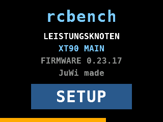

# Die Sensorknoten

<sub>[English](Nodes.md) · **Deutsch**</sub>

Ein Sensorknoten ist ein ESP32-C6-Board an einer eigenen LiPo-Zelle, das
fertige Messwerte über Bluetooth LE (Low Energy, BLE) sendet. Er hat kein
Kabel zum Prüfstand. Der Leistungsknoten liest ein INA228-Board im
Leistungspfad des ESC (Electronic Speed Controller, Motorregler): das
MATEK I2C-INA-BM oder ein anderes auf 0x40 bis 0x4F ([Der INA228](#der-ina228)). Der Auswuchtknoten liest eine Achse eines
Beschleunigungssensors und einen Indexsensor und sendet alle 250ms einen
Auswuchtbericht. Der Anzeigeknoten ist der Leistungsknoten auf einem
2,8"-Touch-Display-Board mit ESP32-S3, versorgt aus dem Pack, das seine
Messwerte auch auf dem eigenen Bildschirm zeigt
([Der Anzeigeknoten](#der-anzeigeknoten)).

Der Leistungsknoten dient der Messung, nicht als Schutzfunktion. Keine
Grenze und keine Abschaltung des Prüfstands liest ihn, so wie keine den
verkabelten INA228 liest. Mit INA228-QUELLE NODE endet ein Lauf an den
Aussetzern des Knotens wie an denen jedes Messsensors
([Das Panel](#das-panel)).

Waveshare, MATEK, GERUI, Texas Instruments, Analog Devices und Vishay sind
Namen ihrer Inhaber, und
Bluetooth ist eine Marke ihres Inhabers. rcbench ist unabhängig: nicht mit
ihnen verbunden, nicht von ihnen unterstützt oder gesponsert. Die Namen
sagen, aus welchen Teilen der Knoten gebaut ist.
[Rechtliche Hinweise und Haftungsausschluss](../README-de.md#rechtliche-hinweise-und-haftungsausschluss)
enthält den Hinweis des Projekts.

| Teil | Wo |
| --- | --- |
| die Pakete, die UUIDs (Universally Unique Identifier), die Steuer-Writes, das Advertising, die 20ms-Fenster | `protocols/rcnode`, kein Pin-Treiber |
| Start, der Schritt einmal je Sekunde, Schlafen und Aufwachen | `firmware/node/main/node_main.c` |
| die Entscheidungen zu Akku und Schlaf, in der Host-Suite getestet | `firmware/node/main/node_policy.c` |
| der GATT-Server (Generic Attribute Profile) und das Advertising auf NimBLE | `firmware/node/main/node_ble.c` |
| die Rolle Leistung: der INA228, die Fenster, die Akkumulatoren | `firmware/node/main/node_pwr.c` |
| die Suche der Adresse des INA228 und die Shunt-Einstellung der Rolle Leistung, in der Host-Suite getestet | `firmware/node/main/node_pwr_sens.c` |
| der INA228-Treiber, derselbe wie im IOmcu | `shared/sense/ina228.c`, `shared/sense/sense_bus.c` |
| die Rolle Auswuchten: der ADC-Datenstrom, der Index, der Bericht, der Akku | `firmware/node/main/node_bal.c` |
| die ADC-Frames, die Skala, der Index und der Demodulator, in der Host-Suite getestet | `shared/vibe` |
| die Akkumessung des Leistungsknotens | `firmware/node/main/node_bat.c` |
| Pins, INFO-Board-Byte und Update-Art jedes Boards | `firmware/node/main/node_board.h` |
| der Bildschirm des Anzeigeknotens: Werte, Höchst- und Tiefstwert, Touch, Formate, Zeichnen, in der Host-Suite getestet | `firmware/node/main/node_view.c` |
| Startbildschirm und SETUP des Anzeigeknotens, der I2C-SCAN, in der Host-Suite getestet | `firmware/node/main/node_setup.c`, `firmware/node/main/node_setup_view.c`, `firmware/node/main/node_scan.c` |
| die eigenen Einstellungen des Knotens (NAME, INA228-ADRESSE, SHUNT) und RCNODE_T_CONFIG, die Regeln in der Host-Suite getestet | `firmware/node/main/node_store.c`, `firmware/node/main/node_set.c` |
| die Seite des Panels für die eigenen Einstellungen des Knotens, in der Host-Suite getestet | `shared/ui/node_cfg_link.c` |
| Display und Touch des Anzeigeknotens | `firmware/node/main/node_lcd.c`, `firmware/node/main/node_disp.c` |
| die Konsole | `firmware/node/main/node_console.c` |
| die Servo-Rolle: die UART-Verbindung zum Core2350B, die Pumpe, `srv` auf der Konsole | `firmware/node/main/node_srv_link.c`, `firmware/node/main/node_srv.c` |
| die Sicherheitsentscheidungen und die Abfrage des Servoknotens, unter der Host-Testsuite | `firmware/node/main/node_srv_policy.c`, `firmware/node/main/node_srv_poll.c` |
| die Heartbeat- und RUN-Pins des Servoknotens | `firmware/node/main/node_srv_hb.c` |
| die Central des Panels für den Leistungsknoten: Suche, Bindung, Prüfung von INFO, der RUN-Marker, der SHUNT-Write, in der Host-Suite getestet | `shared/ui/pnode_ctl.c` |
| Messwerte, Summen, Spitzen und Aussetzerregel des Panels, in der Host-Suite getestet | `shared/ui/pnode_meter.c` |
| der Eintrag LEISTUNGSKNOTEN unter SETUP > WIRELESS | `shared/ui/wireless_pnode.c` |
| der Client der `blec`-Task des Panels und die Anbindung an die Control-Task | `firmware/panel/main/panel_pnode.c` |

## Die Teile des Leistungsknotens

| Teil | Zweck |
| --- | --- |
| Waveshare ESP32-C6-Zero | ESP32-C6FH4 mit 4MB Flash im Gehäuse, USB-C (USB Serial/JTAG), LDO (Low-Dropout-Regler) vom 5V-Pin auf 3,3V: ME6217C33M5G laut Schaltplan von Waveshare, ME6217C33M6G laut Angebot des Händlers; welches Teil auf den gelieferten Boards sitzt, ist nicht bestätigt, RGB-LED WS2812 an GPIO8, Taste BOOT an GPIO9, Taste RESET |
| Lade- und Boost-Modul GERUI CD42 | lädt die Zelle über VIN (4,5V bis 5V) und erzeugt aus ihr 5V an OUT |
| eine 1S-LiPo-Zelle | an BAT des Moduls |
| ein INA228-Board | das MATEK I2C-INA-BM: INA228, Shunt 200µΩ, Adresse 0x45, XT60 ein und aus; oder ein anderes INA228-Board: Adresse 0x40 bis 0x4F, sein Shunt als KNOTEN-SHUNT eingestellt, 50 bis 10.000µΩ |
| 2 × 200kΩ, 1 × 100nF | der Akku-Spannungsteiler |
| 2 × 2,2kΩ | I2C-Pull-ups (Inter-Integrated Circuit) auf 3,3V |

USB-VBUS des Boards erreicht seinen 5V-Pin über eine Schottky-Diode
B5819WS (Schaltplan des Boards). Mit OUT des Moduls am 5V-Pin fließt nichts
zurück in ein USB-Kabel.

## Verdrahtung

| Von | Nach | Hinweis |
| --- | --- | --- |
| Zelle + | CD42 BAT+ | |
| Zelle − | CD42 BAT− | |
| CD42 OUT 5V | ESP32-C6-Zero 5V | der LDO des Boards erzeugt 3,3V |
| CD42 OUT GND | ESP32-C6-Zero GND | |
| CD42 BAT+ | 200kΩ nach GPIO3 | oberer Teil des Teilers |
| GPIO3 | 200kΩ nach GND, 100nF nach GND | unterer Teil des Teilers; GPIO3 ist ADC1 Kanal 3 |
| ESP32-C6-Zero GPIO19 | MATEK SDA | 2,2kΩ von SDA nach 3V3 |
| ESP32-C6-Zero GPIO18 | MATEK SCL | 2,2kΩ von SCL nach 3V3 |
| ESP32-C6-Zero 5V | MATEK 5V | die Versorgung des INA228 |
| ESP32-C6-Zero GND | MATEK G | die einzige Masse des Knotens |

Die Leitung zum MATEK ist 10cm lang oder kürzer. Der Bus läuft mit 400kHz.
Die Firmware schaltet die Pull-ups der Pads ab; der Bus läuft auf den
2,2kΩ-Pull-ups und denen des Moduls.

Der Teiler zieht bei 4,2V 10,5µA aus der Zelle, auch während der Knoten
schläft oder aus ist.

**Vor dem ersten Anschließen.** An welcher Schiene die I2C-Pull-ups des
MATEK hängen, ist nicht bekannt. Den MATEK allein mit 5V versorgen, SDA und
SCL offen lassen und beide gegen G messen: Beide müssen 3,3V oder weniger
zeigen. Ein höherer Wert braucht einen Pegelwandler; die Pins des ESP32-C6
vertragen 3,3V.

### Die Masseregel

GND des Knotens ist G des MATEK, und G ist der Minuspol des Akkupacks. Der
Minuspol der Zelle ist ebenfalls GND des Knotens. Der Knoten hat kein
weiteres Kabel: Der gemessene Pfad ist vom Prüfstand getrennt.

- Kein USB-Kabel am Knoten, solange ein Pack am XT60 steckt. Die Masse des
  Kabels ist dann der Minuspol des Packs, und ein Laptop oder das Panel am
  selben USB-Baum schließt eine Schleife über die Rückleitung des ESC.
- Den Knoten mit abgezogenem XT60 laden oder an einer Powerbank, an der
  sonst nichts hängt.
- Das Gehäuse des Knotens isoliert das Board von der Shunt-Seite des Moduls.

## Das CD42-Modul

Der GERUI "5V 2A Laderegler" trägt einen Chip mit der Aufschrift CD42 und
eine Ladeanzeige aus 4 LEDs (25%, 50%, 75%, 100%).

| Anschluss | Zweck |
| --- | --- |
| VIN | 4,5V bis 5V aus einer Quelle für 2A bis 3A, zum Laden |
| BAT | die 3,7V-Zelle |
| OUT | 5V, aus der Zelle hochgesetzt |
| KEY | eine Taste |

Nicht bekannt, am ersten Modul zu messen:

- die Abschaltschwelle bei geringer Last: der Laststrom, unter dem das Modul
  OUT abschaltet;
- der Ruhestrom des Moduls an der Zelle;
- ob KEY oder eine Last den Boost startet.

**Was die Schlafregel annimmt.** Das Modul hält OUT auf 5V, während der
Knoten schläft. Die Last an OUT im Schlaf ist der ESP32-C6 im Deep Sleep
(7µA, Angabe des Chips), der LDO und die WS2812 des Boards im Ruhezustand
(nicht gemessen), ein eigener Regler des MATEK, falls vorhanden (nicht
bekannt), und der abgeschaltete INA228 (5µA). Schaltet das Modul OUT unter
dieser Last ab, wird der Knoten beim ersten Schlafen dunkel: Der 10s-Timer
läuft nie, die Taste RESET bewirkt nichts, und nur was den Boost des Moduls
wieder startet (KEY oder ein Ladegerät an VIN, nicht bekannt, was davon),
holt den Knoten zurück.

**So wird es gemessen.**

1. Ein Messgerät in Reihe in OUT: der Strom mit dem Knoten wach, beim
   Advertising und verbunden.
2. Auf der Konsole `sleep`. Ein Messgerät an OUT für 2min: OUT bleibt bei
   5V oder fällt ab.
3. Der LA2016 (Logikanalysator) an SCL: alle 10s ein Lesen der Busspannung
   zeigt, dass der Knoten über seinen Timer aufwacht.
4. Die Schwelle: OUT mit Widerständen belastet, der Knoten nicht an OUT. Der
   kleinste Strom, der OUT 5min lang eingeschaltet hält.
5. Der Ruhestrom: ein Messgerät in der Leitung der Zelle, OUT ohne Last.

Schaltet OUT im Schlaf ab, bleiben ein Lastwiderstand an OUT, der die Last
über der Schwelle hält (er kostet die Zelle diesen Strom), oder ein
Schiebeschalter in der Leitung der Zelle und kein Schlaf. Die Wahl wartet
auf die Messwerte.

## Schlafen und Aufwachen

| Bedingung | Was der Knoten tut |
| --- | --- |
| 120s ohne Verbindung, ohne Pack am XT60 und ohne `stay on` | Deep Sleep mit einem 10s-Timer; der Auswuchtknoten ohne Timer |
| SLEEP auf CONTROL geschrieben oder `sleep` auf der Konsole | dasselbe, sofort |
| ein Timer-Wecken | der INA228 wandelt die Busspannung einmal (540µs), der Knoten liest sie und schaltet das Bauteil ab; 5,0V oder mehr startet den Knoten vollständig, weniger schläft weiter |
| eine Zelle zwischen 1,0V und 3,3V, 3 Messungen in Folge, über Timer-Wecken hinweg gezählt | aus: Deep Sleep ohne Timer |
| OFF auf CONTROL geschrieben oder `off` auf der Konsole | aus, sofort |
| die Taste RESET, ein Aus- und Einschalten, ein Flashen | ein vollständiger Start |

Die Zahl der niedrigen Messungen bleibt im RTC-Speicher (Real-Time Clock)
über den Deep Sleep erhalten, also schaltet eine einzelne niedrige Messung
bei einem Timer-Wecken nichts ab; eine gute Messung setzt die Zahl zurück.
Ein Teilerwert unter 1,0V ist keine Zelle, das Board nur an USB, und
schaltet nichts ab. Unter 3,5V meldet STATUS den Akku als schwach. Eine
fehlgeschlagene Akkumessung (der ADC oder seine Kalibrierung schlägt fehl)
setzt in STATUS das Flag 0x0040 mit der Zellspannung 0, schreibt `bat
error` auf die Konsole und zählt weder zur Abschaltung noch setzt sie die
Zahl zurück. Vor dem
Schlafen beendet der Knoten die Verbindung, wartet 200ms und schreibt
ADC_CONFIG des INA228 auf Shutdown.

Die Taste BOOT ist GPIO9, und GPIO9 kann den ESP32-C6 nicht aus dem Deep
Sleep wecken (nur GPIO0 bis GPIO7 können das). Die Taste RESET ist die
Wecktaste. Der Auswuchtknoten hat keinen Sensor, der ihm das Aufwachen
sagt: Er schläft bis zur Taste RESET.

Der Auswuchtknoten hat kein Pack. Er ist untätig ohne Verbindung und ohne
`stay on`; ein drehender Rotor oder ein Indeximpuls hält ihn nicht wach,
weil ohne Verbindung niemand seine Berichte nimmt. Nach 120s Untätigkeit
hält er den ADC-Datenstrom an, schaltet die Versorgung des Moduls TCRT5000
(GPIO20) ab und schläft bis zur Taste RESET.

Ein Timer-Wecken lädt das Image ohne erneute Prüfung
(`CONFIG_BOOTLOADER_SKIP_VALIDATE_IN_DEEP_SLEEP`). Wie lange ein
Timer-Wecken dauert und welchen mittleren Strom der Knoten im Schlaf zieht,
ist nicht gemessen. Die Schätzung des Plans ist 100µA: alle 10s 30ms wach
bei 30mA, dazu der Strom im Schlaf.

## Der INA228

Der Knoten schreibt die Einstellung des Prüfstands (`INA228_ADC_BENCH`):
Bus- und Shuntspannung je 540µs, Temperatur 50µs, Mittelung 1, ein
Ergebnis alle 1130µs. ADCRANGE 1 (±40,96mV) für jeden Shunt: 204,8A am
200µΩ-Shunt des MATEK, 390,625µA je Schritt. Der Treiber ist derselbe wie
im IOmcu.

**Die Adresse.** Der INA228 liegt auf einer von 0x40 bis 0x4F: das MATEK
auf 0x45, die meisten anderen Boards auf 0x40. Beim Start und bei jeder
neuen Prüfung liest der Knoten MANUFACTURER_ID (3Eh) und DEVICE_ID (3Fh)
ab 0x40 aufwärts, eine Adresse je Takt von 1130µs, und nimmt die erste mit
5449h und Die 228h; ein anderes Bauteil wird nie beschrieben, FT6336G
(0x38) und ES8311 (0x18) nie gefragt. Die NACKs der Suche zählen nicht in
`errors`. Ohne Fund nennt STATUS `absent` oder `wrong id`, und die Suche
beginnt 1000ms später neu, wie nach einem zurückgesetzten Bauteil. INFO
nennt die gefundene Adresse, 0 für keine. INA228-ADRESSE (ab Werk AUTO,
oder fest 0x40 bis 0x4F, NVS-Namespace `node`, Schlüssel `i228`) begrenzt
die Suche mit derselben Prüfung auf eine Adresse; das SETUP des
Anzeigeknotens und der Eintrag LEISTUNGSKNOTEN des Panels setzen sie
([Nodes-setup](Nodes-setup-de.md#die-einstellungen-über-die-verbindung)).

**Der Shunt.** KNOTEN-SHUNT am Panel, 50 bis 10.000µΩ, Vorgabe 200µΩ, geht
als SHUNT zum Knoten. Er hält ihn im NVS (Namespace `pwr`, Schlüssel
`shunt_uohm`), nennt ihn sofort in INFO und stellt das Bauteil im nächsten
Takt damit ein. Das SETUP des Anzeigeknotens setzt ihn auch; die letzte
Änderung gewinnt ([Der Shunt im Gleichschritt](Nodes-setup-de.md#der-shunt-im-gleichschritt)). ADCRANGE 1 und SHUNT_CAL 4096 gelten für jeden Shunt, der
Vollausschlag ist 40,96mV über dem Shunt: 819,2A bei 50µΩ, 204,8A bei
200µΩ, 4,096A bei 10.000µΩ. Eine Änderung löscht CHARGE und ENERGY und
zählt in `epoch`. Das MATEK auf 200µΩ ergibt Fenster und INFO der festen
Einstellung 0x45 Byte für Byte (`test_node_pwr_sens`).

| Alle | Gelesen | Wohin |
| --- | --- | --- |
| 1130µs | CURRENT und VBUS | das 20ms-Fenster |
| 20ms | | ein Fensterpaket: mittlerer und höchster Strom, mittlere und niedrigste Spannung, die Zahl der Samples, Clip-Flags |
| 40ms | ADC_CONFIG, gegen den geschriebenen Wert | ein zurückgesetztes Bauteil wird 1000ms später neu eingestellt und gezählt |
| 500ms | DIAG_ALRT, dann CHARGE und ENERGY (roh, 40 Bit; das Lesen löscht ihre Überlauf-Flags), DIETEMP | ein Akkumulatorpaket und die Extremwerte seit dem letzten RUN-Write |

Ein Fenster hält 17 oder 18 Samples. Ein Stromsample an einem Ende des
20-Bit-Bereichs ist ein Clip: gezählt und markiert, nie ein Wert. Der
Knoten löscht die Akkumulatoren nie. Das Bauteil löscht sie bei seinem
eigenen Reset und bei jeder Einstellung, und epoch im Akkumulatorpaket
zählt die Einstellungen. Nach CHARGE und ENERGY liest der Knoten
ADC_CONFIG noch einmal zurück. Stimmt es nicht, hat sich das Bauteil vor
oder zwischen den Lesevorgängen zurückgesetzt: Beide Werte werden
verworfen, ihre Flags im Paket sind gelöscht, und das Bauteil wird neu
eingestellt. Das Panel wertet ein Fallen von ENERGY bei gleicher epoch
ebenfalls als Neustart (`rcnode_acc_restarted()`). Die Pakete stehen in
[protocols/rcnode](../protocols/rcnode/README.md).

**Was eine neue Einstellung verliert.** Jede Einstellung schreibt RSTACC,
also sind CHARGE und ENERGY seit dem letzten Akkumulatorpaket, das das
Panel übernommen hat, verloren:

| Ursache | Verlorene Ladung und Energie |
| --- | --- |
| das Bauteil hat sich selbst zurückgesetzt | vom letzten guten Akkumulatorpaket bis zur Einstellung: bis zu 500ms bis zum nächsten Lesen, 40ms bis zum Rücklesen, das den Reset bemerkt, und 1000ms bis zur Einstellung, höchstens 1,54s |
| 3 fehlgeschlagene Lesevorgänge in Folge ohne Reset (der Bus, nicht das Bauteil) | vom letzten guten Akkumulatorpaket bis zur Einstellung: bis zu 500ms, die Zeit der fehlschlagenden Lesevorgänge und 1000ms |
| das Bauteil antwortet nicht auf die Einstellung | die Einstellung wird alle 1000ms wiederholt, und jeder Versuch fügt 1000ms hinzu |

Die Fensterpakete tragen Strom und Spannung durch eine solche Lücke; das
Panel kann die Lücke aus ihnen zählen.

## Der Auswuchtknoten

Der Auswuchtknoten tastet eine Achse eines Beschleunigungssensors und einen
Indexsensor in einem ADC-Datenstrom (Analog-Digital-Wandler) ab,
demoduliert die Vibration auf dem Knoten gegen den Index (shared/vibe) und
sendet alle 250ms einen Auswuchtbericht. Seine Sensoren und seine Zelle
gehören ihm allein: Er berührt kein Pack, und die Masseregel des
Leistungsknotens gilt für ihn nicht. Wo die Sensoren an einem Prüfstand
oder einem Flugzeug sitzen, steht in [Auswuchten](Balance-de.md).

### Teile

| Teil | Zweck |
| --- | --- |
| Waveshare ESP32-C6-Zero | wie beim Leistungsknoten |
| Modul GERUI CD42, eine 1S-LiPo-Zelle, 2 × 200kΩ und 1 × 100nF | wie beim Leistungsknoten: Versorgung und Akku-Spannungsteiler |
| Breakout ADXL335 oder ADXL337 (Analog Devices), 3 Achsen, ±3g | die Vibration; eine Achse wird genutzt |
| 2 × 4,7nF Keramikkondensator, 0603 oder die Bauform des Breakouts | ersetzen die Filterkondensatoren von X und Y |
| Modul TCRT5000 mit Komparator LM393 (TCRT5000 von Vishay) | der Index: ein Impuls je Umdrehung von einem Strich auf der Motorglocke |

### Verdrahtung

| Von | Nach | Hinweis |
| --- | --- | --- |
| Zelle, CD42, Teiler nach GPIO3 | wie beim Leistungsknoten | der Akku: GPIO3 ist ADC1 Kanal 3 |
| ESP32-C6-Zero 3V3 | ADXL VCC | die Versorgung des Beschleunigungssensors, der LDO des Boards |
| ESP32-C6-Zero GND | ADXL GND | |
| ESP32-C6-Zero GPIO0 | ADXL X oder Y | ADC1 Kanal 0: die Achse in der Ebene der Halterung, quer zur Welle |
| ADXL Z | nicht verbunden | |
| ESP32-C6-Zero GPIO20 | Modul TCRT5000 VCC | 3,3V, solange der Knoten läuft, aus vor dem Schlafen |
| ESP32-C6-Zero GND | Modul TCRT5000 GND | |
| ESP32-C6-Zero GPIO1 | Modul TCRT5000 D0 | ADC1 Kanal 1: der Ausgang des Komparators |
| Modul TCRT5000 A0 | nicht verbunden | |

Die Sensorleitungen sind mit ihrer Masse verdrillt und 30cm lang oder
kürzer.

**Pins.** GPIO0 und GPIO1 sind ADC1 Kanal 0 und 1 und keine
Strapping-Pins: Die Strapping-Pins des ESP32-C6 sind GPIO4, GPIO5, GPIO8,
GPIO9 und GPIO15 (sein Datenblatt v1.6, Tabelle 3-1). GPIO0 und GPIO1 sind
auch die Pins eines externen 32kHz-Quarzes. Das ESP32-C6-Zero trägt keinen
(sein Schaltplan zeigt nur den 40MHz-Quarz), und die Firmware betreibt den
langsamen Takt am internen RC-Oszillator (`CONFIG_RTC_CLK_SRC_INT_RC`).
GPIO20 liegt an der Stiftleiste des Boards und ist weder ein ADC-Kanal noch
ein Strapping-Pin.

**Die Versorgung des Moduls aus GPIO20.** Die Infrarot-LED des TCRT5000 ist
die größte Sensorlast des Knotens. Ein Pin mit Treiberstärke 3 liefert bis
zu 40mA bei 2,64V oder mehr (Datenblatt v1.6, Tabelle 5-4). Der Knoten
setzt GPIO20 beim Start auf high und vor dem Schlafen auf low und hält ihn
im Deep Sleep dort (`gpio_hold_en()`), also ist die LED dunkel, solange der
Knoten schläft. Der Strom des Moduls hängt von
seinem LED-Widerstand ab und ist nicht gemessen. Das Modul darf nicht an
5V laufen: D0 erreicht dann 5V, und die Pins des ESP32-C6 vertragen 3,3V.

**Der Beschleunigungssensor an 3V3.** Der Ausgang des ADXL ist
ratiometrisch: Empfindlichkeit und Nullpunkt folgen seiner Versorgung. 3V3
des Boards ist die sauberste Versorgung am Knoten. Ein Breakout mit eigenem
Regler (das GY-61 trägt einen) legt den ADXL an den Ausgang dieses Reglers,
der nicht gemessen ist. Der ADXL zieht 350µA, auch während der Knoten
schläft.

### Die Filterkondensatoren des Beschleunigungssensors

ADXL335 und ADXL337 setzen die Bandbreite jeder Achse mit einem
Kondensator vom Ausgangspin nach GND, gegen einen internen Widerstand von
32kΩ ±15%: Bandbreite = 1 / (2π × 32kΩ × C). Übliche Breakouts tragen
0,1µF an jeder Achse: 50Hz. Bei 10.000rpm liegt 1x bei 167Hz, und 50Hz
lassen davon 29% durch.

Die Kondensatoren von X und Y gegen 4,7nF tauschen: 1.058Hz, 920Hz bis
1.245Hz über die Toleranz des Widerstands. 4,7nF ist der kleinste Wert,
den das Datenblatt empfiehlt; die Achsen X und Y reichen bis 1.600Hz. Der
Kondensator von Z kann bleiben.

Die gefundene Dokumentation der Breakouts nennt keine Positionen der
Kondensatoren. Auf dem EVAL-ADXL335Z von Analog Devices sitzen C2, C3 und
C4 an XOUT, YOUT und ZOUT. Auf einem anderen Breakout jeden mit dem
Messgerät suchen: der Kondensator mit einem Ende am Pin X (oder Y) der
Stiftleiste und dem anderen an GND.

Mit 4,7nF verzögert das Filter das Signal um etwa 150µs und lässt 98,8%
von 167Hz durch, 9° später. Beides ist bei einer Drehzahl konstant und
hebt sich in der Zwei- und der Vier-Lauf-Methode auf. Der Knoten gleicht es
nicht aus: Die Amplitude, die er bei 167Hz meldet, ist 1,2% zu niedrig,
seine Phase 9° zu spät.

### Das Modul TCRT5000

Der Komparator des Moduls vergleicht den Fototransistor mit der Schwelle,
die sein Potentiometer setzt. Seine LED an D0 leuchtet bei einem Pegel von
D0. Das Potentiometer bei von Hand gedrehtem Rotor einstellen: D0 wechselt,
wenn der Strich am Sensor vorbeiläuft, und nur dort.

Der Knoten liest D0 in seinem ADC-Datenstrom mit Schwellen von 1100mV und
2200mV. Er nimmt als Markierung den Pegel, auf dem D0 kürzer steht,
gewogen über je 250ms, also funktionieren ein dunkler Strich auf heller
Glocke und ein heller Strich auf dunkler Glocke. Die Indexflanke ist der
Anfang des Strichs: die Kante, die zuerst am Sensor vorbeiläuft.

Das Datenblatt des TCRT5000 nennt 2,5mm als Abstand des höchsten Signals.
Der Kontrast des Strichs auf einer Motorglocke und die Flanke des Moduls
sind nicht gemessen.

### Anordnung

- Der Strich auf der Motorglocke liegt in Linie mit Blatt 1, wie
  [Auswuchten](Balance-de.md) sagt.
- Das Modul TCRT5000 zeigt auf die Außenfläche der Glocke, 2mm bis 3mm
  entfernt.
- Der ADXL sitzt an einem steifen Teil nahe am Lager, die Achse an GPIO0
  in der Ebene der Halterung und quer zur Welle.
- Das Breakout wird mit seiner Masse isoliert vom Metall des Prüfstands
  befestigt (Nylonschrauben oder eine isolierende Unterlage), damit die
  Masse des Knotens keinen Weg zum Prüfstand hat.

### Was der Knoten misst

| Stufe | Wert |
| --- | --- |
| ADC | ADC1 im Continuous-Modus, ein Muster aus 3 Kanälen: GPIO0, GPIO1, GPIO3, 12dB Dämpfung, 12 Bit |
| Rate | 30.000 Wandlungen je Sekunde angefragt; ESP-IDF v6.1 setzt 30.120, 10.040Hz je Kanal. Der Treiber nimmt 611 bis 83.333 je Sekunde, 27.777Hz je Kanal bei 3; das Datenblatt des ESP32-C6 nennt 100.000 |
| Index | im Datenstrom, ein Drittel Sample nach dem Vibrationskanal. Ein Sample sind 100µs, 6° einer Umdrehung bei 10.000rpm; ein Bericht summiert seine Umdrehungen, und ±1 Sample Jitter ergibt im Test von shared/vibe 1,25° in einem Bericht bei 10.000rpm |
| Skala | die Kalibrierkurve des Chips für Kanal 0 bei den Werten 1000 und 3000; nominal 0 bis 3300mV über 4096 Werte, 805µV je Wert, 2,44mg je Wert bei 330mV/g |
| Empfindlichkeit | 330mV/g: die 300mV/g der Datenblätter bei 3,0V (270 bis 330mV/g), auf 3,3V skaliert |
| Sensor im Bereich | der Gleichanteil der Achse zwischen 1000mV und 2300mV setzt `RCNODE_BF_DC_OK`: 1650mV ± 165mV Nullpunkttoleranz und ± 330mV Schwerkraft an einer geneigten Achse, mit 150mV Reserve |
| Bericht | alle 2.510 Samples, 250ms: Drehzahl, Streuung der Periode, Amplitude und Phase von 1x, die Amplituden von 2x und der Blattfrequenz, Effektivwert, Güte, Umdrehungen, Flags (`RCNODE_T_BAL_REPORT`, [protocols/rcnode](../protocols/rcnode/README.md)) |

Der Akku ist der dritte Kanal des Datenstroms: Ein Einzelwandeln an ADC1
schlägt fehl, solange der Continuous-Modus die Einheit hält. STATUS nimmt
den Mittelwert der Akku-Samples einer Sekunde. Solange der Datenstrom nicht
läuft (er startete nicht oder ließ sich nicht wieder starten), liest der
Knoten den Akku mit Einzelwandlungen, 16 Samples gemittelt, wie der
Leistungsknoten.

`t_node` eines Berichts ist die Zeit, zu der das letzte Vibrationssample
seines Fensters gewandelt wurde. Der Knoten datiert es vom neuesten Frame,
den der Treiber fertiggestellt hat, also macht ein Rückstau von Frames im
Puffer des Treibers es nicht später.

Die Phase zählt in Grad ab der Indexflanke, in der Reihenfolge, in der die
Punkte am Indexsensor vorbeilaufen: gegen die Drehrichtung, wie der
Bildschirm BALANCE zählt. Die Flanke ist der Anfang des Strichs, die halbe
Strichbreite vor seiner Mitte: 5,7° bei einem 3mm-Strich auf einer
30mm-Glocke. Die Korrektur der Zwei-Lauf-Methode ist frei von diesem
Versatz, weil der Probelauf ihn ebenso misst.

**Steuerung.** BLADES setzt die Blattzahl für die Blattfrequenz (2 bis zum
ersten Write). RPM mit einem Wert von 1 bis 60000 schaltet in den Modus
ohne Index: Der Knoten demoduliert bei dieser Drehzahl, die Phase liest 0,
und der Bericht trägt `RCNODE_BF_NO_INDEX`. RPM 0 kehrt zum Index zurück.
RUN wird angenommen und ändert am Auswuchtknoten nichts.

**STATUS.** Der Sensorzustand ist `RCNODE_SENSOR_UNPROBED` (1) vor dem
ersten Bericht, `RCNODE_SENSOR_ONLINE` (5), solange der Gleichanteil des
letzten Berichts im Bereich lag, `RCNODE_SENSOR_ABSENT` (2), bevor er es je
war, `RCNODE_SENSOR_OFFLINE` (6), nachdem er es war,
und `RCNODE_SENSOR_REFUSED` (4), wenn der ADC-Datenstrom nicht startete.
`errors` zählt zwei Ereignisse und `resets` die Neustarts, die sie
auslösen; jedes verliert den offenen Bericht:

- eine Wandlung außerhalb der Reihenfolge des Musters: Der Demodulator
  startet dort neu;
- ein voller Puffer des Treibers. Der Knoten ist mehr als 8 Frames (80ms)
  zurückgefallen, und der Treiber hat die Frames verworfen, die er hielt.
  Verlorene Frames sind ganze Durchläufe des Musters, also zeigt die
  Reihenfolge sie nicht. Der Knoten zählt die Überläufe des Treibers,
  verwirft einen Lesevorgang, vor oder während dem einer kam, hält den
  Datenstrom an, leert den Puffer und startet Datenstrom und Demodulator
  neu. Die Samples bis zum Neustart gehen verloren, etwa 80ms oder mehr.

**Kalibrierung.** Nichts am Knoten ist gegen eine bekannte Vibration
kalibriert. Der Fehler des ADC nach der Kalibrierung ist ±40mV bei 12dB
(Datenblatt v1.6, Tabelle 5-6), seine effektiven Bits bei 10kHz sind nicht
gemessen, und die Empfindlichkeit des ADXL ist ±10% und folgt seiner
Versorgung. Der absolute Wert in g trägt diese Fehler; die Korrekturen der
Zwei- und der Vier-Lauf-Methode nutzen Verhältnisse und tragen sie nicht.
Ein Shaker oder eine bekannte Unwucht am Prüfstand des Besitzers misst die
Skala.

## Der Anzeigeknoten

Der Anzeigeknoten ist der Leistungsknoten auf dem LCDWIKI ES3C28P, einem
2,8"-Display-Board mit ESP32-S3, das Hosyond verkauft. Er liest den INA228
wie der Leistungsknoten und zeigt Spannung, Strom und Leistung mit ihrem
Höchst- und Tiefstwert auf dem eigenen Bildschirm. Der Bildschirm läuft
mit und ohne Panel. Ist das Panel verbunden, bedient der Knoten es wie der
Leistungsknoten auf dem ESP32-C6: derselbe Dienst, dieselben Pakete mit
denselben Raten, dieselbe INA228-Einstellung in INFO. Das Board-Byte in
INFO ist 2.

Der Bau folgt den Unterlagen von LCDWIKI zum ES3C28P: der Spezifikation
(`ES3C28P_ES2N28P_Specification_V1.0.pdf`, Abschnitt 4.2), dem
Benutzerhandbuch, dem Schaltplan und der Display-Einstellung
`ILI9341V_Init.txt`, alle unter `https://www.lcdwiki.com/res/ES3C28P/`. Das
Angebot des Verkäufers ließ sich nicht lesen. Ein Board mit ESP32-WROOM-32
oder resistivem Touchscreen ist eine andere Bauart: Dieses Image läuft
darauf nicht.

| Teil | Zweck |
| --- | --- |
| LCDWIKI ES3C28P | ESP32-S3R8: 8MB Octal-PSRAM im Gehäuse, 16MB QSPI-Flash; 2,8" IPS 240 × 320, ILI9341V über 4-Draht-SPI; kapazitiver Touch FT6336G an I2C-Adresse 0x38; Audio-Codec ES8311 an 0x18, nicht benutzt; USB-C (USB Serial/JTAG des Chips); 1,25mm-Buchsen für I2C, UART, 4 GPIO, eine 3,7V-Zelle und einen Lautsprecher; BOOT-Taste an IO0; RESET-Taste |
| ein INA228-Board | das MATEK I2C-INA-BM: INA228, 200µΩ-Shunt, Adresse 0x45, XT60 ein und aus; oder ein anderes INA228-Board: Adresse 0x40 bis 0x4F, sein Shunt als KNOTEN-SHUNT eingestellt, 50 bis 10.000µΩ |
| ein 5V-Abwärtswandler | aus dem Pack an seinem Stecker gespeist, vor dem Shunt; sein Strom wird nicht gemessen |

### Pins

| Signal | Pin am ES3C28P | Quelle |
| --- | --- | --- |
| LCD CS, low-aktiv | IO10 | Spezifikation 4.2 |
| LCD DC, high Daten | IO46 | Spezifikation 4.2 |
| LCD SCLK | IO12 | Spezifikation 4.2 |
| LCD MOSI | IO11 | Spezifikation 4.2 |
| LCD MISO, nicht gelesen | IO13 | Spezifikation 4.2 |
| LCD-Reset | CHIP_PU, geteilt mit dem Reset des Chips | Spezifikation 4.2; die Firmware setzt das Panel per Befehl 0x01 zurück |
| Hintergrundbeleuchtung, high an | IO45 | Spezifikation 4.2, Benutzerhandbuch "LCD backlight control circuit" |
| Touch SDA = SDA der I2C-Buchse | IO16 | Spezifikation 4.2 |
| Touch SCL = SCL der I2C-Buchse | IO15 | Spezifikation 4.2 |
| Touch-Reset, low-aktiv | IO18 | Spezifikation 4.2 |
| Touch-Interrupt, low bei Berührung; nicht benutzt | IO17 | Spezifikation 4.2 |
| BOOT-Taste, die Bestätigungstaste des Updates | IO0 | Spezifikation 4.2 |
| Akku, über einen Teiler von 2 | IO9 | Spezifikation 4.2, Benutzerhandbuch "Battery level detection circuit" |

Touch, I2C-Buchse und Audio-Codec teilen einen I2C-Bus (Spezifikation 4.2).
Das Board zieht SDA und SCL mit 4,7kΩ auf 3,3V (R29, R30, Schaltplan). Die
Pinfolge der I2C-Buchse stammt aus dem Text des Schaltplans und ist an
einem gelieferten Board nicht bestätigt: Pin 1 VCC3V3, Pin 2 GND, Pin 3
IIC_SCL, Pin 4 IIC_SDA.

### Verdrahtung des Anzeigeknotens

| Von | Nach | Hinweis |
| --- | --- | --- |
| Wandler 5V | ES3C28P USB-C VBUS | über ein USB-C-Anschlusskabel; der LDO (Low-Dropout-Regler) des Boards erzeugt 3,3V |
| Wandler GND | ES3C28P USB-C GND | der Minuspol des Packs |
| Wandler 5V | MATEK 5V | die Versorgung des INA228 |
| ES3C28P I2C-Buchse Pin 2 (GND) | MATEK G | |
| ES3C28P I2C-Buchse Pin 4 (IIC_SDA, IO16) | MATEK SDA | kein eigener Pull-up: die 4,7kΩ des Boards |
| ES3C28P I2C-Buchse Pin 3 (IIC_SCL, IO15) | MATEK SCL | |

**Vor dem ersten Anschließen.** Zwischen Pin 1 und Pin 2 der I2C-Buchse
3,3V messen: Das bestätigt die Pinfolge oben. Die Pull-up-Schiene des
MATEK wie beim Leistungsknoten prüfen ([Verdrahtung](#verdrahtung)): SDA
und SCL zeigen gegen G 3,3V oder weniger, mit dem MATEK allein an 5V.

[Die Masseregel](#die-masseregel) gilt: GND des Knotens ist der Minuspol
des Packs, also kein USB-Kabel zu einem Computer, solange ein Pack am XT60
steckt. Die UART-Buchse führt ebenfalls 5V (über Q5, Schaltplan); ihre
Pinfolge ist nicht bestätigt, darum gehen die 5V in die USB-C-Buchse. Eine
Zelle an der Akkubuchse braucht es nicht; der Knoten überwacht sie nicht,
und STATUS meldet, was IO9 liest.

### Der Bildschirm und das SETUP des Knotens



Der Bildschirm zeigt nach dem Einschalten 10s lang einen Startbildschirm
mit einer SETUP-Taste, die es gibt, bis sich ein Panel verbindet, dann das
Messbild: Spannung, Strom und Leistung, jede mit Höchst- und Tiefstwert.
Das eigene SETUP des Knotens setzt NAME, INA228-ADRESSE (AUTO oder fest)
und SHUNT und hat einen I2C-SCAN, der in kein Bauteil schreibt.
Bildschirme, Touch, Sprache und wie der Shunt mit KNOTEN-SHUNT am Panel
gleich bleibt, stehen in
[Der Bildschirm des Anzeigeknotens und die eigenen Einstellungen der Knoten](Nodes-setup-de.md).

### Versorgung und Schlaf

Der Anzeigeknoten schläft nie und schaltet sich nicht wegen seiner Zelle
ab: Seine 5V kommen aus dem Pack. Er lehnt SLEEP von CONTROL und von der
Konsole ab (`SLEEP refused: the display node stays on`); OFF schaltet ihn
bis RESET oder bis zum Aus- und Einschalten ab. Das Panel sendet keins von
beiden.

### Update und Flashen

Das erste Image des Anzeigeknotens kommt über USB, mit abgezogenem Pack am XT60:

```sh
esptool.py --chip esp32s3 write_flash 0x0 rcbench-node-display-merged-<version>.bin
```

Der Anzeigeknoten nimmt Updates über Bluetooth LE vom Panel an: Art 4
(`BLEOTA_KIND_NODE_POWER_S3`), die Chip-ID des ESP32-S3 im Kopf des Images,
BOOT (IO0) 1s halten zum Bestätigen. Er lehnt ein Image des
C6-Leistungsknotens ab, und der C6-Leistungsknoten lehnt seines ab, bei
BEGIN und noch einmal am Kopf. Sein Update-Image ist
`rcbench-node-display-<Version>.bin`; das Panel sendet es von der Zeile des
Leistungsknotens, die dafür ANZEIGEKNOTEN-FIRMWARE zeigt
([Update über Bluetooth LE](#update-über-bluetooth-le)).

## Der Servoknoten

Der Servoknoten ist der ES3C28P des Remote-Servoknotens: das Board neben
einem Waveshare Core2350B, auf dem die IOmcu-Firmware als Board 3 läuft
(`IOMCU_BOARD=rsn`). Die Servo-Rolle fragt den Core2350B über einen UART
(Universal Asynchronous Receiver-Transmitter) ab und trägt die
Lebendigkeit des Panels über eine Heartbeat-Leitung zu ihm. Sie meldet
sich als `rcbench-srv-XXXX` mit dem Rollen-Byte 3. Das Board ist immer an:
kein Schlaf, kein Weckzeitgeber.

### Pins des Servoknotens

| Signal | ES3C28P-Pin | Core2350B |
| --- | --- | --- |
| UART TX, 1.000.000 Baud 8N1 | IO43 (TXD0, P2 Pin 3, über R39 100Ω) | GPIO1, UART0 RX |
| UART RX | IO44 (RXD0, P2 Pin 4, über R38 100Ω) | GPIO0, UART0 TX |
| HEARTBEAT | IO21 (P3 Pin 4) | GPIO3 und das Monoflop des Hauptschalters |
| RUN | IO14 (P3 Pin 3) | RUN, über einen N-Kanal-MOSFET: IO14 high zieht RUN auf low |

Die Pin-Reihenfolgen stammen aus dem Schaltplan des ES3C28P; an einem
gelieferten Board sind sie nicht bekannt. IO21 und IO14 liegen ab dem
Start der Rolle auf low. Die Servo-Rolle zeigt keinen Bildschirm des
Leistungsknotens.

### Die Verbindung zum Core2350B

UART0 trägt jeden Link-Frame mit COBS (Consistent Overhead Byte Stuffing)
gerahmt und mit einer CRC-16 (Cyclic Redundancy Check), wie
[Der UART-Transport](Link-de.md#der-uart-transport) beschreibt. Eine
Anfrage ist unterwegs; sie wird nach 50ms wiederholt und nach 1000ms
aufgegeben, wie auf der CAN-Verbindung des Panels. Das ROM des ES3C28P
(ESP32-S3) schreibt seine Startmeldungen mit 115.200 Baud auf denselben
TX-Pin; die Rahmung des Core2350B verwirft sie als fehlerhafte Frames.
Beide Empfänger beginnen wie nach einem 0x00: auf einer beim Start ruhigen
Leitung wird der erste Frame angenommen, und Störungen enden als ein
abgelehnter Frame an ihrem 0x00.

| Austausch | Alle |
| --- | --- |
| IDENTITY: Board 3, Protokoll 4.41 oder später | nach jedem Verbindungsaufbau; ein anderes Board oder ein älteres Protokoll wird abgelehnt |
| CONTROL schreiben: ARM und THROTTLE | 50ms |
| STATUS lesen, 10 Register | 500ms; 50ms, solange ein Fehlerbit gesetzt ist oder ein ARM wartet |
| POWER lesen, 6 Register | 100ms |
| SUPPLY lesen, 18 Register | 100ms |
| SENSE_WIN_A und SENSE_WIN_B lesen, je 32 Register | 50ms |

### Sicherheit am Servoknoten

Die Aus-Schreibvorgänge sind ARM 0 und THROTTLE 0 auf CONTROL, RAIL 0 und
PORT_WANT 0 auf POWER und OUTPUT 0 auf SUPPLY. Sie sind ab dem Start
fällig und nach jeder Zeile unten, die sie nennt. Ein laufender Austausch
wird für sie aufgegeben, so folgen sie innerhalb der Leitungszeit eines
Austauschs. CLEAR und der Frame, der auf ARMED schaltet, werden ebenso
aufgegeben, vor dem Senden oder während sie warten, sobald ein SAFE, ein
STOP oder ein Verlust angenommen ist, und ebenso ein CONTROL-Schreiben,
dessen ARM vom geltenden abweicht. CONTROL ist sofort fällig, solange der
Knoten ARM 0 oder THROTTLE 0 will und der Core2350B einen Wert ungleich 0
halten kann, den zuletzt bestätigten oder einen höheren, seither
gesendeten. Ein Lesen, das auf seine Antwort wartet, wird dann aufgegeben,
so gehen ARM 0 nach einem SAFE und THROTTLE 0 nach den 150ms mit der
nächsten Pumpe hinaus.

| Ereignis | Der Servoknoten |
| --- | --- |
| kein KEEPALIVE seit dem Start (STANDALONE) | keine Heartbeat-Flanke; ARM 0; jedes ARM abgelehnt |
| ein KEEPALIVE ohne STOP-Flag, der Core2350B antwortet als Board 3 | alle 20ms eine Flanke auf IO21 |
| 300ms kein KEEPALIVE | PANEL LOST: die Flanken enden, die Aus-Schreibvorgänge; gehalten, bis ein ARM angenommen wird |
| eine Bluetooth-LE-Trennung | dasselbe sofort |
| STOP oder ein KEEPALIVE mit STOP-Flag | dasselbe sofort, gehalten als STOP |
| 150ms kein THROTTLE im Zustand ARMED | THROTTLE 0 wird geschrieben; ARMED bleibt bis zu den 300ms |
| 1000ms keine Antwort des Core2350B | IOMCU LOST: SAFE, die Flanken enden, die Aus-Schreibvorgänge für seine Rückkehr fällig, IDENTITY wird neu gelesen |
| 3000ms keine Antwort | IO14 für 10ms high, einmal je Stille: der Core2350B startet neu, mit gesetztem Arm-Latch |
| der Core2350B lehnt das ARM von CONTROL im Zustand ARMED ab | SAFE, die Aus-Schreibvorgänge |

Ein ARM wird angenommen mit einer Bluetooth-LE-Verbindung, einem KEEPALIVE
in den letzten 300ms ohne STOP-Flag, einem Core2350B, der als Board 3
antwortet, und beantworteten Aus-Schreibvorgängen. Das Schalten auf ARMED
folgt dem des Panels
([Das erste Schalten auf ARMED nach einem Stopp](Safety-de.md#das-erste-schalten-auf-armed-nach-einem-stopp)):
die Flanken setzen wieder ein, der Knoten wartet 100ms, liest dann alle
50ms STATUS, bis der Heartbeat-Fehler gelöscht ist, und schreibt CLEAR
(0x5AFE) und danach ARM. Eine Leitung, der 300ms nach dem ARM noch nicht
vertraut wird, beendet das Schalten: SAFE.


Der Knoten sendet sein Advertising als `rcbench-pwr-XXXX` oder `rcbench-bal-XXXX`, die letzten zwei
Bytes seiner Adresse in Hex, alle 100ms, solange keine Verbindung steht.
Das Advertising trägt die UUID des Knotendienstes und die Herstellerdaten
mit der Rolle, die Scan Response den Namen. Eine Central zur Zeit, kein Pairing, kein Bonding. Der
Knoten fragt eine ATT-MTU (Attribute Protocol, Maximum Transmission Unit)
von 247 an und keine eigenen Verbindungsparameter.

| Characteristic | Eigenschaften | Inhalt |
| --- | --- | --- |
| STREAM | NOTIFY | Leistung: Fenster alle 20ms, Akkumulatoren und Extremwerte alle 500ms; Auswuchten: ein Bericht alle 250ms; beide: das STATUS-Paket alle 1000ms |
| STATUS | READ, NOTIFY | Akku, Flags, Firmwareversion, Zähler, alle 1000ms |
| CONTROL | WRITE, WRITE WITHOUT RESPONSE | RUN mit einem Tag von 1 bis 255, SLEEP, OFF; LANG (0 Englisch, 1 Deutsch) und SHUNT (50 bis 10.000µΩ) am Leistungsknoten; BLADES (1 bis 12) und RPM am Auswuchtknoten |
| INFO | READ | Protokoll, Rolle, Board, Adresse; die gefundene Adresse des INA228 (0 keine), ADCRANGE und Shunt (0 am Auswuchtknoten) |

Ein Write, den die Rolle nicht annimmt oder der eine andere Länge hat,
wird mit dem ATT-Fehler 0x13 oder 0x0D abgelehnt.

STREAM-Pakete warten in einer Warteschlange für 32 Pakete auf den Sender.
Eine volle Warteschlange, ein Stack ohne Puffer oder ein Paket, das länger
ist als die MTU der Verbindung weniger 3 Bytes, verwirft das Paket und
zählt es in `dropped` von STATUS. Der Stack würde eine längere
Notification ohne Fehler kürzen; die Pakete des Leistungsknotens haben 20
Bytes und passen in die kleinste MTU von 23, der Auswuchtbericht hat 24
Bytes und braucht 27.

## Das Panel

Das Panel verbindet sich mit einem Leistungsknoten als drittem Client
seines Bluetooth-LE-Hubs, neben der IMU und dem Dial (Owner 2 des Hubs von
`protocols/bleuart`). SETUP > WIRELESS > LEISTUNGSKNOTEN enthält seine
Zeilen ([Bildschirme](Screens-de.md#wireless-der-leistungsknoten)). Das
erste Leistungsknoten EIN startet Bluetooth LE bis zum Neustart des
Panels. Der Auswuchtknoten ist der vierte Client, Owner 3
([Auswuchten](Balance-de.md#messen-mit-dem-auswuchtknoten)).

- **Suchen und binden.** KNOTEN SUCHEN öffnet SEARCH
  ([Bildschirme](Screens-de.md#wireless-search)) und sucht 10s lang nach
  den Geräten, deren Advertising den Knotendienst und in den
  Herstellerdaten die Rolle Leistung nennt (`rcnode_adv_match()`, der Name
  nur, wo keine Herstellerdaten kamen). Ein Auswuchtknoten wird nicht
  gelistet, mit oder ohne Namen. GEBUNDENER KNOTEN öffnet SEARCH mit der
  Liste der letzten Suche, ohne Suche. SEARCH zeigt die verbleibenden
  Sekunden der Suche, dann bis zu 8 Knoten mit ihrem RSSI, den gebundenen
  hervorgehoben, oder warum es keinen listet. Tippen auf einen Knoten
  fragt `LEISTUNGSKNOTEN BINDEN?`; BINDEN bindet ihn über seine Adresse,
  in SETUP gehalten (`pnode_ble`, `pnode_name`), und sein erster Connect
  nimmt den nächsten Zug des Hubs nach einem laufenden Versuch. SEARCH
  bleibt offen und hebt den Knoten hervor, sobald er gebunden ist. Ein
  gebundener Knoten wird nach
  jedem Abbruch ohne Suche wieder verbunden, 1000ms nach dem Abbruch und
  nach einem gescheiterten Verbindungsaufbau im Backoff des Hubs. Hält
  der Connect eines anderen Clients den Hub, wartet der Connect des
  Knotens in der Warteschlange des Hubs und folgt nach höchstens einem
  Versuch jedes anderen Clients, je 5000ms. Eine Suche bei ARMED wird
  abgelehnt, und eine laufende Suche endet beim
  Schalten auf ARMED.
- **Ablehnungen.** Tippen auf KNOTEN SUCHEN oder AKTUALISIEREN während
  einer Suche zeigt `SUCHE LÄUFT: SIE ENDET SPÄTESTENS NACH 10s` und
  startet keine. BINDEN während einer Suche, oder nachdem sich die Liste
  unter der Frage änderte, bindet nichts und zeigt die Texte unten. Der
  Frame gibt einen Befehl an den `blec`-Task weiter, und der Controller
  kann ihn dort noch ablehnen; die Ansicht zählt jede Ablehnung, und das
  Band nennt sie. Eine Bindung, abgelehnt, weil zuerst eine Suche startete,
  zeigt `SUCHE LÄUFT: DEN KNOTEN NACH DEM ENDE WÄHLEN`, eine, abgelehnt,
  weil sich die Liste änderte,
  `KNOTEN NICHT GEBUNDEN: LISTE GEÄNDERT, ERNEUT WÄHLEN`, und die Konsole
  schreibt `node: bind of n refused` (`bal:` beim Auswuchtknoten). Eine
  Suche, abgelehnt, während ein ARM wartet, zeigt den ARMED-Text, eine,
  abgelehnt, während eine andere läuft,
  `SUCHE LÄUFT: SIE ENDET SPÄTESTENS NACH 10s`, und die Konsole schreibt
  `scan refused`.
- **Die Bindung bleibt.** Der Frame schreibt die Adresse einer Bindung und
  dann ihren Namen in SETUP, im Frame nach der Bindung durch den
  Controller, und jeder Schreibvorgang schickt die Werte von SETUP an den
  Controller. Ein Post, der vor diesem Schreiben gelesen wurde, etwa eine
  Änderung der INA228-QUELLE im Frame dazwischen, trägt die Adresse vor der
  Bindung; er trägt die Zahl der Bindungen, die SETUP gehalten hatte, und
  der Controller behält bei einer Zahl hinter seiner eigenen den
  gebundenen Knoten und nimmt die übrigen Werte. Der Auswuchtknoten macht
  es ebenso.
- **Bindung lösen.** BINDUNG LÖSEN auf SEARCH, ein Halten von 2s
  ([Bildschirme](Screens-de.md#wireless-search)), schickt UNBIND an den
  Task `blec`. Der Controller (`pnode_ctl_unbind()`, `bal_ctl_unbind()`)
  trennt die Verbindung mit einem Disconnect oder bricht den laufenden
  Connect ab, löscht die gebundene Adresse und den Namen und zählt die
  Änderung wie eine Bindung, so schreibt der Frame die leere Adresse und
  den leeren Namen in SETUP und fordert Speichern an. Kein Connect folgt.
  Das Ende der Verbindung ist kein LOST. UPDATES liest für den Knoten
  keine Platine bis zum nächsten INFO eines gebundenen Knotens. Die Konsole schreibt
  `node: unbound <Adresse>` (`bal:` beim Auswuchtknoten) und
  `unbind refused: no node bound`, wenn nichts gebunden war. ARMED lehnt
  es nicht ab: Ein Lauf, der auf den Leistungsknoten zählt, bekommt danach
  keinen Messwert und endet als Fehler, sobald der Ausfall 300ms
  übersteigt, wie bei einer verlorenen Verbindung. Die Messwerte des
  Auswuchtknotens veralten.
- **Die Verbindung.** Das Panel abonniert STREAM und liest INFO einmal nach
  jedem Abonnieren. Ein Knoten, dessen INFO ein anderes Protokoll als 1,
  eine andere Rolle als Leistung oder eine INA228-Einstellung nennt, die
  `ina228_calibrate()` für diesen Shunt beim Vollausschlag dieses Bereichs
  nicht ergibt, sendet nichts, was das Panel nimmt. Die Central abonniert
  eine Characteristic, deshalb sendet der Knoten sein STATUS-Paket auch auf
  STREAM; die Akkuzeile liest es.
- **Der Shunt.** Nach INFO auf jeder Verbindung und jeder Änderung von
  KNOTEN-SHUNT schreibt das Panel SHUNT, wenn INFO einen anderen nennt,
  nach einem ausstehenden RUN-Write, nie bei ARMED, und liest INFO bei
  SAFE neu; ein Timeout liest INFO und schreibt erneut. ATT-Fehler 0x13
  gibt `LEISTUNGSKNOTEN NIMMT KEINEN SHUNT: FIRMWARE AKTUALISIEREN`. Ein
  Knoten, der CONFIG nimmt, bekommt den Write erst nach seinem CONFIG, und
  die letzte Änderung beider Enden gewinnt
  ([Der Shunt im Gleichschritt](Nodes-setup-de.md#der-shunt-im-gleichschritt)).
- **Die eigenen Einstellungen des Knotens.** Nach INFO schreibt das Panel
  CONFIG; KNOTENNAME und INA228-ADRESSE schreiben NAME und I228 bei SAFE
  ([Nodes-setup](Nodes-setup-de.md#die-einstellungen-über-die-verbindung)).
- **Der RUN-Marker.** Bei jedem Schalten auf ARMED schreibt das Panel RUN
  mit dem Tag des Laufs, 1 bis 255, auf CONTROL. Eine Verbindung, die dann
  nicht steht, bekommt den Write, wenn sie innerhalb des Laufs wiederkommt.
  Eine Verbindung, die innerhalb des Laufs zu einem Knoten wiederkommt,
  dessen erstes RUN-Paket ein anderes Tag trägt, ein neu gestarteter
  Knoten, bekommt den Write noch einmal.

INA228-QUELLE (WIRED, NODE; Vorgabe WIRED) legt fest, wessen INA228 MOTOR &
ESC speist. Sie ändert sich nur bei SAFE: bei ARMED hat ihre Zeile keine
Tasten, ein Druck darauf zeigt `Nur bei SAFE einstellbar` auf dem Band, und
`settings_set()` und Zurücksetzen lassen sie stehen
(`settings_safe_only()`), ebenso KNOTEN-SHUNT. Mit NODE nach jedem Lesen
der BENCH-Page des IOmcu:

| Wert | Vom Knoten |
| --- | --- |
| Spannung, Strom, Leistung | der Mittelwert der Fenster mit INA228 online seit dem letzten Lesen, alle 50ms; die Werte des letzten Fensters, wenn keines kam; keiner, sobald das letzte älter als 300ms ist |
| ein begrenzter Strom | ein Fenster, dessen Stromsamples alle an einem Ende lagen, liest dieses Ende, den Vollausschlag bei ADCRANGE und Shunt aus INFO (204.8A beim MATEK), als begrenzt markiert; ein Fenster mit einigen begrenzten Samples liest den Mittelwert der übrigen, als begrenzt markiert |
| niedrigste Spannung, höchster Strom, höchste Leistung | seit dem Schalten auf ARMED: die Extremwerte der Fenster und die RUN-Extremwerte des Knotens unter dem Tag des Laufs, die auch Fenster enthalten, die der Funk verloren hat |
| Ladung, Energie | Differenzen der 40-Bit-Akkumulatoren mit CHARGE_OK und ENERGY_OK, ab dem letzten Paket vor dem Schalten auf ARMED, bis zu 500ms davor; ein Wechsel der Epoche oder ein Fallen von ENERGY addiert die neuen Zählwerte ab 0 (`rcnode_acc_restarted()`); die Schritte werden mit `ina228_charge_uc()` und `ina228_energy_mj()` zu µC und mJ |
| die Telemetrie des ESC | Spannung und Strom der BENCH-Page selbst, die die des ESC sind, solange der INA228 des IOmcu nicht die Quelle ist, werden zu den Werten des ESC |

Ein Lauf ohne Akkumulatorpaket in den 500ms vor dem Schalten auf ARMED hat
keine Summen vom Knoten: das Panel zählt Ladung und Energie aus den
Messwerten. Summen, die älter als 1500ms sind, verlieren ihre Markierung,
und das Panel zählt aus den Messwerten, solange sie fehlen.

**Das Schalten auf ARMED.** Mit NODE wird ein ARM von MOTOR & ESC oder ESC
STICK, deren Läufe BENCH lesen, abgelehnt, solange Leistungsknoten AUS ist
oder in den letzten 100ms kein Messwert kam. Das Band zeigt `ARMED
gesperrt: Leistungsknoten sendet nicht. INA228-Quelle WIRED oder Knoten
verbinden.` Die Ablehnung steht bei den anderen Arm-Ablehnungen des Panels
(`drain_commands()`), jeder Weg, der das Gas auf ARMED schaltet, trifft auf
sie. Die ARMs von SERVO und OUTPUTS lesen keinen INA228 und werden für den
Knoten nicht abgelehnt.

**Aussetzer.** Ein Lauf zählt auf den Knoten, wenn er BENCH liest, MOTOR &
ESC oder ESC STICK, mit NODE. Ein SERVO- oder OUTPUTS-Lauf zählt keinen. In
einem solchen Lauf öffnet ein Messwert, der mehr als 100ms ausbleibt, einen
Aussetzer, datiert ab dem letzten Messwert, nicht vor dem Beginn des
Laufs; der nächste Messwert schließt ihn. Die Regel ist die jedes
Messsensors (`servo_gap.h`): ein Aussetzer bis 300ms wird überbrückt,
einmal in 10s; ein längerer oder ein zweiter, der innerhalb von 10s nach
dem Beginn des ersten beginnt, ist ein Fehler: SAFE und alle Ausgänge aus,
mit
`MESSWERTE DES LEISTUNGSKNOTENS BEI ARMED VERLOREN: AUF SAFE GESCHALTET, ALLE AUSGÄNGE AUS`
im Band. Bei WIRED beendet die Verbindung des Knotens nichts.

Die Zeiten der Aussetzer sind die Verarbeitungszeiten der Task `blec`: ein
Fenster zählt, wenn die Task seine Notification nimmt, alle 5ms, nicht wenn
der Knoten es geschlossen hat. Die Verzögerung vom Fenster des Knotens bis
zur Task ist nicht gemessen.

Die Konsole des Panels gibt die Wechsel der Verbindung aus und, solange sie
steht, einmal je Sekunde eine Zeile mit dem Tag `node`:

```
I (52120) node: 50 windows in 1000ms, 2214 readings, 55 packets, lost 0 bad 0 unread 0, restarts 0, cell 3920mV, runs 1, 0 events dropped
```

Das Log des Prüfstands nennt die Quelle: `source` zeigt `node` in einer
Zeile, deren INA228-Werte die des Knotens sind, und `ina voltage` und
`ina current` enthalten sie
([Bildschirme](Screens-de.md#tabelle-und-was-der-esc-meldet)).

Die Kachel MOTOR & ESC im Menü zählt den Knoten als Sensor des Akkus,
solange Leistungsknoten EIN ist, INA228-Quelle NODE und ein Knoten
gebunden ist, verbunden oder nicht: Sie trägt dann keine Marke SIMULIERT,
auch bei ausgeschaltetem INA228 des IOmcu
([Bildschirme](Screens-de.md#marken-im-menü)).

## Update über Bluetooth LE

Ein Knoten nimmt ein neues Anwendungs-Image über BLE von einem Central an,
über den Update-Dienst von `protocols/bleota`
([README](https://github.com/subtilitas/rcbench/blob/main/protocols/bleota/README.md)).
Das Panel-Image bringt die Images der Knoten nicht mit: Das Halten einer
Zeile lädt die Datei seiner Rolle aus dem Release, das das Panel ausführt,
`rcbench-node-pwr-<Version>.bin`, `rcbench-node-bal-<Version>.bin` oder,
für den Anzeigeknoten, `rcbench-node-display-<Version>.bin`, oder liest sie
aus `BENCH/UPDATES` der SD-Karte, prüft sie
([Bildschirme: Geräte-Images](Screens-de.md#geräte-images)) und sendet sie
von der Seite der Funkgeräte auf UPDATES:
LEISTUNGSKNOTEN-FIRMWARE und AUSWUCHTKNOTEN-FIRMWARE
([Bildschirme: Die Sensorknoten](Screens-de.md#die-sensorknoten)). Das
Halten von 2s auf der Zeile beendet den eigenen Link des Knotens
(`pnode_ctl_hold()`, `bal_ctl_hold()`); dieses Ende und die Rückkehr des
Links zählen als kein Verlust, das Band zeigt also kein
`LEISTUNGSKNOTEN VERLOREN`. Nach dem Update verbindet sich der Client des
Knotens wieder aus den Werten von SETUP, und die Zeile liest die Version
des Knotens aus seinem ersten STATUS-Paket auf der neuen Verbindung. Ein
Auswuchtknoten, der installiert hat, gilt für die Auswucht-Läufe als
Neustart: Die Uhr in INFO erkennt ihn, und die Läufe leeren sich
([Auswuchten](Balance-de.md#messen-mit-dem-auswuchtknoten)); ein Update
ohne Installation behält sie.

Die Zeile des Leistungsknotens wählt ihr Image nach dem Board, das INFO
des Knotens nennt (`devimg_pnode_image()`, Feld `board` von INFO,
`RCNODE_BOARD_*`):

| INFO `board` | Image | Art | Chip im Kopf | Überschrift der Zeile |
| --- | --- | --- | --- | --- |
| 1, ESP32-C6-Zero | `rcbench-node-pwr-<Version>.bin` | 2 | ESP32-C6, 0x000D | LEISTUNGSKNOTEN-FIRMWARE |
| 2, ES3C28P | `rcbench-node-display-<Version>.bin` | 4 | ESP32-S3, 0x0009 | ANZEIGEKNOTEN-FIRMWARE |
| noch keins gelesen | `rcbench-node-pwr-<Version>.bin` | 2 | ESP32-C6, 0x000D | LEISTUNGSKNOTEN-FIRMWARE |
| jedes andere | keins: `KEINE FIRMWARE`, ein Tippen zeigt `Dieses Release enthält keine Firmware für dieses Gerät.` | | | LEISTUNGSKNOTEN-FIRMWARE |

Das Panel behält das Board der gebundenen Adresse über das Ende eines
Links, das eigene Halten des Links durch das Update und ein Wiederverbinden
mit noch ungelesenem INFO hinweg, und über ein Binden der schon gebundenen
Adresse: Nichts davon ändert die Wahl oder verwirft ein Update, das dem
Image geschuldet ist. Ein neues INFO setzt das Board; eine andere Adresse
(das Binden eines anderen Knotens, ein Lösen, die Adresse aus SETUP)
löscht es bis zum INFO dieses Knotens. Bevor das erste Byte
hinausgeht, hält `devimg_fits()` das Image gegen das Board, das INFO auf
dem Link nannte, der die Version des Knotens meldete: Das Board nimmt
dieses Image, und der Kopf nennt Chip und Art des Boards. Passt es nicht,
endet das Update, bevor der Link des Knotens berührt wird, mit
`<Name>-Update abgebrochen: Image für eine andere Platine.` im Band. Der
Knoten prüft die Art noch einmal bei BEGIN und den Kopf noch einmal vor
dem Schreiben.

1. Das Central verbindet sich und sendet BEGIN: die Art (Leistungsknoten
   oder Auswuchtknoten), die Größe, die Version und den SHA-256 des Images.
2. Der Knoten prüft die Art gegen seine Rolle, die Größe gegen seinen Slot
   von 1.572.864 Bytes (0x180000) und die Version. Ein Leistungsknoten lehnt
   ein Auswucht-Image ab und umgekehrt. Noch wird nichts gelöscht.
3. Der Knoten wartet 30s auf seine BOOT-Taste (GPIO9; IO0 am
   Anzeigeknoten), 1s gehalten. Der C6-Knoten zeigt nichts; die WS2812 wird nicht angesteuert, und das Central
   sagt dem Benutzer, BOOT zu drücken. Kein Halten in 30s lehnt ab. Eine
   Taste, die beim Öffnen des Fensters schon gedrückt ist, zählt erst nach
   dem Loslassen.
4. Gehalten: Der Knoten nimmt die ersten 296 Bytes des Images und prüft,
   dass sie seinen Chip (ESP32-C6, am Anzeigeknoten ESP32-S3) und die
   eigene Rolle des Knotens nennen
   (`DEVOTA_ROLE`, hinter dem Anwendungsdeskriptor von ESP-IDF). Ein Image
   der anderen Rolle oder eines anderen Geräts wird abgelehnt, bevor etwas
   geschrieben ist. Dann löscht und schreibt der Knoten den Slot, aus dem
   er nicht läuft.
5. END: Der Knoten vergleicht den SHA-256 jedes geschriebenen Bytes mit dem
   aus BEGIN, lässt ESP-IDF das Image prüfen, setzt den Boot-Slot und
   startet 500ms später neu.

Eine Ablehnung, ein verlorener Link, 10s ohne Schreiben oder ein
abweichender SHA-256 beenden die Übertragung: Der Knoten schließt den Slot
und läuft mit seinem Image weiter. Eine neue Übertragung beginnt bei Byte
0. Die Ausnahme ist die Installation nach END: Der Boot-Slot kann schon
gesetzt sein, wenn der Link abbricht oder ein ABORT kommt. Der Knoten
beendet die Installation dann und startet in das neue Image, wenn es die
Prüfung von ESP-IDF bestanden hat.

Solange eine Übertragung oder eine Installation läuft, schläft der Knoten
nicht, lehnt SLEEP und OFF von CONTROL und der Konsole ab und schaltet sich
nur bei einer Zelle unter 3,0V (`NODE_UPD_OFF_MV`) ab, 3 Messungen in Folge,
statt unter 3,3V. Eine so leere Zelle beendet das Update mit dem Knoten; das
Image, mit dem er lief, bleibt.

Das neue Image startet auf Probe (`CONFIG_BOOTLOADER_APP_ROLLBACK_ENABLE`)
und markiert sich bei seiner ersten Verbindung als gültig, die es nur mit
laufendem BLE-Stack annimmt.

| Start eines Images auf Probe | Ergebnis |
| --- | --- |
| eine Verbindung | behalten |
| ein Timer-Aufwachen aus dem Tiefschlaf | dasselbe Image, weiter auf Probe: Das Aufwachen lädt das Image, das der Start davor gewählt hat, und liest den Probezustand nicht (`CONFIG_BOOTLOADER_SKIP_VALIDATE_IN_DEEP_SLEEP`) |
| die RESET-Taste, ein Aus- und Einschalten, ein Panic, vor einer Verbindung | das Image davor |

Ein Leistungsknoten, der vor seiner ersten Verbindung schläft, bleibt also
über seine Aufwachvorgänge alle 10s auf Probe, und ein voller Start geht
dann zum alten Image zurück. Der Auswuchtknoten schläft ohne Timer und
wacht nur mit RESET auf, einem vollen Start.

Probe und Rollback gehören dem Bootloader: Ein Knoten, der über USB mit
einem Image vor dieser Update-Firmware geflasht wurde, hat einen Bootloader
ohne beides. Er nimmt Updates über Funk an, aber ohne Probe und ohne
Rollback, bis er einmal über USB mit einem Release geflasht wird, das das
Update trägt.

Sicherheit: kein Pairing, keine Verschlüsselung und keine Signatur. Die
Unversehrtheit stützt sich auf den SHA-256 in BEGIN. Jedes Central in
Reichweite kann BEGIN senden; die gehaltene BOOT-Taste nimmt es an
([SECURITY.md](../SECURITY.md)).

Die Geräteseite läuft im Task `ota`, Priorität 3, alle 10ms, mit einem
Stack von 8.192 Bytes aus dem Heap beim Start, der Größe der OTA-Beispiele
von ESP-IDF; seine Tiefe ist nicht gemessen. Ihr statischer RAM sind
3.623 Bytes: der Ring des Fensters von 2.048 Bytes, ein Schreibpuffer von
1.024 Bytes und der Zustand. Das Image des Leistungsknotens hat 646.240
Bytes, 41,1% eines Slots; das des Auswuchtknotens 642.672 Bytes, 40,9%.

## Bauen und Flashen

Die Rolle wird beim Bauen gewählt (`main/Kconfig.projbuild`). Ein Board ist
für einen Sensor verdrahtet, also ist die Rolle Teil des Images, keine
gespeicherte Einstellung, die ein vollständiges Löschen des Flash verliert.

```sh
. ~/esp/esp-idf-v6.1/export.sh
cd firmware/node
idf.py -B build-pwr -D SDKCONFIG=build-pwr/sdkconfig build
idf.py -B build-pwr merge-bin -o rcbench-node-pwr-merged.bin
```

Der Auswuchtknoten:

```sh
idf.py -B build-bal -D SDKCONFIG=build-bal/sdkconfig \
  -D SDKCONFIG_DEFAULTS="sdkconfig.defaults;sdkconfig.balance" build
idf.py -B build-bal merge-bin -o rcbench-node-bal-merged.bin
```

Ein Release enthält für jeden Build (`pwr`, `bal`, `display`)
`rcbench-node-<build>-<version>.bin`, die Anwendung, die das Panel über
Bluetooth LE sendet, und `rcbench-node-<build>-merged-<version>.bin` für
0x0 über USB; jede mit ihrer `.sig` und einer Zeile in `SHA256SUMS`. Der
CI-Job (Continuous Integration) "Node image" baut alle drei.

Zum Flashen zuerst das Pack vom XT60 abziehen (die Masseregel), dann USB-C
des Knotens anschließen:

```sh
python -m esptool --chip esp32c6 -p /dev/ttyACM0 -b 460800 \
  write-flash 0x0 rcbench-node-pwr-merged-<version>.bin
```

Der Auswuchtknoten nimmt `rcbench-node-bal-merged-<version>.bin` auf
dieselbe Weise.

Der Anzeigeknoten (ESP32-S3, [Der Anzeigeknoten](#der-anzeigeknoten)):

```sh
idf.py -B build-display -D SDKCONFIG=build-display/sdkconfig \
  -D IDF_TARGET=esp32s3 \
  -D SDKCONFIG_DEFAULTS="sdkconfig.defaults;sdkconfig.s3_es3c28p" build
idf.py -B build-display merge-bin -o rcbench-node-display-merged.bin
esptool.py --chip esp32s3 write_flash 0x0 \
  build-display/rcbench-node-display-merged.bin
```

Ein Release enthält dafür `rcbench-node-display-merged-<version>.bin` für
USB und `rcbench-node-display-<version>.bin` für das Update über
Bluetooth LE.

Der Servoknoten ([Der Servoknoten](#der-servoknoten)) auf demselben Board:

```sh
idf.py -B build-srv -D SDKCONFIG=build-srv/sdkconfig \
  -D IDF_TARGET=esp32s3 \
  -D SDKCONFIG_DEFAULTS="sdkconfig.defaults;sdkconfig.s3_es3c28p;sdkconfig.servo" build
idf.py -B build-srv merge-bin -o rcbench-node-srv-merged.bin
esptool.py --chip esp32s3 write_flash 0x0 \
  build-srv/rcbench-node-srv-merged.bin
```

Der CI-Job "Node image" baut ihn als `rcbench-node-srv-merged-<version>.bin`;
er nimmt kein Update über Bluetooth LE.

Ein schlafender Knoten antwortet nicht über USB. RESET drücken, um ihn zu
starten, oder BOOT halten und RESET drücken für den Download-Modus des ROM.

## Die Konsole

USB Serial/JTAG an USB-C des Boards. Eine Zeile je Sekunde:

```text
I (5123) node: pwr 50 win/s, n 18, 22.18V 14.300A, part online at 0x45, 200uOhm, epoch 1; link up -58dBm, sub 1, bat 3.92V, errors 0, resets 0, dropped 0
```

| Feld | Bedeutung |
| --- | --- |
| `win/s` | in der letzten Sekunde geschlossene Fenster, 50, wenn jedes Fenster ein Sample hat |
| `n` | Samples im letzten Fenster |
| Volt und Ampere | die Mittelwerte des letzten Fensters |
| `part` | `online` oder `not answering`; `at` und die Adresse des letzten Funds; der aktive Shunt |
| `epoch` | Einstellungen des INA228 seit dem Start |
| `link` | none ohne Verbindung, sonst up und der RSSI (Received Signal Strength Indication) |
| `sub` | 1, wenn STREAM abonniert ist |
| `bat` | die Zelle; unter 1.00V ohne Zelle; `error`, wenn die Messung fehlschlug |
| `errors`, `resets`, `dropped` | die Zähler von STATUS |

Die Zeile des Auswuchtknotens:

```text
I (5123) node: bal 4 rep/s, adc 10040/s, 8420rpm 0.3%, 1x 412mg 265.00deg q91%, 2x 38mg, blade 120mg (3), rms 530mg, revs 35, dc 1652mV, flags 0x01c7, mark high; link up -58dBm, sub 1, bat 3.92V, errors 0, resets 0, dropped 0
```

| Feld | Bedeutung |
| --- | --- |
| `rep/s` | Berichte in der letzten Sekunde, 4 |
| `adc` | Durchläufe des Musters in der letzten Sekunde: die Rate, die ein Kanal bekommt |
| Drehzahl und Prozent | Drehzahl und Streuung der Periode des letzten Berichts |
| `1x`, `q` | Amplitude und Phase von 1x, die Güte |
| `2x`, `blade`, `rms` | die Amplituden von 2x und der Blattfrequenz (die Blattzahl in Klammern), der Effektivwert |
| `revs` | Umdrehungen im letzten Bericht |
| `dc` | der Gleichanteil der Achse: 1650mV bei ruhendem ADXL an 3,3V |
| `flags` | die Flags des Berichts, `VIBE_F_*` (shared/vibe) |
| `mark` | `high` oder `low`: der Pegel von D0, den der Knoten als Strich nimmt |
| `nominal scale` | erscheint, wenn der Chip keine ADC-Kalibrierung hat und die Nennkurve einspringt |

Beim Start schreibt der Knoten die Rate, die Werte für 1g und den Bereich
des Gleichanteils:
`bal: ADC 10040Hz a channel, 1g = 409 counts, DC 1241 to 2855, calibrated`.

| Befehl | Wirkung |
| --- | --- |
| `status` | Name, Firmware, Rolle und der letzte Status vollständig |
| `stay on`, `stay off` | hält den Knoten wach oder lässt ihn wieder schlafen; bis zu einem Neustart |
| `sleep` | Deep Sleep in der nächsten Sekunde, am Leistungsknoten mit der 10s-Prüfung |
| `off` | aus, in der nächsten Sekunde |

Der Start schreibt `rcbench node <version>, role pwr, <n> timer wakes before
this start`.

Die Zeile des Servoknotens:

```text
I (5123) node: srv iomcu up, panel LINKED, SAFE, beat on, faults 0x0000, answered 1520, unanswered 0, refused 0; link up -58dBm, sub 0, bat 0.00V, errors 0, resets 0, dropped 0
```

| Feld | Bedeutung |
| --- | --- |
| `iomcu` | `up` mit angenommener IDENTITY, `none` davor, `LOST` nach 1000ms ohne Antwort |
| `panel` | `STANDALONE`, `LINKED`, `PANEL LOST` oder `STOP` |
| `SAFE` | oder `ARM WAIT`, `ARM WRITE`, `ARMED` |
| `beat` | ob IO21 Flanken trägt |
| `faults` | STATUS-Register 1, wie zuletzt gelesen |
| `answered`, `unanswered`, `refused` | beantwortete Austausche, nach 1000ms aufgegebene Austausche, Frames, die die UART-Rahmung oder das Dekodieren verwarf |

| Befehl | Wirkung |
| --- | --- |
| `srv` | die Zeile oben, die IDENTITY, die Seiten POWER und SUPPLY wie zuletzt gelesen, die Zähler |
| `srv ka on`, `srv ka off` | ein KEEPALIVE alle 50ms von der Konsole und eine Verbindung, wie von einem verbundenen Panel: der Heartbeat läuft ohne Panel; off wirkt wie eine Bluetooth-LE-Trennung. Es schaltet nichts auf ARMED und nichts ein |
| `srv stop` | STOP, wie das des Panels |

## Aktuelle Einschränkungen

- Ein Panel aus der Zeit vor CONFIG überschreibt einen im SETUP des
  Anzeigeknotens geänderten Shunt bei seiner nächsten Verbindung
  ([Nodes-setup](Nodes-setup-de.md#aktuelle-einschränkungen)).

- Der Servoknoten hat in `protocols/rcnode` noch keine eigenen Pakete und
  keine eigenen Steuerbefehle: KEEPALIVE, STOP, ARM, SAFE und THROTTLE
  kommen nur von der Konsole (`srv ka`, `srv stop`), und das Panel listet
  keinen Servoknoten. Er hat keinen eigenen Bildschirm und aktualisiert
  das Image des Core2350B nicht.

- Das Panel verbindet sich mit dem Leistungsknoten und mit dem
  Auswuchtknoten (SETUP > WIRELESS,
  [Auswuchten](Balance-de.md#messen-mit-dem-auswuchtknoten)).
- Das Panel zeigt keine Signalstärke eines verbundenen Knotens. STATUS
  trägt keine; die Trefferliste zeigt die dBm der Suche.
- Die Messwerte des Knotens erreichen MOTOR & ESC nur, solange die
  IOmcu-Verbindung steht: bei getrennter Verbindung läuft das Modell des
  Panels.
- Die Latenz von einem Fenster des Knotens bis zum Lesen im Panel ist nicht
  gemessen.
- Die Pins, das Aufwachen, die Ströme und das Verhalten des CD42 sind nicht
  gemessen.
- Die Abschaltschwelle des CD42 bei geringer Last ist nicht bekannt (oben).
- Rate, Skala, Rauschen und Indexzeit des Auswuchtknotens sind nicht
  gemessen: Die Werte oben sind die der Datenblätter und von ESP-IDF. Die
  Station kann den Index mit einem Impuls des Pi an GPIO1 und dem LA2016
  prüfen; ein Signal am Vibrationseingang braucht einen Generator, den die
  Station nicht hat.
- Der Auswuchtknoten gleicht das Filter des ADXL nicht aus: Bei 167Hz ist
  seine Amplitude 1,2% zu niedrig und seine Phase 9° zu spät (oben).
- Eine verlorene Wandlung verliert den offenen Auswuchtbericht; ein voller
  Puffer des Treibers verliert ihn und mindestens 80ms an Samples
  (`errors`, `resets` in STATUS).
- Der Auswuchtknoten versorgt seinen ADXL im Schlaf weiter aus 3V3: 350µA.
- Die WS2812 wird nicht angesteuert. Ihr Ruhestrom ist nicht gemessen.
- Die Rate des Updates über Bluetooth LE und ein Rollback sind nicht
  gemessen.
- Ein Knoten prüft Art, Chip und Segmente eines Images, nicht seine
  Herkunft: Ein Central in Reichweite kann jedes Image der Rolle des Knotens
  anbieten, auch ältere, und ein Halten von BOOT für 1s installiert es.
- Fenster ohne Sample zwischen zwei Fenstern werden nicht gesendet: Ein
  stehender Sampler zeigt sich als Sprung in `t_node` ohne Sprung in `seq`.
- Releases vor dem, das `rcbench-node-display-<Version>.bin`
  veröffentlicht, haben dafür keine Zeile in `SHA256SUMS`: Ein Panel mit
  einem solchen Release kann das Image des Anzeigeknotens nicht laden, und
  das Halten endet mit `Kein Prüfsummeneintrag für diese Firmware.`
- Ein Anzeigeknoten, der seit dem Start des Panels oder seit seinem Binden
  nicht verbunden war, zeigt bis zu seinem ersten INFO
  LEISTUNGSKNOTEN-FIRMWARE und den Dateinamen des C6-Knotens; das Halten
  bleibt bis dahin grau.
- Die Einstellung des ILI9341V im Anzeigeknoten ist die des Herstellers,
  nicht gemessen; der SPI-Takt von 20MHz,
  die Ausrichtung des Touch, die Pinfolge der I2C-Buchse und der zur
  Laufzeit für Bluetooth LE freie interne RAM sind nicht gemessen. Ein
  Board ohne PSRAM läuft ohne Display.
- Das Lesen des Touch teilt den Bus mit dem INA228: 5 Byte bei 400kHz,
  etwa 170µs, können ein Sample um so viel verzögern. Die Wirkung auf die
  Sample-Zahl eines Fensters ist nicht gemessen.
