# Der Bildschirm des Anzeigeknotens und die eigenen Einstellungen der Knoten

[English](Nodes-setup.md) · **Deutsch**

Diese Seite beschreibt die Bildschirme des Anzeigeknotens: das Messbild,
den Startbildschirm und das eigene SETUP des Knotens. Sie beschreibt auch
die Einstellungen, die jeder Knoten selbst hält (NAME, INA228-ADRESSE,
SHUNT), wie das Panel sie über die Verbindung schreibt und wie Panel und
Knoten den Shunt gleich halten. Teile, Verdrahtung und Pakete des Knotens
stehen in [Die Sensorknoten](Nodes-de.md).

| Teil | Wo |
| --- | --- |
| das Messbild: Werte, Höchst- und Tiefstwert, Touch, Formate, Zeichnen, in der Host-Suite | `firmware/node/main/node_view.c` |
| Startbildschirm und SETUP: Bildschirme, Tippen, Zeiten, Änderungen, in der Host-Suite | `firmware/node/main/node_setup.c` |
| ihr Zeichnen, in der Host-Suite | `firmware/node/main/node_setup_view.c` |
| der I2C-SCAN (Inter-Integrated Circuit), in der Host-Suite | `firmware/node/main/node_scan.c` |
| die eigenen Einstellungen des Knotens und ihre Regeln, in der Host-Suite | `firmware/node/main/node_store.c` |
| die Einstellungen im NVS (nichtflüchtiger Speicher), die Schreibzugriffe, CONFIG auf STREAM | `firmware/node/main/node_set.c` |
| der Anzeige-Task: Bildschirme, Touch, die Buszugriffe des Scans | `firmware/node/main/node_disp.c`, `firmware/node/main/node_pwr.c` |
| die Seite des Panels: CONFIG, NAME und INA228-ADRESSE, in der Host-Suite | `shared/ui/node_cfg_link.c` |
| die Abgleichregel des Shunts, in der Host-Suite | `protocols/rcnode/rcnode_cfg.c` (`rcnode_shunt_sync()`) |

## Der Startbildschirm

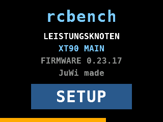

Nach dem Einschalten zeigt der Anzeigeknoten 10s lang den Startbildschirm
(`NS_SPLASH_MS`, 10.000ms): den Produktnamen `rcbench`, die Rolle
`LEISTUNGSKNOTEN`, den eigenen Namen des Knotens, wenn er einen hat, die
Firmware (`FIRMWARE 0.23.18`) und `JuWi made`. Ein Balken unten wird über
die 10s kürzer. Nach den 10s zeigt der Knoten das Messbild.

Der Startbildschirm trägt eine SETUP-Taste von 200 × 52px. Ein Tippen
darauf öffnet das SETUP des Knotens. SETUP gibt es nur, bevor sich ein
Panel verbindet:

| Ereignis in den 10s | Ergebnis |
| --- | --- |
| kein Tippen | das Messbild nach 10s |
| Tippen auf SETUP, kein Panel verbunden | SETUP öffnet sich |
| Tippen auf SETUP bei verbundenem Panel | nichts |
| ein Panel verbindet sich | sofort das Messbild |

Startbildschirm und SETUP zeigen Englisch, oder Deutsch, wenn das zuletzt
verbundene Panel LANG Deutsch schrieb (im NVS gehalten). `JuWi made` lautet
in beiden gleich.

## SETUP am Knoten

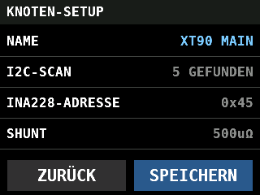

SETUP nimmt nur Tippen: kein Halten, kein Wischen. Es hat vier Zeilen und
zwei Tasten. Jede Zeile ändert eine Kopie des Werts; vor SPEICHERN erreicht
nichts das Bauteil oder den Speicher.

| Zeile | Wert | Tippen |
| --- | --- | --- |
| NAME | der Name, oder `KEINER` | öffnet die Tastatur |
| I2C-SCAN | `ZUM SCANNEN TIPPEN`, oder `n GEFUNDEN` nach einem Scan | scannt und listet die Antworten |
| INA228-ADRESSE | `AUTO`, oder die feste Adresse (`0x45`) | öffnet die Auswahl: AUTO und die INA228, die der Scan fand |
| SHUNT | der Shunt, `200uΩ` | öffnet das Ziffernfeld |
| ZURÜCK | | verlässt SETUP; nichts wird gespeichert |
| SPEICHERN | | speichert die Werte und startet das Messbild neu |

**SPEICHERN.** Jeder geänderte Wert geht ins NVS. Ein neuer Shunt stellt
das Bauteil neu ein; eine neue Adresseinstellung beendet die Bindung und
startet die Suche damit; ein neuer Name geht in die Werbung (Advertising).
Höchst- und Tiefstwerte beginnen neu. Ein geänderter Shunt startet die Uhr
der eigenen Änderung des Knotens, die das Panel beim Verbinden liest
(unten).

**Ende ohne Bedienung.** 60s ohne Tippen im SETUP (`NS_IDLE_MS`,
60.000ms) wirken wie ZURÜCK: Die Änderungen verfallen, das Messbild kommt.

**Werbung.** Solange SETUP offen ist, wirbt der Knoten nicht. Kein Panel
verbindet sich, und ein Prüfstand sieht den Knoten nicht. ZURÜCK,
SPEICHERN und das Ende ohne Bedienung starten die Werbung wieder.

### NAME

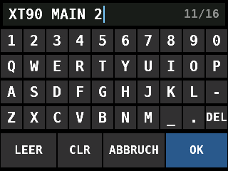

Die Tastatur schreibt A bis Z, 0 bis 9, `-`, `_`, `.` und LEER, höchstens
16 Zeichen; DEL nimmt das letzte, CLR alle. Die Zahl rechts im Feld zeigt
`11/16`. OK entfernt Leerzeichen an beiden Enden. Ein leerer Name ist kein
Name: Der Knoten heißt dann `rcbench-pwr-XXXX`, nach seiner Adresse.
ABBRUCH behält den alten Namen.

### I2C-SCAN

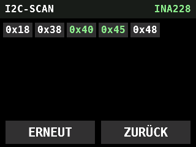

Der Scan fragt jede 7-Bit-Adresse von 0x08 bis 0x77 einmal (112 Adressen)
mit einem Adressbyte und einem STOP, ohne Datenbyte. Nur an einer
antwortenden Adresse von 0x40 bis 0x4F sendet er Daten: einen
Schreibzugriff von 1 Byte, den Registerzeiger 3Eh (MANUFACTURER_ID), dann
einen wiederholten START und ein Lesen von 2 Byte; von einem Bauteil mit
5449h dasselbe mit 3Fh (DEVICE_ID). Ein INA228 antwortet mit Die 228h
(`ina228_identity_ok()`, die Suche des Leistungsknotens, die es ebenso
macht). Der Zeiger wählt das zu lesende Register; kein Register wird je
beschrieben. Jede Antwort erscheint als Feld; der Text eines INA228
ist grün. 0x00 bis 0x07 und 0x78 bis 0x7F sind reservierte I2C-Adressen und
werden nicht gefragt. Bei mehr als 30 Antworten zeigen sich 29, und das
30. Feld zeigt `+N`. ERNEUT scannt
noch einmal; ZURÜCK führt zu den Zeilen.

Auf dem Display-Board antwortet der Touch-Controller auf 0x38 und der
Audio-Codec auf 0x18. Der Scan teilt den Bus mit dem Abtaster des INA228
und mit dem Touch; der Bustreiber hält die Zugriffe auseinander. Seine
Wirkung auf die Samplezahl der Fenster während des Scans ist nicht
gemessen.

### INA228-ADRESSE

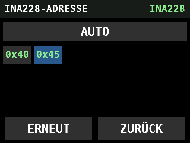

AUTO sucht 0x40 bis 0x4F ab und nimmt den ersten INA228, wie der
Leistungsknoten ab Werk ([Der INA228](Nodes-de.md#der-ina228)). Eine feste
Adresse fragt nur diese eine, mit derselben Prüfung, und findet kein
Bauteil an einer anderen. Die Auswahl bietet AUTO, jeden INA228 des
letzten Scans und die aktive feste Adresse, wenn der Scan sie nicht fand.
Ohne Scan scannt die Auswahl zuerst. Tippen wählt; ERNEUT scannt wieder;
ZURÜCK behält die Einstellung.

### SHUNT

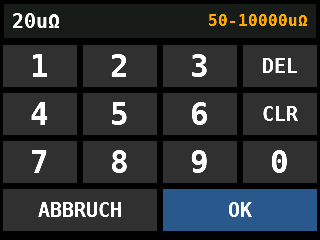

Das Ziffernfeld nimmt bis zu 5 Ziffern. OK nimmt 50 bis 10.000µΩ, den
Bereich von KNOTEN-SHUNT am Panel; ein anderer Wert wird abgelehnt, und
`50-10000uΩ` wird orange. ABBRUCH behält den alten Shunt.

## Das Messbild

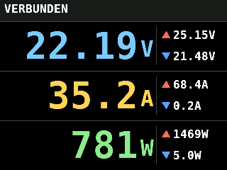

Der Bildschirm ist 320 × 240 groß, im Querformat. Das Band oben nennt die
Verbindung: ohne Verbindung `STANDALONE`, `VERBUNDEN`, sobald ein Central
verbunden ist und abonniert hat. Darunter liegen drei Zeilen: Spannung,
Strom und Leistung. Jede Zeile zeigt ihren aktuellen Wert in 32x44-Ziffern
und rechts der Linie ihren Höchstwert (rotes Dreieck) und Tiefstwert
(blaues Dreieck).

| Wert | Anzeige | Bereich |
| --- | --- | --- |
| Spannung | 2 Nachkommastellen | 0.00V bis 99.99V |
| Strom | 1 Nachkommastelle | -999.9A bis 999.9A |
| Leistung | 1 Nachkommastelle unter 100W, sonst ganze Watt | -99999W bis 99999W |

Der Bildschirm schreibt Zahlen mit Punkt, wie das Panel. Jeder Wert wird
kaufmännisch von null weg gerundet und auf seinen Bereich begrenzt; die
Einheit folgt ohne Leerzeichen (`12.60V`, `35.2A`, `443W`). Die aktuellen
Werte sind der Mittelwert der 20ms-Fenster des INA228 seit dem letzten
Bild, 5 Bilder je Sekunde (`NV_FRAME_MS`, 200ms): etwa 10 Fenster je Bild.
Die Leistung eines Fensters ist seine mittlere Spannung mal seinem
mittleren Strom. Höchst- und Tiefstwert sind die einzelner Fenster seit
dem Start, dem letzten Zurücksetzen oder dem letzten SPEICHERN im SETUP;
sie liegen im RAM, ein Neustart löscht sie. Ein Fenster ohne Sample oder
mit nur übersteuerten Stromsamples zählt nicht. Ohne Fenster seit dem
letzten Bild zeigen die Werte `--`, und das Band zeigt `KEIN SENSOR`.

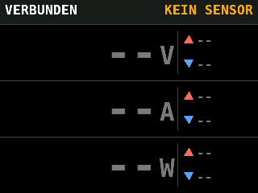

Nur was sich geändert hat, wird gezeichnet und zum Display gesendet: Ein
Bild mit einem neuen Wert sendet den Teil seiner Zeile, nicht das ganze
Bild von 153.600 Byte.

### Touch im Messbild

| Berührung | Wirkung |
| --- | --- |
| ein Tippen auf Höchst- und Tiefstwert einer Zeile (x 220 bis 319) | setzt die beiden dieser Zeile zurück |
| 2s Halten an beliebiger Stelle | setzt alle sechs zurück, einmal, noch während des Haltens |

Sonst hat der Touch keine Funktion. Das Halten löst beim ersten Lesen aus,
das den Finger 2s oder später nach Beginn des Drucks sieht. Ein Druck,
dessen letzter gelesener Kontakt vor 2s liegt, ist ein Tippen; der Druck
endet 60ms nach dem letzten gelesenen Kontakt, und der Touch wird alle
20ms gelesen. Ab 300ms Druck füllt sich unten im Band ein Balken bis zu
den 2s, und das Band zeigt `ALLE ZURÜCKSETZEN`.

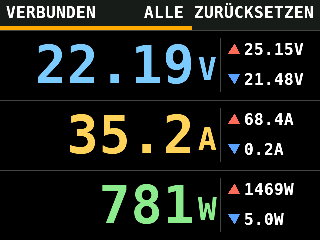

Der FT6336G meldet das Hochformat des Panels; die Firmware dreht es für den
Bildschirm im Querformat. Dass die Drehung zum Board passt, ist nicht
bestätigt: Jedes Tippen schreibt seinen Punkt auf die Konsole (`disp: tap
at 260,60: highest and lowest reset`). `NODE_LCD_TURN` 1 in `node_board.h`
dreht Bildschirm und Touch um 180°.

### Sprache

Die Texte des Messbilds sind englisch. Solange ein Panel verbunden ist,
folgen sie seiner Sprache: Das Panel schreibt LANG nach CONTROL, nach INFO
bei jeder Verbindung und bei jedem Wechsel seiner Sprache
([protocols/rcnode](../protocols/rcnode/README.md)). Auf Deutsch zeigt der
Bildschirm `VERBUNDEN`, `KEIN SENSOR` und `ALLE ZURÜCKSETZEN`. Ohne
Verbindung sind die Texte des Messbilds wieder englisch. Der Knoten behält
das letzte LANG für Startbildschirm und SETUP.

## Die Einstellungen über die Verbindung

Jeder Knoten hält seinen NAME selbst; der Leistungsknoten auch INA228-
ADRESSE und SHUNT. Ein Knoten ohne Bildschirm (der Leistungsknoten auf dem
C6-Zero und der Auswuchtknoten) bekommt sie vom Panel: SETUP > WIRELESS,
LEISTUNGSKNOTEN oder AUSWUCHTKNOTEN
([Bildschirme](Screens-de.md#wireless-der-leistungsknoten)).

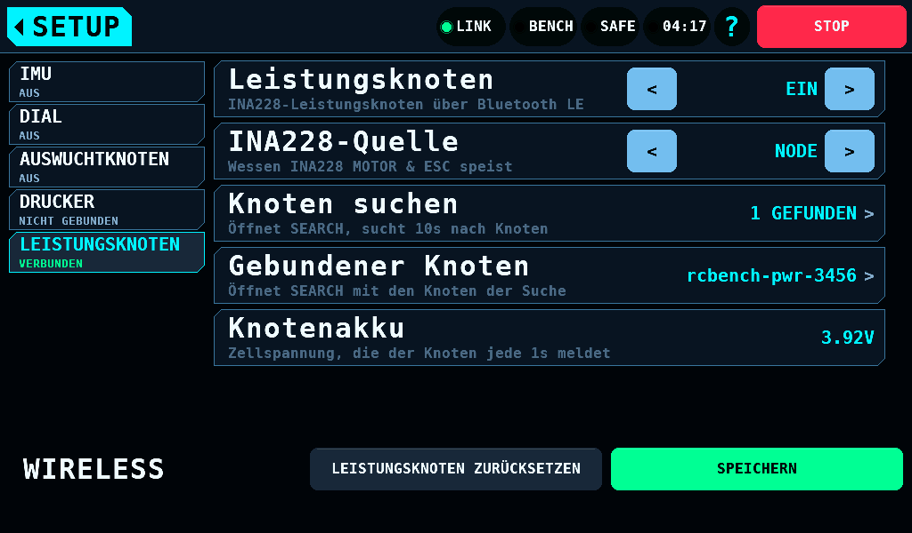

| Zeile am Panel | Eintrag | Werte | Druck |
| --- | --- | --- | --- |
| Knotenname | LEISTUNGSKNOTEN, AUSWUCHTKNOTEN | der Name des Knotens; ohne Namen `rcbench-pwr-XXXX`; `NICHT VERBUNDEN`; `ALTE FIRMWARE` | öffnet die Namenstastatur mit dem Namen; OK schreibt NAME, ein leerer Name löscht ihn |
| INA228-Adresse | LEISTUNGSKNOTEN | `AUTO`, `0x40` bis `0x4F`, `NICHT VERBUNDEN`, `ALTE FIRMWARE` | `<` und `>` schalten AUTO, 0x40 ... 0x4F, AUTO; jeder Schritt schreibt I228, vom zuletzt erbetenen Wert aus, bis CONFIG des Knotens antwortet: Zwei schnelle Schritte gehen zwei Adressen weiter |
| Knoten-Shunt | LEISTUNGSKNOTEN | 50 bis 10.000uΩ | die Einstellung des Panels; der Abgleich unten |

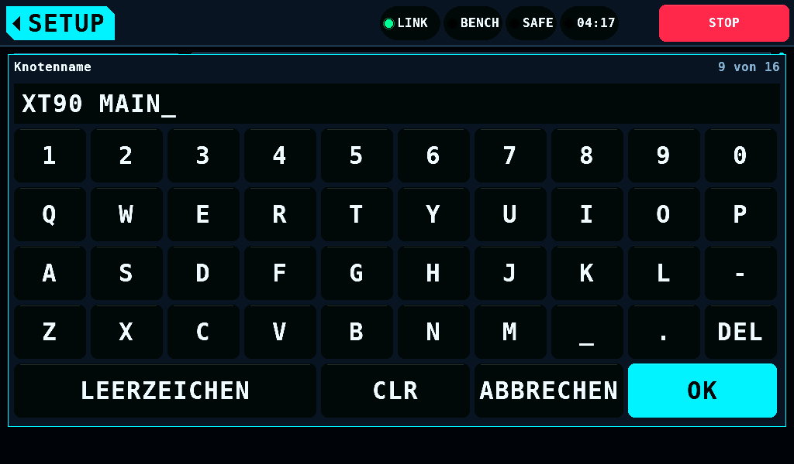

Keine Knoteneinstellung ändert sich, solange der Prüfstand ARMED ist oder
ein Wechsel zu ARMED wartet: Die Zeilen zeigen `Nur bei SAFE einstellbar`,
ein Druck zeigt `KEINE KNOTENEINSTELLUNG BEI ARMED: ERST AUF SAFE
SCHALTEN`, und ein bei SAFE erbetener Schreibzugriff wartet auf SAFE. Ein
nicht verbundener Knoten zeigt `KNOTEN NICHT VERBUNDEN: EINSTELLUNGEN NUR
ÜBER DIE VERBINDUNG`; ein Knoten aus der Zeit vor diesen Einstellungen
zeigt `KNOTEN NIMMT KEINEN NAMEN UND KEINE ADRESSE: FIRMWARE
AKTUALISIEREN` (`KNOTEN NIMMT KEINEN NAMEN: FIRMWARE AKTUALISIEREN` beim
Auswuchtknoten). Dieselben Texte zeigen sich, wenn die Zeile die Anfrage
durchlässt, die Steuerung sie aber ablehnt, etwa weil die Verbindung
dazwischen abriss. Ein Schreibzugriff, den der Knoten ablehnt, zeigt `DER
KNOTEN HAT DIE EINSTELLUNG ABGELEHNT`. Ein NAME oder eine INA228-ADRESSE,
die beim Abriss der Verbindung wartet oder unterwegs ist, geht auf der
nächsten Verbindung nicht erneut: Das Band zeigt `VERBINDUNG GETRENNT:
EINSTELLUNG NICHT GESCHRIEBEN, NEU SETZEN`.

GEBUNDENER KNOTEN zeigt den Namen des Knotens. Das Panel hält ihn bei
SAFE im SETUP (`SET_TEXT_PNODE_NAME`, `SET_TEXT_BNODE_NAME`), so zeigt er
sich auch, solange der Knoten fehlt. Ein Knoten mit Namen wirbt mit ihm als
vollständigem Namen, so listet WIRELESS SEARCH ihn mit Namen (`XT90
MAIN`), auch auf einem Panel aus der Zeit vor dem Namen.

### Die Pakete

| Schreibzugriff oder Paket | Bytes | Wirkung |
| --- | --- | --- |
| CONFIG (0x08) | 1 | der Knoten sendet RCNODE_T_CONFIG auf STREAM sofort und nach jeder Änderung auf dieser Verbindung |
| NAME (0x09) | 17: Op, 16 Bytes mit NUL aufgefüllt | der Name; "" löscht ihn |
| I228 (0x0A) | 2: Op, 0 AUTO oder 0x40 bis 0x4F | die INA228-ADRESSE; nur Leistungsrolle |
| SHUNT (0x07) | 3 | der Shunt, und der Wert, auf den sich beide Enden einigen |
| RCNODE_T_CONFIG (0x32) | 30 | Flags, Adresseinstellung, Shunt, vereinbarter Shunt, Alter der eigenen Änderung in s, der Name |

Die Aufbauten stehen in [protocols/rcnode](../protocols/rcnode/README.md).
Ein gespeicherter Name oder eine Adresse außerhalb des Bereichs gilt als
Vorgabe: kein Name, AUTO.

## Der Shunt im Gleichschritt

KNOTEN-SHUNT am Panel und das eigene SETUP des Knotens setzen beide den
Shunt. Die letzte Änderung gewinnt. Der Knoten hält zwei Werte: den
aktiven Shunt und den Shunt, auf den sich beide Enden zuletzt einigten
(`shunt_agreed`), den Wert des letzten SHUNT-Schreibzugriffs. Eine
Änderung im SETUP des Knotens setzt den Shunt und behält den vereinbarten
Wert; ein SHUNT-Schreibzugriff setzt beide. CONFIG trägt beide und die Zeit
seit der eigenen Änderung des Knotens in s (`shunt_age_s`), oder keine,
wenn der Knoten seit seinem Start keine machte.

Nach INFO auf jeder Verbindung schreibt das Panel CONFIG und hält jeden
SHUNT-Schreibzugriff zurück, bis CONFIG kommt. Dann entscheidet
`rcnode_shunt_sync()` mit der Einstellung des Panels, Shunt und
vereinbartem Wert des Knotens, dem Alter am Knoten und der Zeit seit der
Änderung der Panel-Einstellung:

| Einstellung des Panels gegen vereinbart | Shunt des Knotens gegen vereinbart | Ergebnis |
| --- | --- | --- |
| gleich | gleich | nichts |
| geändert | gleich | das Panel schreibt SHUNT mit seiner Einstellung |
| gleich | geändert | das Panel übernimmt den Shunt des Knotens in KNOTEN-SHUNT und schreibt SHUNT damit, so vermerkt der Knoten ihn als vereinbart |
| auf den Wert des Knotens geändert | geändert | das Panel schreibt SHUNT damit, so vermerkt der Knoten ihn als vereinbart |
| geändert | auf einen anderen Wert geändert | die jüngere Änderung gewinnt; eine Änderung unbekannten Alters ist älter als jede bekannte; gleiches Alter, oder zweimal unbekannt, geht an den Knoten |

Das Alter am Panel ist ab der ersten Änderung von KNOTEN-SHUNT nach dem
Start des Panels bekannt; eine Änderung von vor dem Start gilt als
unbekannt. Das Alter am Knoten endet bei 65.534s (18,2h), und das am Panel
zählt nicht weiter: Zwei ältere Änderungen sind gleich alt, und der Wert
des Knotens bleibt. Das Alter am Knoten ist von seiner eigenen Änderung bis zu
seinem nächsten Neustart bekannt. So gewinnt eine Änderung im SETUP des
Knotens kurz vor einer Verbindung gegen einen Panel-Wert aus einer früheren
Sitzung, und ein KNOTEN-SHUNT, der nach der Änderung am Knoten geändert
wurde, gewinnt gegen sie.

Nichts davon läuft, solange der Prüfstand ARMED ist oder ein Wechsel zu
ARMED wartet; es läuft beim nächsten SAFE. Die Übernahme in KNOTEN-SHUNT
fordert ein Speichern an. Das Messbild eines Laufs liest den
Shunt aus INFO: Das erneute Lesen von INFO nach jedem SHUNT wartet, solange
der Prüfstand ARMED ist oder der Lauf des Messbilds läuft.

**Ein CONFIG, das nicht kommt.** Das Panel fragt CONFIG ein zweites Mal,
wenn innerhalb von 2000ms (`NCL_WAIT_MS`) nach der Antwort auf die erste
Frage keines kommt. Ohne CONFIG 2000ms nach der zweiten gilt der Knoten
als einer aus der Zeit vor CONFIG (unten), und das Panel schreibt SHUNT
nach der Regel von INFO. Ein CONFIG, das danach kommt, wird nach der
Tabelle oben neu entschieden, auch wenn der Wert des Panels der schon
geschriebene ist: Eine Änderung am Knoten darin kommt zurück in
KNOTEN-SHUNT und wird zum Knoten geschrieben. Ein Knoten auf einer
Verbindung mit einer MTU (maximale Übertragungseinheit) unter 33 kann die
30 Bytes von CONFIG gar nicht senden; bei ihm überschreibt die Regel von
INFO eine Änderung am Knoten.

**Ältere Enden.** Ein Knoten aus der Zeit vor CONFIG lehnt es mit
ATT-Fehler 0x13 ab; das Panel schreibt dann SHUNT, wann immer INFO einen
anderen Shunt nennt. Ein Panel aus der
Zeit vor CONFIG schreibt es nie, also sendet der Knoten ihm nie
RCNODE_T_CONFIG; INFO behält seine 20 Bytes. Ein solches Panel schreibt
SHUNT, wann immer INFO einen anderen Shunt nennt: Es überschreibt eine
Änderung am Knoten.

## Sicherheit

- Der Knoten hat keinen Teil am STOP des Prüfstands: STOP des Panels und
  des IOmcu wirken auf ihre eigenen Ausgänge, und nichts im
  Startbildschirm oder SETUP des Knotens erreicht sie.
- SETUP öffnet sich nur, bevor sich ein Panel verbindet, und der Knoten
  wirbt nicht, solange SETUP offen ist: Kein Prüfstand liest einen Knoten,
  dessen Einstellungen gerade geändert werden.
- Das Panel schreibt bei ARMED keine Knoteneinstellung und übernimmt
  keine.
- Der I2C-SCAN beschreibt kein Register: Seine einzigen Datenbytes sind
  die 1-Byte-Registerzeiger 3Eh und 3Fh an antwortenden Adressen von 0x40
  bis 0x4F.
- Ein gespeicherter Name oder eine Adresse außerhalb des Bereichs gilt als
  Vorgabe.

## Aktuelle Einschränkungen

- Ein Panel aus der Zeit vor CONFIG überschreibt einen im SETUP des
  Knotens geänderten Shunt bei seiner nächsten Verbindung.
- Die INA228-ADRESSE am Panel schreibt bei jedem Schritt: Von AUTO bis
  0x4F sind es 16 Schreibzugriffe, und der Knoten sucht bei jedem neu.
- Zwei Panels, die sich abwechselnd mit demselben Knoten verbinden,
  tauschen den Shunt hin und her: Der vereinbarte Wert ist der des
  Knotens, einer für alle Panels. Schrieb Panel A 500 und hält Panel B
  300 aus einer eigenen früheren Änderung, sieht B bei seiner Verbindung
  die eigene Einstellung als geändert und die des Knotens nicht und
  schreibt 300; die nächste Verbindung von A macht dasselbe mit 500.
- Eine Verbindung mit einer MTU unter 33 trägt kein CONFIG: Das Panel
  fällt nach den zwei Fragen, 4000ms, auf die Regel von INFO zurück und
  überschreibt eine Änderung am Knoten.
- Startbildschirm, SETUP und Scan auf dem ES3C28P sind an einem
  gelieferten Board nicht gemessen: die Drehung des Touch, die Zeit des
  Scans auf dem Bus und seine Wirkung auf den Abtaster.
