# The display node's screen and the nodes' own settings

**English** · [Deutsch](Nodes-setup-de.md)

This page holds the display node's screens: the meter, the boot splash and
the node's own SETUP. It also holds the settings every node keeps itself
(NAME, INA228 ADDRESS, SHUNT), how the panel writes them over the link, and
how the panel and the node keep the shunt in step. The node's parts,
wiring and packets are on [The sensor nodes](Nodes.md).

| Part | Where |
| --- | --- |
| the meter: values, highest and lowest, touch, formats, drawing, under the host suite | `firmware/node/main/node_view.c` |
| the splash and SETUP: screens, taps, timers, edits, under the host suite | `firmware/node/main/node_setup.c` |
| their drawing, under the host suite | `firmware/node/main/node_setup_view.c` |
| the I2C (Inter-Integrated Circuit) SCAN, under the host suite | `firmware/node/main/node_scan.c` |
| the node's own settings and their rules, under the host suite | `firmware/node/main/node_store.c` |
| the settings in NVS (non-volatile storage), the writes, CONFIG on STREAM | `firmware/node/main/node_set.c` |
| the display task: the screens, the touch, the scan's bus calls | `firmware/node/main/node_disp.c`, `firmware/node/main/node_pwr.c` |
| the panel's side: CONFIG, NAME and INA228 ADDRESS writes, under the host suite | `shared/ui/node_cfg_link.c` |
| the shunt's sync rule, under the host suite | `protocols/rcnode/rcnode_cfg.c` (`rcnode_shunt_sync()`) |

## The boot splash

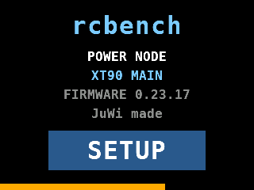

After power-on the display node shows the splash for 10s (`NS_SPLASH_MS`,
10,000ms): the product name `rcbench`, the role `POWER NODE`, the node's
own name when it has one, the firmware (`FIRMWARE 0.23.17`) and
`JuWi made`. A bar along the foot shortens over the 10s. When the 10s end,
the meter shows.

The splash carries a SETUP button of 200 × 52px. A tap on it opens the
node's SETUP. SETUP is offered only before a panel links:

| Event during the 10s | Result |
| --- | --- |
| no tap | the meter at 10s |
| a tap on SETUP, no panel linked | SETUP opens |
| a tap on SETUP with a panel linked | nothing |
| a panel links | the meter at once |

The splash and SETUP show English, or German when the last panel linked
wrote LANG German (kept in NVS). `JuWi made` reads the same in both.

## SETUP on the node

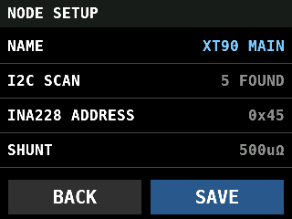

SETUP takes taps only: no hold and no swipe. It has four rows and two
buttons. Each row edits a copy of the value; nothing reaches the part or
the store before SAVE.

| Row | Value | A tap |
| --- | --- | --- |
| NAME | the name, or `NONE` | opens the keyboard |
| I2C SCAN | `TAP TO SCAN`, or `n FOUND` after a scan | runs the scan and lists the answers |
| INA228 ADDRESS | `AUTO`, or the fixed address (`0x45`) | opens the choice: AUTO and the INA228s the scan found |
| SHUNT | the shunt, `200uΩ` | opens the keypad |
| BACK | | leaves; nothing is stored |
| SAVE | | stores the values and restarts the meter |

**SAVE.** Each value that changed is stored in NVS. A new shunt sets the
part up again with it; a new address setting ends the binding and starts
the search on it; a new name goes into the advertising. The highest and
lowest restart. A changed shunt starts the clock of the node's own change,
which the panel reads when it links (below).

**The idle end.** 60s without a tap in SETUP (`NS_IDLE_MS`, 60,000ms) is
BACK: the edits are dropped and the meter shows.

**Advertising.** While SETUP is open, the node does not advertise. No
panel links, and a bench does not see the node. BACK, SAVE and the idle
end start the advertising again.

### NAME

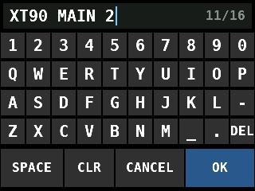

The keyboard types A to Z, 0 to 9, `-`, `_`, `.` and SPACE, 16 characters
at most; DEL takes the last one, CLR all. The count right of the field
reads `11/16`. OK drops the spaces at either end. An empty name is no name:
the node is named `rcbench-pwr-XXXX` then, from its address. CANCEL keeps
the name before.

### I2C SCAN

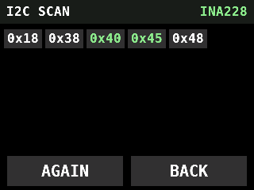

The scan asks every 7-bit address of 0x08 to 0x77 once (112 addresses) with
an address byte and a STOP, and no data byte. Only at an answering address
of 0x40 to 0x4F does it send data: a write of 1 byte, the register pointer
3Eh (MANUFACTURER_ID), then a repeated START and a read of 2 bytes; from a
part that answers 5449h, the same with 3Fh (DEVICE_ID). An INA228 answers
die 228h (`ina228_identity_ok()`, the power node's own search, which does
the same). The pointer selects the register to read; no register is ever
written. Each answer shows
as a chip; an INA228's text is green. 0x00 to 0x07 and 0x78 to 0x7F are
I2C's reserved addresses and are not asked. With more than 30 answers, 29
show and the 30th cell reads `+N`. AGAIN scans once more; BACK returns to the rows.

On the display board the touch controller answers at 0x38 and the audio
codec at 0x18. The scan shares the bus with the sampler of the INA228 and
with the touch; the bus driver keeps the transactions apart. Its effect on
the window's sample count during the scan is not measured.

### INA228 ADDRESS

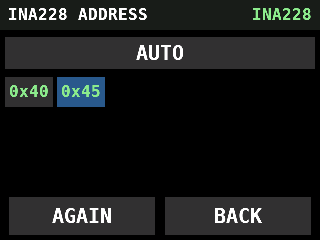

AUTO searches 0x40 to 0x4F and takes the first INA228, as the power node
does by default ([The INA228](Nodes.md#the-ina228)). A fixed address asks
that one address only, with the same check, and finds no part at another.
The choice offers AUTO, every INA228 the last scan found, and the fixed
address in force when the scan did not find it. Without a scan the choice
runs one first. A tap picks; AGAIN scans again; BACK keeps the setting.

### SHUNT

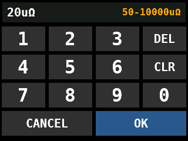

The keypad types up to 5 digits. OK takes 50 to 10,000µΩ, the range of
NODE SHUNT on the panel; another value is refused, and `50-10000uΩ` turns
orange. CANCEL keeps the shunt before.

## The meter

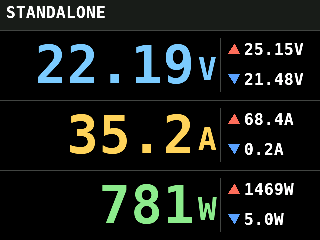

The screen is 320 × 240, landscape. The band at the top names the link:
`STANDALONE` without one, `CONNECTED` once a central is connected and
subscribed. Under it are three rows: voltage, current and power. Each
row shows its live value in 32x44 digits and, right of the line, its
highest (red triangle) and lowest (blue triangle).

| Value | Shown | Range |
| --- | --- | --- |
| voltage | 2 decimals | 0.00V to 99.99V |
| current | 1 decimal | -999.9A to 999.9A |
| power | 1 decimal under 100W, else whole watts | -99999W to 99999W |

Each value is rounded half away from zero and clamped to its range; units
follow without a space (`12.60V`, `35.2A`, `443W`). The live values are the
mean of the INA228's 20ms windows since the last frame, 5 frames a second
(`NV_FRAME_MS`, 200ms): about 10 windows a frame. A window's power is its
mean voltage times its mean current. The highest and lowest are those of
single windows since the start, the last reset or the last SAVE of SETUP;
they live in RAM and a restart clears them. A window without a sample, or
whose current samples all clipped, counts for nothing. Without a window
since the last frame the values read `--` and the band reads `NO SENSOR`.

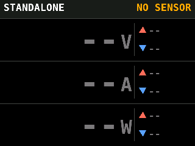

Only what changed is drawn and sent to the display: a frame with one new
value sends that value's part of its row, not the frame of 153,600 bytes.

### Touch on the meter

| Touch | Does |
| --- | --- |
| a tap on a row's highest and lowest (x 220 to 319) | resets that row's two |
| a hold of 2s anywhere | resets all six, once, while still held |

Nothing else is a touch function. The hold fires on the first touch read
that sees the finger 2s or more into the press. A press whose last touch
read comes before 2s is a tap; the press ends 60ms after the last touch
read, and the touch is read every 20ms. From 300ms of a press on, a bar at
the band's foot fills toward the 2s and the band reads `RESET ALL`.

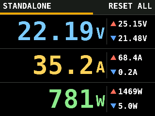

The FT6336G reports the panel's portrait frame; the firmware turns it for
the landscape screen. That the turn matches the board is unconfirmed: each
tap prints its point on the console (`disp: tap at 260,60: highest and
lowest reset`). `NODE_LCD_TURN` 1 in `node_board.h` turns screen and touch
by 180°.

### Language

The meter's texts are English. While a panel is linked, they follow the
panel's language: the panel writes LANG to CONTROL after INFO on each link
and at each change of its language
([protocols/rcnode](../protocols/rcnode/README.md)). German shows
`VERBUNDEN`, `KEIN SENSOR` and `ALLE ZURÜCKSETZEN`. Without a link the
meter's texts are English again. The node keeps the last LANG for the
splash and SETUP.

## The settings over the link

Every node keeps its own NAME; the power node also its INA228 ADDRESS and
SHUNT. A node without a screen (the C6-Zero power node and the balance
node) takes them from the panel: SETUP > WIRELESS, POWER NODE or BALANCE
NODE ([Screens](Screens.md#wireless-the-power-node)).

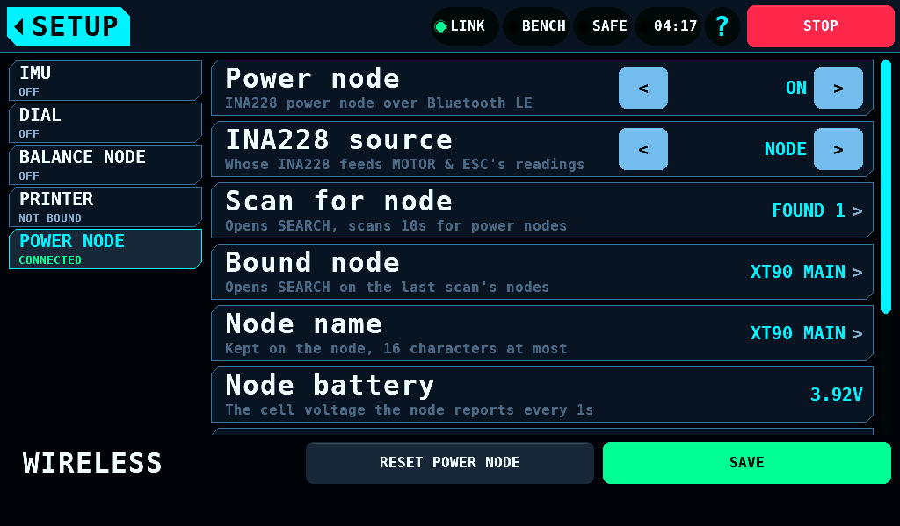

| Panel row | Entry | Values | A press |
| --- | --- | --- | --- |
| Node name | POWER NODE, BALANCE NODE | the node's name; `rcbench-pwr-XXXX` without one; `NOT LINKED`; `OLD FIRMWARE` | opens the name keyboard on the name; OK writes NAME, an empty name clears it |
| INA228 address | POWER NODE | `AUTO`, `0x40` to `0x4F`, `NOT LINKED`, `OLD FIRMWARE` | `<` and `>` step AUTO, 0x40 ... 0x4F, AUTO; each step writes I228, from the value last asked for until the node's CONFIG answers, so two quick steps go two addresses on |
| Node shunt | POWER NODE | 50 to 10,000uΩ | the panel's setting; the sync below |

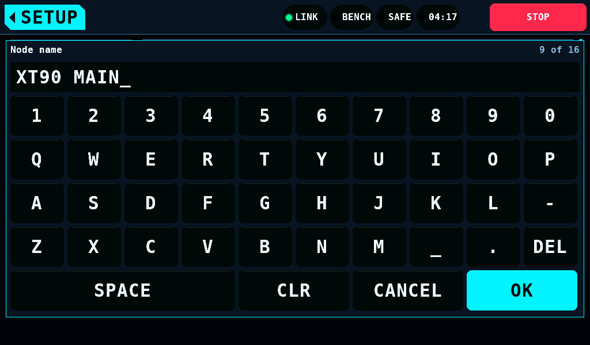

No node setting changes while the bench is ARMED or a switch to ARMED
waits: the rows read `Set on a SAFE bench only`, a press reads `NO NODE
SETTING CHANGE WHILE ARMED: SWITCH TO SAFE FIRST`, and a write asked while
SAFE waits for SAFE. A node not linked reads `NODE NOT LINKED: ITS
SETTINGS CHANGE ONLY OVER THE LINK`; a node built before these settings
reads `THE NODE TAKES NO NAME OR ADDRESS: UPDATE ITS FIRMWARE` (`THE NODE
TAKES NO NAME: UPDATE ITS FIRMWARE` for a balance node). The same texts
show when the request passes the row but the controller refuses it, the
link having dropped in between, say. A write the node refuses reads `THE
NODE REFUSED THE SETTING`. A NAME or INA228 ADDRESS that waits, or is in
flight, when the link drops is not sent again on the next link: the band
reads `THE LINK DROPPED: THE NODE SETTING WAS NOT WRITTEN, SET IT AGAIN`.

BOUND NODE shows the node's name. The panel keeps it in SETUP
(`SET_TEXT_PNODE_NAME`, `SET_TEXT_BNODE_NAME`) while SAFE, so it shows
while the node is away. A node with a name advertises it as its complete
name, so WIRELESS SEARCH lists it by its name (`XT90 MAIN`), also on a
panel built before the name.

### The packets

| Write or packet | Bytes | Does |
| --- | --- | --- |
| CONFIG (0x08) | 1 | the node sends RCNODE_T_CONFIG on STREAM at once and after each change on this link |
| NAME (0x09) | 17: op, 16 bytes NUL padded | the name; "" clears it |
| I228 (0x0A) | 2: op, 0 AUTO or 0x40 to 0x4F | the INA228 ADDRESS; power role only |
| SHUNT (0x07) | 3 | the shunt, and the value both ends agree on |
| RCNODE_T_CONFIG (0x32) | 30 | flags, address setting, shunt, agreed shunt, the age of the node's own change in s, the name |

The layouts are in [protocols/rcnode](../protocols/rcnode/README.md). A
stored name or address out of range reads as its default: no name, AUTO.

## The shunt in step

The panel's NODE SHUNT and the node's own SETUP both set the shunt. The
last change wins. The node keeps two values: the shunt in force, and the
shunt both ends last agreed on (`shunt_agreed`), the value of the last
SHUNT write. A change on the node's SETUP moves the shunt and keeps the
agreed value; a SHUNT write sets both. CONFIG carries both, and the time
since the node's own change in s (`shunt_age_s`), or none when the node
made none since its start.

After INFO on each link the panel writes CONFIG and holds every SHUNT
write until CONFIG comes. Then `rcnode_shunt_sync()` decides, with the
panel's setting, the node's shunt and agreed value, the node's age and the
time since the panel's setting changed:

| Panel's setting against agreed | Node's shunt against agreed | Result |
| --- | --- | --- |
| the same | the same | nothing |
| changed | the same | the panel writes SHUNT with its setting |
| the same | changed | the panel takes the node's shunt into NODE SHUNT, then writes SHUNT with it, so the node marks it agreed |
| changed to the node's value | changed | the panel writes SHUNT with it, so the node marks it agreed |
| changed | changed to another value | the younger change wins; a change of unknown age is older than any known one; equal ages, or two unknown, go to the node |

The panel's age is known from the first change of NODE SHUNT after the
panel's start; a change from before the start counts as unknown. The
node's age stops at 65,534s (18.2h), and the panel's counts no further:
two changes older than that are equal, and the node's value stays. The
node's age is known from its own change to its next restart. So a change
made on the node's SETUP right before a link wins over a panel value set
in an earlier session, and a NODE SHUNT changed after the node's change
wins over it.

None of this runs while the bench is ARMED or a switch to ARMED waits; it
runs at the next SAFE. The take into NODE SHUNT asks a save. The meter of
a run reads INFO's shunt: the INFO read again after each SHUNT
write waits while the bench is ARMED or the meter's run is live.

**A CONFIG that does not come.** The panel asks CONFIG a second time when
none comes within 2000ms (`NCL_WAIT_MS`) of the first ask's answer. With
none 2000ms after the second, the node is treated as one built before
CONFIG (below), and the panel writes SHUNT by INFO's rule. A CONFIG that
comes after that is decided again by the table above, also when the
panel's value is the one already written: a node-side change it carries
is taken back into NODE SHUNT and written to the node. A node on a link
with an MTU (maximum transmission unit) under 33 cannot send the 30 bytes
of CONFIG at all; on it, INFO's rule overwrites a node-side change.

**Older ends.** A node built before CONFIG refuses it with ATT error 0x13;
the panel then writes SHUNT whenever INFO names another shunt. A
panel built before CONFIG never writes it, so the node never sends
RCNODE_T_CONFIG to it; INFO keeps its 20 bytes. Such a panel writes SHUNT
whenever INFO names another shunt: it overwrites a node-side change.

## Safety

- The node has no part in the bench's STOP: the panel's STOP and the
  IOmcu's act on their own outputs, and nothing on the node's splash or
  SETUP reaches them.
- SETUP opens only before a panel links, and the node does not advertise
  while SETUP is open, so no bench reads a node whose settings are being
  edited.
- The panel writes no node setting while ARMED, and takes none.
- The I2C SCAN writes no register: its only data bytes are the 1-byte
  register pointers 3Eh and 3Fh at answering addresses of 0x40 to 0x4F.
- A stored name or address out of range reads as its default.

## Current limitations

- A panel built before CONFIG overwrites a shunt changed on the node's
  SETUP at its next link.
- The panel's INA228 ADDRESS writes at each step: stepping from AUTO to
  0x4F writes 16 times, and the node searches anew at each.
- Two panels that link to the same node in turn swap the shunt: the
  agreed value is the node's, one for all panels. When panel A wrote 500
  and panel B holds 300 from its own earlier change, B's link reads its
  own setting as changed and the node's as not, and writes 300; A's next
  link does the same with 500.
- A link with an MTU under 33 carries no CONFIG: the panel falls back to
  INFO's rule after the two asks, 4000ms, and overwrites a node-side
  change.
- The splash, SETUP and the scan on the ES3C28P are not measured on a
  delivered board: the touch's turn, the scan's time on the bus and its
  effect on the sampler.
