# Bildschirme

<sub>[English](Screens.md) · **Deutsch**</sub>

Bedienung, Anzeigen und Menümarkierungen auf jeder Seite.

## Das Statusband

Das Statusband ist auf allen Seiten gleich. Von rechts nach links zeigt es
STOP, "?" auf einer Seite mit [Hilfe](#die-bildschirmhilfe), die Laufzeituhr
(in ARMED oder nach einem Lauf), den Arm-Chip, einen gemeldeten FEHLER-Code
oder [HWSTOP](#hwstop), den Modus und VERBINDUNG oder KEINE VERBINDUNG.

BENCH bedeutet: Die Verbindung steht und das Panel steuert die Ausgänge
des IOmcu. In SIM antwortet kein IOmcu; das Panel berechnet eigene Modelle.
INJECT ersetzt beide Modi, solange ein Touch-Injector an der I2C-Adresse
0x14 (Inter-Integrated Circuit) antwortet. Das Panel sucht einmal beim
Start nach einem Injector.

Der Arm-Chip nennt die Ausgänge, die beim Wechsel auf ARMED aktiv werden:

| Chip | Angesteuerte Ausgänge |
| --- | --- |
| SAFE | keine |
| ARMED MOTOR | die Gas-Ausgänge, durch ARM auf MOTOR & ESC oder einen Stick-Lauf unter PROGRAMMIEREN; kein Ruder und kein Programmierport |
| ARMED SERVO | die Ruder und ein pulsender PROG-PORT, aktiviert auf SERVO; kein Gas-Ausgang |
| ARMED | alle zugeordneten Ausgänge, bei einem IOmcu älter als Protokoll 4.18 |

STOP wirkt auf jeder Seite. Ein Druck schaltet den Prüfstand auf SAFE und
rastet wie ein Not-Aus-Taster ein. STOP zeigt dann `GESTOPPT` über
`2s HALTEN ZUM LÖSEN` in einem gelben Rahmen, der Arm-Chip zeigt STOP.
ARM und jedes Einschalten werden abgelehnt.

Ein Seitenwechsel, das Ende eines Hinweises, die Rückkehr der Verbindung
oder ARM löst den Stopp nicht. Halte STOP 2s, um ihn zu lösen. Das Panel
wartet dabei auf die Meldung des IOmcu, dass alles ausgeschaltet ist
([STOP als Not-Aus](Stop-de.md)). Der Prüfstand bleibt nach dem Lösen SAFE.

ARM steht unten auf einer Prüfstandsseite; STOP steht oben im Statusband.

Eine Berührung bleibt bis zum Abheben dem Bereich zugeordnet, in dem sie
begonnen hat. Das Statusband belegt die oberen 60px des Panels.

- Eine auf dem Band begonnene Berührung bleibt dem Band zugeordnet. Ziehst
  du den Finger nach unten in die Seite, bewegt er dort nichts. Auch das
  Abheben löst dort keine Bedienung aus.
- Eine auf der Seite begonnene Berührung, die ins Band gleitet, gilt an der
  letzten Position innerhalb der Seite als losgelassen. Ein Schieberegler
  oder das SERVO-Zifferblatt behält den Wert dieser Position. Die Bewegung
  im Band zählt nicht mit. Eine Haltegeste auf ARM oder AUSGANG EIN wird
  abgebrochen. Eine Schaltfläche, Taste, Kachel, Registerkarte oder
  Listenzeile unter der letzten Position reagiert nicht: Das Panel hat das
  Loslassen ausgelöst, nicht der Finger. Drei Bedienelemente reagieren
  dennoch, weil sie etwas anhalten: DISARM, AUSGANG AUS und TEST STARTEN
  während eines laufenden Servotests. Die Berührung wird nicht wieder
  aufgenommen, wenn der Finger in die Seite zurückgleitet. Hebe ihn ab und
  setze ihn erneut auf.
- Liegt ein Kontakt mehr als 120px von der zuletzt gemeldeten Position
  entfernt (x- und y-Abstand addiert), gilt er dort als losgelassen und an
  der neuen Position als aufgesetzt. Der Touch-Controller wird alle 10ms
  ausgelesen; sein Meldeintervall am Panel ist nicht gemessen. Auch dieses
  Loslassen löst nichts aus, mit denselben drei Ausnahmen und STOP. Das
  neue Aufsetzen wirkt wie eine normale Berührung. Auf einem Eintrag der
  SETUP-Liste scrollt es jedoch nur und ändert keinen Wert.
- STOP und das Home-Feld reagieren auf einen Druck, der auf ihnen beginnt.
  Ein Finger, der von der Seite auf STOP gleitet, löst keinen Stopp aus.
- Ein zweiter Finger auf STOP, dem Home-Feld oder dem Alarmband wirkt auch,
  während der erste Finger zieht. Nach einem Druck auf das Home-Feld bewegt
  der auf dem Glas gebliebene Finger auf der geöffneten Seite nichts.

STOP ist 168 x 48px groß und beginnt am rechten Ende des Bands bei x 850.
"?" ist 40 x 44px groß und liegt 8px links von STOP, von x 802 bis 842.
Auf Seiten ohne Hilfe bleibt dieser Platz frei, damit die anderen Chips
beim Seitenwechsel ihre Position behalten. Die Chips stehen links von
"?" mit je 4px Abstand. Jeder Chip ist 44px hoch; seine Beschriftung steht
in der Schrift 10 x 20px, 22px von seiner linken Kante entfernt. Die
Berührungsfläche umfasst die Höhe des Bands und reicht an beiden Seiten
2px über den Chip hinaus.

Die breiteste Reihe zeigt eine Laufzeituhr von 10 Stunden, ARMED MOTOR,
einen FEHLER-Code, BENCH und VERBINDUNG auf Deutsch. Sie ist 528px breit
und beginnt bei x 270.

Das Home-Feld ist 44px hoch und beginnt bei x 8, y 8. Sein Name steht in
der Schrift 20 x 36px. Es endet auf MOTOR & ESC bei x 268, auf anderen
Seiten spätestens bei x 248. Keine Chip-Reihe überlappt das Home-Feld;
selbst bei der breitesten Reihe bleiben 2px Abstand zum Verbindungschip.

### Hilfe zu den Chips

Tippe auf einen Status-Chip, um sein Hilfefeld zu öffnen: VERBINDUNG oder
KEINE VERBINDUNG, Modus, FEHLER, HWSTOP, Arm-Chip oder Laufzeituhr. Das Feld erklärt
den aktuellen Zustand und was du tun kannst. Es beginnt 4px unter dem Band
an der linken Kante des Chips. Falls nötig, wird es nach links verschoben,
damit es mindestens 8px vom Panelrand entfernt bleibt.

Das Feld ist 640px breit und fasst 60 Zeichen pro Zeile in der Schrift
10 x 20px bei 21px Zeilenabstand. Die Felder von FEHLER und HWSTOP sind
1008px breit und fassen 97 Zeichen pro Zeile, mit einem Absatz je gesetztem Bit. Kein Feld
überlappt das Statusband oder das Alarmband; STOP bleibt sichtbar.

- Drücke auf einen Chip und hebe den Finger dort ab, um sein Hilfefeld zu
  öffnen. Gleitest du vor dem Abheben vom Chip, bleibt das Feld geschlossen.
- Der Text folgt dem aktuellen Zustand. Neue Fehler erscheinen sofort,
  gelöschte verschwinden. Verschiebt die Laufzeituhr die Chips, folgt das
  Hilfefeld seinem Chip.
- Verschwindet ein Chip, schließt sich auch sein Feld: etwa FEHLER nach dem
  Löschen aller Fehler, HWSTOP nach dem Löschen des Heartbeat-Bits oder die
  ausgeblendete Laufzeituhr.
- Ein Tipp auf einen anderen Chip wechselt zu dessen Hilfefeld. Gleitest
  du vor dem Loslassen von diesem Chip, schließt sich nur das offene Feld.
- Jeder andere Tipp schließt das Feld ohne weitere Wirkung: auf seinen
  eigenen Chip, das Band neben den Chips, das Home-Feld oder die Seite.
  Darunterliegende Kacheln, Schaltflächen und das Alarmband reagieren nicht.
- Halte den leeren Teil des Bands 1000ms für einen [Screenshot](#screenshot).
  Das Hilfefeld bleibt für die Aufnahme sichtbar und schließt sich danach.
- STOP schließt das Feld und stoppt sofort, wie bei geschlossenem Hilfefeld.
- Auch Bedienelemente zum Anhalten wirken mit demselben Druck: DISARM,
  AUSGANG AUS, ABBRECHEN eines Stick-Laufs, TEST BEENDEN, LAUF BEENDEN sowie
  TEST STARTEN oder ENDLAGENLAUF STARTEN während ihres laufenden Tests.
  ARM und AUSGANG EIN schließen dagegen nur das Feld; die Haltegeste beginnt
  nicht.
- Ein Seitenwechsel schließt das Hilfefeld.
- Öffnet ein zweiter Finger das Hilfefeld, endet die Ziehbewegung des ersten
  Fingers auf der Seite wie an der Kante des Statusbands.

Solange die Verbindung steht und der IOmcu Verbindungsframes abgelehnt
hat, zeigt das Hilfefeld von VERBINDUNG am Ende deren Anzahl:
`Abgelehnte Verbindungsframes: 37`. Dieselbe Zeile steht auf MOTOR & ESC
unter der LIVE-Leiste ([Abgelehnte Frames](Link-de.md#abgelehnte-frames)).
Die Anzahl wird bei geöffnetem Feld aktualisiert. Bei Verbindungsverlust
verschwindet die Zeile.

Das Hilfefeld von FEHLER nennt jedes Bit, seinen Code und seine Bedeutung:

| Code | Bit | Von diesem Release gesetzt |
| --- | --- | --- |
| 01 | LINK_SILENT | der IOmcu hat 200ms keine Anfrage empfangen; bleibt bis zum nächsten ARM oder Start des IOmcu |
| 02 | OVERCURRENT | nie |
| 04 | OVERTEMP | nie |
| 08 | STALL | nie |
| 10 | HEARTBEAT | die Sicherheitsleitung vom Panel steht, obwohl das Panel sie treibt: bei gedrücktem Not-Aus oder offener Heartbeat-Leitung; ein eingerastetes STOP zeigt stattdessen STOP |
| 20 | VERSION | nie |
| 40 | STORE_OFF | der IOmcu kann bis zu seinem nächsten Start nicht in seinen Flash schreiben |

Bei einem Bit, das dieses Release nicht setzt oder das dem Panel unbekannt
ist, fordert das Hilfefeld dazu auf, beide Platinen mit demselben Release
zu flashen.

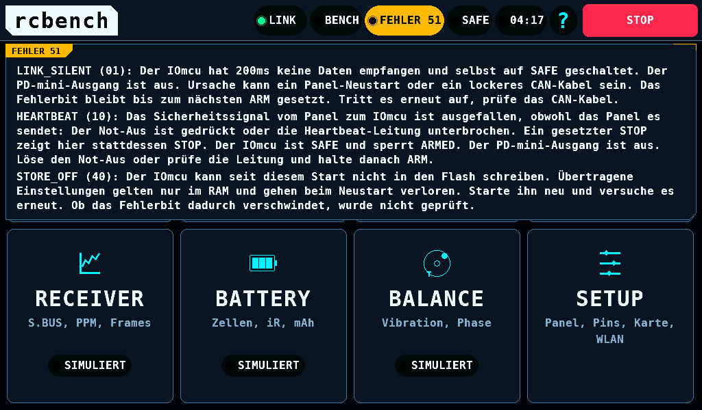


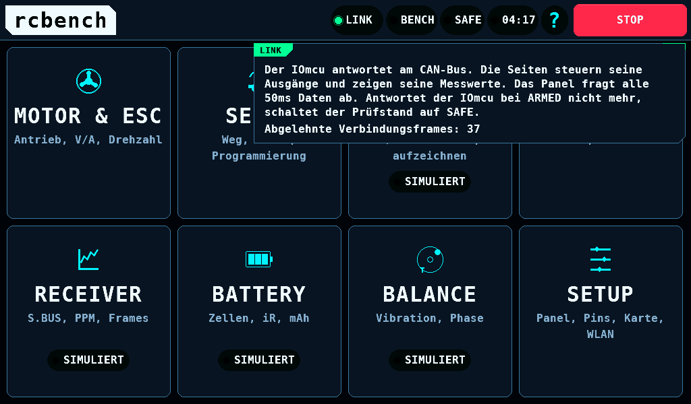

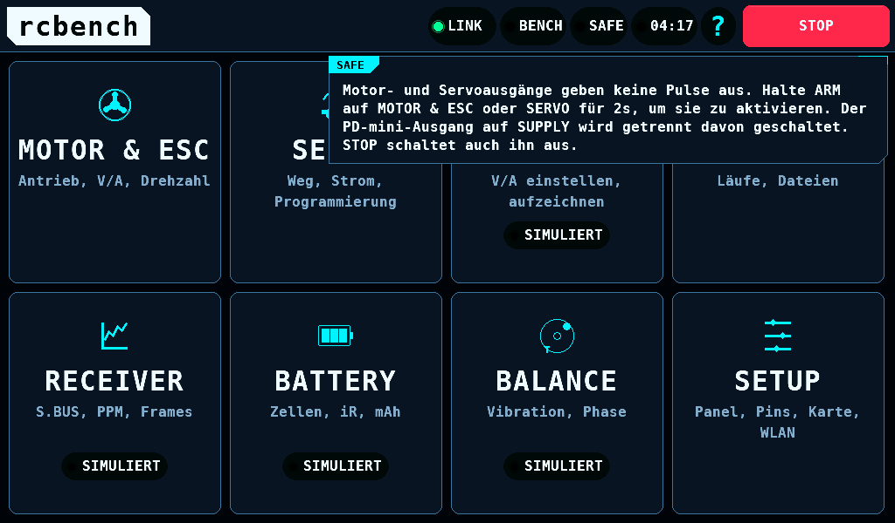

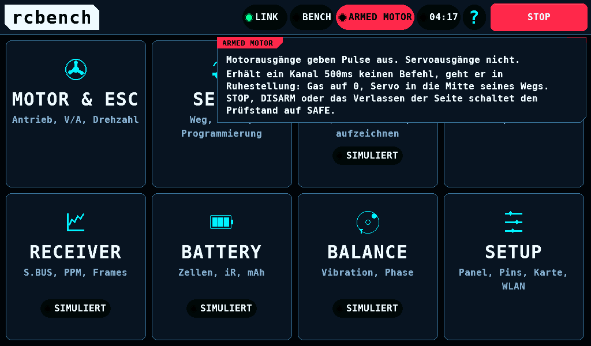

### HWSTOP

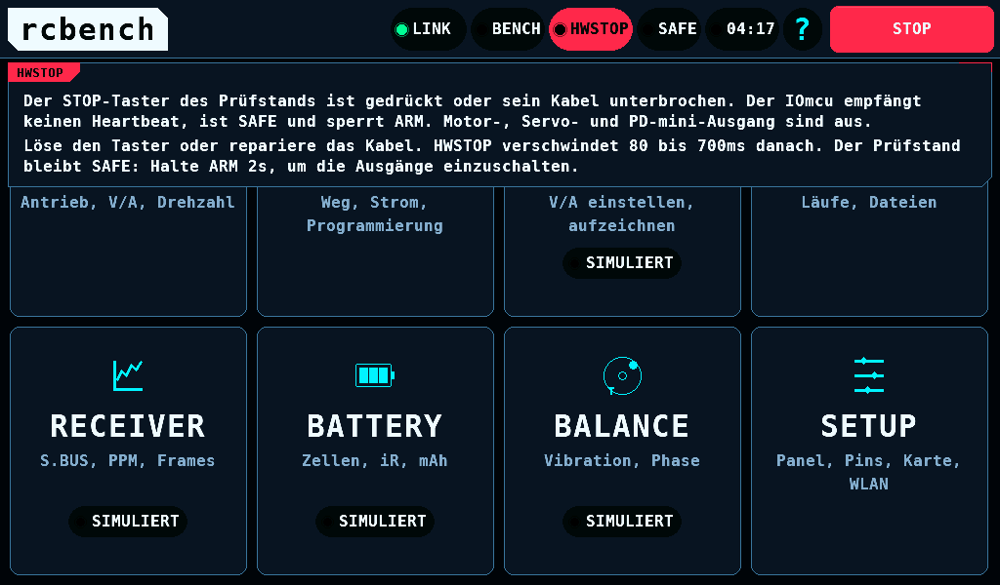

Mit SETUP > PANEL > Hardware-STOP auf EIN zeigt das Band das Heartbeat-Bit
(10) als roten Chip HWSTOP an der Stelle von FEHLER, für einen Prüfstand mit
STOP-Taster in der Heartbeat-Leitung ([STOP-Taster am
Prüfstand](Safety-de.md#stop-taster-am-prüfstand)). Ein gedrückter Taster
und ein unterbrochenes Kabel zeigen beide HWSTOP. Die Einstellung ist
standardmäßig AUS, und mit AUS zeigt das Band FEHLER 10.

- HWSTOP nimmt den Platz von FEHLER ein, die Chipreihe wird also nicht
  breiter: HWSTOP hat 6 Zeichen, `FEHLER 7F` 9. Weitere gleichzeitig
  gesetzte Bits stehen im Kasten von HWSTOP nach dessen zwei Absätzen und
  erscheinen wieder als FEHLER-Code, sobald HWSTOP verschwindet.
- Der Chip hat das Rot des Badges eines eingerasteten STOP, seine Schrift
  die dunkle Farbe der hellen Flächen.
- Solange er steht, liest das Panel STATUS bei jeder 50ms-Abfrage statt
  alle 500ms. Er verschwindet mit dem ersten Band, das aus einem STATUS ohne
  das Bit gezeichnet wird, 80 bis etwa 180ms nachdem die Leitung schließt,
  ohne ARM.
- Solange der eigene STOP des Panels eingerastet ist, während sein Lösen
  läuft und 1000ms danach lässt das Band Bit 10 weg, als HWSTOP und als
  FEHLER 10.

## Die Bildschirmhilfe

"?" im Statusband öffnet die Hilfe zur aktuellen Seite. Nummerierte Marken
kennzeichnen die Bedienelemente; ein Hilfefeld erklärt ihre Funktion.
Das Menü, SUPPLY, SERVO, OUTPUTS, SETUP, LOGS und FILES haben eine Hilfe,
die anderen Seiten haben kein "?". Auch Tastenfelder, Tastaturen, offene
Listen, Boxen, Warnungen und Bestätigungsdialoge zeigen kein "?".

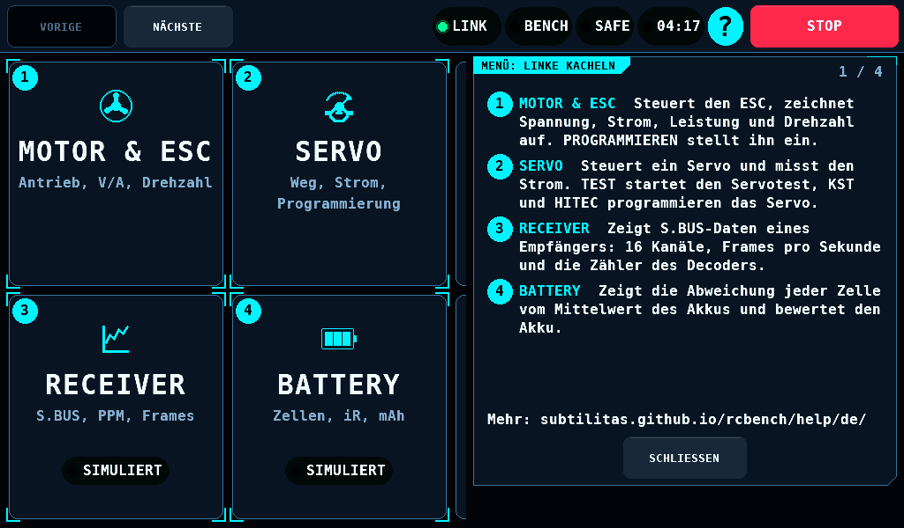

| Teil | Maß |
| --- | --- |
| Hilfefeld | 480 x 488px, 8px vom linken oder rechten Rand des Panels, y 64 bis 552; die Hilfeseite bestimmt die Position |
| Freie Hälfte | die übrigen 528px des Inhalts; die Seite bleibt dort sichtbar und läuft weiter |
| Kopfzeile | der Titel der Seite und "Seite / Seiten" |
| Eintrag | seine Nummer in einer 28px-Marke, der Name des Bedienelements in der Akzentfarbe, dann seine Funktion, in der Schrift 10 x 20px, 41 Zeichen pro Zeile, höchstens 3 Zeilen |
| Einträge pro Seite | höchstens 5 |
| Web-Zeile | `Mehr: subtilitas.github.io/rcbench/help/de/`, auf Englisch die Adresse ohne `de/` |
| VORIGE und NÄCHSTE | 124 x 48px, 8px auseinander, im Band von x 8 bis 264, y 6 bis 54, an der Stelle des Home-Felds, auf jeder Seite dieselbe |
| SCHLIESSEN | 140 x 48px, mittig am unteren Rand des Hilfefelds, y 496 bis 544 |
| Marken | eine 28px-Marke mit der Nummer des Eintrags 4px innerhalb der oberen linken Ecke des Bedienelements, oder 4px links von einem Bedienelement unter 56px Höhe oder Breite; 4px innerhalb der oberen rechten Ecke bei einem Bedienelement, dessen eigener Text an seiner linken Kante beginnt; Winkel von 2px an den Ecken des Bedienelements, 3px außerhalb |

Bei einem Bedienelement im Statusband steht die Nummernmarke darunter,
unter seiner linken Kante. Das Hilfefeld endet 4px über dem Alarmband,
sodass ein Alarm nichts davon verdeckt. Ein Bedienelement, das über die
freie Hälfte hinausreicht, wird bis zu ihrem Rand markiert; Text der Seite
endet dort an diesem Rand.

VORIGE und NÄCHSTE bleiben an derselben Stelle, wenn das Hilfefeld die
Seite wechselt. Wiederholtes Tippen auf dieselbe Position blättert weiter.
Die Tasten stehen im Statusband, das keine Hilfeseite markiert. Im Menü
füllen Kacheln den Inhalt; jede wird auf einer der Hilfeseiten markiert.

Die Tasten ersetzen das Home-Feld, das bei geöffneter Hilfe inaktiv ist.
Die Status-Chips beginnen frühestens bei x 270. Die Tasten verdecken daher
weder Chips noch "?" oder STOP. Nach dem Schließen erscheint das Home-Feld
wieder.

- Tippe auf "?", um Hilfeseite 1 zu öffnen. Gleitest du vor dem Loslassen
  von "?", öffnet sich nichts.
- VORIGE und NÄCHSTE blättern beim Loslassen auf derselben Taste. VORIGE auf
  der ersten und NÄCHSTE auf der letzten Seite sind abgeblendet und inaktiv.
- SCHLIESSEN oder ein Druck auf "?" schließt die Hilfe.
- Ein Druck auf das Hilfefeld oder eine Nummernmarke hat keine Wirkung.
- Ein Druck an anderer Stelle schließt die Hilfe ohne weitere Wirkung:
  auf der freien Hälfte, im Band neben den Chips oder auf dem Alarmband.
- Halte den leeren Teil des Bands 1000ms für einen [Screenshot](#screenshot).
  Die Hilfe bleibt für die Aufnahme sichtbar und schließt sich danach.
- STOP schließt die Hilfe und stoppt sofort. Ein Druck auf einen Chip
  schließt die Hilfe und öffnet beim Loslassen dessen Hilfefeld.
- DISARM, AUSGANG AUS, ABBRECHEN, TEST BEENDEN und LAUF BEENDEN wirken mit
  demselben Druck, der die Hilfe schließt.
- Beim Öffnen der Hilfe endet eine Ziehbewegung an der aktuellen Position.
  Eine Haltegeste auf ARM wird abgebrochen.
- Der Drehknopf bewegt bei geöffneter Hilfe nichts und schließt sie nicht.
- Das Verlassen der Seite oder ein Wechsel ihrer Hilfeseiten schließt die
  Hilfe: eine andere Aufgabe oder ein anderer Tab, und auf SUPPLY und SERVO
  der Wechsel zwischen SAFE und ARMED, das Ein- oder Ausschalten des
  Netzteilausgangs und der Start eines Laufs. Verbindungsverlust und
  Rückkehr der Verbindung lassen sie offen. Ihre Beschriftungen folgen dem
  Zustand.
- In ARMED zeigt die Hilfe nur Seiten, deren Hilfefeld weder ein
  Bedienelement zum Anhalten noch eine ZIEL-Zeile verdeckt. Hilfeseite 1
  weist darauf hin. Im Menü bleiben alle Hilfeseiten auch in ARMED sichtbar.

Die Hilfe des Menüs hat vier Seiten:

1. Die linken beiden Kachelspalten, mit dem Hilfefeld rechts.
2. Die rechten beiden Kachelspalten, mit dem Hilfefeld links.
3. STOP, Arm-Chip, "?" und SIMULIERT, mit dem Hilfefeld links.
4. Die leere Stelle im Band für die Screenshot-Haltegeste, mit dem Hilfefeld
   rechts.

Die Hilfen von OUTPUTS, SETUP, LOGS und FILES haben eigene Seiten für jeden Zustand
ihrer Seite. Auf Hilfeseite 1 steht das Hilfefeld rechts, auf der letzten
links; ein
Bedienelement, das das Hilfefeld zum Teil verdeckt, wird markiert, wo es
sichtbar ist. Keine dieser Seiten steuert einen Ausgang an, daher bleiben
alle ihre Hilfeseiten auch in ARMED sichtbar.

| Seite, Zustand | Hilfeseiten | Markiert |
| --- | --- | --- |
| SETUP, Kacheln | 2 | PANEL, SENSORS, SD CARD, WI-FI, IMU; OUTPUTS, UPDATES, LAYOUT auf dem Träger, SPEICHERN |
| SETUP, eine Liste | 2 | die erste ganze Zeile, der Name der Liste, ZURÜCKSETZEN; von den ganz sichtbaren Zeilen die erste, deren Wert das Ziffernfeld öffnet, sonst die erste mit Tasten: ihr `-` oder `<`, der Wert, `+` oder `>`; SPEICHERN |
| SETUP, SENSORS | 2 | wie eine Liste, zuerst der gewählte Eintrag |
| OUTPUTS, Platinenansicht | 2 | die Fläche der Protokollliste, LETZTER SCHREIBVORGANG, PINS, die linke Taste; BELEGT, die Haltetaste zum Löschen aller Pin-Zuordnungen, wenn angeboten, die rechte Taste |
| OUTPUTS, Eintrag PROG PORT | 2 | die Fläche des Eintrags, PIN, FUNKTION, SERVO-TESTER, PORT-PWM; dann BELEGT und eine Taste, in der Platinenansicht |
| OUTPUTS, Rasteransicht | 1 | die Fläche der Protokollliste, das erste Feld, LETZTER SCHREIBVORGANG; bei einem Eintrag PROG PORT seine Fläche und Zeilen |
| LOGS, Dateiliste | 2 | die Ordner-Tabs, eine Zeile, AKTUALISIEREN, WI-FI; FILES, VORIGE und NÄCHSTE bei mehreren Seiten, die Scrollleiste, LÖSCHEN, ÖFFNEN |
| LOGS, Importansicht | 2 | ERKANNT, TRENNZ., ZAHLEN; die Spalten, ZURÜCK, GRAFIK |
| LOGS, Grafik | 1 | ein Reihen-Chip, die Grafik, ZURÜCK, `<` und `>` |
| FILES, Spalten | 3 | LOGS, Ordner, Zeile und Scrollleiste der linken Spalte; AKTUALISIEREN, KOPIEREN, VERSCHIEBEN, UMBENENNEN; die rechte Spalte, LÖSCHEN, NEU, INFO, ÖFFNEN |

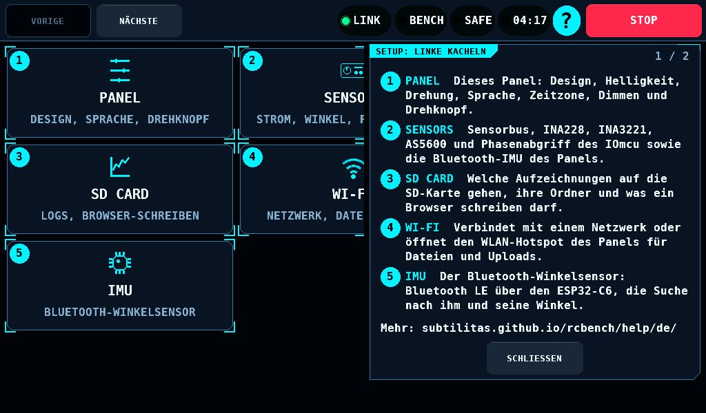

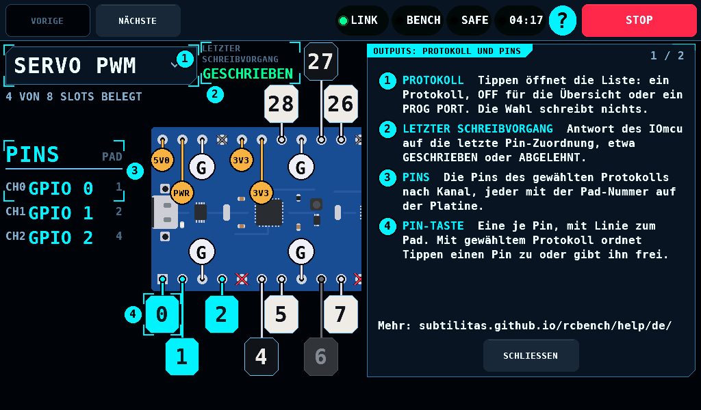

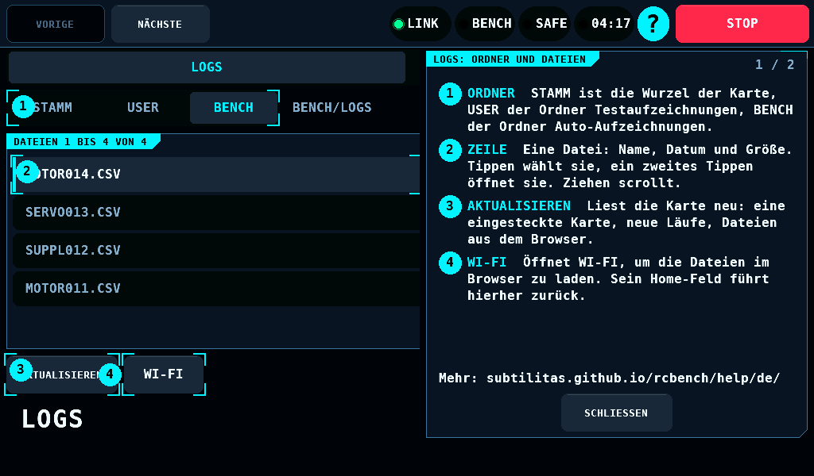

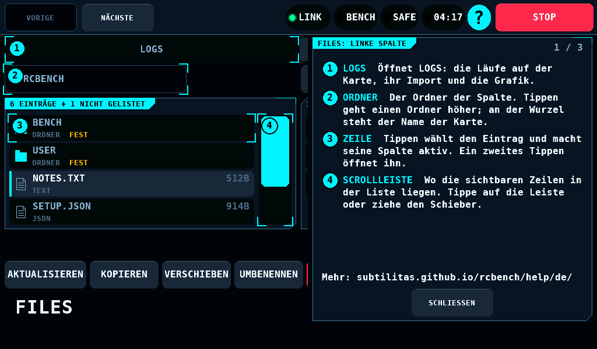

### Die Hilfe von SERVO und SUPPLY

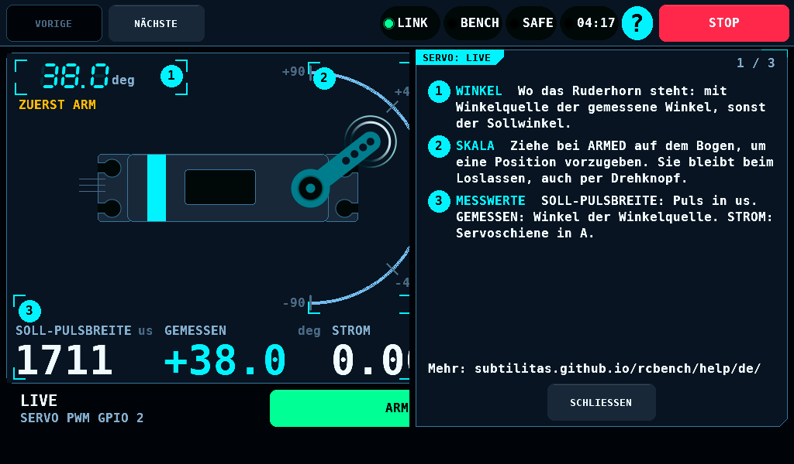

Eine Hilfeseite zur linken Karte hat das Hilfefeld rechts. Die Hilfeseiten
zur rechten Karte, der Ausgangskarte von SERVO und den Messwerten und der
Karte STEUERUNG von SUPPLY, haben es links; nur sie erscheinen in ARMED.
Die Aufgabe auf der linken Karte bestimmt die ersten Hilfeseiten:

| Seite und Aufgabe | Hilfeseiten, Einträge |
| --- | --- |
| SERVO LIVE | die Aufgabenleiste, der Winkel des Ruderhorns, die Skala und die Messwerte (4) |
| SERVO TEST | TEST STARTEN, OPTIONEN einer Laufkarte, ENDLAGENLAUF STARTEN und die Grenzen (4) |
| SERVO PROGRAMMIEREN | die Liste der Servoprogrammierungen, und SUCHE, wenn die Liste ihre Leiste zeigt (1 oder 2) |
| SERVO RUDER | LÄNGE, die Fahrtasten, NULLPUNKT, MAX LÖSCHEN und AUTO (5); AUSSCHLAG, HINTERKANTE und die Statuszeilen (3) |
| SERVO RUDER mit AUTO | die Sollwerte, RESERVE und TOLERANZ, START und MANUELL (4); AUSSCHLAG und HINTERKANTE (2) |
| SERVO OPTIONEN > AUSGANG | die Tabs, TYP, PULSRATE, PULS MIN und PULS MAX (5); PULS MITTE, TRIMMUNG, WEG und UMKEHREN (4) |
| SERVO OPTIONEN > SWEEP | KURVE, TEMPO und BEREICH (3) |
| SERVO OPTIONEN > PRÜFLING | NAME, BERICHT, SENSOR-MITTE, die Taste AS5600 und die Grenzen (5) |
| SERVO, jede Aufgabe | Typ, Grafik oder PROG 5V, SOLL und TEMPO (4); ZIEL, ZENTRIEREN mit SWEEP und FREIGEBEN, ARM, auf RUDER auch die Seitenansicht (3 oder 4) |
| SUPPLY LIVE | die Aufgabenleiste, GRAFIK und TABELLE, SPANNUNG und STROMBEGRENZUNG (4) |
| SUPPLY OPTIONEN > GRENZEN | die Tabs, die Obergrenzen, die Startwerte und mit dem PD mini PD MINI ZURÜCKSETZEN (3 oder 4); die Abschaltungen und Rückfragen, Hilfefeld links (5) |
| SUPPLY OPTIONEN > PD MINI | die vier Zeilen: PD mini, TX, RX und Baud (4) |
| SUPPLY, jede Aufgabe | der Bereich und die vier Messwertkarten (5); in LIVE die Sollwerte, SPITZENWERTE ZURÜCKSETZEN und der Ausgang (2 oder 3) |

Eine Hilfeseite, deren Hilfefeld ein Bedienelement zum Anhalten eines
Ausgangs verdecken würde, fehlt, solange dieses Element sichtbar ist:

- Die Hilfeseiten zur linken Karte verdecken die SOLL-Zeile von SERVO und
  die rechte Spalte von SUPPLY. Sie fehlen, solange der Netzteilausgang an
  ist oder ein EIN unterwegs ist: AUSGANG AUS bleibt sichtbar.
- Die Hilfeseiten zur Ausgangskarte von SERVO verdecken die linke Karte. Sie
  fehlen, solange der automatische Test, ein Endlagenlauf oder AUTO läuft:
  TEST BEENDEN oder LAUF BEENDEN bleibt sichtbar. Ein solcher Lauf ist
  ARMED; SERVO bietet dann keine Hilfeseite, und das Band zeigt kein "?".
- SERVO bietet keine Hilfeseite über einem Tastenfeld, einer Tastatur,
  einer Liste, einer Warnung, einer Rückfrage, einer Servoprogrammierung
  oder den Optionen eines Laufs; SUPPLY keine über seinem Tastenfeld oder
  der Rückfrage zu einem aktiven Ausgang.

## Screenshot

Halte die leere Stelle im Statusband 1000ms, um die Anzeige samt Band
aufzunehmen. Die Stelle ist unmarkiert; die Menühilfe und die Web-Hilfe
erklären ihre Lage.

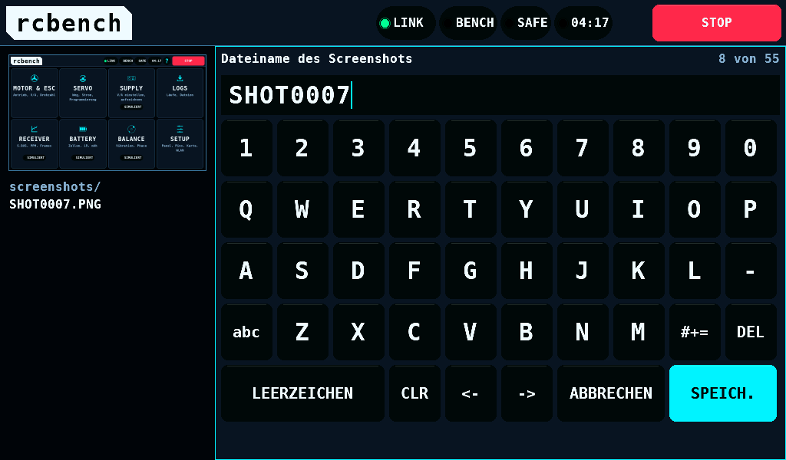

| Teil | Wert |
| --- | --- |
| Wo | die ganze Höhe des Bands, von 8px rechts des Home-Felds bis 8px links des Chips ganz links, aus den Rechtecken berechnet, die das Band zeichnet. Die schmalste Lücke über alle Seiten mit Band, Englisch und Deutsch: 176px in SAFE ohne FEHLER-Chip, 106px in ARMED MOTOR |
| Das Halten | 1000ms, über die Frames addiert; ein verspäteter Frame zählt höchstens 100ms, wie bei einer Halte-Taste. Bei 999ms keine Aufnahme |
| Was es beendet | ein Gleiten aus der Lücke, ein Chip, der unter dem Kontakt erscheint, jedes Ereignis eines anderen Kontakts, ein verlorenes Touch-Ereignis, ein Seitenwechsel. Das Loslassen tut nichts |
| Über dem Hilfefeld eines Chips oder der Hilfe | sie bleiben für das Bild stehen und schließen, wenn das Halten endet, mit Bild oder ohne. Ein Loslassen vor 1000ms schließt sie und nimmt nichts auf. Ein zweiter Kontakt beendet das Halten und trifft sie nach ihren eigenen Regeln: sein Druck schließt sie |
| Was es nicht ist | ein Druck auf einen Chip, das Home-Feld, "?" oder STOP. Keine Seite erhält den Kontakt |
| Antwort bei 1000ms | die Mitteilung im Band, keine Füllung während des Haltens: `Screenshot aufgenommen.` oder `Screenshot aufgenommen. Die Vorschau öffnet sich, sobald der Prüfstand ruht.` |
| Speicher | 1.305.600B PSRAM (pseudo-statisches RAM), 1.228.800B fürs Bild und 76.800B für die Vorschau, von der Aufnahme bis ABBRECHEN oder zum erfolgreichen Speichern. Ein Neustart verwirft das Bild |
| Kein Speicher | das Band sagt `Kein Screenshot: 1.305.600B PSRAM sind nicht frei.`, sonst ändert sich nichts |
| Halten bei wartendem Bild | ersetzt es im selben Speicherbereich: `Neuer Screenshot aufgenommen. Er ersetzt den wartenden.` |
| Halten, während ein abgebrochenes Speichern endet | kein Bild: `Kein Screenshot: Der letzte wird noch geschrieben.`, höchstens eine PNG-Zeile lang |
| Ein fest gespeicherter Wert in der Anzeige | kein Bild: `Kein Screenshot: Diese Seite zeigt ein festes Passwort oder einen festen Code.` WI-FI lehnt ab, solange es ein festes [HOTSPOT-PASSWORT oder einen festen ZUGANGSCODE](#hotspot-passwort-und-zugangscode) zeigt: in der Ansicht dieses Werts, auf seiner Tastatur und in den Zeilen eines laufenden Funks mit einem der beiden fest. Ein Bild auf der Karte ist vom Browser lesbar. Ein ZUFALL-Passwort und ein ZUFALL-Code werden aufgenommen, denn sie enden mit der Sitzung |
| Seiten ohne diese Haltegeste | SPLASH, der Busfehler-Seite, PANEL UPDATE und der Fortschritt des IOmcu-Updates: Sie haben kein Band. Die Frage des IOmcu-Updates und die Release-Erinnerung: Sie können nicht sagen, ob ein Dialog sie verdeckt, und das Popup würde sich erst öffnen, nachdem sie geschlossen wurden. MOTOR & ESC, der längste Titel, hat mit ARMED MOTOR und einem langen FEHLER-Chip keine Lücke |

Die Render-Task nimmt den aktuellen Frame sofort auf, unabhängig vom
Zustand des Prüfstands. Die Aufnahme liest und ändert keinen Ausgang;
STOP, DISARM und die übrigen Bedienelemente bleiben aktiv. Das Bild
entspricht der sichtbaren Anzeige, einschließlich offener Felder, Listen
oder Tastenfelder und der Einstellung `Bilddrehung` 180°. Der Frame wird
aufrecht gezeichnet und auf dem Weg zum Panel gedreht. Die Mitteilung zur
Aufnahme erscheint einen Frame später und ist nicht im Bild.

### Das Popup

Das Popup öffnet sich, wenn der Prüfstand ruht, die aktuelle Seite ein
Statusband hat, kein anderer Dialog offen ist und kein Finger das Glas
berührt. Es nimmt nur einen neuen Druck an. Die Berührung, die den
Prüfstand auf SAFE schaltet oder einen Dialog bestätigt, kann es daher
nicht bedienen.

| Teil | Wert |
| --- | --- |
| Vorschau | 256 x 150px, jedes Pixel der Mittelwert von 4 x 4, oben links im Inhalt |
| Ordner und Name | `screenshots/` und der Name mit `.PNG`, unter der Vorschau |
| Tastatur | die Dateinamen-Tastatur, x 280 bis zum Panelrand. OK heißt `SPEICH.` |
| Band | STOP und die Chips bleiben aktiv. Home-Feld und Drehknopf sind inaktiv, "?" ist ausgeblendet |

Entfällt eine der folgenden Bedingungen, schließt sich das Popup. Das Bild
und der eingegebene Name warten, bis die Bedingungen wieder erfüllt sind.
Erst ABBRECHEN oder erfolgreiches Speichern verwirft das wartende Bild.

| Der Prüfstand ruht, wenn | Gelesen aus |
| --- | --- |
| der Link antwortet oder der Prüfstand simuliert ist | `link_up` des Snapshots, das Flag des Modells |
| SAFE, keine ARM-Anfrage wartet | `armed`, `arm_wanted` des Snapshots |
| keine STOP-Anforderung wartet | `s_stop_request` |
| das Netzteil aus ist, keine Einschaltanforderung unterwegs | `supply.output` des Snapshots, der Ausgang des neuesten Samples, `supply_live_or_coming()` |
| PROG 5V aus ist, keine Einschaltanforderung unterwegs | `prog5v_box_on()`, `supplies_live_or_coming()` |
| kein Port gehalten wird | `supply_screen_port_held()`, `kst_panel_holds_port()`, `hitec_panel_holds_port()`, die Holds der HITEC-Seite in `s_drive` |
| keine Programmiersitzung offen ist | `kst_panel_is_open()`, `hitec_panel_is_open()`, `esc_stick_panel_stage()` |
| kein Kartenauftrag einer Servoprogrammierung läuft | die Datei- und Karten-Zähler von KST und Hitec |
| kein Sweep und keine Pause | `servo_screen_sweeping()`, `servo_screen_paused()` |
| kein automatischer Test und kein Endlagenlauf | `servo_screen_testing()`, `servo_screen_limit_running()`, `s_servo_testing` |
| kein ESC-STICK-Lauf | `esc_stick_panel_profile()` |
| kein Update, keine Installation, kein Download | `cu.active` des Snapshots, `s_cu_busy`, `s_fw_installing`, Flag und Abruf des Downloads |
| kein FEHLER-Bit gesetzt ist | `faults` des Snapshots |
| keine Fehleraufzeichnung geschrieben wird | `log_fault_busy()` |
| kein Aufzeichnungslauf, keine Testdatei, keine Aufzeichnung offen ist | `panel_run_open()` |

Ausgänge werden nur in ARMED angesteuert; SAFE schließt damit auch Pulse
an einem Pin aus. Ein gesetztes FEHLER-Bit verhindert das Popup, bis es
gelöscht ist. Auch offene Tastenfelder, Tastaturen, Listen, Felder oder
Bestätigungsdialoge verzögern das Popup.

### Sichern

SPEICH. schreibt `screenshots/<Name>.PNG` und legt den Ordner bei Bedarf an.
Der Ordner ist nicht FIXED: Der Prüfstand liest nichts daraus. FILES und
die WLAN-Seite können ihn wie jeden anderen Ordner umbenennen oder löschen.
Ein FILES-Fenster mit diesem Ordner zeigt die neue Datei beim nächsten
Aktualisieren.

| Teil | Wert |
| --- | --- |
| Format | PNG (Portable Network Graphics), 1024 x 600, 8 Bit RGB, jeder RGB565-Wert mit seinen oberen Bits in den unteren wiederholt |
| Standardname | `SHOT` und 4 Ziffern, eins über dem höchsten solchen Namen im Ordner; höchstens `SHOT9999` |
| Name | bis 55 Bytes vor `.PNG`, die Regeln der Namen von FILES (`fm_name.h`) |
| Ein vergebener Name | abgelehnt: `Dieser Name ist vergeben. Gib einen anderen ein.` Nichts wird überschrieben |
| Größe | 38.388 bis 77.840B auf der Karte, 8 Dateien; die Seite OUTPUTS mit der Platinenzeichnung ergab die größte Datei |
| Zeit | 5,3 bis 6,3s allein; 0,40 bis 1,00s mit einem Schreibvorgang der WLAN-Seite, der auf die Sperre der Karte wartet. Die Ursache des Unterschieds ist nicht untersucht. Die Konsole schreibt die Dauer jedes Speicherns und jeder Kopie |
| Speicher beim Speichern | 36.928B PSRAM für den Encoder, 16.384B internes RAM für den Kartenpuffer und 7.168B internes RAM für den Stack der Task, am Ende freigegeben |
| Task | `shot`, Priorität 0 auf Kern 0, unter der Render-Schleife. Control-Task und Heartbeat sind nicht beteiligt |
| Stack von `shot` | niedrigster Stand 5.116B unbenutzt von 7.168B |
| Läufe auf einem Panel | 30 Screenshots hintereinander: kein Fehler, kein Neustart. Kein FLIP TIMEOUT und keine Watchdog-Zeile. `FM_ERR_BUSY` trat in 3 Läufen mit überlappendem Speichern und Schreibvorgang der WLAN-Seite nicht auf: Beide Vorgänge warten und werden abgeschlossen |
| Zweiter Kontakt auf einem Panel | 6 von 6 Prüfungen bestanden: Ein zweiter Kontakt während des Haltens nimmt kein Bild auf, und sein Druck wirkt; ein schon liegender Kontakt beginnt kein Halten; STOP während eines Haltens wirkt; ein Halten über der Hilfe mit einem zweiten Kontakt nimmt keins auf; das Popup wartet, bis alle Kontakte abgehoben sind, und drückt keine Taste; 5 gleichzeitige Kontakte auf einer Liste hinterlassen keinen hängenden Druck |
| Auf einem Panel nicht geprüft | keine Karte im Schacht, Pixelgleichheit des PNG mit einem gerenderten Frame, ein Glaskontakt zusammen mit einem Injektor-Kontakt |

Beim Speichern entsteht zuerst `<Name>.PNG.NEW`; danach wird die Datei
umbenannt. Ein Abbruch oder das Entfernen der Karte hinterlässt keine
Datei mit dem gewünschten Namen. Bei Stromausfall bleibt die `.NEW`-Datei
liegen. Das nächste Speichern unter demselben Namen löscht sie.

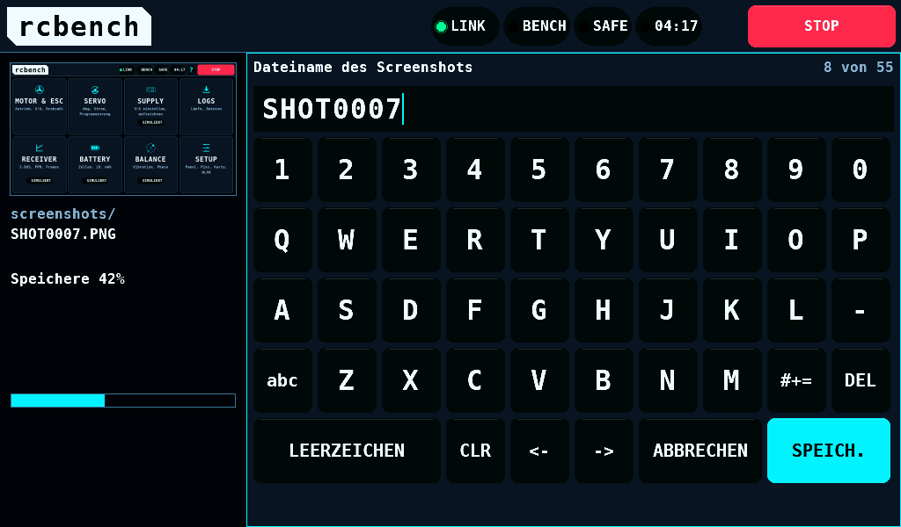

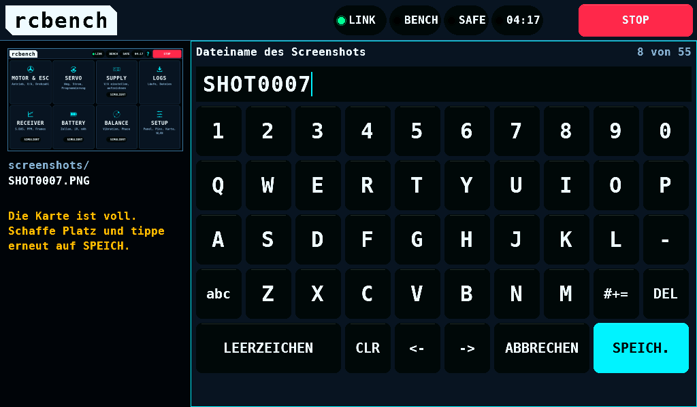

| Beim Speichern oder danach | Anzeige im Popup |
| --- | --- |
| währenddessen | `Speichere 42%` und ein Balken. Nur ABBRECHEN reagiert |
| erfolgreiches Speichern | schließt sich; das Band: `Gespeichert: screenshots/SHOT0007.PNG` |
| keine Karte, Karte weg | `Keine Karte. Setze eine ein und tippe erneut auf SPEICH.` |
| volle Karte | `Die Karte ist voll. Schaffe Platz und tippe erneut auf SPEICH.` |
| schreibgeschützt | `Die Karte ist schreibgeschützt.` |
| Schreiben fehlgeschlagen | `Schreiben fehlgeschlagen. Das Bild bleibt. Tippe erneut auf SPEICH.` |
| kein Speicher für Encoder oder Puffer | `Kein Speicher für das PNG. Nichts wurde geschrieben.` |
| ein anderer Kartenauftrag länger als 2000ms | `Die Karte ist beschäftigt. Tippe gleich erneut auf SPEICH.` |
| der Prüfstand war während des Speicherns nicht durchgehend in Ruhe | beim nächsten Öffnen: `Der Prüfstand war beschäftigt. Nichts gespeichert. Tippe erneut auf SPEICH.` |

Bei einem Fehler bleibt das Bild erhalten und das Popup zeigt die Meldung.
Das Speichern teilt die Kartensperre mit FILES und der WLAN-Seite; jeweils
nur ein Kartenauftrag läuft. Schreibvorgänge der WLAN-Seite warten bis zu
2000ms auf einen Speichervorgang und antworten danach mit `PANEL_BUSY`.

ABBRECHEN stoppt das Schreiben an der nächsten Zeile und verwirft das Bild,
sobald das Schreiben beendet ist. Ist der Prüfstand nicht länger in Ruhe,
endet das Schreiben auf dieselbe Weise, das Bild bleibt jedoch erhalten.
Die Meldung über diesen Abbruch oder einen Fehler bei geschlossenem Popup
erscheint beim nächsten Öffnen. Eine neue Aufnahme oder ABBRECHEN löscht
die Meldung.

Die Render-Task kopiert alle 1.228.800B in einem Frame. Eine Verteilung auf
mehrere Frames würde deren Inhalte mischen, da sich die Bildpuffer mit
jedem Frame ändern. Die Kopie dauert auf dem Build-Rechner 0,1ms, auf dem
Panel 25,8 bis 31,6ms, mit einem Median von 28,3ms über 54 Kopien. Die
Konsole protokolliert jede Dauer.

Im Lauf wurde mindestens 1 Panel-Frame verpasst. Bei einem Sweep liegt die
Bildrate bei 30 bis 37fps; der über 5s gemessene Wert bleibt während der
Haltegeste unverändert. Die Dauer des einzelnen Frames mit der Kopie ist
nicht gemessen. Die Control-Task auf dem anderen Kern wartet nicht darauf.
Die Frame-Überwachung erlaubt 1000ms.

## Das Alarmband

Eine Störung, die die aktuelle Seite nicht anzeigt, erscheint als rotes
Alarmband am unteren Rand jeder Seite mit Statusband. Das Band ist 44px
hoch und zeigt bis zu 2 Zeilen mit je 97 Zeichen in der Schrift 10 x 20px.
Solange es sichtbar ist, verdeckt es die unteren 44px. ARM und alle
Bedienelemente zum Anhalten des Prüfstands enden darüber.

- Ein Alarm verschwindet 30s nach dem Frame, in dem er eintraf. Ein neuer
  Alarm startet diese Zeit erneut, auch bei gleichem Text. Der [Hinweis
  einer Halte-Taste](#halte-tasten) erscheint dagegen 4s lang in
  Bernsteinfarbe und weicht einem Alarm.
- Tippe auf das Band, um den Alarm früher zu löschen: Drücke auf das Band
  und lasse dort los. Am rechten Rand steht ein `x`. Die darunterliegende
  Seite erhält weder diesen Tipp noch die Berührung eines zweiten Fingers
  auf dem Band. Nur das Loslassen des ersten Fingers löscht den Alarm.
- Trifft ein Alarm ein, während ein Finger auf dem Band liegt, löscht das
  anschließende Loslassen ihn nicht.
- Die Bedienelemente zum Anhalten enden oberhalb des Bands, das von Panel-y
  556 bis 599 reicht: DISARM, AUSGANG AUS, ABBRECHEN eines Stick-Laufs
  (y 496 bis 551), ABBRECHEN bei einem Handgriff (y 444 bis 491), TEST
  BEENDEN und LAUF BEENDEN. Sie reagieren bei sichtbarem Alarm; der Alarm
  bleibt. Ein Bedienelement zum Anhalten, das unter dem Band liegt, wirkt
  beim ersten Druck und löscht zugleich den Alarm. ARM und AUSGANG EIN
  unter dem Band reagieren dagegen nicht: Der Tipp löscht nur den Alarm,
  ohne eine Haltegeste zu beginnen.
- Trifft ein Alarm ein, während ein Finger auf einem Bedienelement liegt,
  bleibt die Berührung diesem zugeordnet. Das Loslassen wirkt wie ohne Alarm.
- Die Startmeldung "Touchscreen antwortet nicht. ARMED ist gesperrt."
  bleibt bis zum Neustart und hat kein `x`, da keine Touch-Bedienung möglich
  ist. Spätere Alarme überlagern sie; nach deren Ende erscheint sie wieder.

## Halte-Tasten

Eine Halte-Taste wirkt nach 2s Berührung (`UI_HOLD_S`). Loslassen vor 2s
sendet keinen Befehl. Stattdessen erscheint ihr Hinweis für 4s im Alarmband:
in Bernsteinfarbe (`UI_C_WARN`) mit dunkler Schrift statt der
Gefahrenfarbe. Tippe auf das Band, um ihn früher zu löschen. Der Hinweis
passt in eine Zeile mit höchstens 97 Zeichen.

Ein kurzer Tipp ist keine Störung; der Hinweis ist deshalb eine Mitteilung.
Alarme haben Vorrang: Solange ein Alarm sichtbar ist, bleibt der Hinweis
ausgeblendet. Ein eintreffender Alarm ersetzt einen sichtbaren Hinweis.

- Der Hinweis erscheint nur, wenn du den Finger auf der Taste loslässt.
  Er erscheint nicht nach dem Herausgleiten, bei verlorener Berührung,
  bei einem Loslassen ohne Tipp (`TOUCH_FLAG_NO_TAP`), bei einer Berührung
  mit einem zweiten Finger oder auf einer Seite ohne Statusband.
- Bei 2s oder später hat die Haltegeste bereits gewirkt. Das Loslassen
  zeigt dann keinen Hinweis.
- STOP löscht den Hinweis im selben Frame. Dasselbe gilt bei einem neuen
  Fehlerbit im FEHLER-Chip oder einem Wechsel von ARMED auf SAFE, auch
  durch einen Fehler. Ein Alarm bleibt dabei sichtbar.
- Die Busfehler-Seite hat kein Statusband. Ihre Haltetaste zeigt den
  Hinweis anstelle ihres Balkens von 64px, bernsteinfarben mit dunkler
  Schrift, für 4s. Ein Tipp auf den Balken schließt ihn.

| Taste | Hinweis |
| --- | --- |
| ARM auf MOTOR & ESC und SERVO | `Halte 2s, um auf ARMED zu schalten.` |
| AUSGANG EIN auf SUPPLY und im Versorgungsfeld von SERVO | `Halte 2s, um den Ausgang einzuschalten.` |
| PROG 5V EIN im Feld PROG 5V auf SERVO und SUPPLY, rbmod-Carrier | `Halte 2s, um die 5V der Programmierports einzuschalten.` |
| ÜBERNEHMEN in den Warnungen zu HV, Pulsrate und weichen Grenzen von SERVO, KST und Chaservo und auf den Hitec-Seiten | `Halte 2s, um zu übernehmen.` |
| TEST STARTEN | `Halte 2s, um den Test zu starten.` |
| ENDLAGENLAUF STARTEN | `Halte 2s, um den Endlagenlauf zu starten.` |
| 2s HALTEN ZUM FREIGEBEN, außer auf PORT FREIGEBEN | `Halte 2s, um freizugeben.` |
| 2s HALTEN ZUM SCHREIBEN | `Halte 2s, um zu schreiben.` |
| 2s HALTEN ZUM ZURÜCKSPIELEN | `Halte 2s, um zurückzuspielen.` |
| 2s HALTEN ZUM FORTFAHREN | `Halte 2s, um fortzufahren.` |
| 2s HALTEN ZUM VERLASSEN | `Halte 2s, um die Sitzung zu verlassen.` |
| 2s HALTEN ZUM BEWEGEN auf der Seite SERVO BEWEGEN der Hitec-Programmierung | `Halte 2s, um das Servo zu bewegen.` |
| 2s HALTEN ZUM LADEN | `Halte 2s, um zu laden.` |
| 2s HALTEN ZUM FREIGEBEN auf PORT FREIGEBEN | `Halte 2s, um den Port freizugeben.` |
| 2s HALTEN ZUM REPARIEREN | `Halte 2s, um zu reparieren.` |
| 2s HALTEN ZUM STARTEN in der Warnung eines Stick-Laufs | `Halte 2s, um zu starten.` |
| 2s HALTEN ZUM INSTALLIEREN auf WI-FI | `Halte 2s, um zu installieren.` |
| 2s HALTEN ZUM LADEN & INSTALLIEREN auf UPDATES und in der Update-Erinnerung | `Halte 2s, um zu laden und zu installieren.` |
| 2s HALTEN ZUM IOMCU-UPDATE auf UPDATES und START im Bestätigungsdialog des IOmcu-Updates | `Halte 2s, um den IOmcu zu aktualisieren.` |
| 2s HALTEN ZUM C6-FUNK-UPDATE auf UPDATES | `Halte 2s, um den C6-Funk zu aktualisieren. Das WLAN bleibt bis zum Ende aus.` |
| 2s HALTEN ZUM LÖSCHEN ALLER PIN-ZUORDNUNGEN auf OUTPUTS | `Halte 2s, um alle Pin-Zuordnungen zu löschen.` |
| ÜBERSCHREIBEN im Bestätigungsdialog des FILES-Editors | `Halte 2s, um zu überschreiben.` |
| 2s HALTEN ZUM BESTÄTIGEN auf der Busfehler-Seite | `Halte 2s, um zu bestätigen.` |
| 2s HALTEN ZUM NEUVERBINDEN auf der Busfehler-Seite | `Halte 2s, um neu zu verbinden.` |

## Marken im Menü

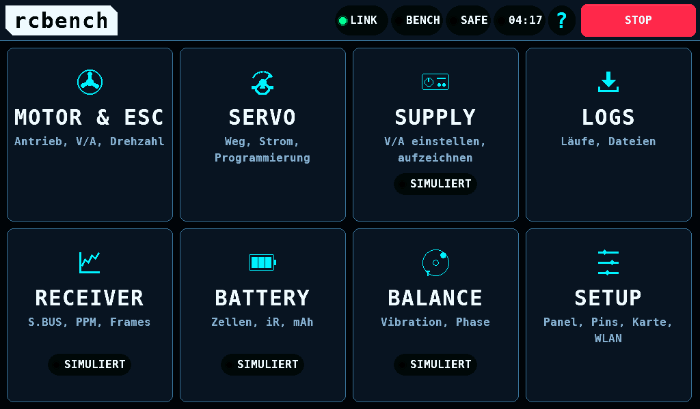

Das Menü hat 4 Spalten und 2 Reihen mit 243 x 255px großen Kacheln und
10px Rand. Jede Kachel zeigt ein 40px-Symbol, ihren Namen in der Schrift
20 x 36px und eine Beschreibung in 10 x 20px. In der ersten Reihe stehen
die Prüfstandsseiten MOTOR & ESC, SERVO und SUPPLY, in der zweiten die
Instrumente RECEIVER, BATTERY und BALANCE. Die letzte Spalte enthält LOGS
über SETUP.

Eine vierte Prüfstandsseite oder ein viertes Instrument lässt den Build
für dieses Raster mit 4 Spalten scheitern (`shared/ui/overview_screen.c`).
Die Programmierung hat keine eigene Kachel. Du erreichst sie über
PROGRAMMIEREN auf MOTOR & ESC und SERVO.

Unter jedem Kachelnamen steht eine Beschreibung mit bis zu 2 Zeilen von
je 22 Zeichen und 8px Abstand zu den Seitenrändern:

| Kachel | Zeile |
| --- | --- |
| MOTOR & ESC | Antrieb, V/A, Drehzahl |
| SERVO | Weg, Strom, Programmierung |
| SUPPLY | V/A einstellen, aufzeichnen |
| LOGS | Läufe, Dateien |
| RECEIVER | S.BUS, PPM, Frames |
| BATTERY | Zellen, iR, mAh |
| BALANCE | Vibration, Phase |
| SETUP | Panel, Pins, Karte, WLAN |

SIMULIERT markiert eine Kachel, wenn der Prüfstand die Datenquelle der
Seite nicht meldet: Entweder fehlt die Fähigkeit im IOmcu, oder der Sensor
ist unter SETUP > SENSORS ausgeschaltet. Die Seite öffnet sich trotzdem
und verwendet ihr Modell.

Die Markierung beschreibt die Seite insgesamt, nicht jeden einzelnen
Messwert. RECEIVER und BATTERY tragen sie und zeigen keine Werte. SERVO
kann ohne Markierung erscheinen und dennoch die berechneten Werte des
Versorgungsmodells anzeigen, wenn weder ein PD mini noch ein INA3221
aktiviert ist. Jede Seite nennt die Quelle ihrer Messwerte.

| Kachel | Ohne Marke, wenn |
| --- | --- |
| MOTOR & ESC | der IOmcu ESCs ansteuert und eine INA228-Konfiguration hat, die unter SETUP, SENSORS eingeschaltet ist |
| SERVO | der IOmcu Servo-PWM-Ausgänge ansteuert |
| SUPPLY | der PD mini auf der Registerkarte PD MINI auf SUPPLY eingeschaltet ist, unabhängig davon, was der IOmcu meldet; sonst rechnet das Panel mit seinem eigenen Netzteilmodell |
| RECEIVER, BATTERY, BALANCE | in diesem Release nie: kein IOmcu meldet diese Fähigkeiten |

Der IOmcu meldet seine Fähigkeitsbits beim Start. Antwortet kein IOmcu,
tragen MOTOR & ESC und SERVO ebenfalls die Markierung.

Das Menü im hellen Design:

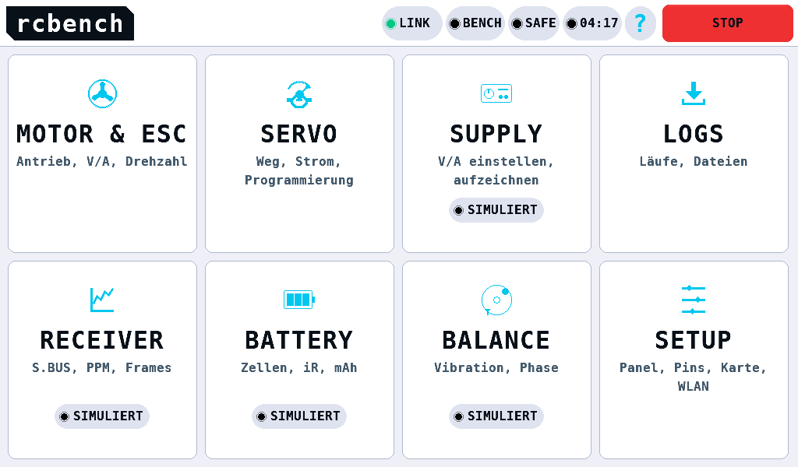

## Tastenfeld, Tastatur und die gemeinsamen Bedienelemente

Tastenfelder, Tastaturen, Auswahllisten, Registerkarten und ZIEL-Zeilen
sehen auf jeder Seite gleich aus. Die Seite weist ihnen eine Fläche oder
Zeile zu; das gemeinsame Bedienelement bestimmt Schrift und innere Abstände.

- **Tastenfeld.** Eine Titelzeile von 32px, die Eingabe von 60px, dann
  4 x 4 Tasten mit 8px Abstand, 8px vom Rand der Fläche; die Tasten enden
  spätestens 4px über dem Alarmband (unten). Auf SERVO ist eine Taste
  145 x 88px groß (21,8 x 13,2mm), auf SUPPLY 145 x 76px.
  Titel und Bereich stehen in der Schrift 10 x 20, oder in 8 x 16, wo beide nicht
  nebeneinander passen. Die Eingabe steht in den Ziffern 32 x 44 mit der
  Einheit in 12 x 24; eine Eingabe, die nicht passt, nimmt die Ziffern
  24 x 30 mit der Einheit in 10 x 20. Ziffern und Punkt stehen in der größten Schrift
  von 20 x 36, 16 x 28, 12 x 24 und 10 x 20, deren Zeichenzelle mit 6px Rand je
  Seite auf eine Zifferntaste passt, sonst in 8 x 16; 20 x 36 braucht
  eine Taste von 32 x 48px und ist die Schrift jedes Tastenfelds, das das
  Panel öffnet. DEL, CLR, ABBRECHEN, OK und `+/-` teilen eine Schrift: die
  größte dieser Schriften, höchstens so groß wie die Ziffernschrift, in der alle
  mit 6px Rand je Seite auf ihre Taste passen. Das englische Wort für
  ABBRECHEN braucht für 20 x 36 eine Taste von 132px. `ABBRECHEN` braucht für 20 x 36 192px,
  für 16 x 28 156px, für 12 x 24 120px und für 10 x 20 102px; die
  deutschen Tastenfelder von SERVO, SUPPLY und den OPTIONEN von
  MOTOR & ESC zeigen ihre Wörter darum in 12 x 24.
- **Tastatur.** Eine Titelzeile von 32px, das Textfeld von 52px, dann 5
  Tastenreihen mit 6px Abstand. Titel und Zähler stehen in 10 x 20, oder
  in 8 x 16, wo beide nicht nebeneinander passen. Der Text steht in der Schrift
  20 x 36, wenn 23 Zeichen und die Schreibmarke ins Feld passen, sonst in
  16 x 28. Buchstaben, Ziffern und Zeichen stehen in der größten Schrift von 20 x 36,
  16 x 28, 12 x 24 und 10 x 20, deren Zeichenzelle mit 4px Rand je Seite auf
  eine Zeichentaste passt, sonst in 8 x 16; 20 x 36 braucht eine Taste
  von 28 x 44px und ist die Schrift jeder Tastatur, die das Panel öffnet.
  Die Worttasten (die untere Reihe, DEL, `ABC`, `abc`, `#+=`) teilen
  eine Schrift: die größte derselben Schriften, höchstens so groß wie die
  Zeichenschrift, in der alle mit 4px Rand je Seite auf ihre Taste passen;
  VERBERGEN zählt dabei wie ANZEIGEN, so ändert ein Tippen die Schrift
  nicht. Auf WI-FI nimmt die Tastatur den Inhalt über dem Alarmband,
  1008 x 484px, mit Tasten von 93 x 71px (14,0 x 10,7mm) und jedem Wort
  in 20 x 36; die Wörter der Passworttastatur stehen auf Deutsch in
  16 x 28, da `LEERZEICHEN` zwei Tasten von 192px hat. Die
  Namenstastaturen von SERVO, Tasten von 55 x 72px, zeigen ihre Wörter
  in 12 x 24, die Suchtastatur von ESC STICK, Tasten von 59 x 57px, in
  16 x 28. Die Tastatur des Texteditors hat keine Titelzeile, kein Feld
  und keine Ziffernreihe: 4 Tastenreihen, Tasten von 93 x 56px, alle
  Wörter in 20 x 36, `123` als weitere Worttaste
  ([Der Texteditor](#der-texteditor)).
- **Auswahlliste.** Ein Feld oder eine Zeile ab 56px Höhe zeigt den Text
  in der Schrift 20 x 36, 12px eingerückt, mit einem 11px breiten Winkel 28px
  vor dem rechten Rand. Ein niedrigeres zeigt ihn in 16 x 28, 10px
  eingerückt, mit einem 7px breiten Winkel 22px vor dem Rand. Ein Text,
  der in 20 x 36 nicht vor den Winkel passt, steht in 16 x 28:
  `DSHOT600 BIDIR` auf einem Feld von 292px. Jedes Feld und jede Zeile
  wählt für sich, die Zeilen einer Liste können sich also unterscheiden.
  Die Felder auf OUTPUTS sind niedriger als 56px.
- **Registerkarten.** Eine Registerkartenleiste ab 32px Höhe zeigt ihre Beschriftungen in der
  Schrift 10 x 20, wenn jede in der gezeigten Sprache mit 6px Rand je Seite
  auf ihre Registerkarte passt; sonst in 8 x 16. ROOT, USER und BENCH auf LOGS und
  die Segmente des PROG-PORT-Eintrags auf OUTPUTS stehen in 10 x 20. Die
  Streifen von SERVO und MOTOR & ESC sind 40px hoch und zeigen 10 x 20;
  der von SUPPLY ist 24px hoch und bleibt bei 8 x 16. Die Registerkarten von
  RECEIVER und BALANCE sind 150 x 48px groß und zeigen 10 x 20.
- **ZIEL-Zeile.** Eine Zeile ab 40px Höhe zeigt Beschriftung und Wert in
  10 x 20, mit 88px für die Beschriftung, und zählt die genannten Pins in
  Zellen von 10px. Eine niedrigere zeigt sie in 8 x 16 mit 64px für die
  Beschriftung und zählt in Zellen von 8px. SERVO und MOTOR & ESC zeichnen
  ihre 48px hoch.
- **Grafik.** Eine Grafik hält 1.024 Werte je Datenreihe, einen je Pixelspalte
  einer Grafik in Panelbreite: 51,2s bei 20 Werten je Sekunde.

Tastenraster enden auf jeder Seite 4px über dem Alarmband, bei y 492 des
Inhalts. Reicht die Fläche eines Tastenfelds oder einer Tastatur weiter,
füllt ihr Hintergrund die gesamte Fläche, die Tasten enden aber an dieser
Grenze. So verdeckt ein Alarm keine Taste.

Auf SERVO sind Tastenfeldtasten 145 x 88px und Tastaturtasten 55 x 72px
groß; auf SUPPLY sind Tastenfeldtasten 145 x 76px groß. Die Suchtastatur
von ESC STICK verwendet 59 x 57px, das Tastenfeld unter OPTIONEN auf
MOTOR & ESC 145 x 89px und das Tastenfeld der Blattzahl auf BALANCE
242 x 72px.

## Splash

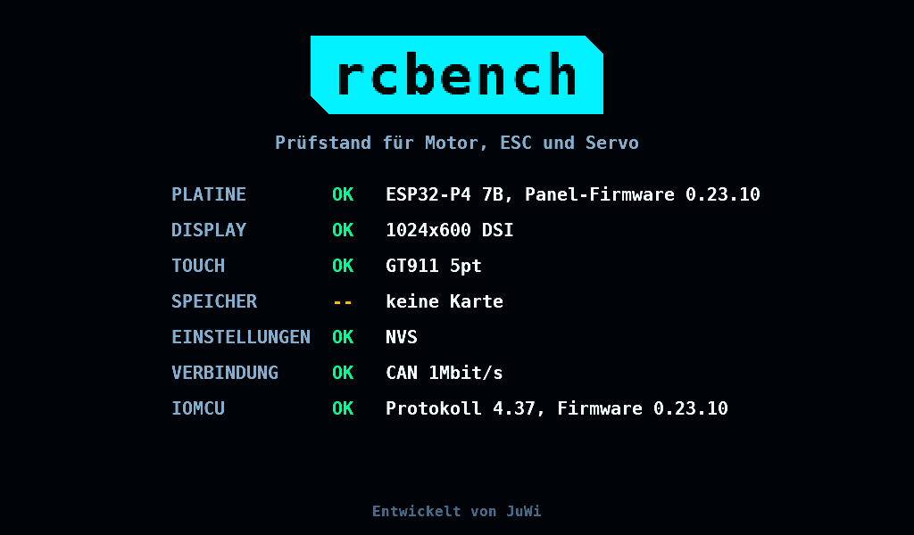

Der Splash füllt das Panel ohne Statusband. Der Name `rcbench` steht oben
mittig in der Schrift 20 x 36px bei doppelter Größe, auf einem 88px hohen
Feld in Akzentfarbe. Darunter steht die Unterzeile in 12 x 24px. Ab y 200
hat jeder Startschritt eine 40px hohe Zeile mit Name, Status (`OK`, `--`,
`!!` oder `..` während des Schritts) und Detail, alles in 12 x 24px.
Das Detail beginnt bei x 432 und wird nach 47 Zeichen abgeschnitten,
24px vor dem rechten Rand.

Jedes Subsystem meldet sein Startergebnis: Platine, Anzeige, Touch,
SD-Karte, Einstellungen, Verbindung und IOmcu. Die Platinenzeile zeigt die
Firmware-Version des Panels. Die IOmcu-Zeile zeigt dessen gemeldete
Protokoll- und Firmware-Version. Damit lassen sich Builds unterscheiden,
die dasselbe Protokoll verwenden.

Eine fehlende Karte oder ein unbrauchbarer NVS (nichtflüchtiger Speicher)
ist eine Warnung. Die SD-Kartenzeile zeigt `keine Karte`, `nicht FAT32/exFAT`
(FAT: File Allocation Table) oder `nicht lesbar`
([Das Format der SD-Karte](#das-format-der-sd-karte)). Ein nicht antwortender
Touch-Controller oder ein IOmcu mit anderer Major-Version des Protokolls
ist ein Fehler; der Prüfstand schaltet dann nicht auf ARMED.

Sobald alle Schritte ihr Ergebnis gemeldet haben, wartet der Splash 1,6s
und öffnet dann das Menü. Tippe, um die Wartezeit zu überspringen.

## Motor & ESC

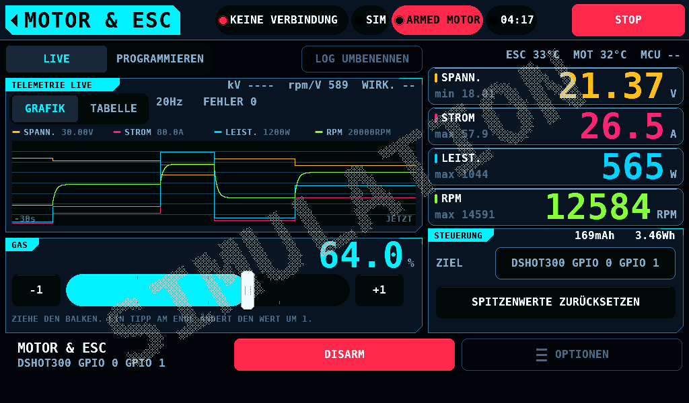

MOTOR & ESC hat oben drei Aufgaben: LIVE, PROGRAMMIEREN und OPTIONEN.
Jede Registerkarte ist 150 x 40px groß und beginnt bei y 8 des Inhalts;
die Seite darunter beginnt bei y 56. Die Menükachel öffnet immer LIVE.
Tippe auf eine Registerkarte, um die Aufgabe zu wechseln. Das fügt keine
Navigationsebene hinzu und lässt die gewählte LIVE-Ansicht GRAFIK oder
TABELLE unverändert.

| Aufgabe | Die linke Spalte, 620px |
| --- | --- |
| LIVE | die Grafik oder die Tabelle über dem Gas |
| PROGRAMMIEREN | die Liste der ESC-Programmierverfahren; eine Zeile öffnet ihre Sitzung über den gesamten Inhalt ([Programmieren](#programmieren)) |
| OPTIONEN | die 8 ESC-Einstellungen unter AKKU, MOTOR und GASAUSGANG ([Optionen](#motor--esc-optionen)) |

MOTOR & ESC hat wie SERVO zwei Spalten: links den 620px breiten
Aufgabenbereich, rechts eine 380px breite Leiste. So bleiben die Messwerte
von der Gasbedienung getrennt. Die Leiste zeigt von oben nach unten die
drei Temperaturen, vier Messwertanzeigen (je 56px hoch mit Ziffern in
32 x 44) und das Feld STEUERUNG. Es enthält eine Titelzeile mit mAh und Wh
des Laufs, die ZIEL-Zeile (48px), SPITZENWERTE ZURÜCKSETZEN (48px) und
ARM (60px).

ZIEL und ARM liegen an denselben Positionen wie im Ausgangsfeld von SERVO.
ARM reicht von y 424 bis 484 des Inhalts und endet 8px über dem Alarmband.
Die rechte Leiste erscheint auf LIVE, der Liste von PROGRAMMIEREN und
OPTIONEN; ARM wirkt auf allen dreien. Eine geöffnete Programmiersitzung
verdeckt die Leiste. Der eingeschaltete Drehknopf ändert auf LIVE das Gas
([der Knopf](#panel-der-drehknopf)). Auf PROGRAMMIEREN und OPTIONEN hat
eine Drehung keine Wirkung.

Das Home-Feld führt eine Navigationsebene zurück:

| Von | Das Home-Feld führt zu |
| --- | --- |
| dem Tastenfeld auf OPTIONEN | OPTIONEN; der Wert bleibt unverändert |
| einer Sitzung auf PROGRAMMIEREN | eine Ebene höher in der Sitzung; von ihrer obersten Ebene zur Liste von PROGRAMMIEREN ([Programmieren](#programmieren)) |
| LIVE, der Liste von PROGRAMMIEREN oder OPTIONEN | dem Menü; der Prüfstand schaltet auf SAFE |

### ZIEL nennt das Protokoll und die Pins

Das Feld STEUERUNG beginnt mit ZIEL: einer 88px breiten Beschriftung und
einem Wertefeld für 25 Zeichen. Es nennt Protokoll und Pins der
Gasansteuerung, etwa `DSHOT300 GPIO 0 GPIO 1`. Diese Pins sind MOTOR PWM
oder einem DShot-Protokoll zugeordnet. Sie werden aus denselben Pages
unter SETUP > OUTPUTS ausgelesen, die die Gas-Rolle des IOmcu verwendet.
Die Pins erscheinen in ihrer Reihenfolge. Nicht passende Pins werden
gezählt: GPIO 0 bis GPIO 7 mit DSHOT300 ergeben
`DSHOT300 GPIO 0 GPIO 1 +6`.

Ein Programmierport mit FUNKTION DSHOT150, DSHOT300 oder DSHOT600 folgt
als `PORT n` auf die Pins und zählt mit, sofern der IOmcu seinen Pin hält.
Ein einzelner Port wird je nach Platz vollständig oder gekürzt angezeigt:
`DSHOT300 PROG-PORT 2 GPIO 14` (28 Zeichen), `DSHOT300 PORT 2 GPIO 14`
(23 Zeichen) im 25-Zeichen-Feld von STEUERUNG oder `DSHOT300 PORT 2` in
einem kürzeren Feld.

| ZIEL lautet | Bedingung |
| --- | --- |
| `DSHOT300 GPIO 0 GPIO 1` | ein Protokoll treibt jeden Gas-Pin |
| `GEMISCHT GPIO 0 GPIO 4` | die Gas-Pins laufen mit zwei oder mehr Protokollen, oder einer davon mit einer Rate, die kein Protokoll von OUTPUTS hat |
| `GPIO 0 GPIO 1` | jeder Gas-Pin läuft mit einer Rate, die kein Protokoll von OUTPUTS hat |
| `KEIN MOTOR-PIN` | die Zuordnung ist ausgelesen und weder ein Pin noch ein Programmierport ist als Motor zugeordnet; Warnfarbe |
| `NICHT AUSGELESEN` | keine Zuordnung wurde ausgelesen: die Verbindung fehlt, die Pages ließen sich nicht lesen, oder für die Platine gibt es keine Pin-Belegung; Warnfarbe |

Mit DShot-Programmierports:

| ZIEL lautet | Bedingung |
| --- | --- |
| `DSHOT300 PORT 2 GPIO 14` | ein DSHOT300-Programmierport an GPIO 14 treibt das Gas, und kein Pin ist als Motor zugeordnet |
| `DSHOT300 GPIO 0 PORT 2` | GPIO 0 als DSHOT300 zugeordnet und ein DSHOT300-Port |
| `GEMISCHT GPIO 0 PORT 2` | die Pins und die Ports laufen mit verschiedenen Raten, oder die Pins mit einer Rate, die kein Protokoll des Katalogs hat |

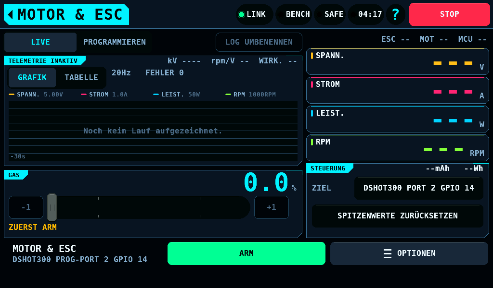

Das Gas lässt sich auch in den beiden Warnzuständen bewegen. ARM schaltet
die gesamte Ausgangsgruppe auf ARMED, nicht nur die hier genannten Pins.

Tippe auf ZIEL, um [OUTPUTS](#outputs) zu öffnen. Die Seite zeigt das den
Gas-Pins zugeordnete Protokoll, den Eintrag PROG-PORT bei alleiniger
Gasansteuerung durch einen DShot-Programmierport oder die Übersicht bei
mehreren oder unbekannten Protokollen. Das Verlassen von MOTOR & ESC
schaltet den Prüfstand auf SAFE.

Das Home-Feld auf OUTPUTS führt zur Aufgabe zurück, auf der du ZIEL
angetippt hast. Öffnest du zwischendurch eine andere Seite, beginnt der
nächste Aufruf von MOTOR & ESC wie über die Menükachel auf LIVE. ZIEL ist
in folgenden Fällen gesperrt und zeigt den gesperrten Rand:

| Bedingung | Grund |
| --- | --- |
| ARMED, eine unbeantwortete ARM- oder DISARM-Anfrage | eine Zuordnung ändert die angesteuerten Pins |
| ARM gehalten | der Druck gehört ARM |
| die [Servoprogrammierung](ServoProgrammer-de.md) hält einen Port | ARM ist aus demselben Grund gesperrt |

### Der Plot zeigt einen Lauf

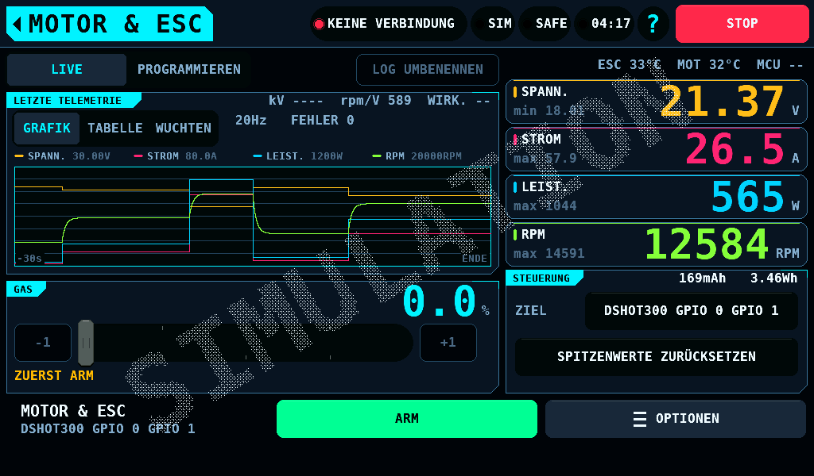

Die Grafik zeichnet einen Lauf auf. Sie läuft nur in ARMED: Der Wechsel
auf ARMED löscht sie, der Wechsel auf SAFE hält sie an. Während der
Aufzeichnung steht `TELEMETRIE LIVE` über der Grafik, beim angehaltenen
Lauf `LETZTE TELEMETRIE`. Vor dem ersten ARM steht dort
`TELEMETRIE INAKTIV` und in der Grafik `Noch kein Lauf aufgezeichnet.`
Die rechte Achsenbeschriftung zeigt während der Aufzeichnung `JETZT`,
am Ende eines angehaltenen Laufs `ENDE`. Messwertanzeigen, TABELLE,
Summen und Temperaturleiste werden in ARMED und SAFE laufend aktualisiert.

Die Grafik ist 600 x 184px groß. Bei 20 Abtastungen pro Sekunde decken ihre
600 Spalten 30,0s ab. Bei längeren Läufen zeigt sie die letzten 30,0s;
der frühere Verlauf bleibt in der CSV-Datei.

Die Kurve endet beim Wechsel auf SAFE, auch wenn der Motor danach noch
ausläuft. SAFE fordert 0% Gas an. Das Auslaufen der Luftschraube ist in
den laufenden Messwertanzeigen sichtbar, nicht in der Grafik oder der
CSV-Datei; diese schließt ebenfalls beim Wechsel auf SAFE.

Der Wechsel auf ARMED löscht die Grafik. Das Lösen eines eingerasteten
STOP lässt den Prüfstand SAFE; die Kurve des gestoppten Laufs bleibt daher
bis zum nächsten ARM erhalten. Jeder Wechsel auf ARMED beginnt eine
CSV-Datei, die LOGS darstellen kann.


Auf LIVE stehen unter dem Titel des Telemetriefelds GRAFIK und TABELLE,
zwei Registerkarten von 200 x 40px. Daneben erscheinen Abfragerate und
Fehlerzahl der Verbindung: CRC-Fehler und Resynchronisationen zusammen
(CRC: Cyclic Redundancy Check). Hat der IOmcu seit dem Einschalten
Verbindungsframes abgelehnt, zeigt die Zeile darunter bei bestehender
Verbindung die Anzahl in 8 x 16: `Abgelehnte Verbindungsframes: 37`.
Ein IOmcu vor Protokoll 4.21 sendet keine Anzahl; die Zeile zeigt dann keine
([Abgelehnte Frames](Link-de.md#abgelehnte-frames)).

Die drei Temperaturen stehen bei jeder Aufgabe über der rechten Leiste.
ESC und MOT stammen von der BENCH-Page. MCU ist die Chiptemperatur des
ESP32-P4 auf der Displayplatine, nicht die Temperatur des IOmcu.

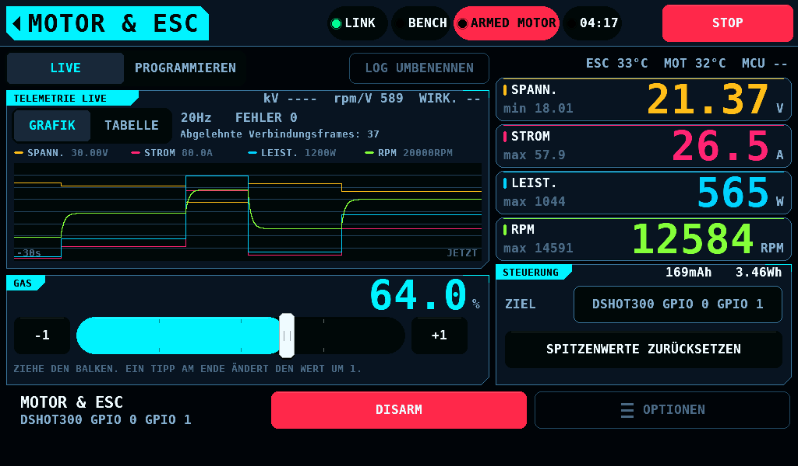

Das Gas folgt der Strecke, die der Finger zurücklegt, ausgehend vom
aktuellen Wert. Ein Druck auf die Reglerbahn sendet keinen Befehl, auch
nicht an ihrem Ende. Eine Ziehbewegung über die gesamte Bahn fordert den
ganzen Bereich an; der Pin folgt ohne Rampe. `-1` und `+1` an den Enden
ändern das Gas um einen Prozentpunkt.

Das Gas lässt sich nur in ARMED ändern:

| Bedienelement | SAFE | ARMED |
| --- | --- | --- |
| Die Reglerbahn | abgelehnt: kein Befehl, Schieberegler und Anzeige bleiben; gedimmt gezeichnet | bewegt das Gas um den Weg des Fingers |
| `-1`, `+1` | abgelehnt; gedimmt gezeichnet | schalten um einen Prozentpunkt |
| Drehknopf | abgelehnt; die Drehung wird nicht gespeichert | bewegt das Gas von seinem Wert aus |
| ARM | schaltet nach seinem Halten von 2s die Gas-Ausgänge auf ARMED; gesperrt gezeichnet und ohne Wirkung, solange die [Servoprogrammierung](ServoProgrammer-de.md) einen Port hält | schaltet bei einem Tipp auf SAFE |
| SPITZENWERTE ZURÜCKSETZEN | setzt die Spitzen zurück | setzt die Spitzen zurück |
| GRAFIK, TABELLE | wechseln die Ansicht von LIVE | wechseln die Ansicht von LIVE |

In SAFE steht unter der Reglerbahn `ZUERST ARM`. Die Gasbedienung bleibt
gesperrt, bis der Prüfstand ARMED meldet, auch zwischen dem Ende der
ARM-Haltegeste und dieser Meldung. Die Sperre beginnt ebenfalls sofort,
wenn die Seite DISARM anfordert (durch Antippen oder Verlassen) oder STOP
bei ARMED gedrückt wird. Sie bleibt bestehen, solange die SAFE-Meldung
des Prüfstands aussteht.

Jeder Wechsel auf SAFE setzt das Gas auf 0%: DISARM, STOP,
Verbindungsverlust, ein nicht antwortender Touch-Controller oder das
Verlassen der Seite. Regler, Anzeige und `-1`/`+1` bleiben bis zum nächsten
ARM bei 0,0%. Das erste `+1` oder eine erste Knopfdrehung um 1% fordert
danach 1,0% an. Auch ein Stick-Lauf unter PROGRAMMIEREN beginnt bei 0%,
obwohl er ohne Halten der ARM-Taste auf ARMED schaltet.

Eine von der Seite angeforderte, aber beim Wechsel auf SAFE noch nicht
vom Panel gesendete Gasvorgabe wird verworfen. Liegt bei einem Wechsel
auf ARMED oder SAFE ein Finger auf der Reglerbahn, kann er nichts ändern.
Hebe ihn ab und setze ihn erneut auf.

Halte ARM 2s. Die Füllung wechselt dabei von Grün nach Gefahrenrot. Am Ende
des Farbwechsels schaltet der Prüfstand auf ARMED. Früheres Loslassen
bricht die Haltegeste ab; das Loslassen selbst schaltet nie auf ARMED.

Der Finger muss während der gesamten Haltegeste auf ARM bleiben.
Herausgleiten bricht sie ab; Zurückgleiten setzt sie nicht fort. Hebe den
Finger ab und drücke erneut, um eine neue Haltegeste zu beginnen. Ein
Wechsel auf SAFE beendet auch eine noch gehaltene Berührung. So kann die
zum Anhalten verwendete Berührung den Prüfstand nicht 2s später erneut
auf ARMED schalten.

Beim Wechsel auf ARMED blinkt die ganze Taste zweimal in der Folge Weiß,
Schwarz, Rot, jeweils einen gezeichneten Frame pro Farbe. In ARMED bleibt
sie gefahrenrot und dient als DISARM. DISARM wirkt sofort beim Aufsetzen,
ohne Halten oder Warten auf das Loslassen. DISARM und STOP halten den
Ausgang ohne Rampe an. SPITZENWERTE ZURÜCKSETZEN löscht die Spitzenmarken
und lässt die laufenden Messwerte unverändert.

### WIRK. ist eine Schätzung

Die Kopfzeile des Telemetriefelds zeigt Nenn-kV, die gemessenen Umdrehungen
pro Minute und Volt sowie WIRK.: gemessene rpm/V geteilt durch Nenn-kV.

Die Klemmenspannung teilt sich in den ohmschen Spannungsabfall und die
Gegen-EMK (elektromotorische Kraft) auf. Unter Last entsprechen rpm/V der
Nenn-kV multipliziert mit dem Spannungsanteil an der Gegen-EMK. Dieser
Anteil entspricht auch dem Anteil der Eingangsleistung, der in mechanische
Leistung umgesetzt wird. Bei einem idealen Motor ist das Verhältnis daher
der Umsetzungswirkungsgrad.

Die angezeigte Zahl entspricht diesem idealen Wirkungsgrad aus drei
Gründen nicht. Deshalb heißt sie WIRK. und nicht Wirkungsgrad:

- Sie erfasst nur die Kupferverluste (I hoch 2 mal R). Eisenverluste, Reibung
  und Luftwiderstand fallen auf die mechanische Seite der Aufteilung, also ist
  die Zahl eine obere Schranke des Wellenwirkungsgrads und nicht sein Wert.
- Der Prüfstand misst die Akkuspannung, nicht die Klemmen des Motors, also
  stecken die Durchlass- und Schaltverluste des ESC in der Zahl. Sie
  beschreibt den Antriebsstrang; ein Vergleich mit einem Motordatenblatt
  vergleicht zwei verschiedene Dinge.
- Sie ist nur so gut wie die Nenn-kV. Ein Fehler dort geht direkt in den
  Prozentwert, und ein Wert über 100% bedeutet, dass die Nennangabe falsch
  ist; die Anzeige zeigt das, statt es zu verbergen, begrenzt auf 199%.

Meldet der angeschlossene ESC Nenn-kV, verwendet das Panel diesen Wert.
Kein unterstützter ESC meldet ihn; deshalb gilt die Einstellung `Nenn-kV`
mit dem Standardwert null. Eine geschätzte kV kann einen plausiblen, aber
falschen Prozentwert ergeben. Ohne eingetragene kV bleibt das Feld leer
und zeigt keinen Prozentwert. Gemessene rpm/V erscheinen unabhängig davon,
weil sie nicht von der Nenn-kV abhängen.

SIMULATION steht quer über der Anzeige, solange kein IOmcu antwortet und
das Panel sein Modell berechnet. Sobald ein IOmcu antwortet, verschwindet
das Wasserzeichen. Die Anzeige verwendet dann dessen Messwerte: Drehzahl
über bidirektionales DShot und Sensorwerte, soweit Messhardware bestückt
ist. Für eine nicht gemessene Größe bleibt das Feld leer.

SETUP > PANEL > Demo-Modus, standardmäßig AUS, blendet das Wasserzeichen
SIMULATION aus und sonst nichts: Das Band zeigt weiter SIM, die Kacheln zeigen
weiter SIMULIERT, und jede andere Angabe, dass Werte simuliert sind, bleibt.
Die Änderung zeigt sich im nächsten Bild. Antwortet ein IOmcu, wird kein
Wasserzeichen gezeichnet; die Einstellung ändert an einem echten Prüfstand
also nichts.

### TABELLE, und was der ESC meldet

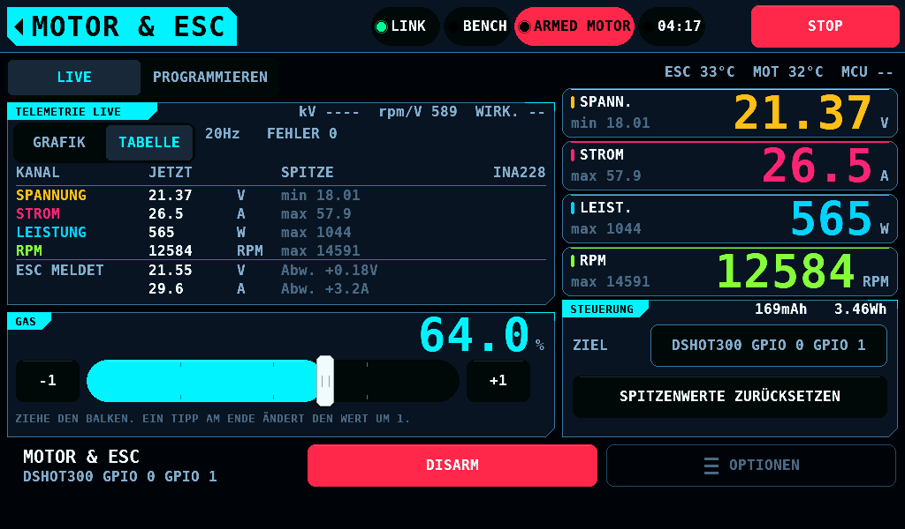

TABELLE zeigt vier Kanäle mit je einem Extremwert. Ein Kanal ohne Messwert
zeigt `--`.

Ist der INA228 unter SETUP > SENSORS eingeschaltet und antwortet er
(BENCH-Flag Bit 5), liefert er Spannung, Strom und Leistung. Angezeigt
werden die Mittelwerte des letzten 50ms-Fensters des IOmcu, ausgelesen mit
20Hz. Die Spitzen des Laufs stammen aus seinen Abtastungen mit 500Hz.
Die Kopfzeile nennt `INA228` und ergänzt `ÜBERSTEUERT`, wenn der Strom im
letzten Fenster oder seit ARM das Ende des Messbereichs erreicht hat.
Strom und Leistung beziehungsweise ihre Spitzen sind dann Grenzwerte,
keine genauen Messwerte.

Unter den Kanälen zeigt `ESC MELDET` Telemetriespannung und -strom des ESC
aus der SENSE-Page. `Abw.` ist der ESC-Wert minus INA228-Wert. Meldet ein
ESC einen Strom, den er nicht misst, kann die Abweichung so groß wie der
Messwert sein. Antwortet der INA228 während eines Laufs nicht weiter,
bleiben Spannung, Strom und Leistung bis zum Laufende leer. Die Anzeige
wechselt nicht zur ESC-Telemetrie. Die gemessenen Spitzen des Laufs bleiben
hier und in der rechten Leiste sichtbar. Ohne INA228 zeigen die Kanäle
ESC-Telemetrie; `ESC MELDET` ist ausgeblendet.

Solange BENCH-Flag Bit 6 gesetzt ist, stammen die mAh- und Wh-Summen im
Feld STEUERUNG vom INA228. Er summiert Ladung und Energie seit ARM bei
jeder Wandlung und meldet sie in Schritten von 0,01mAh und 0,01Wh. Beim
ARM entfernt der IOmcu die Summen des vorherigen Laufs und Bit 6 aus der
BENCH-Page. Das Panel berechnet außerdem die ersten 100ms selbst. Dadurch
kann eine vor ARM erstellte Page keine alten Summen in den neuen Lauf
übertragen.

Ohne Bit 6 berechnet das Panel beide Summen aus angezeigtem Strom und
angezeigter Leistung. Fällt der INA228 während des Laufs aus, zählt das
Panel ab seiner letzten Summe weiter, ohne sie zurückzusetzen.

Die CSV-Datei enthält Zeilen nur für Abtastungen des Panels:

- Bei bestehender Verbindung ist eine Abtastung eine beantwortete
  Leseanfrage der BENCH-Page. Das Panel fragt alle 50ms ab. Hinzu kommen
  der 5ms-Durchlauf der Control-Task, der die Freigabe prüft, und dessen
  Datenaustausch. Auf einem Prüfstand ergaben sich im Mittel 52,9ms,
  etwa 19 Zeilen pro Sekunde. Andere Prüfstände sind nicht gemessen.
- Ohne Verbindung ist eine Abtastung ein Modellschritt, alle 50ms.
- Jede Abtastung ergibt eine Zeile. Beim Auslesen des INA3221-Fensterrings
  (IOmcu-Protokoll 4.11, CH1 eingeschaltet) schreibt eine Abfrage mit
  mehreren 50ms-Fenstern je eine Zeile pro Fenster. Diese Zeilen tragen
  dieselbe `time`. Die eigentliche Abtastung steht in der letzten Zeile
  mit dem neuesten Fenster; vorherige Zeilen enthalten nur `window` und
  Kanalspalten. Bei einem Abfrageintervall von 53ms schreibt eine von
  17 Abfragen zwei Zeilen.
- Es gibt keine weitere Bedingung für eine Zeile. Nimmt die
  Kartenwarteschlange sie nicht auf, wird sie verworfen und gezählt.
  Das Band meldet verworfene Zeilen am Laufende (siehe [Logs](#logs)).

`time` ist die seit ARM verstrichene Zeit in Sekunden, geschrieben auf
1ms. Sie ist kein Zeilenzähler: Die erste Zeile beginnt nicht bei 0.
Fehlende Abtastungen oder verworfene Zeilen hinterlassen einen entsprechend
langen Zeitsprung. In den ersten 4,5h eines Laufs beträgt die Auflösung
1ms, bis 9,1h beträgt sie 2ms.

Eine Datei von Firmware 0.15.0 oder älter weicht in zwei Punkten ab. Nach
einem Servobefehl fehlen Zeilen über Strecken von bis zu 30s, und
`time` läuft nur mit einer geschriebenen Zeile weiter, endet also vor der
Länge des Laufs und zeigt keine Lücke. In einer solchen Datei geben die
`window`-Nummern im Abstand von 50ms den Abstand der Zeilen an, solange der
INA3221 eingeschaltet ist.


```
time (s);voltage (V);current (A);power (W);rpm (rpm);esc (C);motor (C);charge (mAh);energy (Wh);ina voltage (V);ina current (A);esc current (A);window;ch1 current (A);ch1 max (A);ch1 voltage (V);ch2 current (A);ch2 max (A);ch2 voltage (V);ch3 current (A);ch3 max (A);ch3 voltage (V);source
```

In MOTOR-Dateien entsprechen `voltage`, `current` und `power` der Anzeige
auf MOTOR & ESC. Eine durch ARM auf SERVO begonnene SERVO-Datei hat vor
`source` zwei zusätzliche Spalten:

```
...;ch3 voltage (V);pulse (us);angle (deg);source
```

- `voltage`, `current`, `power`, `charge` und `energy` sind die des
  Messgeräts der Servoschiene ([das Messgerät](#servo)):
  - solange ein INA3221-Kanal das Messgerät ist, sein neuestes
    50ms-Fenster zum Zeitpunkt der Abtastung: die mittlere Busspannung, der mittlere Strom
    und ihr Produkt;
  - sonst der letzte Messwert des PD mini zum Zeitpunkt der Abtastung.
  - Spannung und Leistung stehen auf 0,01, Strom auf 0,001.
  - Ladung und Energie zählt das Panel aus diesen Messwerten seit dem ARM,
    auf 1mAh und 0,01Wh.
- `pulse` ist der Puls, den SOLL-PULSBREITE zeigt, in ganzen us. Leer, solange
  eine Programmiersitzung den Port hält.
- `angle` ist der unter GEMESSEN angezeigte Winkel der gewählten Quelle,
  AS5600 oder IMU, auf 0,1°. Die Zelle ist leer, wenn die Quelle ausgeschaltet
  ist, keinen gültigen Messwert liefert oder die Verbindung fehlt.
- Eine Zelle ist leer, solange ihr Messgerät diesen Wert nicht geliefert
  hat.
- Eine Zeile nimmt einen Wert nur aus einer Quelle, die ihre `source` ist:
  - alle fünf Zellen des Messgeräts sind leer in einer `measured`-Zeile,
    solange das Netzteil das Modell des Panels ist (PD mini auf der
    Registerkarte PD MINI von SUPPLY ausgeschaltet);
  - sie sind leer in einer `model`-Zeile, solange nach dem Verlust des Links
    noch der letzte Messwert des PD mini gezeigt wird;
  - eine `model`-Zeile hat keinen Wert des INA3221 und kein `angle`, da beide eine
    bestehende IOmcu-Verbindung voraussetzen. `pulse` ist der eigene Befehl des Panels und
    steht in Zeilen beider Quellen.
- Die Werte des Messgeräts, `pulse` und `angle` stehen in der letzten Zeile
  einer Abtastung. Die Zeilen davor in einem Poll halten nur das Fenster und
  die Kanalspalten.
- Die übrigen Spalten einer SERVO-Datei sind die einer MOTOR-Datei.

`source` ist `measured` bei Zeilen mit Werten eines Messgeräts und `model`
bei Zeilen aus dem Panelmodell (Markierung SIMULIERT). Netzteildateien
haben dieselbe letzte Spalte. Dateien ohne diese Spalte enden bei
`ch3 voltage` oder `energy`. LOGS und die Werkzeuge lesen beide Formen;
`source` ist eine Textspalte und wird nicht als Kurve dargestellt.

`ina voltage` und `ina current` stammen vom INA228 und sind leer, wenn er
nicht die Quelle ist. `esc current` ist der Telemetriestrom des ESC: aus
der SENSE-Page, wenn der INA228 die Quelle ist, sonst aus der BENCH-Page.
Die Zelle bleibt leer, wenn der ESC keinen Strom meldet oder das Panel den
Prüfstand simuliert. Jede nicht gemessene Größe bleibt leer.

`window` und die neun Kanalspalten beschreiben das 50ms-Fenster des INA3221:
je Kanal den mittleren und höchsten Strom sowie die niedrigste Busspannung.
Jedes Fenster steht einmal in der Datei, in der ersten Zeile nach dem
Auslesen durch das Panel, mit seiner Fensternummer. Ein Kanal ohne Messwerte
in diesem Fenster bleibt leer. Ebenso bleiben die Strom- oder
Spannungszellen von CH1 leer, wenn das Fenster keine Abtastung dieser
Größe enthält.

Mit IOmcu-Protokoll 4.11 und eingeschaltetem CH1 erreicht jedes CH1-Fenster
die Datei, solange aufeinanderfolgende Lesezugriffe höchstens 200ms
auseinanderliegen. Ein Sprung über mehr als 1 in `window` bedeutet ein
verlorenes Fenster oder eine vom IOmcu übersprungene Nummer. In SAFE
erfasste Fenster werden nicht geschrieben. CH1 berücksichtigt übersteuerte
Abtastungen am Ende des Bereichs, 1,638A am Shunt mit 0,1Ω, und bewahrt
das Vorzeichen negativer Ströme. CH2 und CH3 stehen in ihrer Fensterzeile,
wenn das Panel beide Pages innerhalb dieses Fensters liest. In nachgeholten
Zeilen bleiben sie leer.

Bei einem älteren IOmcu oder ausgeschaltetem CH1 enthalten die Spalten nur
das letzte Fenster jeder Abfrage. Abfrageintervalle über 50ms überspringen
Fenster: 1 von 17 bei 53ms. Übersteuerte Abtastungen werden ausgeschlossen.
LOGS gruppiert `ina voltage`, `ina current` und `esc current` unter INA228
und ESC, die Fensterspalten unter INA3221.

Bei einem IOmcu mit Protokoll 4.25 und ausgelesener Sensorzuordnung folgen
die Kanalspalten deren Stand beim Öffnen der Datei: je eine Gruppe von
drei Spalten pro Kanal, der ein Ziel überwacht, benannt nach diesem Ziel:

```
window;port 1 current (A);port 1 max (A);port 1 voltage (V);out 3 current (A);out 3 max (A);out 3 voltage (V);supply current (A);supply max (A);supply voltage (V);source
```

- Ein Kanal bekommt eine Gruppe, solange sein Baustein bestückt ist, sein
  Shunt nicht 0 ist und er einen Ausgang, einen Programmierport oder die
  Versorgung überwacht ([SENSORS](#sensors-die-ina3221-bausteine)).
- Der Kanal, der das Ziel des Servotesters überwacht, steht vorn, danach
  die anderen von 0x40 CH1 bis 0x43 CH3.
- Zwei Kanäle an einem Ziel tragen den Kanal im Namen:
  `out 3 0x41 ch2 current (A)`.
- Höchstens 3 Gruppen, 23 Spalten in einer MOTOR-Datei und 25 in einer
  SERVO-Datei: der vierte überwachende Kanal und alle weiteren stehen in
  keiner Datei. LOGS liest höchstens 25 Spalten.
- Eine Datei mit weniger Gruppen endet früher mit `source`: 13 + 3 x
  Gruppen + 1 Spalten, in einer SERVO-Datei 2 mehr. Ohne überwachenden Kanal hat die
  Datei keine Kanalspalten.

Die Gruppe für den Kanal am Ziel des Servotesters stammt aus dem
Fensterring SERVO_WIN und steht in jeder Zeile mit `window`. Andere
Kanalgruppen kommen aus SENSE_WIN_A und SENSE_WIN_B
([Link](LinkSensors-de.md#sense_win_a-und-sense_win_b)). Diese Pages halten
nur das jeweils letzte Fenster. Das Panel liest sie nach SERVO_WIN bei
jeder Abfrage mit mindestens 40ms Abstand, solange ein Baustein der Page
bestückt ist.

Eine Gruppe steht in der Zeile ihres Fensters, wenn die letzte oder
vorletzte Abfrage ihrer Page diese Fensternummer enthält. Sonst bleibt
sie leer. Ein zwischen zwei Abfragen geschlossenes und bereits ersetztes
Fenster erreicht keine Zeile: bei 53ms Abfrageintervall etwa 1 von 17
Zeilen (`test_sense_win_link`).

Die Sensorzuordnung gilt, sobald der IOmcu sie als aktiv bestätigt. Bei
einer aus SENSE abgeleiteten Zuordnung behält die Datei `ch1` bis `ch3`.
Solange die Ausgangsgruppe angesteuert wird, lässt sich die Zuordnung
nicht schreiben; die Spalten bleiben daher über den gesamten Lauf gleich.
LOGS gruppiert `out`, `port` und `supply` unter INA3221.

### MOTOR & ESC, Optionen

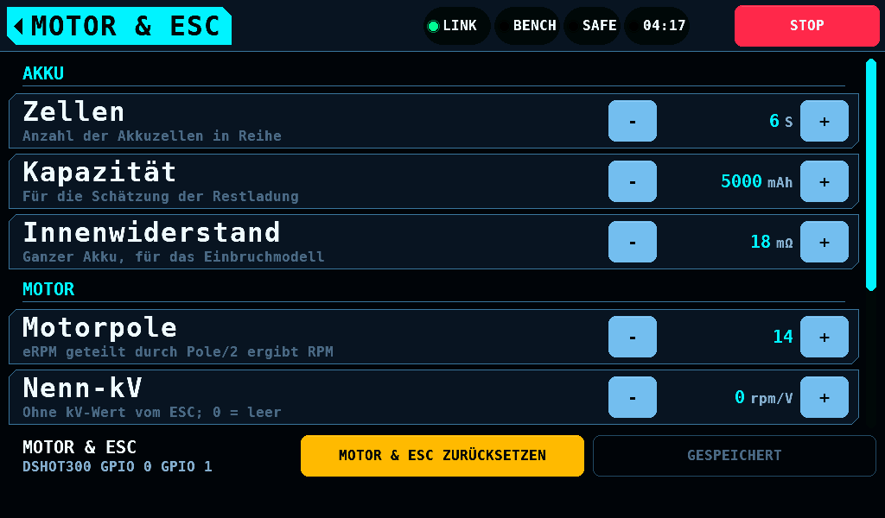

OPTIONEN enthält die 8 Einstellungen für Akku, Motor und Gasausgang
(`SET_CAT_ESC`), in Schemareihenfolge unter drei Überschriften:

| Überschrift | Einstellungen |
| --- | --- |
| AKKU | Zellen, Kapazität, Innenwiderstand |
| MOTOR | Motorpole, Nenn-kV |
| GASAUSGANG | Leerlaufpuls, Vollgaspuls, Rampengrenze |

Die Zeilen stehen in zwei 295px breiten Spalten: AKKU und MOTOR links,
GASAUSGANG rechts. Jede 68px hohe Zeile enthält links die Beschriftung,
rechts den Wert mit Einheit in einem Feld von 120 x 48px und darunter
eine Hilfezeile in 8 x 16.

Tippe auf ein Wertefeld, um das Tastenfeld zu öffnen. Es verdeckt die
linke Spalte und die Aufgabenleiste (620 x 529px), sodass du darunter
keine Aufgabe wechseln kannst. Die rechte Leiste bleibt erreichbar.
Das Tastenfeld zeigt Name, Bereich und Einheit der Einstellung. OK
übernimmt einen gültigen Wert und rundet auf die Schrittweite, etwa
4321mAh auf 4300mAh. Bei Werten außerhalb des Bereichs bleibt es offen
und zeigt den Bereich in der Warnfarbe. ABBRECHEN oder das Home-Feld
schließt es ohne Wertänderung.

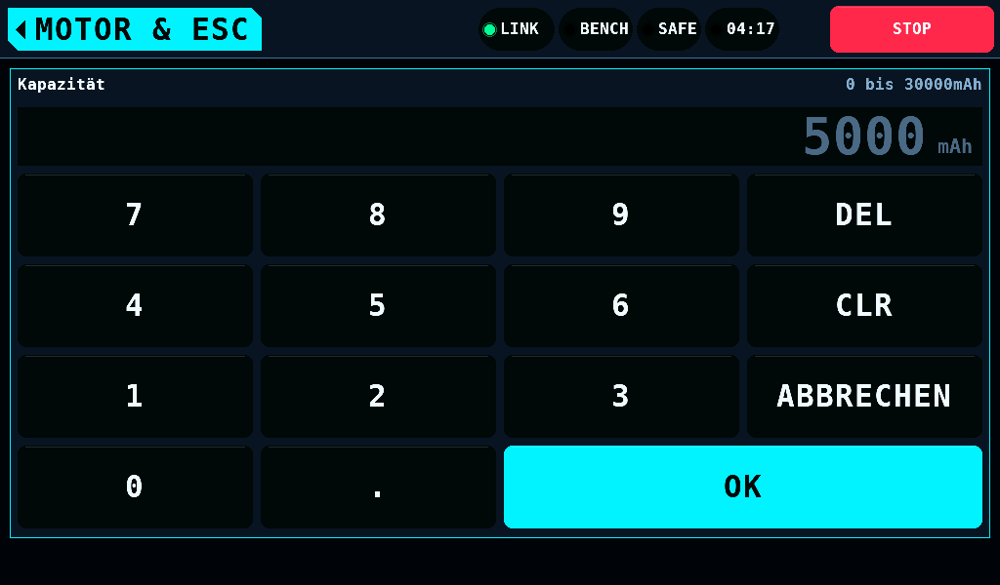

Leerlaufpuls muss mindestens 100us unter Vollgaspuls liegen
(`LINK_CC_THROTTLE_GAP_US`). Die Eingabebereiche überlappen: 800 bis 1600us
und 1400 bis 2400us. Verletzt ein Wert den Abstand, bleibt das Tastenfeld
offen und der bisherige Wert erhalten. Anstelle des Bereichs erscheint
in der Warnfarbe `Leerlaufpuls höchstens 1900us (100us unter Vollpuls)`
oder `Vollpuls mindestens 1100us (100us über Leerlaufpuls)`.

Das Panel prüft denselben Abstand vor dem Senden des Paars an den IOmcu.
Dessen eigene Schreibprüfung begrenzt jeden Puls auf 400 bis 2500us,
prüft aber nicht den Abstand.

Leerlaufpuls und Vollgaspuls lassen sich nur in SAFE ändern. Der IOmcu
übernimmt die Endpunkte, solange der Prüfstand SAFE ist, 300ms nach der letzten
Änderung. Beim Wechsel auf ARMED werden keine Endpunkte gesendet. In ARMED,
während einer ARM-Haltegeste und bei ausstehender ARM- oder DISARM-Antwort
sind beide Wertefelder gesperrt. Ihre Hilfezeile zeigt
`Nur bei SAFE einstellbar` in der Warnfarbe. Ein offenes Tastenfeld schließt
beim Druck auf ARM oder beim Verlassen von SAFE.

Die 2s-Haltegeste gibt einer zuvor eingegebenen Änderung Zeit, den IOmcu zu
erreichen. Ist bei bestehender Verbindung noch eine Übertragung offen,
wird ARM mit `Pulsbereich noch nicht an den IOmcu gesendet. Halte ARM erneut.`
abgelehnt; der Prüfstand bleibt SAFE. Lehnt der IOmcu das Paar ab oder
speichert er andere Werte, bleibt ARM gesperrt. Eine Meldung nennt die
nötige Änderung. Erst eine Änderung hier, eine Zuordnung auf OUTPUTS oder
eine wiederhergestellte Verbindung kann das Paar wirksam machen
([Ein Pulsbereich unterwegs](Safety-de.md#ein-pulsbereich-unterwegs)).
Die übrigen 6 Einstellungen lassen sich jederzeit ändern.

Alle Einstellungen nutzen einen gemeinsamen Speicher. OK übernimmt einen
Wert sofort und fordert das Speichern an. Das Panel schreibt den gesamten
Speicher im ersten Frame mit Prüfstand SAFE, Netzteilausgang aus und ohne
geladene oder gerade abgerufene Platinenzeichnung. Denselben Vorgang
fordert SPEICHERN auf SETUP an ([Werte behalten](#werte-behalten)).

Ungespeicherte SETUP-Änderungen werden mitgeschrieben; die Warnung beim
Verlassen von SETUP entfällt. Wird das Schreiben abgelehnt, bleiben alle
Änderungen ungespeichert. Die SETUP-Warnung nennt dann auch die
ESC-Einstellungen. Die Statuszeile am Seitenende, 4px über dem Alarmband,
zeigt den Speicherzustand:

| Zeile | Stand |
| --- | --- |
| `GESPEICHERT` | alle Änderungen sind gespeichert |
| `SPEICHERN AUSSTEHEND` | Speichern ist angefordert und wartet auf einen ruhenden Prüfstand |
| `NICHT GESPEICHERT` | der letzte Speichervorgang wurde abgelehnt |
| `ÄNDERUNGEN IN SETUP NICHT GESPEICHERT` | Änderungen sind ungespeichert, ohne offenen Speicherauftrag; die nächste Änderung hier speichert sie mit |

### Programmieren

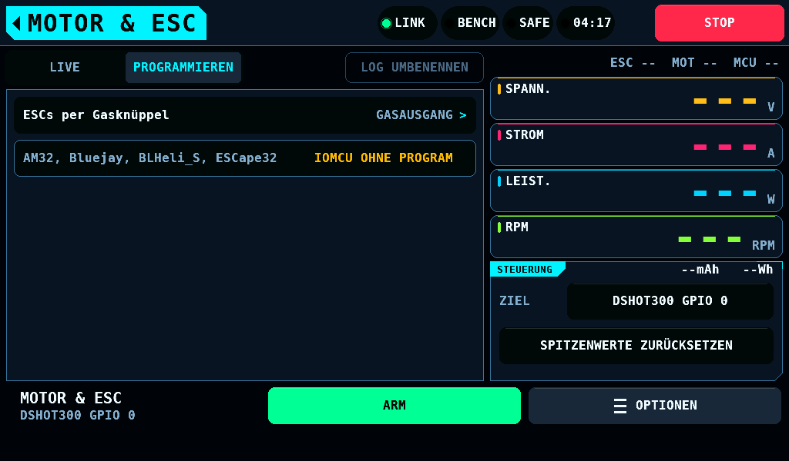

PROGRAMMIEREN zeigt zwei Verfahren zur ESC-Programmierung aus derselben
Tabelle wie SERVO (`shared/ui/prog_registry.c`,
[Programmierer](#programmierer)). `ESCs per Gasknüppel` gehört zur Gruppe
STICK-MENÜ. Rechts steht `GASAUSGANG >`: Das Verfahren verwendet die
Gas-Pins, keinen Programmierport, und benötigt keine Fähigkeit des IOmcu.
Die zweite Zeile öffnet die unten beschriebene Signalleitungs-Sitzung.

Gruppenüberschriften erscheinen erst bei mehr als 8 Zeilen. Das
Ausgangsfeld bleibt rechts neben der Liste sichtbar.

Tippe auf die Gasknüppel-Zeile, um ESC STICK eine Ebene tiefer zu öffnen.
Die Sitzung belegt die gesamte Breite und verdeckt Aufgabenbereich,
rechte Leiste und Registerkarten. ARM und Registerkarten können dadurch
keine Berührung erhalten. Beim Öffnen schaltet der Prüfstand bei Bedarf
auf SAFE, auch wenn ein anderer Finger DISARM hält. Anstelle der
Registerkarten erscheint ein Ausgangsstreifen mit einer Zeile in der
Schrift 10 x 20 ab x 12, y 4:

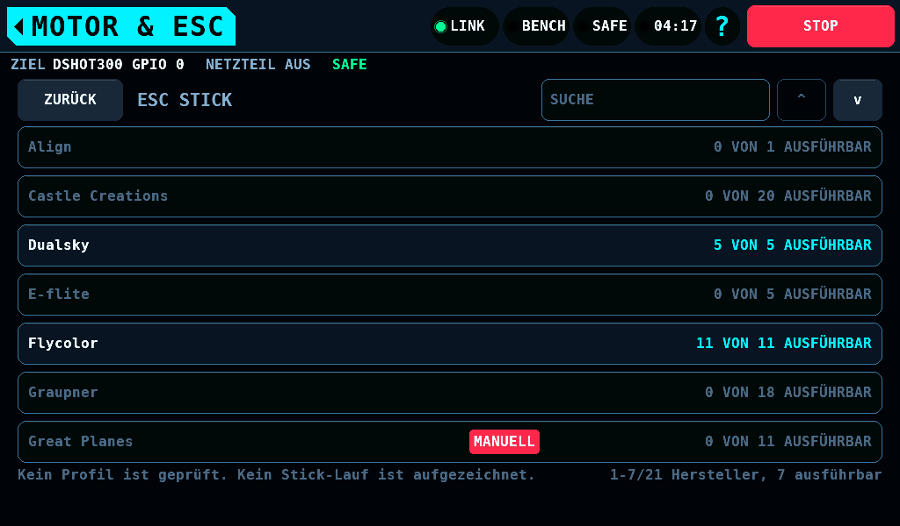

```
ZIEL DSHOT300 GPIO 0 GPIO 1   NETZTEIL 7.60V  1.00A   SAFE
```

| Teil | Zeigt |
| --- | --- |
| `ZIEL` | das Protokoll und die zugeordneten Gas-Pins, wie sie die Zeile ZIEL des Felds STEUERUNG nennt, in höchstens 26 Zeichen; in der Warnfarbe, solange kein Pin zugeordnet oder die Zuordnung nicht ausgelesen ist |
| `NETZTEIL` | den gemeldeten Ausgangszustand des PD mini: `NETZTEIL 7.60V  1.00A`; `NETZTEIL EIN`, solange er eingeschaltet ist, aber Spannungs- und Stromwerte fehlen; `NETZTEIL AUS`; `NETZTEIL --`, solange das Netzteil nicht antwortet |
| `SAFE` oder `ARMED` | der Prüfstand; ARMED in der Gefahrenfarbe |

Der Streifen ist höchstens 100 Zeichen breit, 1000px, auf Englisch und auf
Deutsch. Er wird neu gezeichnet, wenn sich sein Text ändert. Seine Werte
stehen mit Dezimalpunkt, wie auf dem Panel.

In der Herstellerliste von ESC STICK schließt das Home-Feld die Sitzung
und führt zu PROGRAMMIEREN zurück, von dort zum Menü. Das Verlassen von
MOTOR & ESC auf jeder Ebene beendet einen Stick-Lauf, schaltet den von
ihm eingeschalteten Netzteilausgang aus, schaltet den Prüfstand auf SAFE
und schließt ESC STICK. Beim Zurückkehren zeigt PROGRAMMIEREN seine Liste.

Die Zeile `AM32, Bluejay, BLHeli_S, ESCape32`, rechts `SIGNALLEITUNG`, öffnet die Sitzung auf der Signalleitung: [ESC-Signalleitung](EscWire-de.md). Sie ist abgeblendet, bis der IOmcu `LINK_CAP_PROGRAM` meldet.

Der Prüfstand erkennt und steuert ESCs mit BLHeli_32-Firmware und sendet
DShot-Sonderbefehle. Ihre Parameter kann er nicht auslesen:
[Parameter von ESCs mit BLHeli_32-Firmware](BLHeli32-de.md).

### ESC STICK

ESC STICK programmiert einen ESC nach einem Profil über dessen
Gasknüppel-Menü. [Stick-Programmierung](StickProgramming-de.md) beschreibt
die Läufe.

Die Bedienelemente auf ESC STICK reagieren normalerweise auf einen Tipp:
Lasse innerhalb des gedrückten Elements los, höchstens 8px vom Aufsetzpunkt
entfernt auf jeder Achse. Herausgleiten oder Überqueren löst nichts aus.
Jedes Element nimmt eine Berührung mit einem Finger an. Drei Elemente
nutzen das Aufsetzen direkt:

- 2s HALTEN ZUM STARTEN: Das Halten über 2s beginnt mit dem Aufsetzen.
- ABBRECHEN eines Stick-Laufs, auf der Seite des Laufs und in der Aufforderung
  zu einem Handgriff. Es hält einen Motor an, wartet deshalb nicht auf
  das Abheben und reagiert auch auf einen zweiten Finger.
- Die Tasten der Suchtastatur, die ihrem eigenen Aufsetzen und Abheben
  folgen.

ESC STICK belegt den Inhalt unter dem Ausgangsstreifen ab y 28.
Beschriftungen, Zeilen und Schaltflächen verwenden die Schrift 10 x 20:

| Teil | Ort und Größe |
| --- | --- |
| Pfadzeile | y 30 bis 78: ZURÜCK 120 x 48px, der Pfad in der Schrift 12 x 24 und rechts das Suchfeld (260px, sein X 48px), `^` und `v` (je 56px) auf der Liste oder TIMING (168px) auf der Seite eines Profils |
| Liste | 7 Zeilen je Seite, 48px hoch im Abstand von 56px ab y 84, 984px breit; der Name eines Modells in 30 Zeichen; die Fußzeile endet 4px über dem Alarmband |
| Seite eines Profils und TIMING | links die Parameterfläche, 660px: 6 Zeilen je Seite, 48px hoch im Abstand von 56px, jede mit ihrer Nummer, ihrem Namen (bis 23 Zeichen), ihrem Wert in einer 250px breiten Spalte und `-` und `+` von 48 x 48px, 8px zwischen je zweien |
| Seitenspalte | 340px rechts der Parameterfläche: ÄNDERN (auf TIMING dessen Titel), die gezeigten Zeilen und `^` und `v` von 48 x 48px; MANUELLER EINGRIFF NÖTIG, 310 x 48px; darunter, wie das Menü des Profils arbeitet, Netzteil und Einstiegszeit und die Hilfe der gewählten Zeile, umbrochen auf 31 Zeichen je Zeile |
| Fußzeile | y 436 bis 492, 4px über dem Alarmband: links der Hinweis auf bis zu 2 Zeilen, VORGABEN und START, ABBRECHEN, OK oder SCHLIESSEN, je 168 x 56px |
| Lauf und Ergebnis | die Gerätekarte über die Breite ab y 84 mit ihren zwei Zeilen, darunter ab y 136 die Karte des Laufs mit der Signalsäule rechts, zwei Hilfezeilen ab y 390 und die Fußzeile; MANUELLER EINGRIFF NÖTIG eines Ergebnisses, 330 x 56px, links von OK |
| Warnung, Handgriffe, Abfrage | ein Feld über den Seiten ab y 28, sein Titel in der Schrift 20 x 36, seine Zeilen im Abstand von 22px, seine Schaltflächen 48px hoch und 4px über der Fußzeile endend, sodass ein zweites Tippen auf die Stelle von START keine davon trifft |

ZURÜCK und das Home-Feld führen jeweils eine Ebene zurück: vom
Stick-Profil zur Modellliste, von dort zur Herstellerliste und weiter zu
PROGRAMMIEREN. In der Warnung vor dem Lauf wirkt das Home-Feld als
ABBRECHEN, bei Handgriffen als OK. Während eines Stick-Laufs bricht es
den Lauf ab; das Ergebnis bleibt sichtbar.

Die Hersteller erscheinen alphabetisch, jeweils mit der Anzahl ihrer
Modelle mit ausführbarem Profil:


Wähle einen Hersteller, um seine Modelle anzuzeigen, je eines pro Zeile,
sortiert nach Strom, dann Spannung und Name. Jede Zeile nennt Familie und
Profilstatus oder den Grund, weshalb das Profil nicht ausführbar ist.
Wähle ein Modell, um das Profil seiner Familie zu öffnen:

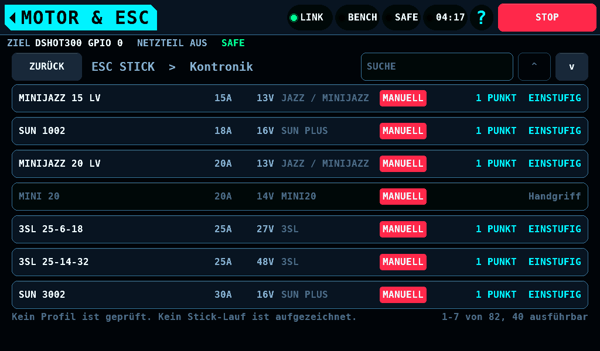

SUCHE filtert die aktuelle Liste. Die Tastatur öffnet sich rechts und
verengt die Liste daneben; jede Eingabe aktualisiert die Treffer. Die
Suche prüft Hersteller plus Familienname oder Hersteller plus Modellname
als jeweils zusammenhängenden Text. Ein Hersteller erscheint, wenn eines
seiner Modelle passt. Groß- und Kleinschreibung spielen keine Rolle;
`*` steht für eine beliebige Zeichenfolge:

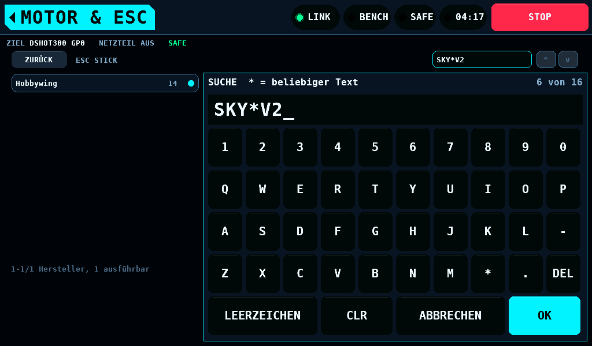

OK behält den Suchtext auf beiden Ebenen bei, X löscht ihn:

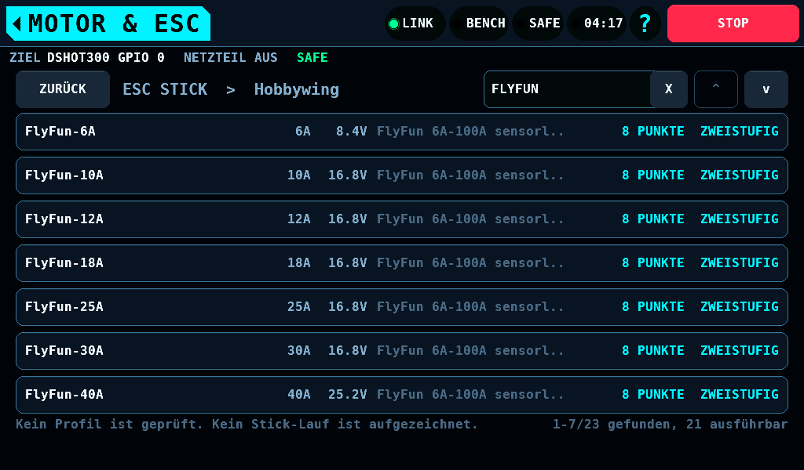

Alle Profilpunkte beginnen mit BEHALTEN. Wähle Werte mit den Minus- und
Plus-Tasten; START zeigt die Anzahl der gewählten Werte:

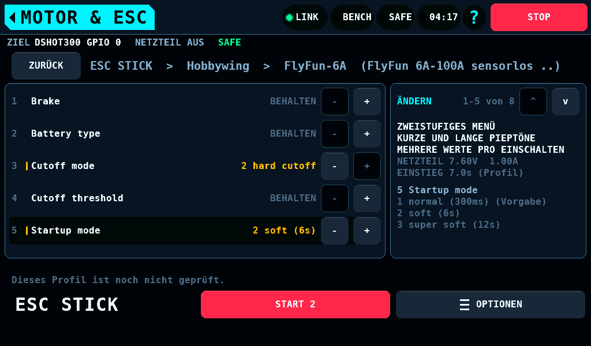

START öffnet die bildschirmfüllende Warnung PROPELLER AB? MOTOR GESICHERT?
Ein am ESC angeschlossener Motor muss fest montiert sein und darf keinen
Propeller tragen. Alternativ ersetzt ein Lastwiderstand den Motor. Halte
2s HALTEN ZUM STARTEN für 2s, um den Lauf zu beginnen:

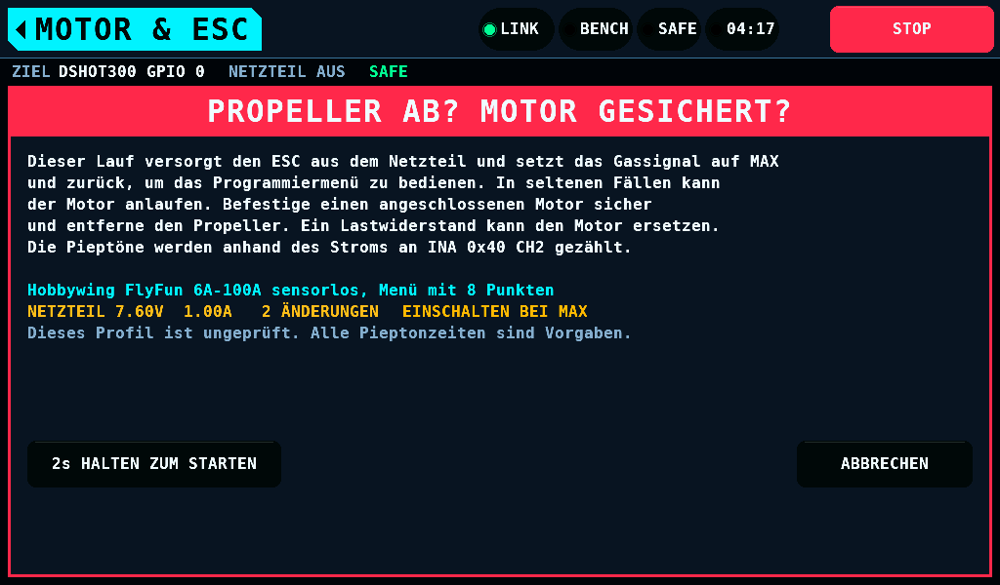

START öffnet nichts, wenn kein Gas-Pin zugeordnet ist, die
Ausgangszuordnung nicht ausgelesen wurde oder das Netzteil aus dem
Panelmodell stammt. Die Zeile daneben nennt den Grund. Jede dieser
Bedingungen schließt auch eine offene Warnung
([Vor einem Lauf](StickProgramming-de.md#vor-einem-lauf)).

Ein Profil mit nötigen Handgriffen am ESC, etwa Jumper stecken oder ziehen
oder einen Taster drücken, zeigt ein rotes MANUELL in der Liste und die
rote Taste MANUELLER EINGRIFF NÖTIG auf seiner Seite. Diese öffnet die
Schritte samt Zeitpunkt; dieselbe Liste erscheint beim ersten Öffnen des
Profils. Die Warnung nennt die Schritte vor dem Einschalten. Für spätere
Schritte pausiert der Lauf mit ERLEDIGT und ABBRECHEN und wartet höchstens
60s ([Handgriffe](StickProgramming-de.md#handgriffe)):

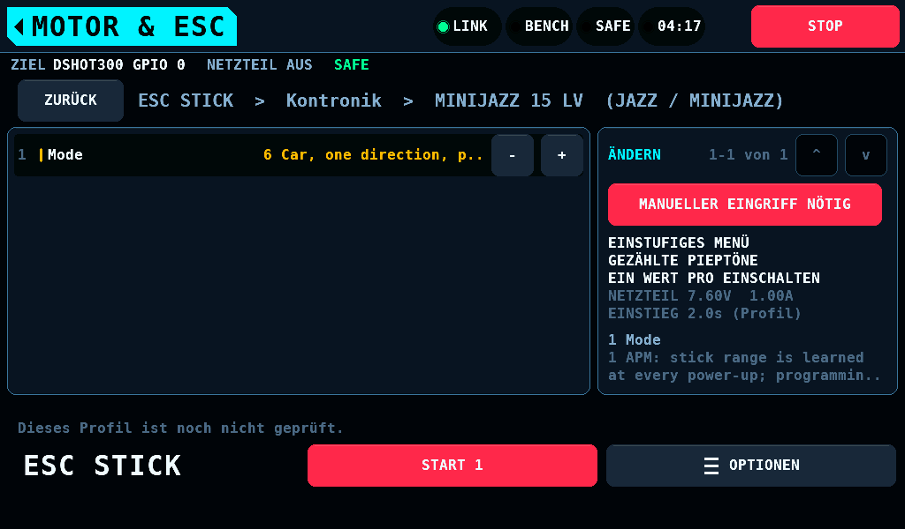

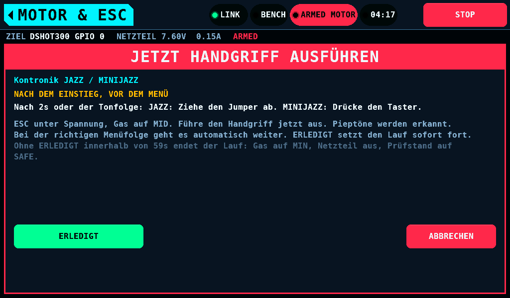

Manche Kontronik-ESCs sperren sich, wenn ihre Versorgung vor der Bestätigung
des gespeicherten Modus ausgeschaltet wird. Bei diesen ESCs lässt der Lauf
die Versorgung eingeschaltet und den Knüppel in der Speicherposition,
bis ERLEDIGT gedrückt wird:

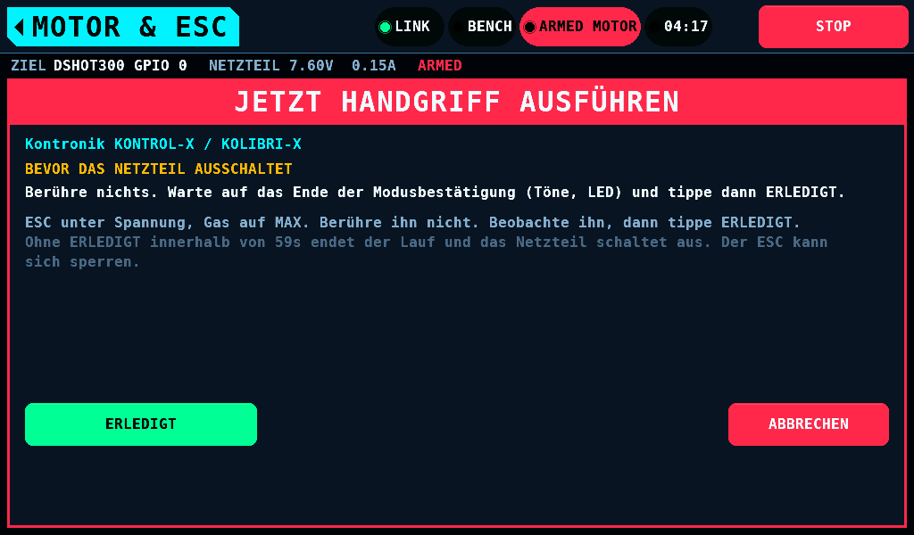

Während des Laufs zeigt die Seite Phase, Pieptöne der aktuellen Gruppe und
die letzte Gruppe. ABBRECHEN, Home-Feld, STOP und Verlassen der Seite
beenden den Lauf: Gas auf MIN, Netzteil aus, Prüfstand SAFE. Grün an der
Signalsäule zeigt einen erkannten Piepton für mindestens 150ms:

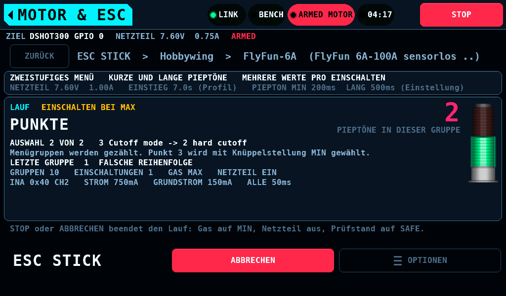

Bei eingeschaltetem Phasenabgriff unter SETUP ergänzt die Laufseite eine
reine Anzeige unter der Stromzeile. Sie zeigt den Zustand des Abgriffs,
die Tonhöhe im letzten 8ms-Fenster, die Anzahl vom IOmcu verlorener und
vom Panel verpasster Pieptöne sowie die letzten vier Pieptöne mit Nummer,
Dauer in ms und mittlerer Tonhöhe in Hz. Der Lauf zählt seine Pieptöne
weiterhin aus dem Netzteilstrom.

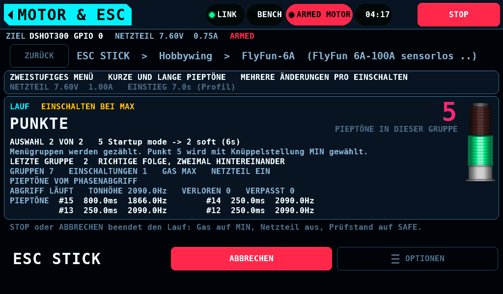

| Zustand | Bedeutung |
| --- | --- |
| `LÄUFT` | die Aufnahme läuft |
| `ÜBERLAUF` | sie läuft, und der Aufnahmering oder die FIFO ist seit dem Einschalten des Abgriffs übergelaufen |
| `WARTET` | keine Verbindung, oder die TONE-Page hat in den letzten 500ms nicht geantwortet, oder ihre Flags sagen, dass der Abgriff läuft, und ihre Fensternummer hat sich 1,5s nicht bewegt, oder der Abgriff wurde ausgeschaltet, und die Page meldet ihn noch als eingeschaltet |
| `KEINE TONE-PAGE` | der IOmcu spricht ein Protokoll älter als 4.8 |
| `PIN BELEGT` | der IOmcu hält den Abgriff aus: sein Pin ist anderweitig zugeordnet, oder der IOmcu führt seit seinem Start keine Erfassung aus (Core 1 nicht gestartet), und seine gespeicherte Konfiguration aktiviert den Abgriff; das Zweite endet nur mit einem Neustart des IOmcu |
| `LÄUFT NICHT` | eingeschaltet, und die Page meldet den Abgriff als aus oder nicht laufend: die Einstellung wurde abgelehnt oder ist noch nicht geschrieben |

TONHÖHE und VERLOREN stammen aus der letzten Statusabfrage. Fehlt ein
Statuswert jünger als 500ms, zeigen sie `--` und blenden `ÜBERLAUF` aus:
bei `WARTET`, `KEINE TONE-PAGE` sowie bei `LÄUFT NICHT`, wenn die Page den
Abgriff als ausgeschaltet meldet. VERPASST und den Pieptonverlauf führt
das Panel selbst; beide bleiben sichtbar.

Das Ergebnis bleibt bis OK sichtbar. Die rote Leuchte kennzeichnet ein
unerwartetes Ende, einschließlich eines vom Prüfstand ausgelösten Stopps.
Bei FERTIG, gedrücktem STOP, ABBRECHEN, Home-Feld oder Verlassen der Seite
bleibt sie aus
([die Liste](StickProgramming-de.md#wie-ein-lauf-endet)):

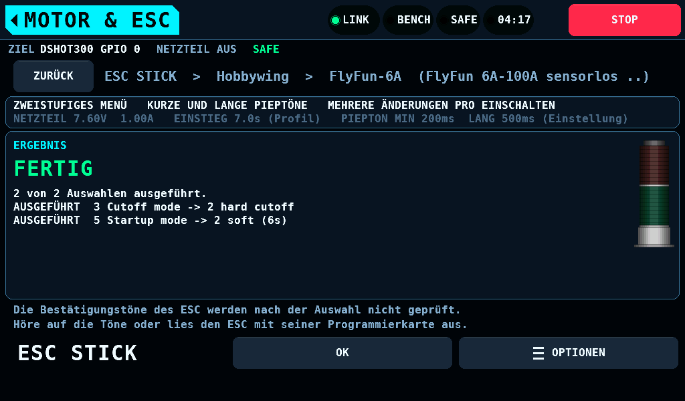

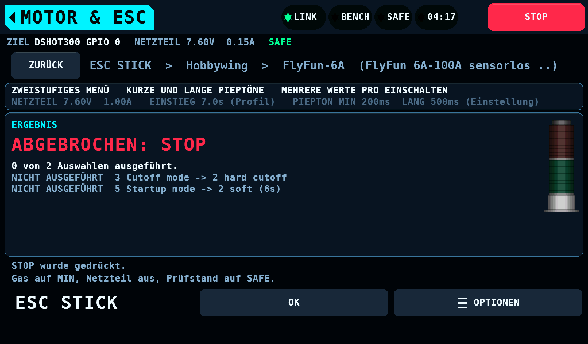

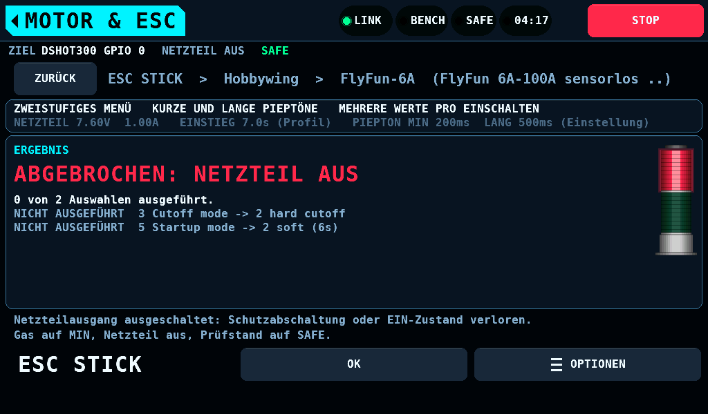

TIMING enthält die Zeiten der Pieptöne und die Netzteil-Einstellungen. Keine
davon ist gemessen:

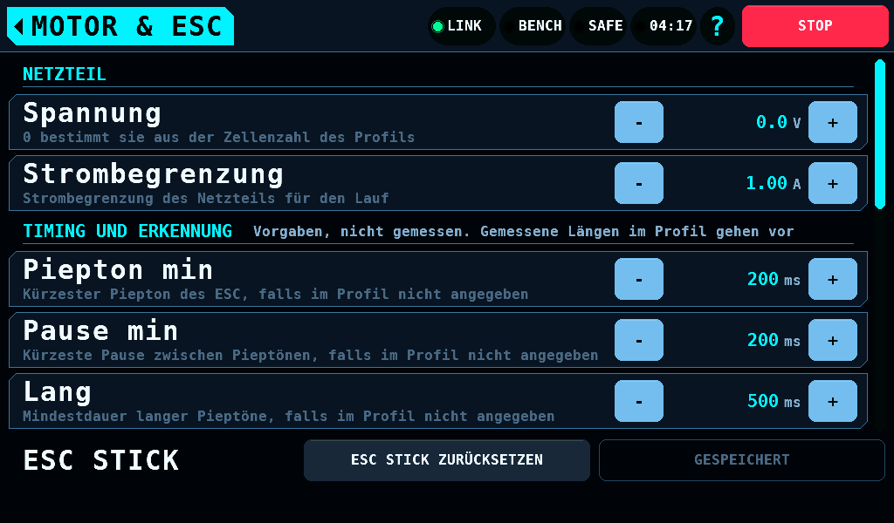

Ändere einen Wert mit `-` und `+` um einen Schritt, oder tippe auf die
250px breite Wertespalte, um das Tastenfeld zu öffnen. Es bedeckt die Seite
unter dem Ausgangsstreifen bis 4px über dem Alarmband: 1008 x 464px mit
242 x 81px großen Tasten. Es zeigt Name, Bereich und Einheit. Die Zahl
der Nachkommastellen folgt der Schrittweite: eine bei 0,1V für Spannung,
zwei bei 0,05A für Strombegrenzung.

OK rundet auf den nächsten Schritt, wie die Plus- und Minus-Tasten:
1,23A wird 1,25A. SCHLIESSEN fordert wie nach einer Schrittänderung das
Speichern an. Bei einem Wert außerhalb des Bereichs bleibt das Tastenfeld
offen und zeigt den Bereich in der Warnfarbe. ABBRECHEN, OK ohne Eingabe
oder das Home-Feld schließt es ohne Änderung; TIMING bleibt offen.
Darunterliegende Bedienelemente reagieren nicht. Profilpunkte verwenden
Listen mit ESC-Werten und öffnen kein Tastenfeld.


## Servo


SERVO hat fünf Aufgaben unter dem Statusband: **LIVE**, **TEST**,
**PROGRAMMIEREN**, **RUDER** und **OPTIONEN**. Die Registerkarten sind
120 x 40px groß, mit 4px Abstand, ab y 8 unter dem Band. Englische
Beschriftungen stehen in 10 x 20, deutsche in 8 x 16: `PROGRAMMIEREN`
hat 13 Zeichen, während 120px nur 10 Zeichen der größeren Schrift fassen.

Die Menükachel öffnet LIVE. Ein Registerwechsel fügt keine
Navigationsebene hinzu; das Home-Feld führt von jeder Aufgabe ins Menü.
Aus Laufeinstellungen führt es zuerst zu TEST, aus einer
Servoprogrammierung zur Liste von PROGRAMMIEREN. Jede Aufgabe behält
Seite und Auswahl bis zum Panelneustart. Das Verlassen von SERVO schaltet
von jeder Aufgabe auf SAFE.

| Aufgabe | Linkes Feld, der Seitenbereich |
| --- | --- |
| LIVE | das Zifferblatt, darüber das Feld eines Laufs, solange er läuft oder sein Ergebnis steht |
| TEST | die Felder AUTOMATISCHER TEST und ENDLAGENLAUF und die Grenzen von SUPPLY, nur lesbar |
| PROGRAMMIEREN | die Liste der Programmierverfahren; eine Zeile öffnet das Verfahren über der linken Spalte |
| RUDER | der Ausschlag einer Ruderfläche in ° und mm, LÄNGE, 1000us, ZENTRIEREN und 2000us, NULLPUNKT, MAX LÖSCHEN und AUTO ([Ruderausschlag](Servo-de.md#ruderausschlag), [AUTO-Endpoints](Servo-de.md#auto-endpoints)) |
| OPTIONEN | die Seiten AUSGANG, SWEEP und PRÜFLING |

Das linke Feld ist 620px breit und beginnt unter der Aufgabenleiste bei
y 56. Rechts reicht das 380px breite Ausgangsfeld vom oberen bis zum
unteren Rand neben der Leiste. Es bleibt bei jeder Aufgabe gleich und
zeigt den aktiven Typ, Messzeile und Grafik der Servoschiene, SOLL, TEMPO,
ZIEL, ZENTRIEREN, SWEEP, FREIGEBEN und ARM. Antippbare Zeilen sind
mindestens 48px hoch. ARM ist 60px hoch und endet wie AUSGANG AUS 4px
über dem Alarmband.

Tastenfeld, Tastatur, Liste, Warnung, Bestätigungsdialog oder
Servoprogrammierung verdecken die gesamte linke Spalte samt Registerkarten.
Beantworte oder schließe sie, bevor du die Aufgabe wechselst.

LIVE zeigt oben links den Winkel des Ruderhorns, darunter in SAFE
`ZUERST ARM`, sowie das Servo-Zifferblatt mit 150px Radius. Am unteren
Rand stehen drei gleich breite Anzeigen: SOLL-PULSBREITE in Mikrosekunden,
GEMESSEN in Grad und STROM in Ampere. Name und Einheit stehen über 44px
hohen Ziffern; die Anzeigen enden 4px über dem Alarmband. +90 und -90
stehen links ihrer Skalenstriche.

Zahlen, die nicht in ihre 198px breite Spalte passen, etwa ein auf
`-1000000.00` begrenzter Strom, verwenden eine kleinere Schrift. Diese
Anzeigen erscheinen nur auf LIVE; andere Aufgaben zeigen den Strom in
der Zeile über der Grafik.

Das Ruderhorn wird mit Subpixelgenauigkeit gezeichnet. Seine Spitze liegt
98px von der Welle entfernt, bewegt sich 1,7px pro Grad und bleibt bei
jedem Schritt höchstens 0,1px von der berechneten Position entfernt.
Eine Bewegung zeichnet nur die umschließenden Rechtecke der alten und
neuen Position in jedem Bildpuffer neu, etwa 160px breit, sowie die
Ziffern für Winkel, SOLL-PULSBREITE und GEMESSEN. Die beiden Felder
werden nicht vollständig neu gezeichnet.

Ziehe bei ARMED auf dem Bogen des LIVE-Zifferblatts, um eine Position
vorzugeben. Der kräftige Arm zeigt die gemessene, der blasse die
angeforderte Position. Ihr Abstand entspricht der Verzögerung des Servos.
Ringe um die Spitze pulsieren, solange das Servo angesteuert wird.

Beim Abheben bleibt die Position gehalten: Die Seite wiederholt den
letzten Befehl alle SERVO_HOLD_MS. **FREIGEBEN** führt die Ruder in die
Mitte ihres Wegs zurück, lässt die Pins aber zugeordnet und pulsend.
Erst SAFE beendet die Pulsflanken; das Verlassen von SERVO schaltet
ebenfalls auf SAFE.

Der eingeschaltete Drehknopf bewegt das Ruderhorn auf LIVE und RUDER von
seiner aktuellen Position aus ([der Knopf](#panel-der-drehknopf)). Auf
TEST, PROGRAMMIEREN, OPTIONEN und unter offenen Dialogen oder einer
Servoprogrammierung hat er keine Wirkung. Auch eine Drehung im Frame,
in dem LIVE wieder erscheint, wird ignoriert; die nächste wirkt.

Nur ein Finger zieht das Zifferblatt. Ein zweiter Druck irgendwo auf der
Seite beendet die Ziehbewegung, ebenso wie bei TEMPO. Der Filter hält
beim erreichten Winkel an. Drücke erneut auf das Zifferblatt, um eine
neue Ziehbewegung zu beginnen.

Der erste Druck gibt den berührten Winkel sofort vor. Die anschließende
Ziehbewegung durchläuft einen einpoligen Filter mit 20ms Zeitkonstante
(`SV_DRAG_TAU_MS`), berechnet aus der Dauer jedes Frames. So verhält er
sich bei 30, 60 und 120 Frames pro Sekunde gleich. Das gezeichnete
Ruderhorn und der gesendete Puls folgen dem gefilterten Winkel; bei
90°/s Fingerbewegung liegen sie 1,8° zurück.

Der Filter gleicht die unterschiedlichen Intervalle der Touch-Abfragen
(10,5ms) und Frames (16,6ms) aus. Bei 90°/s bewegt sich das Ruderhorn
1,0° bis 1,8° pro Frame, ungefiltert wären es 0,5° bis 2,1°. Nach normalem
Loslassen läuft das Ziel bis zum letzten Fingerwinkel weiter und legt
99% des Restwegs in 100ms zurück.

Jeder andere Befehl beendet den Filter sofort: SAFE, DISARM, STOP,
FREIGEBEN, ZENTRIEREN, SWEEP oder eine Knopfdrehung, selbst wenn sie
denselben Puls wie der letzte Filterbefehl ergibt. Auch eine vorzeitige
Unterbrechung der Ziehbewegung beendet ihn: ein zweiter Finger auf der
Seite, dem Statusband, STOP oder Alarmband, oder das Hineingleiten des
ziehenden Fingers ins Statusband. Der Filter stoppt am erreichten Winkel
und sendet keine weiteren Befehle. In SAFE bewegt er nichts. Das nächste
ARM beginnt in Ruhelage ohne verbleibende Zieheingabe.

SERVO steuert die der Rolle Ruder zugeordneten Kanäle. Pins und Protokolle
ergeben sich aus deren Zuordnung. Die acht PPM-Kanäle zählen ebenfalls
als Ruder; ein zugeordneter PPM-Ausgang folgt SERVO wie ein SERVO-PWM-Ausgang.
Ohne zugeordneten Ruderkanal sendet die Seite keinen Positionsbefehl und
kein Pin bewegt sich.

TEMPO begrenzt die Bewegung des Ausgangs in Grad pro Sekunde des
Ruderhornwegs. Bei 100% werden Befehle unmittelbar weitergegeben; das
Servo bewegt sich mit seinem eigenen Tempo. Unter 100% verändert der
Prüfstand den Sollwert entlang einer Rampe. Bei 30% dauert derselbe Weg
dreimal so lange wie bei 90%. Eine Änderung gilt sofort für eine gehaltene
Position. Ohne Rückmeldung folgt die Zeichnung demselben Tempo; bei 100%
springt sie direkt zur angeforderten Position.

**Vor jeder Servobewegung ARM.** ARM aktiviert die Ruderausgänge und einen
pulsenden PROG-PORT. Gas-Ausgänge senden dabei keinen Puls
([Ein Arm für eine Rolle](Link-de.md#ein-arm-für-eine-rolle)). Sind die
Ruderausgänge SAFE, schreibt der IOmcu Pulse der Länge null auf die
PWM-Pins und die Seite nimmt keine Position an. Die Sollposition ändert
sich nur, wenn das Servo ihr folgen kann.

ARM benötigt dieselbe 2s-Haltegeste und denselben Farbwechsel wie auf
MOTOR & ESC. In ARMED schaltet ein Druck auf SAFE. Auch das Verlassen von
SERVO schaltet auf SAFE und gibt den Pin frei. Eine unsichtbare Seite
kann so weder ein Servo halten noch den Prüfstand ARMED lassen.

Die Bedienelemente verhalten sich je nach Zustand so:

| Bedienelement | SAFE | ARMED |
| --- | --- | --- |
| Das Zifferblatt | abgelehnt: kein Befehl, Horn und SOLL-PULSBREITE bleiben | fordert die Stellung unter dem Finger an |
| Drehknopf | abgelehnt; die Drehung wird nicht gespeichert | bewegt das Horn vom befohlenen Wert aus |
| ZENTRIEREN | abgelehnt; gedimmt gezeichnet | fordert PULS MITTE plus TRIMMUNG an |
| SWEEP, PAUSE, PAUSIERT | abgelehnt; gedimmt gezeichnet | startet, pausiert und setzt den Sweep fort |
| FREIGEBEN | sendet die Freigabe; der gezeigte Wert bleibt | zentriert die Ruderflächen; der gezeigte Wert wird zur Ruhelage |
| TEMPO | wird gesetzt; sendet nichts | wird gesetzt; eine gehaltene Stellung wird mit der neuen Rate erneut gesendet |
| OPTIONEN > AUSGANG: TYP, PULSRATE, PULS MIN, MITTE und MAX, TRIMMUNG, WEG, UMKEHREN | werden gesetzt; senden nichts | werden gesetzt; eine gehaltene Stellung oder die Ruhelage wird mit diesen Einstellungen erneut gesendet |
| ZIEL | ein Tippen öffnet SETUP > OUTPUTS | gesperrt; nennt das Ziel |
| SOLL, AUSGANG EIN, AUSGANG AUS | wie auf SUPPLY | wie auf SUPPLY |
| TEST STARTEN | abgelehnt: `ZUERST ARM` | startet den Lauf nach der Haltegeste |

In SAFE ist das Ruderhorn abgeblendet und LIVE zeigt `ZUERST ARM`.
Ruderhorn und SOLL-PULSBREITE behalten die zuletzt angesteuerte Position,
nach einem Neustart PULS MITTE. Eine in SAFE geänderte Pulsbreite ändert
die für diesen Winkel angezeigten Mikrosekunden; WEG begrenzt den Winkel
nicht.

Die Spalte SAFE gilt bereits, sobald die Seite DISARM anfordert, durch
Antippen oder Verlassen, oder STOP bei ARMED gedrückt wird, bevor die
SAFE-Meldung eintrifft. Sweep, Pause, gehaltene Position und automatischer
Test enden mit dieser Anforderung.

Bei ARM wird die Sollposition zur Ruhelage der Pins: der Mitte zwischen
den Kanalendpunkten, 1500us bei STANDARD PWM oder 760us bei NARROW 760,
ohne TRIMMUNG. Ohne Rückmeldung erscheint das Ruderhorn sofort dort.
Die erste Ziehbewegung oder Knopfdrehung beginnt bei diesem Wert,
unabhängig von der vorherigen Anzeige. Eine Drehung um 1% mit STANDARD
PWM fordert 1510us an. Eine Änderung von Typ oder Pulsbreite in ARMED
vor dem ersten Positionsbefehl verschiebt Ruhelage und Anzeige gemeinsam.

Liegt beim Wechsel auf ARMED oder SAFE oder bei einem Stopp ein Finger
auf dem Zifferblatt, kann er nichts ändern. Hebe ihn ab und drücke erneut.
Eine noch nicht gesendete Position, ein Sweep oder eine Pause wird beim
Wechsel auf SAFE oder beim Stopp verworfen. Eine Knopfdrehung in diesem
Zustand wird zurückgenommen; die Anzeige kehrt zum Wert davor zurück.

FREIGEBEN in ARMED stellt dieselbe Ruhelage wie ARM her: 1500us bei
STANDARD PWM oder 760us bei NARROW 760, ohne TRIMMUNG. Die Sollposition
folgt; das Ruderhorn wird mit TEMPO dorthin laufend gezeichnet. Eine
Ziehbewegung endet. Drücke auf das Zifferblatt, um wieder eine Position
vorzugeben. Die nächste Knopfdrehung beginnt an der Ruhelage: 1% mit
STANDARD PWM fordert 1510us an.

Dasselbe gilt für die Freigabe am Ende eines automatischen Tests oder
nach einer Änderung von Typ oder Pulsbreite bei ruhendem Ausgang. Pro
Frame wartet ein Befehl. Treffen Position und FREIGEBEN im selben Frame
ein, wird der spätere Befehl gesendet und angezeigt. Eine Knopfdrehung
wird verworfen, wenn in diesem Frame FREIGEBEN wartet.

Das Ausgangsfeld zeigt den aktiven Typ, die Pulsrate und den Pulsbereich.
Einstellungen, die ein ungeeignetes Servo zerstören können, erscheinen in
der Gefahrenfarbe. Darunter stehen Spannung, Strom und Leistung der
Servoschiene sowie ihre Grafik über die letzten 17,8s (356px bei 20 Punkten
pro Sekunde). STROM auf LIVE zeigt den Strom zusätzlich.

Die 44px hohe Typzeile zeigt `STANDARD PWM  50Hz  1000-2000`: Typ,
Pulsrate und PULS MIN bis PULS MAX in Mikrosekunden, mit je zwei Leerzeichen.
Die längste Zeile, ein Typ mit 13 Zeichen bei 560Hz und zwei vierstelligen
Endwerten, braucht 32 der 35 verfügbaren Zeichen. Deshalb trägt der
Pulsbereich keine Einheit. Eingetragene Pulsbreiten erscheinen sofort.

| Messgerät der Servoschiene | Name in der Zeile | STROM auf LIVE, die Zeile und die Grafik zeigen |
| --- | --- | --- |
| ein INA3221-Kanal | `INA`, die Adresse seines Bausteins und der Kanal: `INA 0x41 CH2` | das letzte 50ms-Fenster des Kanals: den mittleren Strom, die mittlere Busspannung auf der Lastseite des Shunts und ihr Produkt. Ein Punkt in der Grafik je Fenster, 20 in der Sekunde |
| der PD mini | `PD MINI` | die letzte Abtastung des Netzteils. Ein Punkt je Abtastung |
| das Modell, solange kein IOmcu antwortet | `PD MINI` | die letzte Abtastung des Netzteils: die des Netzteilmodells unter dem SIMULATION-Wasserzeichen, und keinen Messwert, wenn die Registerkarte PD MINI auf SUPPLY den PD mini einschaltet, der ohne Verbindung nicht antwortet |

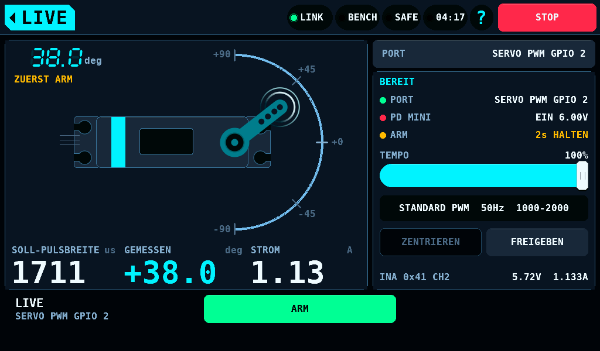

Der Name bleibt in beiden Sprachen `PD MINI`. Ist der PD mini auf der
Registerkarte PD MINI von SUPPLY ausgeschaltet, verwendet das Panel sein
Netzteilmodell. Links oben in der Grafik erscheint unter dem Namen die
Markierung SIMULIERT (englisch SIMULATED), da rechts vom Namen drei
Messwerte stehen. Sie ist 26px hoch und 30px plus Wortbreite breit,
mindestens 110px; SIMULATED und SIMULIERT brauchen 120px. Die Markierung
erscheint und verschwindet automatisch mit dem Modell.

Bei einem INA3221-Messgerät nennt die Zeile den Kanal, `INA 0x40 CH1` bis
`INA 0x43 CH3`, und zeigt unabhängig vom Netzteilmodell keine Markierung.
Es ist der Kanal, der das Ziel des Servotesters überwacht
([SENSORS](#sensors-die-ina3221-bausteine)). Vor IOmcu-Protokoll 4.25 ist
das CH1 des einzelnen über SENSE ausgelesenen Bausteins.

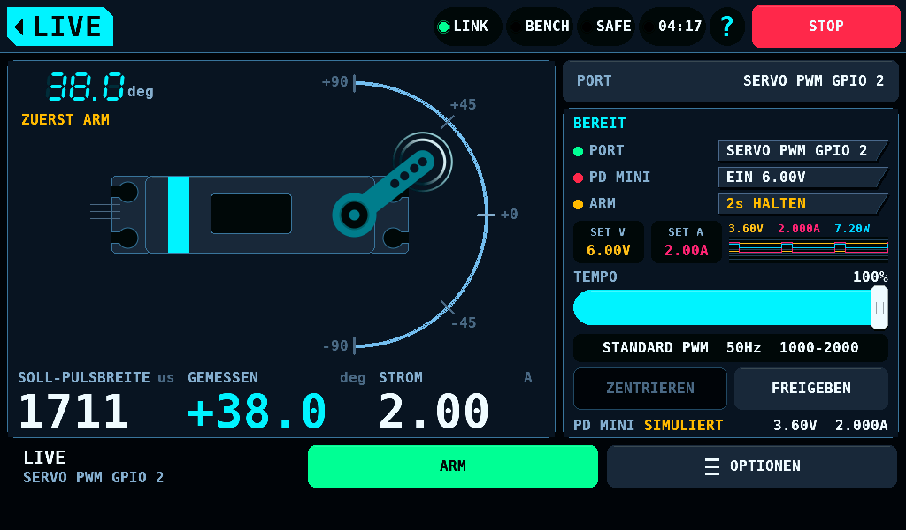

Auf dem [rbmod-Carrier](Carrier-de.md#versorgung) ersetzt das 48px hohe
Feld PROG 5V die Grafik unter den Messwerten. Es steuert die getrennten
5V der Programmierports. Die erste Zeile nennt Pin und Zustand:
`PROG-PORTS 5V, GPIO 21: AUS`. Die zweite zeigt das letzte 50ms-Fenster
von INA3221 0x40 CH3, der diese 5V überwacht: `5.02V  0.120A`, ohne
Fenster `--V  --A`.

PROG 5V EIN benötigt 2s Halten, PROG 5V AUS einen Tipp, wie AUSGANG EIN
und AUS in SAFE oder ARMED. Hält ein Programmierport die 5V, zeigt die
zweite Zeile `BELEGT VON PROG-PORT n` und die Taste ist abgeblendet.
Ein Druck meldet
`PROG-Ports 5V: von einem Programmierport belegt oder nicht ausgelesen.`
Das Feld bleibt unter der KST- und Hitec-Programmierung sichtbar.
Beim Verlassen von SERVO werden die dort eingeschalteten 5V abgeschaltet,
außer ein Port hält sie. Bei aktivem Netzteilmodell steht SIMULIERT
unter dem Feld.

SUPPLY zeigt dasselbe Feld ([Netzteil](#netzteil)); die Regeln stehen unter
[Carrier, Das Feld PROG 5V](Carrier-de.md#das-feld-prog-5v). Zwei Fenster
unter 3000mV bei angezeigtem EIN lösen einen Fehler aus: SAFE, alle
Ausgänge aus und die Bandmeldung
`PROG 5V ausgefallen: INA3221 0x40 CH3 misst 0.12V trotz EIN. Alle Ausgänge aus.`
([Carrier, PROG 5V ausgefallen](Carrier-de.md#prog-5v-ausgefallen)).

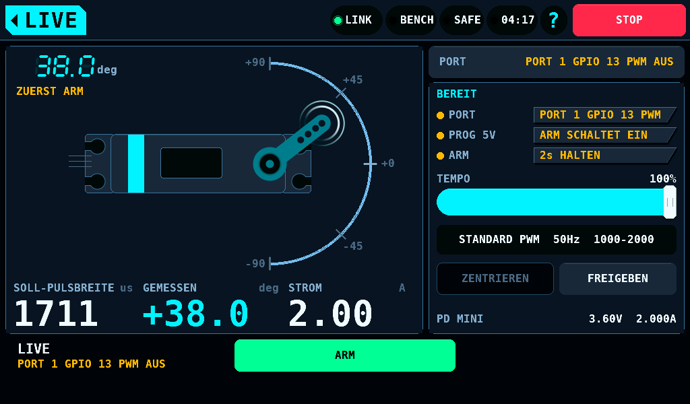

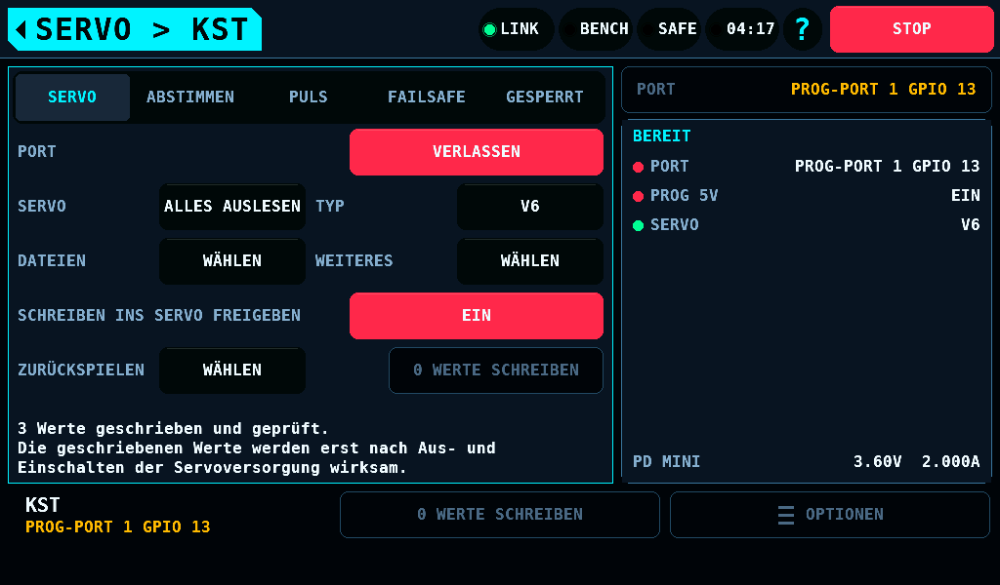

Das Messgerät wird bei jeder Abfrage gewählt
([die Strommonitore](#sensors-die-strommonitore)). Der INA3221 übernimmt,
nachdem seine Bedingungen 1000ms lang erfüllt sind. Der PD mini übernimmt
ab der ersten Abfrage, in der eine Bedingung entfällt.

- Ein Strom hat ein Vorzeichen und wird in Hundertstel Ampere gezeigt:
  `0.41A`, `-0.02A`, `-1.64A`. Ein Messwert, der auf null rundet, ist
  `0.00A`. Die Leistung in der Zeile hat ein Vorzeichen und Zehntel Watt.
  Neben dem Namen eines Kanals, 134px, haben die drei Messwerte 64, 84 und
  74px, 6, 8 und 7 Zeichen zu 10px; neben PD MINI, 90px, 88, 88 und
  90px: eine Spannung ab 10V wird in Zehnteln
  gezeigt, `26.0V`, und eine Leistung, die in Zehnteln mehr als 7 Zeichen
  braucht, ab `-100.0W` und ab `1000.0W`, in ganzen Watt.
- Ein Messwert, der nicht ankam, ist `---` in STROM auf LIVE, `--` in der
  Zeile über der Grafik und eine Lücke in der Grafik: noch keine Abtastung, ein Netzteil,
  das nicht antwortet, kein Fenster seit dem Verbindungsaufbau, ein Fenster ohne
  Messungen dieser Größe.
- Ein Fenster, in dem eine Messung das Ende des Messbereichs des INA3221
  erreicht hat, 1,638A oder -1,638A an einem Shunt von 0,1Ω, zeigt seinen
  Mittelwert, wie er ist, in der Warnfarbe in STROM auf LIVE und in der
  Zeile über der Grafik. Die übersteuerten Messungen zählen in diesem
  Mittelwert mit dem Ende des Bereichs.

  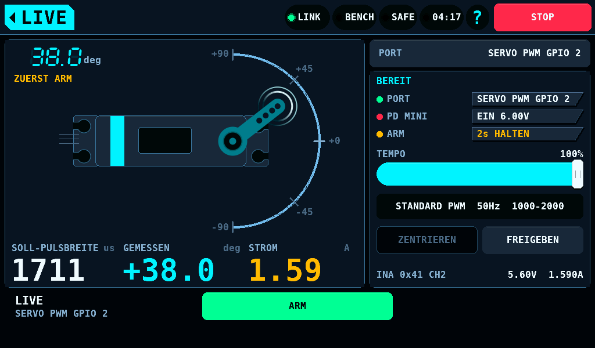

- Verbindungsverlust löscht das letzte INA3221-Fenster. Die Anzeigen zeigen
  `---` und `--`, bis ein neues Fenster eintrifft oder das Messgerät wechselt.
- Der Wechsel zum INA3221 oder von ihm weg leert die Grafik. Ihre Kurve
  gehört immer zum genannten Messgerät. Jedes Fenster und jede
  Netzteilabtastung trägt das bei ihrer Abfrage gewählte Messgerät.
  Werte von vor dem Wechsel werden ausgeschlossen; kein späterer fehlt.
  Die Skala beginnt bei 0, negative Ströme liegen daher am unteren Rand.
- Ändern sich Ziffern oder Farbe von STROM auf LIVE, wird nur diese
  Zahlenanzeige neu gezeichnet.

Der automatische Test verwendet das bei TEST STARTEN ausgewählte
Messgerät der Servoschiene: den INA3221-Kanal, wenn dieser die Schiene
misst und der PD mini das Netzteil ist; sonst den PD mini oder, bei
simuliertem Netzteil, das Modell
([Der Strommesser des Laufs](Servo-de.md#der-strommesser-des-laufs)).

GEMESSEN zeigt den Ruderhornwinkel aus der gewählten Quelle AS5600 oder
IMU, in Zehntelgrad von -180,0° bis +179,9°. Der AS5600 wird 20-mal pro
Sekunde ausgelesen; sein Winkel bezieht sich auf den Mittenwert. Er muss
unter SETUP > SENSORS eingeschaltet sein, antworten und seinen Magneten
erkennen. Ohne Antwort oder Magnet (STATUS MD nicht gesetzt) erscheint
`---`; der Zählerstand ist dann kein gültiger Winkel. Ein zu schwacher
oder zu starker Magnet lässt den Winkel sichtbar; das Alarmband nennt
die Ursache.

Bei gewählter IMU verwendet GEMESSEN deren eingestellte Achse und
Vorzeichen. Ohne gültigen Wert der gewählten Quelle steht dort `---`.
Ist AS5600 gewählt, aber ausgeschaltet, liefert stattdessen eine vorhandene
Servorückmeldung den Winkel. SOLL-PULSBREITE daneben zeigt Mikrosekunden.

**Das Netzteil lässt sich auch hier einstellen und schalten.** SOLL unter
der Grafik enthält Spannungssollwert, Strombegrenzung und Ausgangsschalter
von SUPPLY. Beide Seiten verwenden dieselben Werte; eine Änderung gilt
sofort auf beiden.

- Tippe auf einen Sollwert, um das Tastenfeld über dem linken Feld zu
  öffnen. Werte außerhalb der Grenzen werden wie auf SUPPLY begrenzt.
- Bei eingeschaltetem Ausgang wartet ein eingegebener Sollwert auf
  AUSGANG IST EINGESCHALTET mit ÜBERNEHMEN und ABBRECHEN. Ausgenommen ist
  ein ausgeschaltetes TASTENFELD unter SUPPLY > OPTIONEN > RÜCKFRAGE IM
  BETRIEB. Die Rückfrage schließt unbeantwortet bei ausgeschaltetem
  Ausgang oder STOP. ÜBERNEHMEN im selben Frame wie STOP ändert nichts,
  auch wenn das Netzteil erst eine Abtastung später AUS meldet.
- Eine Erhöhung von höchstens 6,0V auf mehr als 6,0V öffnet NUR HV-SERVOS.
  Standardservos sind für 4,8 bis 6,0V ausgelegt. Darüber darf nur ein für
  diese Spannung spezifiziertes HV-Servo (High Voltage) betrieben werden;
  ein Standardservo kann sofort zerstört werden. Halte 2s HALTEN ZUM
  ÜBERNEHMEN, um die Spannung anzuwenden. ABBRECHEN verwirft sie, STOP
  beendet das Halten. Bei eingeschaltetem Ausgang ersetzt diese Warnung
  die SUPPLY-Rückfrage und bleibt auch nach dem Ausschalten offen.
  Änderungen einer bereits über 6,0V liegenden Spannung oder eine Eingabe
  auf SUPPLY öffnen diese Warnung nicht.

  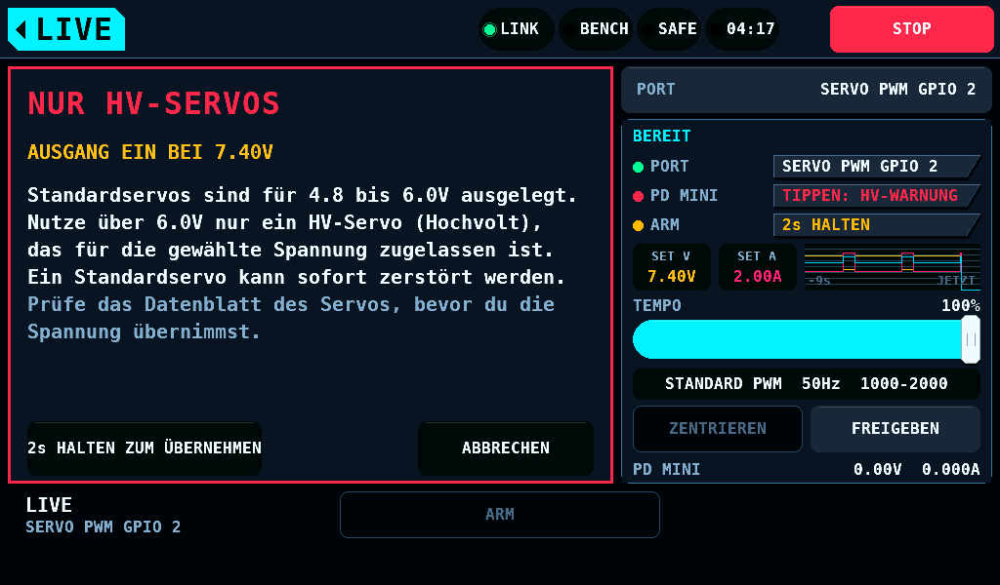

- Lässt VERLASSEN einer KST- oder Hitec-Sitzung den Ausgang mit den
  Sitzungssollwerten eingeschaltet, fragt SERVO unter AUSGANG IST
  EINGESCHALTET nach deren Wiederherstellung:
  `Netzteil-Sollwerte 5.50V 2.00A am eingeschalteten Ausgang wiederherstellen?`
  mit JA und NEIN. JA behandelt die Werte wie eine Eingabe, einschließlich
  NUR HV-SERVOS. NEIN behält die Sitzungssollwerte bis zum nächsten AUS
  ([Servoprogrammierung, Die Versorgung](ServoProgrammer-de.md#die-versorgung)).
  Andere Arten der Portfreigabe lösen diese Rückfrage nicht aus.

- AUSGANG EIN erfordert 2s Halten; AUSGANG AUS einen Tipp, wie auf SUPPLY.
  STOP beendet die Haltegeste. Bei einem Spannungssollwert über 6,0V,
  unabhängig vom Eingabeort, öffnet AUSGANG EIN NUR HV-SERVOS mit der
  Spannung. Nur das vollständige Halten von 2s HALTEN ZUM ÜBERNEHMEN
  schaltet ein; die ursprüngliche Haltegeste oder ein Tipp auf ÜBERNEHMEN
  genügt nicht. Steigt der Sollwert während einer normalen Haltegeste über
  6,0V, durch SUPPLY oder die Wiederherstellung nach einem Lauf, öffnet
  deren Ende die Warnung und lässt den Ausgang aus.
- Beim Verlassen schaltet SERVO einen Ausgang aus, den es über AUSGANG
  EIN, einen Test oder VERBINDEN eingeschaltet hat. Hält eine
  Servoprogrammierung den Port, bleibt der Ausgang an, damit Sitzung und
  Schreibvorgang nicht unterbrochen werden. Er schaltet bei der
  Portfreigabe aus, außer SERVO wurde zuvor wieder geöffnet. Auch eine
  noch ausstehende Einschaltanforderung von SERVO zählt dazu, wenn der
  Port das Netzteil übernimmt. Ein anderswo eingeschalteter Ausgang bleibt
  unverändert. Servoprogrammierung, Tastenfelder und Dialoge gehören zu
  SERVO; ihr Öffnen ist kein Verlassen. Ein Druck auf AUSGANG AUS während
  des Verlassens wird weiterhin gesendet.

**SWEEP führt eine Kurve auf dem IOmcu aus.** Ihr Timing hängt damit nicht
von der Verbindung ab. OPTIONEN > SWEEP bestimmt KURVE (Rechteck, Sinus
oder Dreieck) und TEMPO (0,05 bis 5 Zyklen pro Sekunde). HALTEZEIT des
automatischen Tests bestimmt die Pause an jedem Ende. Die Kurve liegt
um PULS MITTE. BEREICH ist ein Anteil des erlaubten Wegs, begrenzt durch
WEG und den näheren Wert von PULS MIN und MAX. TEMPO im rechten Feld
begrenzt die Bewegung wie eine Ziehbewegung; TRIMMUNG gilt nicht.

Das Panel berechnet dieselbe Kurve und richtet ihr Timing nach dem Start
des IOmcu aus. Erst nach dessen Bestätigung zeichnet es einen neuen oder
fortgesetzten Sweep; bis dahin bleibt das Ruderhorn an der Ausgangsposition.
Ohne Rückmeldung folgt es danach der Kurve mit TEMPO, ausgehend von der
Position beim IOmcu-Start. Zwei Tipps auf SWEEP im selben Frame heben
sich auf, wenn der erste Befehl noch nicht gesendet wurde. Es wird nichts
gesendet; der vorherige Sweep-Zustand bleibt bestehen.

**PAUSE hält die aktuelle Ausgangsposition.** Während eines Sweeps zeigt
die Taste PAUSE in Akzentfarbe. Ein Tipp hält den Ausgang dort, wo er
angekommen ist; durch TEMPO kann er hinter der Kurve liegen. Die Taste
zeigt anschließend PAUSIERT mit Füllung in Warnfarbe. Der IOmcu hält die
Position (HOLD des Links, SWEEP-Register 4), weil nur er sie genau kennt.
Ohne Rückmeldung zeichnet das Panel eine Schätzung. Es wiederholt HOLD
alle 100ms (`SERVO_HOLD_MS`) und hält die Pause so über die 500ms-Frist des
IOmcu hinaus aktiv. Die Pause wartet nicht hinter bereits gesendeten
Sweep-Schreibvorgängen.

Tippe auf PAUSIERT, um an der gespeicherten Kurvenphase fortzusetzen,
einschließlich des Fortschritts einer Haltezeit und bereits erreichter
Enden. Diese Phase stammt von der HOLD-Bestätigung des IOmcu, nicht vom
Tipp auf PAUSE. Während des Austauschs laufen IOmcu und Zeichnung mit
dem beim Tipp geltenden TEMPO weiter, höchstens 500ms. Ohne Rückmeldung
setzt das Panel das Ruderhorn dann auf die geschätzte Ausgangsposition
zum Bestätigungszeitpunkt, aus Kurve und Tempobegrenzung berechnet.
Eine inzwischen geänderte TEMPO-Einstellung erreicht den IOmcu erst beim
Fortsetzen.

Nach einem Tipp auf PAUSIERT bleibt das Ruderhorn stehen, bis das
Fortsetzen bestätigt ist. Das Panel fährt dann von der gespeicherten
Phase aus weiter, anhand der Zeitpunkte beider Bestätigungen. Das gilt
auch, wenn der Tipp vor der HOLD-Bestätigung eintrifft: Diese setzt das
Ruderhorn weiterhin auf die gehaltene Position; von dort geht es weiter.

Der IOmcu bewahrt die Phase beim Halten und setzt mit `LINK_SV_RESUME`
(Protokoll 4.6) fort. Der Ausgang nähert sich der Kurve mit TEMPO, bei
100% sofort; meist liegt er bereits darauf. Eine während der Pause unter
OPTIONEN > SWEEP geänderte KURVE beginnt stattdessen einen neuen Sweep.

Ein IOmcu vor Protokoll 4.6 oder ein wegen beendeten Haltens abgelehntes
Fortsetzen beginnt die Kurve neu: bei Sinus und Dreieck in der Mitte,
bei Rechteck am ersten Ende. Das Alarmband meldet
`IOmcu-Firmware älter als 0.13.0. Sweep beginnt von vorn.` oder
`IOmcu hat das Fortsetzen abgelehnt. Sweep beginnt von vorn.` Auch ein
Tipp auf PAUSIERT nach einem unbeantworteten HOLD beginnt neu, weil der
IOmcu halten oder noch laufen könnte:
`Pause wurde nicht bestätigt. Sweep beginnt von vorn.` Ein Tipp vor einem
HOLD, das das Panel anschließend aufgibt (siehe unten), startet nichts;
die Pause endet mit diesem HOLD.

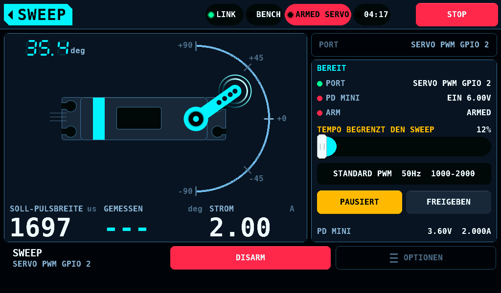

Wird HOLD 500ms lang nicht wiederholt, hat der IOmcu es freigegeben.
Das Panel gibt dann die Ruder zur Mitte frei und zeichnet das Ruderhorn
dort. Ebenso endet die Pause, wenn HOLD erst nach einer Wiederholung oder
mehr als 500ms beantwortet wird. Der IOmcu könnte freigegeben und an
anderer Stelle wieder gehalten haben; der Winkel ist dem Panel dann
unbekannt. Das Ende der Pause verhindert, dass eine spätere Profiländerung
diesen unsicheren Winkel anfordert.

Verbindungsverlust beendet Sweep und Pause und zeichnet das Ruderhorn in
Ruhelage. Der IOmcu setzt die Ruder 500ms nach dem letzten empfangenen
Schreiben in Ruhe. Nach Rückkehr der Verbindung werden keine alten Sweep-
oder Haltebefehle gesendet; der nächste Tipp startet einen neuen Sweep.

Zifferblatt, ZENTRIEREN, FREIGEBEN, STOP, ein Wechsel auf SAFE und das
Verlassen der Seite beenden laufende und pausierte Sweeps. Die Taste zeigt
wieder SWEEP. Änderungen von Typ, Pulsrate, Pulsbreite, TRIMMUNG, WEG oder
UMKEHREN beenden ebenfalls eine Pause und halten ihren Winkel als Position.
Mit Rückmeldung gilt der zuletzt gemeldete Winkel, dem sich das Servo nach
dem Tipp noch nähern kann; ohne Rückmeldung gilt die gezeichnete Schätzung
zum Bestätigungszeitpunkt. TEMPO ändert die Pause nicht und gilt beim
Fortsetzen. Verlorene Touch-Ereignisse pausieren einen laufenden Sweep
wie PAUSE.

Eine geänderte Einstellung startet einen laufenden Sweep mit neuer Kurve.
Bis zur IOmcu-Bestätigung zeichnet das Panel die alte Kurve mit ihren
ursprünglichen Pulsen und WEG weiter. Jede Bestätigung gehört zu ihrem
Befehl. Ändern sich TEMPO oder KURVE während eines ausstehenden Starts,
kann eine ältere Bestätigung daher nicht den neueren Befehl zeichnen.
Profil- und Pulsratenänderungen gelten sofort.

SWEEP ist in ARMED mit zugeordnetem Ruder, bestehender Verbindung und
IOmcu-Protokoll 4.2 verfügbar; sonst ist die Taste abgeblendet. Der IOmcu
stoppt einen 500ms lang nicht wiederholten Sweep und lässt jedes Ruder
an der erreichten Ausgangsposition.

**TEMPO BEGRENZT DEN SWEEP** steht in der Warnfarbe statt der Beschriftung
TEMPO im rechten Feld, solange TEMPO langsamer ist als die schnellste
Änderung, die die Kurve verlangt. Dann bestimmt TEMPO die Bewegung, nicht
KURVE: Rechteck, Sinus und Dreieck laufen alle als Rampen mit der Rate von
TEMPO und sehen gleich aus, und der Ausgang kann umkehren, bevor er ein Ende
erreicht. Die Zeile folgt den Einstellungen; sie erscheint also schon vor
dem Druck auf SWEEP und ebenso, während ein Sweep läuft. Erhöhe TEMPO im rechten Feld oder senke
TEMPO (die Rate in Hz) oder BEREICH unter OPTIONEN > SWEEP, um die Meldung
zu beseitigen. Ein Rechteck springt zwischen seinen Enden, daher erscheint
sie dort bei jedem TEMPO unter 100%. Mit den Vorgaben der Seite SWEEP
(Sinus, 0,5Hz, BEREICH 80%) und WEG +/-90° verschwindet sie
ab TEMPO 63%, beim Dreieck ab 40%.
[Servoverfahren](Servo-de.md#sweep-und-tempo) nennt die Regel.

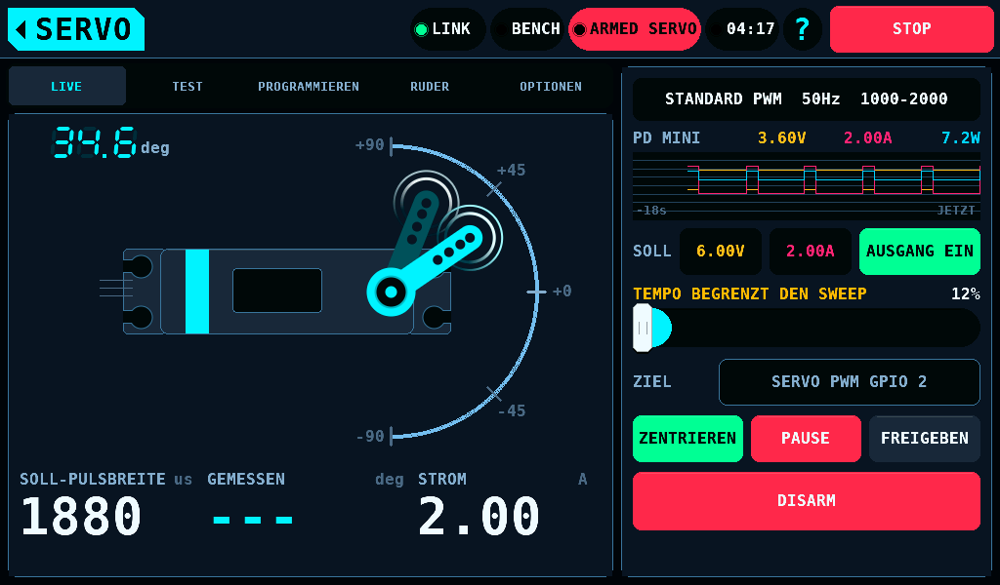

**TEST STARTEN beginnt den automatischen Test** im Feld AUTOMATISCHER TEST
auf TEST. Er fährt das Servo bei den gewählten Netzteilspannungen, misst
Strom in Ruhe, Bewegung und Halten sowie die Stellzeit und sucht die
Spannung, bei der die Bewegung endet.
[Servoverfahren](Servo-de.md#automatischer-test) beschreibt Methode und Dateien.

Das 600 x 188px große Feld enthält Laufname, eine Zusammenfassung wie
`4.8V, 6.0V, BROWN-OUT, JE 60s` oder `..., JE 20 BEWEGUNGEN`, TEST STARTEN
(300 x 48px) neben OPTIONEN (160 x 48px), Zustandszeile, letztes Ergebnis
mit Dateien und dem Hinweis zu BLOCKIERT AB. Ein Ergebnis lautet etwa
`ZULETZT: BESTANDEN ATEST004.CSV + .TXT`; ein Abbruch zeigt den Grund in
Warnfarbe, etwa `ZULETZT: ABGEBROCHEN - Verbindung verloren`.

Der Start benötigt ARMED und ein antwortendes Netzteil. Die Zustandszeile
folgt Prüfstand und Einstellungen: ZUERST ARM, KEINE STUFE GEWÄHLT,
NETZTEIL ANTWORTET NICHT, BEREICH ZU KLEIN (BEREICH und WEG legen beide
Enden auf PULS MITTE), STUFE AUSSERHALB DER GRENZEN (eine Stufe überschreitet
die Spannungsgrenze, vor jeder Warnung geprüft) oder BERICHT WIRD NOCH
GESCHRIEBEN.

Der Hinweis zu BLOCKIERT AB nennt unerreichbare Schwellen:
`BLOCKIERT AB 2.00A unerreichbar: Strombegrenzung 2.00A`, wenn BLOCKIERT AB
mindestens so hoch wie die Strombegrenzung unter SOLL ist. Andernfalls,
bei INA3221 als Messgerät und einer Schwelle mindestens in Höhe seines
Messbereichs, erscheint
`BLOCKIERT AB 2.00A unerreichbar: INA3221-Bereich 1.638A`.
Der Hinweis sperrt TEST STARTEN nicht; siehe
[Blockieren und Konstantstrom](Servo-de.md#blockieren-und-konstantstrom).

TEST STARTEN benötigt 2s Halten, weil der Lauf das Netzteil einschaltet und
das Servo bewegt. Bei eingeschaltetem HV-SERVO und einer Stufe über 6,0V
öffnet ein Tipp stattdessen NUR HV-SERVOS mit der höchsten Stufe. Der Lauf
beginnt erst nach vollständigem Halten von 2s HALTEN ZUM ÜBERNEHMEN.
Jeder Neustart schaltet HV-SERVO aus. An einem Programmierport des
rbmod-Carriers sind keine Spannungsstufen möglich; seine Versorgung ist
auf 5V festgelegt.

TEST bleibt beim Start sichtbar; die Zustandszeile nennt die aktuelle
Stufe. LIVE zeigt links unter `ZUERST ARM` ein 346px breites Lauffeld,
das bei jedem Winkel Abstand zum Ruderhorn hält. Es zeigt Stufe und Phase
sowie neben TEST BEENDEN das Messgerät: `PD mini`, einen INA3221-Kanal wie
`INA 0x41 CH2` oder `SIMULATION`. Der Lauf verwendet bis zum Ende das bei
TEST STARTEN gewählte Messgerät
([Der Strommesser des Laufs](Servo-de.md#der-strommesser-des-laufs)) und
steuert Servo, Sollwerte und Schalter von SUPPLY.

Der Lauf endet vorzeitig mit Ausgang aus und zur Mitte freigegebenem
Servo bei TEST BEENDEN (in beiden Feldern), STOP, SAFE, Verbindungsverlust,
Verlassen von SERVO, Berühren des Zifferblatts, ZENTRIEREN, SWEEP,
FREIGEBEN, Antippen eines Sollwerts, Änderungen von Typ, Pulsen, TRIMMUNG,
WEG, UMKEHREN oder TEMPO, verlorenen Touch-Ereignissen oder den
Netzteilbedingungen in [der Liste](Servo-de.md#was-einen-lauf-beendet).

Nach dem Lauf werden die vorherigen SUPPLY-Sollwerte wiederhergestellt,
unabhängig von der sichtbaren Seite. Das wartet auf den gesendeten
AUS-Befehl und einen danach erfassten Messwert, mit dem das Netzteil
selbst AUS bestätigt. Die Panelanforderung genügt nicht: Der PD mini folgt
erst einen Verbindungsaustausch und eine Modultransaktion später. Keine
Einschaltanforderung darf ausstehen, und AUSGANG EIN darf weder auf SERVO
noch SUPPLY gehalten werden. Nach dem Laufende geänderte Sollwerte
bleiben unverändert.

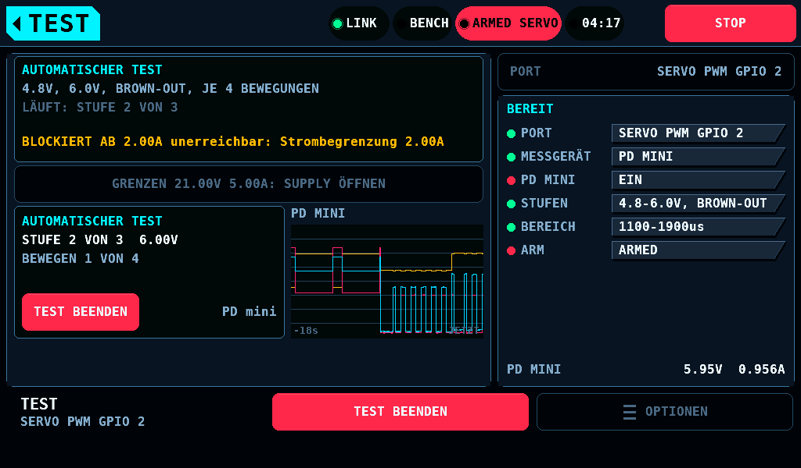

Das Ergebnis bleibt bis SCHLIESSEN im LIVE-Feld und bis zum nächsten Lauf
unter ZULETZT. Es zeigt BESTANDEN, NICHT BESTANDEN oder ABGEBROCHEN mit
Grund, die längste Stellzeit, den höchsten Haltestrom und die in
`USER/LOGS` gespeicherten Dateien: `ATESTnnn.CSV` und `+ .TXT`, sobald der
vollständige Bericht die Karte erreicht hat. Bei Testaufzeichnungen AUS
unter [Setup](#setup) > SD CARD steht `TESTAUFZEICHNUNGEN AUS`; es werden
keine Dateien geschrieben.

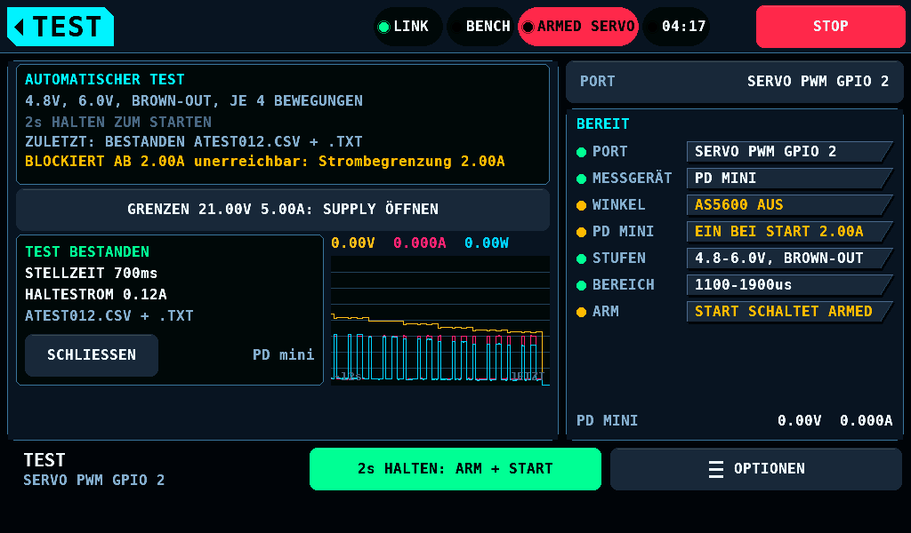

Ein Lauf mit INA3221-Fenstern nennt das Messgerät auch im Ergebnis, wie
in der Zeile über der Grafik:


**ENDLAGENLAUF STARTEN beginnt die Endlagensuche** im Feld ENDLAGENLAUF
auf TEST. Das Servo fährt in 10us-Schritten nach außen, bis der Strom ein
blockiertes Gestänge erkennen lässt. SUCHEN + PROGRAMMIEREN verringert
zusätzlich die Endwerte der gewählten Servofamilie, bis beide Enden frei
sind: LEFT ANGLE und RIGHT ANGLE bei KST und Chaservo, LEFT END und
RIGHT END bei Hitec.

An einem SERVO-PWM-Pin läuft die Suche von PULS MITTE bis PULS MIN und
MAX. An einem Programmierport beginnt sie mit einer Lesesitzung. Bei KST
und Chaservo verwendet sie NEUTRAL, PULSE LOWER und PULSE UPPER des Servos;
bei Hitec gilt das Pulsmodell der Familie.
[Servoverfahren](Servo-de.md#eingebaute-mechanische-endlage) beschreibt
Methode, Schutzfunktionen und Bericht.

Halte ENDLAGENLAUF STARTEN 2s bei ARMED mit INA3221 als Messgerät der
Servoschiene. Die Zusammenfassung zeigt `NUR SUCHE` oder
`SUCHEN + PROGRAMMIEREN` und SERVOPULSE, während der Lauf den Port ausliest.
Darunter nennt eine Zeile Ausgang und Messgerät, etwa
`AUSGANG PROG-PORT 1 GPIO 13, STROM INA3221 0x41 CH2` oder
`AUSGANG SERVO PWM GPIO 2, STROM INA3221 0x40 CH1`. Ohne überwachenden Kanal
steht im Messgeräteteil `STROM INA3221`. Es folgen aktueller Vorgang oder
Startverweigerung, letztes Ergebnis und Bericht. Diese vier Zeilen stehen
in 10 x 20 bei 20px Abstand, beginnend 2px unter der Taste; die letzte
endet 2px innerhalb des 188px hohen Felds.

TEST bleibt beim Start sichtbar. Das Lauffeld auf LIVE zeigt geschriebene
Werte von 8, Phase, Seite, Puls und Ausgang sowie LAUF BEENDEN. Danach
stehen dort bis SCHLIESSEN Urteil, Werte oder Endlagen und `LIMITnnn.TXT`,
bei ausgeschalteten Testaufzeichnungen `TESTAUFZEICHNUNGEN AUS`. Für jedes
Schreiben schaltet der Lauf selbst auf SAFE und zurück auf ARMED.
STOP oder SAFE durch den Bediener sowie Abbruchgründe des automatischen
Tests beenden ihn mit Ausgang aus.

Am Programmierport des rbmod-Carriers versorgt PROG 5V den Lauf und
übernimmt das Aus- und Einschalten anstelle des PD mini. PROG 5V muss vor
dem Start eingeschaltet sein. Der PD mini an der Servoschiene wird bei
diesem Lauf weder verwendet noch überwacht; sein Umschalten beendet den
Lauf nicht. Ein Abbruch schaltet PROG 5V aus.


### Programmierer


PROGRAMMIEREN listet die Verfahren im Aufgabenbereich auf. Links steht
der Name, rechts Zielport und Pin, etwa `PROG-PORT 1 GPIO 13`, gefolgt
von `>`. KST und Chaservo verwenden den unter SERVO-TESTER gewählten
Port, PORT 1, PORT 2, PORT 3 oder PORT 4. Bei SERVO-TESTER auf OUTPUTS zeigt die Zeile
`PROG-PORT` mit Pin.

Hält eine andere Sitzung den Port, ist die Zeile mit `PORT BELEGT`
abgeblendet. Dazu zählt auch eine HITEC-Sitzung der Prüfstandskonsole;
das Panel fragt STATE der HITEC-Page alle 500ms ab. Die Hitec-Zeile selbst
wird durch eine HITEC-Sitzung nicht abgeblendet. Nach dem Auslesen öffnet
sie bei einem anderweitig gehaltenen Port mit PORT FREIGEBEN
([Ein Port, den eine andere Sitzung hält](HitecProgrammer-de.md#ein-port-den-eine-andere-sitzung-hält)).

Die Liste enthält `KST- und Chaservo-Servos` und `Hitec-Servos`. Tippe auf
eine aktive Zeile, um ihre Servoprogrammierung eine Ebene tiefer über der
linken Spalte samt Registerkarten zu öffnen. Ein automatischer Test endet
dabei. SCHLIESSEN oder das Home-Feld führt zur Liste zurück, ein weiterer
Druck auf das Home-Feld ins Menü. Innerhalb eines Tastenfelds, einer Liste,
Warnung oder Tastatur schließt das Home-Feld nur diesen Dialog.

Eine gesperrte Zeile erscheint abgeblendet und nennt anstelle des Ports
den Grund. Antippen öffnet nichts:

| Grund | Wann |
| --- | --- |
| `IOMCU OHNE SERVO PWM` | der IOmcu, die RP2350-Platine, meldet die Fähigkeit nicht, die die Zeile braucht; antwortet kein IOmcu, meldet er keine. Der Name der Fähigkeit ist der des Links und bleibt englisch |
| `PORT BELEGT` | die Servoprogrammierung einer anderen Zeile hält denselben Programmierport |

Die Zeilen stammen aus der Firmware-Tabelle `shared/ui/prog_registry.c`.
Ein weiterer Servohersteller ergänzt eine Tabellenzeile und seine
Servoprogrammierung, keine Kachel oder Registerkarte. Bei mehr als 9 Zeilen
erscheint SUCHE mit Tastatur; `*` steht für beliebigen Text. Mehr als
8 Zeilen zeigen Gruppenüberschriften. Übersteigt die Liste die Seitenhöhe,
blätterst du mit `^` und `v`. Sie fasst höchstens 48 Zeilen. Bei zwei
Zeilen erscheinen diese Bedienelemente nicht. Modellierte Protokolle ohne
IOmcu-Transport haben keine Zeile
([Programmieren](#programmieren) auf MOTOR & ESC).

Eine Zeile ist 48px hoch mit 8px darunter, eine Überschrift 28px mit
4px darunter, beide in der Schrift 10 x 20. Die Leiste über einer
blätternden Liste ist 48px hoch: SUCHE 260px breit links, `^` und `v` je
56px rechts. Jeder Eintrag endet 4px über dem Alarmband: auf der linken
Fläche von SERVO passen 7 Zeilen ohne die Leiste, 6 unter ihr. Die Liste
von MOTOR & ESC ist dieselbe Liste.

Die KST- und Chaservo-Programmierung schaltet den Programmierport des
Testers von PWM (Pulsweitenmodulation) auf Lesen und Schreiben über die
Servosignalleitung um. PROG-PORT 1 verwendet standardmäßig GPIO 13,
Pad 17. Zum Verbinden muss SERVO-TESTER unter SETUP > OUTPUTS einen der
Ports PORT 1, PORT 2, PORT 3 oder PORT 4 wählen. Bei OUTPUTS bleibt VERBINDEN gesperrt;
es erscheint `Zum Programmieren muss das Servo am Programmierport angeschlossen sein.`
und `Tippe auf ZIEL und wähle unter SERVO-TESTER einen der Ports PORT 1 bis PORT 4.`
ZIEL öffnet den OUTPUTS-Eintrag von PROG-PORT 1 mit SERVO-TESTER. Dessen
Home-Feld führt zur Servoprogrammierung zurück.

Am rbmod-Carrier mit IOmcu-Protokoll ab 4.36 kannst du vor VERBINDEN auf
die Beschriftung PORT tippen und einen Programmierport wählen. Die Pins
sind fest: PROGP01 GPIO13, PROGP02 GPIO14, PROGP03 GPIO15, PROGP04 GPIO0.
Die Wahl setzt SERVO-TESTER und fordert für diesen Port SERVO PWM, für
die anderen drei KEINE an. Der Tester wartet auf die Auslesebestätigung.

Solange ein Port gehalten wird, öffnen SCHLIESSEN und Home-Feld
PROGRAMMIERMODUS VERLASSEN. Während des Wechsels in den Programmiermodus
oder zurück haben sie keine Wirkung. Das Verlassen von SERVO erhält den
gehaltenen Port; beim Zurückkehren öffnet sich die Servoprogrammierung
unter PROGRAMMIEREN wieder. ARM ist auf SERVO und MOTOR & ESC gesperrt.
Ein Druck zeigt `ARMED gesperrt: Die Servoprogrammierung belegt einen Port.`
ZENTRIEREN, FREIGEBEN und STOP bleiben aktiv. SOLL-PULSBREITE zeigt `---`,
weil der Tester keine Pulse an den gehaltenen Port sendet.

In PWM mit antwortendem PD mini nennt PORT die von VERBINDEN eingestellte
Spannung und Strombegrenzung: `PORT  5.0V  1000mA`. Während der
Portbelegung sind die Sollwerte und AUSGANG EIN auf SERVO und SUPPLY
gesperrt; AUSGANG AUS bleibt aktiv. Am rbmod-Carrier haben die Ports
eigene 5V, deshalb bleiben diese Netzteilbedienelemente aktiv
([Carrier, Versorgung](Carrier-de.md#versorgung)). Das Verlassen des
Programmiermodus schaltet die Servoversorgung nicht aus und ein. Ob ein
KST-Servo im Programmiermodus PWM folgt, ist nicht gemessen.

Die Servoprogrammierung belegt das linke Feld von 620px. Bedienelemente
sind mindestens 48px hoch und enden 4px über dem Alarmband:

| Teil | Größe |
| --- | --- |
| Registerkarten und SCHLIESSEN | eine Zeile oben, 48px hoch: fünf Registerkarten von 95px, SCHLIESSEN 120px |
| Zeilen | 48px hoch im Abstand von 56px, bis zu 5 je Registerkarte, in zwei Spalten von 295px; eine breite Zeile nimmt beide |
| Werte | 150px (15 Zeichen der Schrift 10 x 20); bei einer breiten Zeile 260px, darin ihre Tasten `-` und `+` von 56px |
| Hinweise und Meldungen | unter der letzten Zeile, Schrift 10 x 20, 60 Zeichen je Zeile, 20px je Zeile, bis 4px über dem Alarmband: 7 Zeilen unter der Registerkarte SERVO |
| Listen (DATEIEN, ZURÜCKSPIELEN, WEITERES, ein Faktor) | ein Titel, dann bis zu 7 Einträge, 48px hoch im Abstand von 56px, ABBRECHEN 150 x 48px am Fuß |
| Warnseiten | der Titel in der Schrift 20 x 36, bis zu 16 Zeilen in der Schrift 10 x 20 (in einem niedrigeren Bereich weniger: die Zeilen, die 8px über den Tasten Platz haben), die Halte-Taste 300 x 56px und ABBRECHEN 180 x 56px am Fuß |

Passen alle Beschriftungen in ihre 95px breiten Registerkarten, verwenden
sie 10 x 20, wie im Englischen. Sonst verwenden sie 8 x 16, etwa für
`ABSTIMMEN`. Kein Hinweis, keine Meldung und kein Bedienelement liegt
unter dem Alarmband. Jede Meldungszeile erscheint; die längste Meldung
belegt 5 der 7 Zeilen unter SERVO.

Lassen die beiden festen Hinweiszeilen neben einer Meldung keinen Platz
für eine Seitenzahl, werden sie zuerst mit den übrigen Hinweisen
geblättert. Ein Hinweis, der höher als die verfügbare Seite ist, wartet
auf das Ende der Meldung. Das längste deutsche Hinweispaar benötigt
4 Zeilen, die längste Meldung 5. Zusammen wären es 9; deshalb wartet
das Hinweispaar.

[Servoprogrammierung für KST- und Chaservo-Servos](ServoProgrammer-de.md)
beschreibt das Verfahren.

#### Hitec-Programmierung

Die Hitec-Programmierung öffnet sich über `Hitec-Servos` mit denselben
Maßen: fünf Registerkarten (SERVO, BEWEGUNG, WEG, SCHUTZ, INFO) und
SCHLIESSEN, 48px hohe Zeilen mit 56px Abstand, Wertefelder von 150px oder
260px Breite sowie Hinweise in 10 x 20 bis 4px über dem Alarmband.
Bestätigungsseiten haben eine 300 x 56px große Halte-Taste und
ABBRECHEN mit 180 x 56px.

Sie liest das Servo aus und schreibt bearbeitete Werte zurück. Tippe auf
einen schreibbaren Wert, um eine Liste mit bis zu 6 Einträgen oder das
Tastenfeld zu öffnen. SCHREIBEN INS SERVO FREIGEBEN erlaubt das Schreiben;
n WERTE SCHREIBEN, 220px breit, öffnet die Schreibseite. Wähle SERIE vor
VERBINDEN als D-SERIE oder KLASSISCH. PORT zeigt Port, GPIO, Serie,
Empfangsart und die von VERBINDEN eingestellte Versorgung.

Bei gehaltenem Port gelten dieselben Regeln für ARM und Netzteilbedienung
wie bei KST, einschließlich der getrennten 5V am Carrier. Ein gesperrtes
Netzteilelement meldet beim Antippen
`Servoprogrammierung belegt das Netzteil: Sollwerte und EIN gesperrt.`
DATEIEN ersetzt SERIE und öffnet `BENCH/HITEC/CONF`, mit 5 Dateien pro
Seite unter dem Speichereintrag. Ein neuer Name öffnet die Tastatur;
Dateien für andere Modelle oder außerhalb weicher Regeln öffnen
DIESE DATEI PRÜFEN.

ZURÜCKSPIELEN schreibt das Sitzungsbackup zurück; wo der Prüfstand nicht
prüfen kann, ob das Servo das des Backups ist, bestätigt sein 2s Halten das
Exemplar. WEITERES enthält für
klassische Servos WERKSEINSTELLUNG. Ein Port einer anderen HITEC-Sitzung
öffnet mit PORT FREIGEBEN; 2s Halten gibt ihn bei unveränderter Versorgung
an PWM zurück. [Servoprogrammierung für Hitec-Servos](HitecProgrammer-de.md)
beschreibt Zeilen, Ablauf und Meldungen.

SERVO BEWEGEN, die fünfte Zeile von WEG bei einem Servo der D-Serie,
fährt das Ruderhorn auf die bearbeitete Position, während der Prüfstand
SAFE bleibt ([SERVO BEWEGEN in der Hitec-Programmierung](HitecMove-de.md)). Ein
Tippen auf AUS öffnet seine Seite; 2s HALTEN ZUM BEWEGEN schaltet es ein.
Solange es an ist, zeigen NEUTRAL, ENDE LINKS und ENDE RECHTS Tasten `-`
und `+` mit 56 x 48px um einen 148px breiten Wert; eine Taste ändert beim
Drücken um 8 Zählwerte und wiederholt nach 0.45s mit 8Hz, ab 1.8s mit
30Hz. Der Name der verfolgten Zeile steht in der Akzentfarbe. Die
Hinweise zeigen Port und GPIO, `POSITION 3344 (-65.1°)` mit dem
AS5600-Winkel und dem Versorgungsstrom, die Reichweite und den Hinweis zur
Endlage. Ein Tippen auf EIN, ein Wechsel der Registerkarte, SCHLIESSEN und
das Home-Tag schalten es aus; die Taste zeigt WARTEN, bis das Servo neu
gestartet ist.

Solange die Schleife läuft, steht ANSCHLAG SUCHEN in der Zeile von
DREHRICHTUNG: zwei Tasten mit 126 x 48px, ENDE LINKS und ENDE RECHTS. Ein
Tippen startet die Suche auf dieser Seite, die Taste wird in der
Warnfarbe gezeichnet, und ein zweites Tippen beendet sie. Der Hinweis
zeigt
`ANSCHLAG SUCHEN Richtung ENDE LINKS: 37 Zählwerte alle 2 Durchläufe ab NEUTRAL, höchstens 40s. Tippe erneut zum Anhalten.`
Ein gefundener Anschlag setzt diese Endlage im Entwurf:
`Anschlag bei 4840. ENDE LINKS in den Änderungen auf 4915 gesetzt.`


### Einstellungen

OPTIONEN enthält die drei Seiten AUSGANG, SWEEP und PRÜFLING.
Laufspezifische Einstellungen öffnest du über OPTIONEN im jeweiligen
TEST-Feld, eine Navigationsebene tiefer. SCHLIESSEN oben rechts neben
dem Laufnamen oder das Home-Feld führt zu den TEST-Feldern zurück.
Eine andere Aufgabe blendet die Liste aus; beim Zurückkehren zu TEST
erscheint sie wieder. Das Ausgangsfeld bleibt sichtbar und bedienbar.

Tippe auf einen Zahlenwert für das Tastenfeld, eine Auswahl für ihre
Liste, einen Schalter zum Umschalten oder den Namen für die Tastatur.

Die Registerkarten von OPTIONEN sind je 197 x 40px groß. Darunter stehen
zwei 295px breite Spalten mit 48px hohen Zeilen bei 52px Abstand. Links
steht die Beschriftung, rechts der Wert in 140px Breite. TYP, PULSRATE
und NAME belegen beide Spalten. Hinweise auf AUSGANG verwenden
60-Zeichen-Zeilen mit 21px Abstand.

Laufeinstellungen stehen in drei 193px breiten Spalten. Jede Zeile zeigt
ihren Namen über einem 48px hohen Wertefeld bei 71px Abstand. Die
15 Zeilen des automatischen Tests verteilen sich zu fünf pro Spalte:
Spannungsstufen mit HV-SERVO, Grenzwerte mit BROWN-OUT sowie Dauer und
Zeiten. TESTDAUER NACH steht oben rechts unter OPTIONEN des TEST-Felds.
Ein zweiter Tipp an dieser Stelle öffnet daher seine Liste, ohne einen
Wert zu ändern. Hinweise, Speicherstatus, BLOCKIERT AB und Grenzen enden
mindestens 4px über dem Alarmband.

Auswahllisten haben zwei Spalten mit je fünf 48px hohen Einträgen bei
56px Abstand. Warnungen verwenden 12 x 24px mit 49 Zeichen pro Zeile.
Die 56px hohen Tasten 2s HALTEN ZUM ÜBERNEHMEN und ABBRECHEN enden 4px
über dem Alarmband.


| Ort | Einstellung | Wirkung |
| --- | --- | --- |
| OPTIONEN > AUSGANG | TYP | das Servoprofil: STANDARD PWM, NARROW 760, WIDE, HELI CYCLIC oder HELI TAIL 760 |
| OPTIONEN > AUSGANG | PULSRATE | wie oft ein Impuls gesendet wird; die Liste des Typs oder EIGENE EINSTELLUNG über das Tastenfeld |
| OPTIONEN > AUSGANG | PULS MIN, PULS MITTE, PULS MAX | die Impulsbreiten, auf die der Weg abgebildet wird, 400 bis 2500us: -90° ist MIN, 0 ist MITTE, +90° ist MAX, und FREIGEBEN ruht auf MITTE. Ein Ende liegt nicht weiter von MITTE entfernt als MITTE von 400us oder 2500us |
| OPTIONEN > AUSGANG | TRIMMUNG | zur Mitte addiert, 5us je Schritt, bis 200us in jede Richtung; `-` und `+` stellen sie, ein Tipp auf den Wert öffnet das Tastenfeld mit Vorzeichen |
| OPTIONEN > AUSGANG | WEG | wie weit der Arm in jede Richtung darf, 10 bis 90° |
| OPTIONEN > AUSGANG | UMKEHREN | die Richtung, in der der Winkel auf den Impuls abgebildet wird |
| OPTIONEN > SWEEP | KURVE, TEMPO, BEREICH | die Bewegung von SWEEP: Rechteck, Sinus oder Dreieck, 0,05 bis 5Hz, 10 bis 100% des Wegs. Der automatische Test springt zwischen den Enden, die BEREICH ergibt |
| AUTOMATISCHER TEST > OPTIONEN | TESTDAUER NACH, TESTZEIT, BEWEGUNGEN | wie lange jede Spannungsstufe läuft: eine Zeit oder eine Zahl von Bewegungen |
| AUTOMATISCHER TEST > OPTIONEN | HALTEZEIT, EINSCHWINGZEIT | Haltezeit an jedem Ende, im Test und bei SWEEP; Wartezeit nach einer Spannungsstufe vor dem Messen |
| AUTOMATISCHER TEST > OPTIONEN | STUFE 4.8 / 6.0 / 7.4 / 8.4V | die Spannungsstufen; 7,4 und 8,4V laufen nur mit HV-SERVO an |
| AUTOMATISCHER TEST > OPTIONEN | BROWN-OUT | zeigt `EIN 3.0/0.2V` (NIEDRIGSTE SPANNUNG und SCHRITT) oder `AUS`; ein Tippen öffnet die Seite des Brown-out-Laufs, deren SCHLIESSEN und Home-Feld zurückführen |
| AUTOMATISCHER TEST > BROWN-OUT | BROWN-OUT, NIEDRIGSTE SPANNUNG, SCHRITT | der Lauf ab 5,0V abwärts, an oder aus; seine Untergrenze, 2,0 bis 4,8V, vorgegeben 3,0V; sein Schritt, 0,1 bis 1,0V, vorgegeben 0,2V. Der Hinweis darunter nennt den Lauf am geltenden Netzteil und wie viele Spannungen er verlangt |
| AUTOMATISCHER TEST > OPTIONEN | HV-SERVO | nimmt die Stufen 7,4 und 8,4V hinzu, vorgegeben aus und nach jedem Neustart aus; ein Lauf mit ihnen startet nur über NUR HV-SERVOS |
| AUTOMATISCHER TEST > OPTIONEN | BLOCKIERT AB | über diesem Strom gilt das Servo als blockiert |
| AUTOMATISCHER TEST > OPTIONEN | RUHESTROM, HALTESTROM, STELLZEIT | Grenzen für bestanden/nicht bestanden; 0 wird nicht geprüft |
| ENDLAGENLAUF > OPTIONEN | ENDLAGENLAUF | NUR SUCHE oder SUCHEN + PROGRAMMIEREN, ein Tippen schaltet um; SUCHEN + PROGRAMMIEREN wird nur für ein Servo am Programmierport angeboten, sonst lautet die Zeile NUR SUCHE mit dem Grund darunter. Für die Sitzung |
| ENDLAGENLAUF > OPTIONEN | SERVO | KST/CHASERVO oder HITEC; wählt die Servofamilie für SUCHEN + PROGRAMMIEREN |
| ENDLAGENLAUF > OPTIONEN | SERVOPULSE | BEHALTEN oder 1000-2000, ein Tippen schaltet um; nur für KST/CHASERVO mit ZIEL auf PROG-PORT angezeigt. 1000-2000 schreibt PULSE LOWER und PULSE UPPER des Servos in der Lesesitzung des Laufs, vor der Suche, auf 1000,0 und 2000,0us. Vorgabe BEHALTEN; für die Sitzung |
| OPTIONEN > PRÜFLING | NAME | der Prüfling, bis 23 Zeichen, für den Bericht |
| OPTIONEN > PRÜFLING | BERICHT | ein Textbericht neben der Aufzeichnung jedes Tests |
| OPTIONEN > PRÜFLING | SENSOR-MITTE | ein Tippen nimmt den aktuellen Zählerstand als Mitte, wenn das Servo in Neutral steht, und setzt nichts ohne einen Messwert seit dem aktuellen Verbindungsaufbau (keinen nach einem Verbindungsverlust, bis ein neuer eintrifft) und solange der Sensor keinen Magneten meldet; die Zeile zeigt den gespeicherten Zählerstand, 0 bis 4095, und ist bei ausgeschaltetem AS5600 gedimmt. Dieselbe Einstellung wie SETUP, SENSORS, AS5600-Mitte |
| OPTIONEN > PRÜFLING | KST EXPERT MODE | ob der [Programmierer für KST- und Chaservo-Servos](ServoProgrammer-de.md#expertenmodus) DEAD BAND, BOOST, STRETCH, PAIRING LÖSEN und den Reiter GESPERRT zeigt; standardmäßig AUS, EIN nach 2s Halten (ein kürzerer Druck zeigt den Hinweis auf dem Band), AUS mit einem Tipp. Bleibt über einen Neustart erhalten |

TRIMMUNG ist das einzige Tastenfeld mit Vorzeichen. `+/-` zwischen Punkt
und OK setzt oder entfernt ein führendes Minus, vor oder nach der
Zifferneingabe. OK nimmt -200 bis +200us an und rundet auf den nächsten
5us-Schritt: 13 wird 15, -12 wird -10, -0 wird 0. Bei -201 bleibt das
Tastenfeld offen und zeigt den Bereich in Warnfarbe. Ein Vorzeichen ohne
Ziffern gilt als leere Eingabe. Andere Tastenfelder haben kein `+/-` und
behalten ihre Tastenpositionen.


Der Ausgangsencoder AS5600 wird nur unter SETUP > SENSORS ein- und
ausgeschaltet ([der Ausgangsencoder](#sensors-der-ausgangsencoder)).
Die 600 x 48px große Taste `AS5600 EIN ODER AUS: SENSORS ÖFFNEN` auf
PRÜFLING öffnet dort den AS5600-Eintrag. Der Sensor ergänzt den
Ruderhornwinkel unter GEMESSEN sowie in CSV und Bericht eines Laufs
([Servo](Servo-de.md#der-ausgangsencoder)).

Die Spannungs- und Stromgrenzen von SUPPLY begrenzen Sollwerte und
Teststufen. Sie stehen unter den TEST-Feldern und auf PRÜFLING in einer
600 x 48px großen Taste: `GRENZEN 21.00V 5.00A: SUPPLY ÖFFNEN`.
Tippe darauf, um SUPPLY > OPTIONEN > GRENZEN zu öffnen und sie einzustellen.

Beide Tasten öffnen wie ZIEL eine andere Seite. Deren Home-Feld führt zur
ursprünglichen Aufgabe und Unterseite zurück. Das Verlassen von SERVO
schaltet auf SAFE, beendet Sweep oder Test und schaltet eine von SERVO
eingeschaltete Versorgung aus. Daher teilen die Tasten die ZIEL-Sperre:
In ARMED, während Sweep oder Lauf und bei gehaltenem Programmierport
sind sie abgeblendet und inaktiv. Beim Verlassen von SENSORS mit
ungespeicherten Werten erscheint die entsprechende Warnung.

Der erste Hinweis unter AUSGANG nennt die Auswahl von SERVO-TESTER:
OUTPUTS oder PORT 1, PORT 2, PORT 3 oder PORT 4, sowie deren Einstellungsort:
`SERVO-TESTER: PORT 1. Wähle ihn auf OUTPUTS.` Der Hinweis ist nicht antippbar.


ZIEL steht zwischen TEMPO und ZENTRIEREN im Ausgangsfeld und nennt das
aktive Protokoll mit Pins, mittig im Wertefeld. Tippe darauf, um SETUP >
OUTPUTS beim aktiven Ausgang zu öffnen: PROG-PORT bei einem Port,
SERVO PWM bei Standardausgängen oder die Übersicht bei unbekanntem Ziel
oder fehlendem IOmcu ([Outputs](#outputs)). Auch bei ausstehendem
ZIEL-Schreibvorgang oder angefordertem Port ohne Pin folgt es dem
wirklich angesteuerten Ziel.

Dort wählt SERVO-TESTER über die ZIEL-Einstellung OUTPUTS oder einen
Programmierport; PORT-PWM steuert dessen Puls. Beides wird im NVS
(nichtflüchtiger Speicher) gespeichert. Das Verlassen von SERVO schaltet
auf SAFE und beendet Sweep oder Test. Das OUTPUTS-Home-Feld führt zur
Aufgabe zurück, auf der ZIEL angetippt wurde.

ZIEL ist in ARMED, während laufendem oder pausiertem Sweep, automatischem
Test oder Endlagenlauf und bei gehaltenem Programmierport gesperrt:
umrandet, abgeblendet und nicht antippbar. Es nennt weiterhin das Ziel.
Das Ausgangsfeld bleibt neben Seiten, Tastenfeldern und Servoprogrammierung
sichtbar und zeigt den Pin auch bei verdeckter linker Spalte.

SERVO-TESTER wählt OUTPUTS oder PORT 1, PORT 2, PORT 3 oder PORT 4. Bei OUTPUTS nennt ZIEL
die der Rolle SERVO PWM zugeordneten GPIOs, etwa `SERVO PWM GPIO 4` oder
`SERVO PWM GPIO 2 GPIO 4`. Es nutzt 25 Zeichen und zählt weitere Pins mit
`+N`: 8 Pins ab GPIO 40 ergeben `SERVO PWM GPIO 40 +7`. Name und Wert
stehen in Warnfarbe, wenn kein Pin zugeordnet ist (`KEIN SERVO-PWM-PIN`)
oder keine Zuordnung ausgelesen wurde (`PINS NICHT AUSGELESEN`).

Bei einem Programmierport nennt ZIEL in Warnfarbe dessen Nummer und den
vom IOmcu gemeldeten GPIO, etwa `PROG-PORT 1 GPIO 13`. Testerbefehle
verändern dann die Standard-Servo-PWM-Ausgänge nicht. Diese halten bei
ARMED ihre Ruhepulse in der Mitte zwischen den Endpunkten.

Ein Port ohne nutzbaren Pin zeigt nur `PROG-PORT 1`, ebenfalls in
Warnfarbe. Das gilt ohne Pin, bei beim Start abgelehntem Pin, FUNKTION
KEINE oder einem im IOmcu fehlenden Port. Der IOmcu behält dann die
Standardausgänge als Ziel; der Tester sendet ihnen jedoch nur eine
Freigabe. SWEEP bleibt abgeblendet, bis der Port einen SERVO-PWM-Pin hat
oder SERVO-TESTER die Standardausgänge wählt. Bei PORT-PWM aus sendet der Port keinen
Puls. ZIEL zeigt `PORT 1 GPIO 13 PWM AUS` (22 Zeichen bei zweistelligem
Pin) oder `PROG-PORT 1 PWM AUS`.

Zwei Warnzustände nennen kein Ziel und senden keine Testerbefehle:
`KEINE VERBINDUNG`, wenn kein IOmcu antwortet, und `UNBEKANNT`, wenn die
Programmierport-Page seit dem Verbindungsaufbau nicht gelesen wurde,
ein Schreiben unbestätigt blieb oder ein Lesen unbeantwortet war.
Bei gehaltenem Programmierport nennt ZIEL weiterhin das IOmcu-Ziel,
Port oder Ausgänge. Die Servoprogrammierung steuert den Port; der Tester
sendet nichts.

Die Page wird alle 500ms gelesen. Ein IOmcu vor Protokoll 4.13 hat sie
nicht und verwendet Standardausgänge. ZIEL folgt dem bestätigten Zustand
des IOmcu. Änderungen von SERVO-TESTER warten auf einen ruhenden Prüfstand
und erscheinen nach der Übernahme. Der IOmcu startet mit Standardausgängen
und kehrt zu ihnen zurück, wenn eine Programmiersitzung ihren Port ohne
Pin lässt. In SAFE stellt das Panel den gewählten Port innerhalb einer
Page-Abfrage, 500ms, wieder her, ohne auf ARM zu warten.


| Typ | Mitte | Weg | Pulsraten |
| --- | --- | --- | --- |
| STANDARD PWM | 1500us | 1000-2000us | 50, 60, 100, 150, 200, 250, 300, 333Hz |
| NARROW 760 | 760us | 660-860us | wie STANDARD PWM |
| WIDE | 1500us | 800-2200us | wie STANDARD PWM, bis 312Hz |
| HELI CYCLIC | 1520us | 820-2220us | 50, 120, 200, 333Hz |
| HELI TAIL 760 | 760us | 410-1110us | 200, 333, 560Hz |

Jeder Puls braucht eine Pause vor dem nächsten Frame. STANDARD PWM,
NARROW 760 und WIDE verlangen mindestens 1ms. Ihre höchste Rate ist daher
`1 / (längster Puls + 1ms)`, also 333Hz bei 2000us. Heli-Profile verwenden
Rotorflights Raten für digitale Taumelscheiben- und Schmalband-Heckservos
mit mindestens 0,5ms Pause.

Eine Pulsrate ohne die nötige Pause wird abgelehnt, ebenso ein für die
aktive Rate zu langer PULS MAX. Die Pause folgt dem längsten vom IOmcu
ausgebbaren Puls, dem oberen Ende des Befehlsbereichs. Das ist PULS MAX
oder ein längerer Puls, wenn PULS MITTE näher an MAX als an MIN liegt:
um die Differenz zwischen den Abständen MITTE–MIN und MITTE–MAX. Auch eine PULS MITTE,
die dieses obere Ende über die nötige Pause hinaus verschiebt, wird
abgelehnt.

**Ein Heli-Typ oder eine Pulsrate über 60Hz kann ein ungeeignetes Servo
zerstören.** Die Auswahl öffnet eine Warnung in Gefahrenfarbe. Sie nennt
Einstellung und Gefahr und übernimmt erst nach vollständigem Halten von
2s HALTEN ZUM ÜBERNEHMEN. ABBRECHEN, Herausgleiten, verlorene Berührung
oder Verlassen der Seite übernimmt nichts. Der aktive Typ und die Rate
bleiben im rechten Feld rot. Jeder Neustart setzt STANDARD PWM mit 50Hz,
sodass ein anschließend angeschlossenes Servo keine für ein anderes
Servo gewählte Rate erhält.


**Die Pulsrate erreicht die Pins** über die SERVO-Page des IOmcu
(Protokoll 4.1) und gilt für ZIEL. Bei OUTPUTS betrifft sie jeden
PWM-Ausgang, dessen erster Kanal die Rolle Ruder hat. PPM behält seinen
eigenen Frame. Bei PROG-PORT betrifft sie dessen Pin; jeder Slot behält
seine eigene Rate (Protokoll 4.19). Andere Programmierports laufen mit 50Hz.

Teilt ein Programmierport seinen PWM-Slice mit einem weiteren
Programmierport, sind nur 50Hz möglich. Der RP2350 gibt beiden Pins einen
gemeinsamen Teiler und Wrap; höhere Raten werden abgelehnt. Ein ZIEL-Wechsel
setzt die Rate auf 0: Jeder Ausgang verwendet seine eigene Rate. Die Seite
sendet ihre Rate mit der nächsten und jeder gehaltenen Position erneut.
Ein Profilwechsel bei ARMED in Ruhelage sendet die Ruhelage mit der Rate
neu; ein Wechsel während ausstehendem ARM gilt für dieses ARM.

Eine höhere Rate wird erst gesendet, nachdem alle Pulsbreiten angekommen
sind. Jede andere Rate geht ihnen voraus; breitere Pulse warten auf ihre
Übernahme. So wird keine hohe Rate mit den breiteren Pulsen eines
langsameren Profils kombiniert. AUSGANG meldet das Ergebnis:

| Hinweis | Bedeutung |
| --- | --- |
| Aktiv | die Rate läuft auf dem Ziel, das der IOmcu hält, benannt nach seiner PROG-Page: `Aktiv: Ausgänge laufen mit 330Hz.` oder `Aktiv: PROG-PORT 1 GPIO 13 läuft mit 330Hz.`, der Port mit der Nummer, die ZIEL nennt: PORT 1, PORT 2, PORT 3 oder PORT 4. Der Hinweis steht in der Warnfarbe, solange dieses Ziel vom gewählten ZIEL abweicht (zweite Zeile `Das gewählte ZIEL ist nicht aktiv.`; PROG-PORT ohne an den Port zugeordneten Pin lässt OUTPUTS das Ziel), solange das Port-Ziel keinen Pin hat, solange PORT-PWM AUS ist (`PORT-PWM ist AUS. Der Port gibt keine Pulse aus.`) und solange das Ziel unbekannt ist. Mit einem IOmcu vor Protokoll 4.19 lautet der Hinweis "jedes PWM-Ruder läuft mit": ein solcher IOmcu fährt jede PWM-Ruder mit der Rate, gleich was ZIEL nennt. Ohne Verbindung lauten beide `Keine Verbindung. Die aktive Pulsrate ist unbekannt.` in der Warnfarbe: ein IOmcu, der bei unterbrochener Verbindung neu startet, fährt jeden Pin wieder mit seiner eigenen Rate |
| Die Pulsrate wird mit der nächsten Position | noch nicht geschrieben |
| ABGELEHNT | ein Puls des Ziels (eines Ruders, oder des Programmierports, solange sein Puls eingeschaltet ist) ist länger als der Frame bei dieser Rate, oder ein Pin des Ziels teilt sich einen PWM-Slice mit einem Ausgang auf einer anderen Rate; die Pins behalten ihre Rate |
| Dieser IOmcu nimmt keine Pulsrate | Protokoll 4.0: jeder PWM-Ausgang läuft mit den 50Hz seiner Zuordnung |

Ein IOmcu-Neustart oder eine auf OUTPUTS geschriebene Zuordnung setzt
jeden Slot auf seine eigene Rate zurück, bei Servos 50Hz. Die Seite
sendet ihre Rate mit der nächsten Position anhand der aktiven Zuordnung
erneut. Ein Zuordnungsschreibvorgang wartet, wenn das Zurücksetzen
unbeantwortet (`KEINE VERBINDUNG` auf OUTPUTS) oder abgelehnt (`ABGELEHNT`) ist.

ARM bleibt auf jeder Seite gesperrt, solange die Rate von ZIEL unbekannt
ist: `Pulsrate des Servos unbekannt. Halte ARM erneut.` Ein bei fehlender
Verbindung angefordertes ARM erreicht den IOmcu erst nach erfolgreichem
Zurücksetzen.

AUSGANG-Einstellungen, HV-SERVO, ENDLAGENLAUF und SERVOPULSE gelten für
die Sitzung. SWEEP, automatischer Test, PRÜFLING und ZIEL werden im NVS
gespeichert. Jede Änderung fordert sofort das Schreiben an; es erfolgt
im ersten Frame bei ruhendem Prüfstand ([Werte behalten](#werte-behalten)).
Jede OPTIONEN-Seite zeigt unten `GESPEICHERT`, `SPEICHERN AUSSTEHEND`,
`NICHT GESPEICHERT` oder `ÄNDERUNGEN IN SETUP NICHT GESPEICHERT`.
Laufeinstellungen zeigen denselben Status unter dem Laufnamen.


Aktuelle Einschränkungen:

- Bis die Seite eine Stellung sendet, laufen die Pins mit der Rate, die die
  SERVO-Page hält; nach einem Neustart oder einer neuen Zuordnung sind das 50Hz.
- Am Netzteilmodell des Panels sind die Ströme des automatischen Tests die Last des Modells, nicht die
  des Servos: ein Lauf dort misst das Modell. [Was nicht gemessen ist](Servo-de.md#was-nicht-gemessen-ist).
- Das Netzteil auf der rechten Fläche ist das von SUPPLY: der PD mini, wenn
  die Registerkarte PD MINI auf SUPPLY ihn aktiviert, sonst das Modell des Panels, dessen Spannung, Strom
  und Leistung simuliert und nicht gemessen sind.

## Netzteil


SUPPLY stellt den PD mini ein, schaltet ihn und zeichnet seine Messwerte
auf. Der PD mini ist ein programmierbares Netzteil und USB-PD-Trigger
(USB Power Delivery), gesteuert über UART (Universal Asynchronous
Receiver-Transmitter). Der IOmcu verwendet einen PIO-UART (Programmable
Input/Output) auf zwei Pins, über die SUPPLY-Link-Page (Protokoll 4.3).
Das Panel schreibt die Page und liest sie alle 100ms.

Ist der PD mini auf der Registerkarte PD MINI aktiviert, zeigt die
Kopfzeile Modul und UART-Pins, etwa `PD MINI TX GPIO 12 RX GPIO 13`, aus
den Einstellungen PD mini TX und PD mini RX. Ein fehlender Pin oder beide
Signale auf demselben GPIO ergeben `PD MINI OHNE PINS`. Bei deaktiviertem
Modul verwendet das Panel sein Netzteilmodell. Die Kopfzeile zeigt
`SIMULIERT: SCHALTE IN PD MINI EIN`; die Menükachel trägt SIMULIERT.

SUPPLY hat zwei Aufgaben, LIVE und OPTIONEN, mit je 150 x 40px großen
Registerkarten über dem Inhaltsbereich. Die Menükachel öffnet immer LIVE.
Tippe auf eine Registerkarte, um die Aufgabe zu wechseln. Der Wechsel
fügt keine Navigationsebene hinzu und behält die LIVE-Ansicht GRAFIK
oder TABELLE bei.

| Aufgabe | Die linke Spalte, 620px |
| --- | --- |
| LIVE | die Grafik oder die Tabelle über den Sollwerten |
| OPTIONEN | die Registerkarten GRENZEN und PD MINI ([Der Tab PD MINI](#der-tab-pd-mini)); auf GRENZEN die 9 Einstellungen des Netzteils unter AUSGANGSGRENZEN, NACH DEM NEUSTART, ABSCHALTUNGEN und RÜCKFRAGE IM BETRIEB ([Netzteil, Optionen](#netzteil-optionen)) |

Die Kopfzeile rechts neben der Aufgabenleiste zeigt Modul, Pins und
ONLINE oder ANTWORTET NICHT in 10 x 20. Rechts steht in 8 x 16 der
zulässige Sollwertbereich, etwa `3.3-8.4V  0.50-5.00A`. Die Zeile bleibt
auf beiden Aufgaben sowie unter Tastenfeld und Bestätigungsdialog sichtbar.

Die 380px breite rechte Leiste ist auf beiden Aufgaben gleich: vier
64px hohe Messwertfelder SPANN., STROM, LEIST. und MODUS, darunter
STEUERUNG. Dessen Titelzeile zeigt mAh und Wh des Laufs. Unten stehen
SPITZENWERTE ZURÜCKSETZEN (48px) und AUSGANG EIN / AUS (60px), an der
Stelle von ARM und DISARM auf SERVO und MOTOR & ESC.

Das Layout entspricht MOTOR & ESC. Links auf LIVE stehen das Ausgangsfeld
mit GRAFIK | TABELLE unter dem Titel und darunter SOLLWERTE. Jede
Sollwertzeile enthält Name, `-0.1` (72 x 48px), Reglerbahn (312 x 48px),
`+0.1` und ein Wertefeld von 120 x 48px.

Die Grafik zeigt Spannung, Strom und Leistung der letzten 30s. Rechts
stehen Messwerte, niedrigste Laufspannung sowie höchster Laufstrom und
höchste Leistung. MODUS nennt die Regelung: CV (Constant Voltage,
Konstantspannung) hält den Spannungssollwert, CC (Constant Current,
Konstantstrom) die Strombegrenzung. CC steht in Warnfarbe, weil das
Netzteil der Last dann nicht die eingestellte Spannung liefert.

SPANN. und STROM nennen den Sollwert in Klammern hinter ihrer Beschriftung.
Die Grafik zeichnet ihn gestrichelt in Farbe und Skala des jeweiligen
Messwerts; TABELLE zeigt beide. Der Klammerwert ist der vom Netzteil
bestätigte Sollwert. Antwortet es nicht, erscheint der auf dem Panel
gesetzte Wert.

| Sollwert | Modell | PD mini | Tasten |
| --- | --- | --- | --- |
| SPANNUNG | 3,3 bis 21V, Schritte von 20mV | 1 bis 20V, Schritte von 10mV | 0,1V |
| STROMBEGRENZUNG | 0,5 bis 5A, Schritte von 50mA | 0,05 bis 3A, Schritte von 10mA | 0,1A |

Das Modell verwendet das weiteste Profil einer USB-PD-PPS-Quelle
(Programmable Power Supply): 3,3 bis 21V bei bis zu 5A. Die PD-mini-Bereiche
stammen von der Herstellerseite und sind nicht gemessen. Als
Abwärtswandler kann er seine Eingangsspannung nicht übersteigen. Seine
zusätzliche Spannungsgrenze liegt 0,7V unter dem gemeldeten Eingang;
5V am Eingang erlauben daher höchstens 4,3V.

Unter 1,7V Eingangsspannung bleibt die angezeigte Grenze beim Mindestwert
1V. Unter 1,5V bleibt der Ausgang aus. Ohne Eingangsmesswert gilt 20V.
Ein Sollwert über der Eingangsspannung versetzt das Modul in ERR, bis es
aus- und wieder eingeschaltet wird. Der benötigte Abstand ist nicht gemessen.

Die Grenze liegt 0,2V über der Abschaltlinie (siehe unten). Damit darf die
Eingangsspannung unter Last um 0,2V sinken, bevor ein Sollwert an der Grenze
zur Abschaltung führt. OPTIONEN begrenzt beide Bereiche zusätzlich.
Die Regler folgen dem aktiven Netzteil. Tippe auf eine Reglerbahn, um den
Wert unter dem Finger zu setzen.

**Tippe auf SPANN., STROM oder ein Sollwertfeld, um das Tastenfeld zu
öffnen.** Es belegt die linke Spalte unter der Aufgabenleiste, mit Tasten
von 145 x 76px. Die Titelzeile zeigt den erlaubten Bereich; der aktuelle
Wert bleibt bis zur ersten Ziffer blass. OK übernimmt einen Wert im
Bereich und rundet auf die Schrittweite des Netzteils. Außerhalb des
Bereichs wird der Wert abgelehnt und der Bereich in Warnfarbe markiert.
OK ohne Eingabe oder ABBRECHEN behält den bisherigen Sollwert.


**Änderungen bei eingeschaltetem Ausgang benötigen eine Bestätigung.**
Ein neuer Sollwert vom Regler, den Schritttasten oder dem Tastenfeld
öffnet eine Rückfrage mit der Änderung. ÜBERNEHMEN sendet sie an das
Netzteil. ABBRECHEN verwirft sie und setzt den Regler zurück. Eine
Ziehbewegung fragt einmal beim Loslassen; bis dahin bleibt der alte
Sollwert aktiv. Endet das Ziehen ohne Abheben des Fingers, etwa durch
einen zweiten Finger auf dem Home-Feld oder verlorenen Touch, erscheint
keine Rückfrage und der Regler kehrt zurück. Bei ausgeschaltetem Ausgang
ist keine Bestätigung nötig.

STOP schließt die Rückfrage unbeantwortet. ÜBERNEHMEN im selben Frame
wie STOP (etwa 50ms) ändert nichts. Unter OPTIONEN lässt sich die
Bestätigung für Regler und Tastenfeld getrennt ausschalten.


**AUSGANG EIN benötigt 2s Halten**, mit derselben Geste und demselben
Farbwechsel wie ARM. AUSGANG AUS reagiert auf einen Tipp. STOP schaltet
den Ausgang auf jeder Seite aus. Dasselbe gilt für andere Stopps:
einen nicht antwortenden Touch-Controller, verlorene Touch-Ereignisse
beim Einschalten, bevor ein ganzer Frame EIN gesehen hat, einen IOmcu,
der ARMED nicht aufrechterhält, ein nicht antwortendes Netzteil oder
eine Abschaltung. Der Ausgang bleibt bis zum erneuten Einschalten aus.

Beim Verlassen schaltet SUPPLY einen von ihm eingeschalteten Ausgang
aus, einschließlich einer noch ausstehenden Einschaltanforderung.
SERVO und ESC STICK behandeln ihre Ausgänge ebenso. Ausgenommen ist
SERVO bei gehaltenem Programmierport; dessen Ausgang bleibt bis zur
Portfreigabe an (siehe SERVO). Versorge ein Servo über SERVO und einen
ESC über ESC STICK. MOTOR & ESC schaltet keine Versorgung; seine
ESC-Läufe verwenden eine eigene Stromquelle.

Ein von einer anderen Seite eingeschalteter Ausgang bleibt beim
Verlassen von SUPPLY unverändert. Tastenfelder, Rückfragen, andere
SUPPLY-Dialoge und Aufgabenwechsel zählen nicht als Verlassen. LINK LOST,
das kein STOP hat, öffnet sich bei eingeschaltetem Ausgang nicht.

**Das Home-Feld führt eine Ebene zurück.** Das Schließen eines Dialogs
lässt den Ausgang unverändert; beim Rückweg ins Menü gilt die Abschaltregel:

| Von | Das Home-Feld führt zu |
| --- | --- |
| der Rückfrage | dem, was darunter liegt; die Änderung wird verworfen, wie ABBRECHEN sie verwirft |
| einem Tastenfeld | dem, was darunter liegt, LIVE oder OPTIONEN; der Wert bleibt unverändert |
| LIVE oder OPTIONEN | dem Menü; ein Ausgang, den SUPPLY eingeschaltet hat, geht aus |

Die Aufgaben liegen wie bei MOTOR & ESC und SERVO auf derselben Ebene.
Das Home-Feld führt nicht von OPTIONEN zu LIVE.

**Beim PD mini** hat AUS Vorrang vor anderen ausstehenden Schreibvorgängen
an die SUPPLY-Page. Der IOmcu schaltet den Ausgang auch selbst ab, wenn
der Panel-Heartbeat ausbleibt. Bei aktiviertem PD mini bedeutet ANTWORTET
NICHT: Kein IOmcu mit Protokoll 4.3 antwortet, oder die Page-Messwerte sind
älter als 1500ms. Ein eingeschalteter Ausgang wird dann abgeschaltet.

Antwortet die Page, aber der Messwertzähler SAMPLES des Moduls bleibt
stehen, zeigt die Kopfzeile weiter ONLINE. Das kann bei fehlgeschlagenen
Anzeigelesungen trotz erfolgreicher anderer Abfragen auftreten. Nach
1500ms ohne neuen Messwert zeigen Spannung, Strom und Leistung Striche;
Abschaltungen, Spitzen und Summen verwenden keinen Messwert. Nach
3000ms (`SUPPLY_LINK_BLIND_MS`) schaltet der Ausgang mit
`Keine Messwerte vom Netzteil. Ausgang aus.` ab.

Bei häufigen Sollwertänderungen, etwa Ziehen mit ausgeschaltetem REGLER
UND STUFEN und ungefähr einem Wert alle 50ms, priorisiert der Treiber
überfällige Abfragen. Eine 400ms verspätete Abfrage (`PDMINI_POLL_LATE_MS`)
kommt vor dem nächsten Sollwertschreiben. Solche Abfragen werden einzeln
mit einer anderen Transaktion dazwischen eingeplant. Zustandsabfragen und
Eingangsspannungsabfragen vor einem Schreiben dürfen auch unmittelbar
auf eine andere Abfrage folgen. Bei sofortigen Antworten liegen
Anzeigelesungen etwa 500ms und Zustandsabfragen etwa 900ms auseinander,
jeweils mit bis zu zwei zusätzlichen Transaktionen. Selbsttätiges
Umschalten des Moduls wird während des Ziehens erkannt. Die
Eingangsspannung wird vor Sollwertschreiben oder EIN nur bei ausstehendem
Auftrag gelesen, nie zwischen den Abfragen für EIN.

Das Host-Modell prüft 40 Startphasen mit Antworten bis 390ms Verspätung,
innerhalb der Wartefrist von 400ms:

| Vorgang | Dauer bei Antworten bis 390ms Verspätung |
| --- | --- |
| Ein Sollwert erreicht das Modul | innerhalb von 2,5s |
| EIN bei bereits geschriebenen Sollwerten | innerhalb von 3,6s |
| EIN direkt nach Sollwertänderung oder Ziehen | bis 7,5s |
| Modul schaltet seinen Ausgang beim Ziehen selbst | innerhalb von 2,1s erkannt |
| Modul schaltet trotz angefordertem AUS ein | innerhalb von 1,8s in Ruhe oder 2,1s beim Ziehen abgeschaltet; bei sofortigen Antworten etwa 500ms |

Die Antwortzeit des echten Moduls ist nicht gemessen. Verzögerte Antworten
verlängern die vorgesehenen 500ms für Zustands- und Eingangsspannungsabfragen,
weil jede Transaktion ihre Antwortzeit benötigt. In Ruhe liegen
Eingangsspannungsabfragen bei 100ms Verzögerung 850ms auseinander, bei
200ms 1,3s und bei 390ms 2,5s. Zustandsabfragen können 1,5s auseinanderliegen.

Beim Ziehen mit mindestens 279ms Antwortverzögerung wächst die Lücke
zwischen Anzeigelesungen auf 3,7 bis 5,0s (5,0s bei 390ms), über
`SUPPLY_LINK_BLIND_MS`. Der Ausgang schaltet mit
`Keine Messwerte vom Netzteil. Ausgang aus.` ab. Die Page-Abfrage des
Panels alle 100ms verlängert die beobachtete Lücke um bis zu 100ms.
Ab 263ms Antwortverzögerung überschreitet die Treiberlücke 2,9s;
eine Abschaltung ist daher ab 263ms möglich. In Ruhe beträgt die Lücke
bei 390ms bis zu 2,5s. Ab 259ms überschreitet sie 1,4s, ab 279ms 1,5s;
die Anzeigen können daher ab etwa 260ms Striche zeigen.

Auch ein vom IOmcu abgelehntes EIN (kein Heartbeat) oder aufgegebenes EIN
(Heartbeat ausgefallen oder IOmcu neu gestartet) schaltet den Ausgang
mit Alarm ab. Schaltet das Modul über Überstromschutz oder Taste selbst
aus, bleibt es bis zu einer neuen Haltegeste aus. Weitere Alarme melden
abgelehnte Pins, fehlgeschlagenes Schalten oder nicht übernommene Sollwerte.
Änderungen von Pins oder Baudrate sowie Aktivieren oder Deaktivieren des
PD mini schalten den Ausgang aus.

**Eine zu niedrige Eingangsspannung schaltet den PD-mini-Ausgang ab.**
Bei eingeschaltetem Ausgang fragt der IOmcu die Eingangsspannung bei
sofortigen Antworten alle 500ms ab, bei verzögerten Antworten seltener
(siehe oben). Zwei aufeinanderfolgende Messwerte unter Sollwert plus 0,5V
schalten den Ausgang sofort ab. Das Band nennt beide Werte, etwa
`PD-mini-Eingang 6.18V liegt unter den nötigen 6.00V + 0.5V. Ausgang aus.`

Vom Einbruch bis zur Abschaltung dauert es bei sofortiger Antwort etwa
1,0s. Im Host-Modell sind es bei 100ms Antwortverzögerung 1,7s, bei 200ms
1,9s und bei bis zu 390ms bis zu 4,7s. Der Ausgang bleibt bis zu einer
neuen Haltegeste aus. Unter 1,5V Eingangsspannung ist der Mindest-Sollwert
1,0V nicht möglich. EIN wird daher nicht geschrieben; dieselbe Meldung
erscheint.

Ein einzelner niedriger Messwert schaltet nicht ab. Eine fehlgeschlagene
Abfrage erhöht oder löscht den Zähler nicht. Bei eingeschaltetem Ausgang
wird der Sollwert nicht an fallende Eingangsspannung angepasst. Diese
Regel ist nicht am Prüfstand verifiziert: Ob das aktive Modul bei einem
Einbruch in ERR geht, ist nicht gemessen. Sie kann daher einen Lauf
beenden, der sonst weiterlaufen würde.

AUSGANG EIN und AUS, SPITZENWERTE ZURÜCKSETZEN und die Messwerte bleiben
unter OPTIONEN, Tastenfeld und Rückfrage aktiv. Jeweils nur ein Finger
bedient die Seite: Hält einer ein Bedienelement, hat ein zweiter Finger
auf der Seite keine Wirkung.

Auf dem [rbmod-Carrier](Carrier-de.md#versorgung) nennt eine Zeile unter
AUSGANG die getrennten 5V der Programmierports:
`PROG-PORTS 5V, GPIO 21: EIN`, `AUS` oder nach unbeantworteter Abfrage
`UNBEKANNT`. EIN erscheint in Akzentfarbe. KST- und Hitec-Programmierung
schalten diese Versorgung. Auf LIVE ermöglicht PROG 5V rechts von GRAFIK
und TABELLE das manuelle Schalten und zeigt den INA3221-Messwert wie auf
[SERVO](#servo). Die Zeile unter AUSGANG bleibt bei jeder Aufgabe sichtbar.
Beim Verlassen schaltet SUPPLY die von seinem Feld eingeschalteten 5V
aus, außer ein Port hält sie. Platinen ohne Schalter zeigen beides nicht.


### Netzteil, Optionen

OPTIONEN ist die zweite Aufgabe und enthält GRENZEN und PD MINI mit je
40px hohen Registerkarten. GRENZEN zeigt links Obergrenzen und Startwerte,
rechts Abschaltungen und Rückfragen. Jede Zeile ist 48px hoch mit einem
120 x 48px großen Wertefeld; unten steht der Speicherstatus. Alle
Einstellungen bleiben im NVS des Panels über Neustarts erhalten.

Tippe auf einen Wert für das Tastenfeld oder auf einen Schalter zum
Umschalten. LIVE schließt ein offenes Einstellungstastenfeld ohne
Wertänderung, wie ABBRECHEN. OPTIONEN schließt entsprechend ein offenes
Sollwerttastenfeld. Bei einer Rückfrage zum eingeschalteten Ausgang
bleiben Aufgabenwechsel bis ÜBERNEHMEN oder ABBRECHEN gesperrt.

Änderungen werden im nächsten Frame bei SAFE ohne ausstehendes ARM,
Netzteilausgang aus ohne ausstehendes EIN und ohne geladene oder gerade
abgerufene Platinenzeichnung gespeichert. Ungespeicherte SETUP-Änderungen
werden mitgeschrieben. Flash-Schreiben hält beide Kerne einschließlich
AUSGANG AUS und Abschaltprüfung an und wartet deshalb auf diese Bedingungen.
Die Statuszeile zeigt GESPEICHERT, SPEICHERN AUSSTEHEND, nach abgelehntem
Schreiben NICHT GESPEICHERT oder ÄNDERUNGEN IN SETUP NICHT GESPEICHERT.
Letzteres bedeutet ungespeicherte SETUP-Änderungen ohne Speicherauftrag;
SPEICHERN auf SETUP oder eine Änderung hier fordert ihn an.


| Einstellung | Bereich | Vorgabe | Wirkung |
| --- | --- | --- | --- |
| SPANNUNG MAX | 3,3 bis 21V | 21,00V | die höchste Spannung, die ein Sollwert annimmt |
| STROM MAX | 0,5 bis 5A | 5,00A | die höchste Strombegrenzung, die ein Sollwert annimmt |
| STARTSPANNUNG | bis SPANNUNG MAX | 6,00V | der Spannungs-Sollwert nach einem Neustart |
| STARTSTROM | bis STROM MAX | 2,00A | die Strombegrenzung nach einem Neustart |
| ÜBERSTROM | 0 bis 5A | AUS | Ausgang aus, wenn der Strom ABSCHALTZEIT lang darüber lag |
| ÜBERSPANNUNG | 0 bis 21V | AUS | Ausgang aus, wenn die Spannung ABSCHALTZEIT lang darüber lag |
| ABSCHALTZEIT | 0 bis 5000ms | 100ms | wie lange ein Messwert über einer Abschaltschwelle liegt, bevor sie auslöst |
| REGLER UND STUFEN | EIN, AUS | EIN | fragen, bevor der Regler einen eingeschalteten Ausgang ändert |
| TASTENFELD | EIN, AUS | EIN | fragen, bevor das Tastenfeld einen eingeschalteten Ausgang ändert |

Sinkt eine Grenze unter einen Sollwert, werden dieser und sein Startwert
sofort gesenkt. Eingaben werden in der sichereren Richtung gerundet:
Grenzen nach unten, sodass 12,01V nur 12,00V erlauben; eine positive
Abschaltschwelle auf mindestens einen Schritt, nie auf AUS. Eine Schwelle
von 0 ist ausgeschaltet.

Die Zeit über einer Schwelle beginnt beim ersten Messwert darüber. Ein
Messwert darunter setzt den Zähler zurück; ein fehlender Messwert lässt
ihn unverändert. Bei Abschaltung geht der Ausgang aus. MODUS zeigt bis
zum nächsten Einschalten ABGESCHALTET, und das Band nennt die ausgelöste
Schwelle. In CC hält das Netzteil seine Strombegrenzung. ÜBERSTROM bei
oder über STROMBEGRENZUNG kann daher nicht auslösen. Setze die Schwelle
darunter, um eine zu lange zu viel Strom ziehende Last abzuschalten.

Nach einem Neustart ist der Ausgang aus, welche Startwerte auch gelten.

Bei aktivem PD mini bietet OPTIONEN PD MINI ZURÜCKSETZEN. Es schaltet
den Ausgang aus und sendet SYSTEM_RESET. Ein Modul mit ERR nach einem
zu hohen Sollwert kann so ohne Abstecken neu starten. Etwa 1s später wird
seine Kennung erneut abgefragt. Ob dies jeden ERR löscht, ist nicht
gemessen. Vor IOmcu-Protokoll 4.4 ist der Modulneustart nicht verfügbar;
der Ausgang schaltet aus und das Band meldet dies.

### Das Log

Ein Netzteillauf beginnt mit EIN und endet mit AUS. Die Grafik leert sich
beim Einschalten und hält nach dem Ausschalten den Verlauf. Die Summen
mAh und Wh in STEUERUNG integrieren die angezeigten Messwerte über den
Lauf, mit Zeitschritten von höchstens 1s. SPITZENWERTE ZURÜCKSETZEN
beginnt die Extremwerte erneut beim aktuellen Messwert.

Ein Lauf wird in eine eigene `SUPPLnnn.CSV` in `BENCH/LOGS` geschrieben,
eine Zeile alle 50ms, solange Auto-Aufzeichnungen unter [Setup](#setup) > SD CARD
auf EIN steht:

```
time (s);set (V);voltage (V);limit (A);current (A);power (W);mode;charge (mAh);energy (Wh);source
```

Fehlende Messwerte bleiben als Zellen leer. `mode` ist CV, CC oder OFF,
bei nicht antwortendem Netzteil leer. `source` ist `measured` für
PD-mini-Messwerte und `model` für das Panelmodell.

Prüfstandsläufe haben Vorrang bei der Aufzeichnung: ARM während eines
Netzteillaufs schließt dessen Datei. Ist der Ausgang beim nächsten SAFE
noch an, beginnt eine neue Netzteildatei. Ihre Ladung und Energie zählen
wie die Anzeige ab den Summen seit EIN weiter; die erste Zeile muss
daher nicht bei 0 beginnen. Netzteilberechnung und Aufzeichnung behalten
ihren eigenen 50ms-Takt, während die Control-Task auf die Verbindung
wartet. Ein nicht antwortender IOmcu reduziert daher weder Grafikpunkte
noch Aufzeichnungszeilen.

Das Modell berechnet eine 6Ω-Last hinter 0,05Ω Quellwiderstand. Alle 3s
kommt für 0,6s eine Lastspitze von 1,4A hinzu. Bei den Startwerten 6,00V
und 2,00A führt sie in CC. Diese Werte sind berechnet; kein Gerät am
Prüfstand wird dadurch versorgt.

Die Einstellungen PD mini, PD mini TX, PD mini RX und PD mini Baud stehen
unter OPTIONEN > PD MINI ([Der Tab PD MINI](#der-tab-pd-mini)). TX und RX
sind IOmcu-GPIOs: TX verbindet mit DM des Moduls, RX mit DP. `-` und `+`
überspringen den GPIO des anderen Signals und stoppen am Bereichsende.
Bei RX auf GPIO 47 endet TX bei GPIO 46. Das Tastenfeld lehnt den anderen
GPIO mit `GPIO vom anderen PD-mini-Pin belegt` statt der Bereichsangabe ab.

Eine gespeicherte Zuordnung beider Signale zum selben GPIO wird unverändert
geladen. Das Panel schreibt die Page deaktiviert, lässt den PD mini aus
und zeigt in beiden Zeilen `TX und RX auf einem Pin. PD mini bleibt aus.`,
bis ein Wert geändert wird. Der Schalter PD mini deaktiviert das Modul.

Der IOmcu lehnt reservierte Pins, Ausgangspins, Sensorbus- und
Phasenabgriff-Pins sowie den anderen PD-mini-Pin ab. Der Alarm lautet
`PD-mini-Pins abgelehnt. Prüfe SUPPLY, Tab PD MINI.` Beispielsweise ist
RX auf GPIO 17 bei Sensor-SDA auf GPIO 16 belegt, weil SCL dann GPIO 17
verwendet. Der Alarm endet, sobald eine Abfrage die gewünschte Zuordnung
bestätigt; beim Zurückstellen auf den weiterhin aktiven Pin sofort.

Nachdem das Modul einmal geantwortet hat, wartet eine Anschlussänderung
auf eine danach gesendete Zustandsabfrage, höchstens etwa 1,2s. Diese muss
Ausgang AUS bestätigen. Das Modul kann sich zwischen zwei Abfragen über
seine Taste oder AUTO OUT selbst einschalten; neue Pins könnten dann den
Weg zum Ausschalten unterbrechen. Bei EIN oder fehlgeschlagener Abfrage
wird die Änderung abgelehnt:
`PD-mini-Anschlüsse abgelehnt. Sein Ausgang kann noch eingeschaltet sein.`
Sie wird erst nach einer weiteren Anschlussänderung erneut gesendet.
Auch dieser Alarm endet, wenn die gewünschte Zuordnung bestätigt ist.

PD mini Baud entspricht der UART-Baudrate des Moduls: 9600, 19200 (ab Werk),
38400, 57600, 115200, 230400 oder 460800 Baud, oder AUTO. AUTO ist die
Vorgabe und probiert alle 7 Raten, eine pro Sekunde. Die Kopfzeile zeigt
die aktive Rate nach ONLINE, etwa `ONLINE 38400`, bei AUTO und fester Wahl.


#### Der Tab PD MINI

OPTIONEN zeigt die 40px hohen Registerkarten GRENZEN und PD MINI. Unter
PD MINI stehen vier Anschlusszeilen mit 56px Abstand, je mit Beschriftung,
Hilfezeile, Wertefeld von 120 x 48px und `-`/`+`-Tasten von 56 x 48px.

| Zeile | Werte | Vorgabe | Ein Druck |
| --- | --- | --- | --- |
| PD mini | EIN, AUS | AUS | ein Tippen auf den Wert schaltet um |
| PD mini TX | GPIO -1 bis 47 | -1 | - und + ändern schrittweise, der Wert öffnet das Tastenfeld |
| PD mini RX | GPIO -1 bis 47 | -1 | - und + ändern schrittweise, der Wert öffnet das Tastenfeld |
| PD mini Baud | 9600, 19200, 38400, 57600, 115200, 230400, 460800, AUTO | AUTO | < und > und der Wert gehen durch die 8 Werte |

Eine Änderung gilt sofort und wird nach der Regel oben gespeichert, wie eine
Änderung auf GRENZEN. Es gibt kein SPEICHERN und keine Warnung beim Verlassen. Die
gespeicherten Schlüssel sind `pdm_en`, `pdm_tx`, `pdm_rx` und `pdm_baud`. PD MINI
ZURÜCKSETZEN startet das Modul neu und schreibt keine der vier Zeilen.

Anschlussänderungen schalten einen aktiven Ausgang aus. In folgenden
Zuständen sind die Zeilen deshalb gesperrt:

| Zustand | Ein Druck auf eine Zeile | Hilfezeile und Band |
| --- | --- | --- |
| Ausgang an oder eine Einschaltanforderung unterwegs, von jeder Seite, am PD mini oder am Modell | ändert nichts | `Ausgang ein: schalte ihn zuerst aus` |
| ein Programmierport hält das Netzteil | ändert nichts | `Ein Programmierport belegt das Netzteil` |
| Prüfstand ARMED | ändert nichts; auch `settings_set()` und eine Rücksetzung lassen die Zeilen unverändert | `Nur bei SAFE einstellbar` |

Ein offenes Pin-Tastenfeld schließt bei Eintritt eines dieser Zustände,
ohne die Eingabe zu übernehmen. Auch eine laufende Berührung wird
abgebrochen; Loslassen ändert nichts. Bei SAFE und Ausgang aus erreichen
Aktivierung, Pins und Baudrate die SUPPLY-Page wie unter
[Netzteil](#netzteil) beschrieben, nach Prüfung des AUS-Zustands am Modul.
Erreicht eine Änderung dennoch einen aktiven Ausgang, etwa VERWERFEN nach
abgelehntem Speichern in der SETUP-Warnung, schaltet sie ihn aus und meldet
`PD-mini-Anschlüsse geändert. Ausgang aus.` PD MINI ZURÜCKSETZEN bleibt
auf GRENZEN.


Auf dem [rbmod-Carrier](Carrier-de.md) sind PD mini TX auf 7 und RX auf 6
festgelegt. Sie haben keine Schritttasten und kein Tastenfeld und zeigen
`Auf Platine verlötet. Hier nicht änderbar.` Gespeicherte Pinwerte bleiben
für ein von Hand verdrahtetes Modul erhalten. PD mini und PD mini Baud
lassen sich unter denselben drei Zustandsbeschränkungen oben ändern.


Bei aktivem Netzteilmodell dient der Quelltext in der Kopfzeile als Taste:
`SIMULIERT: SCHALTE IN PD MINI EIN`. Tippe darauf, um PD MINI von LIVE oder
GRENZEN aus zu öffnen. Ein offenes Tastenfeld schließt dabei. Eine offene
Rückfrage zum aktiven Ausgang musst du zuerst beantworten.

## Receiver


RECEIVER zeigt sechzehn Kanäle in zwei Spalten mit je acht 52px hohen
Spuren. Jede enthält Kanalname in 10 x 20, Verlauf, einen 56px breiten
Balken für den aktuellen Wert und Mikrosekunden in 8 x 16. Der Verlauf
fasst 200 Werte, einen pro Pixel: etwa 2,8s bei 71 Frames pro Sekunde,
also einem S.BUS-Frame alle 14ms. CH17 und CH18 sind digitale Kanäle.
Ein Glitch erscheint als Spitze einer Spur, ein Signalausfall als
zeitgleiche Kerbe durch alle sechzehn.

Das 260px breite Zustandsfeld rechts zeigt den Zustand in 20 x 36 und
bis zu drei Erklärungszeilen in 12 x 24. BUS, RATE, FRAMES, RESYNC und
BAD TAIL stehen in 32px hohen Zeilen. Die 44px hohen Leuchten für CH17
und CH18 zeigen gesetzte Digitalkanäle und sind nicht antippbar. KANÄLE
und ROHDATEN sind 150 x 48px große Registerkarten. ROHDATEN zeigt die
Bytes des letzten Frames, acht pro Zeile, sowie Decoderzähler in 8 x 16.

Keine Firmware liefert Daten an RECEIVER (siehe
[Empfängerbusse](Receivers-de.md)); die Seite zeigt KEIN SIGNAL.

Das Zustandsfeld zeigt KEIN SIGNAL, FAILSAFE, FRAME LOST oder LIVE mit
einer Erklärungszeile:


In FAILSAFE sendet der Empfänger formal gültige, selbst erzeugte Werte;
alle Spuren erscheinen rot. Behandle FAILSAFE als Stopp. Die sechzehn
Kanäle sind dann keine gültigen Steuereingaben.
[Empfängerbusse](Receivers-de.md) beschreibt die Zustände.

## Akku


BATTERY zeigt die Abweichung jeder Zellspannung vom Akkumittelwert.
Das Urteil richtet sich nach dem größten Unterschied zwischen zwei
Zellen: GUT unter 30mV, BEOBACHTEN ab 30mV, ERSETZEN ab 60mV. Die Skala
passt sich an, mit mindestens 12mV, und steht neben der Grafik.

Das Grafikfeld ist 640px breit, das rechte Feld 360px. Ein Balken ist
höchstens 48px breit und reicht 164px zu jeder Seite des Mittelwerts. Unter
jedem Balken stehen Nummer und Spannung der Zelle in 12 x 24 bis 11 Zellen und
in 10 x 20 von 12 bis 14. Das Urteil steht in 20 x 36, seine Zeile in bis zu
zwei Zeilen 12 x 24, die sechs Zeilen sind je 36px hoch, der Hinweis in
10 x 20.

Miss unter Last. Im Ruhezustand kann eine schwache Zelle dieselbe
Spannung wie die übrigen zeigen.

Keine Firmware liefert Daten an diese Seite. Ohne ausgelesenen
Zellenmonitor zeigt der Prüfstand KEIN AKKU. Das Bild oben stammt aus einem Modell.

## Logs


Öffne eine Datei auf der Karte, prüfe die Erkennung in der Importansicht
und zeichne anschließend die gewählten Datenreihen:


Das Home-Feld führt wie ZURÜCK eine Ebene zurück: von Grafik zu Import,
vom Import zur Dateiliste und von dort ins Menü. In der LÖSCHEN-Rückfrage
wirkt es als ABBRECHEN.

Die Kachel LOGS öffnet eine gemeinsame Leiste für LOGS und FILES: zwei
499 x 40px große Registerkarten über die Inhaltsbreite, von y 5 bis 45.
Diese Seitentitel bleiben in jeder Sprache gleich. Tippe auf eine
Registerkarte, um die Seite zu öffnen. Auf oberster Ebene führt jedes
Home-Feld ins Menü, unabhängig vom Zugangsweg.

Die Leiste erscheint nur in der LOGS-Dateiliste und den FILES-Fenstern.
Import, Grafik, Dialoge, Tastaturen, Textbetrachter und Editor blenden
sie aus und nehmen keine Registerwechsel an. Ihr Home-Feld führt zuerst
eine Ebene zurück.

Die Dateiliste hat vier Bereiche. Oben öffnet die gemeinsame Leiste
[Files](#files). Die Kopfzeile von y 52 bis 100 enthält STAMM, USER und
BENCH (je 110 x 40px), Ordner- und Kartenname sowie VORIGE und NÄCHSTE
(140 x 48px) bei mehreren Seiten.

Die 1008px breite Liste zeigt sechs 44px hohe Zeilen bei 48px Abstand.
Jede reagiert über die vollen 48px. Name, Änderungsdatum und rechtsbündige
Größe stehen in 10 x 20. Namen verwenden bis zu 60 Zeichen, sonst die
ersten 58 und `..`. Die 160px breite Datumsspalte zeigt die auf der Karte
gespeicherte Änderungszeit wie INFO in [Files](#files), in der `Zeitzone`
unter SETUP > PANEL: `2026-10-26 09:41`. Ohne Zeitstempel oder bei 1980,
dem Datum einer ungestellten Uhr, bleibt sie leer
([PANEL: Zeitzone und Uhr](#panel-zeitzone-und-uhr)). Die Größe belegt
100px am Zeilenende. Dateityp und Laufdauer erscheinen nicht.

Die Fußzeile von y 440 bis 492 endet 4px über dem Alarmband. Links stehen
AKTUALISIEREN (140 x 52px) und WI-FI (100 x 52px), rechts LÖSCHEN und
ÖFFNEN (140 x 52px). WI-FI öffnet [WLAN](#wlan) aus jedem Listenzustand;
dessen Home-Feld führt hierher zurück. In der LÖSCHEN-Rückfrage und in
Dateiansichten fehlt WI-FI. Dateimeldungen nutzen zwischen WI-FI und
LÖSCHEN bis zu zwei Zeilen mit 37 Zeichen.

Die Importansicht zeigt ERKANNT (400px) neben der Spaltenliste (600px,
7 Zeilen bei 48px Abstand), darunter vier Tasten von 246 x 52px.
Die Grafik ist 992 x 316px groß, mit vier Datenreihen-Chips von 240 x 44px
darüber. Darunter stehen Zeitmarken, ZURÜCK (140 x 52px), `<` und `>`
(96 x 52px) sowie die Cursorzeile. Die LÖSCHEN-Rückfrage ist 700 x 280px
groß, mit ABBRECHEN und LÖSCHEN von je 300 x 56px.

Beschriftungen, Zeilen, Tasten und Importwarnungen verwenden 10 x 20.
Leere-Listen-Texte, Rückfragen, Erklärungsfelder und Dateimeldungen
verwenden 12 x 24. Zeitmarken und Wertebereiche der Spalten und Chips
stehen in 8 x 16.

Der CSV-Leser (Comma-Separated Values) nimmt Dezimalkomma und -punkt,
Einheitenzeilen und unterschiedlich lange Zeilen an. Die Importansicht
zeigt seine Erkennung vor dem Zeichnen. Anfangs sind bis zu 4 numerische
Spalten gewählt. SERVO-Dateien bevorzugen `pulse`, `angle`, `current` und
`voltage`. Enthält eine davon keine Zahlen, folgen andere Zahlenspalten.
Andere Dateien wählen die ersten 4 Zahlenspalten.

Jede Zahlenspalte zeigt Minimum und Maximum. Liegen beide unter 1000,
erscheint eine Nachkommastelle, sonst keine: `11.9..12.6V` oder
`2392..14639rpm`. Überschreitet der Bereich sein 17-Zeichen-Feld, entfallen
Nachkommastellen: `-999.9..-999.9mOhm` wird `-1000..-1000mOhm`.
Noch längerer Text wird am Feldrand abgeschnitten.

Eine Zeile endet mit LF (Zeilenvorschub, 0x0A). Text nach dem letzten LF
gilt als unvollständige Zeile, auch mit allen Feldern: Eine Zahl könnte
von `9554` auf `95` gekürzt sein. Diese Zeile fehlt in Zeilenzahl,
Kennwerten und Grafik. ZEILEN erscheint in Warnfarbe; der Import meldet
`LETZTE ZEILE UNVOLLSTÄNDIG. ÜBERSPRUNGEN.` Auch Dateien anderer Programme
verlieren so die letzte Zeile, wenn deren abschließendes LF fehlt.
Leerzeichen, Tabs und Wagenrückläufe (CR) nach dem letzten LF gelten
nicht als Zeile.

Der Prüfstand speichert Läufe in zwei Kartenordnern, mit einem Präfix
für die Laufart und einer Nummer von 001 bis 999. Fehlende Ordner legt
er beim ersten Schreiben Ebene für Ebene an. Die Tabelle zeigt die
Vorgaben. Andere Ordner wählst du unter [Setup](#setup) > SD CARD mit
Ordner Auto-Aufzeichnungen und Ordner Testaufzeichnungen:

| Ordner | Name | Lauf |
| --- | --- | --- |
| `BENCH/LOGS` | `SERVOnnn.CSV` | ein Schalten auf ARMED von SERVO |
| `BENCH/LOGS` | `MOTORnnn.CSV` | ein Schalten auf ARMED von ARM auf MOTOR & ESC oder einem Stick-Lauf auf dessen PROGRAMMIEREN |
| `BENCH/LOGS` | `SUPPLnnn.CSV` | ein Einschalten des SUPPLY-Ausgangs, solange der Prüfstand SAFE ist |
| `USER/LOGS` | `ATESTnnn.CSV` | ein AUTOMATISCHER TEST; sein Bericht ist `ATESTnnn.TXT` |
| `USER/LOGS` | `LIMITnnn.TXT` | der Bericht eines ENDLAGENLAUFS, ohne CSV daneben |
| `USER/LOGS` | `RUDDRnnn.CSV` | ein Lauf von AUTO auf RUDER, eine Zeile je Messung; sein Bericht ist `RUDDRnnn.TXT` |

Der Name folgt der Seite, die ARM angefordert hat: Gas-Ausgänge ergeben
`MOTORnnn`, Ruder `SERVOnnn`. Ein IOmcu vor Protokoll 4.18 aktiviert bei
jedem ARM auch die Gas-Ausgänge. ARM auf SERVO schreibt dennoch
`SERVOnnn.CSV`.

Zwei Schalter unter [Setup](#setup) > SD CARD bestimmen die Aufzeichnung.
Auto-Aufzeichnungen AUS verhindert Dateien in `BENCH/LOGS` und schließt
eine laufende Datei beim Ausschalten. Testaufzeichnungen AUS verhindert
Dateien in `USER/LOGS`; ein Test behält die Auswahl vom Start. Beide sind
standardmäßig EIN. Die Fehleraufzeichnung `BENCH/RCBENCH.LOG` wird
unabhängig davon geschrieben.

Ein geänderter Ordner unter [Setup](#setup) > SD CARD gilt für die nächste
Datei. Offene Läufe und Tests bleiben in ihrem ursprünglichen Ordner;
der nächste verwendet die Nummern des neuen Ordners. Beide Aufzeichnungsarten
dürfen einen Ordner und eine Nummernfolge über alle sechs Präfixe teilen.

USER und BENCH listen die eingestellten Ordner. Dateien in zuvor
verwendeten Ordnern bleiben auf der Karte, erscheinen dort aber nicht.
Wähle den früheren Ordner wieder, um sie erneut zu sehen.

Firmware 0.21.0 und älter schrieb jeden Lauf ins Stammverzeichnis der Karte:
`BENCHnnn.CSV`, `ESCnnn.CSV`, `SERVOnnn.CSV` mit seiner `SERVOnnn.TXT` (ein
Servotest) und `SERVOnnn.TXT` allein (ein Endlagenlauf). Diese Dateien
bleiben, wo sie sind, und bleiben lesbar: Nichts verschiebt sie, und der Tab
STAMM listet sie.

Jeder Ordner hat eine Nummernfolge über alle Laufpräfixe. Der nächste
Lauf verwendet die höchste Nummer plus eins. Auf `SUPPL041.CSV` und
`SERVO042.CSV` in `BENCH/LOGS` folgen daher `MOTOR043.CSV` oder
`SUPPL043.CSV`. Nummern in CSV-, TXT- oder Ordnernamen sind belegt.
Das Panel durchsucht den Ordner beim ersten Schreiben nach dem Start und
merkt sich dann die nächste Nummer. Vor deren Nutzung prüft es alle
12 möglichen Namen (6 Präfixe mit CSV und TXT) und überspringt inzwischen
angelegte Dateien. Es überschreibt keine und füllt keine niedrigeren
Lücken nach Löschungen.

Ein Ordner mit Nummer 999 nimmt keinen weiteren Lauf an, auch bei freien
niedrigeren Nummern. Das Band meldet
`Karte voll oder nicht beschreibbar. Lauf nicht aufgezeichnet.` oder für
einen Test `Karte fehlt oder ist voll. Servotest nicht aufgezeichnet.`
Bei vorhandener, nicht einbindbarer Karte erscheint
`Karte ist weder FAT32 noch exFAT. Servotest nicht aufgezeichnet.` oder
`Karte nicht lesbar. Servotest nicht aufgezeichnet.` Ist ein Ordnername
bereits durch eine Datei belegt oder die Karte voll oder schreibgeschützt,
erscheint `Ordner BENCH/LOGS nicht anlegbar. Lauf nicht aufgezeichnet.`
Nach einem fehlgeschlagenen Lauf wird der Ordner beim nächsten Mal erneut
durchsucht. Eine gelöschte höchste Nummer kann dadurch wieder frei werden.

LOGS listet CSV-Läufe und erkannte Berichte. LÖSCHEN eines Laufs entfernt
auch seinen passenden Bericht. Ein Bericht ist eine `.TXT` mit Laufnamen,
erkannt durch `log_report_number()`, nach derselben Regel wie FILES.
Beispiele sind `ATESTnnn.TXT` mit oder ohne `ATESTnnn.CSV`, `LIMITnnn.TXT`
ohne CSV und `SERVOnnn.TXT` im Stammverzeichnis von Firmware 0.21.0 oder
älter. Andere `.TXT`-Dateien fehlen in der Liste. CSV und Bericht sind
getrennte Zeilen, CSV zuerst. ÖFFNEN importiert die CSV oder öffnet den
Bericht im [Textbetrachter](#der-textbetrachter).

Die Reihenfolge folgt absteigenden Laufnummern über alle Präfixe,
Berichte nach ihrer eigenen Nummer: `LIMIT044.TXT`, `MOTOR043.CSV`,
`SERVO042.CSV`, `SERVO042.TXT`, dann `SUPPL041.CSV`.


ÖFFNEN zeigt einen Bericht schreibgeschützt im
[Textbetrachter](#der-textbetrachter) von FILES. Das Statusband trägt FILES;
das Home-Feld führt zu LOGS mit erneut ausgewähltem Bericht zurück.
Berichte über 1MiB bleiben in der Liste, mit der Fußmeldung
`Über 1MB: zu groß. Lade die Datei über WLAN herunter.`


Drei Registerkarten wählen den Ordner: STAMM für das Kartenstammverzeichnis,
USER für Ordner Testaufzeichnungen (Vorgabe `USER/LOGS`) und BENCH für
Ordner Auto-Aufzeichnungen (Vorgabe `BENCH/LOGS`). Ein Tipp lädt die erste
Seite. Ohne Karte wechselt die Auswahl ebenso. Das Feld zeigt
`Keine Karte. Setze eine Karte ein und tippe auf AKTUALISIEREN.` samt
Erklärung der Registerkarte. Der Tipp sucht wie AKTUALISIEREN erneut nach
einer Karte. Bei nicht einbindbarer Karte erscheint stattdessen
`Karte ohne FAT32 oder exFAT. Formatiere sie am Computer.` oder
`Karte nicht lesbar. Prüfe sie am PC, dann tippe AKTUALISIEREN.`
([Das Format der SD-Karte](#das-format-der-sd-karte)).

Die Kopfzeile nennt den Ordner, etwa `BENCH/LOGS`, außer unter STAMM.
Der Kartenname, etwa `UNITEST`, steht rechtsbündig am Listenrand oder
links von VORIGE bei sichtbaren Blättertasten. Leere Ordner erklären den
Grund und die vorgesehenen Namen: `Keine .csv-Dateien in BENCH/LOGS.` oder
bei ausgeschalteter Aufzeichnung `AUTO-AUFZEICHNUNGEN AUS unter SD CARD.`
Die LÖSCHEN-Rückfrage blendet die Registerkarten aus. Eine geöffnete Datei
bleibt in Import und Grafik ihrem ursprünglichen Ordner zugeordnet,
unabhängig von späteren Registerwechseln.

LOGS lädt 48 Einträge pro Seite aus einem Ordner mit bis zu 999 Läufen.
Zuerst stehen nummerierte Läufe und Berichte, höchste Nummer zuerst,
danach andere Dateien nach Namen. Innerhalb einer Seite steht der neueste
nummerierte Lauf oben.

„Neuester“ bezieht sich auf die Nummer im Dateinamen. Das Datum hängt von
der Paneluhr ab. Sie startet nach dem Einschalten ungestellt und wird im
Heimnetz über NTP (Network Time Protocol) gesetzt
([PANEL: Zeitzone und Uhr](#panel-zeitzone-und-uhr)). Zuvor geschriebene
Dateien tragen ein Datum von 1980.


Bei mehr als 48 Dateien erscheinen VORIGE und NÄCHSTE in der Kopfzeile.
Die Listenüberschrift nennt den Bereich, etwa
`DATEIEN 145 BIS 192 VON 1000`, auf einer einzigen Seite die ganze Liste,
etwa `DATEIEN 1 BIS 7 VON 7`; ein leerer Ordner zeigt `DATEIEN`. VORIGE ist auf der ersten,
NÄCHSTE auf der letzten Seite gesperrt. Seiten werden von oben in Gruppen
zu 48 Einträgen gezählt. Liegen weniger als 48 Einträge vor der aktuellen
Seite, lädt VORIGE die erste Seite.

Während einer späteren Seite neu aufgezeichnete Läufe erscheinen auf
Seite 1. VORIGE ab Seite 3 überspringt auf dem Rückweg so viele Einträge,
wie hinzugekommen sind. NÄCHSTE von Seite 1 zeigt sie; die Bereichsnummern
machen die Verschiebung sichtbar.

Jedes Laden durchsucht den Ordner einmal, behält 48 Einträge und zählt
den Rest. Im Speicher liegt nur eine Seite. Das Lesen läuft auf der
Zeichen- und Touch-Task. Bei 999 Läufen dauert die Auswahl auf einem
x86-64-Rechner etwa 2ms (gemessen). Für das Panel sind 20 bis 40ms
geschätzt. Das Verzeichnislesen wird auf 63 Sektoren zu 512 Bytes,
etwa 25ms bei 20MHz SPI (Serial Peripheral Interface), geschätzt;
mit einem Bericht je Lauf auf 125 Sektoren und 50ms. Beide Panelschätzungen
sind ungemessen. Mit Berichten sind bis zu 1.998 Einträge möglich; deren
Auswahlzeit ist nicht gemessen. Die Dateigrößen stammen aus demselben
Verzeichnisdurchlauf.

Der Rollbalken rechts ist 56px breit, etwa 8,4mm bei angenommenen,
nicht gemessenen 0,150mm Pixelabstand. Sein Griff stellt die sichtbaren
Zeilen im Verhältnis zur aktuellen Seite dar und scrollt nur darin.
Tippe auf die Bahn, um den Griff unter dem Finger zu zentrieren, oder
ziehe den Griff.

LOGS liest die Karte bei jedem Öffnen aus dem Menü oder über seine
Registerkarte neu. Es lädt die erste Seite des gewählten Ordners und
wählt dessen neuesten Lauf. Während der Abwesenheit aufgezeichnete Läufe
erscheinen ohne AKTUALISIEREN. Hat das Panel seit dem letzten Besuch eine
Datei geschrieben, wählt LOGS deren Registerkarte. Sonst bleibt die
vorherige Auswahl, nach Neustart BENCH. Eine offen gelassene Import- oder
Grafikansicht bleibt offen, mit aktualisierter Liste dahinter.

AKTUALISIEREN liest die aktuelle Seite neu. Auf Seite 1 beginnt es oben
und nimmt neue Läufe auf. Auf späteren Seiten beginnt es beim ersten
Eintrag dieser Seite, auch wenn dessen Datei inzwischen gelöscht wurde.
Ist der Ordner kürzer als diese Position, erscheint die letzte Seite.
Die neu geladene Liste wählt den neuesten nummerierten Lauf oben,
ohne nummerierten Lauf nichts.

LÖSCHEN liest ebenso neu, behält aber die Scrollposition und löscht die
Auswahl. LÖSCHEN und ÖFFNEN bleiben abgeblendet, bis du eine Zeile wählst.
Das Löschen der einzigen Datei auf der letzten Seite zeigt die Seite davor.

Die Kopfzeile nennt die Karte mit ihrer Datenträgerbezeichnung, gelesen
einmal beim Einbinden der Karte. Eine Karte ohne Bezeichnung zeigt den
Produktnamen, den die Karte meldet (zum Beispiel `SC16G`), und eine Karte,
die keines von beiden meldet, zeigt `SD CARD`.

Einstecken, Entfernen oder Tauschen einer Karte wird beim nächsten
AKTUALISIEREN, Öffnen von LOGS, Seitenladen oder ÖFFNEN erkannt, ohne
Neustart ([Das Format der SD-Karte](#das-format-der-sd-karte)). Kopfzeile,
Liste und Leermeldungen beziehen sich dann auf die eingelegte Karte.
Eine neue Karte beginnt auf Seite 1; ohne Karte erscheint
`Keine Karte. Setze eine Karte ein und tippe auf AKTUALISIEREN.`

ÖFFNEN und LÖSCHEN wirken nur auf der Karte, von der die Liste gelesen
wurde. Import und Grafik lesen ebenfalls nur ihre ursprüngliche Karte
erneut. Nach einem Tausch werden diese Vorgänge abgelehnt, ohne die neue
Karte zu verändern. Nach jedem Einbinden beginnt die Liste auf Seite 1.
Karten bleiben auch bei gleicher Bezeichnung unterscheidbar, ebenso
unbenannte Karten desselben Modells mit identischem Namen in der Kopfzeile.

Bediene die Grafik mit zwei Fingern: auseinanderziehen zum Vergrößern,
zusammenziehen zum Verkleinern, gemeinsam bewegen zum Verschieben.
Der Ausschnitt bleibt nach dem Loslassen bestehen; ein Balken darunter
zeigt seine Lage im Lauf. Der kleinste Ausschnitt umfasst 8 Werte, der
größte den ganzen Lauf. Ein Finger oder `<` und `>` bewegt den Cursor.
Wandert er über einen vergrößerten Rand, folgt der Ausschnitt. ZURÜCK
öffnet die Importansicht.

Die Grafik verteilt Zeilen gleichmäßig nach Zeilennummer. Beschriftung
und Cursoranzeige verwenden die Zeitspalte relativ zur ersten Zeile.
Die Dauer in der Kopfzeile ist letzte minus erste Zeit. Fehlende Zeilen
ergeben Sprünge in den angezeigten Zeiten, keine breiteren Grafiklücken.
Aktuelle Dateien von ARMED-Läufen verwenden verstrichene Echtzeit.
Dateien aus Firmware 0.15.0 oder älter unterschätzen die Laufdauer
(siehe Motor & ESC, die CSV-Datei).

SETUP > PANEL > Ein Finger schiebt ist standardmäßig aus. Eingeschaltet
erlaubt es das Verschieben vergrößerter Ausschnitte mit einem Finger.
Mehr als 10px Bewegung vom Aufsetzpunkt zieht den Ausschnitt seitlich;
der Messpunkt bleibt dabei unter dem Finger. Innerhalb von 10px wird
wie sonst ein Wert gewählt. Verschieben ändert den Cursor nicht.
Bei vollständig sichtbarem Lauf bewegt ein Finger stattdessen den Cursor.
Ein zweiter Finger beginnt das Zoomen.

Tasten und Zeilen auf LOGS reagieren beim Loslassen innerhalb des
gedrückten Elements, sofern der Finger auf keiner Achse mehr als 8px
vom Aufsetzpunkt entfernt war. Vertikales Ziehen über mehr als 8px scrollt
Datei- oder Spaltenliste und wählt nichts aus. Diese Ansichten nehmen
jeweils nur einen Finger an; ein zweiter hat keine Wirkung.

LÖSCHEN fragt vor dem Entfernen der gewählten Datei nach. Der Dialog nennt
Name und Größe. Erst Drücken und Loslassen von LÖSCHEN in diesem Dialog
bestätigt. ABBRECHEN oder Verlassen schließt ohne Löschung. Eine vom
Logger offene Datei kann nicht gelöscht werden. Eine gelöschte Datei
verschwindet auch aus offenen Import- und Grafikansichten.

Der Logger prüft die Nummern beim ersten Lauf nach dem Start und nach
einem nicht geöffneten Lauf, sonst zählt er seine gemerkte Folge weiter.
Eine gelöschte Nummer wird nur wieder frei, wenn sie bei diesem Durchlauf
höher als alle verbliebenen Laufnummern ist.


Läufe werden alle 20 Zeilen oder 1000ms fest auf die Karte geschrieben,
je nachdem, was zuerst eintritt. Ein Stromausfall verliert noch nicht
festgeschriebene und zwischen Control- und Karten-Task wartende Zeilen:
unter 1,0s bei nachkommender Karte oder 84 Zeilen (4,20s bei 20Hz), wenn
die Karte hängt und die Warteschlange voll ist. Der Rest bleibt lesbar.
Eine unvollständige letzte Zeile ohne LF wird beim Import übersprungen
(siehe [Logs](#logs)).

Die Karte hat eine eigene Schreib-Task. Eine SD-Karte (Secure Digital)
darf 250ms für einen Schreibvorgang benötigen, länger als die
150ms-Grenze der Sicherheits-Heartbeat-Task.

Neun Meldungen im Alarmband beschreiben Fehler bei der Aufzeichnung:

| Meldung | Was passiert ist |
|---|---|
| `Keine Karte. Dieser Lauf wird nicht aufgezeichnet.` | keine Karte ist eingebunden, der Lauf wurde nie geöffnet |
| `Karte ist weder FAT32 noch exFAT. Lauf nicht aufgezeichnet.` | die Karte im Steckplatz trägt kein FAT-Volume, keine Karte ist eingebunden ([Das Format der SD-Karte](#das-format-der-sd-karte)) |
| `Karte nicht lesbar. Lauf nicht aufgezeichnet.` | die Karte ließ sich nicht auflisten, es war keine Laufnummer wählbar, oder die Karte im Steckplatz lässt sich nicht einbinden |
| `Karte voll oder nicht beschreibbar. Lauf nicht aufgezeichnet.` | es ließ sich keine Laufnummer anlegen |
| `Karte zu langsam. Lauf nicht aufgezeichnet.` | jede Zeile wurde verworfen, es gibt für diesen Lauf gar keine Datei |
| `Die Karte war zu langsam. In der Aufzeichnung fehlen Daten.` | einzelne Zeilen wurden verworfen; die Zeitspalte der Datei zeigt, wo |
| `Daten können nicht mehr auf die Karte gespeichert werden. Aufzeichnung endet hier.` | ein Schreibvorgang ist mitten im Lauf fehlgeschlagen, jede weitere Zeile wird abgewiesen. Eine während des Laufs entnommene Karte wird bei diesem Fehler gefunden: Die Datei wird sofort geschlossen, der Lauf geht ohne Aufzeichnung weiter, und das Schließen des Laufs meldet nichts weiter |
| `Daten konnten nicht mehr auf die Karte geschrieben werden. Aufzeichnung unvollständig.` | derselbe Fehler, beim Schließen des Laufs noch einmal gemeldet |
| `Letzter Schreibvorgang auf die Karte fehlgeschlagen. Aufzeichnung unvollständig.` | das Schließen ist fehlgeschlagen, die Zeilen seit dem letzten Festschreiben fehlen in der Datei |

Die ersten fünf Meldungen bedeuten, dass keine Laufdatei angelegt wurde.
Bei den letzten vier existiert eine Datei mit fehlenden oder
unvollständigen Daten. Ein fehlgeschlagenes Schreiben oder Schließen
ist ein Fehler: Prüfstand SAFE, Netzteil aus
([Sicherheit, Fehler](Safety-de.md#fehler)).

LOGS listet keine Läufe, die noch geschrieben werden. Deren
Verzeichnisgröße kann bis zum Schließen nur den zuletzt festgeschriebenen
Stand zeigen. Ein offener Lauf könnte dadurch abgeschlossen wirken.

### Das Format der SD-Karte

Das Panel bindet Karten mit FAT12, FAT16, FAT32 oder exFAT (extended File
Allocation Table) ein. Das Volume kann die ganze Karte belegen oder die
erste der 4 primären MBR-Partitionen (Master Boot Record) mit einem
unterstützten Format. Das Panel liest und schreibt lange Dateinamen mit
bis zu 255 Zeichen.

| Karte | Größe | Format ab Werk | Am Panel |
| --- | --- | --- | --- |
| SDSC (SD Standard Capacity) | bis 2GB | FAT12 oder FAT16 | wird eingebunden |
| SDHC (SD High Capacity) | 4GB bis 32GB | FAT32 | wird eingebunden |
| SDXC (SD eXtended Capacity) | 64GB bis 2TB | exFAT | wird eingebunden |
| SDUC (SD Ultra Capacity) | über 2TB | exFAT | wird nicht eingebunden |

Nicht unterstützt:

- eine Karte mit GPT-Partitionierung (GUID Partition Table; GUID: Globally
  Unique Identifier) statt MBR;
- ein Volume über 2TiB;
- NTFS (New Technology File System), ext4, HFS+ und APFS.

Eine Karte mit nicht unterstützter Partitionierung, Volumegröße oder
Dateisystem wird nicht eingebunden. Das Panel formatiert keine Karten.

Verwende zum Formatieren den SD Memory Card Formatter der SD Association.
Er verwendet eine MBR-Partitionstabelle, bis 32GB mit FAT32 und ab 64GB
mit exFAT. Alternativ:

- Wähle unter Windows im Formatieren-Dialog FAT32 oder exFAT.
- Wähle unter macOS im Festplattendienstprogramm „Löschen“, das Schema
  `Master Boot Record` und das Format `MS-DOS (FAT)` oder `ExFAT`.
- Verwende unter Linux `sudo mkfs.vfat -F 32 /dev/sdX1` oder
  `sudo mkfs.exfat /dev/sdX1` für die erste Kartenpartition unter
  `/dev/sdX1` auf einer Partitionstabelle `dos`.

Formatieren löscht die Karte. Das Panel prüft beim Start, bei
AKTUALISIEREN, beim Öffnen von LOGS, beim Wechsel der dortigen Seite oder
Registerkarte, bei ÖFFNEN und beim Start eines Laufs oder Servotests, ob
eine Karte vorhanden ist. Hinzu kommen die in
[Servoprogrammierung](ServoProgrammer-de.md) aufgeführten Aktionen. Die
Prüfung läuft nicht in jedem Frame.

Bei einer eingebundenen Karte sendet das Panel dazu einmal SEND_STATUS
(CMD13). Antwortet sie nicht, gilt sie als entnommen oder getauscht.
Das Panel gibt ihr Volume frei und bindet die Karte im Steckplatz ein.
Zuerst schließt es alle offenen Dateien der alten Karte, etwa eine
laufende Aufzeichnung oder einen WLAN-Download. Bis die letzte Datei
geschlossen ist, gilt der Steckplatz als leer.

Nach einem Lesefehler folgt derselbe Befehl. Antwortet die Karte, während
ihre Lesezugriffe fehlschlagen, gilt sie als nicht lesbar. Das Panel
versucht einmal je Prüfung, sie einzubinden, ohne Wiederholungsschleife.
Jede Seite, die eine Karte benötigt, zeigt den Zustand des Steckplatzes:

| Steckplatz | [Splash](#splash), Zeile SD-Karte | LOGS | Lauf im Band |
|---|---|---|---|
| leer | `keine Karte` | `Keine Karte. Setze eine Karte ein und tippe auf AKTUALISIEREN.` | `Keine Karte. Dieser Lauf wird nicht aufgezeichnet.` |
| eine Karte ohne FAT- oder exFAT-Volume: NTFS, GPT oder nicht formatiert | `nicht FAT32/exFAT` | `Karte ohne FAT32 oder exFAT. Formatiere sie am Computer.` | `Karte ist weder FAT32 noch exFAT. Lauf nicht aufgezeichnet.` |
| eine Karte, die sich aus anderem Grund nicht einbinden lässt oder trotz Antwort Lesefehler liefert, etwa bei einem Lesefehler oder unvollständigem Kartenstart | `nicht lesbar` | `Karte nicht lesbar. Prüfe sie am PC, dann tippe AKTUALISIEREN.` | `Karte nicht lesbar. Lauf nicht aufgezeichnet.` |

Die Panel-Konsole nennt das Ergebnis mit dem zugrunde liegenden
Fehlercode:

- `I storage: SK64G mounted, exFAT, 61002 MB` enthält das Format der
  eingebundenen Karte.
- `I storage: no card (ESP_ERR_TIMEOUT)` meldet einen leeren Steckplatz.
- `W storage: card holds no FAT volume (FatFs 13): format it FAT32 or exFAT`
  meldet ein nicht unterstütztes Dateisystem.
- `W storage: mount failed: FatFs <n>` oder
  `W storage: mount failed: <Name des ESP-IDF-Fehlers>` meldet einen
  anderen Fehler beim Einbinden.

Bei einer entnommenen oder getauschten Karte erscheint
`I storage: card gone (check: FatFs 3)` ohne E-Zeile von ESP-IDF. Die
nächste Zeile beschreibt die Karte im Steckplatz. Antwortet die Karte,
aber ein Lesezugriff schlägt fehl, erscheint
`W storage: card answers and does not read (walk: FatFs 1)`. Wird die
Karte während eines Laufs entnommen, erkennt der nächste fehlgeschlagene
Schreibzugriff dies. ESP-IDF protokolliert dessen E-Zeilen (`sdmmc_cmd`,
`diskio_sdmmc`) vor `I storage: card gone`.

Eine Karte, die startet, sich aber nicht einbinden lässt, wird ein zweites
Mal gestartet, um den FatFs-Fehler zu ermitteln. Das ergänzt jeden
fehlgeschlagenen Versuch um einen Kartenstart; dessen Dauer ist nicht
gemessen. Bei erfolgreichem Einbinden entfällt dieser zusätzliche Start.

Dateigrößen werden mit 64 Bit gelesen. Eine exFAT-Datei ab 4GiB erscheint
daher mit ihrer Größe, etwa `8.00GB`. ÖFFNEN liest Dateien bis 2GiB minus
1 Byte. Größere Dateien bleiben in der Liste, auch FAT32-Dateien von
2GiB bis 4GiB minus 1 Byte. ÖFFNEN meldet dann
`BENCH001.CSV ist 2GB oder größer. Nicht geöffnet.`

Die Größenangaben verwenden binäre Einheiten: 1kB sind 1024 Bytes,
1MB sind 1024kB und 1GB sind 1024MB. [WLAN](#wlan) listet Dateien jeder
Größe, die die Karte unterstützt, und lädt sie herunter.

## Files

FILES zeigt die SD-Karte (Secure Digital) in zwei Bereichen. Die Seite
kopiert, verschiebt, benennt um und löscht Dateien, legt Ordner und leere
Textdateien an und öffnet Dateien im [Textbetrachter](#der-textbetrachter).
Sie teilt sich eine Registerkartenleiste mit [LOGS](#logs). Das Home-Feld
schließt zuerst einen offenen Dialog oder die Tastatur und führt dann
zum Menü. FILES steuert keinen Ausgang.

Von den Dateibereichen aus öffnet eine Registerkarte sofort die andere
Seite. Während des Kopierens verdeckt der Fortschrittsdialog die
Registerkarten; tippe zuerst auf ABBRECHEN oder das Home-Feld.


Jeder 500px breite Bereich zeigt einen Ordner, bei x 8 oder x 516.
Links erscheint zunächst das Stammverzeichnis der Karte, rechts der
Ordner Testaufzeichnungen (Vorgabe `USER/LOGS`). Die Überschrift in
Akzentfarbe kennzeichnet den aktiven Bereich. ÖFFNEN, UMBENENNEN, LÖSCHEN,
NEU und INFO wirken dort; KOPIEREN und VERSCHIEBEN übertragen den
gewählten Eintrag in den Ordner des anderen Bereichs. Tippe auf eine
Zeile, um sie auszuwählen und ihren Bereich zu aktivieren. Ein weiterer
Tipp auf die gewählte Zeile öffnet sie.

Unter der Registerkartenleiste liegt die Kopfzeile jedes Bereichs, bei
Körper-y 52 bis 100. Ihre 312px breite Pfadtaste führt einen Ordner höher.
Im Stammverzeichnis zeigt sie den Volumennamen oder `SD CARD` und hat
keine Funktion. VORIGE und NÄCHSTE (88 x 48px) erscheinen rechts, wenn
der Ordner mehr als 48 Einträge enthält:


Die Überschrift zählt die Einträge: `6 EINTRÄGE` oder bei mehreren
Seiten `EINTRÄGE 49 BIS 96 VON 120`. Zusätzlich zählt sie ausgeblendete
Einträge, etwa `+ 1 NICHT GELISTET`: Namen mit einem Punkt am Anfang
(`.DS_Store`, `._RCBENCH.LOG`) und Namen mit mehr als 63 Bytes. Ein Ordner
mit ausschließlich ausgeblendeten Einträgen ist nicht leer; LÖSCHEN lehnt
ihn daher ab.

Die Liste zeigt 5 Zeilen mit je 44px Höhe im Abstand von 48px. Ziehe an
der Liste oder ihrem 56px breiten Rollbalken, um zu scrollen. Zuerst
stehen Ordner, dann Dateien; beide Gruppen sind nach Namen sortiert.
Jede Zeile zeigt ein Symbol, den Namen und rechtsbündig die Größe
(`512B`, `14kB`, `7.0MB`, `8.00GB`; binäre Einheiten mit 1024 Bytes je
1kB). Unter dem Namen stehen Art und Zustand des Eintrags:

| Art | Eintrag |
|---|---|
| ORDNER | ein Ordner |
| AUFZEICHNUNG | eine CSV-Datei im Ordner Auto-Aufzeichnungen oder Testaufzeichnungen |
| BERICHT | ein `.TXT`-Bericht in einem der beiden Aufzeichnungsordner |
| SERVODATEI | eine Datei in `BENCH/KST/CONF` |
| ESC-PROFIL | eine `.JSON`-Datei in `BENCH/ESC/CONF` |
| FEHLERPROTOKOLL | `BENCH/RCBENCH.LOG` und seine älteren und vorläufigen Kopien |
| CSV, JSON, TEXT | eine `.CSV`-, `.JSON`- oder `.TXT`-Datei anderswo |
| DATEI | jede andere Datei |

| Zustand | Bedeutung |
|---|---|
| FEST | ein vom Prüfstand verwendeter Ordner: die beiden Aufzeichnungsordner, `BENCH/ESC/CONF`, `BENCH/KST/CONF`, `BENCH/HITEC/CONF`, `BENCH/ESCW/CONF` und ihre übergeordneten Ordner, darunter `BENCH` und `USER`. UMBENENNEN und VERSCHIEBEN sind gesperrt, weil der Inhalt dadurch vom erwarteten Pfad verschoben würde. NEU kann diese Ordner anlegen; LÖSCHEN kann einen leeren entfernen. Jeder Schreiber legt seinen Ordner vor dem Schreiben erneut an. Leser behandeln einen fehlenden Ordner wie auf einer neuen Karte |
| GESPERRT | die Vermerke der Programmierungen, `BENCH/KST/CONF/KST.TXT`, `BENCH/HITEC/CONF/HITEC.TXT` und `BENCH/ESCW/CONF/ESCW.TXT`, sowie ihre Dateien `KST.NEW`, `HITEC.NEW` und `ESCW.NEW` während des Schreibens. Nur INFO ist verfügbar |
| WIRD GESCHRIEBEN | eine im Logger offene Datei. Nur INFO ist verfügbar |

Das Fehlerprotokoll erlaubt KOPIEREN und LÖSCHEN nur bei bestehender
IOmcu-Verbindung und ohne ausstehenden Schreibzugriff auf das Protokoll.
Ohne Verbindung schreibt das Panel alle 5s hinein.

Backups der ESC-Signaldraht-Sitzung in `BENCH/ESCW/CONF` heißen etwa
`ESCW001-AM32.TXT`, nach dem Muster `ESCWnnn-<Firmware>.TXT`
([Namen der Backups](EscWire-de.md#namen-der-backups)). FILES kann jedes
davon löschen. Die eigene DATEIEN-Liste der Programmiersitzung schützt
Backups, die während dieser Sitzung gespeichert wurden.

Die Fußzeile liegt bei Körper-y 440 bis 492 und endet 4px über dem
Alarmband. Links steht AKTUALISIEREN (140 x 52px), wie auf [Logs](#logs).
Darauf folgen KOPIEREN, VERSCHIEBEN, UMBENENNEN, LÖSCHEN, NEU, INFO und
ÖFFNEN mit je 118 x 52px. ÖFFNEN steht am rechten Rand; zwischen den
Tasten liegen 6px.

Die Beschriftungen verwenden die Schrift 10 x 20 mit mindestens 4px Rand
je Seite. AKTUALISIEREN belegt 130px, VERSCHIEBEN 110px. Nicht verfügbare
Tasten sind gedimmt. Ein Tipp darauf nennt den Grund im zweizeiligen
Meldungsfeld über der Fußzeile, in der Schrift 12 x 24.

| Taste | Funktion |
|---|---|
| AKTUALISIEREN | prüft den Steckplatz und liest die aktuelle Seite jedes Bereichs neu; siehe [AKTUALISIEREN](#aktualisieren) |
| KOPIEREN | kopiert die gewählte Datei in den Ordner des anderen Bereichs; Ordner können nicht kopiert werden |
| VERSCHIEBEN | verschiebt die gewählte Datei oder den gewählten Ordner in den anderen Bereich |
| UMBENENNEN | öffnet die Tastatur mit dem Namen des Eintrags |
| LÖSCHEN | fragt nach Bestätigung; mit der CSV-Datei eines Laufs wird auch ihr Bericht gelöscht; ein Ordner muss leer sein |
| NEU | bietet ORDNER oder TEXTDATEI an, danach die Tastatur für den Namen; eine neue Textdatei ist leer |
| INFO | zeigt Name, Ordner, Art, Größe oder Anzahl der Einträge, Zeit und Regel |
| ÖFFNEN | öffnet einen Ordner, eine erkannte Aufzeichnungs-CSV in LOGS oder eine andere Datei im Textbetrachter; dabei gelten die folgenden Grenzen |

Eine CSV-Datei, die LOGS in einem seiner drei Ordner (STAMM, USER, BENCH)
listet, öffnet sich in der Importansicht auf der zugehörigen Registerkarte
von [Logs](#logs). Überschreitet sie 2GiB minus 1 Byte, zeigt LOGS
stattdessen die Dateiliste mit dem Grund. Wurde die Karte seit dem
Einlesen der FILES-Liste getauscht, öffnet sich nichts. Die Meldung lautet
`Die Karte wurde entnommen oder getauscht. Tippe auf AKTUALISIEREN.`

Andere Dateien, auch Berichte, öffnen sich im
[Textbetrachter](#der-textbetrachter). Über 1MiB ist ÖFFNEN grau und meldet
`Über 1MB: zu groß. Lade die Datei über WLAN herunter.` Auch während der
Logger eine Datei schreibt, ist ÖFFNEN grau, mit einer Meldung wie
`ATEST012.TXT wird gerade geschrieben.` Die Vermerke der
Servoprogrammierung erlauben nur INFO.

KOPIEREN, VERSCHIEBEN, UMBENENNEN und NEU überschreiben keinen
vorhandenen Namen. Sie melden etwa `NOTES.TXT ist dort bereits vorhanden.`
Eine Kopie wird zunächst mit angehängtem `.NEW` geschrieben und erst
nach Abschluss umbenannt. Ein Abbruch hinterlässt daher keine
unvollständige Datei unter dem endgültigen Namen.

Nach jeder Operation liest der Logger seine Ordner neu ein, bevor er die
nächste Datei anlegt. Der nächste Lauf erhält dadurch eine höhere Nummer
als jede Aufzeichnung, die in einen Aufzeichnungsordner kopiert oder
umbenannt wurde. KOPIEREN und VERSCHIEBEN lehnen das Ziel ab, wenn es dem
aktuellen Ordner des Eintrags entspricht oder innerhalb des zu
verschiebenden Ordners liegt:
`Beide Seiten zeigen diesen Ordner, oder das Ziel liegt darin.`

### Der Textbetrachter


Der Textbetrachter öffnet Kartendateien schreibgeschützt über ÖFFNEN in
FILES oder Berichte über ÖFFNEN in [Logs](#logs). Das Home-Feld führt zu
den Dateibereichen zurück, wenn FILES ihn geöffnet hat, oder zurück zu
LOGS, wenn LOGS ihn geöffnet hat. Auch beim Verlassen von FILES schließt
der Betrachter, sofern der [Editor](#der-texteditor) keinen
ungespeicherten Text enthält.

Dateien dürfen bis zu 1MiB (1.048.576 Bytes) und 65.536 Zeilenenden
enthalten. Die Kartenaufgabe lädt die gesamte Datei in 16KiB-Blöcken,
während die Anzeige `Karte wird gelesen.` meldet.

Die Kopfzeile bei Körper-y 4 bis 52 zeigt Ordner und Dateinamen, Größe
und NUR LESEN. Namen über 44 Zeichen werden vorne mit `..` gekürzt.
Rechts nennt `ZEILE 23 VON 57` die oberste sichtbare Zeile und die
Gesamtzahl der Zeilen. Ein abschließendes Zeilenende erzeugt keine
zusätzliche Leerzeile.

Der Text belegt 1008 x 372px ab Körper-y 60: 18 Zeilen zu 92 Zeichen in
der Schrift 10 x 20, im Abstand von 20px. BEARBEITEN, die zweite Taste
der Fußzeile, öffnet den [Editor](#der-texteditor). KLEIN links schaltet
auf die Schrift 8 x 16 um: 22 Zeilen zu 115 Zeichen im Abstand von 16px,
etwa für die Stufentabelle eines Berichts. Die Taste heißt dann NORMAL.
Die Wahl gilt für alle Dateien bis zum nächsten Panel-Start.


Lange Zeilen werden in der nächsten Bildschirmzeile fortgesetzt, links
mit `..` markiert. Ein Tabulator rückt zum nächsten Vielfachen von
8 Zeichen vor, höchstens bis zum Zeilenende. Ungültige UTF-8-Bytes,
Steuerzeichen und NUL-Bytes nach den ersten 4KiB erscheinen jeweils als
ein `?`. Zeichen, die in der Schrift fehlen, erscheinen ebenfalls als
`?`. Eine UTF-8-Byte-Order-Mark am Dateianfang wird ausgeblendet.

LF, CR LF und ein einzelnes CR beenden jeweils eine Zeile. Verwendet eine
Datei mehrere Formen, zeigt die Fußzeile `GEMISCHTE ZEILENENDEN`.

Ziehe auf dem Text, um je 20px eine Zeile zu scrollen (16px mit KLEIN),
gemessen ab dem Aufsetzen. Bewegungen bis 8px zählen nicht als Ziehen.
Beim Ziehen am 56px breiten Rollbalken liegt der Schieber unter dem
Finger. Der Balken umfasst alle Dateizeilen und ihre umbrochenen
Bildschirmzeilen, von der ersten bis zur letzten Anzeigeseite. Das gilt
auch, wenn die letzte Seite innerhalb einer umbrochenen Zeile beginnt.
Ein Tipp auf den Balken neben dem Schieber setzt ihn an diese Stelle.

SEITE HOCH und SEITE RUNTER (140 x 52px rechts in der Fußzeile) scrollen
um eine Anzeigeseite mit 18 oder 22 Zeilen. Am jeweiligen Ende ist die
entsprechende Taste grau; passt der gesamte Text auf die Anzeige, sind
beide grau.

Die Hervorhebung richtet sich nach der Dateiendung: `.TXT` verwendet
die Begriffe der Prüfstandsberichte, `.JSON` die JSON-Syntax und `.CSV`
die CSV-Syntax. Andere Dateien erscheinen als einfacher Text.

| Klasse | In einer `.TXT`-Datei | Farbe |
|---|---|---|
| Überschrift | Zeile 1 und eine Zeile in Großbuchstaben wie `AKTIVE EINSTELLUNGEN` | Akzent |
| Bezeichnung | `Ergebnis:` oder `Neutral =` vom Zeilenanfang, innerhalb von 24 Zeichen | gedimmt |
| OK | BESTANDEN des Berichts, in jeder Sprache | OK-Grün |
| FEHLER | NICHT BESTANDEN des Berichts, in jeder Sprache | Gefahr-Rot |
| WARNUNG | ABGEBROCHEN, NICHT MESSBAR, nicht gemessen, nicht geprüft, nicht ausgeführt, verkürzt, `--`, `[not loaded]` | Warnfarbe |
| Zahl mit Einheit | `6.00V`, `0.210A`, `400ms`, `333Hz` | Farbe der Einheit: V und mV Spannung, A und mA Strom, W Leistung, rpm und Hz Drehzahl, andere Türkis |
| Kommentar | `#` bis zum Zeilenende | blass |
| Register | `00: 1A 2B ...`, `checksum 9F3A77C1`, `journal=...` | gedimmt |

Die Hervorhebung erkennt die englischen und deutschen Begriffe der
Berichte. Ein deutscher Bericht behält daher seine Farben auf einem
englisch eingestellten Panel.


Kann der Betrachter eine Datei nicht anzeigen, nennt er den Grund.
Dazu gehören `Keine Textdatei: ein NUL-Byte in den ersten 4kB.`,
`Zu viele Zeilen: höchstens 65536.`, ein Wachstum über 1MiB seit dem
Einlesen der Liste oder ein Kartenfehler wie
`Die Karte wurde entnommen oder getauscht. Tippe auf AKTUALISIEREN.`
Eine leere Datei zeigt `Die Datei ist leer.`

Der Betrachter verwendet einen Dateipuffer mit 1MiB und einen
Zeilenindex mit 256KiB, beide im PSRAM (Pseudo-Static Random-Access
Memory). Die Dauer zum Lesen von 1MiB von einer Panel-Karte ist nicht
gemessen.

### Der Texteditor


BEARBEITEN wechselt vom Betrachter zum Editor und öffnet die Tastatur.
Änderungen betreffen zunächst den Text im Panel-Speicher; SPEICHERN
schreibt ihn auf die Karte. Das Textfeld zeigt 8 Zeilen (10 mit KLEIN)
auf 1008 x 170px ab Körper-y 60. Die Tastatur reicht von Körper-y 236
bis zum Alarmband: 4 Reihen mit 10 Tasten, je 93 x 56px groß und 6px
voneinander entfernt. Es gibt keine eigene Ziffernreihe; die Buchstaben
beginnen oben.

Die 3 Zeichenreihen haben vier Ebenen: Kleinbuchstaben, Großbuchstaben
(`ABC`) und zwei Symbolseiten. `123` links von DEL öffnet die erste
Symbolseite mit 0 bis 9 in der obersten Reihe und den 17 Zeichen
`- / : ; ( ) = # " _ . , ? ! ' [ ]`. Dort öffnet `#+=` links von Z die
zweite Seite mit den übrigen 15 Zeichen: `$ % & * + < > @ \ ^` und
`` ` { | } ~ ``. `abc` führt von beiden Seiten zurück zu den Buchstaben.
Für eine Ziffer brauchst du 2 Tipps: `123`, dann die Ziffer. DEL entfernt
das Zeichen vor dem Cursor.

Die unterste Reihe enthält ENTER (2 Tasten breit), LEERZEICHEN (4), `<-`
und `->` (je 1) und FERTIG (2). Eine Taste wirkt, wenn der Kontakt, der
sie gedrückt hat, über derselben Taste losgelassen wird. Ein zweiter
Kontakt wird ignoriert, solange der erste besteht. Die Tastatur gibt
ASCII ein (0x20 bis 0x7E); Ä Ö Ü ä ö ü ß können angezeigt, aber nicht
eingegeben werden.

Der Cursor ist ein 2px breiter Balken in Akzentfarbe vor der
Einfügeposition. Tippe auf den Text, um ihn an die nächstgelegene
Zeichenposition dieser Zeile zu setzen. Hinter dem Zeilenende steht er
am Zeilenende, unter der letzten Zeile am Textende. `<-` und `->` bewegen
ihn um ein Zeichen; CR LF zählt als ein Zeilenende. Nach jeder Taste
scrollt der Text nur so weit, dass die Cursorzeile sichtbar bleibt.

Die Kopfzeile zeigt BEARBEITUNG, wenn der Text der Datei auf der Karte
entspricht, GEÄNDERT in Warnfarbe bei Abweichungen und `ZEILE 3 VON 59`
für die Cursorzeile.

ENTER fügt CR LF ein, wenn die erste Dateizeile mit CR LF endet, sonst
LF, auch bei einer leeren Datei. Die Grenzen des Betrachters gelten
auch im Editor. Würde eine Taste 1MiB überschreiten, wird nichts
eingefügt und die Kopfzeile zeigt `Text zu groß: höchstens 1MB.` Bei
65.536 Zeilenenden bleibt ENTER ohne Wirkung und meldet
`Zu viele Zeilen: höchstens 65536.`

FERTIG oder das Home-Feld schließt die Tastatur. Die Fußzeile zeigt dann
links SPEICHERN, VERWERFEN und TASTATUR, rechts SEITE HOCH und SEITE RUNTER
und dazwischen eine dreizeilige Meldung in der Schrift 8 x 16. TASTATUR
öffnet die Tastatur erneut.

SETUP > PANEL > Tastaturtransparenz bietet AUS (Vorgabe), 25% und 50%.
Bei 25% oder 50% reicht das Textfeld wie im Betrachter unter der Tastatur
bis Körper-y 432. Die Zeilen 9 bis 18 (11 bis 22 mit KLEIN) scheinen
durch. Jedes Pixel einer Taste oder eines Zwischenraums besteht zu 25%
oder 50% aus dem dahinterliegenden Text und zum übrigen Anteil aus der
Tasten- oder Feldfarbe. Beschriftungen, die obere Haarlinie jeder Taste
und der Tastaturrahmen bleiben deckend.

Cursor, Tipps auf den Text und SEITE HOCH/SEITE RUNTER verwenden weiterhin
die 8 Zeilen über der Tastatur. Die Einstellung gilt nur für die
Editor-Tastatur. Die Tastaturen für Namen, Ordner, Suche und WLAN haben
eigene Textfelder und bleiben deckend. Werte über 50% stehen nicht zur
Wahl, weil die Tastenränder dann im Text verschwimmen würden.


SPEICHERN schreibt `<Name>.NEW` im Dateiordner, in 16KiB-Blöcken über
die Kartenaufgabe. Danach löscht es `<Name>` und benennt die neue Datei
entsprechend um. Die Meldung lautet `<Name> gespeichert.`, die Kopfzeile
zeigt die geschriebene Größe.

Während des Speicherns bleibt der Text unverändert: Tasten fügen nichts
ein, VERWERFEN und das Home-Feld warten. Bei einer offenen Rückfrage zum
Öffnen einer anderen Datei ist VERWERFEN grau. Nach erfolgreichem
Speichern schließt diese Rückfrage und die gewünschte Datei öffnet sich.
Schlägt das Speichern fehl, bleibt die Rückfrage mit aktivem VERWERFEN
offen. Ohne Änderungen ist SPEICHERN grau; ein Tipp darauf meldet
`Keine Änderungen zu speichern.`

SPEICHERN ist gesperrt, solange der Prüfstand ARMED ist, ein Lauf
aufgezeichnet wird oder der Logger die Datei schreibt. Die Meldung nennt
den Grund, etwa `Prüfstand ARMED. Die Karte ist nur lesbar.`; die
Änderungen bleiben erhalten. Wechselt der Prüfstand während des
Speicherns auf ARMED oder beginnt ein Lauf, stoppt das Speichern vor dem
nächsten Block, entfernt `.NEW` und lässt die Originaldatei unverändert.
Die Meldung lautet `Gestoppt: Der Prüfstand ist ARMED.` oder
`Gestoppt: Ein Lauf wird aufgezeichnet.`

Wird die Karte während des Speicherns entnommen, bleiben die Änderungen
ungespeichert. Es erscheint
`Nicht gespeichert: Die Karte wurde entnommen oder getauscht.` Geschieht
dies zwischen dem Löschen der alten Datei und dem Umbenennen der neuen,
liegt der vollständige Text als `<Name>.NEW` vor, ohne Datei `<Name>`.
Stelle den Namen mit UMBENENNEN in FILES wieder her.

SPEICHERN ersetzt nur die ursprünglich geöffnete Datei. Der Editor
behält ihre CRC-32-Prüfsumme (Cyclic Redundancy Check) nach dem Laden und
jedem erfolgreichen Speichern. Sie dient auch als ETag der
[Datei-API](#die-datei-api) der WLAN-Seite. Vor dem Öffnen von `.NEW` liest
derselbe Speicherauftrag die Kartendatei erneut und berechnet ihre
Prüfsumme. Für 1MiB zu speichernden Text werden daher zuerst 1MiB gelesen;
die Dauer dieses Lesens ist nicht gemessen.

Wurde die Datei inzwischen geändert oder entfernt, etwa durch den
WLAN-Editor oder einen Upload ([Schreiben per Browser](#schreiben-per-browser)),
lehnt SPEICHERN den Schreibzugriff ab. Die Meldung lautet
`<Name> wurde seit dem Lesen auf der Karte geändert.` Der Dialog
UNGESPEICHERTE ÄNDERUNGEN zeigt
`<Name> wurde auf der Karte geändert. NEU LESEN verwirft deine ungespeicherten Änderungen.`
über BLEIBEN, NEU LESEN und ÜBERSCHREIBEN mit je 208 x 56px.

BLEIBEN erhält die Änderungen; ein erneutes SPEICHERN wird wieder
abgelehnt. NEU LESEN verwirft sie und lädt die Kartendatei in den
Betrachter. Halte ÜBERSCHREIBEN 2s lang. Früheres Loslassen schreibt
nichts und zeigt `Halte 2s, um zu überschreiben.` im Alarmband.
Wegrutschen von der Taste, das Home-Feld oder ein Wechsel auf ARMED
brechen das Halten ohne Schreibzugriff ab.

Vollständiges Halten erlaubt einen Speicherzugriff auf die Dateiversion,
die beim abgelehnten SPEICHERN gefunden wurde. Deren Prüfsumme ersetzt
vorübergehend die erwartete Prüfsumme des Editors. Der Speicherauftrag
vergleicht sie vor dem Öffnen von `.NEW` erneut. Jede weitere Änderung,
auch während des Haltens, führt zu einer neuen Ablehnung und öffnet den
Dialog mit der zuletzt ermittelten Prüfsumme. Eine entfernte Datei hat
keine Prüfsumme: ÜBERSCHREIBEN ist gedimmt, nimmt kein Halten an und legt
die Datei nicht erneut an.

Schlägt das Schreiben der Ersatzdatei fehl, bleiben Originaldatei und
ungespeicherte Änderungen erhalten. Erneutes SPEICHERN wird abgelehnt,
bis das Halten vollständig ist. Eine bereits offene Rückfrage zum
Öffnen einer anderen Datei bleibt nach diesem fehlgeschlagenen
Speichern offen.

Der Betrachter öffnet nur Dateien ohne NUL-Byte in den ersten 4kB.
SPEICHERN prüft dieselbe Bedingung. Verschiebt eine Bearbeitung ein
späteres NUL-Byte in diesen Bereich, bleibt der Text ungespeichert und
die Meldung lautet
`Nicht gespeichert: ein NUL-Byte in den ersten 4kB. FILES öffnet die Datei nicht wieder.`
VERWERFEN stellt die geladene Datei ohne erneute Prüfung wieder her.

Auch bei mehr als 1MiB oder 65.536 Zeilenenden bleibt der Text unverändert,
mit derselben Grenzmeldung wie bei einer abgelehnten Taste. Eine von
FILES geöffnete Datei hält beide Grenzen bereits ein.

Eine KST-Datei beginnt mit `KST servo configuration, format` und einer
Zahl. Hat die Servoprogrammierung sie geschrieben, enthält sie eine
Prüfsummenzeile. Beim Speichern einer bearbeiteten KST-Datei entfernt
der Editor alle Zeilen, die der Leser der Servoprogrammierung als
Prüfsummenzeile erkennt: Nach etwaigen Leerzeichen oder Tabulatoren
lautet das erste Wort `checksum`, unabhängig von Groß- und
Kleinschreibung, gefolgt von Leerzeichen, Tabulator, `:`, `=` oder
Zeilenende.

Die Meldung lautet
`Ohne Prüfsummenzeile gespeichert. Die Servoprogrammierung liest sie als bearbeitet.`
Die Servoprogrammierung liest danach die Wertzeilen als manuelle
Bearbeitung, ohne Prüfsummenvergleich ([Programmierer](#programmierer)).
Beim unveränderten Speichern bleibt die Prüfsumme erhalten. Dateien in
`BENCH/ESC/CONF` mit der Endung `.json` liest das Panel beim Start.
Nach ihrem Speichern erscheint
`Gespeichert. Das Panel liest die Datei beim nächsten Start.`


Bei ungespeicherten Änderungen öffnet VERWERFEN oder das Home-Feld bei
geschlossener Tastatur den Dialog UNGESPEICHERTE ÄNDERUNGEN. Er bietet
BLEIBEN und VERWERFEN mit je 300 x 56px. BLEIBEN oder das Home-Feld bei
offenem Dialog erhält die Änderungen.

Nach der Taste VERWERFEN stellt die Bestätigung VERWERFEN den Text auf
den geladenen oder zuletzt gespeicherten Stand zurück und lässt den
Editor offen. Nach dem Home-Feld stellt sie denselben Stand wieder her
und zeigt den Betrachter. Ein weiterer Tipp auf das Home-Feld führt dann
wie im Betrachter zu den Dateibereichen oder zu LOGS. Ohne Änderungen
wechselt das Home-Feld ohne Rückfrage zum Betrachter.

Auch ÖFFNEN aus LOGS oder FILES fragt nach, bevor es ungespeicherten Text
ersetzt. VERWERFEN öffnet die gewünschte Datei; BLEIBEN erhält die
Änderungen und bricht dieses ÖFFNEN ab.

STOP hält den Prüfstand an, ohne den Editor zu schließen oder dessen
Text zu verwerfen. Für SPEICHERN gelten weiterhin die oben beschriebenen
Sperren bei ARMED und laufender Aufzeichnung. Verlässt du FILES auf einem
anderen Weg, bleibt ein Editor mit ungespeicherten Änderungen erhalten.
Bei der Rückkehr zu FILES erscheint er wieder.

Einzelne Tasten lassen sich nicht rückgängig machen; VERWERFEN stellt
die ganze Datei wieder her. Dafür hält der Editor die geladene Datei in
einem zweiten 1MiB-Puffer im PSRAM. Der Vermerk der Servoprogrammierung
`BENCH/KST/CONF/KST.TXT` lässt sich nicht öffnen. Das Fehlerprotokoll
`BENCH/RCBENCH.LOG` öffnet sich mit grauem BEARBEITEN; ein Tipp darauf
nennt den Grund. Die vom Panel unterstützte Tippgeschwindigkeit ist
nicht gemessen.

### AKTUALISIEREN

AKTUALISIEREN prüft den Steckplatz und liest danach die aktuelle
Ordnerseite jedes Bereichs neu, einen Bereich nach dem anderen. Die
erste Seite beginnt beim ersten Ordnereintrag. Ein neuer Eintrag, der
vor den anderen einsortiert wird, etwa `ATEST001.CSV` neben
`SERVO`-Aufzeichnungen, erscheint dadurch dort. Spätere Seiten beginnen
bei ihrem eigenen ersten Eintrag, wie bei VORIGE und NÄCHSTE. Neue
Einträge vor dieser Stelle gehören auf eine frühere Seite.

Bei der Rückkehr zu FILES werden beide Bereiche ebenso neu gelesen.
Jeder behält seine Position:

- Stand der erste Ordnereintrag oben, steht wieder der erste oben,
  einschließlich eines neu hinzugefügten Eintrags.
- Andernfalls bleibt der bisherige oberste Eintrag oben. Wurde er
  entfernt, tritt der Eintrag an seiner sortierten Position an seine
  Stelle.
- Der gewählte Eintrag bleibt gewählt, wenn er weiterhin auf der Seite
  liegt. Wurde er entfernt oder auf eine andere Seite verschoben, ist
  wie nach LÖSCHEN nichts gewählt. VERSCHIEBEN und UMBENENNEN wirken ohne
  Rückfrage; deshalb wird die Auswahl nie automatisch auf einen anderen
  Eintrag übertragen. Tippe, um erneut auszuwählen.
- Ein entfernter erster Seiteneintrag bestimmt weiterhin die Startposition
  der Seite; sie beginnt beim nächsten Eintrag. Bleibt ab dieser Stelle
  nichts übrig, erscheint die letzte Ordnerseite.
- Hat eine Seite weniger Zeilen als zuvor, zeigt sie ihre letzten
  5 Zeilen ohne leere Zeile darunter.
- Ein am Computer entfernter Ordner zeigt
  `Dieser Ordner ist nicht auf der Karte.` ohne Zeilen. Die Pfadtaste
  führt aus ihm heraus.
- Ohne Karte zeigen beide Bereiche
  `Keine Karte. Setze eine Karte ein und tippe auf AKTUALISIEREN.` Eine
  danach eingesetzte Karte gilt als neu; die Bereiche beginnen wieder
  im Stammverzeichnis und im Ordner Testaufzeichnungen.

Neue Einträge erscheinen in sortierter Reihenfolge. AKTUALISIEREN
wartet auf eine laufende Listenabfrage, INFO oder einen anderen Auftrag.
Die Kartenaufgabe bearbeitet jeweils eine Anfrage.

### Die Schreibsperre

FILES schreibt nur, solange der Prüfstand SAFE ist und keine
Aufzeichnungsdatei offen ist. Bei ARMED oder laufender Aufzeichnung sind
KOPIEREN, VERSCHIEBEN, UMBENENNEN, LÖSCHEN und NEU gedimmt. Die Meldung
lautet `Prüfstand ARMED. Die Karte ist nur lesbar.` oder
`Ein Lauf wird aufgezeichnet. Die Karte ist nur lesbar.` Durchsehen,
Lesen von Dateien, INFO und AKTUALISIEREN bleiben verfügbar. Dabei gelten
weiterhin die normalen Beschränkungen für gesperrte Dateien und Dateien,
die gerade geschrieben werden.


Wechselt der Prüfstand während des Kopierens auf ARMED oder beginnt
eine Aufzeichnung, stoppt die Kopie vor dem nächsten 16KiB-Block.
Die unvollständige Kopie wird entfernt; die Meldung lautet
`Gestoppt: Der Prüfstand ist ARMED.` oder
`Gestoppt: Ein Lauf wird aufgezeichnet.`

### Die Boxen


Der LÖSCHEN-Dialog ist 700 x 280px groß und bietet ABBRECHEN und LÖSCHEN
mit je 300 x 56px. Er nennt den gewählten Eintrag und seine Größe. Bei
der CSV-Datei eines Laufs nennt er auch den Bericht derselben Nummer,
wenn die aktuelle Seite ihn listet. In Ordnern mit mehr als 48 Einträgen
nennt er auch einen möglichen Bericht auf einer anderen Seite, weil die
aktuelle Seite dessen Vorhandensein nicht bestätigen kann. LÖSCHEN
entfernt den passenden Bericht immer, wenn er auf der Karte vorhanden ist.


Dauert Kopieren, Verschieben, Umbenennen, Löschen oder Anlegen länger
als 0,25s, erscheint ein Fortschrittsdialog. Beim Kopieren zeigt er einen
Balken sowie die kopierten und gesamten Bytes. ABBRECHEN stoppt vor dem
nächsten Block und meldet `Abgebrochen.`


INFO öffnet einen Dialog von 800 x 420px mit SCHLIESSEN (300 x 56px).
Für eine Datei zeigt er Name, Ordner, Art, Größe, Änderungszeit und Regel.
Für einen Ordner zeigt er Einträge, Gesamtgröße der direkt enthaltenen
Dateien, ausgeblendete Einträge, Änderungszeit und Regel.

Die Zeit stammt von der Karte und erscheint in der Zeitzone unter
SETUP > PANEL, etwa `2024-05-17 12:34`. Ein Zeitstempel aus dem Jahr 1980
erscheint als `nicht bekannt`: FAT (File Allocation Table) verwendet
dieses Jahr bei nicht gestellter Uhr, und das Panel gibt es nicht als
bekanntes Datum aus ([PANEL: Zeitzone und Uhr](#panel-zeitzone-und-uhr)).


NEU öffnet über der Taste eine Auswahl aus ORDNER und TEXTDATEI mit je
56px hohen Zeilen. Drücke außerhalb der Liste, um sie zu schließen.

### Die Tastatur für Namen


UMBENENNEN und NEU verwenden die [WLAN](#wlan)-Tastatur über den gesamten
Körper. Namen dürfen bis zu 59 Bytes enthalten; Ä Ö Ü ä ö ü ß belegen
je 2 Bytes. DEL entfernt ein ganzes Zeichen. OK lehnt ungültige Namen
ab und nennt den Grund neben dem Titel: ein leerer Name
(`Gib einen Namen ein.`), eines der Zeichen `" * / : < > ? \ |`, ein
Leerzeichen oder Punkt am Anfang oder Ende oder ein Gerätename wie
`CON`, `NUL` oder `COM1`, allein oder vor einem Punkt. ABBRECHEN schließt
die Tastatur ohne Änderungen.

### Keine Karte


Ohne Karte zeigen beide Bereiche
`Keine Karte. Setze eine Karte ein und tippe auf AKTUALISIEREN.` Alle
Tasten außer AKTUALISIEREN sind gedimmt. Die nächste Anfrage oder
AKTUALISIEREN erkennt eine entnommene oder getauschte Karte. Beide
Bereiche kehren dann zum Stammverzeichnis und zum Ordner
Testaufzeichnungen der Karte im Steckplatz zurück.

### Die Kartenaufgabe

FILES übergibt alle Kartenzugriffe an die Aufgabe `cardjob`: Ordnerlisten,
INFO und Dateioperationen. Die Aufgabe startet bei der ersten Anfrage von
FILES mit Priorität 1 auf Kern 0, einem Stack von 6656B und einem
16KiB-Kopierpuffer im internen RAM. Die Anzeige wird weiter gezeichnet,
während die Karte arbeitet.

Nach jeder Kopie protokolliert das Panel deren Rate auf der Konsole:
`files: copy of <bytes>B in <time>ms: <rate>kB/s, done; cardjob stack <bytes>B unused`.
Eine abgebrochene Kopie meldet `not done`. Die Rate auf einer Karte ist
nicht gemessen.

## WLAN


WI-FI stellt zwei Browserfunktionen bereit: Dateien auf der Karte herunterladen
und im Rahmen von [Schreiben per Browser](#schreiben-per-browser) ändern sowie
ein Panel-Firmware-Image hochladen. Öffne den Bildschirm über seine Kachel auf
[SETUP](#setup), die Taste WI-FI auf [LOGS](#logs) oder die Taste auf
[UPDATES](#updates). Das Home-Feld führt zum Ausgangsbildschirm zurück.
Dasselbe gilt für SCHLIESSEN auf PANEL UPDATE, wenn die Installation eines
Uploads fehlschlägt. Über der
Netzwerkliste oder einer Tastatur führt das Home-Feld wie ABBRECHEN zunächst
eine Ebene zurück: von der Tastatur zur Liste, ohne die Eingabe zu übernehmen,
und von der Liste zu den Tasten. Bei der Rückfrage zu einem
hochgeladenen Image wirkt das Home-Feld wie ABBRECHEN: Es verwirft das Image
und schließt auch eine darunter geöffnete Liste oder Tastatur. WI-FI bleibt
geöffnet. Ein zweites Tippen, solange das Image noch da ist,
verlässt den Bildschirm. Der Funk läuft nur, solange dieser Bildschirm offen ist,
und für die Release-Suche und den Download unter [Updates](#updates). Er
ist bei jedem Start des Panels aus und geht aus, wenn der Bildschirm
verlassen wird, bevor eine Installation den Flash schreibt und nach 10min ohne
Anfrage. Beim Verlassen enden auch eine bestehende Browserverbindung und ein laufender
Upload. Das Öffnen des Bildschirms allein schaltet das WLAN nicht ein.

Jede Ansicht von WI-FI endet 4px über dem Alarmband, bei Körper-y 492,
damit ein Alarm keine Taste verdeckt. Zeilen, Tasten und Tastaturtasten
sind 48px hoch oder höher.

| Ansicht | Aufbau |
| --- | --- |
| Funk aus | ab Körper-y 16 sieben Tasten von 460 x 60px (69,0 x 9,0mm), 8px Abstand, links; rechts eine Karte von 524px mit Zeilen von 49 Zeichen in 10 x 20, 24px Abstand |
| Funk an | ab Körper-y 16 Zeilen von 56px: die Bezeichnung in 10 x 20 auf 240px, der Wert in 20 x 36 auf 740px, wo ein Netzwerkname von 32 Zeichen 640px braucht; die Zeilen darunter in 12 x 24, 28px Abstand; WLAN AUS 460 x 60px ab Körper-y 424, und mit Schreiben per Browser HALTEN die Taste des Schreibens gleich groß daneben ab Körper-x 548 |
| Netzwerkliste | zwei Spalten mit je acht Zeilen von 492 x 48px, 52px Abstand: der Name in 12 x 24 (32 Zeichen sind 384px), das Signal in 10 x 20; AKTUALISIEREN, VERSTECKTES NETZWERK und ABBRECHEN je 328 x 56px |
| Frage zu einem Image | eine Karte von 1008 x 484px: Titel und Versionen in 20 x 36, die Sätze in 12 x 24, umbrochen bei 80 Zeichen; ABBRECHEN und 2s HALTEN ZUM INSTALLIEREN 460 x 72px |
| Tastatur | 1008 x 484px, Tasten von 93 x 71px ([Tastatur](#tastenfeld-tastatur-und-die-gemeinsamen-bedienelemente)) |

Das WLAN startet nur, wenn der Prüfstand SAFE, der Netzteilausgang aus und
kein Aufzeichnungslauf offen ist. Andernfalls sind die Starttasten grau.
Die Karte nennt die fehlende Bedingung:


Das WLAN schaltet sich beim Wechsel auf ARMED, bei STOP, beim Einschalten
des Netzteilausgangs, beim Beginn eines Aufzeichnungslaufs, nach 10min ohne
Anfrage oder nach 16 falschen Zugangscodes aus. Die Karte nennt den Grund: `WLAN ausgeschaltet: Prüfstand ARMED.`, `WLAN ausgeschaltet: STOP.`,
`WLAN ausgeschaltet: Netzteilausgang ein.`, `WLAN ausgeschaltet: Aufzeichnungslauf gestartet.`,
`WLAN nach 10min ohne Anfrage ausgeschaltet.`,
`WLAN nach 16 falschen Zugangscodes ausgeschaltet.` oder `WLAN konnte nicht starten.` Ein
STOP oder ein Schalten auf ARMED verwirft auch ein hochgeladenes Image, das
am Panel wartet. Solange der Funk läuft, laufen der Link zum IOmcu und
der Heartbeat wie auf jedem anderen Bildschirm.

Ließ sich das WLAN beim Start nicht einrichten (kein Speicher für seine
Sperre oder seine Puffer), sind alle Tasten grau, und die Karte sagt
`WLAN wurde beim Start nicht eingerichtet und ist nicht verfügbar. Starte für einen neuen Versuch neu.` Der Rest des Panels läuft wie ohne WLAN.

### WLAN-HOTSPOT

WLAN-HOTSPOT startet das eigene Netz des Panels. Der Bildschirm zeigt die
Zugangsdaten für dein Telefon oder deinen Rechner:


| | |
| --- | --- |
| Band und Kanal | 2,4GHz, Kanal 6 (`WIFI_ACCESS_AP_CHANNEL`) |
| Sicherheit | WPA2 (Wi-Fi Protected Access 2) Personal |
| Netzname | `rcbench-` und 4 Hex-Ziffern der MAC-Adresse (Media Access Control) des Panels, `rcbench-3F7A` |
| Passwort | ZUFALL: 8 Zeichen, bei jedem Start neu, aus `abcdefghjkmnpqrstuvwxyz23456789` (kein 0, 1, i, l oder o). Fest: die 8 bis 63 Zeichen von [HOTSPOT-PASSWORT](#hotspot-passwort-und-zugangscode) |
| Clients | 1 gleichzeitig |
| IP-Adresse | `http://192.168.4.1/` |
| Reichweite | nicht gemessen |

1. LOGS > WI-FI > WLAN-HOTSPOT.
2. Verbinde dein Telefon oder deinen Rechner mit dem angezeigten Netz.
   Verwende das Passwort auf dem Bildschirm.
3. Öffne `http://192.168.4.1/` und gib den angezeigten Zugangscode ein.

### HOTSPOT-PASSWORT und ZUGANGSCODE


HOTSPOT-PASSWORT legt das Passwort für das Netz von WLAN-HOTSPOT fest.
ZUGANGSCODE legt den Code für die Browserseite fest. Beide Werte können auf
ZUFALL stehen, der Vorgabe, oder fest eingegeben sein. Feste Werte bleiben
über Neustarts erhalten. Bei ausgeschaltetem WLAN zeigen die beiden Tasten
`HOTSPOT-PASSWORT: ZUFALL` oder `HOTSPOT-PASSWORT: FEST`, `ZUGANGSCODE: ZUFALL` oder
`ZUGANGSCODE: FEST`. Sie lassen sich in jedem Zustand des Prüfstands bedienen,
weil sie keine Funkaktion auslösen.

| Teil | Wert |
| --- | --- |
| Wert | 8 bis 63 Zeichen, 0x20 bis 0x7E: Buchstaben, Ziffern, Leerzeichen und Satzzeichen. Die Passphrase von WPA2 Personal nimmt denselben Bereich |
| WERT EINGEBEN | die WLAN-Tastatur: Ihre drei Ebenen tippen nur diesen Bereich, und ein 64. Zeichen nimmt sie nicht an |
| 7 Zeichen oder weniger | OK wird abgelehnt, mit `Gib mindestens 8 Zeichen ein.` in der Titelzeile der Tastatur |
| ZURÜCK AUF ZUFALL | ein Tippen, keine Eingabe, grau, solange der Wert ZUFALL ist |
| Wann es gilt | beim nächsten Start des Funks. Der Bildschirm sagt es: `Eine Änderung gilt ab dem nächsten WLAN-Start.` |
| Anzeige | in seiner eigenen Ansicht und bei laufendem Funk in den Zeilen, im Klartext wie ein Zufallspasswort. Die Tastatur maskiert ihn bis ANZEIGEN |
| Zeilen mit langem Wert | 20 x 36 für bis zu 37 Zeichen, 10 x 20 für bis zu 63. Die Ansicht nutzt 20 x 36 für bis zu 48 Zeichen, 12 x 24 für bis zu 63 |
| Gespeichert in | NVS, Namensraum `wifi`, Schlüssel `ap_pass` und `web_code`. Fehlt ein Schlüssel, gilt ZUFALL. Einstellungen eines Builds ohne diese Schlüssel behalten ihr Netz und ihren Schalterzustand. Ein ungültiger gespeicherter Wert wird ebenfalls als ZUFALL geladen |
| HEIMNETZ LÖSCHEN | behält beide Werte |
| Wiederherstellung | jede Ansicht zeigt ihren Wert am Panel, und ZURÜCK AUF ZUFALL braucht keinen Browser, in jedem Zustand des Prüfstands |

Die Änderung gilt ab dem nächsten WLAN-Start. Die Bedienelemente sind nur
bei ausgeschaltetem WLAN verfügbar, wenn keine Sitzung offen ist. Eine mit
dem alten Code geöffnete Sitzung kann die Änderung daher nicht überdauern:
Beim nächsten Start werden Cookies und Eingaben nur mit dem neuen Code verglichen.

Feste Werte werden weder protokolliert noch auf der Konsole oder in einer
Datei ausgegeben. Auch Antworten der Seite und der Datei-API enthalten sie nicht.
`tools/check_wifi_secrets.py` lässt den CI-Lauf scheitern, wenn ein Log-Aufruf
einen solchen Wert ausgibt oder der Wert außerhalb der dafür vorgesehenen
Quelldateien verwendet wird. Das Panel hat keinen Export und kein Backup des NVS. Die
Screenshot-Ablehnung oben deckt den einen Weg ab, auf dem ein Bild eines Werts
auf die Karte käme.

### Heimnetz

Das Panel kann sich auch mit einem vorhandenen Netz verbinden: WPA2 oder
WPA3 (Wi-Fi Protected Access 3) Personal. Enterprise-Netze und offene Netze
werden nicht angeboten.

HEIMNETZ WÄHLEN sucht höchstens 10s lang und zeigt bis zu 16 Netze mit ihrer
Signalstärke in dBm, das stärkste zuerst. Netze ohne Namen, offene Netze und
Enterprise-Netze fehlen in der Liste. Ein Netz mit mehreren Access Points
erscheint nur einmal.


Ein Tippen auf ein Netz öffnet die Tastatur für sein Passwort.
VERSTECKTES NETZWERK öffnet sie für den Namen eines Netzes, das sich nicht
ankündigt, und danach für das Passwort. AKTUALISIEREN sucht erneut; ABBRECHEN
geht zurück.

`Kein WPA2- oder WPA3-Netzwerk gefunden.` bedeutet, dass die abgeschlossene
Suche kein geeignetes Netz gefunden hat. Meldet das Funkmodul eine
fehlgeschlagene Suche, wird sie wiederholt: höchstens 3 Suchen
(`WA_SCAN_TRIES`) innerhalb derselben 10s. Scheitert jede, lehnt das Funkmodul die Suche ab oder endet
sie nicht in den 10s, steht an der Stelle der Liste
`WLAN konnte nicht starten.`; ein STOP, ein Wechsel nach ARMED, der
eingeschaltete Netzteilausgang oder ein geöffneter Aufzeichnungslauf
hinterlässt dort seine eigene Zeile. AKTUALISIEREN versucht es erneut.
HEIMNETZ WÄHLEN ist nur bei ausgeschaltetem WLAN verfügbar. Bei laufendem
Access Point oder verbundenem Panel bietet der Bildschirm zunächst WLAN AUS an.


Die Tastatur hat drei Ebenen desselben Rasters: Kleinbuchstaben, `ABC` für
Großbuchstaben, `#+=` für die 32 druckbaren Zeichen von ASCII (American
Standard Code for Information Interchange), die keine Buchstaben oder
Ziffern sind. Jedes der 95 druckbaren ASCII-Zeichen liegt einmal auf einer
Ebene; LEERZEICHEN ist die breite Taste. Die Tastatur deckt den Körper über
dem Alarmband, 1008 x 484px, mit Tasten von 93 x 71px
([Tastenfeld, Tastatur und die gemeinsamen Bedienelemente](#tastenfeld-tastatur-und-die-gemeinsamen-bedienelemente)).
Ein Name hat 1 bis 32 Bytes. Bei einem leeren Namen lässt OK die Tastatur
offen und zeigt `Gib einen Netzwerknamen ein.` Ein Passwort hat 8 bis 63
Zeichen, wie bei WPA2 und WPA3 Personal. Das 64. Zeichen wird abgewiesen;
bei weniger als 8 Zeichen zeigt OK einen Hinweis.


Das Passwort wird zunächst durch `*` maskiert. ANZEIGEN macht es lesbar,
VERBERGEN maskiert es wieder. OK speichert Name und Passwort im NVS
(Non-Volatile Storage). Danach bietet der Bildschirm MIT HEIMNETZ VERBINDEN an.


Bei bestehender Verbindung zeigt der Bildschirm das Netz, die Adresse des
Panels und seinen Namen, `http://rcbench-3F7A.local/`, mit denselben
4 Hex-Ziffern wie der Name des Access Points. Der Name antwortet über mDNS (Multicast Domain Name
System) auf Rechnern, die `.local`-Namen auflösen; welche Telefone das tun,
ist nicht gemessen. Die Adresse funktioniert auf jedem. Startet der Namensdienst nicht
(keine Task, kein Socket, keine Multicast-Gruppe), folgen noch 3 Versuche im
Abstand von 5s (`WA_MDNS_RETRIES`, `WA_MDNS_RETRY_MS`). Danach bleibt der Name
bis zum nächsten Verbindungsaufbau unerreichbar; die Adresse funktioniert weiter.

Scheitert der Verbindungsaufbau, zeigt der Bildschirm den Grund und bietet
WLAN-HOTSPOT an. Dafür ist kein Heimnetz erforderlich:

| Zeile auf der Karte | Bedingung |
| --- | --- |
| `Verbindung fehlgeschlagen. Passwort abgelehnt.` | 3 Abbrüche der Authentifizierung in Folge innerhalb 20s (`WA_AUTH_TRIES`): Schlüssel abgelehnt, MIC-Fehler (Message Integrity Code) oder Schlüssel-Handshake ohne Antwort in der Zeit; oder keine Verbindung innerhalb 20s (`WA_JOIN_MS`) mit einem Abbruch der Authentifizierung als letztem Abbruch |
| `Verbindung fehlgeschlagen. Netzwerk nicht gefunden.` | keine Verbindung innerhalb 20s (`WA_JOIN_MS`), und der letzte Abbruch von anderer Art oder keiner |
| `Keine Verbindung. Nach 15s noch keine IP-Adresse.` | verbunden, aber keine Adresse per DHCP (Dynamic Host Configuration Protocol) innerhalb 15s (`WA_ADDRESS_MS`) |
| `Verbindung zum Heimnetz verloren.` | verbunden, dann hat das Netz das Panel getrennt |

Nach einem Abbruch während des Verbindungsaufbaus folgt ein neuer Versuch.
Ein einzelner Authentifizierungsfehler beendet den Aufbau nicht: ESP-IDF
meldet ein falsches Passwort und einen verspäteten Schlüssel-Handshake mit
denselben Gründen, 15 und 204. Auch bei richtigem Passwort kann die Antwort
zu spät kommen, wenn Panel oder Router beschäftigt sind. Jeder andere Abbruch setzt die
Zählung auf 0 zurück. Jeder Abbruch steht als eine Zeile mit seiner
Grundnummer im seriellen Log (`wifi_err_reason_t` von ESP-IDF).

HEIMNETZ LÖSCHEN löscht Name und Passwort aus dem NVS und schaltet den
Zugangscode wieder ein. Die Werte von HOTSPOT-PASSWORT und ZUGANGSCODE bleiben
erhalten; ihre eigenen Ansichten bieten ZURÜCK AUF ZUFALL an.

Änderungen am gespeicherten Netz, HEIMNETZ LÖSCHEN und der Zugangscode-Schalter
wirken sofort. Sie werden im nächsten Frame, der Flash-Schreiben erlaubt,
im NVS gespeichert. Nach einem fehlgeschlagenen Schreiben folgen noch
3 Versuche im Abstand von 10s (`WA_PENDING_RETRIES`, `WA_PENDING_RETRY_MS`),
und die Karte sagt `Nicht gespeichert. Schreiben in den Flash fehlgeschlagen. Bei der nächsten Änderung wird es erneut versucht.`, bis eines gelingt. Die Änderung gilt in jedem
Fall bis zum Neustart des Panels; nur ein gelungenes Schreiben überdauert
ihn.

Aktuelle Einschränkungen:

- Der NVS ist nicht verschlüsselt. Das Passwort des Heimnetzes, ein festes
  HOTSPOT-PASSWORT und ein fester ZUGANGSCODE liegen im Klartext im Flash des
  Panels, wo sie jeder liest, der den Flash über USB (Universal Serial Bus)
  ausliest.
- Die Seite ist einfaches HTTP (Hypertext Transfer Protocol). Im Heimnetz
  gehen der Zugangscode und jede Datei unverschlüsselt durchs Netz. Der
  Bildschirm sagt es, solange das Panel verbunden ist.
- Ein hochgeladenes Image wird gegen seinen eigenen SHA-256 geprüft, nicht
  gegen eine Signatur. Jedes Image, das als `rcbench-panel` für den ESP32-P4
  gebaut ist, wird nach 2s Halten installiert, und im Heimnetz kann ein
  Gerät zwischen Browser und Panel das Image unterwegs austauschen. Das
  IOmcu-Image, das ein Panel-Image mitbringt, kommt mit und wird dem
  IOmcu beim nächsten Link-up angeboten.
- Ein Gerät, das den Verkehr im Heimnetz mitliest, kann einen eigenen
  Schreibzugriff senden, solange Schreiben erlaubt ist: Zugangscode und
  Header gehen im Klartext.
- Der Editor des Browsers speichert eine Datei mit gemischten
  Zeilenenden mit LF; der Editor von FILES am Panel behält sie.
- Außer für Release-Suche und Download ist das Panel nur verbunden,
  solange dieser Bildschirm offen ist. Eine dauerhafte Verbindung bei
  einem Prüfstand in SAFE ist nicht implementiert.
- Die Seite kommt langsam an. In einem Heimnetz brauchte die Seite, 18,9kB
  mit ihrer Kartenliste, 4,54s, etwa 4,2kB/s, gegen 688-757kB/s eines
  Downloads. Die Ursache ist nicht gemessen. Die Seite mit der
  Dateiverwaltung hat 64.045 Bytes auf Englisch mit leerer Karte und keine
  Kartenliste; ihre Zeit ist nicht gemessen.

### Der Zugangscode

Bei eingeschaltetem Zugangscode fragt die Seite nach dem angezeigten Code,
bevor sie Dateien auflistet oder einen Upload annimmt. Der Browser behält ihn
für die Sitzung. Nach 16 falschen Codes schaltet sich das WLAN aus; das gilt
auch bei einem festen Code.

| Ein falscher Code | Zählt zu den 16 |
| --- | --- |
| In der Eingabe (`POST /code`) | jedes Mal, auch derselbe Wert noch einmal |
| Im Cookie, ein für diese Sitzung neuer Wert | einmal |
| Im Cookie, einer der letzten 4 Werte | nein. Die Anfrage bekommt das Formular oder die 403, und sonst ändert sich nichts |

Ein vor der Codeänderung geöffneter Tab oder mehrere Anfragen derselben Seite
können das WLAN damit nicht allein ausschalten: 100 Anfragen mit demselben
alten Cookie zählen 1. Eine Wiederholung verrät beim Raten nichts Neues,
und 16 verschiedene Werte schalten den Funk weiterhin aus. Gespeichert werden 4
Hashes von je 8 Bytes, berechnet mit SHA-256 und 16 zufälligen Bytes als
Schlüssel (`WA_STALE_KEPT`, `WA_STALE_KEY`), keine Codewerte. Ein geratener Wert lässt sich
nicht so wählen, dass er einen Hash trifft, denn der Schlüssel entsteht bei jedem
Start des Funks neu. Dieser Start leert den Speicher und die Zählung. Ein
richtiger Code in Cookie oder Eingabe wird über das ganze Feld in konstanter Zeit
verglichen, was auch immer der Speicher hält.

Aktuelle Einschränkung: Mehr als 4 verschiedene alte Cookies zugleich, etwa von 5
Browsern mit je einem eigenen, verdrängen einander, und jedes zählt wieder, wenn
es zurückkommt.

Mit ZUGANGSCODE auf ZUFALL, der Vorgabe, hat der Code 8 Zeichen und entsteht bei
jedem Start des Funks neu; ein Code aus einer früheren Sitzung öffnet nichts.

Ein fester ZUGANGSCODE hat 8 bis 63 Zeichen und bleibt über Sitzungen hinweg
gültig. Ein Browser, der ihn gespeichert hat, und jeder, der ihn kennt, kann
damit spätere Sitzungen öffnen. Eine Änderung ersetzt ihn beim nächsten
WLAN-Start. In einem Heimnetz geht er bei jeder Anfrage über
einfaches HTTP unverschlüsselt durchs Netz, im Cookie, wie ein Zufallscode, und
ein dort mitgelesener Wert bleibt gültig, bis er geändert wird, wo ein Zufallscode
mit der Sitzung endet. 16 falsche Codes beenden eine Funk-Sitzung; die Zählung
beginnt bei der nächsten neu.

Das Cookie trägt den Code prozentkodiert (`wa_code_cookie()`): höchstens 189
Bytes, wenn bei einem Code von 63 Zeichen jedes kodiert werden muss.

Der Schalter ZUGANGSCODE gilt für Hotspot und Heimnetz. Er ist auf einem
Panel ohne gespeicherte Werte und nach HEIMNETZ LÖSCHEN eingeschaltet; sein
Zustand wird im NVS gespeichert. Ist er ausgeschaltet, listet die Seite
Dateien auf, sendet sie und nimmt Uploads ohne Code an. Der Bildschirm zeigt
`Zugangscode aus. Jedes Gerät im Netzwerk kann die Seite öffnen.` Ein Upload
installiert trotzdem erst nach 2s Halten am Panel.

Vor der Codeprüfung wird jede Anfrage wie folgt geprüft, unabhängig vom
Zugangscode-Schalter (`shared/webaccess/include/wa_guard.h`):

| Prüfung | Abgelehnt mit |
| --- | --- |
| Der `Host`-Header nennt das Panel: `rcbench-3F7A.local`, `rcbench-3F7A` oder die Adresse, mit der sich der Browser verbunden hat (`192.168.4.1` als Access Point), in beliebiger Groß- und Kleinschreibung, ohne Port oder mit Port 80. Eine IPv6-Adresse wird abgelehnt. | 421 Misdirected Request |
| Eine Anfrage nach der Seite, einer Datei, dem ZIP oder der Datei-API hat keinen Body. | 400 Bad Request |
| Eine Code-Eingabe hat höchstens 200 Bytes Body, ein PUT der Datei-API höchstens 1.048.576 und ein Formular der Datei-API höchstens 1.024. | 413 Content Too Large |
| Code-Eingabe, Upload und jeder Schreibzugriff der Datei-API tragen einen `Origin`-Header aus `http://` und einem der Namen oben; ohne `Origin` einen `Referer`, der so beginnt. Keiner der beiden, `Origin: null` und jede andere Seite werden abgelehnt. | 403 Forbidden |
| Ein Upload und jeder Schreibzugriff der Datei-API tragen den Header `X-Rcbench-Upload: 1`, den das Skript der Seite selbst sendet. | 403 Forbidden |

Eine andere Webseite im selben Browser erreicht die Karte damit nicht
unter einem eigenen DNS-Namen (Domain Name System), sendet keine Codes, die
zu den 16 zählen, sendet kein Image und ändert die Karte nicht. Ein Browser sendet einen solchen eigenen
Header an eine andere Seite erst nach deren Zustimmung. Das Panel erteilt
diese Zustimmung nicht. Eine abgelehnte Anfrage
wird beantwortet, bevor ihr Body gelesen ist, und die Verbindung schließt
mit der Antwort. Weitere Daten des Clients werden gelesen und verworfen, bis der Body endet,
der Client schließt, 2s lang kein Byte eintrifft oder 10s vergangen sind.
So kann der Client die Antwort vor dem Verbindungsende lesen: Ungelesene
Bytes würden beim Schließen einen Verbindungsreset auslösen und die Antwort
verwerfen. Ein Body, der nach 10s noch ankommt, endet mit diesem
Zurücksetzen; 1MiB in 10s sind 105kB/s. Die Datei-API beantwortet die 421,
die 413, die 403 und die
400 in JSON wie ihre anderen Ablehnungen, mit `HOST`, `TOO_LARGE`,
`FORM_TOO_LARGE`, `ORIGIN` und `BODY` ([die Datei-API](#die-datei-api)); die
Seite, `/card/` und die ZIP-Datei beantworten sie ohne Body.

### Schreiben per Browser


SETUP > SD CARD > Schreiben per Browser legt fest, was ein Browser braucht,
um die Karte über die Seite zu ändern: HOCHLADEN, NEUER ORDNER, NEUE
TEXTDATEI, UMBENENNEN, VERSCHIEBEN, LÖSCHEN und SPEICHERN im Editor
([die Seite](#die-seite)).
Die Einstellung wird mit den anderen gespeichert.

| Wert | Ein Schreibzugriff braucht |
| --- | --- |
| OFFEN (Vorgabe) | nur die Seite: den Zugangscode, solange ZUGANGSCODE an ist |
| ZUGANGSCODE | den Zugangscode dieser Sitzung, auch mit ZUGANGSCODE aus: Lesen braucht dann keinen Code, Schreiben schon, und die Seite fragt beim ersten Schreiben nach ihm |
| HALTEN | ein Halten von 2s auf 2s HALTEN: BROWSER DARF SCHREIBEN, einmal je Sitzung des Funkmoduls |
| AUS | kein Schreibzugriff wird angenommen |

Während du die Seite bedienst, zeigt ein Hinweis unter den Statuszeilen die
geltende Schreibberechtigung:
`Der Browser darf auf die Karte schreiben: bisher 3 Schreibvorgänge.`,
`Schreiben per Browser erfordert den Zugangscode r4tcw9pe.` (ZUGANGSCODE mit
ZUGANGSCODE aus), `Halte die Taste 2s, um dem Browser das Schreiben zu erlauben.` oder `Schreiben per Browser ist aus: SD CARD.` Gezählt
werden die Schreibvorgänge, die das Panel in dieser Sitzung des
Funkmoduls für die Seite ausgeführt hat.

Mit HALTEN steht 2s HALTEN: BROWSER DARF SCHREIBEN neben WLAN AUS,
460 x 60px ab Körper-x 548. Loslassen vor 2s erlaubt nichts und zeigt
`Halte 2s, um Schreiben per Browser zu erlauben.` im Warnband. Nach dem
Halten heißt die Taste BROWSER-SCHREIBEN AUS und reagiert auf einen Tipp.
Schreiben bleibt erlaubt, bis das Funkmodul abschaltet (WLAN AUS, der Bildschirm verlassen,
10min ohne Anfrage, ARM, STOP, der Netzteilausgang, ein aufgezeichneter
Lauf, 16 falsche Codes) oder du BROWSER-SCHREIBEN AUS antippst. Die nächste Sitzung beginnt ohne
Schreibberechtigung.

Jeder Schreibzugriff durchläuft folgende Schritte in dieser Reihenfolge
(`firmware/panel/components/wifi_access/wifi_write.c`):

1. die Prüfungen der Tabelle oben: `Origin` der Seite, Header des Skripts,
   höchstens 1.048.576 Bytes einer Datei oder 1.024 eines Formulars;
2. den Zugangscode, solange ZUGANGSCODE an ist, dann die Einstellung;
3. bei einem PUT die Prüfungen vor dem Empfang des Bodys, unter der
   Auftragssperre der Karte: die Regeln von FILES, `If-Match` gegen die Datei
   auf der Karte und `If-None-Match`. Dabei wird nichts geschrieben. Beim
   Ersetzen wird die alte Datei hier und in Schritt 6 gelesen;
4. den vollständigen Empfang des Bodys ins PSRAM, vor dem Kartenzugriff,
   in Stücken von 4.096B. Schaltet sich das WLAN aus, schließt die Verbindung
   oder kommt 30s lang kein Byte, endet die Anfrage ohne Schreibzugriff;
5. die Auftragssperre der Karte, die FILES am Panel hält, solange es einen
   Auftrag ausführt: Der Schreibzugriff wartet höchstens 2000ms auf sie und
   bekommt dann `PANEL_BUSY` mit `Retry-After: 2`; die Seite sendet ihn nach
   2s noch einmal, höchstens 3 Mal;
6. die Regeln und die Schreibsperre von FILES, wie für FILES selbst: SAFE,
   kein aufgezeichneter Lauf, die Ordner des Prüfstands, die Vermerke der
   Servoprogrammierung, die Dateien des Loggers, die Namen, die die
   Tastatur des Panels tippt. `If-Match` und `If-None-Match` eines PUT werden
   hier, direkt vor dem Schreiben, noch einmal verglichen, also wird eine
   Datei abgelehnt, die sich änderte, während der Body ankam. Die Schreibbedingungen werden vor jedem weiteren Stück von 16KiB geprüft.
   Ein Wechsel zu ARMED hält den Schreibzugriff deshalb am nächsten Stück an
   und entfernt seine `.NEW`-Datei.

Eine Ablehnung vor Schritt 4 schließt die Verbindung mit der Antwort: Der
Body erreicht keinen Puffer des Panels, die noch ankommenden Bytes werden wie
oben verworfen. Solange der Prüfstand ARMED ist, der Netzteilausgang
an ist oder ein Lauf aufgezeichnet wird, ist der Funk aus und die Seite gar
nicht erreichbar.

### Die Seite

Die HTML-Seite (Hypertext Markup Language) enthält alle Skripte und Stile
selbst. Sie funktioniert daher auch auf einem Telefon ohne weitere
Netzverbindung. Sie folgt der Sprache des Panels und hat zwei Teile.

**Panel-Firmware.** Die installierte Version, eine Dateiauswahl, Hochladen
mit Fortschrittsbalken und die Antwort des Panels als Textzeile. Die Datei
ist das Release-Asset `rcbench-panel-p4-vX.Y.Z.bin`. Eine Datei, die größer
als der Slot des Panels ist, 8.126.464 Bytes, wird abgewiesen, bevor ein
Byte gesendet ist. Vor der Installationsfrage prüft das Panel das vollständige Image:
den ESP-Image-Header für den ESP32-P4 (Chip-ID 0x0012), den Projektnamen `rcbench-panel`
der Anwendung, eine Version der Form MAJOR.MINOR.PATCH und den angehängten
SHA-256 (Secure Hash Algorithm, 256 Bit). Solange ein Image wartet,
wird ein weiterer Upload abgewiesen. Verwirf das wartende Image mit ABBRECHEN
am Panel, bevor du ein anderes hochlädst. Während ein Upload läuft,
zeigt der Bildschirm die empfangenen Bytes. Der Upload schreibt keinen
Flash: Das Panel hält die Datei im PSRAM (Pseudo-Static Random-Access
Memory), bis PANEL UPDATE sie schreibt. Das Panel
schreibt das Image erst nach dem Halten auf PANEL UPDATE in den Flash
([Installieren: PANEL UPDATE](#installieren-panel-update)). Während es
schreibt, tastet der DSI-Host (Display Serial Interface) die Framebuffer
weiter per DMA (Direct Memory Access) aus dem PSRAM ab, und sein Interrupt
läuft während jedes Flash-Löschens (`CONFIG_LCD_DSI_ISR_CACHE_SAFE=y` in
`firmware/panel/sdkconfig.defaults`). Was die Anzeige während des Löschens
zeigt, ist nicht gemessen.

**Dateien auf der Karte.** Die Karte in zwei Spalten, wie [FILES](#files)
sie zeigt, gelesen über [die Datei-API](#die-datei-api). Sie ändert die
Karte nur, so weit [Schreiben per Browser](#schreiben-per-browser) es
erlaubt. Jede
Spalte ist ein Ordner, bis zu 48 Einträge je Seite, Ordner zuerst, dann
Namen ohne Rücksicht auf Groß- und Kleinschreibung. Die linke Spalte öffnet
im Stammverzeichnis der Karte, die rechte im Ordner Testaufzeichnungen (vorgegeben
`USER/LOGS`). Der Browser merkt sich beide Ordner für seinen Tab, solange dieselbe Karte
im Slot steckt. Nach einem Kartenwechsel öffnen beide Spalten wieder an
diesen Ausgangsorten.

- Die oberste Zeile einer Spalte ist der Pfad ihres Ordners auf einer
  Taste, die einen Ordner höher geht; das Stammverzeichnis zeigt den
  Volumennamen der Karte oder `SD CARD`. VORIGE und NÄCHSTE stehen daneben,
  solange der Ordner mehr als 48 Einträge hat.
- Die Überschrift zählt die Einträge wie FILES, `6 EINTRÄGE` oder
  `EINTRÄGE 49 BIS 96 VON 120`, und danach die nicht gelisteten.
- Eine Zeile zeigt Namen, Größe (`512B`, `14kB`, `7.0MB`; 1kB sind 1.024
  Bytes), das Wort der Art und das Zustandswort von FILES
  (`WIRD GESCHRIEBEN`, `GESPERRT`, `FEST`).
- Ein Klick oder ein Tipp wählt eine Zeile und macht ihre Spalte zur
  aktiven, mit dem Akzentrahmen. Ein zweiter Tipp, ein Doppelklick oder
  Enter ist ÖFFNEN.
- AKTUALISIEREN, INFO, HERUNTERLADEN und ÖFFNEN, am Fuß des Fensters,
  wirken auf den gewählten Eintrag der aktiven Spalte. Eine Taste, die abgelehnt würde, ist
  gedimmt, und ein Tipp darauf sagt unter den Tasten, warum.

| Taste | Was sie tut |
|---|---|
| AKTUALISIEREN | fragt den Zustand des Panels neu und liest dann jede Spalte auf der Seite neu, die sie zeigt, wie [AKTUALISIEREN](#aktualisieren) in FILES; eine seitdem getauschte Karte beginnt beide Spalten wieder im Stammverzeichnis und im Ordner Testaufzeichnungen |
| INFO | Name, Ordner, Art, Größe oder Einträge, Zeit und Regel des Eintrags wie der INFO-Kasten von FILES; die Zeit ist der Zeitstempel der Karte in der Zone von SETUP > PANEL, `Zeitzone`, `nicht bekannt` für einen Zeitstempel in 1980 |
| HERUNTERLADEN | die gewählte Datei über `/card/<Pfad>`; auf einem Ordner gedimmt |
| ÖFFNEN | geht in einen Ordner oder zeigt eine Datei im Betrachter über der Seite. Gedimmt auf einer Datei über 1.048.576 Bytes, einer Datei, die der Logger schreibt, und den Vermerken der Servoprogrammierung, die HERUNTERLADEN trotzdem sendet |

Die zweite Tastenreihe enthält die Schreibaktionen. Jede Aktion wartet auf
die Antwort des Panels. Nach einem erfolgreichen Schreibzugriff werden beide
Spalten neu eingelesen.

| Taste | Was sie tut |
|---|---|
| HOCHLADEN | sendet eine Datei bis 1.048.576 Bytes in den Ordner der aktiven Spalte, mit Fortschrittsbalken; eine größere wird abgelehnt, bevor ein Byte gesendet ist. Ein vergebener Name fragt `UP.TXT gibt es in diesem Ordner schon. Ersetzen?` mit ERSETZEN und ABBRECHEN. Vor der Frage fragt die Seite `/api/info` nach dem ETag der Datei dort, und ERSETZEN sendet `If-Match` mit ihm: Eine Änderung am Panel oder aus einem anderen Browser, während die Frage offen ist, wird mit `Die Daten auf der Karte haben sich seit dem Lesen geändert. Lies sie erneut ein.` abgelehnt. Eine Datei dort über 1.048.576 Bytes hat kein ETag und wird ohne den Vergleich ersetzt. Die Datei muss Text sein, wie der Betrachter ihn nimmt: kein NUL-Byte in den ersten 4.096 Bytes und höchstens 65.536 Zeilenenden |
| NEUER ORDNER | ein Ordner mit dem getippten Namen im Ordner der aktiven Spalte |
| NEUE TEXTDATEI | eine leere Datei mit dem getippten Namen dort; ein vergebener Name wird abgelehnt |
| UMBENENNEN | der gewählte Eintrag unter dem getippten Namen in seinem Ordner; nur eine andere Groß- und Kleinschreibung ist auch ein Umbenennen |
| VERSCHIEBEN | der gewählte Eintrag in den Ordner der anderen Spalte, unter seinem Namen; ein Ordner nur, wenn er leer ist |
| LÖSCHEN | fragt `VON KARTE LÖSCHEN` mit dem Namen, ob es die Datei oder den leeren Ordner löscht, den Bericht, den ein Lauf-Log mitnimmt, und dass es sich nicht rückgängig machen lässt; ein Ordner nur, wenn er leer ist |

Ein getippter oder hochgeladener Name folgt der Tastatur des Panels ohne
die deutschen Buchstaben: 1 bis 59 Bytes ASCII (American Standard Code
for Information Interchange); Buchstaben, Ziffern, Leerzeichen und
Zeichen außer `" * / : < > ? \ |`; kein Punkt und kein Leerzeichen an
einem Ende. Ein Eintrag, dessen Pfad ein Zeichen außerhalb von ASCII
enthält, die deutschen Buchstaben eingeschlossen, wird nur auf FILES
umbenannt, verschoben und gelöscht. Eine Schreibtaste ist gedimmt, solange das Panel keinen
Schreibzugriff annimmt (die Einstellung, das Halten, ARMED, ein Lauf),
ohne Auswahl, UMBENENNEN und VERSCHIEBEN auf einem Ordner des Prüfstands, auf
den Vermerken der Servoprogrammierung und auf einer Datei, die der Logger schreibt; ein Tipp
darauf sagt, warum. Mit Schreiben per Browser ZUGANGSCODE und ZUGANGSCODE
aus fragt der erste Schreibzugriff in einem Kasten nach dem Code. CODE
SENDEN schickt ihn an `/code`, ohne die Seite zu verlassen, und der
Schreibzugriff, der gefragt hat, geht noch einmal hinaus. Trifft die Antwort erst nach ABBRECHEN des Dialogs ein, wird nichts gesendet.
Bei einem falschen Code erscheint die Eingabe erneut.

Der Betrachter zeigt die Datei nur lesend über der Seite: Pfad, Größe,
NUR LESEN, `ZEILE 23 VON 57` für die oberste Zeile, `GEMISCHTE ZEILENENDEN`
für eine Datei mit mehr als einer Art und SCHLIESSEN (oder Escape). Seine
Zeilen sind gefärbt, wie der [Textbetrachter](#der-textbetrachter) des
Panels sie färbt, mit denselben Regeln, denselben Urteilswörtern auf
Englisch und Deutsch und den Paletten des Panels: der hellen, oder der
dunklen, wenn der Browser ein dunkles Schema verlangt. Eine Bezeichnung
(`Result:`, `name =`) ist TEXT_DIM: #46586c in der hellen Palette,
#84acca in der dunklen, wie das Panel es in jedem Theme zeichnet. Die
ganze Seite folgt demselben Schema: Hintergrund, Text, Linien, Spalten,
Boxen und der Kopf des Betrachters nehmen die Theme-Farben des Panels,
PANEL, TEXT, TEXT_DIM, EDGE und ACCENT, hell oder dunkel. Eine Zeile wird
nicht umbrochen; der Text rollt seitwärts. Ein Tab reicht bis zum nächsten
Vielfachen von 8 Zellen. Ein Steuerzeichen und ein Byte, das keine
UTF-8-Folge beginnt, erscheinen als `?`. Lehnt die Datei-API eine Datei ab, zeigt der Betrachter den Grund.
Die Seite zeichnet die sichtbaren Zeilen und je 200 Zeilen darüber und darunter.

BEARBEITEN im Kopf des Betrachters öffnet die Datei im Editor des Browsers
(`shared/webaccess/web/edit.js`): ein Textfeld über denselben farbigen
Zeilen, in derselben Schrift von 13px mit 20px Zeilenabstand, sodass
Cursor, Auswahl, Rückgängig, Kopieren und Einfügen des Browsers und die
Tastatur eines Telefons darauf wirken. Einen Frame nach jeder Änderung oder Scrollbewegung werden die sichtbaren
Zeilen und je 200 darüber und darunter neu aufgeteilt und eingefärbt. Der Kopf zeigt dann BEARBEITUNG, oder
GEÄNDERT in der Warnfarbe, solange der Text von der Datei abweicht,
`ZEILE 3 VON 59` für die oberste Zeile, SPEICHERN und SCHLIESSEN; Strg+S
ist SPEICHERN. BEARBEITEN ist unter denselben Bedingungen gesperrt wie die Schreibtasten:
wenn das Panel keine Schreibzugriffe annimmt, bei Dateien, die der Logger
schreibt, bei Vermerken der Servoprogrammierung und beim Fehlerlog. Ein Tipp
auf die gesperrte Taste zeigt den Grund.

Der Editor erhält die Bytes der Datei. SPEICHERN stellt ihre Zeilenenden
(LF, CR LF oder CR) und ein vorhandenes BOM (Byte Order Mark) am Dateianfang
wieder her. Neu eingegebene Zeilen erhalten dieselbe Art von Zeilenende. Eine
Datei mit mehr als einer Art Zeilenende wird mit LF gespeichert;
BEARBEITEN sagt
`Gemischte Zeilenenden: SPEICHERN schreibt jedes Zeilenende als LF.`
Eine Datei lässt sich nicht im Editor öffnen, wenn sie kein UTF-8 enthält
oder das Textfeld ihre Bytes nicht unverändert wiedergeben könnte:
`Der Browser kann diese Datei nicht bytegenau erhalten (kein UTF-8). Bearbeite sie am Panel: FILES > BEARBEITEN.`
SPEICHERN prüft die Grenzen des Betrachters anhand der zu speichernden Bytes,
einschließlich BOM und CR LF: über 1.048.576 Bytes sendet
es nichts und sagt `Text zu groß: höchstens 1MB.`, über 65.536 Zeilenenden
`Zu viele Zeilen: höchstens 65536.`

SPEICHERN sendet `PUT /api/file` mit `If-Match` und dem ETag vom letzten
Lesen oder erfolgreichen Speichern der Datei. Ohne dieses ETag sendet der
Editor keinen Schreibzugriff. Die Notiz sagt dann
`<Name> gespeichert.` Eine KST-Datei, erste Zeile
`KST servo configuration, format` und eine Zahl, verliert zuerst jede
Prüfsummenzeile, nach der Regel des Editors von FILES
([der Texteditor](#der-texteditor)), und die Notiz sagt
`Ohne Prüfsummenzeile gespeichert. Die Servoprogrammierung liest sie als bearbeitet.`
Ein ESC-Profil, das das Panel beim Start liest, sagt
`Gespeichert. Das Panel liest die Datei beim nächsten Start.` Eine Datei,
die seit dem Lesen auf der Karte geändert wurde, durch den Editor von
FILES, einen Upload oder einen anderen Browser, wird mit 412 `CHANGED`
abgelehnt. Der Kopf zeigt dann
`Die Daten auf der Karte haben sich seit dem Lesen geändert. Lies sie erneut ein.`, und das Feld
UNGESPEICHERTE ÄNDERUNGEN fragt
`<Name> wurde auf der Karte geändert. NEU LESEN verwirft deine ungespeicherten Änderungen.`
mit BLEIBEN, NEU LESEN und ÜBERSCHREIBEN. BLEIBEN behält den Text; NEU LESEN
verwirft ihn, liest die Datei neu von der Karte und zeigt sie. Halte ÜBERSCHREIBEN
2s lang gedrückt; eine Füllung zeigt den Fortschritt. Auch eine gehaltene
Leer- oder Eingabetaste zählt als Druck. Ein Loslassen vor 2s sendet
nichts und zeigt `Halte 2s, um zu überschreiben.` im Feld. Verlässt der Druck die Taste, drückst du Escape oder verliert die Taste den
Fokus, wird ohne Schreibzugriff abgebrochen. Nach vollständigem Halten sendet SPEICHERN `If-Match` mit dem ETag aus der
412-Antwort. Es bezeichnet den Dateistand zum Zeitpunkt dieser Ablehnung. Eine Datei, die
sich nach dieser Ablehnung ändert, auch während des Drucks, wird wieder mit
412 beantwortet, und das Feld fragt erneut mit dem ETag dieser Antwort. Bei einer
entfernten Datei kommt eine 412 ohne ETag zurück. ÜBERSCHREIBEN ist dann
gedimmt und sendet nichts. Ein Schreiben, das fehlschlägt, lässt die Datei, wie sie war, und
den Text ungespeichert, und das nächste SPEICHERN wird mit 412 abgelehnt. Mit Schreiben per Browser
ZUGANGSCODE und noch keinem Code fragt SPEICHERN im Feld des Editors nach
dem Code: CODE SENDEN schickt ihn an `/code`, ohne die Seite zu verlassen,
die Antwort des Panels setzt das Cookie, und SPEICHERN geht mit dem Text,
wie er steht, noch einmal hinaus; ein falscher Code sagt
`Falscher Zugangscode.` und fragt erneut. Eine Antwort, die nach ABBRECHEN im Feld
oder nach dem Schließen des Editors kommt, speichert nichts. Bei jeder anderen Ablehnung steht der Grund im Kopf; der eingegebene Text
bleibt erhalten. Während SPEICHERN läuft, ist der Text nicht bearbeitbar,
und SCHLIESSEN wartet auf das Ende des Vorgangs.

SCHLIESSEN oder Escape, solange der Text von der Datei abweicht, fragt
UNGESPEICHERTE ÄNDERUNGEN:
`<Name> ohne Speichern verlassen? Die Änderungen gehen verloren.` mit
BLEIBEN und VERWERFEN. Beim Verlassen oder Neuladen der Seite mit ungespeicherten Änderungen
erscheint der eigene Rückfragedialog des Browsers. Solange der
Betrachter zu sehen ist, nehmen die Spalten und Tasten dahinter keinen
Klick, keinen Fokus und keine Taste an, sodass sich keine Datei über dem
Text des Editors öffnet.

Die Seite sendet eine Anfrage nach der anderen. Eine Anfrage ohne Antwort
nach 2s zeigt
`Antwort vom Panel steht aus. Es bearbeitet eine Anfrage nach der anderen.`; ein
Download über `/card/` hält die nächste Anfrage bis zu seinem Ende auf. Ein
Browser ohne JavaScript zeigt `Die Dateiliste benötigt JavaScript.` und den
ZIP-Link.

**Alles als eine ZIP-Datei herunterladen** sendet die ganze Karte als eine
ZIP-Datei. Die Seite nennt vor dem Klick die Zahl der Dateien, ihre Bytes
und die Bytes der ZIP-Datei. Die Dateien werden unkomprimiert mit ihren Pfaden ab dem Stammverzeichnis
der Karte, UTF-8-Namen und den Zeitstempeln der Karte aufgenommen. ZIP
speichert Ortszeiten; dafür gilt SETUP > PANEL, `Zeitzone`. Eine Datei über 4GiB − 1B, ein Archiv über
4GiB − 1B und mehr als 65.535 Einträge nutzen ZIP64. Nichts wird dafür auf
die Karte geschrieben. Das Panel braucht 24 Bytes PSRAM je Eintrag. Das Archiv wird während des
Lesens gesendet und nicht vollständig im Speicher gehalten. Die Zahl der Einträge hat
keine eigene Grenze; eine Karte, deren Einträge nicht in den freien PSRAM
passen, bekommt 503 Service Unavailable.

Für den Download werden zuerst die Einträge gezählt und in einem weiteren
Durchgang ihre Größen ermittelt. Danach wird jeder Eintrag zweimal gelesen:
zuerst für seine Daten, am Ende für das Verzeichnis der ZIP-Datei.

Jede Datei wird in Stücken von 16KiB gelesen (`WA_ZIP_READ_BYTES`). Jedes
Stück beginnt an einem Dateiversatz, der ein Vielfaches von 16KiB ist, und
geht direkt von der Karte in einen an der Cache-Zeile ausgerichteten
16KiB-Puffer im PSRAM. Die Header vor der Datei ändern diese Ausrichtung
nicht, auch wenn sie die Position im Archiv verschieben. Der Puffer wird für den Download
belegt und an seinem Ende freigegeben. FatFs findet eine Datei in ihrem
Ordner, indem es den Ordner ab seinem ersten Eintrag liest, also kosten
die Öffnungen eines Ordners mit n Dateien etwa n x n / 2 gelesene
Einträge; die Zeit für einen Ordner mit 999 Dateien ist nicht gemessen.
Das Panel protokolliert das Ende jedes Downloads. Bei einem Fehler nennt
die Meldung auch Ursache und betroffenen Eintrag:

```text
I (…) wifi: zip: sent, <n> of <n> B in <t> ms
W (…) wifi: zip: card read failed at USER/LOGS/LOG00030.BFL, <n> of <n> B in <t> ms
```

Die Ursachen sind die des Archivs, `card read failed` und `no card`, oder
die des Sendens, `receiver gone`, `nothing taken for 30 s` und `radio going
off`. Ein Lesen oder Öffnen, das die Karte ablehnt, schreibt davor
`card: read of <n>B failed, errno <e>` oder `card: open of <path> failed,
errno <e>`.

- Bei einer Datei, die durch Anhängen wächst, etwa einer Aufzeichnung,
  werden nur die ersten Bytes bis zu ihrer Größe beim Downloadstart gesendet.
- Eine Datei, die an Ort und Stelle neu geschrieben wird, wird mit ihren
  ersten Bytes gesendet, wie der Download sie liest.
- Eine Datei oder ein Ordner, die während des Downloads hinzukommen, fehlen
  darin. Mehr als 16, die zwischen dem Zählen und dem zweiten Durchgang
  hinzukommen, bekommen 503 Service Unavailable.
- Eine Datei, die kürzer wird, bevor der Download sie liest, und eine Datei
  oder ein Ordner, die gelöscht oder umbenannt werden, bevor der Download
  zum letzten Mal an ihnen vorbeikommt, beenden den Download zu kurz; der
  Browser meldet ihn als fehlgeschlagen. Das Rotieren von
  `BENCH/RCBENCH.LOG` bei 1MiB ist ein Umbenennen.

In einem Heimnetz lief ein Download einer Datei von 16MiB mit 688-757kB/s,
Kartenlesen und Funk zusammen, nicht getrennt, und ein Upload eines Image
von 2,56MB über `/update` mit 556-599kB/s. Der Ping lag im Mittel bei
14,6ms; kein SDIO-Fehler (Secure Digital Input/Output) wurde gemeldet, und
das Panel zeichnete während der Downloads 60fps. Die Reichweite ist nicht
gemessen. [Performance](Performance-de.md#wlan-downloads) nennt, was die
Rate begrenzt, und die Schritte, sie zu messen. Ein Download von S Bytes
bei einer Rate von R Bytes pro Sekunde dauert S / R Sekunden: bei 700kB/s
braucht eine Karte mit 50MB etwa 71s. Die Seite beantwortet eine
Anfrage nach der anderen, also wartet eine Anfrage während eines Downloads
auf dessen Ende. Wird die Karte während des Downloads entnommen oder nimmt der Browser
30s lang keine Daten an, endet der Download unvollständig. Der Browser
meldet den Fehler; das Panel läuft weiter.

### Die Datei-API

Der Server der Seite beantwortet auch vier Lesezugriffe für ein Skript:
eine Seite eines Ordners, die Angaben zu einem Eintrag, eine Textdatei
ganz und den Zustand des Panels (`shared/webaccess/include/wa_api.h`,
`firmware/panel/components/wifi_access/wifi_files.c`); und vier
Schreibzugriffe (`shared/webaccess/wa_api_write.c`,
`firmware/panel/components/wifi_access/wifi_write.c`). Die Dateiverwaltung
der Browserseite verwendet diese API mit denselben Seiten, Regeln und
Ladevorgängen wie FILES. Jede Anfrage durchläuft die Prüfungen der Tabelle
oben. Wie beim Download ist bei eingeschaltetem Zugangscode ein gültiger
Code nötig; fehlt er, lautet die Antwort 403 mit `CODE`.

| Anfrage | Antwort |
| --- | --- |
| `GET /api/status` | JSON (JavaScript Object Notation): Name, Version und Sprache des Panels, `"writes"` `open` oder `closed` mit dem ersten Grund, aus dem ein Schreibzugriff zum Zeitpunkt der Anfrage abgelehnt wird, und seinem Text (`WRITES_OFF`; `ARMED` oder `LOGGING`, solange die Schreibsperre greift; `WRITES_HOLD`; leer, wenn offen) und `"mode"`, die Einstellung (`OPEN`, `CODE`, `HOLD`, `OFF`; bei `CODE` entscheidet der Code jedes Schreibzugriffs), Mount-Nummer, Name, Größe und freie Bytes der Karte, die Grenzen: 48 Einträge je Seite, 1.048.576 Bytes und 65.536 Zeilenenden je Datei, und der Ordner Testaufzeichnungen, den SETUP > SD CARD nennt (vorgegeben `USER/LOGS`) |
| `GET /api/list?path=P&go=G&key=N&key_dir=D` | JSON: bis zu 48 Einträge des Ordners `P`, Ordner zuerst, dann Namen ohne Rücksicht auf Groß- und Kleinschreibung, wie FILES sie listet. Jeder Eintrag hat Namen, ob er ein Ordner ist, Bytes, Art (`FOLDER`, `RUN`, `REPORT`, `KST`, `PROFILE`, `FAULT`, `CSV`, `JSON`, `TEXT`, `OTHER`), Platz (`FREE`, `FIXED`, `LOCKED`, `FAULT`) und ob der Logger ihn schreibt. Dazu die Mount-Nummer, die Einträge vor der Seite, die Summe des Ordners, die nicht gelisteten Einträge und ob davor und danach eine Seite steht. `G` ist `first` (voreingestellt), `last`, `next`, `prev` oder `same`; die letzten drei nennen die Seite über den Eintrag `N` an ihrem Rand, `D` 1 für einen Ordner. |
| `GET /api/info?path=P&dir=D&mount=M&etag=1` | JSON: Größe und FAT-Zeitstempel von `P`, -1 für keinen, und diese Zeit, wie INFO sie zeigt, `2027-01-01 00:00` in der Zone von SETUP > PANEL, `Zeitzone`, leer für einen Zeitstempel in 1980 oder keinen; für einen Ordner (`D` 1) seine Einträge, deren Bytes und die nicht gelisteten Einträge. Mit `etag=1` hat eine Datei auch `"etag"`, die CRC-32, die `/api/file` als ETag gibt, beliebiger Bytes: Das Panel liest dafür die Karte, und die Datei geht nicht über das Netz. `""` für eine Datei über 1.048.576 Bytes, die nicht gelesen wird |
| `GET /api/file?path=P&mount=M` | die Bytes der Textdatei `P`, wie die Karte sie hält, BOM (Byte Order Mark) eingeschlossen, mit `ETag` (ihre CRC-32, Cyclic Redundancy Check), `X-Rcbench-Eol` (`lf`, `crlf`, `cr` oder `mixed`), `X-Rcbench-Lines` (die Zeilen, wie der Betrachter von FILES sie zählt: ein Zeilenende am Dateiende beginnt keine Zeile, also haben `a\nb\n` und `a\nb` 2 und eine leere Datei 0) und `X-Rcbench-Bom` (1 oder 0) |

Ein Pfad beginnt am Stammverzeichnis der Karte und ist prozentkodiert.
Als Trenner dient `/`; `%2F` wird abgelehnt, `+` bleibt ein Pluszeichen. Er hat höchstens 120 Bytes
und 16 Ordner, wie auf FILES. Mit `mount=M` wird INFO oder eine Datei von
einer anderen Karte als der gelisteten mit `CARD_GONE` abgelehnt.

Die Schreibzugriffe führen Aufträge von FILES aus, nach den Schritten von
[Schreiben per Browser](#schreiben-per-browser). Ein Formular ist ein Body
von höchstens 1.024 Bytes, gelesen wie ein Query-String.

| Anfrage | Was sie tut |
| --- | --- |
| `PUT /api/file?path=P&mount=M` | speichert den Body, höchstens 1.048.576 Bytes, als Textdatei `P` über `P.NEW`, wie der Editor von FILES speichert. Mit `If-Match: "<ETag>"` nur, solange die CRC-32 der Datei dieses ETag ist, sonst 412 `CHANGED`; mit `If-None-Match: *` nur, wo kein Eintrag den Namen hat, sonst 409 `EXISTS`; mit keinem von beiden legt es die Datei an oder ersetzt sie. Beide werden verglichen, bevor der Body gelesen ist, und noch einmal direkt vor dem Schreiben. Der Body folgt den Grenzen des Betrachters: 415 `NOT_TEXT`, 422 `TOO_MANY_LINES`. Antwortet 201 für eine angelegte und 200 für eine ersetzte Datei, mit `ETag` und `{"path":"P","created":true,"etag":"...","note":""}`; `note` ist `ESC_NEXT_START` für ein ESC-Profil (Electronic Speed Controller), das der nächste Start liest |
| `POST /api/mkdir` mit `path=P&mount=M` | legt den Ordner `P` an; 201 |
| `POST /api/rename` mit `from=P&to=Q&dir=D&mount=M` | `Q` im Ordner von `P` benennt den Eintrag um; `Q` mit demselben Namen in einem anderen Ordner verschiebt ihn dorthin, einen Ordner nur, wenn er leer ist; jedes andere `Q` ist 400 `REQUEST`; 200 |
| `POST /api/delete` mit `path=P&dir=D&mount=M` | löscht `P`, den Bericht eines Laufs mit, einen Ordner nur, wenn er leer ist; 200 |

Ein neuer Name folgt der Tastatur des Panels: 1 bis 59 Bytes, keines von
`" * / : < > ? \ |`, kein Punkt und kein Leerzeichen an einem Ende.
`If-Match` nimmt ein ETag, wie `/api/file` es liefert; ein schwaches
(`W/`) oder eine Liste ist 400 `REQUEST`. Jeder Pfad eines
Schreibzugriffs nennt jeden Eintrag nur auf eine Weise: ein Name mit
Leerzeichen am Anfang, Leerzeichen oder Punkt am Ende, `\`, `:`, einem
Steuerbyte, `~` vor einer Ziffer (ein 8.3-Kurzname wie
`LOG000~1.BFL`) oder einem Zeichen außerhalb von ASCII ist 400 `NAME`,
weil FatFs ihn als anderen Eintrag läse: Es faltet die Schreibung von
ganz Unicode, `ſ` (U+017F) ist für FatFs `S`. Groß- und Kleinschreibung
in ASCII wird nicht abgelehnt: Die Regeln vergleichen Namen ohne sie, wie
FatFs.

Eine Ablehnung enthält einen HTTP-Status und `{"error":"WORT","text":"..."}`.
Der Text folgt der Sprache des Panels:

| Wort | Status | Wann |
| --- | --- | --- |
| `NAME` | 400 | ein Pfad, den die Karte oder FILES nicht nimmt |
| `REQUEST` | 400 | ein Parameter außer den obigen, oder kein Pfad für INFO oder eine Datei |
| `ARG` | 400 | ein Ordner, als Datei angefragt |
| `BODY` | 400 | eine Leseanfrage mit Body (die Prüfung oben) |
| `CODE` | 403 | kein Zugangscode oder ein falscher, der zu den 16 zählt |
| `ORIGIN` | 403 | ein Schreibzugriff ohne den `Origin` der Seite oder den Header des Skripts (die Prüfung oben) |
| `WRITES_OFF`, `WRITES_HOLD`, `WRITES_CODE` | 403 | ein Schreibzugriff, den [Schreiben per Browser](#schreiben-per-browser) nicht erlaubt: AUS, HALTEN vor dem Halten, ZUGANGSCODE ohne den Code dieser Sitzung |
| `FIXED` | 403 | ein Ordner des Prüfstands oder das Fehlerlog, bei UMBENENNEN und VERSCHIEBEN |
| `DENIED` | 403 | eine schreibgeschützte Karte |
| `LOCKED` | 403 | die Vermerke der Servoprogrammierung, `KST.TXT` und `HITEC.TXT`: stattdessen herunterladen |
| `NOT_FOUND` | 404 | kein solcher Eintrag, oder einer anderer Art |
| `EXISTS`, `NOT_EMPTY`, `SAME` | 409 | ein vergebener Name; ein Ordner mit Einträgen; ein Verschieben in denselben Ordner oder in sich selbst |
| `ARMED`, `LOGGING` | 409 | der Prüfstand wechselte zu ARMED, oder ein Lauf wird aufgezeichnet: Die Karte ist nur lesbar |
| `CHANGED` | 412 | ein PUT mit `If-Match`, dessen Datei eine andere CRC-32 als das ETag hat oder fehlt. Das JSON ergänzt `"etag":"xxxxxxxx"`, die CRC-32 der gefundenen Datei; keins für eine fehlende Datei |
| `TOO_BIG` | 413 | eine Datei über 1.048.576 Bytes, abgelehnt, bevor ein Byte gelesen ist |
| `TOO_LARGE` | 413 | der Body eines PUT über 1.048.576 Bytes (die Prüfung oben) |
| `FORM_TOO_LARGE` | 413 | das Formular eines POST über 1.024 Bytes (die Prüfung oben) |
| `NOT_TEXT` | 415 | ein NUL-Byte in den ersten 4.096 Bytes |
| `HOST` | 421 | ein `Host`, der nicht das Panel ist (die Prüfung oben) |
| `TOO_MANY_LINES` | 422 | mehr als 65.536 Zeilenenden |
| `BUSY` | 423 | eine Datei, die der Logger schreibt |
| `IO` | 500 | die Karte hat einen Lese- oder Schreibzugriff nicht ausgeführt |
| `NO_CARD`, `CARD_GONE`, `MEMORY`, `CANCELLED` | 503 | keine Karte; Karte entnommen oder getauscht; kein PSRAM für die Anfrage; der Funk geht aus |
| `PANEL_BUSY` | 503 | FILES am Panel hielt die Karte 2000ms lang; mit `Retry-After: 2` |
| `FULL` | 507 | die Karte oder der Ordner ist voll |

Die API belegt bei der ersten Anfrage etwa 22kB PSRAM. Bei der ersten
Datei kommen 1MiB für deren Bytes und 256KiB für den Zeilenindex hinzu.
Beim Abschalten des WLANs wird dieser Speicher freigegeben.
Jede Anfrage nach Liste, INFO und Datei schreibt ihre Antwort, ihre Bytes,
ihre Zeit und den ungenutzten Stack der Server-Task ins Log, als
`api: <request> <answer>, <n>B in <t>ms; httpd stack <n>B unused`; jeder
Schreibzugriff fügt den freien internen RAM an, als `api: put OK, 1048576B
in <t>ms; httpd stack <n>B unused, internal RAM <n>B free`. Der Body eines
Schreibzugriffs liegt in demselben 1MiB PSRAM; Formular und Header nutzen
den Puffer der Seite von 4.096B. Der Stack des Servers hat 8.192 Bytes;
ein Lese- oder Schreibzugriff darauf ist auf einem Panel nicht gemessen.

### Installieren: PANEL UPDATE

Nach dem Empfang eines Images fragt das Panel nach der Installation und
zeigt dabei beide Versionen:


Auch eine ältere Version lässt sich installieren; die Rückfrage weist
darauf hin. Während eine Platinenzeichnung geladen oder gespeichert wird,
wartet die Installation:


Dieselbe Version aus einem anderen Build wird als Neuinstallation
angeboten. Der Build, der schon läuft, wird nicht angeboten:


Halte `2s HALTEN ZUM INSTALLIEREN` für 2s gedrückt. Die Installation lässt
sich nur am Panel starten. Dafür muss der Prüfstand SAFE, der Netzteilausgang
aus und jeder Aufzeichnungslauf beendet sein. Es darf weder eine
Platinenzeichnung geladen oder gespeichert werden noch ein IOmcu-Update laufen (`Installation wartet auf das Ende des IOmcu-Updates.`). ABBRECHEN verwirft das Image.


Das Halten schaltet zuerst den Funk aus. Dann stoppt die Control-Task seine
Abfragen und hält den Heartbeat absichtlich zurück, sodass der IOmcu
seine Ausgänge im Failsafe hält, wie bei jedem Neustart des Panels.
PANEL UPDATE nimmt den ganzen Bildschirm, ohne Band und ohne STOP: Nichts
kann dahinter auf ARMED geschaltet werden. Ein Balken von 64px trägt den
Titel; die Bytes stehen in der Schrift 20 x 36px über einem Balken von
36px Höhe und 976px Breite, die Zeilen darunter in der Schrift
12 x 24px. Das Image wird in Stücken von 64KiB in den inaktiven Slot geschrieben.
Bytes und Prozentwert zeigen den Fortschritt. Die
Anzeige wird während jedes Flash-Löschens weiter abgetastet; was sie dann
zeigt, ist nicht gemessen. Danach wird der Slot
zurückgelesen und geprüft. Er wird als Startslot ausgewählt, und das Panel
startet neu.


Der Splash zeigt die neue Version, und das Band sagt
`Panel-Firmware 0.22.1 installiert.`. Schlägt das Schreiben fehl, bleibt der bisherige Build als Startbuild
ausgewählt. SCHLIESSEN führt zum Menü zurück; nach einem Download von GitHub
führt es dorthin, wo der Download begann.


Der erste Start eines neuen Builds ist ein Versuchsstart. Scheitert die
Touch-Einrichtung, startet das Panel an diesem Schritt mit dem vorherigen
Build neu: Ohne Touch lässt sich STOP nicht bedienen. Laufen Display und
Touch, wird der Build bestätigt, sobald das gesamte Panel läuft:

- die Karteneinrichtung wurde versucht; auch eine fehlende oder unlesbare Karte zählt;
- die Einstellungen sind geladen;
- die Steuer-Task und die Logger-Task sind je einen Durchlauf gelaufen;
- ein ganzes Bild hat das Display erreicht, und die Bildschirmschleife ist
  danach einmal gelaufen.

Auf den IOmcu wird nicht gewartet; auch ohne ihn kann der Build bestätigt
werden. Ab 30s nach dem Start genügt die laufende Bildschirmschleife,
unabhängig von den übrigen Bedingungen. Die Bestätigung schreibt otadata
und wartet deshalb auf einen zulässigen Flash-Schreibzeitpunkt. Dafür gelten
dieselben Regeln wie beim Speichern der Einstellungen: nicht, solange der Prüfstand ARMED ist oder ein
Schalten auf ARMED wartet, nicht bei eingeschaltetem Netzteilausgang und nicht,
solange eine Platinenzeichnung abgerufen oder gespeichert wird. Die Konsole
sagt, wie es ausging:

    I (…) rcbench: 0.22.1 on trial: kept once every task runs and a frame is on the display, or at 30s after the start with the screen loop running
    I (…) rcbench: 0.22.1 kept: every task runs and a frame is on the display, 4210ms after the start
    W (…) rcbench: 0.22.1 kept at the 30s bound with the screen loop running; not seen: logger task

Die 4210ms sind ein Beispiel; die Zeit ist nicht gemessen. Wird der Start vorher
durch einen Panic, einen Watchdog-Reset, einen Neustart oder einen
Stromausfall unterbrochen, startet der vorherige Build, der dann
`Panel-Firmware 0.22.1 ist nicht gestartet. Version 0.22.0 läuft wieder.` im Band
zeigt. Ein gescheiterter Versuchsstart wird nicht bestätigt. Schlägt das Markieren
als ungültig fehl, startet das Panel mit unbestätigtem Versuch neu; der
Bootloader kehrt trotzdem zum vorherigen Build zurück. Scheitert die
Bestätigung eines erfolgreichen Starts, weil otadata nicht geschrieben
werden kann, zeigt das Band
`Panel-Firmware 0.22.1 wurde nicht übernommen. Beim nächsten Start läuft wieder die vorherige Version.`;
der Build läuft bis dahin.

Vor dem Neustart speichert die Installation die geschriebene Version im NVS
(Non-Volatile Storage): ein Eintrag von 40 Byte im Namensraum `fw_ota`,
Schlüssel `restart_note`, mit einem Magic Word und einem FNV-1a-Hash
(Fowler-Noll-Vo). Er bleibt bei Neustart, Panic und Stromausfall erhalten. Der nächste Start
liest ihn; hat der Bootloader den geschriebenen Slot als ungültig markiert,
ist dieser Start der Build davor, und das Band zeigt die Zeile `ist nicht gestartet`. Der
Eintrag wird nach jedem Start gelöscht außer nach einem Versuchsstart, der
zurückgeht, also erscheint die Zeile einmal. Bei falscher Größe, falschem Magic Word oder abweichendem Hash wird der
Eintrag wie eine fehlende Notiz behandelt. Der erste Start nach
einer Installation aus 0.23.2 oder älter findet keinen Eintrag, wie ein
Panel, das nie installiert hat: Diese Builds halten die Notiz im LP-RAM
(Low-Power), und einen Versuchsstart dieses Builds, der zurückgeht, meldet
der alte Build von dort. Die Konsole nennt die Prüfung jedes Starts in
einer Zeile:

    I (…) fw_ota: start check: note 0.24.1, last invalid slot ota_0, result ROLLED_BACK
    I (…) fw_ota: start check: note none, last invalid slot none, result NORMAL

Die Notiz ist die Version oder `none`, oder `unreadable` für einen Eintrag,
der als keine Notiz gilt; der Slot ist der letzte ungültige des Bootloaders
oder `none`; das Ergebnis ist `NORMAL`, `UPDATED`, `ROLLED_BACK`,
`UNCONFIRMED` oder `GOING_BACK`, Letzteres vor dem Neustart eines
Versuchsstarts, der zurückgeht.

Aktuelle Einschränkungen:

- Eine Installation, deren NVS-Schreiben scheitert, meldet das auf der
  Konsole (`restart note not kept`), und ein Start ihres Builds, der
  zurückgeht, zeigt keine Zeile im Band.
- Hängt ein Versuchsstart vor der Bildschirmschleife, etwa beim Einhängen
  der Karte, wird er weder bestätigt noch automatisch zurückgesetzt.
  Der Task-Watchdog meldet den Fehler, löst aber keinen Neustart aus
  (CONFIG_ESP_TASK_WDT_PANIC ist aus). Das Panel bleibt auf dem Splash.
  Erst ein Neustart oder Stromausfall führt zum vorherigen Build zurück.
- Wie lange Löschen und Schreiben dauern, ist nicht gemessen. Die dunkle
  Anzeige bei jedem Löschen ist auf 0.20.0 gemeldet und auf 0.21.x nicht
  gemessen.

Flashe das Panel vor dem ersten WLAN-Update einmal über USB, um das
Partitionslayout mit zwei Anwendungs-Slots einzurichten:
[Erster Start, §1](FirstRun-de.md#1-beide-platinen-flashen).

## Setup

Die SETUP-Kachel im Menü öffnet ein Raster aus 3 mal 3 Kacheln im selben
Stil wie das Menü. Jede Kachel ist 328 x 130px groß, mit 10px Rand: ein Symbol
von 36px mittig über ihrem Namen in der Schrift 12 x 24px, darunter eine
Zeile in der Schrift 10 x 20px.


- PANEL, SENSORS und SD CARD enthalten die Einstellungen für den gesamten
  Prüfstand. Jede Kachel nennt die Zahl der Einstellungen in ihrer Liste;
  SENSORS nennt stattdessen die verfügbaren Gruppen,
  `STROM, WINKEL, PHASENABGRIFF`. Ein Tippen öffnet die Liste der Kategorie. Die Einstellungen von Akku,
  Motor und Gasausgang stehen unter MOTOR & ESC > OPTIONEN
  ([MOTOR & ESC, Optionen](#motor--esc-optionen)).
- Vier eigene Bildschirme: OUTPUTS ([Outputs](#outputs)), WI-FI ([WLAN](#wlan)),
  UPDATES ([Updates](#updates)) und IMU ([Die Bluetooth-IMU](#die-bluetooth-imu)).
  Das Band jedes Bildschirms nennt ihn wie
  seine Kachel, und das Band dieser Seite zeigt SETUP. [Files](#files) ist ein
  Tab der Kachel [LOGS](#logs).
- LAYOUT ([Layout](#layout)) als letzte Kachel auf einem Board mit verlöteten
  Pins, dem [rbmod-Carrier](Carrier-de.md). Auf jedem anderen Board sind 2 Plätze
  frei, auf diesem 1. Die Seite bietet 9 Plätze; ein zehnter
  Eintrag lässt den Build fehlschlagen.
- SPEICHERN, unten rechts, ist dieselbe Taste wie auf den Listen
  ([Werte behalten](#werte-behalten)). Eine ungespeicherte Änderung in
  einer beliebigen Kategorie zeigt sich auch hier:


Dieselbe Seite im hellen Design:


Die Liste einer Kategorie beginnt am linken Rand des Panels und ist 984px
breit. Ihr sichtbarer Bereich ist 428px hoch und umfasst 6 ganze Zeilen.
Darunter steht eine 48px hohe Leiste mit drei Spalten: Kategoriename,
KATEGORIE ZURÜCKSETZEN und SPEICHERN. Eine
Zeile ist 64px hoch bei 70px Zeilenabstand: der Name der Einstellung in der
Schrift 20 x 36px, ihre Hilfezeile darunter in der Schrift 10 x 20px, ihr
Wert in der Schrift 12 x 24px. Für Werte, die nicht zwischen die Tasten passen, ist die Schrift
10 x 20px vorgesehen. Keine SETUP-Einstellung braucht sie, weder auf
Englisch noch auf Deutsch. Die Leiste endet bei y
552 des Panels, 4px über dem Alarmband ([Das Alarmband](#das-alarmband)).
Ein Alarm verdeckt deshalb weder Zeilen noch Tasten, auch nicht KATEGORIE
ZURÜCKSETZEN oder SPEICHERN. Das gilt für die Kacheln und die Listen.


Das Home-Feld führt eine Ebene nach der anderen zurück:

| Von | Das Home-Feld führt zu |
| --- | --- |
| der Liste einer Kategorie | den Kacheln; die Liste behält ihre Position |
| den Kacheln | dem Menü; mit einem ungespeicherten Wert zuerst der Warnung ([Mit ungespeicherten Werten verlassen](#mit-ungespeicherten-werten-verlassen)) |
| OUTPUTS, WI-FI, UPDATES, IMU | den Kacheln; OUTPUTS, aus ZIEL auf MOTOR & ESC oder SERVO geöffnet, dorthin zurück, WI-FI, von der Taste auf LOGS oder UPDATES geöffnet, ebenso. Eine Liste oder eine Tastatur, die auf einem davon offen ist, schließt zuerst ([Outputs](#outputs), [WLAN](#wlan)) |

Die SETUP-Kachel im Menü öffnet immer die Kachelübersicht. Beim Verlassen
von SETUP wird nichts gespeichert, weder aus der Übersicht noch aus einer Liste.

Sprache unter PANEL schaltet die ganze Oberfläche ab dem nächsten Bild
zwischen Englisch und Deutsch um, ohne Neustart. Was ihr folgt, was Englisch
bleibt und warum: [Sprache der Oberfläche](Language-de.md). Ein Finger
schiebt legt in derselben Kategorie fest, ob sich die vergrößerte
Aufzeichnungsgrafik mit einem Finger verschieben lässt. Die Einstellung ist
standardmäßig aus; Einzelheiten stehen unter [Logs](#logs). Tastaturtransparenz legt fest, wie viel des
Texts durch die Tastatur des Texteditors scheint: AUS, 25% oder 50%,
standardmäßig AUS; beschrieben unter [Der Texteditor](#der-texteditor).
Demo-Modus blendet das Wasserzeichen SIMULATION aus und lässt den SIM-Chip des
Bands stehen ([Das Statusband](#das-statusband)). Hardware-STOP, die letzte
Zeile und standardmäßig AUS, zeigt den Heartbeat-Fehler als HWSTOP statt
FEHLER 10 ([HWSTOP](#hwstop)).


Acht Einstellungen werden gespeichert, ohne den Firmwarebetrieb zu
beeinflussen. Einheiten und Dimmen nach erscheinen unter PANEL; Zellen,
Kapazität und Innenwiderstand unter MOTOR & ESC. Vibration, Optischer Tacho
und Tacho-Pin haben gespeicherte Schlüssel, aber keinen Eintrag unter
SENSORS. Rampengrenze beeinflusst nur die Änderungsrate des simulierten
Prüfstands.

### Tasten und Liste

Die Tasten `-` und `+` einer Zeile (`<` und `>` bei einem Schalter oder einer
Auswahl) ändern ihren Wert um einen Schritt. Ein geänderter Wert gilt sofort;
SPEICHERN entscheidet, ob er einen Neustart übersteht
([Werte behalten](#werte-behalten)). Eine Zahl bleibt an den Enden ihres
Bereichs stehen, ebenso die INA228-Adresse, die Tasten `-` und `+` hat: 0x40
bis 0x4F. Ein Shunt unter SENSORS nimmt 0 (AUS) oder 5,0 bis 1000,0mΩ:
`+` von AUS gibt 5,0 und `-` von 5,0 gibt AUS. Ein Schalter oder eine
Auswahl springt vom letzten Wert auf den ersten.

- **Tippen.** Beim Abheben ändert die Taste den Wert um einen Schritt.
  Das gilt nur für den Finger, der sie gedrückt hat: Er muss innerhalb der
  Taste liegen und darf in x und y höchstens 8px vom Aufsetzpunkt entfernt sein. Die Taste wird ab dem Aufsetzen gedrückt gezeichnet.
- **Halten.** Eine gehaltene Taste ändert den Wert erstmals 0,45s nach dem
  Aufsetzen, danach 8-mal pro Sekunde und ab 2,25s 30-mal pro Sekunde.
  Nach 1,00s sind es 5 Schritte, nach 3,00s 38. Beim Abheben kommt kein
  weiterer Schritt hinzu. Das Halten endet, wenn der
  Finger mehr als 8px vom Aufsetzpunkt entfernt oder außerhalb der Taste
  ist.
- **Scrollen.** Eine senkrechte Wischbewegung von mehr als 8px scrollt die
  Liste. Sie kann überall in der Liste beginnen, auch in den Tastenspalten,
  und ändert keinen Wert. Der Balken rechts der Liste, 12px breit, zeigt die
  Position und nimmt keine Berührung an. Eine Liste, die in ihre 428px
  passt, hat keinen Balken.
- Eine Taste ist 56 x 48px gezeichnet und nimmt ihre Spalte, 56px breit,
  über die 64px ihrer Zeile. Die 6px zwischen zwei Zeilen gehören zu keiner
  Taste.
- **Tastenfeld.** Ein Tipp auf den Wert einer Zahl, die 166px zwischen
  ihren Tasten `-` und `+`, öffnet das Tastenfeld über der Liste und der
  Leiste: 1004 x 482px, Tasten von 241 x 85px, sein Fuß 4px über dem
  Alarmband. Es nennt die Einstellung, ihren Bereich und ihre Einheit, zeigt
  den Wert blass, bis eine Ziffer getippt ist, und nimmt so viele Stellen
  nach dem Punkt, wie der Schritt hat: eine für die 0,1mΩ eines Shunts,
  keine für einen Pin. OK setzt den Wert, wie ein Schritt ihn setzt: Er gilt
  sofort, SPEICHERN behält ihn. Ein Wert zwischen zwei Schritten wird auf
  den näheren Schritt gesetzt: 73% Helligkeit sind 75%. Ein Wert außerhalb
  des Bereichs lässt das Tastenfeld offen und nennt den Bereich in der
  Warnfarbe. Ein Wert im Bereich, den die Tasten nie erreichen, lässt es
  ebenfalls offen und nennt statt des Bereichs den Grund in der Warnfarbe:
  `0 oder 5.0 bis 1000.0mΩ` für einen Shunt zwischen 0 und 5,0mΩ,
  `0 oder 10 bis 32767mA` für eine Stromgrenze zwischen 0 und 10mA,
  `Zulässige Bus-Pins: 0 4 6 14 16 18 20 26` für einen Pin für
  Sensor-SDA, den der Bus nicht haben kann, `Zulässige Abgriff-Pins: 0 1
  2 4 5 6 7 13 14 15 16 17 18 19 20 21 22` für einen Abgriff-Pin, den das
  Modul nicht herausführt, und `GPIO vom anderen PD-mini-Pin belegt` für
  den GPIO, den der andere PD-mini-Pin hält. Die Pinlisten entstehen aus
  `settings_sense_sda_valid()` und `settings_tap_pin_valid()`, den
  Prüfungen, nach denen die Tasten der Zeilen gehen. Die nächste Eingabe zeigt wieder den Bereich. Das
  Tastenfeld eines
  Pins hat keine Taste `+/-`: -1, ein nicht gesetzter Pin, wird mit `-`
  gesetzt. Eine Zahl zeigt so viele Stellen nach dem Punkt, wie ihr Schritt
  hat, damit die Zeile zeigt, was das Tastenfeld nimmt: 1.25A, nicht
  1.2A.
  ABBRECHEN, OK ohne getippten Wert und das Home-Feld schließen es und ändern
  nichts; das Verlassen von SETUP schließt es ebenfalls. Nichts darunter
  nimmt einen Druck an. Schalter, Auswahlen, INA228-Adresse und Sensor-SCL öffnen kein Tastenfeld.
  Eine Wischbewegung, die auf einem Wert beginnt, scrollt die Liste und
  öffnet ebenfalls kein Tastenfeld. Der Zustand des Prüfstands sperrt das
  Tastenfeld nicht. Er sperrt die Tasten einer Zeile, `Bilddrehung`,
  solange der Prüfstand ARMED ist
  ([PANEL: Bilddrehung](#panel-bilddrehung)).
- Nur ein Finger gleichzeitig: Solange einer drückt oder scrollt, bewirkt
  ein zweiter Finger auf diesem Bildschirm nichts.

Zwei Grenzen:

- Bleibt ein Finger vor dem Scrollen mindestens 0,45s auf einer Taste,
  hat er bereits eine Wertänderung ausgelöst. Das zählt als Halten.
- Fehlt ein Kontakt in einem Report des Touch-Controllers, wird das als
  Abheben und erneutes Aufsetzen erkannt. Liegt der neue Kontakt auf einer
  Taste und hebt dort ohne Bewegung ab, zählt er als Tippen. Wie oft der
  GT911 einen bewegten Kontakt in einem Report auslässt, ist nicht gemessen.

### PANEL: Bilddrehung

`Bilddrehung` dreht Bild und Touch-Koordinaten um 180°, wenn das Panel
kopfüber eingebaut ist.

| Einstellung | Werte | Standard |
| --- | --- | --- |
| `Bilddrehung` | NORMAL, 180° | NORMAL |


- Der Flush dreht das Bild. Bei 180° zeichnet jeder Bildschirm das aufrechte
  Bild in einen logischen Puffer, je einen neben den beiden Framebuffern
  (2 x 1.228.800 Byte PSRAM, Pseudo-Static RAM, beim Start in beiden
  Einstellungen belegt). Jeder Flip kopiert, was der Frame gezeichnet hat,
  als höchstens 8 Rechtecke aus 16-zeiligen Bändern in den Framebuffer,
  den das Panel abtastet, um 180° gedreht, über die PPA (Pixel-Processing
  Accelerator) des ESP32-P4. NORMAL zeichnet direkt in den Framebuffer und
  kopiert nichts. Die eigene Scanrichtung des EK79007 (DCS-Befehl 0x36,
  DCS: Display Command Set) kann das Bild auf diesem Board nicht drehen:
  Der Strap an seinem PINCTL-Pin hält die Scanrichtung fest, beim Start wie
  bei laufendem Video.
- Die Kopie läuft in der Render-Schleife, im Flip. Die Steuer-Task, der
  STOP gehört, wartet nie auf sie. Ihre Zeit je Flip ist der Wert `TURN`
  der Konsole. Auf SERVO LIVE beim Schwenken, ARMED, las ein Lauf am
  Prüfplatz TURN 3,8 bis 4,8ms und 30,2fps, gegen 39 bis 45fps bei NORMAL:
  mit der Kopie braucht jeder Frame zwei Panel-Frames
  ([Performance](Performance-de.md#auf-dem-board)). Auf dem Host kopiert
  SERVO LIVE beim Schwenken im Mittel 77.093px je Frame, MOTOR & ESC LIVE
  bei ARMED 192.911px, ein ruhender Bildschirm 0px (`test_gfx_turn`).
- Die Touch-Koordinaten werden mit dem Bild gedreht. Ein Kontakt am
  logischen Pixel (x, y) bei NORMAL liegt bei 180° an
  (1023 - x, 599 - y). Bild und Touch verwenden dasselbe Flag. Der Flip
  setzt es, sobald der gedrehte Frame auf dem Display erscheint. Jeder Bildschirm, das Band,
  STOP und die Sicherheitsregeln sehen in beiden Einstellungen logische
  Pixel.
- Kontakte des Touch-Injectors sind in beiden Einstellungen logische Pixel
  und drehen sich nicht. Station-Skripte und die Koordinaten im README des
  Injectors gelten in beiden.
- Eine Änderung wirkt ab dem nächsten Frame, ohne Neustart. Dazu wird
  vollständig neu gezeichnet und zweimal vollständig kopiert. SPEICHERN
  behält die Änderung; beim nächsten Start erscheint bereits der
  Startbildschirm gedreht.
- Ein Flip, dessen Kopien länger als 50ms brauchen oder den die PPA
  ablehnt, schickt seinen Frame ungedreht hinaus. Bild und Touch sind ab
  diesem Frame NORMAL, das Band sagt `Bilddrehung 180° fehlgeschlagen.
  NORMAL bis zum Neustart.`, und die Konsole sagt `rotation 180 off: PPA
  timeout after <n> us` (oder `PPA error after <n> us`). Die gespeicherte Einstellung bleibt 180°, und
  der nächste Start dreht wieder. Beendet die PPA eine Kopie erst nach dem Timeout, schreibt sie deren
  Block nachträglich. Dieser Block bleibt gedreht, bis der Bildschirm ihn
  neu zeichnet.
- Die SRM-Einheit der PPA (Scale, Rotate, Mirror) läuft mit Espressifs
  Workaround für den Hardwarefehler DIG-734 bei jeder Kopie, so wie
  Espressifs esp_lvgl_adapter 0.6.4 ihn patcht
  (`firmware/panel/ppa_dig734.cmake`).
- Solange der Prüfstand ARMED ist, bleibt die Einstellung gesperrt. Die
  Zeile hat keine Tasten; KATEGORIE ZURÜCKSETZEN und VERWERFEN ändern sie nicht. Eine Drehung
  bewegt jedes Bedienelement unter dem Finger weg, STOP eingeschlossen. Es gilt dieselbe Regel wie für Leerlaufpuls und Vollgaspuls unter
  MOTOR & ESC, OPTIONEN: Änderungen sind nur bei einem Prüfstand in SAFE erlaubt.

### PANEL: Zeitzone und Uhr

Die Panel-Platine trägt keinen RTC-Chip (Real-Time Clock). Ihre Uhr ist die
Systemzeit des ESP32-P4 ([Aufbau](Building-de.md#die-uhr-des-panels)).

| Einstellung | Werte | Vorgabe |
| --- | --- | --- |
| `Zeitzone` | UTC, LONDON, BERLIN, HELSINKI, NEW YORK, CHICAGO, DENVER, LOS ANGELES, TOKYO, SYDNEY | BERLIN |


- `Zeitzone` legt fest, in welcher Zone Dateizeitstempel geschrieben und
  angezeigt werden: die FAT-Zeitstempel auf der Karte, FILES INFO, die Dateiliste der
  Wi-Fi-Seite und die ZIP-Datei. Eine Änderung wirkt ohne Neustart ab dem nächsten Zeitstempel und Frame.
  SPEICHERN behält sie. Beim nächsten Start wird die Zone gesetzt, bevor
  die Karte eingebunden wird. Die
  Sommerzeit folgt der Regel jeder Zone: Berlin hat MEZ (UTC+1) und MESZ
  (UTC+2) vom letzten Sonntag im März 01:00 UTC bis zum letzten Sonntag im
  Oktober 01:00 UTC. Die Regeln sind POSIX-TZ-Zeichenketten in
  `shared/clock/wall_clock.c`.
- FAT speichert die Zeit einer Datei als Ortszeit im Moment des Schreibens,
  ohne Zone (`get_fattime()` von ESP-IDF liest `localtime_r()`). Ein späterer Zonenwechsel verschiebt bestehende Dateizeitstempel nicht:
  Eine um 12:00 geschriebene Datei zeigt auch nach dem Wechsel in eine
  1h zurückliegende Zone weiterhin 12:00.
- Die Zeile ist bei ARMED nicht gesperrt: Sie bewegt kein Bedienelement.
- Bei jedem Einschalten startet die Uhr ungestellt, bei 1970-01-01 00:00:00
  UTC. Eine Datei, die dann geschrieben wird, trägt 1980-01-01 plus die Zeit
  seit dem Einschalten, `1980-01-02 06:54` einen Tag und 6h 54min danach:
  FAT kennt kein früheres Datum. FILES INFO liest einen solchen Zeitstempel
  als `nicht bekannt`, und die Dateiliste der Wi-Fi-Seite lässt seine Zeit
  leer.
- Ein Software-Neustart erhält die Uhrzeit, etwa nach einem Firmware-Update
  oder einem Fehler. ESP-IDF hält die Systemzeit im RTC-Timer des ESP32-P4,
  den nur das Einschalten zurücksetzt. Der Timer zählt den Quarz Y3 der
  Platine mit 32.768kHz, oder den internen RC-Oszillator, wenn der Quarz
  nicht anschwingt ([Aufbau](Building-de.md#der-langsame-rtc-takt)). Mit
  dem Quarz beträgt die Abweichung höchstens etwa 30ppm, gemessen über
  65min. Auf dem RC ist sie kein fester Wert: 584ppm über 2h04min in einem
  Lauf, unter 15ppm über 1h51min in einem anderen. Die Abweichung summiert
  sich nur über einen Hardware-Reset; ein Software-Neustart
  (`esp_restart`) setzt die Uhr bei der nächsten Verbindung wieder auf die
  NTP-Zeit.
- Jede Verbindung mit dem Heimnetz fragt `pool.ntp.org` einmal über SNTP
  (Simple Network Time Protocol): die Release-Prüfung beim Start, NACH
  UPDATES SUCHEN und der Download unter [Updates](#updates) und das
  Heimnetz von WI-FI ([WLAN](#wlan)). Die Anfrage geht hinaus, sobald das
  Panel seine Adresse hat. Sie endet mit der Antwort oder nach 30000ms
  ohne Antwort, was zuerst kommt.
- Endet eine Verbindung während einer offenen Anfrage, bleibt das
  Funkmodul bis zur Antwort oder höchstens 30000ms eingeschaltet. Das gilt
  beim regulären Ende der Release-Prüfung, bei AUS auf WI-FI, beim Verlassen
  von WI-FI und nach 10min Leerlauf. Die Konsole sagt `wifi: radio held for
  the NTP answer, 30000ms at most from the request`. ARM, auch ein angefordertes, das Einschalten der Versorgung, der Beginn
  eines Aufzeichnungslaufs, STOP, eine Installation, START eines IOmcu-Updates,
  ein Ausfall des Funkmoduls, ein verlorenes Netz, 16 falsche Zugangscodes
  und eine neue WI-FI- oder GitHub-Sitzung schalten das Funkmodul sofort aus.
  Die Anfrage endet dann ohne Antwort, und die Uhr bleibt bis zur nächsten
  Verbindung unverändert. Wie lange eine Antwort in einem echten Netz
  braucht, ist nicht gemessen; im Heimnetz des Prüfstands kam die Antwort 7,2s
  nach der Adresse.
- Eine GitHub-Anfrage, die noch auf ihre Namensauflösung wartet, hält das
  WLAN nicht weiter aktiv. Das Funkmodul wartet höchstens 1,5s auf die
  Anfrage und schaltet sich dann aus. Die Auflösung endet erst, wenn lwIP
  sie aufgibt. Bis dahin
  startet keine neue Suche und kein Download.
- Nach jeder Verbindung nennt die Konsole die DNS-Server (Domain Name
  System), die das Heimnetz vergeben hat, in der Reihenfolge, in der lwIP
  sie fragt, zum Beispiel `wifi: dns 192.0.2.53, 192.0.2.1`.
- Aktuelle Einschränkung: Ein erster DNS-Server, der nicht antwortet,
  verzögert nach einer Verbindung jede Namensauflösung um etwa 7s, die der
  NTP-Anfrage wie die der Release-Prüfung. lwIP fragt einen Server bei 0s,
  1s, 2s und 4s und den nächsten bei 7s; ESP-IDF v6.1 bietet keinen der
  beiden Werte in seiner Konfiguration an.
- Eine Antwort stellt die Uhr und schreibt eine Konsolenzeile: den Server,
  die gesetzte Zeit in UTC und wie weit sie die Uhr bewegt hat, zum Beispiel
  `ntp: pool.ntp.org set 2026-10-24 14:03:12 UTC, offset +1792739352.345s from the old clock`.
  Keine Antwort: `ntp: no answer from pool.ntp.org in 30000ms; clock unchanged`.
  Eine zuvor beendete Verbindung: `ntp: join ended before an answer from pool.ntp.org; clock unchanged`.
- Bei jedem Start nennt die Konsole den langsamen Takt, den der RTC-Timer
  zählt: `clock: rtc slow clock 32k crystal, 32768.012Hz calibrated`, oder
  als Warnung `clock: rtc slow clock internal RC, 136012.345Hz calibrated:
  the 32k crystal did not start`.
- Bei jedem Start meldet die Konsole den Zustand der Uhr: `clock: not set
  (...s since 1970); file dates read 1980 until an NTP answer` nach dem
  Einschalten, oder die über einen Neustart behaltene Zeit in UTC und in der
  Zone.
- Der Access Point (WI-FI ohne Heimnetz) hat keinen Weg nach draußen und
  fragt keinen Zeitserver. Ein Panel, das nur den Access Point nutzt, behält
  Dateizeitstempel im Jahr 1980.
- Die Uhr im Band (`04:17`) ist die Zeit des Laufs seit ARM, nicht die
  Uhrzeit. Laufaufzeichnungen zählen ihre Zeitspalte ab dem Start des Laufs, und die
  Berichte (ATESTnnn.TXT, LIMITnnn.TXT) tragen kein Datum: Der Zeitstempel
  der Datei ist ihr Datum.

### PANEL: der Drehknopf

Ein magnetischer Winkelsensor MT6701 unter 0x06 steuert den Regler des
aktiven Prüfstandsbildschirms: das Gas auf MOTOR & ESC oder das Horn auf
SERVO. Er liegt an einem eigenen Bus auf IO30 (SDA) und IO31 (SCL) des
Headers P3 (I2C: Inter-Integrated Circuit). Verdrahtung:
[Bauen](Building-de.md#verdrahtung-des-drehknopfs). Andere Bildschirme
ignorieren ihn.

| Einstellung | Bereich | Standard |
| --- | --- | --- |
| `Drehknopf` | AUS, EIN | AUS |
| `Drehknopfbereich` | 90 bis 720deg in Schritten von 10 | 270deg |

`Drehknopfbereich` ist der Knopfwinkel, der den Regler über seinen ganzen Weg
bewegt. Bei 270deg bewegt eine Vierteldrehung das Gas um 33,3 Punkte und das
Horn über ein Drittel seines Wegs von -Weg bis +Weg.

- Die Drehung verändert den Wert relativ; die absolute Knopfstellung gibt
  keinen Zielwert vor. Die Änderung wird zum Gas oder Hornwinkel addiert
  und bei 0 und 100% beziehungsweise an den Wegenden begrenzt. Drehst du
  über ein Ende hinaus und zurück, bewegt sich der Wert von diesem Ende aus.
- Der Knopf schaltet nicht auf ARMED. Dafür bleibt das Halten der ARM-Taste nötig.
- Die erste Messung nach dem Einschalten oder nach einem Sensorausfall
  setzt nur die Referenz. Sie bewegt den Regler nicht, auch wenn sich der
  Knopf während des Ausfalls gedreht hat.
- Der Sensor wird alle 10ms ausgelesen, bei fehlender Antwort alle 100ms. Eine Abfrage sind drei Lesezugriffe, 0x03, 0x04 und noch einmal
  0x03, jeder mit 5ms Bus-Timeout; ein NACK oder ein Timeout bei einem davon
  gilt als keine Antwort. Solange der Knopf keine Referenz hat, geht eine
  Adressprobe an 0x06 voraus (nur das Adressbyte), und die Lesezugriffe folgen
  nur, wenn sie bestätigt wird. Eine Abfrage, deren zwei 0x03-Bytes sich
  unterscheiden, bewegt nichts und behält die Referenz. Ein High-Byte, das sich
  zwischen den zwei 0x03-Lesezugriffen ändert und wieder zurückändert, wird
  angenommen; ein Schritt von bis zu 64 Zählern (0,52% des Wegs bei 270deg)
  an einem Reglerende bleibt also möglich; wie oft, ist nicht gemessen. Der Sensor meldet über I2C keinen
  Magnetstatus, also ist eine Antwort ein Messwert. Ein Sprung von mehr als 90deg zwischen zwei Messungen
  gilt als Störung und wird verworfen.
- Ein Finger auf dem Gas-Track oder dem SERVO-Zifferblatt hat Vorrang vor
  dem Knopf. Das gilt während der Berührung und für den gesamten Frame,
  in dem der Finger das Bedienelement berührt, auch wenn er darin abhebt. Auf SERVO übernimmt der Knopf die Hornsteuerung weder bei einem laufenden
  oder pausierten Sweep noch während eines Testlaufs oder bei geöffnetem
  Einstellungsfeld.
- Ein Frame, der Touch-Ereignisse verloren hat, verwirft die Bewegung des
  Knopfs zusammen mit den Gesten, ebenso ein Frame, in dem der Router
  überhaupt navigiert hat, auch weg vom Bildschirm und zurück. Das Kommando
  des Knopfs geht mit dem nächsten Frame hinaus; findet dieser Frame zuerst
  verlorene Touch-Ereignisse, wird das Kommando zurückgenommen, und der
  Regler kehrt auf seinen Wert vor dem Knopf zurück.
- Der Knopf ersetzt nur Gas- oder Hornpositionsbefehle. Wartet ein anderes
  Kommando auf den Frame, etwa ein gerade abgeschlossener Wechsel auf ARMED,
  ein Wechsel auf SAFE, das Zurücksetzen der Spitzen oder eine Freigabe,
  wird die Knopfbewegung dieses Frames verworfen und nicht nachgeholt.
- Auf SERVO hat eine Drehung in SAFE keine Wirkung und wird nicht
  nachgeholt. ARM setzt das Horn auf die Ruhelage; die nächste Drehung
  beginnt dort. Ein vorgemerkter, noch nicht gesendeter Drehbefehl wird beim
  Wechsel auf SAFE oder bei STOP zurückgenommen. Auch auf MOTOR & ESC
  bleiben Drehungen in SAFE ohne Wirkung. Der Wechsel auf SAFE setzt den
  Schieberegler auf 0%; die nächste Drehung nach ARM beginnt dort.
- Der Bus des Knopfs ist der zweite I2C-Controller des ESP32-P4, und nichts
  sonst von der Platine liegt an ihm. Das Panel legt weder den Knopf noch ein
  anderes selbst angeschlossenes Gerät auf 0x14 oder 0x5D, die beiden
  Adressen des Touch-Controllers GT911 am Touch-Bus, oder auf eine, die die
  I2C-Spezifikation reserviert, 0x00 bis 0x03 und 0x78 bis 0x7F.
  Ohne Sensor sendet `Drehknopf` EIN alle 100ms eine unbestätigte
  Adressprobe an 0x06. Im Busmodell der Host-Tests ändert das sonst nichts. Am Panel ist es
  nicht gemessen: 0x00 bis 0x07 sind auf dieser Platine nicht gescannt.
- Der Knopf ist an Hardware nicht gemessen: seine Drehrichtung, sein Rauschen
  und sein Verhalten ohne Magnet darüber.

### SENSORS: die geteilte Ansicht

SENSORS fasst die vom IOmcu ausgelesenen Geräte und die Bluetooth-IMU des
Panels in einer geteilten Ansicht zusammen. Links stehen 9 Einträge;
rechts erscheinen die Einstellungen des gewählten Eintrags.


Die linke Liste reicht von Body-y 8 bis 440, 4px über dem Streifen: 9 Einträge
von 220 x 48px im Abstand von 48px, von oben nach unten SENSORBUS, INA228,
INA3221 0x40 bis 0x43, AS5600, PHASENABGRIFF und IMU. Ein Eintrag nimmt
Berührungen über seine 48px an und zeichnet seine Karte 1px innerhalb seiner
Ober- und Unterkante, 2px zwischen zwei Karten. Jeder Eintrag zeigt seinen Namen in der Schrift 12 x 24px und darunter
seinen Zustand in 8 x 16px. Der gewählte Eintrag hat die helle Füllung und
die Akzentkante; beim Start ist der erste Eintrag gewählt. Die rechte Liste beginnt bei x 240 und ist 754px breit. Tasten, Wertfeld,
Tastenfeld und Scrollbalken sind wie in den übrigen Listen angeordnet.
Name und Hilfe einer Zeile haben 438px Platz, entsprechend 43 Zellen der
Schrift 10 x 20px.

| Eintrag | Zustand im Betrieb | Zeilen |
| --- | --- | --- |
| SENSORBUS | `GPIO 16 / 17`, `KEINE PINS GESETZT`, `VOM IOMCU ABGELEHNT`, auf dem Carrier `GPIO 16 / 17 VERLÖTET` | 2, immer |
| INA228 | ein Zustand der Tabelle unten, oder `ADRESSE WIE INA3221` | 4 |
| INA3221 0x40 bis 0x43 | ein Zustand der Tabelle unter [SENSORS: die INA3221-Bausteine](#sensors-die-ina3221-bausteine) | 10 |
| AS5600 | `EIN`, `VOM IOMCU ABGELEHNT` | 2 |
| PHASENABGRIFF | `EIN`, `VOM IOMCU ABGELEHNT` | 7 |
| IMU | `BLUETOOTH STARTET`, `KEIN BLUETOOTH AM C6`, `C6 AUSGEFALLEN: NEUSTART`, `KEIN SENSOR GEBUNDEN`, `SUCHE LÄUFT`, `VERBINDE`, `GEBUNDEN`, `VERBUNDEN 50Hz`, `KEINE FRAMES` ([Die Bluetooth-IMU](#die-bluetooth-imu)) | 6 |

- Bei einem ausgeschalteten Eintrag mit Einschaltzeile erscheint nur diese
  Zeile; sein Zustand lautet `AUS`. EIN blendet die übrigen Zeilen ein.
- Ein Eintrag wird beim Loslassen gewählt, wenn der Finger auf ihm bleibt
  und höchstens 8px vom Aufsetzpunkt entfernt ist. Eine weitere Bewegung
  wählt und verschiebt nichts. Ein geöffnetes Tastenfeld sperrt die
  Bedienelemente darunter.
- Jeder Eintrag behält seine Scrollposition beim Wechsel zu anderen
  Einträgen, Kacheln oder Kategorien. Beim erneuten Öffnen wird sie auf den
  dann verfügbaren Zeilenbereich begrenzt.
- Beim Wechsel des Eintrags bleiben ungespeicherte Änderungen erhalten.
  SPEICHERN und die Warnung beim Verlassen berücksichtigen alle Einträge.
- Die Rücksetztaste nennt den Eintrag, etwa `INA228 ZURÜCKSETZEN`, und setzt
  alle seine Zeilen zurück, auch ausgeblendete. Sie steht an der Stelle
  von KATEGORIE ZURÜCKSETZEN. Eine Wischbewegung, die auf ihr endet, aktiviert
  sie nicht.
- Die erste Spalte des Streifens nennt die Kategorie, wie auf jeder Liste.

Vibration und Optischer Tacho haben gespeicherte Schlüssel in dieser
Kategorie, aber keinen sichtbaren Eintrag. Ihre Werte bleiben gespeichert,
beeinflussen den Firmwarebetrieb jedoch nicht.

Der Drehknopf tut auf SETUP nichts: das Panel gibt eine Drehung nur an
MOTOR & ESC und SERVO weiter.

### SENSORS: die Strommonitore

Der IOmcu liest I2C-Strommonitore (I2C: Inter-Integrated Circuit) an einem
Bus auf zwei seiner Pins: einen TI INA228 im Strompfad des ESC, hier
eingestellt, und bis zu vier TI INA3221
([SENSORS: die INA3221-Bausteine](#sensors-die-ina3221-bausteine)). Die Zeilen
der Einträge SENSORBUS und INA228:


Der Zustand von INA228 ergibt sich aus der bestätigten SENSE-Konfiguration
und ihren Messungen (`sense_map_link_i228()`). Er verwendet die Begriffe der
[Tabelle der Bausteine](#sensors-die-ina3221-bausteine): `ONLINE`,
`SUCHT DEN BAUSTEIN`, `ANTWORTET NICHT`, `ANDERE ID ANTWORTET`,
`NOCH NICHT GESCHRIEBEN`, `NOCH NICHT AUSGELESEN`, `VOM IOMCU ABGELEHNT` für einen
abgelehnten Frame, abgelehnte Pins oder einen IOmcu ohne die Page SENSE, und
`KEINE BUS-PINS`. `ADRESSE WIE INA3221` weist auf einen bestückten Baustein mit derselben
Adresse hin. Dann wird keiner von beiden ausgelesen.

| Einstellung | Bereich | Standard | |
| --- | --- | --- | --- |
| INA228 | EIN, AUS | AUS | der Monitor im Strompfad des ESC |
| INA228-Adresse | 0x40 bis 0x4F | 0x45 | der MATEK I2C-INA-BM ab Werk; seine Lötbrücken geben 0x44 oder 0x41 |
| INA228-Shunt | 50 bis 20000µΩ, Schritte von 1µΩ | 200 | der des MATEK |
| INA228-Höchststrom | 1,0 bis 300,0A, Schritte von 0,1A | 204,8 | der Strom, für den der Messbereich eingestellt wird: er wählt den ADC-Bereich (ADC: Analog-Digital-Wandler) und sonst nichts. 300A ist das Auslegungsmaximum des Prüfstands; mehr lehnt der IOmcu ab. Seine Ablehnung eines Bereichs über 2000A Vollausschlag bleibt, und 300A am kleinsten Shunt, 50µΩ, erreichen sie nicht. Bis 40,96mV über dem Shunt nimmt er ±40,96mV, 78,125nV je Schritt; bis 163,84mV ±163,84mV, 312,5nV je Schritt; darüber lehnt der IOmcu das Paar ab |
| Sensor-SDA | −1, 0, 4, 6, 14, 16, 18, 20, 26 | 16 | GPIO des IOmcu (GPIO: General-Purpose Input/Output). `-` und `+` gehen von einem dieser Werte zum nächsten und halten bei −1 und bei 26. −1: die Pins sind nicht gesetzt, und auf der Page ist kein Bauteil eingeschaltet |
| Sensor-SCL | SDA + 1 oder −1 | 17 | der GPIO nach Sensor-SDA, und −1 mit ihm. Die Zeile zeigt den Wert und hat keine Tasten |

Die Hilfe der beiden Zeilen nennt jeweils den zulässigen Wert zur
Einstellung der anderen Zeile: `Bis 300.0A an 200uΩ (163.84mV)` bei INA228-Höchststrom, `Bis 800uΩ bei
204.8A (163.84mV)` bei INA228-Shunt. Shunt in µΩ mal Höchststrom in A ist
höchstens 163840. Jeder Shunt nimmt einen Höchststrom von mindestens 8,1A, bei
20000µΩ; bis 546µΩ nimmt er die vollen 300,0A. 201µΩ bei 204,8A sind 41,16mV
und nehmen den weiteren Bereich; 203,7A bringen ihn in den engeren zurück. Ein
Paar über 163,84mV ist auf beiden Zeilen markiert und steht im Band: `INA228 Shunt x Höchststrom über 163.84mV: an 1000uΩ bis 163.8A. Prüfe SENSORS.`.

SDA und SCL sind das Paar eines I2C-Blocks: die GPIO-Nummer von SDA ist
modulo 4 gleich 0 oder 2, und SCL ist der GPIO danach. Sensor-SDA nimmt nur
die Pins eines solchen Paars, die das RP2350-CAN herausführt und nicht
reserviert: GPIO 2 fehlt, weil GPIO 3 der Heartbeat ist, GPIO 8 bis GPIO 12 gehören dem
CAN-Controller, und GPIO 22, GPIO 24 und GPIO 28 fehlen, weil das Modul GPIO 23, GPIO 25 und
GPIO 29 nicht herausführt. Die Regel ist die, nach der die SENSE-Page des
IOmcu ein Schreiben beurteilt (`link_sn_pins_pair()`,
`settings_sense_sda_valid()`). Ein Pin, den ein Ausgang, der PD mini oder der
Phasenabgriff hält, wird trotzdem angeboten, und der IOmcu lehnt ihn
ab. Mit Sensor-SDA auf −1 schreibt das Panel ENABLE 0, SDA 0 und SCL 0 auf
die Page.

Das Tastenfeld lehnt unzulässige Pins ab und zeigt statt des Bereichs die
nach derselben Regel zulässigen Pins. Bei eingegebenem GPIO 5 erscheint `Zulässige Bus-Pins: 0 4 6 14 16 18 20 26`.


Pins werden mit dem Präfix GPIO angezeigt, etwa `GPIO 1`: im Tastenfeld,
in der Einstellungszeile und in der Rückfrage beim Verlassen ohne Speichern.
Auch der Bereich im Kopf des Tastenfelds verwendet es: `GPIO -1 bis 47`.


Beim Laden der Einstellungen wird `sns_scl` nicht gelesen. Sensor-SCL wird
aus dem gespeicherten Sensor-SDA abgeleitet; beim Speichern erhält der
Schlüssel diesen abgeleiteten Wert. Ein gespeichertes
Sensor-SDA außerhalb der Werte oben lädt als 16, ohne Alarm und ohne die
Einstellungen als geändert zu markieren.

Der Bus läuft fest mit 400kHz. Der IOmcu nimmt keinen anderen Takt an. Ein Messwert am oberen Ende des Bereichs des INA3221, 163,8mV über dem
Shunt, wird als übersteuert gezeigt und nie als Wert.

Das Panel schreibt die Einstellung 500ms nach der letzten Änderung auf die
SENSE-Page des IOmcu (Protokoll 4.7), nur bei einem Prüfstand in SAFE,
und nur, was von dem abweicht, was die Page hält: der IOmcu lehnt eine
Änderung ab, solange er Ausgänge treibt, und legt jede Änderung im Flash ab.
Bei jedem Verbindungsaufbau liest das Panel die Page zunächst aus.
Bereits übernommene Einstellungen werden daher nicht erneut geschrieben. Ändern sich die eigenen Werte eines Monitors, während beide eingeschaltet
sind, werden zunächst beide auf der Page aus- und danach wieder eingeschaltet.
So liegen die Bauteile auch während der Änderung nicht auf derselben Adresse. Einem IOmcu älter als 4.7 wird nichts
gesendet. Nachdem ein Schreiben angenommen ist, liest das Panel die Identität
des IOmcu erneut: die Fähigkeitsbits 3 und 4 folgen der Einstellung,
und mit eingeschaltetem INA228 verliert die Kachel MOTOR & ESC ihre Marke
`SIMULIERT`.

Solange ein Monitor eingeschaltet ist, liest das Panel die 14
Nur-Lese-Register der SENSE-Page alle 50ms; solange der INA3221
eingeschaltet ist, die Kanalfenster der SERVO_SENSE-Page alle 50ms, jedes 50ms-Fenster
einmal. Mit einem IOmcu mit Protokoll 4.11 und CH1 unter den Kanälen
des INA3221 liest es außerdem alle 50ms SERVO_WIN, das die letzten vier
Fenster des Messkanals hält, und SENSE bis Register 31
([Link](Link-de.md#der-fenster-ring)). Mit einem IOmcu mit Protokoll 4.25
liest es SENSE_WIN_A und SENSE_WIN_B in jedem Poll, nach SERVO_WIN und höchstens alle 40ms, solange ein Baustein der
Page bestückt ist, für die Spalten der Laufaufzeichnung
([TABELLE](#tabelle-und-was-der-esc-meldet)).

Die Servoschiene hat zu jeder Zeit ein Messgerät: der Kanal des INA3221,
der das Ziel des Servotesters misst ([SENSORS](#sensors-die-ina3221-bausteine))
-- bei einem IOmcu älter als 4.25 CH1 des einen Bausteins, den SENSE liest
--, solange ein bestückter Baustein diesen Kanal hat, der IOmcu Protokoll
4.11 spricht, der
IOmcu die Einstellung hält, das Bauteil als INA3221 an einem Bus
antwortet, der nicht hängt, in den letzten 200ms ein Fenster mit
Strommessungen geschlossen hat, sein Reset-Zähler steht und all das seit
1000ms gilt; sonst der PD mini. Die Zeile STROM, die Zeile über dem Plot
und der Plot des SERVO-Bildschirms zeigen den Messwert des Messgeräts
([Servo](#servo)); der Servotest liest den PD mini, welches es auch ist.

Das Band meldet die Zustände jeweils einmal, nacheinander und nach
Dringlichkeit. Zwischen zwei Meldungen liegen mindestens 5s, damit auch
bei gleichzeitig auftretenden Zuständen beide lesbar bleiben. Es gilt
folgende Reihenfolge:

| Meldung | Wann |
| --- | --- |
| `IOmcu hat keine SENSE-Page. Stromsensoren werden nicht ausgelesen.` | ein Monitor ist eingeschaltet, und der IOmcu spricht ein Protokoll älter als 4.7; gesagt beim Link-Aufbau und wenn ein Monitor eingeschaltet wird, während er antwortet |
| `SDA oder SCL der Sensoren nicht festgelegt. Prüfe SENSORS.` | ein Monitor ist mit einem Pin auf −1 eingeschaltet; auf der Page ist keiner eingeschaltet |
| `INA228 und INA3221 nutzen beide 0x40. Prüfe SENSORS.` | der INA228 auf der Adresse eines bestückten INA3221; keiner wird gelesen |
| `Sensor-Pins GPIO 16/GPIO 17 abgelehnt. Prüfe SENSORS.` | der IOmcu hat die Pins abgelehnt: an einen Ausgang gebunden, vom PD mini oder vom Phasenabgriff belegt oder reserviert; beide Monitore bleiben aus. 30s lang gezeigt oder bis zum Antippen, einmal je Änderung |
| `INA228-Shunt oder Höchststrom abgelehnt. Prüfe SENSORS.` | die Spannung über dem Shunt beim Höchststrom übersteigt 163,84mV, oder der Messbereich, den er ergibt, übersteigt 2000A; der INA228 bleibt aus |
| `INA3221-Einstellungen abgelehnt. Prüfe SENSORS.` | der IOmcu hat die Einstellung der INA3221 abgelehnt: die Zuordnung auf SENSE_MAP, bei einem IOmcu älter als 4.25 den Frame des einen Bausteins; der IOmcu behält, was er hielt |
| `INA3221 0x41 hat alle Kanäle aus. Prüfe SENSORS.` | alle drei Shunts eines bestückten Bausteins stehen auf AUS; keine Zuordnung wird geschrieben, bis einer wieder an ist, und die Zeile verlässt dann das Band |
| `Sensorbus blockiert: SDA auf Low. Freitakten wird versucht.` | der IOmcu fand SDA oder SCL auf low gehalten und taktet den Bus frei. Eine Leitung, die low liest, ohne dass etwas sie hält (Pins ohne angeschlossenes Bauteil und ohne Pull-up), ist das nicht: sie steigt innerhalb von 50µs am eigenen Pad-Pull-up des IOmcu (32 bis 86kΩ), und die Monitore gelten als nicht antwortend |
| `INA228 antwortet nicht unter 0x45.` | eingeschaltet, und 2,5s nach Annahme seiner Einstellung keine Antwort, oder keine Antwort mehr, nachdem er geantwortet hat. `Ein Gerät antwortet unter 0x44.` wird angefügt, wenn der Adress-Scan des IOmcu dort etwas gefunden hat, wo das Bauteil sein könnte |
| `0x40 meldet 1408h, kein INA3221. Gerät wird nicht verwendet.` | an der Adresse des Bauteils antwortet etwas mit einer anderen Identität |
| `INA228-Strom am Messbereichsende. Anzeige zeigt nur den Grenzwert.` | der INA228 hat im letzten 50ms-Fenster oder seit dem Schalten auf ARMED das Ende seines Bereichs gelesen |
| `INA3221 0x40 CH1 bei 1.64A übersteuert. Anzeige zeigt nur den Grenzwert.` | ein Kanal des Bausteins, den SERVO_SENSE liest, hat das obere Ende seines Bereichs erreicht; der Strom ist sein Vollausschlag |
| `IOmcu-Speicher nicht verfügbar. Einstellungen gehen beim Neustart verloren.` | STATUS-Fehlerbit 6: der IOmcu speichert in diesem Boot nichts, die Einstellung, die Bindungen und die Verdrahtung des Netzteils sind bei seinem Neustart verloren; einmal je Link-Aufbau gesagt |
| `IOmcu-Firmware älter als 0.16.0. Servostrom wird vom PD mini ausgelesen.` | der INA3221 ist mit CH1 eingeschaltet, und der IOmcu spricht Protokoll 4.7 bis 4.10: er hat keinen Fenster-Ring, und der PD mini ist das Messgerät der Servoschiene. Gesagt beim Link-Aufbau und wenn der INA3221 eingeschaltet wird, während er antwortet |
| `INA3221 hat sich zurückgesetzt. Prüfe seine Stromversorgung.` | der IOmcu fand den INA3221 mit seiner Einschalt-Konfiguration und hat ihn 1000ms später neu eingestellt; einmal je Reset gesagt. Die Fenster dieser 1000ms halten keine Messungen |

Eine abgelehnte Einstellung wird erst wieder geschrieben, wenn sie sich unter
SETUP ändert. Pins, die das Paar eines I2C-Blocks sind und abgelehnt wurden,
weil ein Ausgang, der PD mini oder die Platine einen davon hält, werden alle
5s ohne weiteren Alarm erneut angeboten; einen Pin unter OUTPUTS oder
SUPPLY freizugeben macht den Bus daher verfügbar. Ein bloßer Antwortausfall eines Monitors schaltet den Prüfstand nicht
auf SAFE.
Davon getrennt können die konfigurierten INA3221-Stromgrenzen den Prüfstand
abschalten, wie unten beschrieben.

Ein Einstellungsalarm verschwindet, sobald seine Ursache behoben ist,
auch vor Ablauf der 30s: `SDA oder SCL der Sensoren nicht
festgelegt.` und `INA228 und INA3221 nutzen beide 0x40.` mit der Änderung,
die die Einstellung richtigstellt, und eine Ablehnung, sobald der IOmcu den
Frame wie verlangt hält: sofort, wenn der Wert auf den zurückgestellt
wird, den die Page noch hält, sonst wenn das Schreiben des neuen Werts
übernommen ist, 500ms nach der letzten Änderung und bei einem Prüfstand in
SAFE (`sense_link_event_stands()`). Wurde eine Meldung vor ihrer Anzeige verdrängt und ist ihre Ursache beim
nächsten Anzeigeversuch behoben, entfällt sie. Meldungen aus Messungen
(keine Antwort, andere Kennung, Bereichsgrenze, blockierter Bus) bleiben
30s lang oder bis zum Antippen stehen.

#### Eine Zeile, die der IOmcu nicht hält


Die Markierung auf Sensor SDA, auf AS5600 und auf den Zeilen des Phasenabgriffs
stellt auch den Zustand des Eintrags auf `VOM IOMCU ABGELEHNT`.

Weicht der Wert einer Zeile vom bestätigten Wert der IOmcu-Page ab, werden
Rand und Wert in der Warnfarbe markiert. Die Hilfezeile lautet `Vom IOmcu nicht übernommen.`. Das Panel
vergleicht die Einstellung, die es verlangt, mit der, die die Page zuletzt
bestätigt oder zurückgelesen hat (`sense_link_unheld()`,
`tone_link_unheld()`). Die Marke gilt für die Zeilen der Strommonitore, für
Sensor-SDA und Sensor-SCL (eine Marke, die Pins sind ein Frame), für AS5600
und für die Zeilen des Phasenabgriffs in zwei Gruppen: Phasenabgriff,
Abgriff-Pin und die zwei Töne, sowie Tonsprung, Abgriff-Pause und Min.
Perioden. SENSORS markiert seine Zeilen je Baustein
([SENSORS: die INA3221-Bausteine](#sensors-die-ina3221-bausteine)).

| Die Marke steht | Bis |
| --- | --- |
| ab einer Änderung | das Schreiben bestätigt ist: 500ms nach der letzten Änderung, und bei den Strommonitoren erst bei einem Prüfstand in SAFE |
| auf einem Wert, den der IOmcu abgelehnt hat | der Wert auf einen geändert ist, den er annimmt; bei anderswo belegten Pins, bis der Versuch alle 5s angenommen wird |
| auf INA228 oder AS5600 auf EIN, während die Page das Bauteil aus hat | die Ursache weg ist: ein abgelehnter Frame, Sensor-SDA auf −1, der INA228 auf der Adresse eines bestückten INA3221, ein IOmcu älter als das Bauteil |
| nach einem Neustart des IOmcu oder einem Link-Aufbau auf dem, was seine Page anders liest | das Panel es geschrieben hat |

Ohne antwortenden IOmcu oder vor dem ersten Auslesen der Page nach dem
Verbindungsaufbau fehlt der Vergleichswert. Dann wird keine Zeile markiert.
AS5600-Mitte ist eine Einstellung des Panels und wird nie markiert. Die
Meldung im Band ist davon unabhängig und bleibt wie oben beschrieben.

### SENSORS: die INA3221-Bausteine

Für jeden der bis zu vier TI INA3221 gibt es einen eigenen Eintrag. Diese
Dreikanal-Strommonitore liegen am Sensorbus auf 0x40 bis 0x43. Jeder Eintrag
legt auch fest, was die einzelnen Kanäle messen.

Auf dem [rbmod-Carrier](Carrier-de.md#der-strommonitor) ist ein INA3221 auf
0x40 verlötet: 0x40 BESTÜCKT zeigt EIN, und seine drei Zeilen MISST zeigen
SCHIENE B, SCHIENE A und PROG PORTS 5V. Diese Zeilen haben keine Tasten und
die Hilfezeile `Auf Platine verlötet. Hier nicht änderbar.`. Die drei Schienen lassen sich weder in einer anderen Zeile noch auf einem
anderen Prüfstand auswählen.

Die erste Zeile jedes Eintrags:

| Einstellung | Bereich | Standard | |
| --- | --- | --- | --- |
| 0x40 bestückt bis 0x43 bestückt | EIN, AUS | AUS | ein INA3221 an dieser Adresse. Das DAOKAI-Modul nimmt 0x40 mit geschlossener A0-Lötbrücke nach GND. Ab Werk sind alle vier A0-Brücken offen, und die Adresse schwankt zwischen 0x40 und 0x41 |

Bei einem bestückten Baustein erscheinen neun weitere Zeilen, drei je
Kanal. Bei einem unbestückten Baustein bleiben sie ausgeblendet.

| Einstellung | Bereich | Standard | |
| --- | --- | --- | --- |
| 0x40 CH1 misst | KEINE, AUSGANG 1 bis AUSGANG 8, PORT 1 bis 4, NETZTEIL | AUSGANG 1 für 0x40 CH1, KEINE für jeden anderen Kanal | worin der Shunt des Kanals liegt: ein Ausgangskanal, ein Programmierport oder die Versorgungsschiene |
| 0x40 CH1 Shunt | AUS, 5,0 bis 1000,0mΩ, Schritte von 0,1mΩ | 100,0 | AUS: der Kanal wird nicht gelesen. Der R100 des DAOKAI misst bis 1,64A |
| 0x40 CH1 Grenze | AUS, 10 bis 32767mA, Schritte von 10mA mit den Pfeilen | AUS | ein 50ms-Fenster, dessen höchster Strom sie überschreitet, wird auf dem Band gesagt, und der Prüfstand schaltet auf SAFE mit dem Ausgang des Netzteils aus ([Sicherheit, Fehler](Safety-de.md#fehler)). AUS: keine Grenze |

Ein Tipp auf den Wert eines Shunts öffnet das Tastenfeld
([Tasten und Liste](#tasten-und-liste)). 44,4mΩ vom Standardwert 100,0
sind fünf Tasten, `4`, `4`, `.`, `4` und OK, wo `-` 556 Schritte braucht.
0 ist AUS; 0,1 bis 4,9 wird abgelehnt, und das Tastenfeld zeigt bis zur
nächsten Taste `0 oder 5.0 bis 1000.0mΩ` statt des Bereichs.
Eine Zeile GRENZE nimmt 0 (AUS) oder 10 bis 32767mA an; 1 bis 9 wird mit
`0 oder 10 bis 32767mA` abgelehnt.


Unter dem Namen jedes Bausteins steht sein aktueller Zustand:

| Zustand | Wann |
| --- | --- |
| `ONLINE` | der IOmcu liest den Baustein, der als INA3221 antwortet |
| `SUCHT DEN BAUSTEIN` | die Einstellung ist angenommen, und der IOmcu hat den Baustein noch nicht gefunden: die ersten 2,5s |
| `ANTWORTET NICHT` | an der Adresse des Bausteins antwortet 2,5s nach der angenommenen Einstellung nichts, oder der Baustein hört auf zu antworten |
| `ANDERE ID ANTWORTET` | an der Adresse antwortet etwas mit einer anderen Identität |
| `NOCH NICHT GESCHRIEBEN` | eine Änderung wartet: 500ms nach der letzten Änderung, und nur bei einem Prüfstand in SAFE |
| `NOCH NICHT AUSGELESEN` | kein IOmcu antwortet, oder seine Page ist seit dem Link-Aufbau nicht gelesen |
| `VOM IOMCU ABGELEHNT` | der IOmcu hat die Zuordnung abgelehnt; er behält die, die er hielt |
| `ALLE KANÄLE AUS` | alle drei Shunts des Bausteins stehen auf AUS: keine Zuordnung wird geschrieben |
| `INA228 AN DIESER ADRESSE` | der INA228 ist auf der Adresse des Bausteins eingeschaltet: der Baustein bleibt aus der Zuordnung und der INA228 aus |
| `UNGELESEN, IOMCU < 0.22.0` | ein IOmcu älter als Protokoll 4.25 liest nur einen Baustein, und nicht diesen |
| `KEINE BUS-PINS` | SENSORBUS hat keinen Pin für SDA oder SCL: kein Baustein ist eingeschaltet |

Wie bei anderen nicht übernommenen Einstellungen werden Rand und Wert in
der Warnfarbe markiert und die Hilfe durch einen Hinweis ersetzt. Das gilt
bei abgelehnten Bausteinen, vollständig ausgeschalteten Kanälen eines
Bausteins, einer mit dem INA228 geteilten Adresse, fehlendem Sensorbus oder
einem älteren IOmcu, der diesen Baustein nicht ausliest. Bei einem IOmcu vor
4.25 lautet der Hinweis `IOmcu vor 0.22.0: 1 Baustein, CH1 mit 1kHz.`:


Auch eine Zeile GRENZE wird markiert, solange der IOmcu ihren Wert nicht
übernommen hat: nach einer Änderung bis zur Schreibbestätigung sowie nach
einem abgelehnten Schreiben oder einer abgelehnten Page. Ihr Hinweis lautet
`Vom IOmcu nicht übernommen.` Bei einem IOmcu vor 4.27 wird jede Grenze,
die nicht AUS ist, mit `IOmcu vor 0.22.0: keine Grenze geprüft.` markiert:


Das Panel schreibt die Grenzen in die Page SENSE_LIMIT des IOmcu
(Protokoll 4.27), in einem Schreiben von 12 Registern, LIMIT_MA in mA,
500ms nach der letzten Änderung. Das gilt in jedem Zustand des Prüfstands
und nur für abweichende Werte auf der Page. Bei jedem Verbindungsaufbau
liest das Panel die gesamte Page aus.
Solange die Page eine Grenze hält, die nicht AUS ist, liest es alle 200ms
OVER und OVER_COUNT, in ARMED wie in SAFE; dieses Lesen löscht OVER im
IOmcu. Der IOmcu prüft jedes 50ms-Fenster eines Kanals einmal, wenn es
schließt: darüber, wenn der höchste Strom des Fensters über der Grenze
liegt oder ein Messwert das Ende des Bereichs erreicht hat und dieses Ende
über ihr liegt ([Link](LinkSensors-de.md#sense_limit)). Bevor das Panel bestehende Grenzen ersetzt, liest es OVER einmal aus.
Ein noch gegen die alte Grenze geprüftes Fenster wird mit dieser alten
Grenze gemeldet.
Das Band meldet eine Überschreitung höchstens alle 5s und für denselben
Kanal höchstens alle 30s, solange sie anhält. Gleichzeitig betroffene
Kanäle werden reihum gemeldet, beginnend nach dem zuletzt gemeldeten.
Überschreiten alle 12 Kanäle ihre Grenze, erscheinen alle innerhalb von
12 Meldungen, also 60s.

| Band | Wann |
| --- | --- |
| `INA3221 0x41 CH2 (PORT 1) über der Grenze von 0.80A.` | ein Fenster des Kanals hat seit dem letzten Lesen seine Grenze überschritten; in Klammern, was der Kanal misst, nichts bei KEINE; die Grenze ist die, an der das Fenster geprüft wurde |
| `Ein INA3221-Kanal überschritt seine Grenze. Die Kanalnummer ging bei der Übertragung verloren.` | OVER_COUNT hat sich ohne OVER-Bit bewegt: die Antwort mit den Bits kam nicht an. Eine Antwort, die nicht ankommt, beendet den Link; das sagt also das Lesen beim nächsten Link-Aufbau. Ein Zähler von 0 dort ist ein neu gestarteter IOmcu und wird nicht gesagt |
| `INA3221-Grenzen abgelehnt. Prüfe SENSORS.` | der IOmcu hat das Schreiben abgelehnt; er behält die Grenzen, die er hielt, und das Panel schreibt erst wieder, wenn sich eine Grenze ändert. Ebenso ein IOmcu, der Protokoll 4.27 oder neuer nennt und die Page mit BAD_PAGE beantwortet: das Panel schickt der Page bis zum nächsten Link-Aufbau nichts mehr |

Bereits vor dem Verbindungsaufbau gesetzte OVER-Bits werden beim ersten
Auslesen mit ihrem Kanal gemeldet. Das gilt auch bei einem neu gestarteten IOmcu.

Ein gesetztes Bit beim Auslesen von OVER löst die Abschaltung aus:
Der Prüfstand wechselt auf SAFE, und jeder Ausgang geht aus
([Sicherheit](Safety-de.md#fehler)). Das Panel schreibt
außerdem eine INFO-Zeile je Kanal auf die Konsole, Tag `rcbench`, auf
Englisch:

```
I (123456) rcbench: INA3221 0x40 CH1 (PORT 1) over its limit of 0.010A: highest window read 0.153A
```

Der Messwert ist der höchste Strom aus den Kanalfenstern, die das Panel
seit dem Poll mit dem vorherigen OVER-Lesezugriff auf SENSE_WIN_A oder
SENSE_WIN_B gelesen hat. Es ist die vom IOmcu geprüfte Größe, mit einer
Auflösung von 0,001A. Die Grenze ist die, an
der die Auslösung geprüft wurde, auch wenn im selben Poll eine neue Grenze
geschrieben wird. Fenster, die erst nach dem letzten Auslesen ihrer Page schließen, fehlen
in diesem Wert. Er kann deshalb trotz Auslösung unter der Grenze liegen. `no window read` steht an seiner Stelle,
wo das Panel keines gelesen hat. Bei anhaltender Überschreitung wird die Zeile mit jedem OVER-Lesezugriff
alle 200ms ausgegeben; das Band meldet denselben Kanal nur alle 30s.

Das Panel schreibt die Zuordnung in die Page SENSE_MAP des IOmcu
(Protokoll 4.25), in einem Schreiben von 26 Registern: die bestückten
Bausteine, den Kanal, der mit 1kHz gelesen wird, die zwölf Shunts und was
jeder Kanal misst. Wie bei SENSE liest es die Page bei jedem Verbindungsaufbau zunächst aus.
Es schreibt nur abweichende Werte, 500ms nach der letzten Änderung und nur
bei einem Prüfstand in SAFE. Eine abgelehnte
Zuordnung wird erst wieder geschrieben, wenn sie sich ändert. Solange ein
Baustein bestückt ist, liest das Panel alle 500ms die IDs und Zustände der
Bausteine. Bleibt die Antwort eines Bausteins aus oder meldet er eine andere Identität,
zeigt das Band dies einmal, wie beim INA228. Für den unten beschriebenen
Baustein, über den SENSE berichtet, entstehen diese Meldungen aus den
SENSE-Lesezugriffen selbst.

Der Kanal, der mit 1kHz gelesen wird und dessen Fenster der Servotest und
der SERVO-Bildschirm nutzen, ist der niedrigste Kanal mit Shunt an einem
bestückten Baustein, der das Ziel des Servotesters misst: einen Ausgang,
AUSGANG 1 bis AUSGANG 8, solange das Ziel OUTPUTS ist, und PORT n, solange
es Programmierport n ist. Jeder andere Kanal mit Shunt wird reihum gelesen,
einer je Millisekunde: 90,9Hz je Kanal bei elf ([Link](Link-de.md)).

An einem IOmcu älter als 4.25 nehmen der Servotest und der
SERVO-Bildschirm den INA3221 nur als Messgerät der Servoschiene, solange
dieser Kanal CH1 seines Bausteins ist: dieser IOmcu liest CH1 mit 1kHz.
Liegt er auf CH2 oder CH3, ist das Messgerät dort der PD mini.

Ein IOmcu älter als 4.25 hat kein SENSE_MAP und liest einen INA3221 über
SENSE: den Baustein des Kanals, der mit 1kHz gelesen wird, sonst den
niedrigsten bestückten, mit seinem CH1-Shunt (oder dem ersten, der nicht AUS
ist) und den Kanälen auf diesem Shunt. SENSE trägt einen Shunt für alle
Kanäle, die er liest; ein Kanal auf einem anderen Shunt wird nicht gelesen.

Bei aktiver Zuordnung spiegelt der IOmcu Adresse, Shunt und Kanäle des
INA3221 auf SENSE. Das Panel schreibt diese Werte dort nicht.

Gespeicherte Einstellungen: Ein Panel, das von 0.21 aktualisiert wurde, hat
keine Schlüssel für SENSORS. Jeden, der fehlt, nimmt es beim Start aus den
vier INA3221-Einstellungen, die 0.21 hielt: der Baustein an der alten
Adresse bestückt, wenn der INA3221 EIN war, sein CH1 auf dem alten Shunt,
CH2 und CH3 darauf bei CH1+2+3 und AUS bei CH1, und sein CH1 misst PORT 1,
wenn das Ziel des Servotesters der Programmierport war, sonst AUSGANG 1;
jeder andere Kanal 100,0mΩ und KEINE; jede Grenze AUS. Die alten
Einstellungen bleiben
unverändert gespeichert, damit ein Panel, das auf 0.21 zurückgeht, seine
Einstellung findet. Das nächste SPEICHERN schreibt jeden Schlüssel von
SENSORS.

### SENSORS: der Ausgangsencoder

Ein magnetischer Winkelsensor AS5600 von ams OSRAM auf der Ausgangswelle des
Servos, am Sensorbus neben den Monitoren, an seiner festen Adresse 0x36
(Protokoll 4.9):

| Einstellung | Bereich | Standard | |
| --- | --- | --- | --- |
| AS5600 | EIN, AUS | AUS | der Ausgangsencoder; er nimmt SDA und SCL des Sensorbusses oben, beide Pins müssen gesetzt sein |
| AS5600-Mitte | 0 bis 4095, Schritt 1 | 0 | der 12-Bit-Zählerstand des Sensors, wenn das Servo in Neutral steht; 4096 Schritte je Umdrehung, 0,0879 Grad je Schritt. SENSOR-MITTE auf der Seite SERVO setzt ihn aus dem aktuellen Wert |

Das Panel schreibt das Freigabe-Bit mit dem Rest des Bus-Frames, 500ms nach
der letzten Änderung und nur bei einem Prüfstand in SAFE, an einen IOmcu,
der Protokoll 4.9 nennt; einem älteren wird nichts gesendet. Solange der Encoder
freigegeben ist, liest es die Register 12 bis 31 von SENSE alle 40ms. Das Band
sagt, jeweils einmal und eins nach dem anderen wie bei den Monitoren:

| Meldung | Wann |
| --- | --- |
| `IOmcu-Firmware älter als 0.15.0. AS5600 nicht ausgelesen.` | der Encoder ist eingeschaltet, und der IOmcu spricht ein Protokoll älter als 4.9; gesagt beim Link-Aufbau und wenn der Encoder eingeschaltet wird, während er antwortet |
| `AS5600 antwortet nicht unter 0x36.` | eingeschaltet, und 2,5s nach seiner Einstellung ohne Antwort, oder verstummt, nachdem er geantwortet hat; auch wenn etwas an 0x36 einen STATUS gibt, den kein AS5600 gibt, ML und MH zugleich. Das Band nimmt die Zeile mit dem ersten Lesen zurück, das den Baustein antwortend findet |
| `AS5600 erkennt keinen Magneten. Prüfe den Magneten an der Servoabtriebswelle.` | er antwortet, ein Winkel wurde gelesen, und STATUS MD (Magnet erkannt) ist nicht gesetzt. Der Zählerstand ist kein Winkel: GEMESSEN zeigt `---`, SENSOR-MITTE setzt nichts, und ein Lauf protokolliert und beurteilt keinen Winkel |
| `AS5600: Magnetfeld zu schwach. Bringe den Magneten näher heran.` | STATUS MD und ML sind gesetzt. Der Winkel wird verwendet; das Datenblatt des Sensors spezifiziert sein Rauschen nur für 30 bis 90 mT |
| `AS5600: Magnetfeld zu stark. Vergrößere den Abstand zum Magneten.` | STATUS MD und MH sind gesetzt. Der Winkel wird verwendet, wie bei ML |

Eine Magnetmeldung erscheint einmal, solange die STATUS-Bits MD, ML und MH
unverändert bleiben. Das gilt auch dann, wenn eine andere SENSORS-Zeile
geändert und dadurch die Konfiguration neu geschrieben wird. Die Meldung erscheint erneut, wenn sich ein Bit ändert, etwa wenn ein
schwacher Magnet verschwindet, schwach zurückkehrt oder ein zu starkes Feld
liefert. Sie erscheint auch nach einem zwischenzeitlich passenden Feld,
nach gemeldetem Antwortausfall, nach dem Ausschalten des Sensors und nach
einem Verbindungsaufbau erneut. Bei gelöschtem MD-Bit ist der Winkel ungültig; mit gesetztem Bit wird er
wieder verwendet. Der DIR-Pin
des Sensors bestimmt die Richtung, in der sein Zählerstand steigt; das Panel
nimmt an, dass er mit der Pulsbreite des Servos steigt.

### SENSORS: der Phasenabgriff


Der Phasenabgriff erfasst die Pieptöne eines ESC an einer Motorphase. Ein GPIO
des IOmcu liest die Phase über einen Vorwiderstand und eine
Zener-Klemme; der IOmcu misst die Zeiten der Flanken am Pin und meldet
Länge und Tonhöhe jedes Pieptons. Die Verdrahtung steht nicht im Bauhandbuch.
Der Abgriff ist ein Eingang: er treibt nichts, und der IOmcu nimmt eine
Änderung in ARMED wie in SAFE an. Seine Zeilen folgen den
Pins des Busses:

| Einstellung | Bereich | Standard | |
| --- | --- | --- | --- |
| Phasenabgriff | EIN, AUS | AUS | die Aufnahme läuft auf dem IOmcu |
| Abgriff-Pin | 0, 1, 2, 4 bis 7, 13 bis 22 | 22 | GPIO des IOmcu; GPIO 22 ist Pad 29. Das Tastenfeld und die Tasten bieten die Pins, die das RP2350-CAN herausführt und nicht belegt, ohne die ADC-Pins (ADC: Analog-Digital-Wandler) GPIO 26 bis GPIO 29: GPIO 3 ist der Heartbeat, GPIO 8 bis GPIO 12 gehören dem CAN-Controller, und das Modul führt GPIO 23 bis GPIO 25 und GPIO 29 nicht heraus. Vom IOmcu abgelehnt: ein Pin, der an einen Ausgang gebunden ist; ein Pin, den die SENSE- oder SUPPLY-Page hält |
| Tiefster Ton | 50 bis 2000Hz, Schritte von 10Hz | 400 | ein tieferer Ton ist kein Piepton |
| Höchster Ton | 100 bis 6900Hz, Schritte von 50Hz | 6500 | über dem tiefsten Ton |
| Tonsprung | 0 bis 50%, Schritte von 1% | 8 | ein Tonhöhensprung dieser Größe beginnt einen neuen Piepton ohne Stille dazwischen; 0 trennt nur an Stille |
| Abgriff-Pause | 1 bis 100ms | 3 | die Stille, die einen Piepton beendet; mindestens eine Periode des tiefsten Tons, bei 50Hz also 20ms |
| Min. Perioden | 1 bis 64 | 3 | die Tonperioden, die einen Piepton ergeben |

Das Panel schreibt die Einstellung 500ms nach der letzten Änderung auf die
TONE-Page des IOmcu (Protokoll 4.8), und nur, was von dem abweicht,
was die Page hält: der IOmcu legt jede Änderung im Flash ab. Bei jedem
Link-Aufbau liest es die Page zuerst. Die Einstellung wird in zwei Frames übertragen: Pin und Tonbereich sowie
Sprung, Pause und Perioden. Ändern sich beide, wird die Reihenfolge so
gewählt, dass die Page dazwischen gültig bleibt. Eine Pause kürzer als die
Periode des tiefsten Tons wird abgelehnt. Deshalb wird die Pause vor dem
Absenken und nach dem Anheben des tiefsten Tons geschrieben. Einem IOmcu älter als 4.8 wird nichts gesendet.

Solange die Page den Abgriff eingeschaltet hält, liest das Panel ihre 16
Leseregister alle 50ms: die Flags, die Tonhöhe des letzten 8ms-Fensters,
die Nummer des neuesten Pieptons und die Zähler der verlorenen Pieptöne und
der ignorierten Low-Phasen. Ein Lauf-Flag gilt nur zusammen mit einer
fortschreitenden Fensternummer als Nachweis einer laufenden Erfassung.
Der IOmcu schließt alle 8ms ein Fenster. Bleibt die Nummer 1,5s
(`TONE_LINK_WINDOW_STALE_MS`) unverändert, steht die Erfassung trotz
antwortender Page. Der Bildschirm zeigt dann `WARTET`, ebenso bei einem
mehr als 500ms alten Leseergebnis. Die Pieptöne holt es einzeln
nach Nummer. Der IOmcu hält die letzten 64 Pieptöne, nummeriert von 1 bis 65535 und
danach wieder ab 1. Lesen entfernt keinen Eintrag; eine verlorene Antwort
auf dem Link verliert deshalb noch keinen Piepton. Ein Piepton, der den Ring verlassen hat,
bevor er gelesen wurde, oder an dem der Ring vorbeizog, während das Panel
mehr als 64 zurücklag, wird als verpasst gezählt. Die letzten 8 Pieptöne
hält das Panel für den Bildschirm; die Laufseite von ESC STICK zeigt 4
davon ([ESC STICK](#esc-stick)).

Das Band sagt, was der Abgriff meldet, je einmal und eins nach dem anderen,
wie bei den Strommonitoren:

| Meldung | Wann |
| --- | --- |
| `IOmcu hat keine TONE-Page. Phasenabgriff nicht ausgelesen.` | der Abgriff ist eingeschaltet und der IOmcu spricht ein Protokoll älter als 4.8; gesagt beim Link-Aufbau und wenn der Abgriff eingeschaltet wird, während er antwortet |
| `Phasenabgriff an GPIO 22, 400 bis 6500Hz abgelehnt. Prüfe SENSORS.` | der IOmcu lehnte den ersten Frame ab: der Pin ist nicht erlaubt, der Tonbereich nicht einer, den er nimmt (der höchste Ton nicht über dem tiefsten, oder die Pause kürzer als die Periode des tiefsten Tons), oder er führt seit seinem Start keine Erfassung aus (Core 1 nicht gestartet). Ein Pin, den ein Ausgang, der Sensorbus, der PD mini oder ein Programmierport hält, wird als belegt abgelehnt (BUSY, Protokoll 4.17): alle 5s ohne weitere Meldung erneut angeboten, damit ein freigegebener Pin den Abgriff startet. Jede andere Ablehnung wird erst nach der nächsten Änderung unter SETUP SENSORS oder dem Link-Aufbau erneut geschrieben. Von einem IOmcu mit 4.16 oder älter, der für beides BAD_VALUE sagt, wird der Frame alle 5s erneut angeboten, wenn sein Tonbereich und seine Pause gültig sind ([Link](Link-de.md#ein-belegter-pin-am-phasenabgriff)) |
| `Phasenabgriff: Sprung, Pause oder Perioden abgelehnt. Prüfe SENSORS.` | der IOmcu lehnte den zweiten Frame ab; nicht erneut geschrieben, bis sich ein Wert ändert |
| `Pin GPIO 22 für den Phasenabgriff ist belegt. Erfassung läuft nicht.` | der IOmcu meldet den Pin als abgelehnt, aus einem von zwei Gründen. Eine im Flash gehaltene Einstellung traf bei seinem Start auf eine Bindung: der erste Frame wird alle 5s ohne weitere Meldung erneut angeboten, damit ein freigegebener Pin den Abgriff startet. Der IOmcu führt seit seinem Start keine Erfassung aus (Core 1 nicht gestartet, Protokoll 4.17): kein Pin ist gebunden, und einen freizugeben ändert nichts. Das nächste Angebot des ersten Frames wird ohne weitere Meldung mit BAD_VALUE abgelehnt, und der Frame wird erst nach der nächsten Änderung unter SETUP SENSORS oder dem Link-Aufbau erneut angeboten; nur ein Neustart des IOmcu lässt den Abgriff laufen. Das Band sagt `Phasenabgriff an GPIO 22, 400 bis 6500Hz abgelehnt. Prüfe SENSORS.` nur für eine andere Einstellung als die, die der IOmcu behalten hat, geschrieben beim Link-Aufbau vor dem ersten Lesen des Status oder weniger als 5s, nachdem der Pin zuerst als nicht frei gemeldet oder zuletzt angeboten wurde; eine spätere Änderung geht als stilles Angebot hinaus |
| `Phasenabgriff: Erfassung übergelaufen. Pieptöne unvollständig.` | der Aufnahmering oder die FIFO (First in, first out: Warteschlange) des IOmcu ist seit dem Einschalten des Abgriffs übergelaufen; der laufende Piepton wurde abgeschnitten |

Die drei Einstellungsalarme (erster Frame abgelehnt, zweiter Frame abgelehnt,
Pin belegt) verschwinden, sobald ihre Ursache behoben ist, auch vor Ablauf
der 30s (`tone_link_event_stands()`): ein abgelehnter
Frame, sobald der IOmcu ihn wie verlangt hält, sofort, wenn der Wert auf den
zurückgestellt wird, den die Page noch hält, sonst wenn das Schreiben des
neuen Werts 500ms nach der letzten Änderung übernommen ist; ein belegter
Pin, sobald ein Statuslesen den Pin als genommen zeigt oder der Abgriff
ausgeschaltet ist und die Page ihn aus hält. Abgriff-Pause 2ms mit Tiefster
Ton 400Hz wird gewollt abgelehnt: die Pause muss mindestens eine Periode
des tiefsten Tons lang sein, 2,5ms bei 400Hz (`tone_init()`,
`protocols/phase_tap/tone.c`).

### Die Bluetooth-IMU


Die IMU-Kachel unter SETUP öffnet den Bildschirm für den Winkelsensor
WitMotion BWT901CL. Er ist über Bluetooth LE durch den ESP32-C6 des Boards
mit dem Panel verbunden ([Die Bluetooth-IMU](IMU-de.md)); das erste IMU EIN
startet Bluetooth LE. Seine Einstellungen
stehen im IMU-Eintrag unter SENSORS: IMU EIN oder AUS, ACHSE (X, Y, Z), VORZEICHEN (+, -), RATE (10, 20,
50, 100 oder 200Hz, ab Werk 50Hz), ALGORITHMUS (6-AXIS oder 9-AXIS) und
WINKELQUELLE. Die Bedienelemente links, 460 x 56px im Abstand von 64px ab
Body-y 16: SENSOREN SUCHEN, ein freier Platz, `2s HALTEN: BESCHLEUNIGUNG KALIBRIEREN`, NULLPUNKT und NULLPUNKT LÖSCHEN nebeneinander, und
IMU-OPTIONEN, das SENSORS auf dem IMU-Eintrag öffnet; dessen Home-Feld
führt zurück. Die Karte rechts, x 484 bis 1016, nennt den gebundenen Sensor
und seine Adresse mit ihrem Typ, die Firmware des C6, den Zustand, die Winkel X, Y und Z
relativ zum Nullpunkt in der Schrift 16 x 28px (die von den Läufen
verwendete Achse in der Akzentfarbe), die Rate der Winkel-Frames, das Alter des neuesten und den Akku
des Sensors. SENSOREN SUCHEN öffnet die Liste für eine Suche von 10s: bis zu
8 Sensoren von 640 x 48px im Abstand von 52px mit Name, Adresse und RSSI,
unter AKTUALISIEREN die Zahl der übrigen Geräte, die die Suche hörte; ein
Tippen bindet einen und schließt die Liste. Das Home-Feld schließt zuerst die Liste. Der Messwert ist
300ms nach dem letzten Winkel-Frame veraltet, die Aussetzer-Toleranz eines
Laufs ([Servoverfahren](Servo-de.md)).


### SD CARD: welche Logs geschrieben werden, und wohin


| Einstellung | Bereich | Vorgabe | Schreibt |
| --- | --- | --- | --- |
| Auto-Aufzeichnungen | AUS, EIN | EIN | `SERVOnnn.CSV`, `MOTORnnn.CSV` und `SUPPLnnn.CSV` in Ordner Auto-Aufzeichnungen: eine Aufzeichnung je ARMED- und Netzteil-Lauf |
| Testaufzeichnungen | AUS, EIN | EIN | `ATESTnnn.CSV` mit seiner `ATESTnnn.TXT` und `LIMITnnn.TXT` in Ordner Testaufzeichnungen: den AUTOMATISCHEN TEST und den ENDLAGENLAUF |
| Schreiben per Browser | OFFEN, ZUGANGSCODE, HALTEN, AUS | OFFEN | selbst nichts: was ein Browser braucht, um die Karte über die Seite von WI-FI zu ändern ([Schreiben per Browser](#schreiben-per-browser)) |
| Ordner Auto-Aufzeichnungen | ein Ordner, siehe unten | `BENCH/LOGS` | wohin Auto-Aufzeichnungen schreibt |
| Ordner Testaufzeichnungen | ein Ordner, siehe unten | `USER/LOGS` | wohin Testaufzeichnungen schreibt |

- Bei AUS werden weder Dateien geschrieben noch Nummern vergeben.
  Kartenmeldungen für diese Art von Lauf bleiben ebenfalls aus.
- Die Einstellung Auto-Aufzeichnungen wird bei jedem Durchlauf der Steuer-Task gelesen.
  Schaltest du während eines Laufs auf AUS, wird seine Datei geschlossen.
  Schaltest du während eines ARMED- oder Netzteil-Laufs auf EIN, beginnt
  eine neue Datei.
- Testaufzeichnungen wird bei TEST STARTEN und ENDLAGENLAUF STARTEN gelesen.
  Der Test behält den Zustand vom Start. Bei AUS
  zeigen die Laufkarte und der Kasten auf LIVE `TESTAUFZEICHNUNGEN AUS` an der
  Stelle der Dateinamen.
- BERICHT unter SERVO > OPTIONEN > PRÜFLING entscheidet bei Testaufzeichnungen EIN,
  ob `ATESTnnn.TXT` geschrieben wird.
- Das Fehlerprotokoll, `BENCH/RCBENCH.LOG`, wird unabhängig von beiden
  geschrieben.
- [Logs](#logs) nennt die Namen und die Nummerierung.

Ein Tipp auf eine Ordnerzeile öffnet die Bildschirmtastatur über der Liste
mit dem aktuellen Ordner als Eingabe. Die Taste `.` schreibt dort `/`. OK
übernimmt den Ordner, in Großbuchstaben, als Änderung: SPEICHERN behält
ihn wie einen Wert, und die Warnung beim Verlassen von SETUP nennt ihn.
ABBRECHEN und das Home-Feld lassen den Ordner unverändert. Lehnt die Karte
den eingegebenen Ordner ab, bleibt die Tastatur nach OK offen. Der bisherige
Ordner gilt weiter; rechts vom Titel steht der Grund:


| Abgelehnt | Beispiel | Zeile |
| --- | --- | --- |
| ein leerer Ordnername: nichts getippt, oder ein `/` am Anfang, am Ende oder doppelt | `/LOGS`, `LOGS/`, `A//B` | `Ein Ordnername ist leer` |
| ein Ordnername mit mehr als 8 Zeichen | `BENCHLOGS` (`BENCHLOG` wird genommen) | `Höchstens 8 Zeichen je Ordner` |
| mehr als 2 Ordner | `A/B/C` (`A/B` wird genommen) | `Höchstens 2 Ordnerebenen` |
| ein Zeichen außer A-Z, 0-9, `_` und `-` | `MY LOGS` | `Nur A-Z, 0-9, _ und -` |
| ein Gerätename von Windows: CON, PRN, AUX, NUL, COM1 bis COM9, LPT1 bis LPT9 | `AUX/LOGS` | `Reservierter Name` |
| ein Ordner der eigenen Dateien des Prüfstands: `BENCH/ESC`, `BENCH/KST`, `BENCH/HITEC`, `BENCH/ESCW` | `BENCH/KST` (`BENCH/KSTX` wird genommen) | `Für Prüfstand-Dateien reserviert` |

Jeder Ordnername, den das Panel nimmt, ist ein kurzer 8.3-Name von FAT (File
Allocation Table), auf jedem Computer derselbe. Der längste Ordner hat 17
Zeichen, `ABCDEFGH/12345678`. Ein ungültiger gespeicherter Ordner, etwa von einer anderen Firmware,
wird nicht verwendet. Die Aufzeichnungen gehen stattdessen in den
Vorgabeordner ihrer Art, und LOGS listet diesen Ordner.

### Werte behalten

Ein geänderter Wert wirkt sofort und wird erst in den Flash geschrieben, wenn
SPEICHERN gedrückt wird. SPEICHERN, neben KATEGORIE ZURÜCKSETZEN auf einer
Liste und allein auf den Kacheln, nennt einen von vier Zuständen der Werte.
Die Einstellungen bilden einen gemeinsamen Satz. Deshalb zeigen die
Kacheln und alle Listen denselben Speicherzustand.

| Beschriftung | Bedeutung |
| --- | --- |
| `GESPEICHERT` | Nichts ist ungeschrieben. Die Taste ist inaktiv. |
| `SPEICHERN` | Etwas ist ungeschrieben. Ein Druck fordert das Schreiben an. |
| `BEI STILLSTAND` | Das Schreiben ist angefordert und wartet auf einen Moment dafür. |
| `NICHT GESPEICHERT` | Das Speichern wurde abgelehnt. Der Bildschirm kann nicht bestimmen, welche Werte das Medium erreicht haben. Scheitert ein Schlüssel, bleiben vorherige Schlüssel gespeichert; der nächste Start kann deshalb neue und alte Werte laden. Ein Druck versucht das Speichern erneut. |


Ein Druck fordert das Speichern zunächst an. Das Schreiben der
Einstellungen bestätigt eine Page im NVS (Non-Volatile Storage). Dabei
schaltet die Flash-Operation des ESP32-P4 den Cache ab; währenddessen kann
keiner der beiden Kerne Code aus dem Flash ausführen. Geschrieben wird im ersten Frame, in dem der
Prüfstand SAFE ist und kein Schalten auf ARMED wartet, der Ausgang des
Netzteils aus ist und kein ON eingereiht ist und keine Zeichnung der Platine geholt
oder abgelegt wird. Auf
dem Einstellungs-Bildschirm ist das der nächste Frame, und die Beschriftung
steht auf `GESPEICHERT`. In ARMED steht die
Anforderung als `BEI STILLSTAND`, bis der Prüfstand auf SAFE schaltet.

Bei einem abgelehnten Schreibzugriff bleibt `NICHT GESPEICHERT` in der
Gefahrenfarbe stehen, bis das Speichern gelingt oder eine weitere Änderung
vorgenommen wird. Eine Ablehnung nimmt bereits geschriebene Werte nicht zurück. Die
Schlüssel werden einzeln gesetzt; scheitert ein späterer, bleiben die
vorherigen gespeichert. Das Medium kann daher neue und alte Werte enthalten.
Welche davon gespeichert sind, kann der Bildschirm nicht bestimmen. Ein
Panel, dessen NVS gar nicht hochkam, lehnt jedes Schreiben der Sitzung ab,
schreibt nichts und sagt das zusätzlich einmal auf dem Splash als
`NVS nicht verfügbar`.

Ungespeicherte Werte gelten bis zum Ausschalten oder Neustart des Panels.
Das Verlassen des Bildschirms speichert sie nicht.

Stellst du einen Wert auf seinen gespeicherten Stand zurück, zählt er
nicht als Änderung. Die Beschriftung kehrt zu `GESPEICHERT` zurück, und ein
noch nicht ausgeführter Speicherauftrag entfällt. Eine Kommazahl, die weg- und
zurückgestellt ist, kann ihr gespeichertes Wort um eine Rundung verfehlen
und gilt als zurück, solange sie weniger als einen halben Schritt davon
entfernt ist. Die gespeicherten Werte
sind eine Kopie, die das Panel hält: die beim Start geladenen, die Vorgaben,
wo der Store keine hatte, oder die, die das letzte gelungene Speichern
geschrieben hat. Nach einem abgelehnten Speichern bleibt diese Kopie unverändert.
Ob sie weiterhin mit dem Inhalt des Mediums übereinstimmt, ist jedoch unbekannt. Die Beschriftung bleibt deshalb
bei `NICHT GESPEICHERT` oder `SPEICHERN`, bis ein Speichern gelingt, auch wenn
jeder Wert zurückgestellt ist.

### Mit ungespeicherten Werten verlassen

Das Home-Feld auf den Kacheln ist der einzige Weg von SETUP zum Menü.
Steht die Beschriftung auf `SPEICHERN` oder `NICHT GESPEICHERT`, öffnet es
zunächst eine Warnung über dem Inhalt: eine Karte von
1004 x 424px mit einem 3px breiten Rand in der Warnfarbe, über der Leiste.
Ihr Titel steht in der Schrift 20 x 36px, die zwei Zeilen dazu, was
ungespeichert heißt, und die Hinweise in der Schrift 12 x 24px.


Die Warnung nennt jeden von der gespeicherten Kopie abweichenden Wert oder
Text. Jede Änderung belegt eine 24px hohe Zeile in der Schrift 10 x 20px:
`Name: gespeichert -> jetzt`.
Ein Wert steht so da, wie die Liste ihn schreibt, mit Einheit; ein Text, der
Name des Prüflings (DUT, device under test), so, wie er ist. Auch Einstellungen anderer Bildschirme, etwa SERVO, ESC STICK oder
MOTOR & ESC, stehen in der Liste. Sie gehören zum selben Satz und werden
zusammen gespeichert. Eine Änderung unter MOTOR & ESC, OPTIONEN fordert dieses Speichern
selbst an. Die
Zeilen folgen der Reihenfolge des Schemas, die Texte nach den Werten. Bei
mehr als 10 Änderungen zeigen sich 9 Zeilen, und die zehnte lautet bei 12
`und 3 weitere`.


Die drei Spalten der Leiste bieten folgende Aktionen:

| Taste | Was sie tut |
| --- | --- |
| BLEIBEN | Schließt die Warnung. Die Kacheln zeigen sich wieder; eine Liste behält ihre Kategorie und ihre Scroll-Position. |
| VERWERFEN | Stellt jeden geänderten Wert auf dem Weg eines Schritts von Hand auf den gespeicherten zurück und öffnet dann das Menü. |
| SPEICHERN | Fordert das Schreiben an wie die Speichertaste und öffnet dann das Menü. Das Schreiben folgt derselben Regel: der erste ruhige Frame. |

VERWERFEN setzt jeden Wert mit demselben Aufruf wie eine Taste, in der
Reihenfolge des Schemas. Der IOmcu erfährt so jeden Pin und Port, der
sich bewegt, und Sprache, Theme, Helligkeit und Kontrast aus PANEL
gelten ab dem nächsten Frame. Eine zurückgestellte Verdrahtung des PD mini
schaltet den Netzteilausgang ab und meldet denselben Alarm wie eine Änderung
von Hand. PWM-Ziel und Port-PWM werden nicht zurückgestellt, solange die
Servoprogrammierung den Servo-Port belegt. Wie bei einer gesperrten Taste
bleiben diese Werte unverändert und ungespeichert. Nach einem abgelehnten Speicherauftrag fordert VERWERFEN zusätzlich das
Schreiben der zurückgestellten Werte an. Das Medium kann bereits einen
Teil des fehlgeschlagenen Auftrags enthalten, den ein Neustart sonst laden würde.

Bei ARMED ist VERWERFEN inaktiv gezeichnet, und die Zeile
`VERWERFEN wartet, bis der Prüfstand SAFE ist.` sagt warum. Mehrere Werte auf einmal
zurückzustellen, Pins darunter, ist auf einem laufenden Prüfstand eine
Änderung, die der Bediener in diesem Moment nicht vorgenommen hat. BLEIBEN
und SPEICHERN wirken bei ARMED; ein Speichern wartet als `BEI STILLSTAND` auf
SAFE. Nach einem abgelehnten Speichern steht die Zeile
`Speichern fehlgeschlagen. Tippe erneut auf SPEICHERN.` in der
Gefahrenfarbe.

Die Warnung betrifft nur das Verlassen über das Home-Feld:

- Nichts ungespeichert oder ein Speichern angefordert (`BEI STILLSTAND`):
  keine Warnung, das Menü öffnet.
- OUTPUTS, WI-FI und UPDATES öffnen von einer Kachel
  und kehren zu SETUP zurück: keine Warnung auf dem Hin- oder Rückweg.
- Das Home-Feld über der Warnung ist BLEIBEN.
- STOP stoppt den Prüfstand und lässt die Warnung, wie sie ist.
- Ein Bildschirm, den das Panel selbst öffnet, etwa der Bus-Fehler-Bildschirm
  nach einem Verbindungsverlust, schließt die Warnung sofort. Die Werte
  gelten weiter und bleiben ungespeichert.

## Der Bus-Fehler-Bildschirm

Bei jedem Start führt das Panel während des Splash 1200ms lang den
CAN-Echo-Selbsttest aus (Controller Area Network). Kommen nicht alle
Testframes unverändert zurück, erscheint dieser Bildschirm anstelle des Menüs.


Auf anderen Bildschirmen lässt sich ein Busfehler nicht von einem fehlenden
IOmcu unterscheiden: In beiden Fällen fehlen Messwerte. Hier nennt die
Überschrift das Testergebnis, die Liste die Prüfungen in ihrer Reihenfolge
und die rechte Spalte die Zähler beider Enden.

Der Bildschirm füllt das Panel. Ein roter Balken von 64px trägt den Titel,
das Urteil steht darunter, beide in der Schrift 20 x 36px. Die linke
Spalte, 712px, trägt die Bedeutung in höchstens zwei Zeilen und die Liste
der Prüfungen in der Schrift 12 x 24px: 32px je Prüfung und 28px mehr
für jede Zeile, auf die eine Prüfung umbricht. Ab y 432 folgen die drei
Hinweise. Die rechte Spalte, 240px ab x 760, trägt die Zähler in der
Schrift 10 x 20px. `2s HALTEN ZUM BESTÄTIGEN` läuft 976 x 56px über den
Fuß, 16px über dem Rand des Panels.


Halte die Bestätigungstaste zwei Sekunden lang, um den Bildschirm zu
verlassen. Sie verwendet dieselbe Geste und Füllung wie ARM. Die Bestätigung
behebt den Fehler nicht: Der Prüfstand läuft in Simulation, kein Ausgang
wird angesteuert, und beim nächsten Start läuft der Test erneut. Band und
STOP fehlen, weil der Prüfstand hinter diesem Bildschirm nicht ARMED sein kann.
Antwortet die Verbindung wieder, ist die Haltetaste stattdessen NEUVERBINDEN
([Eine Verbindung, die wieder antwortet](#eine-verbindung-die-wieder-antwortet)).

### Ein Link, der abreißt

Derselbe Bildschirm erscheint, wenn eine zuvor bestehende Verbindung seit
4s ausgefallen ist. Die Überschrift nennt dann den aktuellen Zustand des
CAN-Controllers im Panel.


| Überschrift | Bedeutung |
| --- | --- |
| `Panel vom Bus getrennt.` | Übertragungsfehler haben den Controller in Bus-off versetzt; er sendet deshalb nicht |
| `Panel verbindet sich neu.` | die Bus-off-Erholung läuft; Abfrage- und Neustartfolge erlauben eine Rückkehr nach etwa 3s, sofern der Bus die Erholung zulässt |
| `CAN-Controller des Panels ist gestoppt.` | untätig und nicht neu gestartet: ein Fehler in der Firmware |
| `Verbindung antwortet nicht mehr.` | der Controller ist am Bus und niemand antwortet |
| `Controller-Zustand nicht auslesbar.` | der Treiber läuft nicht; es kann nichts gesendet werden |

Die Wartezeit von vier Sekunden verhindert, dass ein kurzer Ausfall für
einen einzelnen Poll sofort den gesamten Bildschirm ersetzt.

**Niemals bei einem Prüfstand in ARMED.** Der Bildschirm hat kein STOP, und einem
Prüfstand, an dem sich etwas dreht, darf keine Diagnose die Stopptaste
verdecken. In ARMED sagt das Alarmband, dass der Link weg ist, und der
Bildschirm wartet auf das Schalten auf SAFE.

Dieselben Zahlen gehen in `BENCH/RCBENCH.LOG` auf der SD-Karte, eine Zeile je
Report, solange die Verbindung unterbrochen ist, unabhängig von Auto-Aufzeichnungen unter
[Setup](#setup) > SD CARD. Die Datei hält höchstens 1MiB (1.048.576 Bytes):
Vor einer Zeile, die diese Grenze überschreiten würde, wird die Datei in
`BENCH/RCBENCH.OLD` umbenannt und eine vorhandene alte Datei ersetzt.
Danach beginnt eine neue `BENCH/RCBENCH.LOG`. Die Karte
hält höchstens 2MiB Fehlerprotokoll; bei 208 Bytes je Zeile alle 5s ist eine
Datei etwa 7 Stunden Link-Verlust. Während des Umbenennens heißt die alte
`RCBENCH.OLD` `BENCH/RCBENCH.TMP`, und ein gescheitertes Umbenennen gibt ihr
den Namen zurück. Eine `RCBENCH.TMP`, die bei einer Zeile noch auf der Karte
liegt, von einem Stromausfall oder einem Löschen, das die Karte abgelehnt hat,
wird zuerst gelöscht oder in `RCBENCH.OLD` umbenannt, wenn keine dort liegt.
Scheitert ein Umbenennen oder dieses Löschen oder lässt sich eine Größe nicht
lesen, wird die Zeile nicht geschrieben. Firmware 0.21.0 und älter schrieb `RCBENCH.LOG` ins
Stammverzeichnis; diese Datei bleibt und wird nicht erneut beschrieben:

    t=182s link=down for 47s  bus=OFF tx_err=248 rx_err=0 bus_err=1976 rejoins=44/44  polls=5323 replies=5279 timeouts=44 retried=0

Felder und Reihenfolge bleiben in jeder Zeile gleich. `rejoins` nennt die
Wiederverbindungen während dieses Ausfalls und die Gesamtzahl seit dem Start.
Lässt sich der Controller nicht auslesen, steht in seinen Spalten `?`.
So bleibt auch für fehlgeschlagene Abfragen ein Eintrag mit Zeitstempel erhalten.

Das Fehlerprotokoll auf der Karte erfasst auch Ausfälle, bei denen keine
Konsole angeschlossen ist. Die Konsole ist UART0 (Universal Asynchronous
Receiver-Transmitter 0) mit USB-Serial-JTAG (die eingebaute USB-Serial- und
Debug-Bridge des ESP32-P4) als zweiter Konsole, und welche der beiden
USB-C-Buchsen der Platine welche erreicht, ist nicht verfolgt. Das CAN des
Links ist das TWAI (Two-Wire Automotive Interface) des ESP32-P4 an GPIO21
(Empfang) und GPIO22 (Senden), zu einem Transceiver TJA1051T/3; keiner der
beiden Pins führt etwas anderes.

[Den Link in Betrieb nehmen](Link-de.md) erklärt die Testergebnisse und
ihre Bedeutung.

### Eine Verbindung, die wieder antwortet

Der Bildschirm folgt der Verbindung, solange er sichtbar ist. Seine rechte
Spalte bewegt sich mit: `getrennt` zählt die Sekunden seit der letzten
Antwort, `Anfragen` und `unbeantwortet` zählen die Anfragen, und die Zeilen
unter CONTROLLER zeigen Zustand und Fehlerzähler des Controllers. Ändert sich
eine Zahl, wird nur die Spalte neu gezeichnet.

Hat der IOmcu 1000ms lang jede Abfrage beantwortet (`BUSFAULT_BACK_MS`, das
LINK des Bands), bietet der Bildschirm NEUVERBINDEN an:

- Der Balken wird grün und zeigt `LINK WIEDER DA`.
- Die Überschrift lautet `Die Verbindung antwortet wieder.`
- `verbunden` zählt anstelle von `getrennt` die Sekunden seit der ersten
  Antwort.
- Die Haltetaste am Fuß zeigt `2s HALTEN ZUM NEUVERBINDEN`. Sie öffnet das
  Menü am echten Prüfstand, SAFE.


- Solange die Verbindung schweigt, gibt es kein NEUVERBINDEN. Die
  Haltetaste ist `2s HALTEN ZUM BESTÄTIGEN` und führt ins Menü in der
  Simulation.
- Eine einzige unbeantwortete Abfrage nimmt NEUVERBINDEN sofort zurück und
  bringt die Bestätigung zurück. Die nächsten 1000ms Antworten bieten es
  wieder an.
- Kommt oder geht NEUVERBINDEN, bricht ein laufendes Halten ab. Hebe den
  Finger und halte erneut.
- Die Seite des Starttests bietet NEUVERBINDEN unter derselben Bedingung an.
  Ihre rechte Spalte behält die Zähler des Tests.
- NEUVERBINDEN löscht nichts. Ein bestehender STOP bleibt, ebenso der
  FEHLER-Chip. FEHLER 01 (`LINK_SILENT`: Der IOmcu hat 200ms keine Daten
  empfangen und selbst auf SAFE geschaltet) erlischt beim nächsten ARM. Nach
  NEUVERBINDEN zeigt das Band SAFE, LINK und BENCH, dazu STOP oder FEHLER 01,
  wo eines davon besteht.
- Eine Bestätigung bei schweigender Verbindung beendet den Bildschirm für
  diesen Ausfall. Er öffnet erst wieder, wenn die Verbindung geantwortet hat
  und danach erneut 4s ausgefallen ist.

## IOmcu-Update

Enthält der Panel-Build ein IOmcu-Image, bietet er es an, sobald der
verbundene IOmcu einen anderen Build verwendet. Die Prüfung läuft bei jedem
Verbindungsaufbau und vergleicht SHA-256-Digests (Secure Hash Algorithm).
Versionsnummern sind für diesen Vergleich nicht maßgeblich. Ein anderer Build meldet den Alarm
`IOmcu nutzt einen anderen Build. Aktualisiere ihn auf UPDATES.`, und
die Frage öffnet sich auf dem Menü, solange der Prüfstand SAFE ist, der
Ausgang der Versorgung aus, der Funk des Panels ganz aus und
keine Installation eines Panel-Images im Gang. Ein START bei noch aktivem WLAN oder laufender Panel-Installation wird
verworfen. Die Frage erscheint erneut, sobald beide Hindernisse entfallen.


Die Frage ist ein Kasten von 860 x 248px im Körper, ihre Zeilen in der
Schrift 12 x 24px. ABBRECHEN und START sind je 398 x 56px, nebeneinander,
START rechts; ihre Mitten liegen auf dem Panel bei x 305 und 719, y 376.

Die Frage nennt die laufende IOmcu-Version und die im Panel enthaltene
Version. Ein Tipp auf ABBRECHEN schließt sie. Bis zum nächsten Neustart
fragt das Panel für diese IOmcu-Version nicht erneut. Das Home-Feld lehnt
das Angebot ebenfalls ab.
SETUP > UPDATES startet das Update auch nach einer Ablehnung
([Der IOmcu](#der-iomcu)). START braucht 2s Halten, die
ARM-Geste mit demselben Überblenden.

Wird die Frage vom Panel überdeckt, zählt das nicht als Ablehnung. Das gilt
für den Busfehler-Bildschirm nach 4000ms ohne Verbindung und für den Download
von PANEL UPDATE. Das Angebot bleibt unbeantwortet; die Prüfung beim
nächsten Verbindungsaufbau bietet es erneut an. Die Frage öffnet dann auf
dem Menü unter denselben Bedingungen wie beim ersten Mal. Ein durch den Bildschirmwechsel abgebrochener Druck auf START löst kein
Update aus.

Ein älteres Image wird ebenfalls angeboten. Die Frage sagt dann `Die Firmware auf diesem Panel ist älter.` in der Warnfarbe, und START braucht dasselbe
Halten.


Nach dem vollständigen Halten von START beginnt das Update. Die normale
Verbindung zum IOmcu wird unterbrochen, die Ausgänge sind aus, und der
IOmcu lehnt ARM bis zum Ende des Updates ab. Die Fortschrittsanzeige füllt
den Bildschirm. Er hat kein Band und kein STOP, wie der Bus-Fehler-Bildschirm:
hinter ihm kann der Prüfstand nicht auf ARMED schalten.


Der Fortschritt hat einen Titelbalken von 64px, den Schritt in der Schrift
20 x 36px, darunter die Versionen, einen Balken von 36px Höhe und 976px
Breite ab y 180, die Blockzahl und drei Hinweise in der Schrift 12 x 24px,
28px auseinander.

| Schritt | Gezeigt, während |
| --- | --- |
| `Firmware wird vorbereitet.` | das Panel das Image hasht, 8KiB je Schritt |
| `Firmware wird gesendet.` | die Blöcke hinausgehen, je 64 Byte; der Balken und `Block 1497 von 2994, 50%` zählen sie |
| `IOmcu prüft die Firmware.` | der IOmcu den geschriebenen Slot hasht |
| `IOmcu startet die neue Firmware.` | er in den neuen Slot neu startet, auf Probe |
| `Neue Firmware wird dauerhaft übernommen.` | das Panel die Identität des neuen Images liest und BUY schreibt |

Der Bildschirm kehrt zum Menü zurück, wenn das Update endet, oder zu
UPDATES, wenn das Halten auf UPDATES es gestartet hat. Das Alarmband sagt
dann, wie es endete:

| Alarm | Bedeutung |
| --- | --- |
| `IOmcu auf 0.22.0 aktualisiert.` | das neue Image läuft und bleibt |
| `IOmcu-Update abgebrochen: keine Antwort. Vorherige Firmware läuft.` | 4s lang hat nichts geantwortet |
| `IOmcu-Update abgebrochen: abgelehnt, Fehler 6. Vorherige Firmware läuft.` | der IOmcu hat einen Schritt abgelehnt; die Fehlernummern stehen in [Link](Link-de.md#die-pages) |
| `IOmcu-Update abgebrochen: Firmware-Prüfung fehlgeschlagen. Vorherige Firmware läuft.` | der SHA-256 des Slots ist nicht der des Images |
| `IOmcu-Update abgebrochen: Flash-Speicher blieb belegt. Vorherige Firmware läuft.` | die Sperre des Speichers blieb 10s zu |
| `IOmcu-Update abgebrochen: IOmcu 3-mal neu gestartet. Vorherige Firmware läuft.` | drei Anläufe ab Block 0 |
| `IOmcu-Update abgebrochen: neue Firmware ist nicht gestartet. Vorherige Firmware läuft.` | keine Identität vom neuen Image innerhalb 12s; das Boot-ROM kehrt zum alten zurück |
| `IOmcu kann nicht über CAN aktualisiert werden. Installiere die Firmware einmal über USB.` | ein IOmcu ohne die Update-Pages oder ohne die Partitionstabelle ([Erster Lauf](FirstRun-de.md#die-partitionstabelle-des-iomcu)) |
| `Neue IOmcu-Firmware dauerhaft übernommen.` | ein beim Link-up gefundenes Image auf Probe wurde behalten |

Nach einem Ausschalten während des Updates startet der IOmcu sein altes
Image. Beim nächsten Verbindungsaufbau wird das Update erneut angeboten.
Geschrieben wird ausschließlich der inaktive Slot.
[Link](Link-de.md#firmware-update-über-den-link) beschreibt Übertragung,
Flash-Aufteilung und Grenzen. Die Dauer der Übertragung ist nicht
gemessen.

Die Frage öffnet sich vom Menü aus, nicht von LOGS: das Angebot kommt mit dem
Link, und LOGS gehört der SD-Karte.

## Updates

UPDATES sucht auf GitHub nach dem neuesten Release der Panel-Firmware
und bietet dessen Installation an. Öffne den Bildschirm über die Kachel
UPDATES auf SETUP; das Home-Feld führt dorthin zurück. Die Erinnerung beim
Start führt dieselbe Suche einmal je Panel-Start aus. 0.22 ist das letzte Release für das ESP32-S3-Panel;
dem ESP32-P4-Panel wird jedes neuere Release angeboten
([Die Release-Linie](#die-release-linie)).


Die Tasten sind 460 x 56px, 64px auseinander, links. Die Karte rechts ist
532px breit, von y 16 bis 384 im Körper; ihr Text läuft in Zeilen von 41
Zeichen der Schrift 12 x 24px, 28px auseinander. Reicht ein Ergebnis bis in
die letzten drei Zeilen der Karte, entfallen diese Zeilen. Unter den Tasten
stehen die Zeilen des IOmcu-Abschnitts in der Schrift 10 x 20px, und sein
Halten ist eine fünfte Taste derselben Größe, ab y 428 im Körper. Unter der
Karte steht die Zeile C6 RADIO: eine Zeile bei y 396 im Körper und ihr
Halten, 532 x 56px, neben dem des IOmcu ([Der C6-Funk](#der-c6-funk)).

| Bedienelement | Wirkung |
| --- | --- |
| `NACH UPDATES SUCHEN` | Fragt GitHub einmal. `ABBRECHEN` auf derselben Taste, solange die Suche läuft. |
| `ERINNERUNG BEIM START: EIN` / `AUS` | Schaltet die Suche beim Start und ihre Erinnerung. Gespeichert mit SPEICHERN auf SETUP, wie jede Einstellung. Ab Werk an. |
| `RELEASES: STABLE` / `TESTING` | Legt fest, welche Releases eine Suche liest ([Die Suche](#die-suche)). Gespeichert mit SPEICHERN auf SETUP. Ab Werk `STABLE`. Ein Wechsel blendet das Ergebnis der letzten Suche aus: ein Release, das mit der anderen Einstellung gefunden wurde, wird nicht angeboten. |
| `2s HALTEN ZUM LADEN & INSTALLIEREN` | Erscheint, sobald eine Suche ein neueres Release gefunden hat. Lädt es, prüft es und installiert es. |
| `2s HALTEN ZUM IOMCU-UPDATE` | Startet das Update des IOmcu aus dem Image, das dieses Panel mitbringt ([Der IOmcu](#der-iomcu)). |
| `2s HALTEN ZUM C6-FUNK-UPDATE` | Sendet das Image des C6-Funks, das dieses Panel mitbringt, an den ESP32-C6 des Boards ([Der C6-Funk](#der-c6-funk)). |

Die Karte nennt die laufende Version und das gespeicherte Heimnetz. Suche
und Download brauchen:

- ein auf WI-FI gespeichertes Heimnetz ([Heimnetz](#heimnetz)).
  Ohne eines sagt die Karte `Kein Heimnetz gespeichert.` über der Taste
  `NETZWERK SPEICHERN: WI-FI ÖFFNEN`, und NACH UPDATES SUCHEN ist grau. Die
  Taste öffnet WI-FI, dessen Home-Feld hierher zurückführt; der Funk geht dabei
  aus, wie auf jedem Weg von WI-FI weg. Eine Prüfung, die mangels
  Netz endete, sagt auf PANEL UPDATE `Speichere ein Netzwerk unter WI-FI.`;
- einen Prüfstand in SAFE, einen ausgeschalteten Netzteilausgang und keinen
  offenen Aufzeichnungslauf.
  Sonst ist die Taste grau, und die Karte sagt
  `WLAN benötigt SAFE und einen ausgeschalteten Netzteilausgang.` und `Es darf kein Aufzeichnungslauf offen sein.`;
- kein laufendes Update des IOmcu und keine Panel-Installation im
  Gang.

Der Download braucht wie eine Installation außerdem, dass keine
Platinenzeichnung geladen oder gespeichert wird.

### Die Suche

Die Versionsnummer eines Releases kennzeichnet seine Art. Eine ungerade Minor-Nummer ist ein
Testing-Release, auf GitHub als Pre-Release veröffentlicht (0.21.x). Eine
gerade Minor-Nummer ist ein Stable-Release (0.22.x).

Das Panel verbindet sich mit dem Heimnetz, sendet eine HTTPS-Anfrage (HTTP
über Transport Layer Security) und liest den Tag des neuesten Releases aus
der Antwort. RELEASES legt die Anfrage fest:

| RELEASES | Anfrage | Was gelesen wird |
| --- | --- | --- |
| `STABLE` | `GET https://github.com/subtilitas/rcbench/releases/latest` | Der `Location`-Header des Redirects, der den Tag nennt (`.../releases/tag/v0.20.0`). Den Body liest das Panel nicht. Das Latest-Release von GitHub ist nie ein Pre-Release. Liegt dieses Release hinter der Release-Linie und ist neuer als der laufende Build, folgt einmal die Anfrage von `TESTING` ([Die Release-Linie](#die-release-linie)). |
| `TESTING` | `GET https://api.github.com/repos/subtilitas/rcbench/releases?per_page=10` mit `Accept: application/vnd.github+json` und `X-GitHub-Api-Version: 2022-11-28` | `tag_name` und `draft` jedes der 10 nach Datum neuesten Releases in der JSON-Antwort (JavaScript Object Notation), Testing oder Stable. Die höchste Version unter denen, die kein Entwurf sind, ist das neueste Release, gleich in welcher Reihenfolge; das höchste Release der Release-Linie unter ihnen wird daneben gehalten. Die Antwort wird in Stücken von 4096 Bytes bis zum Ende des 10. Release gelesen und nicht gespeichert. |

Verbindungsaufbau, Adressvergabe und Anfrage dauern zusammen höchstens 30s.
Danach schaltet sich das WLAN aus. Die Verbindung fragt auch einen
NTP-Server nach der Zeit. Steht diese Antwort noch aus, bleibt das WLAN
höchstens 30s ab der NTP-Anfrage eingeschaltet ([PANEL: Zeitzone und Uhr](#panel-zeitzone-und-uhr)). In beiden Einstellungen wird ein Release nur angeboten, wenn
es zur Release-Linie des Panels gehört und neuer als der laufende Build ist.
Die Linie des ESP32-P4-Panels enthält jedes Release
([Die Release-Linie](#die-release-linie)).

Aktuelle Einschränkung beider Einstellungen: Ein erster DNS-Server (Domain
Name System) des Heimnetzes, der nicht antwortet, verzögert jede
Namensauflösung um etwa 7s, von den 30s der Suche
([PANEL: Zeitzone und Uhr](#panel-zeitzone-und-uhr)).

Aktuelle Einschränkungen von `TESTING`: GitHub beantwortet ohne Konto 60
API-Anfragen pro Stunde und öffentlicher IP-Adresse (Internet Protocol), und
die Geräte hinter einer Adresse teilen sie sich. Jede Suche ist eine
Anfrage, und das Panel wiederholt keine. Ein Release, das nach Datum älter
als die 10 neuesten ist, sieht das Panel nicht, wie hoch seine Version auch
ist.


Die Karte zeigt den aktuellen Schritt (`Verbindung mit Workshop 2.4 wird aufgebaut`,
`GitHub wird geprüft.`) und die Restzeit (`noch 26s`). Das Ergebnis bleibt
bis zur nächsten Suche stehen. Wurde die Suche für WI-FI abgebrochen,
verschwindet ihr Ergebnis nach Ende der WI-FI-Sitzung und Abschalten des WLANs:


| Karte | Bedeutung |
| --- | --- |
| `Version 0.22.1 ist verfügbar.` | Das neueste Release ist neuer als der laufende Build. Das Halten erscheint. |
| `Aktuell. Panel-Version: 0.22.0.` und `Neuestes Release auf GitHub: 0.22.0.` | Das neueste Release ist die laufende Version oder älter. |
| `Kein neueres Release für das ESP32-S3-Panel. Panel-Version: 0.22.0.` und `Neuestes Release auf GitHub: 0.23.0.` | Nur auf einem Panel mit der Linie 0.22: Das neueste Release ist neuer als der laufende Build und liegt hinter der Release-Linie. Es wird nicht angeboten, und die Erinnerung beim Start öffnet sich dafür nicht. |
| `Verbindung fehlgeschlagen. Passwort abgelehnt.`, `Verbindung fehlgeschlagen. Netzwerk nicht gefunden.`, `Keine Verbindung. Nach 15s noch keine IP-Adresse.`, `Verbindung zum Heimnetz verloren.` | Das Verbinden scheiterte, wie auf WI-FI. |
| `Keine Antwort innerhalb von 30s.` | Die 30s sind abgelaufen. |
| `Keine Verbindung zu GitHub.` | Namensauflösung, Verbindung oder Zertifikatsprüfung scheiterten. |
| `GitHub hat die Anfrage abgelehnt: HTTP 404.` | Eine andere Antwort als ein Redirect (`STABLE`) oder als 200 (`TESTING`). |
| `GitHub-Anfragelimit erreicht: HTTP 403.` und `GitHub erlaubt 60 API-Anfragen pro Stunde und Adresse.` | `TESTING`: GitHub antwortete mit 403 oder 429, seinem Limit für Anfragen ohne Konto. |
| `Die eigene Version des Panels ist nicht MAJOR.MINOR.PATCH: kein Update angeboten.` und `Neuestes Release auf GitHub: 0.22.1.` | Die Version des laufenden Builds ist nicht lesbar. Kein Release wird angeboten. |
| `Unerwartete Antwort von GitHub.` | Der `Location`-Header (`STABLE`) oder die Antwort der API (`TESTING`) fehlt oder ist ungültig; eine zweite Zeile sagt, was (Tabellen unten). |
| `WLAN ausgeschaltet: Prüfstand ARMED.`, `...: Netzteilausgang ein.`, `...: Aufzeichnungslauf gestartet.`, `...: STOP.` | Die Suche endete deshalb. |
| `Abgebrochen: Die Seite WI-FI nutzt das WLAN.` | WI-FI wurde geöffnet. Die Zeile verschwindet, sobald die Sitzung von WI-FI geendet hat und das Funkteil aus ist. |
| `Abgebrochen: IOmcu-Update gestartet.` | Das Update des IOmcu begann. |
| `Abgebrochen.` | ABBRECHEN. |
| `WLAN konnte nicht starten.` | Der Funk kam nicht hoch. |


Für den Versionstext gilt ein festes Format: `v`, dann MAJOR.MINOR.PATCH, nur
Ziffern, jede Zahl von 0 bis 65535 in höchstens 5 Ziffern und ohne führende
Null (`v0.20.0`, nicht `v0.020.0`), und nichts danach. Ein Release ist
neuer, wenn sein MAJOR größer ist, oder MAJOR gleich und MINOR größer, oder
beide gleich und PATCH größer.

| Zweite Zeile | Bedeutung |
| --- | --- |
| `In der Antwort fehlt der Location-Header.` | Der Redirect trägt keinen `Location`-Header. |
| `Die Adresse ist zu lang.` | Ein `Location` über 69 Bytes: die Tag-Adresse und 18 Bytes. |
| `Ein Byte ist kein druckbares ASCII-Zeichen.` | Ein Leerzeichen, ein Steuerzeichen oder ein Byte über 126. |
| `Die Adresse steht an einer unerwarteten Stelle.` | Nicht `https://github.com/subtilitas/rcbench/releases/tag/...`. |
| `Der Versionstext hat ein ungültiges Format.` | Der Tag verletzt die Regel oben. |

Die Antwort der API unter `TESTING` wird ebenso streng gelesen. Sie braucht
Status 200 und entweder eine `Content-Length` von 1 bis 262.144 Bytes oder
die Chunked-Kodierung (`Transfer-Encoding: chunked`), deren Releases
innerhalb von 262.144 Bytes enden. GitHub sendet die Chunked-Form, wenn
sein Cache die Anfrage nicht hält (`Cache-Control: max-age=60`), und die
Form mit `Content-Length` aus seinem Cache. Die 10 neuesten Releases am 2026-10-18, v0.12.0 bis v0.20.0, waren
108.198 Bytes, das größte 13.734. Aus jedem Release werden nur die eigenen Felder `tag_name` und `draft`
ausgewertet. Schlüssel in verschachtelten Objekten oder Strings werden
übergangen, ebenso Releases mit `draft` true. Ein ungültiges Release macht
jedoch die gesamte Antwort ungültig, auch wenn es ein Entwurf ist. Dann
wird nichts angeboten; die zweite Zeile nennt den Grund. Ein 11.
Release und alles nach dem 10. liest das Panel nicht.

| Zweite Zeile | Bedeutung |
| --- | --- |
| `Die Antwort enthält keine Größenangabe.` | Weder eine `Content-Length` noch die Chunked-Kodierung. |
| `Die Antwort ist leer.` | Eine `Content-Length` von 0, oder eine Antwort mit Chunked-Kodierung ohne ein Byte. |
| `Der Download ist zu groß für das Panel.` | Eine `Content-Length` über 262.144 Bytes. |
| `Weniger Daten als angekündigt empfangen.` | Die Antwort endete vor ihrer `Content-Length`. |
| `Mehr Daten als angekündigt empfangen.` | Ein Lesen lieferte mehr Bytes als verlangt. |
| `In der Antwort fehlt tag_name.` | Ein Release hat keinen `tag_name`, es gibt nur Entwürfe, oder die Antwort endete vor ihrem Array oder ihrem 10. Release. |
| `Der tag_name ist zu lang.` | Ein `tag_name` über 18 Bytes. |
| `Die Antwort hat nicht das erwartete JSON-Format.` | Kein Array von Objekten; ein `tag_name`, der kein einfacher String ist (ein Escape, ein Steuerzeichen, eine Zahl); ein `draft` anders als `true` oder `false`; ein Schlüssel zweimal in einem Release; ein Steuerzeichen in einem anderen String; eine Klammer, die die andere Art schließt; Verschachtelung tiefer als 32 Ebenen. |
| `Die Releases enden nicht innerhalb von 262144 Bytes.` | Die eigene Grenze des Scans von 262.144 Bytes: eine Antwort mit Chunked-Kodierung, deren Array oder 10. Release nicht innerhalb davon endet. Eine Antwort innerhalb ihrer `Content-Length`-Grenze überschreitet sie nicht. |
| `Der Versionstext hat ein ungültiges Format.` | Ein Tag verletzt die Regel oben. |

### Die Release-Linie

0.22 ist das letzte Release für das ESP32-S3-Panel. Spätere Releases sind für die 7-Zoll-Display-Platine mit ESP32-P4 von Waveshare.

Die Linie des ESP32-P4-Panels enthält jedes Release: Eine Suche bietet
jedes Release an, das neuer als der laufende Build ist, mit `STABLE` und mit
`TESTING` gleich (`FW_REL_LINE_CAPPED` 0 in
`shared/fwupdate/include/fw_release.h`). Am Fuß der Karte stehen drei Zeilen zur Erinnerung und zu RELEASES.
Die letzte lautet `TESTING bietet auch Testversionen: ungerade Minor-Nummern.`.

| GitHub nennt | ESP32-P4-Panel mit 0.23.0 |
| --- | --- |
| `v0.24.0`, `v1.0.0` | angeboten: `Version 0.24.0 ist verfügbar.` |
| `v0.23.0` | `Aktuell. Panel-Version: 0.23.0.` |
| `v0.22.1` | `Aktuell. Panel-Version: 0.23.0.`: ein älteres Release wird nie angeboten |

Die Linie des ESP32-S3-Panels, 0.22 (Release 0.22.0; in diesem Baum
`fw_release_set_line_capped(true)`, das die Host-Suite setzt und der
ESP32-P4-Build nicht), bietet nur ein Release mit MAJOR 0 und MINOR 22 an,
das neuer als der laufende Build ist, mit `STABLE` und mit `TESTING` gleich
(`FW_REL_LINE_MAJOR` und `FW_REL_LINE_MINOR`). Der Fuß ihrer Karte sagt das
in seinen ersten Zeilen, `0.22 ist das letzte Release für das ESP32-S3-Panel. Spätere Releases sind für die 7-Zoll-Display-Platine mit ESP32-P4 von Waveshare.`, und seine letzte Zeile lautet `TESTING bietet auch Testversionen. Beide bieten nur 0.22.x an.`:

| GitHub nennt | Panel mit 0.22.0 | Panel mit 0.22.1 |
| --- | --- | --- |
| `v0.22.1` | angeboten: `Version 0.22.1 ist verfügbar.` | `Aktuell. Panel-Version: 0.22.1.` |
| `v0.22.0` | `Aktuell. Panel-Version: 0.22.0.` | `Aktuell. Panel-Version: 0.22.1.`: ein älteres Release wird nie angeboten |
| `v0.23.0`, `v0.24.0`, `v1.0.0` | `Kein neueres Release für das ESP32-S3-Panel. Panel-Version: 0.22.0.` | `Kein neueres Release für das ESP32-S3-Panel. Panel-Version: 0.22.1.` |
| ein ungültiger Tag, etwa `v0.22.1-rc1` | `Unerwartete Antwort von GitHub.` und `Der Versionstext hat ein ungültiges Format.` | dasselbe |

Liegt mit `TESTING` das höchste der 10 neuesten Releases hinter der Linie,
tritt das höchste Release der Linie unter ihnen an seine Stelle, sobald es
neuer als der laufende Build ist: neben einem Pre-Release 0.23.0 wird einem
Panel mit 0.22.0 das Release 0.22.1 angeboten. `STABLE` liest das
Latest-Release von GitHub; ein Stable-Release, das älter als ein
veröffentlichtes ist, wird nicht Latest
([Bauen: Releases](Building-de.md#releases)). Liegt das Latest-Release
hinter der Linie und ist neuer als der laufende Build, sendet `STABLE` zusätzlich dieselbe Anfrage wie `TESTING`. Es bietet das
neueste 0.22.x unter den 10 neuesten Releases an, sofern es neuer als der
laufende Build ist. Diese
Anfrage zählt gegen GitHubs Grenze von 60 API-Anfragen pro Stunde; scheitert
sie, lautet die Karte wie ohne sie: `Kein neueres Release für das
ESP32-S3-Panel.`. Ist auf der Linie nichts neuer als der laufende Build,
enden beide Einstellungen mit dieser Zeile und nennen das neueste Release.
Der IOmcu bekommt das Image, das dieses Panel mitbringt, aus demselben
Release ([Der IOmcu](#der-iomcu)).

Aktuelle Einschränkung der Linie 0.22: Die Liste enthält die 10 nach Datum
neuesten Releases (`per_page=10`). Ein Patch-Release 0.22.x, nach dem 10 oder mehr
Releases veröffentlicht wurden, wird in keiner Einstellung gefunden.

### Der IOmcu

Unter den Tasten zeigt UPDATES den IOmcu-Abschnitt: die laufende Version
(`Läuft: 0.21.2`), die Version des enthaltenen Images
(`Auf diesem Panel: 0.22.0`), eine Statuszeile und
`2s HALTEN ZUM IOMCU-UPDATE`. Das Halten startet dasselbe Update mit derselben Fortschrittsanzeige wie
die Frage beim Verbindungsaufbau ([IOmcu-Update](#iomcu-update)), auch wenn
diese Frage zuvor abgelehnt wurde. Nach dem Update oder einem verworfenen
START ohne begonnenes Update kehrt der Bildschirm zu UPDATES zurück.


Die Taste zum Halten ist nur im Zustand der letzten Tabellenzeile aktiv.
Andernfalls ist sie grau; die Statuszeile nennt den ersten zutreffenden
Grund in dieser Reihenfolge:

| Zeile | Bedingung |
| --- | --- |
| `Dieses Panel enthält keine IOmcu-Firmware.` | Das Panel ist ohne das Image des IOmcu gebaut. `Auf diesem Panel: unbekannt`. |
| `Wartet auf das Ende des IOmcu-Updates.` | Ein Update läuft, ein Image auf Probe wird übernommen, oder ein START ist noch nicht angenommen. |
| `Kein IOmcu antwortet.` | Keine Verbindung, und kein IOmcu einer anderen Protokoll-Hauptversion antwortet. `Läuft: unbekannt`. |
| `Wartet auf die Build-Prüfung des IOmcu.` | Ein IOmcu antwortet; sein Build ist noch nicht verglichen. |
| `Build des IOmcu wird geprüft.` | Der SHA-256-Vergleich läuft. |
| `Build-Prüfung fehlgeschlagen. Sie läuft bei der nächsten Verbindung erneut.` | Der Vergleich endete ohne Antwort. |
| `Kein Update über CAN. Installiere Firmware einmal über USB.` | Der IOmcu hat keine Update-Pages oder keine Partitionstabelle. |
| `Dieser Panel-Build enthält keine IOmcu-Firmware für diese Platine.` | Der IOmcu meldet ein Board (IDENTITY-Register 5), für das dieser Panel-Build kein Image trägt. Kein Update wird angeboten: das Image eines anderen Boards brächte dessen Pinbelegung auf dieses. |
| `Der IOmcu nutzt den im Panel enthaltenen Build.` | Die Digests sind gleich: es gibt nichts zu senden. |
| `Für das Update muss SAFE aktiv und der Netzteilausgang aus sein.` | ARMED, ein wartendes Arm, oder der Netzteilausgang ist an oder schaltet ein. |
| `Wartet, bis das WLAN des Panels aus ist.` | Eine Suche, ein Download oder der Bildschirm WI-FI hat den Funk an, oder er schaltet noch ab. |
| `Wartet: Die Installation der Panel-Firmware läuft.` | Eine Panel-Installation ist im Gang. |
| `Ausgänge bleiben aus. ARMED ist bis zum Ende des Updates gesperrt.` | Das Halten startet das Update. Bei einem älteren Image lautet die Zeile `Die Firmware auf diesem Panel ist älter.` in der Warnfarbe, bei gleicher Versionsnummer `Gleiche Versionsnummer, aber ein anderer Build.` |

Die Bedingungen sind die der Frage: ein anderer Build, der Prüfstand SAFE,
der Netzteilausgang aus, der Funk ganz aus und keine Panel-Installation. Verwendet der IOmcu bereits den enthaltenen Build, bleibt die Taste zum
Halten inaktiv. Auch die Frage beim Verbindungsaufbau erscheint dann nicht. Ein IOmcu einer
anderen Protokoll-Hauptversion zeigt KEINE VERBINDUNG im Band und nimmt das
Update trotzdem, wie die Frage es auch ihm anbietet.

### Der C6-Funk

Unter der Karte zeigt UPDATES den ESP32-C6 des Boards, der Wi-Fi und
Bluetooth trägt: `C6-Funk: 2.13.0. Auf diesem Panel: 2.13.0.`, die Version,
die der C6 beim ersten Wi-Fi-Start seit dem Panel-Start gemeldet hat, oder
`nicht gemeldet`, und die Version des Images, das dieses Panel mitbringt,
oder `keine`. Darunter `2s HALTEN ZUM C6-FUNK-UPDATE`. Während das Update
läuft, zeigt die Taste `C6-UPDATE 37%`, den Anteil des Images, den der C6
angenommen hat. Die Schritte, ihre Grenzen und wie jeder endet, stehen in
[Bauen: Die Firmware des C6](Building-de.md#die-firmware-des-c6).


Das Halten ist nur aktiv, wenn keiner der Gründe unten zutrifft. Sonst ist
es grau, und ein Tippen darauf zeigt den ersten Grund im Alarmband:

| Band | Bedingung |
| --- | --- |
| `Dieses Panel enthält keine C6-Funk-Firmware.` | Das Panel wurde ohne das Image des C6 gebaut. |
| `Die enthaltene C6-Funk-Firmware hat die Prüfung nicht bestanden.` | Das mitgebrachte Image ist kein ESP32-C6-Build von esp_hosted, oder sein SHA-256 weicht ab. |
| `Das C6-Funk-Update läuft.` | Ein Update läuft. |
| `Der C6-Funk hat nicht geantwortet. Starte das Panel neu.` | Die Verbindung zum C6 ist seit dem Panel-Start ausgefallen; der C6 wird im Reset gehalten. |
| `Der C6-Funk nutzt die im Panel enthaltene Firmware.` | Der C6 hat die mitgebrachte Version gemeldet. |
| `Das C6-Update erfordert SAFE.` | ARMED, oder ein ARM wartet. |
| `Das C6-Update erfordert einen ausgeschalteten Netzteilausgang.` | Der Netzteilausgang ist an oder schaltet ein. |
| `Das C6-Update wartet: Ein Aufzeichnungslauf ist offen.` | Ein Log-Lauf ist offen. |
| `Das C6-Update wartet: Eine Platinenzeichnung wird geladen oder gespeichert.` | Eine Platinenzeichnung wird geholt oder behalten. |
| `Das C6-Update wartet auf das Ende des IOmcu-Updates.` | Das IOmcu-Update läuft. |
| `Das C6-Update wartet: Die Installation der Panel-Firmware läuft.` | Download oder Installation des Panels laufen. |
| `Das C6-Update wartet, bis das WLAN des Panels aus ist.` | Eine Prüfung, ein Download oder WI-FI hat den Funk an. |
| `Das C6-Update wartet: Bluetooth startet.` | Die Start-Task `blestart` von Bluetooth LE läuft. |
| `Das C6-Update wartet auf die letzte Antwort des C6-Funks.` | Ein Schritt eines beendeten Updates ist aus seinem Aufruf noch nicht zurück. |

Ein C6, der keine Version meldet, wie der ausgelieferte, bekommt das Update
angeboten. Das Alarmband sagt, wie ein Update endete:

| Alarm | Bedeutung |
| --- | --- |
| `C6-Funk auf 2.13.0 aktualisiert. Das Panel startet neu.` | Der C6 hat das Image angenommen und geprüft; das Panel startet 3s später neu. |
| `Der C6-Funk nutzt bereits 2.13.0. Nichts gesendet.` | Der C6 hat beim Verbindungsaufbau des Updates die mitgebrachte Version gemeldet. |
| `Der C6-Funk nimmt kein Update über SDIO an. Flashe ihn über Header H4.` | Der Beginn-Aufruf ist fehlgeschlagen oder abgelaufen: die Firmware des C6 hat kein Update über SDIO ([Bauen: Wiederherstellung über Header H4](Building-de.md#wiederherstellung-über-header-h4)). |
| `Der C6-Funk hat nicht geantwortet. WLAN ist bis zum Neustart des Panels aus.` | Die Verbindung zum C6 ist ausgefallen. |
| `C6-Update abgebrochen: <Grund>. Vorherige Firmware läuft.` | Ein Schreiben, die Prüfung im C6 oder das Aktivieren ist fehlgeschlagen (`Schreiben fehlgeschlagen`, `Prüfung im C6 fehlgeschlagen`, `Aktivierung fehlgeschlagen`), oder ein Schritt blieb über seine Grenze ohne Antwort (`keine Antwort`). |

Während das Update läuft, wird ARM mit `ARMED gesperrt: Das C6-Funk-Update
läuft.` abgelehnt, das WLAN startet nicht, und Installation des Panels,
GitHub-Prüfung und IOmcu-Update warten.

### Die Erinnerung


Die Erinnerung ist ein Kasten von 860 x 480px mit ihren Zeilen in der
Schrift 12 x 24px. JETZT NICHT und NICHT MEHR ERINNERN sind 398 x 56px
nebeneinander; das Halten ist 812 x 64px darunter.

Mit ERINNERUNG BEIM START an und einem gespeicherten Heimnetz sucht das
Panel einmal nach jedem Start. Die Suche wartet auf einen Moment, den der
Prüfstand erlaubt: Splash vorbei, Prüfstand SAFE, Netzteilausgang aus, kein
offener Aufzeichnungslauf, WI-FI geschlossen und kein Update des
IOmcu angeboten oder im Gang. Sind diese Bedingungen in den ersten 10min nach dem Start nicht erfüllt,
entfällt die Suche für diesen Start.

Findet die Suche ein neueres Release, erscheint die Erinnerung im Menü
(OVERVIEW). Sie wartet, solange der Prüfstand ARMED ist, ARM angefordert
ist, der Netzteilausgang eingeschaltet ist oder die Frage beziehungsweise
Fortschrittsanzeige des IOmcu-Updates sichtbar ist. Sobald diese Hindernisse
entfallen und das Menü zu sehen ist, öffnet sie sich.

| Bedienelement | Wirkung |
| --- | --- |
| `JETZT NICHT` | Schließt die Erinnerung bis zum nächsten Start des Panels. Verlassen über das Home-Feld wirkt genauso. |
| `NICHT MEHR ERINNERN` | Schaltet ERINNERUNG BEIM START aus und fordert das Speichern an, das im nächsten Moment geschieht, in dem die Einstellungen geschrieben werden dürfen ([Werte behalten](#werte-behalten)). SETUP > UPDATES schaltet sie wieder ein. |
| `2s HALTEN ZUM LADEN & INSTALLIEREN` | Dasselbe Halten wie auf UPDATES. |

Findet die Suche beim Start kein neueres Release oder scheitert sie, zeigt
sie nichts. Ihr Ergebnis steht auf UPDATES.

### Der Download

Das Halten für 2s bestätigt Download und Installation. Nach dem Download
folgt keine weitere Rückfrage. Das Panel verbindet sich innerhalb von 30s mit dem Heimnetz
und lädt dann zwei Dateien des Release-Tags über HTTPS, `SHA256SUMS` und
`rcbench-panel-p4-v0.23.0.bin`. GitHub beantwortet beide mit einem Redirect zu
seinem Datei-Host; das Panel folgt höchstens 3 Redirects und nur zu
`github.com`, `release-assets.githubusercontent.com` und
`objects.githubusercontent.com`. Dann:

1. `SHA256SUMS` hat höchstens 4096 Bytes und genau eine Zeile für den
   Dateinamen des Images.
2. Das Image kündigt seine Größe an, bevor ein Byte behalten wird. Ein Image
   ohne Größe, mit 0 Bytes oder größer als der Slot (8.126.464 Bytes) wird
   abgelehnt. Das Image liegt im PSRAM (Pseudo-Static Random-Access Memory).
3. Der SHA-256 (Secure Hash Algorithm, 256 Bit) des Images muss mit seinem
   Eintrag in `SHA256SUMS` übereinstimmen.
4. Das Image muss alle Prüfungen für hochgeladene Images bestehen
   ([Installieren](#installieren-panel-update)) und die Version des Releases nennen.

Erst danach beginnt dieselbe Installation wie nach der Bestätigung am
Panel: WLAN vollständig aus, Schreiben, Neustart, Versuchsstart. Zwischen
dem Halten und dem eigentlichen Schreiben bleibt der Flash unverändert.


| Schritt | Zu sehen, solange |
| --- | --- |
| `Verbindung mit Workshop 2.4 wird aufgebaut` | Verbinden und Adresse laufen |
| `SHA256SUMS wird gelesen.` | die erste Datei kommt |
| `Firmware wird heruntergeladen.` | das Image kommt; der Balken und `720896 von 1843200 Bytes (39%)` zählen es |
| `SHA-256-Prüfsumme und Firmware werden geprüft.` | die Prüfungen laufen |

ABBRECHEN beendet den Download. Er endet auch bei STOP, bei ARMED, beim
Einschalten des Netzteilausgangs, beim Beginn eines Aufzeichnungslaufs,
beim Laden einer Platinenzeichnung oder 180s nach dem Halten. Der laufende
Build bleibt erhalten. SCHLIESSEN führt zu UPDATES zurück oder zum Menü,
wenn die Installation aus der Erinnerung gestartet wurde.


| Zeile | Bedeutung |
| --- | --- |
| `SHA256SUMS-Datei nicht verwendbar.` | `SHA256SUMS` fehlt (`HTTP-Status 404.`), ist über 4096 Bytes groß, `Eine Prüfsummenzeile hat ein ungültiges Format.`, `Kein Prüfsummeneintrag für diese Firmware.` oder `Zwei Prüfsummeneinträge für diese Firmware.` |
| `SHA-256-Prüfsumme stimmt nicht mit SHA256SUMS überein.` | Das Image ist nicht das, das das Release nennt. |
| `Die Firmware hat die Prüfungen des Panels nicht bestanden.` | Eine der Prüfungen des Image lehnte es ab. |
| `GitHub hat die Anfrage abgelehnt: HTTP 404.` | Eine Antwort auf das Image, die weder die Datei noch ein Redirect ist. |
| `Unerwartete Antwort von GitHub.` | `Mehr als 3 Weiterleitungen.`, `Weiterleitung zu einem nicht erlaubten Host.`, `Die Adresse ist zu lang.` (ein `Location` über 2048 Bytes), `Die Antwort enthält keine Größenangabe.`, `Die Antwort ist leer.`, `Der Download ist zu groß für das Panel.`, `Weniger Daten als angekündigt empfangen.`, `Die Firmware-Datei nennt eine andere Version.` |
| `Nicht genug Speicher für die Firmware.` | Der PSRAM hatte keinen Platz für die angekündigte Größe. |
| `Keine Antwort innerhalb von 30s.`, `Keine Antwort innerhalb von 180s.` | Die 30s des Verbindens oder die 180s des Downloads sind abgelaufen. |

Aktuelle Einschränkungen:

- Wie lange Suche und Download in einem echten Netz dauern, ist nicht
  gemessen.
- Die Gültigkeitszeiträume der Zertifikate werden nicht geprüft: mbedTLS ist ohne seine
  Ablaufprüfung gebaut (`CONFIG_MBEDTLS_HAVE_TIME_DATE` aus, die Vorgabe von
  ESP-IDF).
- Ein Release, dessen Dateien nicht `rcbench-panel-p4-vX.Y.Z.bin` und
  `SHA256SUMS` heißen, lässt sich nicht laden.

## Outputs

Öffne OUTPUTS über die Kachel unter SETUP oder die Zeile ZIEL auf
MOTOR & ESC oder SERVO. Das Home-Feld führt zum Ausgangsbildschirm zurück.
Bei geöffneter Protokollliste schließt es zunächst die Liste ohne Auswahl;
OUTPUTS bleibt geöffnet. Der Bildschirm zeigt die an IOmcu-Pins gebundenen
Protokolle, ihre Pins und die Programmierports. Von SETUP aus öffnet der Bildschirm auf der
[Übersicht](#die-übersicht-aus): AUS gewählt, jeder gebundene Pin mit seinem
Protokoll benannt, und kein Pin änderbar, bis ein Protokoll gewählt ist. Von
einer Zeile ZIEL aus zeigt er das von diesem Prüfstand angesteuerte Ziel:

| Geöffnet von | Öffnet auf |
| --- | --- |
| der Kachel OUTPUTS auf SETUP | der Übersicht, AUS |
| der Zeile ZIEL von MOTOR & ESC | dem Protokoll, an das die Gas-Pins gebunden sind; dem Eintrag PROG-PORT eines DShot-Ports ohne Pin daneben; der Übersicht, solange sie an mehrere gebunden sind (`GEMISCHT`), zwei Ports das Gas treiben oder keines bekannt ist |
| der Zeile ZIEL von SERVO | dem, was die Zeile zeigt: dem Eintrag PROG-PORT, solange der IOmcu den Port treibt, SERVO PWM, solange er die Ausgänge treibt, der Übersicht, solange das Ziel nicht bekannt ist |


Eine Bindung hat zwei mögliche Ansichten. Für Platinen mit Zeichnung oder
Form erscheint [die Platinenansicht](#die-platinenansicht); die Pins werden
direkt an der dargestellten Platine gewählt. Platinen ohne diese Angaben
und der [rbmod-Carrier](#auf-dem-rbmod-carrier) verwenden
[die Rasteransicht](#die-rasteransicht).

Du wählst zuerst ein Protokoll und dann dessen Pins. Das entspricht der
Verkabelung nach Geräteart, etwa vier Servokabel und anschließend ein ESC
(Electronic Speed Controller). Mehrere Protokolle können gleichzeitig
gebunden sein; jeder Pin gehört höchstens einem davon.

Jeder angehakte Pin belegt einen Slot auf der [OUTPUTS-Page](Link-de.md#page-map).
Die Slots folgen über alle Protokolle hinweg der Pin-Reihenfolge, mit Kanälen
ab null. Der niedrigste angehakte Pin ist daher Kanal 0, unabhängig von
Auswahlreihenfolge und Protokoll. Alle Protokolle teilen sich acht Slots
und acht Kanäle. PPM rendert acht Kanäle auf seinem
einen Pin, ein Prüfstand mit PPM hat also für nichts anderes Platz. Es läuft
mit 40Hz und nicht mit den 50Hz der übrigen Pulstreiber: acht Kanäle
brauchen 23.300us Rahmen, und 50Hz geben 20.000.

SERVO PWM und MOTOR PWM erzeugen denselben Puls mit 50Hz. Sie unterscheiden
sich in der Rolle des Kanals: Ohne Kommando geht ein Servokanal in die Mitte,
ein Motorkanal auf null. Da sich das angeschlossene Gerät nicht am Puls
erkennen lässt, legst du die Rolle mit dem Eintrag fest. Binde einen ESC
als MOTOR PWM und ein Ruder als SERVO PWM. Der Gasregler auf MOTOR & ESC
treibt jeden als Motor gebundenen Kanal — MOTOR PWM und die DShot-Einträge —
und lässt die Servokanäle in Ruhe.

Ein MOTOR-PWM-Kanal sendet 0% Gas als Leerlaufpuls und 100% als Vollgaspuls:
1000us und 2000us ab Werk, einstellbar unter MOTOR & ESC, OPTIONEN, in Schritten
von 10us (Leerlaufpuls 800 bis 1600us, Vollgaspuls 1400 bis 2400us). Die
beiden Einstellungen gelten ausschließlich für als Motor gebundene Kanäle: ein SERVO-PWM-Kanal behält 1000 bis 2000us oder den Bereich, den der
SERVO-Bildschirm für das dort gewählte Servo sendet. Eine Änderung erreicht
den IOmcu 300ms nach der letzten Eingabe, solange der Prüfstand SAFE
ist; eine Änderung in ARMED wartet auf das Schalten auf SAFE.
Nach dem Verbindungsaufbau erhält der IOmcu beide Einstellungen, bevor er
Ausgänge ansteuert. Ist der Prüfstand bereits ARMED, bleibt der IOmcu bis
dahin SAFE. Ein
Leerlaufpuls, der nicht mindestens 100us unter dem Vollgaspuls liegt, wird nicht gesendet, und das
Band zeigt `Leerlaufpuls muss mindestens 100us unter Vollgaspuls liegen. Nicht gesendet.`.

Ein ESC, dessen Gasweg an einem Sender kalibriert wurde, nimmt den kürzesten
Puls dieses Senders als null. Einen Leerlaufpuls darüber liest der ESC als Gas,
das nicht ganz unten ist, und der ESC gibt den Motor nicht frei; ein ESC kann dann
schnell piepen. Stelle den Leerlaufpuls auf oder unter den kürzesten Senderpuls und den
Vollgaspuls auf oder über den längsten. Bei einem Sender mit 985 bis 2012us
sind das beispielsweise 980us und 2020us.

Kann das Protokoll keinen weiteren Pin belegen, steht der Grund darunter
in Bernstein: `BENÖTIGT 8 KANÄLE, 4 FREI`, `ALLE 8 SLOTS BELEGT` oder
`SERVO PWM BELEGT 8 PINS`. Der Hinweis erklärt die sonst wie ein Defekt wirkende graue Platine.
Bei PPM wird die gesamte Platine grau, sobald ein anderes Protokoll gebunden ist.


Die acht Protokolle stehen in einer Liste. So lässt sich jedes direkt
wählen, ohne die übrigen schrittweise zu durchlaufen.


Reservierte Pins bleiben sichtbar und lassen sich nicht anhaken. GPIO 3
trägt den Safety-Heartbeat, GPIO 8 bis GPIO 12 gehören zum CAN-Controller
(Controller Area Network). Die Funktion steht unter dem jeweiligen Namen.
So erscheint ein gesuchter GPIO 10 mit Begründung statt als Lücke. [DShot und die
Output-Treiber](DShot-de.md#welcher-pin) hat die ganze Übersicht.

Der Pin des Programmierports des IOmcu, im Auslieferzustand GPIO 13,
wird als `PROG-PORT` gezeigt und lässt sich ebenfalls nicht anhaken:


Eine bereits gespeicherte Bindung behält diesen Pin. Der Programmierport
hat dann keinen Pin; VERBINDEN in der Servoprogrammierung zeigt den Hinweis
für einen Port ohne Pin ([der Port](ServoProgrammer-de.md#der-port)).

Ein Pin, den SETUP > SENSORS oder der Tab PD MINI auf SUPPLY hält, wird ebenso gezeigt, rot und
durchgestrichen, mit dem, was ihn hält, unter seinem Namen, und lässt sich
nicht anhaken:

| Unter dem Namen | Pins | Solange |
|---|---|---|
| `SENSORBUS` | Sensor-SDA und das Sensor-SCL danach, ab Werk GPIO 16 und GPIO 17 | INA228 oder AS5600 EIN ist oder ein INA3221 unter SENSORS bestückt ist |
| `PD MINI` | PD mini TX und PD mini RX | PD mini EIN ist, beide Pins gesetzt, auf zwei Pins |
| `PHASENABGRIFF` | Abgriff-Pin, ab Werk GPIO 22 | Phasenabgriff EIN ist |

Der IOmcu reserviert diese Pins für die jeweiligen Geräte. Solange er
antwortet, zeigen deren Zellen den Stand der zuletzt ausgelesenen oder
nach dem Schreiben bestätigten Page. Lehnt der IOmcu eine Pinänderung ab, bleiben die bisherigen Pins belegt;
die angeforderten bleiben frei. Ein Teil, das der IOmcu abgelehnt
hat, hält nichts: ein Abgriff auf einem ADC-Pin (Analog-Digital-Wandler)
von GPIO 26 bis GPIO 29, ein Abgriff, dessen Pin der IOmcu als abgelehnt
meldet, ein Sensorbus, von dem die Page kein Teil einschaltet, jedes Teil
an einem IOmcu ohne seine Page. Antwortet kein IOmcu, oder vor dem ersten
Lesen einer Page, folgen die Zellen den Einstellungen: Sensor-SDA auf -1
hält nichts, der PD mini mit einem Pin auf -1 auch nicht, ein Abgriff auf
einem ADC-Pin auch nicht, ebenso wenig ein Teil, dessen Zeile SETUP als
nicht übernommen markiert. Nach einer Änderung unter SETUP wird der alte Pin freigegeben und der neue
belegt, sobald die Page ihn bestätigt. Dafür ist kein Neustart nötig. Eine Bindung, die den Pin schon hält, behält ihn, wie gegenüber
dem Programmierport; der IOmcu lehnt dem Teil dann seinen Pin ab, und
SETUP markiert die Zeile.


### Der Eintrag PROG-PORT

Die Protokollliste von OUTPUTS endet mit einem Eintrag PROG-PORT je Programmierport,
den der IOmcu meldet: 4 ab Protokoll 4.26, 1 bei einem älteren Build.
Ist die Anzahl unbekannt, weil die Verbindung fehlt oder die Page seit
dem Verbindungsaufbau noch nicht ausgelesen wurde, zeigt die Liste einen
Eintrag für Port 1. Ein IOmcu vor Protokoll 4.13 hat keinen Programmierport;
dann fehlt der Eintrag. Bei mehr als einem heißen die Einträge
`PROG-PORT 1`, `PROG-PORT 2`, `PROG-PORT 3` und `PROG-PORT 4`. Ein Programmierport ist ein Ausgang
eigener Art, kein Slot und kein Protokoll
([Link](Link-de.md#die-programmierports)). Jeder Eintrag hat dieselben
Zeilen:

| Zeile | Was sie zeigt und tut |
| --- | --- |
| PIN | `PIN GPIO 13` und sein Pad, `PIN WÄHLEN` in Amber für einen Port ohne Pin, `PIN GPIO 14 ABGELEHNT` für einen Pin, den der IOmcu nicht hält, `KEIN PIN BEKANNT` vor dem ersten Lesen. Die Tasten der [Platinenansicht](#die-platinenansicht) setzen ihn; die Zeile nimmt keinen Tipp |
| FUNKTION | ein Auswahlfeld mit dem, was der Pin trägt, solange keine Programmiersitzung ihn hält. Ein Tippen öffnet die Liste über den Zeilen darunter: SERVO PWM, KEINE, und bei einem IOmcu ab Protokoll 4.28 DSHOT150, DSHOT300 und DSHOT600. Ein Tippen auf einen Eintrag erbittet ihn beim IOmcu und schließt die Liste; ein Druck neben die Liste schließt sie und erreicht nichts darunter. Das Feld ist vertieft und matt gezeichnet und nimmt kein Tippen an, solange die Zeile gesperrt ist |
| ÜBERWACHT VON | der INA3221-Kanal, der den Port in SETUP > SENSORS überwacht, `ÜBERWACHT VON INA3221 0x41 CH2`: der niedrigste Kanal mit Shunt auf einem bestückten Baustein; `VON KEINEM STROMKANAL ÜBERWACHT`, solange keiner es tut |
| SERVO-TESTER | OUTPUTS \| PORT n: das Ziel des Testers ([das Ziel](ServoProgrammer-de.md#das-ziel)) |
| PORT-PWM | EIN \| AUS: der Puls des Ports, der das Ziel des Testers ist |

In der Platinenansicht stehen die Zeilen links neben der Platine. Ihre
Tasten wählen den Port-Pin. In der Rasteransicht stehen die Zeilen unter
der Liste; die Zellen tragen dieselben Namen wie in der Übersicht, und der
Port-Pin ist hervorgehoben. Keine Zelle lässt sich anhaken: Ohne Zeichnung
ist der Port-Pin hier nicht wählbar.

| Funktion | Der Pin | Pin-Regel |
| --- | --- | --- |
| SERVO PWM | der Servopuls aus dem PWM-Generator, solange der Prüfstand für Servos ARMED ist und PORT-PWM auf dem Port des Testers EIN ist; sonst low | ein PWM-Pin, auf keinem Slice eines PWM-Ausgangs und auf keinem Compare-Register eines anderen SERVO-PWM-Ports |
| KEINE | ein Eingang mit seinem Pull-down; kein Puls | jeder freie Pin der Stiftleiste |
| DSHOT150, DSHOT300, DSHOT600 | einfaches DShot mit 150, 300 oder 600kbit/s, ein Frame alle 1ms, solange der Prüfstand für Gas ARMED ist; sonst kein Frame. MOTOR & ESC treibt ihn ([ZIEL](#ziel-nennt-das-protokoll-und-die-pins)) | jeder freie Pin der Stiftleiste, den ein PIO-Block erreicht; keine Slice-Regel |

Port 1 beginnt als SERVO PWM auf GPIO 13, die Ports 2 bis 4 als KEINE ohne
Pin. Der IOmcu hält Pin und Funktion jedes Ports in seinem Flash mit der
Bindung der Ausgänge, sie gehören also zur Platine, nicht zum Panel. Ein Tipp auf FUNKTION oder eine Taste der Platinenansicht fordert eine
Änderung an. Das Panel schreibt sie bei ruhendem Prüfstand: SAFE, kein Test,
kein Sweep und keine Sitzung der Servoprogrammierung. Die gelbe Zeile zeigt
den Zustand der Anforderung: `VOM IOMCU ABGELEHNT`, `VERBINDUNG VOR DEM
SCHREIBEN VERLOREN` oder was sie aufhält: `WARTET AUF SAFE`, `WARTET: EIN
SERVOTEST ODER SWEEP LÄUFT`, `WARTET: SERVOPROGRAMMIERUNG BELEGT EINEN PORT`,
`WARTET: HITEC-PROGRAMMIERUNG BELEGT EINEN PORT`, `WARTET: ESC-PROGRAMMIERUNG BELEGT EINEN PIN` oder `WARTET: PORTS MÜSSEN ZUERST AUSGELESEN WERDEN`. `WARTET AUF SAFE OHNE TEST, SWEEP ODER SERVOPROGRAMMIERUNG` steht
höchstens einen Steuerungsdurchlauf lang, bis das Panel die Anforderung geprüft hat.
Ist der Port das Ziel des Testers, wird er für den Schreibzugriff
freigegeben: Sein Puls endet, das Ziel wechselt zu den Ausgängen. Danach
übernimmt der Tester den Port erneut.


Der gelbe Hinweis darunter nennt den ersten zutreffenden Grund:

| Zeile | Wann |
| --- | --- |
| `GESPERRT: SERVOPROGRAMMIERUNG BELEGT DEN PORT` | eine KST- oder Chaservo-Sitzung hält einen Port |
| die Zeile der Bitte | die letzte Bitte für diesen Port wartet, wurde abgelehnt oder ging verloren |
| `PORTS NOCH NICHT AUSGELESEN` | die Seite seit dem Linkaufbau nicht gelesen: FUNKTION nimmt kein Tippen an |
| `GESPERRT: ESC-PROGRAMMIERUNG BELEGT EINEN PIN` | eine Sitzung über die ESC-Signalleitung hält einen Pin |
| `GESPERRT: HITEC-PROGRAMMIERUNG BELEGT EINEN PORT` | eine Hitec-Sitzung hält einen Port |
| `GESPERRT, SOLANGE ARMED ODER EIN TEST ODER SWEEP LÄUFT` | ARMED, oder ein Test oder Sweep läuft |
| `SERVO-TESTER STEUERT PROG-PORT n` | der Tester steuert einen anderen Port, Port n |
| `DER SERVO-TESTER BRAUCHT DIE FUNKTION SERVO PWM` | der Port ist KEINE oder DShot: der Tester nimmt ihn nicht als Ziel |
| `IOMCU ÄLTER ALS 0.22.0: NUR SERVO PWM` | der IOmcu hat keine FUNKTION: jeder Port ist SERVO PWM, und die Zeile nimmt kein Tippen an |
| `SERVO-TESTER STEUERT PROG-PORT n` | der Tester steuert diesen Port, Port n: FUNKTION nimmt kein Tippen an |
| `PORT-PWM BRAUCHT PROG-PORT ALS ZIEL DES TESTERS` | PORT-PWM auf einem Port, der nicht das Ziel des Testers ist |


Die beiden Tester-Segmente schreiben auf diesem Bildschirm keine Page.
Ihre Einstellungen werden im NVS gespeichert und bei ruhendem Prüfstand
an den IOmcu übertragen. Das Wählen eines Eintrags schreibt nichts;
LETZTER SCHREIBVORGANG wird dort nicht angezeigt.

SERVO PWM und MOTOR PWM laufen auf den PWM-Slices, und der IOmcu lehnt
dort zwei Bindungen ab ([Servo-PWM](DShot-de.md#servo-pwm)). Unter diesen beiden Einträgen wird ein kollidierender Pin grau und ohne
Haken dargestellt, wie ein von einem anderen Protokoll belegter Pin.
Darunter steht der Pin, mit dem er kollidiert.

| Zelle | Zeile nach einem Tippen darauf | Regel |
| --- | --- | --- |
| `SLICE VON GPIO 13` | `GPIO 28: TEILT PWM-SLICE MIT PROG-PORT GPIO 13` | der Pin teilt sich einen Slice mit dem Pin eines SERVO-PWM-Programmierports, solange der Port ihn hält, geprüft gegen jeden Port, den der IOmcu meldet; GPIO 13 und GPIO 28 sind Slice 6. Der Pin eines Ports mit KEINE oder DShot steht unter keiner Slice-Regel |
| `KANAL VON GPIO 0` | `GPIO 16: GLEICHER PWM-KANAL WIE GPIO 0` | der Pin teilt sich ein Compare-Register mit einem als SERVO PWM oder MOTOR PWM gebundenen Pin: GPIO 0 und GPIO 16, GPIO 1 und GPIO 17, GPIO 2 und GPIO 18, GPIO 4 und GPIO 20, GPIO 5 und GPIO 21, GPIO 6 und GPIO 22 |

Die Zeile steht in Bernstein unter dem Protokoll bis zur nächsten Auswahl,
zum nächsten Haken, der greift, zum nächsten Besuch des Bildschirms oder zu
einem Wechsel der Platine. Eine Zeile zum Budget des Protokolls (`ALLE 8 SLOTS BELEGT` und die anderen) geht vor. DShot und PPM laufen auf PIO
(Programmable I/O), nicht auf einem Slice, und bekommen beide Pins
angeboten.

Einschränkung: Für die Slice-Regel muss das Panel den Port-Pin vom IOmcu
ausgelesen haben. Bis dahin, bis zu 500ms nach Verbindungsaufbau oder
Port-Pin-Wechsel, bleibt GPIO 28 wählbar. Ein Tipp darauf endet mit
`LETZTER SCHREIBVORGANG: ABGELEHNT`. Andere IOmcu-Prüfungen, etwa zur Pulsrate
der SERVO-Seite auf einem Pin neben MOTOR PWM, können eine Änderung hier
ebenfalls ohne nähere Begründung ablehnen.

Die Pad-Nummer unter jedem Pin entspricht dem Aufdruck auf der Platine.
So findest du denselben Anschluss über die Pad-Nummer oder die GPIO-Nummer
(General-Purpose Input/Output).

Beim Setzen oder Entfernen eines Hakens wird die Bindung sofort geschrieben.
Eine ÜBERNEHMEN-Taste ist nicht vorgesehen, damit keine ungesendete Auswahl
als geltende Verkabelung erscheint. Danach liest das Panel beide Pages
zurück und zeigt den bestätigten Stand des IOmcu. Das Ergebnis steht unter
dem Protokoll als LETZTER SCHREIBVORGANG:

| LETZTER SCHREIBVORGANG | Bedeutung |
| --- | --- |
| `NOCH KEINER` | seit dem Start des Panels wurde nichts geschrieben, oder ein Schreibvorgang wurde nicht gesendet, weil die Bindung auf dem Bildschirm nicht durch ein Lesen bestätigt war |
| `GESCHRIEBEN` | der IOmcu hat jeden Austausch des Schreibvorgangs bestätigt |
| `KEINE VERBINDUNG` | ein Austausch des Schreibvorgangs blieb 1000ms ohne Antwort, oder der Link war unten |
| `ABGELEHNT` | der IOmcu hat geantwortet und abgelehnt: ein Pin, den er nicht binden kann, eine Änderung bei einem Prüfstand in ARMED oder eine Pulsrate, die er nicht zurücksetzen konnte |

An einen IOmcu mit Protokoll 4.10 wird die Bindung als Ganzes
geschrieben: die beiden Pages werden neben den geltenden vorbereitet und von
einem Commit gemeinsam übernommen
([Link](Link-de.md#eine-bindung-als-ganzes)). `KEINE VERBINDUNG` und `ABGELEHNT`
lassen die geltende Bindung dann genau, wie sie war, außer wenn allein die
Bestätigung des Commits verloren geht: dann gilt die Bindung, der Bildschirm
meldet `KEINE VERBINDUNG`, und das Lesen beim nächsten Link-Aufbau zeigt sie. Ein
älterer IOmcu übernimmt die Pages Eintrag für Eintrag, und ein
Schreibvorgang, der mittendrin endet, lässt die Einträge davor in Kraft.

Die Protokollwahl selbst schreibt nichts. Sie bestimmt, welche Pins als
angehakt erscheinen und welchem Protokoll der nächste Haken zugeordnet wird.
Die Pins aller anderen Protokolle bleiben gebunden. Beim Zurückwechseln
erscheint ihr bisheriger Stand; ein weiteres Protokoll löst keine vorhandene
Bindung. Beim Betreten zeigt die Liste AUS, die Übersicht.
Ein gewähltes Protokoll bleibt über das Zurücklesen derselben Platine
gewählt. Beide Ansichten zeigen eine Auswahl.

`DSHOT600 BIDIR` und `DSHOT300 BIDIR` sind die längsten Einträge, 14 Zeichen:


### Die Rasteransicht

Die Rasteransicht erscheint auf Platinen ohne Zeichnung und Form sowie auf
dem rbmod-Carrier. Ohne belegte Geometrie würde eine Platinenzeichnung keine
verlässliche Zuordnung zu den Pads ermöglichen.


Die linke Spalte ist 300px breit: die Beschriftung PROTOKOLL, die Fläche der
Protokoll-Liste (300 x 64px), darunter Anzahl und Grund in 10 x 20 und am
Fuß der Spalte LETZTER SCHREIBVORGANG mit dem Ergebnis in 20 x 36. Die Pins
liegen in einem Raster aus 4 Spalten zu 7 Zellen, je 167 x 64px
(25,1 x 9,6mm), quer 8px und längs 6px auseinander, ab x 324. Eine Zelle
hält ein Ankreuzfeld von 24px, den Pin-Namen in 16 x 28 (`GPIO 28`, 112px) und darunter, was
den Pin hält, oder sein Pad in 8 x 16, höchstens 18 Zeichen. Die letzte
Rasterzeile endet bei Körper-y 492, 4px über dem Alarmband. Die offene
Protokoll-Liste hält die 8 Protokolle in einer Spalte mit Zeilen von 48px
(7,2mm) ab der Oberkante der Fläche und die Einträge PROG-PORT in einer
zweiten Spalte mit denselben Zeilen daneben; mit 4 Einträgen ist die Liste
600 x 392px groß und endet bei Körper-y 436. Darauf wird keine Katze gezeichnet.

Ein Pin, den ein anderes Protokoll hält, wird grau gezeichnet, mit dem Namen
dieses Protokolls darunter, wo ein freier Pin seine Pad-Nummer zeigt. Diese Bindung lässt sich unter dem zugehörigen Protokoll lösen. Ein
reservierter Pin ist dagegen rot und durchgestrichen, weil seine feste
Verdrahtung keine Auswahl erlaubt.

Jede Zelle zeigt damit einen von vier Zuständen: in diesem Protokoll angehakt, von einem anderen gehalten und benannt,
reserviert und durchgestrichen, oder frei und mit seiner Pad-Nummer.

### Auf dem rbmod-Carrier

Beim [rbmod-Carrier](Carrier-de.md) ist jede Leitung fest mit ihrem Pin
verlötet. Die Pins lassen sich am Panel nicht wählen. Das Panel liest das Board aus
IDENTITY-Register 5 am Link des IOmcu (Board 2).


- Das Raster hat vier Zellen: PWM01 bis PWM04 auf GPIO 2, 4, 5 und 1,
  oben der Name, darunter der GPIO. Ein Tipp gibt dem Ausgang das gewählte
  Protokoll. Slot n treibt PWM0(n+1); PWM01 ist Kanal 0.
- Ein Protokoll belegt höchstens die 4 Ausgänge: `SERVO PWM BELEGT 4 PINS`.
- PWM02 und PWM03 sind PWM-Slice 2 und teilen eine Framerate. Ein
  Flächenprotokoll und ein Gasprotokoll auf beiden zusammen werden
  abgelehnt. Die Zelle zeigt `SLICE VON PWM02`, ein Tipp darauf
  `PWM03 GPIO 5: GLEICHER PWM-SLICE WIE PWM02 GPIO 4`. DShot läuft auf
  einer Zustandsmaschine des PIO (Programmable Input/Output) und wird
  neben beiden angeboten.
- Die Zeile unter dem Protokoll zählt gegen 4.


- Jeder Eintrag PROG PORT nennt seinen Pin, `PROGP01 AUF GPIO 13`. PIN
  nimmt keinen Tipp und öffnet keine Pin-Auswahl.
- FUNKTION nimmt keinen Tipp. Sie zeigt `PROGRAMMIERUNG` für FUNC NONE und
  `SERVO PWM` auf dem Port, den der Servotester treibt.
- Mit einem IOmcu ab Protokoll 4.36 erscheinen SERVO-TESTER und PORT-PWM
  wie auf dem Modul. SERVO-TESTER PORT n wählt den Port für den Tester
  und die Programmierung. Es ist dieselbe Auswahl wie die Zeile PORT
  der Programmierbildschirme
  ([Servo-Programmer: Der Port auf dem rbmod-Carrier](ServoProgrammer-de.md#der-port-auf-dem-rbmod-carrier)).
  Das Panel bittet den IOmcu dann um FUNC SERVO PWM auf diesem Port und
  FUNC NONE auf den anderen drei. Das TARGET des IOmcu folgt, sobald der
  Port SERVO PWM liest.
- Für die Auswahl gelten dieselben Sperren wie für SERVO ZIEL: ARMED
  oder angefordertes ARMED, ein laufender Test, Sweep oder Endlagenlauf
  sowie ein von der Programmierung belegter Port. Der Hinweis darunter
  nennt den Grund:
  `GESPERRT, SOLANGE ARMED ODER EIN TEST ODER SWEEP LÄUFT` oder
  `GESPERRT: SERVOPROGRAMMIERUNG BELEGT DEN PORT`.
- PROGP04 (GPIO 0) teilt PWM-Slice 0 mit PWM04 (GPIO 1). Solange PWM04
  einen PWM-Ausgang trägt, wird PROGP04 nicht angeboten, und die Zeile
  lautet `PROGP04 TEILT PWM-SLICE 0 MIT PWM04 (GPIO 1)`. Die Bindungen von PWM01 bis PWM04 werden für einen Programmierport nicht
  geändert. Ein PWM-Protokoll auf PWM04 setzt PROGP04 auf FUNC NONE zurück.
- Die Ports nutzen die festen 5V von M7, geschaltet über GPIO 21.
  PORT-PWM EIN wird nur angenommen, wenn das Feld PROG 5V EIN zeigt.
  Andernfalls lautet die Zeile
  `PROG 5V AUS: SCHALTE ES IM FELD PROG 5V EIN`, und es geht kein Puls
  hinaus. Der Puls endet, wenn PROG 5V ausgeht.
- Mit einem IOmcu vor 4.36 werden SERVO-TESTER und PORT-PWM nicht
  gezeichnet, und die Zeile lautet
  `PIN FEST. DER TESTER BRAUCHT IOMCU-PROTOKOLL 4.36`.
- Die Zeile ÜBERWACHT VON nennt den Kanal des INA3221 des Carriers auf den
  5V der Ports, `ÜBERWACHT VON INA3221 PROG 5V`, solange kein Kanal den
  Port selbst misst
  ([Carrier: Der Strommonitor](Carrier-de.md#der-strommonitor)). CH3 misst
  alle vier Ports zusammen.

### Die Übersicht: AUS

Von SETUP aus öffnet OUTPUTS mit gewähltem AUS. Eine Zeile ZIEL öffnet
stattdessen das Ziel, das der zugehörige Prüfstand ansteuert. AUS ist der erste
Eintrag der Liste und bindet nichts: er nimmt 0 Pins, darum steht unter ihm
keine Pin-Zählung. Mit AUS gewählt zeigt jeder gebundene Pin den
Namen des Protokolls, das ihn hält, in voller Helligkeit; die ganze Bindung
und jeder Pin, den der IOmcu treibt, stehen also auf einem Bildschirm.
Kein Pin lässt sich anhaken oder lösen: ein Tippen auf einen Pin bewirkt
nichts und schreibt nichts, und die Zeile unter der Liste sagt
`WÄHLE EIN PROTOKOLL, DANN TIPPE AUF PINS`. Das Öffnen des Bildschirms schreibt
nichts. Ein Protokoll in der Liste zu wählen verlässt die Übersicht, AUS zu
wählen kehrt zu ihr zurück; keines von beiden schreibt etwas oder löst eine
Bindung.

AUS bleibt bei erneutem Auslesen, Neuzeichnen, Verbindungsabbruch und
Wiederverbindung sowie beim Verlassen des Bildschirms gewählt, bis du einen
anderen Eintrag wählst. Ein Platinenwechsel setzt die Auswahl immer auf AUS.
Das gilt auch, wenn ein IOmcu während des Besuchs erstmals antwortet oder
gegen eine andere Platine getauscht wird. Ein
zuvor gewähltes Protokoll geht nicht auf die Platine über, die antwortet;
der nächste Tipp schreibt also nichts. Ein Druck auf einen Pin zeigt keine
gedrückte Fläche.

Auch bei gewähltem AUS ist ein Schreibvorgang möglich. Bei Pages, die keine
Bindung beschreiben, lautet die Zeile `KEINE GÜLTIGE ZUORDNUNG IN DEN PAGES`,
und `2s HALTEN ZUM LÖSCHEN ALLER PIN-ZUORDNUNGEN` gehalten schreibt eine Bindung
ohne Pin. Dieses Halten ist der Weg aus diesen Pages
([Eine Bindung, die nicht bestätigt ist](#eine-bindung-die-nicht-bestätigt-ist)).

Mit AUS gewählt listet BELEGT jeden gebundenen Pin unter seinem Protokoll:


### Eine Bindung, die nicht bestätigt ist

Der Bildschirm erlaubt Änderungen an einer Bindung erst nach dem Auslesen.
Dabei sind vier Ergebnisse möglich:

| Gelesen | Der Bildschirm |
| --- | --- |
| beide Pages gelesen, und sie beschreiben eine Bindung, auch eine ohne gebundenen Pin | zeigt sie und nimmt Änderungen an |
| eine Page wurde nicht gelesen: keine Antwort in 1000ms, eine Ablehnung, oder der Link ist unten | behält die zuletzt gelesene Bindung, jede Taste grau mit `NICHT AUSGELESEN`; in der Rasteransicht abgedunkelt, mit `ZUORDNUNG NICHT AUSGELESEN. ÄNDERN GESPERRT.` |
| beide Pages gelesen, und keine Bindung beschreibt sie: ein Pin in zwei Slots, eine Rate oder ein Treiber, den kein Protokolleintrag hat, ein Pin außerhalb der Platine oder reserviert, Kanäle nicht in Slot-Reihenfolge | behält die zuletzt gelesene Bindung, abgedunkelt, mit `KEINE GÜLTIGE ZUORDNUNG IN DEN PAGES` und der Taste `2s HALTEN ZUM LÖSCHEN ALLER PIN-ZUORDNUNGEN` |
| der IOmcu ist eine Platine, für die dieser Build keine Pin-Tabelle hat | zeigt keine Pins |

Im zweiten und dritten Zustand bewirkt ein Tippen auf eine Taste oder eine
Zelle nichts, und es wird nichts geschrieben. Ein Haken, der kurz vor dem
fehlgeschlagenen Lesen gesetzt wurde, wird zurückgenommen: gezeigt werden die
zuletzt gelesenen Pins, nicht die zuletzt angetippten. Die Protokollliste bleibt bedienbar. Eine Auswahl bestimmt weiterhin,
für welches Protokoll die Pins mit ihrer Pad-Nummer erscheinen. Das Panel liest bei jedem Link-Aufbau erneut und alle
500ms, solange der Link oben und die Bindung nicht bestätigt ist; das erste
Lesen, das eine Bindung ergibt, beendet den Zustand.


Pages, die keine gültige Bindung beschreiben, werden durch erneutes
Auslesen nicht gültig. `2s HALTEN ZUM LÖSCHEN ALLER PIN-ZUORDNUNGEN`, gehalten, schreibt eine Bindung ohne
Pin: eine Taste von 168 x 80px am Fuß unter BELEGT, deren Tabelle 8px darüber
endet; das Zurücklesen zeigt dann nichts gebunden, und Änderungen werden wieder
angenommen. Es ist der einzige Schreibvorgang, den der Bildschirm in diesem
Zustand sendet. Das Halten wird abgebrochen, wenn der Finger die Taste verlässt, vor 2s
abhebt oder der Bildschirm verlassen wird.


Bei einem IOmcu vor 4.10 kann ein während des Schreibens verlorener Frame
diesen Zustand hinterlassen. Bei einem IOmcu mit 4.10 verhindert das Schreiben
dieses Panels den Zustand. Er tritt dort nur bei Pages auf, die ein anderer
Host oder ein älteres Panel im Flash hinterlassen hat.

### Die Platinenansicht

Für eine Platine mit Zeichnung oder Form zeigt OUTPUTS die Platinenansicht.
Die Liste nennt die gebundenen GPIOs; die Zeichnung zeigt, wo du das Kabel
anschließt.


Die Pads liegen auf der Zeichnung an ihrer tatsächlichen Position. Auf
einem Panel mit 1024 x 600 Pixeln bleiben sie jedoch unter 40 Pixel breit
und damit kleiner als eine Fingerkuppe. Bedient werden deshalb zwei
versetzte Tastenreihen über der Platine und zwei darunter,
50 x 56px (7,5 x 8,4mm), jede an einer geraden Leitung zu ihrem eigenen
Pad. Die Platine ist 600px breit und höchstens 240px hoch gezeichnet,
maßstabsgetreu: der Umriss des RP2350-CAN, 51 x 21mm, wird 582 x 240px
groß. Zwei Tasten einer Reihe stehen zwei Pads auseinander, 8px frei
voneinander, und die untere Reihe endet bei Körper-y 490, über dem
Alarmband. Fläche der Protokoll-Liste (280 x 56px), Anzahl und Grund
stehen oben links; die Tabelle PINS darunter, 171px breit, Zeilen von
36px mit dem Pin-Namen in 16 x 28; BELEGT rechts, 168px breit. Beide
Tabellen stehen 8px frei von der äußersten Taste, die eine 600px breite
Platine haben kann, auch bei einem Pad direkt an ihrer Kante. Die
Protokoll-Liste öffnet über der Platine: die Protokolle in einer Spalte mit
Zeilen von 48px, die Einträge PROG-PORT in einer zweiten Spalte daneben.

LETZTER SCHREIBVORGANG steht rechts der Fläche der Liste, 140 x 56px ab x 296:
die Beschriftung in 8 x 16, das Ergebnis in der größten Schrift von 12 x 24, 10 x 20
und 8 x 16, die es fasst. Auf einer Platine mit einer Taste dort steht es am
Fuß der Spalte BELEGT. Auf einem Eintrag PROG-PORT, der keine Bindung schreibt,
wird es nicht gezeigt.

Mit einem gewählten Eintrag PROG-PORT belegen seine Zeilen die Spalte unter der
Fläche der Liste: die Beschriftung FUNKTION und seine Fläche von 196 x 48px, PIN in
12 x 24 mit dem Pad darunter, ÜBERWACHT VON auf bis zu 3 Zeilen, SERVO-TESTER
und PORT-PWM als Segmentzeilen von 171 x 48px und die gelbe Zeile, 4 Zeilen in
10 x 20 oder 5 in 8 x 16. Die Liste FUNKTION öffnet unter ihrer Fläche, 280px
breit, über der Spalte und der Platine.

Bei jedem Besuch erscheint eine von 8 zufällig gewählten Katzenzeichnungen
unten links oder rechts. Sie hält mindestens 4px Abstand zu Zeilen,
Tasten und Listen und reagiert nicht auf Berührungen. Die Spalte des Eintrags deckt den linken Platz
ab, und eine Katze dort wechselt nach rechts, wenn ein Eintrag gewählt wird.
Eine Katze weicht einer langen Tabelle BELEGT und
`2s HALTEN ZUM LÖSCHEN ALLER PIN-ZUORDNUNGEN`. Die Rasteransicht zeichnet keine.

Aktuelle Einschränkung: Der Kopf hat auf allen Platinen dieselbe Position. Auf einer Platine, deren Shape-Page einen Pin in die obere linke Ecke
ihres Umrisses legt, reichen die Tasten der oberen Reihen bis x 187 nach
links, unter die Fläche der Protokoll-Liste (x 8 bis 288), die Anzahl und
den Grund (bis x 358). Eine solche Taste wird über sie gezeichnet, und ein
Druck auf ihren Teil über der Fläche öffnet die Protokoll-Liste, statt den
Pin zu nehmen. Die Pads des RP2350-CAN in dieser Ecke sind Schienen und
Masse, also liegt keine seiner Tasten dort
(`the_built_in_boards_keys_clear_the_head` in `test_picker_layout`). Eine Taste
über der Fläche von FUNKTION nimmt dort den Druck.

Die Tastenfarbe zeigt die Wirkung eines Tipps:

| Taste | Pin | Ein Tippen |
| --- | --- | --- |
| Elfenbein (Reihe näher an der Platine) oder Ebenholz (Reihe dahinter) | frei | bindet ihn an das gewählte Protokoll |
| Akzentfarbe | im gewählten Protokoll gebunden | gibt ihn zurück |
| grau | ein anderes Protokoll hält ihn, der Programmierport hat ihn, das gewählte Protokoll kann keinen Pin mehr nehmen, oder die Bindung ist nicht bestätigt | ändert nichts |
| keine, rotes Kreuz auf dem Pad | vom IOmcu reserviert: GPIO 3 Heartbeat, GPIO 8 bis GPIO 12 CAN | — |

Benachbarte Tasten unterscheiden sich in Höhe und Farbe, wie die Tasten einer
Klaviatur. Reservierte Pins haben keine Taste, damit sie nicht als wählbar erscheinen.

Oben links steht die Protokollliste. Sie nennt das gewählte Protokoll. Ein
Tippen öffnet sie über der Platine; eine Wahl bestimmt das Protokoll, dem ein
Tippen auf eine Taste zufällt, und schreibt nichts. Ein Tippen neben die offene
Liste schließt sie und wählt nichts. Ein Besuch von SETUP aus öffnet mit AUS
gewählt: keine Taste bindet oder löst einen Pin, bis ein Protokoll gewählt ist,
und die Zeile unter der Liste sagt
`WÄHLE EIN PROTOKOLL, DANN TIPPE AUF PINS`. AUS bleibt über das Zurücklesen
gewählt, bis ein Protokoll gewählt wird, und ein Wechsel der Platine wählt
AUS, was auch gewählt war.


Unter der Liste steht `N VON 8 SLOTS BELEGT`, gezählt über alle Protokolle:
die Protokolle teilen sich die 8 Slots der OUTPUTS-Page. Darunter steht in
Bernstein der Grund, warum keine Taste hinzukommen kann:

| Zeile | Wann |
| --- | --- |
| `ALLE 8 SLOTS BELEGT` | über alle Protokolle sind 8 Pins gebunden |
| `BENÖTIGT 8 KANÄLE, 4 FREI` | PPM, das 8 Kanäle auf einem Pin trägt, bei 4 gebundenen Servo-Pins |
| `SERVO PWM BELEGT 8 PINS` | das gewählte Protokoll hält so viele Pins, wie es nimmt |
| `WÄHLE EIN PROTOKOLL, DANN TIPPE AUF PINS` | AUS ist gewählt |
| `NICHT AUSGELESEN` | die Bindung ist nicht bestätigt |
| `KEINE GÜLTIGE ZUORDNUNG IN DEN PAGES` | die Pages beschreiben keine Bindung |

Diese Zeile erklärt, warum eine vollständig graue Platine keine Auswahl erlaubt.


Links unter PINS stehen die Pins des gewählten Protokolls in
Kanalreihenfolge, jeder mit der auf der Platine aufgedruckten Padnummer in
der Spalte PAD. Rechts unter BELEGT stehen die Pins, die andere Protokolle
halten, jede Gruppe mit Namen und dort eingereiht, wo ihr erster Pin liegt.
Zusammen bilden beide Tabellen die Kanalreihenfolge der OUTPUTS-Page ab. Mit AUS gewählt fehlt die Tabelle PINS, denn AUS
hält keinen Pin; die Slot-Zählung und BELEGT bleiben, und BELEGT führt dann
jeden gebundenen Pin.

Der Pin des Programmierports des IOmcu, ab Werk GPIO 13 (Pad 17), ist grau
gezeichnet, solange kein Protokoll ihn hält, ein Tippen auf ihn ändert
nichts, und BELEGT führt ihn als ersten unter `PROG-PORT`, ohne Kanal.
Jeder Port, den der IOmcu meldet, höchstens 4, hält seinen Pin so, jeder
einmal unter dem einen Namen `PROG-PORT` geführt, und die Slice-Regel
unten wird gegen jeden geprüft. Ein
Protokoll, dessen gespeicherte Bindung diesen Pin hält, behält ihn, der
IOmcu gibt dem Port dann keinen Pin, und die Taste gehört diesem
Protokoll wie jede andere.

Die Liste endet mit den Einträgen PROG-PORT. Mit einem gewählten Port setzen
die Tasten den Pin dieses Ports:

| Taste | Ein Tippen |
| --- | --- |
| der Pin des Ports, hervorgehoben | erbittet keinen Pin |
| eine freie Taste | erbittet diesen Pin |
| grau, unter dem Namen eines anderen Ports (`PROG-PORT 2`), eines Protokolls oder einer Schnittstelle | ändert nichts |
| grau, `SLICE VON GPIO 4` oder `KANAL VON GPIO 12`, auf einem SERVO-PWM-Port | ändert nichts; die Zeile sagt `GPIO 5: TEILT PWM-SLICE MIT AUSGANG GPIO 4` oder `GPIO 28: GLEICHER PWM-KANAL WIE GPIO 12` |

Für einen Port mit KEINE lässt sich jeder freie Pin wählen. Die Anforderung
wartet auf einen ruhenden Prüfstand; die gelbe Zeile zeigt dies an. Vor dem
ersten Auslesen der Ports sind alle Tasten grau. Die Zeile lautet `PORTS NOCH NICHT AUSGELESEN`.


Unter SERVO PWM und MOTOR PWM ist auch eine Taste grau, die der IOmcu
auf einem PWM-Slice ablehnt: GPIO 28, solange
der Port GPIO 13 hält, und der Partner eines als PWM gebundenen Pins, GPIO 16
neben GPIO 0. Ein Tippen darauf ändert nichts und setzt den Grund unter die
Zählung: `GPIO 28: TEILT PWM-SLICE MIT PROG-PORT GPIO 13`,
`GPIO 16: GLEICHER PWM-KANAL WIE GPIO 0`.


Ein Pin, den SETUP > SENSORS oder der Tab PD MINI auf SUPPLY hält, ist ebenso grau, solange kein
Protokoll ihn hält, ein Tippen darauf ändert nichts, und BELEGT führt ihn
nach dem Programmierport unter `SENSORBUS`, `PD MINI` oder `PHASENABGRIFF`
in Rot, ohne Kanal. Welche Pins das sind und wann, steht in der Tabelle
unter [Outputs](#outputs). Nach einer Änderung unter SETUP sowie nach einer Annahme oder Ablehnung
durch den IOmcu werden Tasten und Tabelle im nächsten Frame neu gezeichnet.


BELEGT führt jeden Pin, den es hält. Der Name eines Protokolls nimmt eine
Zeile von 20px, ein Pin eine von 28px. Reichen diese über den Fuß der
Tabelle hinaus, ist jede Pin-Zeile 20px hoch, mit dem GPIO in der kleineren
Schrift, dann 16px, dann auch die Namen 16px. Die höchste Tabelle aus
Protokollen ergibt sich mit AUS gewählt, dem Programmierport aufgeführt und
den 8 Slots auf den 6 Protokollen, die einen Kanal je Pin nehmen: 16 Zeilen,
392px der 432px unter der Überschrift. Mit 4 Programmierports und allen
Anschlüssen EIN neben dieser Bindung führt die Tabelle 27 Zeilen, die Ports
und die Anschlüsse zuerst, in den kleineren Zeilen. Eine Tabelle, die dann
noch über den Fuß reicht, hält die Zeilen, die passen, und endet in `+N`,
N die ausgelassenen Zeilen.


Ein Tippen auf eine Taste schreibt die Bindung sofort, und LETZTER
SCHREIBVORGANG sagt, was daraus wurde. Solange die
Bindung nicht bestätigt ist — ein Lesen schlug fehl, oder die Pages
beschreiben keine Bindung — ist jede Taste grau, der Grund steht unter
der Zählung, und ein Tippen auf eine Taste ändert nichts und schreibt nichts.
Die Protokollliste bleibt bedienbar.

Die Pad-Positionen liefert die Platine über die
[Shape-Page](Link-de.md#page-map): Umriss, Raster und die Ecke mit Pad 1.
Ohne diese Angaben zeigt OUTPUTS die Rasteransicht. Eine geschätzte Form
könnte auf das falsche Pad verweisen und würde damit den Zweck der
Platinenansicht verfehlen.

Auch die Platinenzeichnung liefert der IOmcu. Sie entspricht der Zeichnung
aus dem Konfigurator: den
Umriss, die Bauteile als flache Formen und jedes Pad, maßstäblich in
0,01mm ([Die Zeichnung der Platine](Link-de.md#die-zeichnung-der-platine)).
Das Panel zeichnet sie auf das Pad-Raster der Form, die Platine auf dem
Bildschirm ist also angeordnet wie die Platine in deinen Händen. Ohne
Zeichnung werden Umriss und jedes Pad aus der Form gezeichnet, und die
Tasten liegen an denselben Stellen:


Das Panel zeigt eine Zeichnung nur, wenn sie mit der angeschlossenen
Platine übereinstimmt: Umriss und jede Pad-Position stimmen mit der Form überein, jedes
Pin-Pad trägt den GPIO des Katalogs und jedes andere Pad die Masse oder
Versorgung des Katalogs. Bei einer Abweichung wird statt der Zeichnung die Form dargestellt.

Die Zeichnung des RP2350-CAN hat 1.560 Bytes und wird über den Link in 26
Blöcken zu 62 Bytes geholt, in einem Abschnitt von 15ms je Abfrage von
50ms. Wie lange das auf einem Prüfstand dauert, ist nicht gemessen. Das
Panel behält sie in seinem Flash mit Länge, CRC (zyklische Redundanzprüfung)
und Hash der Zeichnung und zeigt die behaltene Kopie nur, solange der
IOmcu dieselben drei meldet; nach einem Flashen mit einer anderen Zeichnung wird diese erneut abgerufen. Das Schreiben in den Flash wartet
auf einen Prüfstand in SAFE mit ausgeschaltetem Netzteil und hält zwischen
zwei Sektoren von 4kB an, wenn der Prüfstand auf ARMED schaltet oder das
Netzteil einschaltet ([Sicherheit](Safety-de.md#verhaltensweisen-die-absicht-sind)).
Ohne Zeichnung oder bei unvollständiger Übertragung wird die Platine aus
ihrer Form gezeichnet.

Von den drei Adern eines Servokabels wird die Signalleitung über die Tasten
zugeordnet. Masse und Versorgung sind direkt auf der Platine markiert,
an einer kurzen Linie vom Pad nach innen:

| Markierung | Pad |
| --- | --- |
| weiße runde Marke, 36px, mit großem **G**, 40px vom Pad nach innen | Masse |
| bernsteinfarbene runde Marke, 32px, mit der Spannung: **5V0**, **3V3** | Versorgung mit fester Spannung |
| bernsteinfarbene runde Marke mit **PWR** | Versorgung, die ein Eingang ist, VSYS: eine Zahl, die nur manchmal stimmt, ist hier schlechter als keine |
| blasses Kreuz auf dem Pad | keines von beidem, etwa RUN und 3V3_EN |

Die Markierungen liegen innerhalb des Umrisses, weil dort der einzige
verbleibende Platz ist: der Raum neben der Platine gehört den Tasten, und eine
Markierung auf dem Pad selbst wäre so klein wie das Pad. Versorgungen sitzen
auf benachbarten Pads, 29px auseinander, also liegt die Marke einer
Versorgung 30px oder 78px vom Pad nach innen, abwechselnd entlang der Reihe;
die tiefere liegt frei von der Marke einer Masse auf dem Nachbarpad.

Sie kommen von der [Pads-Page](Link-de.md#page-map), die vom Katalog getrennt
ist, weil sie dort nicht hineinpassen — eine Page hat 32 Register, und eine
Platine mit 40 Pads hat zwischen beiden mehr Pads als das. Bedient eine Platine diese Page nicht, bleiben Masse und Versorgung auf
dem Bildschirm unmarkiert. Richte dich dann beim Anschließen nach der
Beschriftung der Platine.

### Der IOmcu hält sie, nicht das Panel

Die Bindung beschreibt die Verkabelung am IOmcu. Er speichert die Pages
OUTPUTS und CHAN_CFG in seinem eigenen Flash und lädt sie beim Start.
Das Panel speichert keine Bindung und sendet keine ungefragt. Nach dem
Verbindungsaufbau liest es die Konfiguration aus und zeigt sie an. So
entspricht die Anzeige auch nach einem Panel-Neustart den konfigurierten Pins.

Das Laden der Bindung konfiguriert die Ausgänge, aktiviert sie jedoch nicht: Jeder
Treiber ist daran gebunden, dass die Rolle seines Pins ARMED ist, was der
IOmcu nur gewährt, solange das ARM-Register diese Rolle nennt, der Link nicht im Failsafe ist
und der Heartbeat vertraut wird. Eine wiederhergestellte Bindung belegt also
ihre Pins und hält sie im Idle, bis jemand auf ARMED schaltet. Kanalbefehle werden nicht wiederhergestellt. Die Konfiguration bleibt
über ein Aus- und Einschalten erhalten, die Gasstellung nicht.

Das Speichern wartet, bis der Prüfstand keine Ausgänge ansteuert, und danach
auf eine Lücke im Busverkehr. Während des Flash-Schreibens hält der IOmcu
bei abgeschalteten Interrupts an und beantwortet keine Anfragen: Auf dem
Inbetriebnahme-Modul wurde ein Speichervorgang mit Löschen und Programmieren
in einem Fenster mit 19.178us gemessen, gegen einen CAN-Frame von etwa
130us und zwei Frames Puffer im Controller. Der Wert beruht auf 1 Probe am Inbetriebnahme-Modul. Das Flash-Bauteil ist
nicht bestimmt; Löschen und Page Program sind nicht getrennt
voneinander gemessen. Das Zeitfenster ist nicht gegen das Datenblattmaximum
des Bauteils geprüft (Bauteil unbekannt). Das Panel schickt je Austausch einen
Request-Frame und wartet auf dessen Antwort, bevor es den nächsten schickt;
in den zwei Puffern des Controllers wartet also höchstens ein Request-Frame.
Ein Fenster verzögert diesen Request um höchstens seine Länge, etwa 19ms gegen
die 1000ms Wartezeit des Panels, und verliert keinen. Das Fenster hält für
seine Länge trotzdem jede Antwort und jeden Ausgabeschritt an, deshalb bleibt
es kurz.

Der Sektor wird deshalb nicht je Speichervorgang gelöscht. Zwei Sektoren
halten je sechzehn Records; ein Speichervorgang schreibt den nächsten Record,
und ein Sektor wird erst gelöscht, wenn jeder Record darin überholt ist.
Dieses Löschen wird vor den Speichervorgang gezogen, der es braucht: beim
Booten, bevor der IOmcu antwortet, oder in einem Durchlauf nach dem
Speichervorgang, der zuerst in den anderen Sektor schreibt, sobald der Bus
5ms ruhig war. Gelöscht wird der zurückgelassene Sektor, nicht der gerade
gefüllte, und zwischen dem Löschen und dem Speichervorgang, der es braucht,
liegen die fünfzehn Speichervorgänge dazwischen.
Fünfzehn von sechzehn Speichervorgängen kosten damit ein Page Program und
kein Löschen. Wie lange ein Page Program auf dem Flash des Moduls dauert, ist
nicht gemessen; die Konsolenzeile nach jedem Speichervorgang trägt den Wert.

Bei einem Stromausfall während des Speicherns bleibt die vorherige Bindung
erhalten. Der unvollständige Record scheitert an der Prüfsumme; sein
Vorgänger bleibt der neueste gültige. Gelöscht wird nie der Sektor mit dem
noch benötigten Record.

Pages, die der Bildschirm nicht beschreiben kann — ein Pin in zwei Slots,
eine Rate, die kein Eintrag anbietet, ein Pin, der nicht auf dem Header liegt
— werden als solche gezeigt und nicht als „nichts konfiguriert“: siehe [Eine
Bindung, die nicht bestätigt
ist](#eine-bindung-die-nicht-bestätigt-ist).

### Layout

Die eigene Kachel LAYOUT erscheint auf SETUP, wenn der IOmcu eine Platine
mit fest verlöteten Pins meldet, den
[rbmod-Carrier](Carrier-de.md). Die Kachel zeigt dort
`STECKER UND PINS`. Das Home-Feld führt zurück zu SETUP. Der Bildschirm
treibt nichts und nimmt keinen Tipp.


| Spalte | Zeilen | Jede Zeile |
| --- | --- | --- |
| J1, `PROGRAMMIERPORTS` | Positionen 1 bis 4: PROGP04, PROGP01, PROGP02, PROGP03 | die Position, die Rolle, ihr GPIO und das Netz an ihrem +, VCC_PROGPORT; rechts `PROGRAMMIERUNG` |
| J2, `SERVOAUSGÄNGE` | Positionen 1 bis 4: PWM03, PWM02, PWM01, PWM04 | dasselbe, mit VCC_SERVOPORT_B an den Positionen 1 und 2 und VCC_SERVOPORT_A an 3 und 4; rechts das auf dem Ausgang gebundene Protokoll, `AUS` für keines, `NICHT AUSGELESEN`, bis die Bindung dieses Boards gelesen ist |
| `WEITERE STECKER` | J3 HEARTBEAT, J5 SENSOR I2C, J4 I2C 2 (`NICHT ANGESTEUERT`), J6 PD MINI, J9 TAP, PROG 5V EN an keinem Stecker | der Name, was er trägt, sein GPIO |

Die Zeile unter den Spalten lautet
`PLATINE REV 1: DREI ÄNDERUNGEN VON HAND. DIE HILFE NENNT SIE.`
([Carrier: Nacharbeit Rev 1](Carrier-de.md#nacharbeit-rev-1)).

Nach dem Binden oder Lösen eines Protokolls unter OUTPUTS sowie nach einem
Platinenwechsel wird der Bildschirm neu gezeichnet. Auf einem Board mit
gewählten Pins zeigt er `DIESE PLATINE HAT KEINE VERLÖTETEN PINS.` und
`IHRE PINS WERDEN UNTER OUTPUTS GEWÄHLT.`.

## Auswuchten

Auf einer eigenen Seite beschrieben: [Auswuchten](Balance-de.md).

Die Registerkarte WUCHTEN zeigt einen festen Winkel (265°) und zwei feste Werte
(0,42g Vibration, 0,35g zuzufügende Masse), solange kein Sensor verbaut ist.
Die Marke SIMULIERT und der Text „Nicht gemessen.“ stehen unter den Werten,
20px hoch und 88px breit. Die Registerkarten PRÜFGESTELL und FLUGMODELL zeigen
Platzierungshilfen und tragen keine Marke.

WUCHTEN, PRÜFGESTELL und FLUGMODELL sind Registerkarten von 150 x 48px. Die
Rotorkarte ist 640px breit, ihre Scheibe hat 160px Radius; die rechte Karte
ist 360px breit. PROPELLER und EDF sind 162 x 48px groß, `-` und `+` der
Blattzahl 56 x 48px, die Tippfläche der Zahl 114 x 48px, die vier Werte
Zeilen von 36px. Die Hinweise und die zwei Zeilen der Regeln stehen in
8 x 16; die Köpfe der Regeln und die Beschriftungen, auch die der
Zeichnungen, in 10 x 20.

## Unbekannte Bildschirm-IDs

Bei einer unbekannten Bildschirm-ID erscheint die Übersicht.
