# Bildschirme

<sub>[English](Screens.md) · **Deutsch**</sub>

Was auf jedem Bildschirm steht, was die Marken im Menü bedeuten und wie die
einzelnen Bildschirme bedient werden.

## Das Statusband

Das obere Band ist auf allen Bildschirmen gleich. Von rechts: STOP, die
Laufzeituhr (in ARMED oder nach einem Lauf), der Arm-Chip, ein
FEHLER-Code, sobald einer gemeldet wird, der Modus und LINK oder KEINE VERBINDUNG.
Der Modus ist BENCH, solange der Link steht und das Panel die Ausgänge des
Koprozessors ansteuert, und SIM, solange kein Koprozessor antwortet und das
Panel mit seinen eigenen Modellen rechnet.

Der Arm-Chip nennt, was ein ARM treibt:

| Chip | Ausgänge, die treiben |
| --- | --- |
| SAFE | keine |
| ARMED MOTOR | die Throttle-Ausgänge, von MOTOR & ESC oder einem Stick-Lauf auf PROGRAMMER; keine Surface und kein Programmierport |
| ARMED SERVO | die Surfaces und ein pulsender PROG PORT, von SERVO; kein Throttle-Ausgang |
| ARMED | jeder gebundene Ausgang, an einem Koprozessor älter als Protokoll 4.18 |

STOP funktioniert auf jedem Bildschirm. Es schaltet auf SAFE und rastet ein: der
Prüfstand bleibt SAFE, bis er erneut auf ARMED geschaltet wird. Ein
Bildschirmwechsel, ein ablaufender Hinweis oder ein zurückkehrender Link hebt
einen Stopp nicht auf.

ARM sitzt unten auf einem Prüfstandsbildschirm; STOP sitzt oben im Band.

Eine Berührung gehört dem, worauf sie aufgesetzt hat, bis sie abhebt. Das
Band sind die oberen 48 px des Panels.

- Eine Berührung, die auf dem Band aufsetzt, bleibt beim Band. Rutscht sie
  nach unten in den Bildschirm, bewegt sie dort nichts, und hebt sie dort ab,
  drückt sie nichts.
- Eine Berührung, die auf dem Bildschirm aufsetzt und nach oben ins Band
  rutscht, wird an der letzten Stelle losgelassen, die sie auf dem Bildschirm
  hatte. Ein Drag auf einem Schieberegler oder auf dem SERVO-Zifferblatt endet
  mit dem Wert von dieser Stelle, und der Weg auf dem Band wird nicht
  dazugerechnet. Ein Halten auf ARM oder AUSGANG EIN ist abgebrochen. Eine
  Schaltfläche, eine Taste, eine Kachel, ein Tab oder eine Listenzeile unter
  dieser Stelle ist nicht gedrückt: Das Release stammt vom Panel und nicht
  vom Finger. Drei Bedienelemente nehmen es an, weil sie etwas anhalten:
  DISARM, AUSGANG AUS und START TEST, solange ein Servotest läuft. Die
  Berührung wird nicht wieder aufgenommen, wenn der Finger zurück auf den
  Bildschirm kommt; abheben und neu drücken.
- Ein Kontakt, der mehr als 120 px (x- und y-Abstand addiert) von der Stelle
  des vorigen Reports entfernt liegt, gilt als dort abgehoben und hier neu
  aufgesetzt. Der Touch-Controller wird alle 10 ms gelesen; sein
  Report-Intervall am Panel ist nicht gemessen. Auch dieses Abheben drückt
  nichts, mit denselben drei Ausnahmen und STOP. Das neue Aufsetzen ist ein
  Druck wie jeder andere, außer auf einer Taste der SETUP-Liste: Dort scrollt
  es und stellt nichts.
- STOP und das Home-Tag reagieren auf einen Druck, der auf ihnen aufsetzt.
  Ein Finger, der vom Bildschirm auf STOP rutscht, stoppt nichts.
- Ein zweiter Finger auf STOP, auf dem Home-Tag oder auf dem Alert-Band wird
  bedient, während der erste zieht. Nach dem Home-Tag bewegt der Finger, der
  noch auf dem Glas liegt, auf dem Bildschirm, zu dem das Tag führt, nichts.

Aktuelle Einschränkung: Die Chips stehen von STOP aus nach links. Eine
Reihe, die x 226 erreichen würde, wo das breiteste Home-Tag (MOTOR & ESC)
endet, beginnt jede Beschriftung 16 px statt 24 px im Chip. Eine Reihe ist
trotzdem breiter und reicht unter das Home-Tag von MOTOR & ESC: ARMED mit
einem FEHLER-Code, auf Englisch bis x 224, auf Deutsch bis x 216. Ein Tipp
dort wirkt auf das Home-Tag, nicht auf den Chip.

Die Home-Tags enden bei x 226 (MOTOR & ESC) und auf den anderen
Bildschirmen bei x 210 oder weniger.

### Hilfe zu den Chips

Ein Tipp auf einen Chip des Bands öffnet unter dem Band einen Kasten, der
sagt, was der Zustand des Chips für den Prüfstand bedeutet und was zu tun
ist: LINK oder KEINE VERBINDUNG, der Modus, FEHLER, der Arm-Chip und die
Laufzeituhr. Der Kasten öffnet 4 px unter dem Band an der linken Kante des
getippten Chips, so weit nach links verschoben, dass er 8 px innerhalb des
Panels bleibt. Er ist 520 px breit; der Kasten von FEHLER reicht über das
Panel (784 px), mit einem Absatz pro gesetztem Bit. Kein Kasten reicht ins
Band, also verdeckt keiner STOP, und keiner reicht bis zum Alert-Band.

- Ein Tipp öffnet ihn: Drücken und Abheben auf demselben Chip. Ein Druck,
  der vor dem Abheben vom Chip rutscht, öffnet nichts.
- Der Text folgt dem Zustand, solange der Kasten offen ist. Ein neuer Fehler
  erscheint sofort, ein gelöschter verschwindet, und ein Kasten folgt seinem
  Chip, wenn die Laufzeituhr erscheint und die Chips verschiebt.
- Ein Kasten, dessen Chip verschwindet, schließt sich: FEHLER, wenn die
  Fehler gelöscht sind, die Laufzeituhr, wenn sie verschwindet.
- Jeder Tipp schließt ihn und tut sonst nichts. Eine Kachel, eine
  Schaltfläche, ein anderer Chip oder das Alert-Band unter dem Finger wird
  nicht gedrückt.
- STOP ist die Ausnahme: Ein Druck auf STOP schließt den Kasten und stoppt
  sofort, wie ohne Kasten.
- Das Verlassen des Bildschirms schließt ihn.
- Ein Finger, der auf dem Bildschirm zieht, während ein zweiter Finger einen
  Kasten öffnet, wird wie an der Kante des Bands losgelassen.

Solange der Link steht und der Koprozessor Link-Frames abgelehnt hat, endet
der Kasten von VERBINDUNG mit ihrer Zahl, derselben Zeile, die MOTOR & ESC in
der Zeile unter der Leiste von LIVE zeigt: `Abgelehnte Verbindungsframes: 37`
([Abgelehnte Frames](Link-de.md#abgelehnte-frames)). Die Zeile folgt der
Zahl, solange der Kasten offen ist, und verschwindet mit dem Link.

Der Kasten von FEHLER nennt jedes Bit, seinen Code und seine Bedeutung:

| Code | Bit | Von diesem Release gesetzt |
| --- | --- | --- |
| 01 | LINK_SILENT | der Koprozessor hat 200 ms keine Anfrage gehört; bleibt bis zum nächsten ARM |
| 02 | OVERCURRENT | nie |
| 04 | OVERTEMP | nie |
| 08 | STALL | nie |
| 10 | HEARTBEAT | die Sicherheitsleitung vom Panel steht: nach jedem STOP bis zum nächsten ARM, bei gedrücktem Not-Aus oder offener Heartbeat-Leitung |
| 20 | VERSION | nie |
| 40 | STORE_OFF | der Koprozessor kann in diesem Start nicht in seinen Flash schreiben |

Bei einem Bit, das dieses Release nie setzt, oder einem, das das Panel nicht
kennt, sagt der Kasten, beide Platinen mit demselben Release zu flashen.


## Das Alert-Band

Eine Störung, die der Bildschirm selbst nicht zeigt, erscheint in einem roten
Band, 34 px hoch, unten über jedem Bildschirm mit Statusband. Solange es
steht, verdeckt es den unteren Rand des Bildschirms, ARM eingeschlossen.

- Es verschwindet 30 s nach dem Frame, in dem es kam. Ein neuer Alert, auch
  mit demselben Text, startet die 30 s neu.
- Ein Tippen auf das Band löscht es früher: auf dem Band drücken und
  loslassen, rechts mit einem `x` markiert. Der Bildschirm darunter bekommt
  weder dieses Tippen noch das eines zweiten Fingers auf dem Band; nur das
  Loslassen des ersten Fingers löscht.
- Ein Alert, der kommt, während ein Finger auf dem Band liegt, wird durch
  dieses Loslassen nicht gelöscht.
- "Touchscreen antwortet nicht. ARMED ist gesperrt." beim Start
  bleibt bis zum Neustart und hat kein `x`: es gibt keinen Touch, mit dem man tippen könnte.
  Ein späterer Alert erscheint darüber; ist er gelöscht, steht wieder dieser.

## Marken im Menü


Eine Kachel mit der Marke SIMULIERT öffnet einen Bildschirm, dessen Quelle
der Prüfstand nicht meldet: Der Koprozessor meldet dafür keine Fähigkeit, oder
sein Sensor ist in SETUP unter ANSCHLÜSSE nicht aktiviert. Ein Bildschirm ohne
seine Hardware öffnet trotzdem und arbeitet aus dem Modell. Die Marke ordnet
nicht jeden Wert auf einem Bildschirm ein. ANALYSER und BATTERY tragen die
Marke und zeigen keine Werte. SERVO ohne Marke zeigt das Versorgungsmodell des
Panels als Messung der Servoschiene, wenn weder ein PD mini noch ein INA3221
aktiviert ist. Jeder Bildschirm nennt die Quelle seiner Werte selbst.

| Kachel | Ohne Marke, wenn |
| --- | --- |
| MOTOR & ESC | der Koprozessor ESCs ansteuert und eine INA228-Einstellung hält, die unter SETUP, ANSCHLÜSSE eingeschaltet ist |
| SERVO | der Koprozessor Servo-PWM-Ausgänge ansteuert |
| SUPPLY | der PD mini unter SETUP, ANSCHLÜSSE eingeschaltet ist, unabhängig davon, was der Koprozessor meldet; sonst rechnet das Panel sein eigenes Modell eines Netzteils |
| ANALYSER, BATTERY, BALANCE, PROGRAMMER | in diesem Release nie: kein Koprozessor meldet diese Fähigkeiten |
| LOGS, SETUP | immer: sie enthalten keine Messung |

Die Capability-Bits meldet der Koprozessor beim Hochfahren. Ohne antwortenden
Koprozessor tragen MOTOR & ESC und SERVO die Marke ebenfalls.

Das Menü im hellen Design:


## Splash


Jedes Subsystem meldet beim Hochfahren sein Ergebnis: Platine, Display,
Touch, SD-Karte, Einstellungen, Link, Koprozessor. Die Zeile der Platine
trägt die Firmware-Version des Panels selbst, die Zeile des Koprozessors die
Protokollversion und die Firmware-Version, die dieser Koprozessor gemeldet
hat — zwei Platinen können dasselbe Protokoll sprechen und verschiedene
Builds sein, und hier zeigt sich das. Eine fehlende Karte ist
eine Warnung. Ein Touch-Controller, der nicht antwortet, oder ein Koprozessor
mit einer anderen Major-Version des Protokolls ist ein Fehler, und der
Prüfstand schaltet nicht auf ARMED. Wenn alle Schritte geantwortet haben,
übergibt der Splash nach 1,6 s an das Menü; ein Tippen überspringt das Warten.

## Motor & ESC


MOTOR & ESC ist eine Werkbank: oben eine Leiste mit Aufgaben, LIVE und
OPTIONEN, je 112 x 24 px, und darunter eine Seite. Die Kachel im Menü öffnet
immer LIVE. Ein Tipp auf einen Reiter wechselt die Aufgabe; ein Wechsel ist
keine Navigationsebene und lässt die Ansicht von LIVE, GRAFIK oder TABELLE,
wie sie war.

| Aufgabe | Die linke Spalte, 546 px |
| --- | --- |
| LIVE | der Plot oder die Tabelle über dem Gas |
| OPTIONEN | die 8 ESC-Einstellungen unter AKKU, MOTOR und GASAUSGANG ([Optionen](#motor--esc-optionen)) |

Zwei Spalten. Die Seite nimmt die linke, die vier Anzeigen und die Karte
STEUERUNG eine Leiste von 236 px auf der rechten, damit das Ablesen der Werte
und das Bedienen des Gases nicht um denselben Teil des Bildschirms
konkurrieren. Die rechte Leiste ist auf beiden Aufgaben dieselbe, und ARM
wirkt auf beiden. Bei eingeschaltetem Drehknopf bewegt dessen Drehung auf
LIVE das Gas ([der Knopf](#anwendung-der-drehknopf)); auf OPTIONEN bewegt
eine Drehung nichts.

Das Home-Tag steigt eine Ebene nach der anderen:

| Von | Das Home-Tag führt zu |
| --- | --- |
| dem Tastenfeld auf OPTIONEN | OPTIONEN; der Wert bleibt unverändert |
| LIVE oder OPTIONEN | dem Menü; der Prüfstand schaltet auf SAFE |

### ZIEL nennt das Protokoll und die Pins

Die Karte STEUERUNG beginnt mit der Zeile ZIEL: der Beschriftung, 64 px, und
einem Wertefeld von 18 Zeichen, das nennt, was das Gas treibt, das Protokoll
und dann die Pins, `DSHOT300 GP0 GP1`. Es sind die Pins, die als MOTOR PWM
oder als DShot-Protokoll gebunden sind, gelesen aus denselben Pages unter
SETUP > AUSGÄNGE, die auch die Gas-Rolle des IOmcu liest. Die Pins stehen in
Pin-Reihenfolge; die nicht passen, werden gezählt. Sind GP0 bis GP7 als
DSHOT300 gebunden, steht dort `DSHOT300 GP0 +7`.

| ZIEL lautet | Bedingung |
| --- | --- |
| `DSHOT300 GP0 GP1` | ein Protokoll treibt jeden Gas-Pin |
| `GEMISCHT GP0 GP4` | die Gas-Pins laufen mit zwei oder mehr Protokollen, oder einer davon mit einer Rate, die kein Protokoll von OUTPUTS hat |
| `GP0 GP1` | jeder Gas-Pin läuft mit einer Rate, die kein Protokoll von OUTPUTS hat |
| `KEIN MOTOR-PIN` | die Bindung ist gelesen und kein Pin ist als Motor gebunden; Warnfarbe |
| `PINS NICHT GELESEN` | keine Bindung wurde gelesen: der Link ist unten, die Pages ließen sich nicht lesen, oder für das Board gibt es keine Pin-Belegung; Warnfarbe |

Das Gas bewegt sich in den beiden Warnzuständen weiter. ARM schaltet die
ganze Bank auf ARMED, nicht nur die hier genannten Pins.

Ein Tipp auf ZIEL öffnet [OUTPUTS](#outputs). Das Verlassen schaltet den
Prüfstand auf SAFE, wie jeder Weg vom Bildschirm. Das Home-Tag auf OUTPUTS
führt zurück zu MOTOR & ESC, auf die Aufgabe, auf der ZIEL getippt wurde; ein
anderer Bildschirm dazwischen macht den nächsten Eintritt zu dem einer
Kachel, auf LIVE. ZIEL nimmt keinen Tipp an und ist mit dem gesperrten Rand
gezeichnet, solange eine dieser Bedingungen gilt:

| Bedingung | Grund |
| --- | --- |
| ARMED, ein ARM gefragt und nicht beantwortet, oder ein DISARM gefragt und nicht beantwortet | eine Bindung ändert die Pins, die der Prüfstand treibt |
| ARM gehalten | der Druck gehört ARM |
| der [Servo-Programmierer](ServoProgrammer-de.md) hält einen Port | ARM ist aus demselben Grund gesperrt |
### Der Plot zeigt einen Lauf


Die Kurve ist die Aufzeichnung eines Laufs. Sie läuft nur, solange der
Prüfstand ARMED ist: das Schalten auf ARMED löscht sie, das Schalten auf SAFE hält sie
so an, wie sie stand. Die Beschriftung der Fläche liest `TELEMETRIE LIVE`,
solange sie läuft, `TELEMETRIE, LETZTE TELEMETRIE`, solange sie einen Lauf hält, und
`TELEMETRIE INAKTIV` vor dem ersten Schalten auf ARMED, wenn im Plot
`Noch kein Lauf aufgezeichnet.` steht. Die rechte Achsenbeschriftung liest `JETZT`, solange
sie läuft, und `ENDE` dort, wo eine gehaltene stehen geblieben ist. Die
Anzeigen, die TABELLE-Seite, die Summen und die Temperaturleiste sind
jederzeit live, ob ARMED oder SAFE.

Das Fenster ist 534 Spalten breit bei 20 Abtastungen je Sekunde, also 26,7 s.
Ein längerer Lauf hält seine letzten 26,7 s; was davor liegt, steht in der
CSV-Datei und nicht auf dem Bildschirm.

Die Kurve endet beim Schalten auf SAFE, nicht wenn der Motor steht. Das Schalten auf SAFE
kommandiert null Gas, und die Luftschraube läuft danach aus. Dieses Auslaufen
steht auf den Anzeigen und nicht im Plot, und auch nicht in der CSV-Datei, die
an derselben Flanke schliesst.

Das Schalten auf ARMED löscht den Plot, und ein eingerasteter Stopp wird durch
Schalten auf ARMED gelöst -- die Kurve eines Laufs, den ein STOP beendet hat,
überlebt es also nicht, den Prüfstand wieder benutzbar zu machen. Ein
Schalten auf ARMED schreibt eine CSV-Datei, und LOGS stellt sie dar.


Auf LIVE trägt die Zeile unter der Leiste GRAFIK und TABELLE, die
Abfragerate, die Fehlerzahl des Links (CRC-Fehler und Resyncs
zusammengezählt; CRC: Cyclic Redundancy Check) und drei Temperaturen. ESC
und MOT kommen von der Bench-Page. MCU ist der eigene Die des Panels,
gelesen vom Sensor des ESP32-S3: die Temperatur der Displayplatine, nicht
die des IOmcu. Solange der Link steht und der IOmcu seit dem Einschalten
Link-Frames abgelehnt hat, zeigt die Zeile nach der Fehlerzahl, wie viele:
`Abgelehnte Verbindungsframes: 37`. Ein IOmcu älter als Protokoll 4.21
sendet keine Zahl, und die Zeile zeigt keine
([Abgelehnte Frames](Link-de.md#abgelehnte-frames)). Auf OPTIONEN hält die
Zeile nur die Temperaturen, über der rechten Leiste.


Das Gas bewegt sich um die Strecke, die ein Finger zurücklegt, nicht auf die
Stelle, an der er landet. Ein Druck auf den Track kommandiert nichts, eine
Berührung am Ende fordert also nichts an; ein Drag über den ganzen Track
fordert den ganzen Weg an, und der Pin folgt ihm ohne Rampe. `-1` und `+1` an
den Enden des Tracks schalten um einen Prozentpunkt.

Das Gas ändert sich nur auf einem Prüfstand in ARMED. Was jedes
Bedienelement tut:

| Bedienelement | SAFE | ARMED |
| --- | --- | --- |
| Der Track | abgelehnt: kein Kommando, Schieberegler und Anzeige bleiben; gedimmt gezeichnet | bewegt das Gas um den Weg des Fingers |
| `-1`, `+1` | abgelehnt; gedimmt gezeichnet | schalten um einen Prozentpunkt |
| Drehknopf | abgelehnt; die Drehung wird nicht aufgehoben | bewegt das Gas von seinem Wert aus |
| ARM | schaltet nach seinem Halten von 2 s die Throttle-Ausgänge auf ARMED; gesperrt gezeichnet und ohne Wirkung, solange der [Servo-Programmierer](ServoProgrammer-de.md) einen Port hält | schaltet bei einem Tap auf SAFE |
| SPITZENWERTE ZURÜCKSETZEN | setzt die Spitzen zurück | setzt die Spitzen zurück |
| GRAFIK, TABELLE | wechseln die Ansicht von LIVE | wechseln die Ansicht von LIVE |

In SAFE zeigt die Zeile unter dem Track `ZUERST ARM`. Die Ablehnung reicht
vom Schalten auf SAFE, bis der Prüfstand ARMED meldet: Auch ein
Bedienelement, das nach dem durchgelaufenen Halten auf ARM und vor dieser
Meldung berührt wird, wird abgelehnt. Von einem DISARM an, das der
Bildschirm anfordert, durch den Tap oder durch das Verlassen, oder einem
STOP auf einem Prüfstand in ARMED, bis der Prüfstand SAFE meldet,
werden die Bedienelemente ebenfalls abgelehnt.

Ein Schalten auf SAFE setzt das Gas auf 0 %, gleich wie es geschieht: der Tap auf
DISARM, STOP, eine verlorene Verbindung, ein Touch-Controller, der nicht
mehr antwortet, oder das Verlassen des Bildschirms. Schieberegler, Anzeige
und die Schritte `-1` und `+1` bleiben dann bis zum nächsten Schalten auf ARMED
auf 0,0 %; das erste `+1` nach einem Schalten auf ARMED fordert also 1,0 % an,
und die erste Knopfdrehung von 1 % fordert 1,0 % an. Auch ein Prüfstand, der
ohne das Halten auf ARM auf ARMED schaltet, durch einen Knüppel-Lauf auf
PROGRAMMER, beginnt bei 0 %. Ein Gas, das der Bildschirm gepostet und das
Panel noch nicht gesendet hat, wenn der Prüfstand auf SAFE schaltet, wird nicht
gesendet. Ein Finger, der auf dem Track liegt, wenn der Prüfstand auf ARMED
oder SAFE schaltet, bewegt nichts, bis er abhebt und neu drückt.

ARM wird gehalten. Die Füllung blendet über zwei Sekunden von Grün ins
Gefahrenrot, und der Prüfstand schaltet auf ARMED, wenn die Blende
durchgelaufen ist; früher loszulassen schaltet nichts auf ARMED, und das
Loslassen selbst ebenfalls nicht.

Der Finger muss auf dem Button bleiben. Verlässt er ihn, ist das Halten
abgebrochen — die Geste ist der Kontakt mit dem Bedienelement und nicht mit
dem Panel. Zurückrutschen setzt es nicht fort: der Kontakt ist für ARM
beendet, und Schalten auf ARMED verlangt danach, den Finger abzuheben und neu zu
drücken. Wird der Prüfstand unter einem noch gehaltenen Finger auf SAFE geschaltet,
endet die Geste ebenfalls — sonst würde genau der Kontakt, mit dem angehalten
wurde, zwei Sekunden später wieder auf ARMED schalten. Das Schalten auf ARMED lässt den ganzen Button
zweimal aufblitzen: weiss, schwarz, rot, und noch einmal, je ein gezeichneter
Frame. Ein Prüfstand in ARMED trägt das Gefahrenrot, und DISARM ist ein Druck
und kein Halten: Anhalten braucht nie ein Halten. DISARM und STOP halten den
Ausgang sofort an, ohne Rampe. SPITZENWERTE ZURÜCKSETZEN löscht die Spitzenwertmarken und
lässt die Live-Anzeigen unverändert.

### EFF ist eine Guessimetrik

Der Header des Telemetrie-Panels zeigt die Nenn-kV, die Umdrehungen je Minute
und Volt, die der Motor tatsächlich dreht, und EFF: das Zweite geteilt durch
das Erste.

Die Rechnung dahinter ist tragfähig. Die Klemmenspannung teilt sich in den
ohmschen Abfall und die Gegen-EMK (elektromotorische Kraft) auf, weshalb rpm/V
unter Last die Nenn-kV skaliert mit dem Anteil der Spannung ist, der die
Gegen-EMK erreicht, und dieser Anteil ist der Anteil der Eingangsleistung, der
mechanisch wird. Im idealen Motor ist das Verhältnis exakt der
Umsetzungswirkungsgrad.

Die Zahl auf dem Bildschirm ist das nicht, aus drei Gründen, und sie heisst
deshalb EFF und nicht Wirkungsgrad:

- Sie erfasst nur die Kupferverluste (I hoch 2 mal R). Eisenverluste, Reibung
  und Luftwiderstand fallen auf die mechanische Seite der Aufteilung, also ist
  die Zahl eine obere Schranke des Wellenwirkungsgrads und nicht sein Wert.
- Der Prüfstand misst die Pack-Spannung, nicht die Klemmen des Motors, also
  stecken die Durchlass- und Schaltverluste des ESC in der Zahl. Sie
  beschreibt den Antriebsstrang; ein Vergleich mit einem Motordatenblatt
  vergleicht zwei verschiedene Dinge.
- Sie ist nur so gut wie die Nenn-kV. Ein Fehler dort geht direkt in den
  Prozentwert, und ein Wert über 100 % bedeutet, dass die Nennangabe falsch
  ist; der Bildschirm zeigt das, statt es zu verbergen, gedeckelt bei 199 %.

Die Nenn-kV kommt vom angeschlossenen ESC, sobald einer sie meldet. Noch
meldet sie keiner, also ist es in der Praxis die Einstellung `Nenn-kV`, deren
Standardwert null ist: eine geratene kV ergibt einen plausibel aussehenden,
aber falschen Prozentwert, und ohne Wert bleibt das Feld leer und es wird kein
Prozentwert gezeigt. Die gemessene rpm/V wird in jedem Fall gezeigt, weil sie
eine Messung und keine Herleitung ist.

Solange die Werte simuliert sind, steht SIMULATION quer über dem Bildschirm.
Das Panel simuliert nur, solange kein Koprozessor antwortet; das Watermark
verschwindet also, sobald einer antwortet. An seine Stelle tritt, was dieser
Koprozessor tatsächlich messen kann: heute rpm über Bidirectional DShot, und
seine eigenen Sensoren, sobald ein Messfrontend bestückt ist. Eine Größe, die
nichts misst, wird als leeres Feld gezeichnet und nicht als modellierter
Wert.

### TABELLE, und was der ESC meldet


TABELLE listet die vier Kanäle, jeden mit seinem Extremwert. Ein Kanal, für
den nichts geantwortet hat, liest `--`.

Ist der INA228 unter SETUP, ANSCHLÜSSE eingeschaltet und antwortet er
(BENCH-Flag Bit 5), sind Spannung, Strom und Leistung die des INA228: die
Mittelwerte des letzten 50-ms-Fensters des Koprozessors, gelesen mit 20 Hz,
mit den Spitzen des Laufs aus seinen 500-Hz-Abtastungen. Die Kopfzeile nennt
die Quelle, `INA228`, und fügt `ÜBERSTEUERT` an, solange ein Strom im letzten
Fenster oder seit dem Schalten auf ARMED das Ende des Messbereichs des Bauteils
erreicht hat: Strom und Leistung, oder ihre Spitzen, sind dann Grenzen und
keine Werte. Unter den Kanälen listet `ESC MELDET` die eigene
Telemetriespannung und den eigenen Telemetriestrom des ESC von der SENSE-Page,
und `Abw.` ist der Wert des ESC minus den des INA228. Ein ESC, der einen
Strom meldet, den er nicht misst, zeigt eine Abweichung so groß wie der
Messwert. Hört der INA228 während eines Laufs auf zu antworten, bleiben
Spannung, Strom und Leistung bis zum Ende dieses Laufs leer; sie fallen
nicht auf die Werte des ESC zurück. Die Spitzen, die er in diesem Lauf
gemessen hat, bleiben sichtbar, hier und in der Leiste. Ohne INA228 sind die
Kanäle die Telemetrie des ESC, und `ESC MELDET` wird nicht gezeigt.

Die mAh und Wh unter ARM sind die eigenen des INA228, solange BENCH-Flag
Bit 6 gesetzt ist: seine Ladung und Energie seit dem Schalten auf ARMED, im
Bauteil bei jeder Wandlung aufsummiert und in Schritten von 0,01 mAh und
0,01 Wh gelesen. Der Koprozessor nimmt die Summen des letzten Laufs und
Bit 6 beim Schalten auf ARMED von der Bench-Page, und das Panel zählt die ersten
100 ms eines Laufs zusätzlich selbst, sodass eine vor dem Schalten auf ARMED
gebaute Page die Summen des letzten Laufs nicht in diesen trägt. Ohne Bit 6 zählt das Panel beide aus dem gezeigten Strom
und der gezeigten Leistung. Hört der INA228 mitten im Lauf auf zu antworten,
zählt das Panel von seiner letzten Summe weiter, und die Summe geht nicht
zurück.

Die CSV-Datei eines Laufs hat für jeden Messwert, den das Panel nimmt, eine
Zeile, und ohne Messwert keine:

- Bei stehendem Link ist ein Messwert ein beantwortetes Lesen der
  BENCH-Page. Das Panel fragt alle 50 ms ab, dazu kommen der 5-ms-Durchlauf
  seiner Control-Task, der das Gate prüft, und die Exchanges des Durchlaufs:
  im Mittel 52,9 ms auf einem Prüfstand, etwa 19 Zeilen je Sekunde. Andere
  Prüfstände sind nicht gemessen.
- Ohne Link ist ein Messwert ein Schritt des Modells, alle 50 ms.
- Ein Messwert ist eine Zeile. Wird der INA3221 über den Fenster-Ring
  gelesen (Koprozessor-Protokoll 4.11, CH1 eingeschaltet), schreibt ein
  Poll, der mehr als ein 50-ms-Fenster bringt, für jedes eine Zeile: die
  Zeilen eines Polls tragen dieselbe `time`, der Messwert steht in der
  letzten davon mit dem neuesten Fenster, und die Zeilen davor halten
  `window` und die Kanalspalten und sind sonst leer. Bei einem Poll von
  53 ms schreibt einer von 17 Polls zwei Zeilen.
- Sonst hält nichts eine Zeile zurück. Eine Zeile, die die Queue zur Karte
  nicht aufnimmt, wird verworfen und gezählt, und das Band meldet es am Ende
  des Laufs (siehe [Logs](#logs)).

`time` ist die Uhrzeit seit dem ARM in Sekunden, auf 1 ms geschrieben, und
kein Zeilenzähler: Die erste Zeile steht nicht bei 0, und eine Strecke ohne
Messwerte oder mit verworfenen Zeilen ist ein Sprung in `time` von ihrer
Länge. Der Wert löst in den ersten 4,5 h eines Laufs auf 1 ms auf, bis 9,1 h
auf 2 ms.

Eine Datei von Firmware 0.15.0 oder älter weicht in zwei Punkten ab. Nach
einem Servobefehl fehlen Zeilen über Strecken von bis zu 30 s, und
`time` läuft nur mit einer geschriebenen Zeile weiter, endet also vor der
Länge des Laufs und zeigt keine Lücke. In einer solchen Datei geben die
`window`-Nummern im Abstand von 50 ms den Abstand der Zeilen an, solange der
INA3221 eingeschaltet ist.


```
time (s);voltage (V);current (A);power (W);rpm (rpm);esc (C);motor (C);charge (mAh);energy (Wh);ina voltage (V);ina current (A);esc current (A);window;ch1 current (A);ch1 max (A);ch1 voltage (V);ch2 current (A);ch2 max (A);ch2 voltage (V);ch3 current (A);ch3 max (A);ch3 voltage (V);source
```

`voltage`, `current` und `power` sind, was der Bildschirm zeigt. `source`
ist `measured` in einer Zeile, deren Werte ein Messgerät geliefert hat, und
`model` in einer Zeile, die das Modell des Panels geliefert hat (die Marke
SIMULIERT); eine Netzteil-Datei hat dieselbe letzte Spalte. Eine Datei ohne
die Spalte endet bei `ch3 voltage` oder `energy`; LOGS und die
Werkzeuge lesen beide Formen, denn `source` ist eine Textspalte und
wird nie gezeichnet.
`ina voltage` und `ina current` sind die des INA228 und leer, solange er
nicht die Quelle ist; `esc current` ist der eigene Telemetriestrom des ESC,
von der SENSE-Page, solange der INA228 die Quelle ist, sonst von der
BENCH-Page, und leer, wenn der ESC keinen meldet oder das Panel den
Prüfstand simuliert. Eine Größe, die nichts gemessen hat, ist eine leere
Zelle. `window` und die neun Kanalspalten sind das 50-ms-Fenster des
INA3221 -- je Kanal der mittlere und der höchste Strom und die niedrigste
Busspannung -- in der ersten Zeile, nachdem das Panel es gelesen hat, und in
keiner anderen, sodass jedes Fenster einmal in der Datei steht, unter seiner
Nummer; ein Kanal ohne Messwerte im Fenster ist leer, ebenso die
Stromzellen oder die Spannungszelle von CH1 für ein Fenster, das von dieser
Größe keine Messung hält. Mit einem Koprozessor
mit Protokoll 4.11 und eingeschaltetem CH1 steht jedes Fenster von CH1 in
der Datei, solange zwei Lesezugriffe höchstens 200 ms auseinanderliegen,
und ein Schritt in `window` von mehr als 1 ist ein verlorenes Fenster oder
eine Nummer, die der Koprozessor übersprungen hat. Ein Fenster, das in
SAFE genommen wurde, steht in keiner Datei. Die Werte
von CH1 zählen eine übersteuerte Messung am Ende des Bereichs, 1,638 A am
0,1-Ω-Shunt, und behalten das Vorzeichen eines negativen Stroms. CH2 und
CH3 stehen in der Zeile ihres Fensters, wenn das Panel beide Pages
innerhalb dieses Fensters gelesen hat, und sind leer in einer Zeile, die
der Poll nachgeholt hat. Mit einem älteren Koprozessor oder ohne CH1 halten
die Spalten das letzte Fenster jedes Lesens: ein Poll, der länger als 50 ms
dauert, überspringt Fenster, 1 von 17 bei 53 ms, und eine übersteuerte
Messung bleibt aus den Werten heraus. LOGS
gruppiert `ina voltage`, `ina current` und `esc current` unter INA228 und
ESC und die Spalten des Fensters unter INA3221.

### MOTOR & ESC, Optionen


OPTIONEN hält die 8 Einstellungen der Kategorie ESC / PRÜFSTAND
(`SET_CAT_ESC`) in der Reihenfolge des Schemas, unter drei Überschriften:

| Überschrift | Einstellungen |
| --- | --- |
| AKKU | Zellen, Kapazität, Innenwiderstand |
| MOTOR | Motorpole, Nenn-kV |
| GASAUSGANG | Leerlaufpuls, Vollpuls, Rampengrenze |

Eine Zeile ist 34 px hoch: die Beschriftung, die Hilfezeile und der Wert mit
Einheit in einem Feld von 100 x 28 px. Ein Tipp auf das Feld öffnet das
Tastenfeld über der linken Spalte und der Leiste, 546 x 423 px, so dass kein
Reiter die Aufgabe darunter wechselt; die rechte Leiste bleibt erreichbar.
Das Tastenfeld nennt die Einstellung, ihren Bereich und ihre Einheit. OK
übernimmt einen Wert im Bereich und legt ihn auf den Schritt der
Einstellung, 4321 mAh als 4300 mAh; außerhalb des Bereichs bleibt das
Tastenfeld offen und nennt den Bereich in der Warnfarbe. ABBRECHEN und das
Home-Tag schließen es, und der Wert bleibt unverändert.


Leerlaufpuls und Vollpuls nehmen nur bei einem Prüfstand in SAFE einen Wert
an: Der IOmcu übernimmt die Endpunkte, solange er entschärft ist. Solange der
Prüfstand ARMED ist oder ein ARM oder ein DISARM auf seine Antwort wartet,
lautet ihre Hilfezeile `Nur bei SAFE einstellbar` in der Warnfarbe, und das
Feld nimmt keinen Tipp an; ein offenes Tastenfeld für einen von beiden
schließt, wenn der Prüfstand SAFE verlässt. Die anderen 6 Zeilen nehmen
jederzeit einen Wert an.

Die Einstellungen sind ein Speicher. Jeder Wert, den OK setzt, gilt sofort
und fordert das Schreiben an; das Panel schreibt den ganzen Speicher im
ersten Frame mit dem Prüfstand SAFE, abgeschaltetem Netzteilausgang und ohne
Platinenzeichnung, die geladen oder gespeichert wird, dasselbe Schreiben, das
SPEICHERN in SETUP anfordert ([Werte behalten](#werte-behalten)). Ein
in SETUP ungespeicherter Wert wird mitgeschrieben, so dass SETUP nichts mehr
zu warnen hat. Ein abgelehntes Schreiben lässt jeden Wert ungespeichert, und
die Warnung von SETUP beim Verlassen nennt die ESC-Zeilen mit ihren eigenen.
Die Zeile unter den Einstellungen nennt den Stand des Speichers:

| Zeile | Stand |
| --- | --- |
| `GESPEICHERT` | nichts ist ungeschrieben |
| `SPEICHERN AUSSTEHEND` | das Schreiben ist angefordert und wartet auf einen ruhenden Prüfstand |
| `NICHT GESPEICHERT` | das letzte Schreiben wurde abgelehnt |
| `ÄNDERUNGEN IN SETUP NICHT GESPEICHERT` | Werte sind ungespeichert, und kein Schreiben ist angefordert; die nächste Änderung hier schreibt sie |

## Servo


SERVO ist eine Werkbank. Die Leiste unter dem Band trägt ihre Aufgaben,
**LIVE**, **TEST**, **PROGRAMMIEREN** und **OPTIONEN**, 112 px je Reiter.
Die Kachel öffnet LIVE. Ein Wechsel des Reiters ist keine Navigationsebene:
das Home-Tag führt von jeder Aufgabe nach Hause und steigt nur aus den
Einstellungen eines Laufs eine Ebene zurück zu TEST und aus einem
Programmierer zurück zur Liste von PROGRAMMIEREN. Jede Aufgabe behält ihre Seite und ihre
Auswahl bis zum Neustart des Panels. Das Verlassen von SERVO schaltet den
Prüfstand auf SAFE, aus jeder Aufgabe.

| Aufgabe | Linke Karte, der Seitenbereich |
| --- | --- |
| LIVE | das Zifferblatt, darüber das Feld eines Laufs, solange er läuft oder sein Ergebnis steht |
| TEST | die Karten AUTOMATISCHER TEST und ENDLAGENLAUF und die Grenzen von SUPPLY, nur lesbar |
| PROGRAMMIEREN | die Liste der Programmierer, eine Zeile je Programmierer; eine Zeile öffnet ihren Programmierer über der linken Spalte |
| OPTIONEN | die Seiten AUSGANG, SWEEP und PRÜFLING |

Die rechte Karte ist die Ausgangskarte, auf jeder Aufgabe dieselbe: die
Messwerte, die Zeile SOLL, TEMPO, die Zeile ZIEL, ZENTRIEREN, SWEEP,
FREIGEBEN und ARM. Ein Feld -- ein Tastenfeld, die Buchstabentastatur,
eine Liste, eine Warnung, die Frage oder ein Programmierer -- bedeckt die
ganze linke Spalte samt den Reitern der Leiste und wird beantwortet oder
geschlossen, bevor die Aufgabe wechselt.

Auf LIVE bei einem Prüfstand in ARMED an beliebiger Stelle auf dem Bogen ziehen, um
eine Stellung zu befehlen. Der
kräftige Arm ist die gemessene Stellung, der blasse Arm die befohlene. Der
Abstand zwischen beiden ist die Verzögerung des Servos selbst. Die Ringe um
die Spitze pulsieren, solange das Servo angesteuert wird. Den Finger zu heben
lässt noch nicht los: Der Bildschirm wiederholt die letzte Stellung alle
SERVO_HOLD_MS, ein Servo bleibt also stehen, wo es hingestellt wurde. Erst
**FREIGEBEN**, die Schaltfläche, führt die Ruderflächen auf die Mitte zurück --
und auch dann bleiben die Pins gebunden und treiben weiter, auf der Mitte
ihres Wegs. Beendet werden die Flanken durch ein Schalten auf SAFE oder durch das
Verlassen des Bildschirms, was auf SAFE schaltet. Bei eingeschaltetem Drehknopf
bewegt dessen Drehung das Horn von dort aus, wo es steht
([der Knopf](#anwendung-der-drehknopf)), nur auf LIVE: auf TEST, auf
PROGRAMMIEREN, auf OPTIONEN, unter einem Feld und unter einem
Programmierer ist das
Zifferblatt nicht zu sehen, und eine Drehung bewegt nichts. Eine Drehung im
Frame, in dem LIVE zurückkommt, bewegt ebenfalls nichts; die nächste
bewegt.

Ein Finger zieht das Zifferblatt. Ein Druck eines zweiten Fingers irgendwo
auf dem Bildschirm beendet den Drag, wie er einen Drag auf TEMPO beendet: Das
Horn bleibt, wo es befohlen wurde, und das Zifferblatt folgt wieder nach
einem neuen Druck darauf.

Der Bildschirm treibt die Kanäle, die die Bindung als Ruderflächen markiert,
und weder einen festen Pin noch ein festes Protokoll. Die acht Kanäle von PPM
sind ebenfalls Ruderflächen, ein gebundener PPM-Ausgang bewegt sich also mit
diesem Bildschirm genau wie ein gebundener SERVO-PWM-Ausgang. Ist überhaupt
kein Ruderflächen-Kanal gebunden, kommandiert er nichts und kein Pin bewegt
sich.

TEMPO ist die Geschwindigkeit, mit der der Prüfstand den Ausgang bewegen
darf, und nicht nur eine Geschwindigkeit für die Zeichnung. Bei 100 % geht
der Befehl unverändert durch und das Servo läuft mit seiner eigenen
Geschwindigkeit; darunter rampt der Prüfstand den Befehl davor, 30 % braucht
also dreimal so lange wie 90 %. Die Änderung wirkt sofort auf einen
gehaltenen Ausgang. Ohne Rückmeldung wird das Horn mit derselben Rate
bewegt gezeichnet, bei 100 % sofort am Befehl.

**Vor jeder Bewegung ARM.** ARM schaltet hier die Surfaces und einen
pulsenden PROG PORT auf ARMED; ein Throttle-Ausgang sendet keinen Puls ([Ein Arm
für eine Rolle](Link-de.md#ein-arm-für-eine-rolle)). Solange der Prüfstand
nicht für die Surfaces ARMED ist, schreibt der Koprozessor auf jeden PWM-Pin
einen Impuls der Länge null, und der
Bildschirm nimmt keine Stellung an: Der befohlene Wert ändert sich nur,
solange das Servo ihm folgt. Der Knopf ist ein
Zwei-Sekunden-Halten, dieselbe Geste und dieselbe Blende wie auf MOTOR & ESC,
und ein Druck darauf in ARMED schaltet auf SAFE. Das Verlassen des
Bildschirms schaltet auf SAFE und gibt den Pin frei: ein Bildschirm, den man
nicht sieht, darf weder ein Servo halten noch den Prüfstand in ARMED
zurücklassen.

Was jedes Bedienelement auf einem Prüfstand in SAFE tut:

| Bedienelement | SAFE | ARMED |
| --- | --- | --- |
| Das Zifferblatt | abgelehnt: kein Kommando, Horn und SOLL-PULSBREITE bleiben | befiehlt die Stellung unter dem Finger |
| Drehknopf | abgelehnt; die Drehung wird nicht aufgehoben | bewegt das Horn vom befohlenen Wert aus |
| ZENTRIEREN | abgelehnt; gedimmt gezeichnet | befiehlt PULS MITTE plus TRIMMUNG |
| SWEEP, PAUSE, PAUSIERT | abgelehnt; gedimmt gezeichnet | startet, pausiert und setzt den Sweep fort |
| FREIGEBEN | sendet die Freigabe; der gezeigte Wert bleibt | zentriert die Ruderflächen; der gezeigte Wert wird zur Ruhelage |
| TEMPO | wird gesetzt; sendet nichts | wird gesetzt; eine gehaltene Stellung wird mit der neuen Rate erneut gesendet |
| OPTIONEN > AUSGANG: TYP, PULSRATE, PULS MIN, MITTE und MAX, TRIMMUNG, WEG, UMKEHREN | werden gesetzt; senden nichts | werden gesetzt; eine gehaltene Stellung oder die Ruhelage wird unter ihnen erneut gesendet |
| ZIEL | ein Tippen öffnet AUSGÄNGE / PROG-PORT | gesperrt; nennt das Ziel |
| SOLL, AUSGANG EIN, AUSGANG AUS | wie auf SUPPLY | wie auf SUPPLY |
| START TEST | abgelehnt: `ZUERST ARM` | startet den Lauf nach seinem Halten |

In SAFE wird das Horn gedimmt gezeichnet, und die linke Karte von LIVE zeigt
`ZUERST ARM`. Horn und SOLL-PULSBREITE zeigen die zuletzt gefahrene Stellung, nach einem
Neustart PULS MITTE. Eine in SAFE geänderte Pulsbreiten-Einstellung ändert
die Mikrosekunden, die SOLL-PULSBREITE für diesen Winkel zeigt, und WEG begrenzt
ihn nicht. Von einem DISARM an, das der Bildschirm anfordert, durch den Tap
oder durch das Verlassen, oder einem STOP auf einem Prüfstand in ARMED, bis
der Prüfstand SAFE meldet, gilt die Spalte SAFE ebenfalls, und ein
Sweep, eine Pause, eine gehaltene Stellung und ein Lauf des automatischen
Tests enden dort, wo es angefordert wird.

Schaltet der Prüfstand auf ARMED, wird der befohlene Wert zur Ruhelage, die die Pins
treiben: die Mitte zwischen den Endpunkten des Kanals, 1500 us bei STANDARD
PWM und 760 us bei NARROW 760, ohne TRIMMUNG. Ohne Rückmeldung wird das Horn
sofort dort gezeichnet. Der erste Drag oder die erste Knopfdrehung nach einem
ARM beginnt bei diesem Wert, gleich was der Bildschirm vorher zeigte; 1 %
Knopfdrehung bei STANDARD PWM fordert 1510 us an. Ein Typ oder eine
Pulsbreite, die auf einem Prüfstand in ARMED vor der ersten Stellung geändert
wird, verschiebt die Ruhelage und den Wert mit ihr.

Ein Finger auf dem Zifferblatt bewegt nichts, wenn der Prüfstand auf ARMED oder SAFE schaltet
oder stoppt, bis er abhebt und neu drückt. Eine Stellung, ein
Sweep oder eine Pause, die der Bildschirm gepostet und das Panel noch nicht
gesendet hat, wenn der Prüfstand auf SAFE schaltet oder stoppt, wird nicht
gesendet, und eine Knopfdrehung in diesem Zustand wird zurückgenommen: Der
Wert kehrt auf den vor der Drehung zurück.

Für FREIGEBEN auf einem Prüfstand in ARMED gilt die Regel des ARM erneut.
Die Pins gehen in die Ruhelage, und der befohlene Wert wird zu dieser
Ruhelage: 1500 us bei STANDARD PWM, 760 us bei NARROW 760, ohne TRIMMUNG. Das
Horn wird mit TEMPO dorthin laufend gezeichnet. Ein laufender Drag endet.
Ein Druck auf das Zifferblatt steuert das Servo wieder an, und die erste
Knopfdrehung zählt von der Ruhelage: 1 % Knopfdrehung bei STANDARD PWM
fordert 1510 us an. Dasselbe gilt für die Freigabe, mit der ein Lauf des
automatischen Tests endet, und für die, die ein geänderter Typ oder eine
geänderte Pulsbreite auf einem ruhenden Prüfstand sendet. Auf jeden Frame
wartet ein Kommando: Von einer Stellung und einem FREIGEBEN im selben Frame
wird das spätere gesendet, und der gezeigte Wert ist dessen Wert. Eine
Knopfdrehung in einem Frame, in dem FREIGEBEN wartet, wird verworfen.

Die rechte Karte zeigt, was befohlen und gemessen ist, Typ, Bildwiederholrate
und Pulsbereich, die gelten -- in der Gefahrenfarbe, solange sie ein Servo
zerstören können, das nicht dafür gebaut ist -- und die Servo-Schiene, wie ihr
Messgerät sie misst: Spannung, Strom und Leistung in der Zeile über dem Plot,
über die letzten 13 s geplottet, und den Strom noch einmal in der Zeile STROM.
Die Typzeile lautet `STANDARD PWM  50 Hz  1000-2000`: der Typ, die
Bildwiederholrate und PULS MIN bis PULS MAX in Mikrosekunden, mit je zwei
Leerzeichen dazwischen. Die längste, ein Typ mit 13 Zeichen bei 560 Hz mit
zwei vierstelligen Enden, belegt 32 der 33 Zeichen der Zeile; der Bereich
trägt deshalb keine Einheit. Eine in den Einstellungen eingetippte Pulsbreite
erscheint sofort in der Zeile.

| Messgerät der Servo-Schiene | Name in der Zeile | STROM, die Zeile und der Plot zeigen |
| --- | --- | --- |
| INA3221 CH1 | `INA3221 CH1` | das letzte 50-ms-Fenster von CH1: den mittleren Strom, die mittlere Busspannung auf der Lastseite des Shunts und ihr Produkt. Ein Punkt im Plot je Fenster, 20 in der Sekunde |
| der PD mini | `PD MINI` | das letzte Sample des Netzteils. Ein Punkt je Sample |
| das Modell, solange kein Koprozessor antwortet | `PD MINI` | das letzte Sample des Netzteils: das des Netzteilmodells unter dem SIMULATION-Watermark, und keinen Messwert, wo SETUP ANSCHLÜSSE den PD mini einschaltet, der ohne Link nicht antwortet |


Der Name bleibt in beiden Sprachen `PD MINI`. Solange der PD mini in SETUP
unter ANSCHLÜSSE abgeschaltet ist, ist das Netzteil das Modell des Panels,
wie auf SUPPLY: dann sitzt eine Pille SIMULIERT (englisch MODELLED), 20 px
hoch und 24 px plus das Wort breit, mindestens 88 px (88 px für MODELLED,
96 px für SIMULIERT), auf der oberen linken Ecke des Plots unter dem Namen,
weil die Zeile neben dem Namen die drei Messwerte trägt. Die Pille kommt und
geht mit dem Modell, ohne Tippen. Mit INA3221 CH1 als Messgerät nennt die
Zeile den INA3221 und trägt keine Pille, ob das Netzteil simuliert ist oder
nicht.


Welches Messgerät es ist, wird einmal je Poll entschieden
([die Strommonitore](#anschlüsse-die-strommonitore)): der INA3221 1000 ms,
nachdem seine Bedingungen gelten, der PD mini ab dem ersten Poll, in dem
eine nicht gilt.

- Ein Strom hat ein Vorzeichen und wird in Hundertstel Ampere gezeigt:
  `0.41 A`, `-0.02 A`, `-1.64 A`. Ein Messwert, der auf null rundet, ist
  `0.00 A`. Die Leistung in der Zeile hat ein Vorzeichen und Zehntel Watt.
  Neben `INA3221 CH1` haben die drei Messwerte 60, 64 und 56 px, 7, 8 und
  7 Zeichen: eine Leistung, die in Zehnteln mehr als 7 Zeichen braucht, ab
  `-100.0 W` und ab `1000.0 W`, wird in ganzen Watt gezeigt.
- Ein Messwert, der nicht ankam, ist `---` in der Zeile STROM, `--` in der
  Zeile über dem Plot und eine Lücke im Plot: noch kein Sample, ein Netzteil,
  das nicht antwortet, kein Fenster seit dem Link-Aufbau, ein Fenster ohne
  Messungen dieser Größe.
- Ein Fenster, in dem eine Messung ein Ende des Messbereichs des INA3221
  las, 1,638 A oder -1,638 A an einem Shunt von 0,1 Ω, zeigt seinen
  Mittelwert, wie er ist, in der Warnfarbe in der Zeile STROM und in der
  Zeile über dem Plot. Die übersteuerten Messungen zählen in diesem
  Mittelwert mit dem Ende des Bereichs.

  

- Ein Link, der ausfällt, nimmt das letzte Fenster des INA3221 mit: `---`
  und `--`, bis das Messgerät wechselt oder ein Fenster über den Link
  ankommt.
- Der Plot wird geleert, wenn der INA3221 das Messgerät wird und wenn er es
  nicht mehr ist: die Kurve gehört dem Messgerät, das die Zeile nennt. Jedes
  Fenster und jedes Sample des Netzteils trägt das Messgerät des Polls, der
  es genommen hat: ein Messwert von vor dem Wechsel zu seinem Messgerät ist
  kein Punkt der Kurve, und keiner von danach fehlt. Die Skala des Plots
  beginnt bei 0, und ein negativer Strom wird an seinem unteren Rand
  gezeichnet.
- Der Wert der Zeile STROM wird neu gezeichnet, wenn sich seine Ziffern oder
  seine Farbe ändern, und für sich allein.

Der automatische Test liest das Netzteil, welches Messgerät die Schiene auch
hat.

GEMESSEN ist der Winkel des Horns ab dem Mittenwert, solange AS5600 in SETUP,
ANSCHLÜSSE eingeschaltet ist, der Sensor antwortet und seinen Magneten
erkennt: `+38.0 deg`, Zehntelgrad, -180.0 bis +179.9, 20-mal in der Sekunde
gelesen. Antwortet der Sensor nicht oder meldet er keinen Magneten (STATUS MD
nicht gesetzt), steht dort `---`: sein Zählerstand ist dann kein Winkel. Ein
als zu schwach oder zu stark gemeldeter Magnet lässt den Winkel stehen; das
Alert-Band sagt, welches von beiden. Bei ausgeschaltetem AS5600 zeigt die Zeile
den Winkel der Rückmeldung. Die befohlene Stellung
daneben ist die Pulsbreite in Mikrosekunden.

**Das Netzteil wird auch hier eingestellt und geschaltet.** Die Zeile SOLL
unter dem Plot trägt die beiden Sollwerte von SUPPLY, Spannung und
Strombegrenzung, und seinen Ausgangsschalter. Es sind die von SUPPLY, keine
Kopie: eine Änderung auf einem Bildschirm ist die Änderung auf beiden.

- Ein Tippen auf einen Sollwert öffnet das Keypad über der linken Karte. Ein
  Wert außerhalb der Grenzen wird hineingeholt, wie auf SUPPLY.
- Ist der Ausgang an, wartet ein getippter Sollwert auf die Rückfrage von
  SUPPLY, AUSGANG IST EINGESCHALTET, mit ÜBERNEHMEN und ABBRECHEN, außer SUPPLYs OPTIONEN, RÜCKFRAGE
  IM BETRIEB, TASTENFELD ist aus. Die Rückfrage verschwindet unbeantwortet, wenn
  der Ausgang ausgeht oder STOP gedrückt wird. Ein ÜBERNEHMEN im selben Frame
  wie STOP übernimmt nichts, auch wenn das Netzteil den Ausgang erst eine
  Messung später als aus meldet.
- Eine Spannung, die von 6,0 V oder darunter auf mehr als 6,0 V erhöht wird,
  öffnet die Warnung NUR HV-SERVOS: Standardservos sind für 4,8 bis 6,0 V
  ausgelegt, darüber arbeitet nur ein als HV (high voltage) spezifiziertes
  Servo innerhalb seiner Spezifikation; ein Standardservo kann darüber sofort
  zerstört werden. Die Spannung gilt erst, nachdem HALTEN
  ZUM ÜBERNEHMEN 2 s gehalten wurde, dieselbe Geste wie bei der Profilwarnung;
  ABBRECHEN verwirft sie. STOP beendet das Halten. Bei eingeschaltetem Ausgang ersetzt sie die Rückfrage
  von SUPPLY und bleibt stehen, wenn der Ausgang ausgeht. Eine Spannung, die
  schon über 6,0 V liegt, ändert sich ohne sie. Eine auf SUPPLY eingestellte
  Spannung öffnet sie nicht.

  

- AUSGANG EIN ist ein Halten über zwei Sekunden, AUSGANG AUS ein Tippen, wie auf
  SUPPLY. STOP beendet ein laufendes Halten. Liegt der Spannungssollwert über
  6,0 V, gleich wo er eingestellt wurde, öffnet AUSGANG EIN stattdessen NUR
  HV-SERVOS mit der Spannung, und der Ausgang geht erst an, nachdem HALTEN ZUM
  ÜBERNEHMEN 2 s gehalten wurde; das Halten des Schalters selbst und ein Tippen
  auf ÜBERNEHMEN schalten nichts ein. Ein Sollwert, der während des gewöhnlichen
  Haltens über 6,0 V steigt -- auf SUPPLY, oder nach einem Lauf
  zurückgesetzt --, wird beim Abschluss des Haltens gesehen: NUR HV-SERVOS
  öffnet sich, und nichts geht an. Das Verlassen von SERVO schaltet einen
  Ausgang aus, den SERVO eingeschaltet hat: mit AUSGANG EIN, mit einem Test
  oder mit VERBINDEN des Servo-Programmierers. Solange der
  Servo-Programmierer einen Port hält, bleibt der Ausgang an, weil ein OFF
  die Sitzung beenden und ein laufendes Schreiben abschneiden würde; er geht
  aus, wenn der Port loslässt, außer SERVO wird vorher wieder gezeigt. Ein
  ON, das SERVO verlangt hat und das auf dem Weg ist, wenn der Port das
  Netzteil übernimmt, zählt als eingeschaltet. Ein
  Ausgang, den SERVO nicht eingeschaltet hat, bleibt, wie er ist. Der
  Servo-Programmierer, die Tastenfelder und die Fragen gehören zu SERVO und
  sind kein Verlassen. Ein Druck auf AUSGANG AUS beim Verlassen wird als das
  OFF gesendet, das er war.

**SWEEP fährt das Servo eine Kurve ab**, auf dem Koprozessor, wo das Timing
nicht vom Link abhängt: KURVE (Rechteck, Sinus oder Dreieck) und TEMPO
(0,05 bis 5 Zyklen je Sekunde) von OPTIONEN > SWEEP und HALTEZEIT (die
Haltezeit an jedem Ende) des automatischen Tests, um PULS MITTE herum. BEREICH ist ein Anteil des Wegs, den das
Servo machen darf: von WEG und vom näheren von PULS MIN und MAX, damit die
Kurve kein Ende erreicht, das sie nicht erreichen darf. TEMPO auf der rechten
Karte begrenzt sie wie ein Ziehen, Trim gilt nicht. Das Horn folgt derselben
Kurve, im Panel gerechnet und ab dem Moment, in dem der Koprozessor seine
gestartet hat. Das Panel zeichnet nur, was der Koprozessor bekanntermaßen
tut: ein verlangter oder fortgesetzter Sweep wird gezeichnet, sobald sein
Start quittiert ist, und bis dahin bleibt das Horn, wo der Ausgang ist.
Ohne Rückmeldung wird es dann ab der Stelle weitergerechnet, an der der
Ausgang war, als der Koprozessor begann, entlang der Kurve mit TEMPO. Zwei
Tipper auf den Sweep-Knopf, die den Bildschirm im selben Frame erreichen,
bevor der Befehl des ersten hinaus ist, heben sich auf: nichts wird
gesendet, und der Sweep läuft weiter wie zuvor.

**PAUSE hält sie an.** Während ein Sweep läuft, heißt der Knopf PAUSE, in der
Akzentfarbe. Ein Tippen hält die Kurve dort an, wo der Ausgang gerade steht
-- TEMPO kann ihn hinter der Kurve zurücklassen --, und hält ihn dort; der
Knopf heißt dann PAUSIERT, gefüllt in der Warnfarbe. Das Halten übernimmt der
Koprozessor (das HOLD des Links, SWEEP-Register 4), weil nur er genau weiß,
wo das ist; ohne Rückmeldung ist das im Panel gezeichnete Horn eine Schätzung
davon. Das Panel wiederholt das Halten alle 100 ms (`SERVO_HOLD_MS`), daher
überdauert eine Pause die 500-ms-Regel des Koprozessors. Eine Pause wartet
nicht hinter Sweep-Schreibvorgängen, die schon auf dem Draht sind. Ein
Tippen auf PAUSIERT setzt den Sweep an dem Punkt der Kurve fort, an dem er
angehalten wurde: die Stelle in einem Verweilen und die erreichten Enden
laufen von dort weiter, und das Horn wird ab dieser Phase gezeichnet. Die
Phase ist die der Kurve, als der Koprozessor das HOLD quittiert hat, nicht
die beim Tippen: dort läuft die Kurve während des Austauschs dazwischen
weiter, und so läuft auch die Zeichnung weiter, mit dem TEMPO, das beim
Tippen galt, höchstens 500 ms lang -- so lange führt der Koprozessor einen
Sweep, von dem er nichts mehr hört. Ohne Rückmeldung wird das Horn dann
dorthin gesetzt, wo der Ausgang bei der Quittung war: die Kurve bis zu
dieser Phase, verlangsamt wie in der Zeichnung. Ein dazwischen geändertes TEMPO erreicht den Koprozessor erst mit dem
Fortsetzen. Ein Tippen auf PAUSIERT lässt das Horn stehen, bis das
Fortsetzen quittiert ist; dann misst das Panel die Zeichnung ab der Phase,
die der Koprozessor behalten hat, so wie es die beiden Quittungen gemessen
hat, auch wenn das Tippen vor der Quittung des HOLD kam; diese Quittung
setzt das Horn dann noch dorthin, wo der Koprozessor den Ausgang gehalten
hat, und das Fortsetzen geht von dort weiter. Der
Koprozessor behält die Phase, solange er hält, und setzt die Kurve fort
(`LINK_SV_RESUME`, Protokoll 4.6); der Ausgang fährt mit der Rate von TEMPO
von der gehaltenen Stelle zur Kurve, bei 100 % sofort, und ist meist schon
dort. Eine während der Pause auf OPTIONEN > SWEEP geänderte Kurve startet
stattdessen als neuer Sweep. Ein Koprozessor älter als 4.6, oder einer, der
das Fortsetzen abweist, weil sein Halten geendet hat, startet die Kurve von
ihrem Anfang -- in der Mitte bei Sinus und Dreieck, am ersten Ende beim
Rechteck --, und das Alert-Band sagt es: `Koprozessor-Firmware älter als 4.6. Sweep beginnt von vorn.` oder `Koprozessor hat das Fortsetzen abgelehnt. Sweep beginnt von vorn.`. Ebenso ein Tippen auf PAUSIERT, während der HOLD
unbeantwortet ist, denn der Koprozessor kann dann halten oder noch laufen:
`Pause wurde nicht bestätigt. Sweep beginnt von vorn.`. Ein Tippen auf
PAUSIERT vor einem HOLD, den das Panel dann loslässt (siehe unten),
startet nichts: die Pause endet mit diesem HOLD.


Ein Halten, das der Link 500 ms nicht wiederholt hat, hat das andere Ende
losgelassen; das Panel gibt die Surfaces dann zur Mitte frei, und das Horn
geht dorthin. Ebenso ein HOLD, der erst bei einer Wiederholung oder nach
mehr als 500 ms beantwortet wurde: der Koprozessor kann ihn losgelassen und
anderswo erneut gehalten haben, wo er hält, ist im Panel also nicht
bekannt, und die Pause endet, statt einen Winkel zu behalten, den eine
spätere Profiländerung an das Servo schicken würde. Fällt der Link weg,
endet ein Sweep oder eine Pause ebenfalls, und das Horn wird in Ruhe
gezeichnet, wie der Koprozessor die Surfaces 500 ms nach dem letzten
Schreiben in Ruhe setzt; kein vorher verlangter Sweep und kein Halten
wird gesendet, wenn der Link zurückkommt, und das nächste Tippen startet
einen Sweep. Ein Finger auf der Skala, ZENTRIEREN, FREIGEBEN, STOP, ein
DISARM und das Verlassen der Seite beenden einen Sweep, ob er läuft oder
angehalten ist, und der Knopf heißt wieder SWEEP. Ein geänderter Typ, eine
geänderte Frame Rate, Pulsbreite, Trim, WEG oder UMKEHREN beenden auch eine
Pause; das Servo wird dann als Position am Winkel der Pause gehalten. Mit
Rückmeldung ist das der Winkel, den das Servo zuletzt gemeldet hat und zu
dem es sich nach dem Tippen noch bewegen kann; ohne Rückmeldung ist es die
gezeichnete Schätzung bei der Quittung. Ein
geändertes TEMPO lässt die Pause stehen; das Fortsetzen läuft mit dem neuen
TEMPO. Verlorene Touch-Ereignisse halten einen laufenden Sweep an wie PAUSE.
Eine geänderte Einstellung startet einen laufenden Sweep mit der neuen Kurve
neu, gezeichnet ab der Quittung des Koprozessors; bis dahin wird die alte
Kurve weitergezeichnet, wie der Koprozessor sie fährt, mit den Pulsen und
dem WEG, mit denen sie gesendet wurde. Jede Quittung wird dem Befehl
zugeordnet, den sie beantwortet: ein TEMPO oder eine Kurve, die geändert
wird, während ein Start wartet, wird nicht von der Quittung des früheren
Befehls gezeichnet. Ein geändertes
Profil oder eine geänderte Frame Rate geht sofort mit.
SWEEP gibt es bei einem Prüfstand in ARMED, mit einer gebundenen Surface und
stehendem Link und einem Koprozessor mit Protokoll 4.2, sonst ist der Knopf ausgegraut;
der Koprozessor hält eine Kurve an, die das Panel 500 ms nicht wiederholt hat,
und lässt jede Surface dort stehen, wo ihr Ausgang gerade ist.

**TEMPO BEGRENZT DEN SWEEP** steht in der Warnfarbe statt der Beschriftung
TEMPO auf der rechten Karte, solange TEMPO langsamer ist als die schnellste
Änderung, die die Kurve verlangt. Dann bestimmt TEMPO die Bewegung, nicht
KURVE: Rechteck, Sinus und Dreieck laufen alle als Rampen mit der Rate von
TEMPO und sehen gleich aus, und der Ausgang kann umkehren, bevor er ein Ende
erreicht. Die Zeile folgt den Einstellungen; sie erscheint also schon vor
dem Druck auf SWEEP und ebenso, während ein Sweep läuft. TEMPO erhöhen oder
TEMPO (die Rate in Hz) oder BEREICH auf OPTIONEN > SWEEP senken, dann
verschwindet sie. Ein Rechteck springt zwischen seinen Enden, daher erscheint
sie dort bei jedem TEMPO unter 100 %. Mit den Vorgaben der Seite SWEEP
(Sinus, 0,5 Hz, BEREICH 80 %) und WEG +/-90 Grad verschwindet sie
ab TEMPO 63 %, beim Dreieck ab 40 %.
[Servoverfahren](Servo-de.md#sweep-und-tempo) nennt die Regel.


**TEST STARTEN startet den automatischen Test** von der Karte AUTOMATISCHER TEST auf TEST: das Servo
wird durch die dort gewählten Spannungen geführt, sein Strom in Ruhe, in
Bewegung und beim Halten gemessen, seine Stellzeit gemessen, und die
Spannung gesucht, bei der es sich nicht mehr bewegt. [Servoverfahren](Servo-de.md#automatischer-test)
beschreibt das Verfahren und die Dateien. Die Karte trägt den Namen des
Laufs und seine OPTIONEN, eine Zusammenfassung (`4.8 6.0 V BROWN-OUT, JE
60 s` oder `..., JE 20 BEWEGUNGEN`), TEST STARTEN, die Zustandszeile, das
letzte Ergebnis mit seinen Dateien (`ZULETZT: BESTANDEN SERVO004.CSV +
.TXT`) und den Hinweis zu BLOCKIERT AB. TEST STARTEN braucht einen Prüfstand
in ARMED und ein Netzteil, das antwortet; die Zustandszeile sagt ZUERST ARM,
KEINE STUFE GEWÄHLT, NETZTEIL ANTWORTET NICHT, BEREICH ZU KLEIN (die Enden aus BEREICH
und WEG fallen auf PULS MITTE), STUFE ÜBER DEN OBERGRENZEN (eine
gewählte Stufe über der geltenden Spannungsgrenze, geprüft, bevor eine
Warnung aufgeht) oder LETZTER BERICHT SCHREIBT NOCH und folgt dem Prüfstand und
den Einstellungen, wenn sie sich ändern. Der Hinweis unter dem letzten Ergebnis sagt, wenn kein Messwert BLOCKIERT AB
überschreiten kann: `BLOCKIERT AB 2.00 A unerreichbar: Strombegrenzung
2.00 A`, solange BLOCKIERT AB bei oder über der Strombegrenzung der Zeile
SOLL liegt, sonst `BLOCKIERT AB 2.00 A unerreichbar: INA3221-Bereich
1.638 A`, solange der INA3221 das Messgerät der Schiene ist und BLOCKIERT AB
bei oder über seinem Bereich liegt. TEST STARTEN bleibt offen: siehe
[Blockieren und Konstantstrom](Servo-de.md#blockieren-und-konstantstrom).
Es ist ein Halten über zwei Sekunden,
die Geste von AUSGANG EIN, weil ein Lauf das Netzteil einschaltet und das Servo
bewegt. Ist HV-SERVO an und eine Stufe über 6,0 V gewählt, öffnet ein Tippen
stattdessen NUR HV-SERVOS mit der höchsten Stufe, und der Lauf startet erst,
nachdem HALTEN ZUM ÜBERNEHMEN 2 s gehalten wurde. HV-SERVO gilt für die Sitzung:
jeder Neustart schaltet es aus.

TEST bleibt beim Start zu sehen, und die Zustandszeile der Karte nennt die
Stufe. LIVE zeigt oben auf der linken Karte das Feld des Laufs: Stufe und
Phase, neben TEST BEENDEN das Messgerät, das der Lauf liest: `PD mini`, `INA3221 CH1` oder `SIMULATION`. Es ist das Messgerät der
Servo-Schiene bei TEST STARTEN, und der Lauf liest es bis zu seinem Ende
([Der Strommesser des Laufs](Servo-de.md#der-strommesser-des-laufs)). Der
Lauf führt das Servo und die Sollwerte und den Schalter von SUPPLY, bis er
endet. Er endet vorzeitig, mit ausgeschaltetem
Ausgang und dem Servo zur Mitte freigegeben, bei TEST BEENDEN (im Feld auf LIVE
oder auf der Karte), STOP, einem DISARM, wenn der Link geht, beim
Verlassen der Seite, bei einem Finger auf der Skala, ZENTRIEREN, SWEEP,
FREIGEBEN, einem Tippen auf einen Sollwert, einer Änderung an Typ, Impulsen,
Trim, Weg, Reverse oder TEMPO des Servos, bei verlorenen Touch-Ereignissen
und beim Netzteil: siehe [die Liste](Servo-de.md#was-einen-lauf-beendet).
Ist ein Lauf vorbei, gehen die Sollwerte von SUPPLY auf ihre Werte vor dem
Lauf zurück, gleich welche Seite oben ist. Das wartet, bis das OFF des
Laufs gesendet ist, ein danach genommener Messwert zeigt, dass das
Netzteil selbst den Ausgang aus meldet -- nicht die Anforderung des Panels,
der das PD mini einen Link-Austausch und eine Modultransaktion später
folgt --,
kein ON unterwegs ist und AUSGANG EIN weder auf SERVO noch auf SUPPLY
gehalten wird. Sollwerte, die nach
dem Ende des Laufs geändert wurden, bleiben, wie sie sind.


Das Ergebnis bleibt bis SCHLIESSEN im Feld auf LIVE und bis zum nächsten Lauf in
der Zeile ZULETZT der Karte: BESTANDEN, NICHT BESTANDEN oder ABGEBROCHEN
und der Grund, die längste Stellzeit und der höchste Haltestrom, und die
Dateien, die die Karte angenommen hat: `SERVOnnn.CSV`, und `+ .TXT`, sobald
die Karte den Bericht vollständig angenommen hat.


Ein Lauf, der die Fenster des INA3221 las, nennt ihn dort, wie die Zeile
über dem Plot:


**ENDLAGENLAUF STARTEN führt die Endlagensuche aus**, von der Karte
ENDLAGENLAUF auf TEST: das Servo wird in Schritten von 10 us nach außen gefahren, bis
sein Strom ein angelaufenes Gestänge zeigt, und mit ENDLAGENLAUF auf
SUCHEN + PROGRAMMIEREN werden LEFT ANGLE und RIGHT ANGLE eines KST- oder
Chaservo-Servos gesenkt, bis kein Ende mehr anläuft. An einem SERVO-PWM-Pin
läuft die Suche von PULS MITTE bis PULS MIN und PULS MAX; am PROG-PORT
kommt zuerst eine Lesesitzung, und die Suche läuft von NEUTRAL des Servos
bis zu seinem eigenen PULSE LOWER und PULSE UPPER.
[Servoverfahren](Servo-de.md#eingebaute-mechanische-endlage) beschreibt
das Verfahren, die Schutzmechanismen und den Bericht. Es ist ein Halten von
2 s bei einem Prüfstand in ARMED und dem INA3221 als Messgerät der
Servoschiene. Darüber nennt die Zusammenfassung der Karte die Betriebsart,
`NUR SUCHE` oder `SUCHEN + PROGRAMMIEREN`, und SERVOPULSE, solange der Lauf
den Port liest. Darunter nennt eine Zeile den Ausgang, den er treibt, und
das Messgerät, `AUSGANG PROG-PORT GP13, STROM INA3221 CH1` oder `AUSGANG
SERVO PWM GP2, STROM INA3221 CH1`, die nächste sagt, warum er nicht starten
kann oder was er gerade tut, dann folgen das letzte Ergebnis und sein
Bericht. TEST bleibt beim Start zu sehen. Sein Feld auf der linken Karte von
LIVE zeigt die geschriebenen Werte
von 8, die Phase mit Seite und Puls und den Ausgang, den er treibt, mit
LAUF BEENDEN; nach dem Lauf bis SCHLIESSEN das Urteil, die Werte oder die
Enden und `SERVOnnn.TXT`. Der Lauf schaltet den Prüfstand für jedes
Schreiben selbst auf SAFE und auf ARMED; STOP und SAFE durch den Bediener
oder einer der Gründe des automatischen Tests beenden ihn mit
ausgeschaltetem Ausgang.


### Programmierer


PROGRAMMIEREN in der Leiste zeigt die Liste der Programmierer im
Seitenbereich, eine Zeile je Programmierer: links der Name, rechts, was die
Zeile ansteuert, mit dem Pin, `PROG-PORT GP13`, dann `>`. Die Liste hat
eine Zeile, `KST- und Chaservo-Servos`. Ein Tippen auf eine aktive Zeile
öffnet ihren Programmierer über der linken Spalte samt den Reitern der
Leiste, eine Ebene tiefer, und beendet einen laufenden automatischen Test.
SCHLIESSEN im Programmierer oder das Home-Tag steigt zurück zur Liste; das
nächste Home-Tag führt nach Hause. Über einem Tastenfeld, einer Liste, einer
Warnung oder der Buchstabentastatur im Programmierer schließt das Home-Tag
dieses Feld, und der Programmierer bleibt.

Eine Zeile wird gedimmt gezeichnet, mit ihrem Grund an der Stelle des Ports,
und ein Tippen auf sie öffnet nichts:

| Grund | Wann |
| --- | --- |
| `IOMCU OHNE SERVO PWM` | der IOmcu, die RP2350-Platine, meldet die Fähigkeit nicht, die die Zeile braucht; antwortet kein IOmcu, meldet er keine. Der Name der Fähigkeit ist der des Links und bleibt englisch |
| `PORT BELEGT` | der Programmierer einer anderen Zeile hält denselben Programmierport |

Die Zeilen stammen aus einer Tabelle in der Firmware,
`shared/ui/prog_registry.c`. Ein neuer Servohersteller ist dort eine Zeile
und sein Programmierer, nie eine Kachel und nie ein Reiter. Eine Liste mit
mehr als 9 Zeilen erhält ein Feld SUCHE, das die Buchstabentastatur öffnet,
`*` für beliebigen Text; eine Liste, die mehr als 8 Zeilen zeigt, zeichnet
sie unter den Überschriften ihrer Gruppen; eine Liste, die höher ist als
der Seitenbereich, blättert mit `^` und `v`. Eine Liste fasst höchstens 48
Zeilen. Mit einer Zeile ist nichts davon gezeichnet. Modellierte Protokolle
ohne Transport auf dem IOmcu, etwa die Hitec-Klasse auf PROGRAMMER, haben
keine Zeile.

Der Programmierer für KST- und Chaservo-Servos nimmt den Programmierport des
IOmcu, im Auslieferzustand GP13 an Pad 17, aus PWM (Pulsweitenmodulation)
und liest und schreibt die Einstellungen des Servos über dessen
Signalleitung. Er verbindet nur, wenn ZIEL auf der rechten Karte auf
PROG-PORT steht; mit AUSGÄNGE zeigt er `Zum Programmieren muss das Servo am Programmierport angeschlossen sein.` und `Rechts auf der Karte das ZIEL auf PROG-PORT stellen.`, und VERBINDEN ist gesperrt. Solange er den Port hält,
bleibt er offen: SCHLIESSEN und das Home-Tag öffnen PROGRAMMIERMODUS
VERLASSEN, und während der Port ins Programmieren oder hinaus wechselt,
tun sie nichts. Das Verlassen von SERVO lässt den Port, wie er ist; zurück
auf SERVO ist der Programmierer auf PROGRAMMIEREN wieder offen. ARM ist gesperrt gezeichnet
und nimmt keinen Druck, ZENTRIEREN, FREIGEBEN und STOP funktionieren, und
SOLL-PULSBREITE zeigt `---`: der Tester sendet keinen Puls auf den Port. In PWM
mit einem antwortenden PD mini nennt die Zeile PORT des Programmierers die
Spannung und die Stromgrenze, die VERBINDEN stellt, `PORT  5.0 V  1000 mA`.
Die Sollwerte und AUSGANG EIN der Zeile SOLL und des SUPPLY-Bildschirms sind
so lange gedimmt und nehmen keinen Druck; AUSGANG AUS funktioniert. Er verlässt das Programmieren, ohne die Versorgung
des Servos aus- und einzuschalten. Ob ein KST-Servo im Programmiermodus PWM
folgt, ist nicht gemessen.
[Servo-Programmierer für KST- und Chaservo-Servos](ServoProgrammer-de.md)
beschreibt ihn.

### Einstellungen

OPTIONEN in der Leiste zeigt die Einstellungen des Servos im Seitenbereich,
auf drei Seiten unter eigenen Reitern: AUSGANG, SWEEP und PRÜFLING. Die
Einstellungen jedes Laufs öffnen sich mit OPTIONEN auf seiner Karte auf
TEST, als Liste im Seitenbereich eine Ebene tiefer; das Home-Tag oder eine
andere Aufgabe schließt sie. Die Ausgangskarte bleibt, wo sie ist, und
funktioniert. Ein Wert öffnet die Tastatur, eine Liste eine Liste, ein
Schalter kippt beim Tippen, und der Name öffnet eine Buchstabentastatur.


| Ort | Einstellung | Wirkung |
| --- | --- | --- |
| OPTIONEN > AUSGANG | TYP | das Servoprofil: STANDARD PWM, NARROW 760, WIDE, HELI CYCLIC oder HELI TAIL 760 |
| OPTIONEN > AUSGANG | PULSRATE | wie oft ein Impuls gesendet wird; die Liste des Typs oder EIGENE EINSTELLUNG über die Tastatur |
| OPTIONEN > AUSGANG | PULS MIN, PULS MITTE, PULS MAX | die Impulsbreiten, auf die der Weg abgebildet wird, 400 bis 2500 us: -90 Grad ist MIN, 0 ist MITTE, +90 Grad ist MAX, und FREIGEBEN ruht auf MITTE. Ein Ende liegt nicht weiter von MITTE entfernt als MITTE von 400 us oder 2500 us |
| OPTIONEN > AUSGANG | TRIMMUNG | zur Mitte addiert, 5 us je Schritt, bis 200 us in jede Richtung |
| OPTIONEN > AUSGANG | WEG | wie weit der Arm in jede Richtung darf, 10 bis 90 Grad |
| OPTIONEN > AUSGANG | UMKEHREN | die Richtung, in der der Winkel auf den Impuls abgebildet wird |
| OPTIONEN > SWEEP | KURVE, TEMPO, BEREICH | die Bewegung von SWEEP: Rechteck, Sinus oder Dreieck, 0,05 bis 5 Hz, 10 bis 100 % des Wegs. Der automatische Test springt zwischen den Enden, die BEREICH ergibt |
| AUTOMATISCHER TEST > OPTIONEN | TESTDAUER NACH, TESTZEIT, BEWEGUNGEN | wie lange jede Spannungsstufe läuft: eine Zeit oder eine Zahl von Bewegungen |
| AUTOMATISCHER TEST > OPTIONEN | HALTEZEIT, EINSCHWINGZEIT | Haltezeit an jedem Ende, im Test und bei SWEEP; Wartezeit nach einer Spannungsstufe vor dem Messen |
| AUTOMATISCHER TEST > OPTIONEN | STUFE 4.8 / 6.0 / 7.4 / 8.4 V, BROWN-OUT | die Spannungsstufen und der Brown-out-Lauf ab 5,0 V abwärts; 7,4 und 8,4 V laufen nur mit HV-SERVO an |
| AUTOMATISCHER TEST > OPTIONEN | HV-SERVO | nimmt die Stufen 7,4 und 8,4 V hinzu, vorgegeben aus und nach jedem Neustart aus; ein Lauf mit ihnen startet nur über NUR HV-SERVOS |
| AUTOMATISCHER TEST > OPTIONEN | BLOCKIERT AB | über diesem Strom gilt das Servo als blockiert |
| AUTOMATISCHER TEST > OPTIONEN | RUHESTROM, HALTESTROM, STELLZEIT | Pass/Fail-Grenzen; 0 wird nicht geprüft |
| ENDLAGENLAUF > OPTIONEN | ENDLAGENLAUF | NUR SUCHE oder SUCHEN + PROGRAMMIEREN, ein Tippen schaltet um; SUCHEN + PROGRAMMIEREN wird nur für ein Servo am Programmierport angeboten, sonst lautet die Zeile NUR SUCHE mit dem Grund darunter. Für die Sitzung |
| ENDLAGENLAUF > OPTIONEN | SERVOPULSE | BEHALTEN oder 1000-2000, ein Tippen schaltet um; nur mit ZIEL auf PROG-PORT angezeigt. 1000-2000 schreibt PULSE LOWER und PULSE UPPER des Servos in der Lesesitzung des Laufs, vor der Suche, auf 1000,0 und 2000,0 us. Vorgabe BEHALTEN; für die Sitzung |
| OPTIONEN > PRÜFLING | NAME | das Testobjekt, bis 23 Zeichen, für den Bericht |
| OPTIONEN > PRÜFLING | BERICHT | ein Textbericht neben dem Log jedes Tests |
| OPTIONEN > PRÜFLING | SENSOR-MITTE | ein Tippen nimmt den aktuellen Zählerstand als Mitte, wenn das Servo in Neutral steht, und setzt nichts ohne einen Messwert vom aktuellen Link (keinen nach einem Linkverlust, bis ein neuer eintrifft) und solange der Sensor keinen Magneten meldet; die Zeile zeigt den gespeicherten Zählerstand, 0 bis 4095, und ist bei ausgeschaltetem AS5600 gedimmt. Dieselbe Einstellung wie SETUP, ANSCHLÜSSE, AS5600-Mitte |
| OPTIONEN > PRÜFLING | PORT-PWM | der Puls am Programmierport, EIN oder AUS. Gesperrt mit ZIEL auf AUSGÄNGE; EIN nach der Regel von ZIEL, AUS in ARMED wie in SAFE, aber nicht während eines Sweeps oder Tests, und beides nicht, solange der Programmierer den Port hält |

AS5600, der Ausgangsencoder, wird nur auf SETUP > ANSCHLÜSSE ein- und
ausgeschaltet ([der Ausgangsencoder](#anschlüsse-der-ausgangsencoder)); der
Hinweis auf PRÜFLING sagt das. Er fügt den Winkel des Horns der Zeile
GEMESSEN sowie der CSV und dem Bericht eines Laufs hinzu
([Servo](Servo-de.md#der-ausgangsencoder)).

Die Grenzen von SUPPLY, Spannung und Strom, in denen die Sollwerte und die
Stufen eines Laufs bleiben, stehen nur lesbar unter den Karten auf TEST und
auf PRÜFLING, mit ihrem Ort und den geltenden Werten: `Grenzen 21.00 V 5.00
A: SUPPLY > OPTIONEN`. Eingestellt werden sie auf SUPPLY > OPTIONEN.


Die Zeile ZIEL der Ausgangskarte, zwischen TEMPO und ZENTRIEREN, nennt, was
der Tester treibt, als `Protokoll Pins`, mittig in ihrem Wertfeld, und ist
das Bedienelement, das es wählt. Ein Tippen auf das Feld öffnet die Liste
AUSGÄNGE / PROG-PORT, die Einstellung ZIEL, im NVS (Non-Volatile Storage)
gespeichert. Die Zeile ist gesperrt -- umrandet, ihr Wert gedimmt, und sie
nimmt keinen Druck --, solange der Prüfstand ARMED ist, während eines
Sweeps (laufend oder pausiert), eines automatischen Tests oder eines
Endlagenlaufs und solange der Servo-Programmierer den Port hält; das Ziel
nennt sie trotzdem. Die Ausgangskarte bleibt unter den Seiten, ihren
Tastenfeldern und dem Servo-Programmierer sichtbar, die Zeile nennt den Pin
also auch, während einer davon die linke Spalte bedeckt.

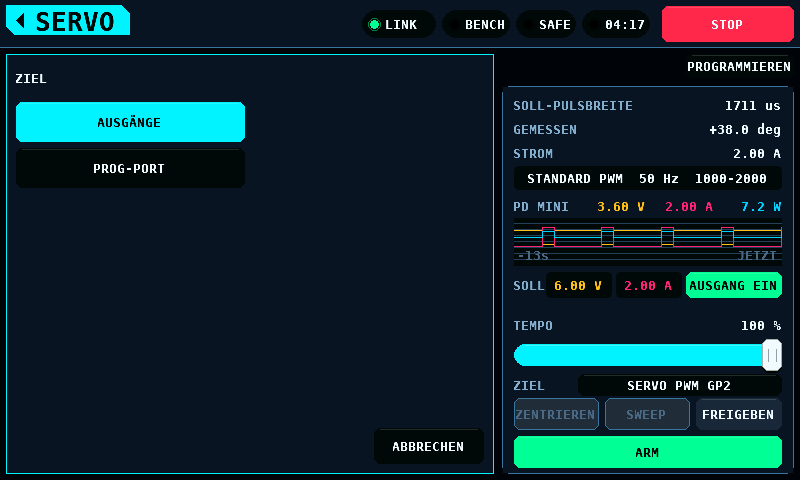

Mit AUSGÄNGE nennt die Zeile die GPIOs, die in der vom Tester getriebenen
Bindung als SERVO PWM gebunden sind: `SERVO PWM GP4`, `SERVO PWM GP2 GP4`;
so viele Pins, wie in die 23 Zeichen des Werts passen, dann `+N`: 8 Pins ab
GP40 lauten `SERVO PWM GP40 GP41 +6`. Die Zeile ist in der Warnfarbe, Name und Wert, ohne einen solchen Pin
(`KEIN SERVO-PWM-PIN`) und bevor eine Bindung gelesen wurde
(`PINS NICHT AUSGELESEN`). Mit PROG-PORT lautet sie `PROG-PORT GP13` in der
Warnfarbe; der Pin ist der GPIO, den der Koprozessor für den Programmierport
meldet. Die Befehle des Testers erreichen dann die SERVO-PWM-Ausgänge nicht;
bei einer Bank in ARMED halten diese ihren Ruhepuls, die Mitte zwischen
ihren Endpunkten. Ein Port als Ziel ohne nutzbaren Pin (keiner, beim Start
abgelehnt, oder ein Port, den der Koprozessor nicht hat) lautet `PROG-PORT`,
ebenfalls in der Warnfarbe: die Befehle gehen trotzdem an den Port. Mit
PORT-PWM aus gibt der Port keinen Puls aus, und die Zeile hängt `PWM AUS`
an: `PROG-PORT GP13 PWM AUS`, 22 Zeichen mit einem zweistelligen Pin. Zwei
Zustände nennen kein Ziel, beide in der Warnfarbe, und in keinem sendet der
Tester einen Befehl: `KEINE VERBINDUNG`, solange kein Koprozessor antwortet, und
`UNBEKANNT`, solange die Programmierport-Seite des Koprozessors seit dem
Linkaufbau nicht gelesen wurde, ein Schreiben auf sie nicht bestätigt wurde
oder ein Lesen nicht beantwortet wurde. Solange der Servo-Programmer den Port
hält, ändert sich die Zeile nicht: sie nennt weiter das Ziel, das der
Koprozessor hält, einen Port oder die Ausgänge; der Programmer treibt den
Port, und der Tester sendet nichts. Die Seite wird alle 500 ms gelesen. Ein
Koprozessor ohne diese Seite (Protokoll älter als 4.13) hat die
Standardausgänge als Ziel. Die Zeile folgt dem Ziel, das der Koprozessor
hält, nicht der Einstellung: eine Änderung von ZIEL wartet auf einen
ruhigen Prüfstand und erscheint in der Zeile, sobald der Koprozessor sie
übernommen hat.


| Typ | Mitte | Weg | Bildwiederholraten |
| --- | --- | --- | --- |
| STANDARD PWM | 1500 us | 1000-2000 us | 50, 60, 100, 150, 200, 250, 300, 333 Hz |
| NARROW 760 | 760 us | 660-860 us | wie STANDARD PWM |
| WIDE | 1500 us | 800-2200 us | wie STANDARD PWM, bis 312 Hz |
| HELI CYCLIC | 1520 us | 820-2220 us | 50, 120, 200, 333 Hz |
| HELI TAIL 760 | 760 us | 410-1110 us | 200, 333, 560 Hz |

Ein Impuls braucht eine Pause vor dem nächsten Frame. STANDARD PWM, NARROW 760
und WIDE halten mindestens 1 ms zwischen den Impulsen, ihre höchste Rate ist
also 1 / (längster Impuls + 1 ms): 333 Hz bei 2000 us. Die Heli-Profile laufen
mit den Raten, die Rotorflight für digitale Taumelscheiben- und
Schmalband-Heckservos nennt, mit mindestens 0,5 ms zwischen den Impulsen. Eine
Rate, die den Impulsen keine Pause lässt, wird abgelehnt, ebenso ein längerer
PULS MAX bei einer Rate, in die er nicht passt. Die Pause gilt nach dem
längsten Impuls, den der Koprozessor ausgeben kann, dem oberen Ende des
Bereichs, den ein Befehl trägt: PULS MAX, oder darüber hinaus, wenn PULS MITTE
nicht in der Mitte liegt, um so viel, wie PULS MITTE näher an MAX liegt als an MIN.
Eine PULS MITTE, die dieses Ende über die Pause der Rate schieben würde, wird
ebenfalls abgelehnt.

**Ein Heli-Typ oder jede Bildwiederholrate über 60 Hz kann ein Servo zerstören,
das nicht dafür gebaut ist.** Die Wahl öffnet eine Warnung in der
Gefahrenfarbe, die nennt, was gewählt ist und was es mit einem nicht dafür
gebauten Servo macht; angewendet wird es erst, nachdem HALTEN ZUM ÜBERNEHMEN 2 s
gehalten wurde. ABBRECHEN, ein abrutschender Finger, ein Touch-Verlust und das
Verlassen des Bildschirms wenden nichts an. Typ und Rate bleiben auf der
rechten Karte rot, und jeder Neustart geht auf STANDARD PWM mit 50 Hz zurück:
ein nach einem Neustart angestecktes Servo bekommt nie eine Rate, die für ein
anderes gedacht war.


**Die Frame Rate erreicht die Pins** über die SERVO-Page des Koprozessors
(Protokoll 4.1). Sie gilt nur für das ZIEL. Mit AUSGÄNGE, den Standard-Servoports,
als Ziel ist das jeder PWM-Ausgang, dessen erster Kanal die Rolle surface hat; ein
PPM-Ausgang behält seinen eigenen Frame. Mit PROG-PORT als Ziel ist es der Pin
des Programmierports, und jeder Slot behält seine eigene Rate (Protokoll
4.19). Jeder andere Programmierport läuft mit 50 Hz. Ein Port, dessen Pin
seinen PWM-Slice mit dem Pin eines anderen Programmierports teilt, läuft nur
mit 50 Hz: der RP2350 gibt beiden Pins eines Slices einen Teiler und einen
Wrap, eine schnellere Rate dort wird also abgelehnt. Eine Änderung des
ZIELS setzt die Rate auf 0 zurück, jeden Ausgang auf seine eigene Rate,
und die Seite sendet ihre Rate mit der nächsten Stellung erneut. Sie geht mit jeder
gehaltenen Stellung hinaus, und ein Profilwechsel, während das Servo in ARMED
ruht, setzt die Ruhelage mit ihr neu; einer, der während eines laufenden Arm
geschieht, ist der, den der Arm verwendet. Eine schnellere Rate folgt den
Impulsbreiten, sobald alle angekommen sind; jede andere Rate geht ihnen voraus,
und nichts Breiteres geht hinaus, bevor sie angekommen ist. So tragen die Pins
nie eine schnelle Rate mit den breiteren Impulsen eines langsameren Profils.
Die AUSGANG-Seite sagt, was aus ihr wurde:

| Hinweis | Bedeutung |
| --- | --- |
| Aktiv | die Rate läuft auf dem Ziel, das der Koprozessor hält, benannt nach seiner PROG-Seite: `Aktiv: AUSGÄNGE laufen mit 330 Hz.` oder `Aktiv: PROG-PORT GP13 läuft mit 330 Hz.` Der Hinweis steht in der Warnfarbe, solange dieses Ziel vom gewählten ZIEL abweicht (zweite Zeile `Das gewählte ZIEL ist nicht aktiv.`; PROG-PORT ohne an den Port gebundenen Pin lässt AUSGÄNGE das Ziel), solange das Port-Ziel keinen Pin hat, solange PORT-PWM AUS ist (`PORT-PWM ist AUS. Der Port gibt keine Pulse aus.`) und solange das Ziel unbekannt ist. Mit einem Koprozessor vor Protokoll 4.19 lautet der Hinweis "jedes PWM-Ruder läuft mit": ein solcher Koprozessor fährt jede PWM-Surface mit der Rate, gleich was ZIEL nennt. Ohne Link lauten beide `Keine Verbindung. Die aktive Pulsrate ist unbekannt.` in der Warnfarbe: ein Koprozessor, der bei unterbrochenem Link neu startet, fährt jeden Pin wieder mit seiner eigenen Rate |
| Die Pulsrate wird mit der nächsten Position | noch nicht geschrieben |
| ABGELEHNT | ein Puls des Ziels -- einer Surface, oder des Programmierports, solange sein Puls eingeschaltet ist -- ist länger als der Frame bei dieser Rate, oder ein Pin des Ziels teilt sich einen PWM-Slice mit einem Ausgang auf einer anderen Rate; die Pins behalten ihre Rate |
| Dieser Koprozessor nimmt keine Frame Rate | Protokoll 4.0: jeder PWM-Ausgang läuft mit den 50 Hz seiner Bindung |

Ein Neustart des Koprozessors und jede auf OUTPUTS geschriebene Bindung setzen
jeden Slot auf seine eigene Rate zurück, 50 Hz für ein Servo; die Seite sendet
ihre Rate mit der nächsten Stellung erneut, gegen die dann geltende Bindung.
Eine Bindung wird nicht geschrieben, solange das Zurücksetzen auf die eigene
Rate jedes Slots unbeantwortet bleibt (OUTPUTS meldet `KEINE VERBINDUNG`) oder
abgelehnt wird (`ABGELEHNT`), und der Prüfstand wird von keiner
Seite aus ARMED, solange die Rate des ZIELS nicht bekannt ist: Der Arm
wird mit `Pulsrate des Servos unbekannt. ARM erneut halten.` abgelehnt, und ein Arm, der
bei unterbrochenem Link gemacht wurde, erreicht den Koprozessor erst, wenn das
Zurücksetzen angekommen ist.

Die AUSGANG-Einstellungen, HV-SERVO, ENDLAGENLAUF und SERVOPULSE gelten für
die Sitzung; die Einstellungen von SWEEP, des automatischen Tests und von
PRÜFLING und ZIEL liegen im NVS. Eine Änderung fordert das Schreiben sofort
an; der Speicher nimmt es im ersten Frame, in dem der Prüfstand ruht
([Werte behalten](#werte-behalten)). Die Speicherzeile unten auf
jeder Seite sagt `GESPEICHERT`, `SPEICHERN AUSSTEHEND`, `NICHT GESPEICHERT`
oder `ÄNDERUNGEN IN SETUP NICHT GESPEICHERT`.


Aktuelle Einschränkungen:

- Bis die Seite eine Stellung sendet, laufen die Pins mit der Rate, die die
  SERVO-Page hält; nach einem Neustart oder einer neuen Bindung sind das 50 Hz.
- Am Netzteilmodell des Panels sind die Ströme des automatischen Tests die Last des Modells, nicht die
  des Servos: ein Lauf dort misst das Modell. [Was nicht gemessen ist](Servo-de.md#was-nicht-gemessen-ist).
- Das Netzteil auf der rechten Karte ist das von SUPPLY: der PD mini, wenn
  SETUP ihn einschaltet, sonst das Modell des Panels, dessen Spannung, Strom
  und Leistung simuliert und nicht gemessen sind.

## Netzteil


Stellt ein programmierbares Netzteil ein, schaltet es und zeichnet es auf: den
PD mini, einen USB-PD-Trigger (USB Power Delivery), der über einen UART
(Universal Asynchronous Receiver-Transmitter) gesteuert wird. Der
Koprozessor steuert ihn über einen PIO-UART (PIO: Programmable
Input/Output) auf zwei seiner Pins, über die SUPPLY-Link-Page (Protokoll
4.3). Das Panel schreibt die Page und liest sie alle 100 ms. Ist der PD mini
in SETUP unter ANSCHLÜSSE eingeschaltet, nennt die Kopfzeile das Modul und die UART-Pins des Koprozessors, an denen
es hängt: `PD MINI TX GP12 RX GP13`, aus den Einstellungen PD mini TX und
PD mini RX. Ist einer der beiden Pins nicht gesetzt, steht `PD MINI OHNE PINS`
in der Kopfzeile. Ist der PD mini abgeschaltet, rechnet das Panel an seiner Stelle ein Modell eines
Netzteils: die Kopfzeile sagt SIMULIERTES NETZTEIL, und die Kachel im Menü trägt
SIMULIERT.

Das Layout ist das von MOTOR & ESC. Der Plot zeigt Spannung, Strom und
Leistung der letzten 27 s. Die Leiste rechts zeigt die Messwerte, die
niedrigste Spannung des Laufs und seinen höchsten Strom und seine höchste
Leistung. MODUS sagt, welchen Sollwert das Netzteil hält: CV (constant voltage)
bei der eingestellten Spannung oder CC (constant current) an der
Strombegrenzung. CC steht in der Warnfarbe: ein Netzteil in CC liefert der
Last nicht die Spannung, auf die es gestellt ist.

Ein Sollwert steht neben seinem Messwert. SPANN. und STROM tragen ihn in Klammern
hinter dem Namen, und der Plot zeichnet ihn gestrichelt in der Farbe und auf
der Skala des Messwerts. TABELLE führt beide auf. Der Wert in Klammern ist der
Sollwert, den das Netzteil zu halten meldet; solange es nicht antwortet, der
des Bildschirms.

| Sollwert | Modell | PD mini | Knöpfe |
| --- | --- | --- | --- |
| SPANNUNG | 3,3 bis 21 V, Schritte von 20 mV | 1 bis 20 V, Schritte von 10 mV | 0,1 V |
| STROMBEGRENZUNG | 0,5 bis 5 A, Schritte von 50 mA | 0,05 bis 3 A, Schritte von 10 mA | 0,1 A |

Die Bereiche des Modells sind das weiteste Profil einer USB-PD-PPS-Quelle
(Programmable Power Supply), 3,3 bis 21 V bei bis zu 5 A. Die des PD mini
stammen von der Seite des Herstellers und sind nicht gemessen. Der PD mini
ist ein Abwärtswandler und gibt nicht mehr ab, als er bekommt: seine
Spannung ist zusätzlich auf 0,7 V unter der Eingangsspannung begrenzt, die
er meldet, bei 5 V Eingangsspannung also höchstens 4,3 V. Unter 1,7 V Eingangsspannung bleibt der Mindestwert von 1 V, den der Bildschirm als Grenze zeigt, und unter 1,5 V bleibt der Ausgang aus; solange keine Eingangsspannung gelesen ist, gilt 20 V. Ein Sollwert über der
Eingangsspannung bringt das Modul in ERR, bis es stromlos war; welchen Abstand es
braucht, ist nicht gemessen. Die Grenze liegt 0,2 V über der Linie, an der
der Ausgang abgeschaltet wird (siehe unten): die Eingangsspannung darf unter
Last um 0,2 V sinken, bevor ein Sollwert an der Grenze abgeschaltet wird. Beide engen
die Grenzen unter OPTIONEN ein, und die Schieber folgen dem Netzteil, das
in Gebrauch ist. Ein Tippen auf eine Spur setzt den Wert unter dem Finger.

**Ein Tippen auf die Karte SPANN. oder STROM oder auf den Wert eines Sollwerts
öffnet eine Tastatur** über der linken Spalte. Sie zeigt den Bereich in der
Titelzeile und den aktuellen Wert blass, bis eine Ziffer getippt ist. OK
übernimmt einen Wert im Bereich, gerundet auf den Schritt des Netzteils; ein
Wert außerhalb wird abgelehnt, und der Bereich wechselt in die Warnfarbe. OK
ohne Eingabe und ABBRECHEN lassen den Sollwert, wie er war.


**Eine Änderung an einem eingeschalteten Ausgang fragt zuerst.** Solange der
Ausgang an ist, öffnet ein neuer Sollwert vom Schieber oder seinen
Schrittknöpfen oder von der Tastatur eine Frage, die die Änderung nennt.
ÜBERNEHMEN gibt sie dem Netzteil; ABBRECHEN verwirft sie, und der Schieber geht
zurück. Ein Ziehen fragt einmal, beim Loslassen, und bis dahin hält das
Netzteil den alten Sollwert. Bei ausgeschaltetem Ausgang wird nichts gefragt.
STOP schließt die Frage unbeantwortet: ein ÜBERNEHMEN im selben Frame (etwa
50 ms) wie STOP übernimmt nichts. OPTIONEN schaltet die Frage für den Schieber und für die Tastatur getrennt
ab.


**AUSGANG EIN ist ein Zwei-Sekunden-Halten**, dieselbe Geste und dieselbe Blende
wie ARM. AUSGANG AUS ist ein Tippen. STOP schaltet den Ausgang auf jedem
Bildschirm ab. Ebenso jeder andere Stopp, den der Prüfstand zählt -- ein Touch,
der nicht mehr antwortet, ein ON, dessen Touch-Ereignisse verloren gingen, bevor
ein ganzer Frame den Ausgang eingeschaltet sah, und ein Koprozessor, der nicht
ARMED bleiben will -- sowie ein Netzteil, das nicht mehr antwortet, und eine
Abschaltung. Der Ausgang bleibt aus, bis er wieder eingeschaltet wird. Das
Verlassen des Bildschirms schaltet einen Ausgang aus, den SUPPLY eingeschaltet
hat: einen, der als an gemeldet ist, oder ein ON auf dem Weg. SERVO und ESC
STICK tun dasselbe für den Ausgang, den jeder eingeschaltet hat, so dass ein
Ausgang nur an ist, solange der Bildschirm gezeigt wird, der ihn eingeschaltet
hat. Die Ausnahme: ein Ausgang, den SERVO eingeschaltet hat, bleibt nach dem
Verlassen von SERVO an, solange der Servo-Programmierer seinen Port hält, bis
der Port loslässt (siehe SERVO). Ein Servo wird von SERVO versorgt, ein ESC von
ESC STICK. MOTOR & ESC schaltet keine Versorgung; ein ESC, der dort läuft, wird
aus seiner eigenen Quelle versorgt. Ein Ausgang, den ein anderer Bildschirm
eingeschaltet hat, bleibt beim Verlassen von SUPPLY, wie er ist. Das Tastenfeld,
die HV-Frage und die übrigen Overlays von SUPPLY sind kein Verlassen. Der
Bildschirm für den verlorenen Link, der kein STOP hat, öffnet sich nicht,
solange der Ausgang an ist.

**Mit dem PD mini** geht ein OFF vor allem anderen an die SUPPLY-Page, was
das Panel ihr schuldet, und der Koprozessor schaltet den Ausgang selbst ab,
wenn der Heartbeat des Panels ausbleibt. Ein eingeschalteter PD mini zeigt
ANTWORTET NICHT, solange kein Koprozessor antwortet, der Protokoll 4.3
spricht, oder solange die Messwerte der Page älter als 1500 ms sind; ein
Ausgang, der an ist, wird dann abgeschaltet. Antwortet die Page, während der
Messwertzähler des Moduls (SAMPLES) steht -- ein Lesen der Anzeige, das
fehlschlägt, während die anderen Lesungen antworten --, bleibt ONLINE: nach
1500 ms ohne neuen Messwert zeigen die Karten für Spannung, Strom und
Leistung Striche, und keine Abschaltschwelle, kein Spitzenwert und keine
Summe übernimmt einen Messwert; nach
3000 ms (`SUPPLY_LINK_BLIND_MS`) wird ein Ausgang, der an ist, abgeschaltet,
und das Band sagt `Keine Messwerte vom Netzteil. Ausgang aus.`. Ein Sollwert, der sich
schneller ändert, als das Modul ihn übernimmt -- der Slider gezogen mit
REGLER UND SCHRITTE aus, etwa ein neuer Sollwert alle 50 ms --, hält die
Messwerte nicht auf: eine Lesung, die 400 ms über ihre Fälligkeit hinaus
ist (`PDMINI_POLL_LATE_MS`), geht vor das nächste Schreiben eines Sollwerts,
eine nach der anderen mit einer anderen Transaktion dazwischen; das Lesen
des Zustands und das Lesen der Eingangsspannung vor einem Schreiben dürfen auch
direkt auf eine andere Lesung folgen. Bei einem Modul, das sofort antwortet,
wird die Anzeige dann etwa 500 ms nach dem letzten Lesen der Anzeige gelesen
und der Zustand des Ausgangs etwa 900 ms nach dem letzten Lesen des
Zustands, jeweils mit bis zu zwei Transaktionen mehr. Ein Ausgang, den das
Modul einschaltet, während er am Panel aus ist, oder selbst abschaltet, wird
auch während des Ziehens erkannt. Die Eingangsspannung wird vor dem Schreiben eines
Sollwerts oder einem ON nur gelesen, wenn eines davon wartet, und nicht
zwischen den Lesungen für ein ON. Sollwerte und ein ON erreichen ein Modul,
das bis zu 390 ms spät antwortet (der Treiber wartet 400 ms; Host-Modell,
40 Startphasen): ein Sollwert innerhalb von 2,5 s; ein ON innerhalb von
3,6 s, wenn die Sollwerte schon geschrieben sind, bis zu 7,5 s, wenn es
direkt nach einer Änderung des Sollwerts oder einem Ziehen kommt; ein Modul,
das seinen Ausgang selbst schaltet, wird während des Ziehens innerhalb von
2,1 s erkannt. Ein Ausgang, den das Modul einschaltet, während OFF verlangt
ist, wird bei einem Modul, das sofort antwortet, etwa 500 ms später
abgeschaltet, bei einem, das bis zu 390 ms spät antwortet, in Ruhe bis zu
1,8 s und während des Ziehens bis zu 2,1 s später. Die echte Antwortzeit des
Moduls ist nicht gemessen.
Aktuelle Einschränkung: ein Modul, das spät antwortet, dehnt die 500 ms der
Lesungen von Zustand und Eingangsspannung, denn jede Transaktion dauert seine
Antwortzeit. In Ruhe wird die Eingangsspannung bei 100 ms Verspätung 850 ms
auseinander gelesen, bei 200 ms 1,3 s und bei 390 ms 2,5 s; der Zustand bis
zu 1,5 s auseinander.
Aktuelle Einschränkung: antwortet das Modul 279 ms oder später und wird der
Slider gezogen, wird die Anzeige erst 3,7 s bis 5,0 s nach dem letzten
Lesen der Anzeige gelesen (5,0 s bei 390 ms), über `SUPPLY_LINK_BLIND_MS`
hinaus; ein Ausgang, der an ist, wird abgeschaltet, und das Band sagt
`Keine Messwerte vom Netzteil. Ausgang aus.`. Das Panel liest die Page
alle 100 ms, was die Lücke, die es sieht, um bis zu 100 ms verlängert: ab
263 ms Verspätung ist die Lücke des Treibers über 2,9 s, die Abschaltung ist
also ab 263 ms möglich. In Ruhe steht das Lesen der Anzeige bis zu 2,5 s bei
390 ms. Es steht über 1,4 s ab 259 ms Verspätung und 1,5 s ab 279 ms, die
Karten können also ab etwa 260 ms Striche zeigen. Ebenfalls abgeschaltet, mit
einer Zeile im Band, wird der Ausgang, wenn der Koprozessor ein ON abweist
(kein Heartbeat) oder eines fallen lässt (sein Heartbeat blieb aus, oder er
ist neu gestartet). Schaltet das Modul den Ausgang selbst ab -- sein Überstromschutz oder sein
Knopf --, wird er ebenfalls abgeschaltet und erst mit einem neuen Halten
wieder eingeschaltet. Das Band sagt außerdem, wenn die Pins abgewiesen werden,
wenn der Ausgang nicht schalten will und wenn die Sollwerte nicht übernommen
werden. Eine Änderung der Pins oder der Baudrate und das Ein- oder Ausschalten
des PD mini schalten den Ausgang ab.

**Eine einbrechende Eingangsspannung schaltet den PD mini ab.** Solange der Ausgang an
ist, liest der Koprozessor die Eingangsspannung des Moduls alle 500 ms bei einem
Modul, das sofort antwortet, und weiter auseinander bei einem, das spät
antwortet (siehe oben). Liegt die Eingangsspannung bei 2 Lesungen hintereinander
unter dem Sollwert plus 0,5 V, schaltet er den Ausgang sofort ab, und das
Band nennt Eingangsspannung und Sollwert, zum Beispiel
`PD-mini-Eingang 6.18 V liegt unter den nötigen 6.00 V + 0.5 V. Ausgang aus.`.
Vom Einbruch bis zur Abschaltung vergeht bei einem Modul, das sofort
antwortet, etwa 1,0 s. Aktuelle Einschränkung: bei einem, das spät
antwortet, sind es 1,7 s bei 100 ms Verspätung, 1,9 s bei 200 ms und bis zu
4,7 s bis 390 ms (Host-Modell). Der Ausgang bleibt aus bis zu einem neuen
Halten. Eine Eingangsspannung unter 1,5 V
lässt keinen Platz für den kleinsten Sollwert, 1,0 V: das ON wird nicht
geschrieben, und das Band zeigt dieselbe Meldung. Eine einzelne niedrige
Lesung schaltet nichts, und eine fehlgeschlagene Lesung zählt weder mit noch
setzt sie zurück. Solange der Ausgang an ist, wird sein Sollwert einer
fallenden Eingangsspannung nicht nachgeführt. Die Regel ist ohne Messung am Prüfstand
gewählt: ob ein eingeschaltetes Modul bei einbrechender Eingangsspannung in ERR geht,
ist nicht gemessen, also kann die Regel einen Lauf abbrechen, der
durchgehalten hätte.

AUSGANG EIN und AUS, SPITZENWERTE ZURÜCKSETZEN und die Messwerte bleiben unter der Tastatur,
der Frage und OPTIONEN bedienbar. Ein Finger zur Zeit: solange einer ein
Bedienelement hält, bewirkt ein zweiter Finger nirgends auf dem Bildschirm
etwas.

### Einstellungen

OPTIONEN, rechts in der Leiste über beiden Spalten, öffnet die Einstellungen
des Netzteils über der linken Spalte. Jede liegt im NVS (Non-Volatile Storage)
des Panels und übersteht einen Neustart. Ein Wert öffnet die Tastatur, ein
Schalter kippt beim Tippen. Jede Änderung wird im nächsten Frame geschrieben,
in dem der Prüfstand SAFE ist und kein Schalten auf ARMED wartet, der Ausgang
des Netzteils aus ist und kein ON eingereiht ist und die Zeichnung der Platine
weder geladen noch abgelegt wird, und mit ihr jede ungespeicherte Änderung
aus SETUP: ein Flash-Schreibvorgang hält beide Kerne an, AUSGANG AUS und die
Abschaltungen eingeschlossen. Die unterste Zeile sagt GESPEICHERT, SPEICHERN AUSSTEHEND, NICHT GESPEICHERT
(der Schreibvorgang wurde abgelehnt) oder SETUP NICHT GESPEICHERT: eine
Änderung in SETUP, die ohne SPEICHERN verlassen wurde und die nichts schreibt, bis
SPEICHERN dort oder eine Änderung hier danach fragt.


| Einstellung | Bereich | Vorgabe | Wirkung |
| --- | --- | --- | --- |
| SPANNUNG MAX | 3,3 bis 21 V | 21,00 V | die höchste Spannung, die ein Sollwert annimmt |
| STROM MAX | 0,5 bis 5 A | 5,00 A | die höchste Strombegrenzung, die ein Sollwert annimmt |
| STARTSPANNUNG | bis SPANNUNG MAX | 6,00 V | der Spannungs-Sollwert nach einem Neustart |
| STARTSTROM | bis STROM MAX | 2,00 A | die Strombegrenzung nach einem Neustart |
| ÜBERSTROM | 0 bis 5 A | AUS | Ausgang aus, wenn der Strom ABSCHALTZEIT lang darüber lag |
| ÜBERSPANNUNG | 0 bis 21 V | AUS | Ausgang aus, wenn die Spannung ABSCHALTZEIT lang darüber lag |
| ABSCHALTZEIT | 0 bis 5000 ms | 100 ms | wie lange ein Messwert über einer Abschaltschwelle liegt, bevor sie auslöst |
| REGLER UND SCHRITTE | EIN, AUS | EIN | fragen, bevor der Schieber einen eingeschalteten Ausgang ändert |
| TASTENFELD | EIN, AUS | EIN | fragen, bevor die Tastatur einen eingeschalteten Ausgang ändert |

Eine Grenze, die unter einen Sollwert gesenkt wird, holt den Sollwert sofort
auf sie herunter, und einen Startwert mit ihm. Ein getippter Wert kommt in der
sicheren Richtung auf den Schritt der Einstellung: eine Grenze rundet ab, 12,01 V
erlauben also 12,00 V, und eine Abschaltschwelle über 0 ist mindestens ein Schritt, nie
AUS. Eine Abschaltschwelle von 0 ist aus. Die Zeit über einer
Abschaltschwelle zählt ab dem ersten Messwert darüber. Ein Messwert unter
seiner Abschaltschwelle beginnt die Zählung neu; ein Messwert, der nicht
ankam, lässt sie stehen. Eine Abschaltung schaltet den Ausgang ab, MODUS zeigt
ABGESCHALTET, bis der Ausgang wieder eingeschaltet wird, und das Band sagt, welche
Schwelle ausgelöst hat. Das Netzteil hält seine Strombegrenzung in CC, daher löst ein
ÜBERSTROM auf oder über STROMBEGRENZUNG nicht aus; unter der Begrenzung
gesetzt, schaltet er eine Last ab, die zu lange zu viel zieht.

Nach einem Neustart ist der Ausgang aus, welche Startwerte auch gelten.

Ist der PD mini das Netzteil, bietet OPTIONEN außerdem PD MINI ZURÜCKSETZEN. Das
schaltet den Ausgang ab und startet das Modul neu (sein Befehl
SYSTEM_RESET), für ein Modul, das ERR zeigt -- ein Sollwert über seiner
Eingangsspannung bringt es dorthin --, ohne es abzustecken. Etwa 1 s später wird es
wieder gefragt, wer es ist. Ob ein Neustart jedes ERR löst, ist nicht
gemessen. Ein Koprozessor älter als Protokoll 4.4 kann nicht neu starten:
der Ausgang geht aus, und das Band sagt es.

### Das Log

Ein Lauf ist ein Einschalten des Ausgangs. Der Plot leert sich, wenn der
Ausgang angeht, und hält den Lauf, nachdem er ausgeht. mAh und Wh unter dem
Schalter zählen den Lauf aus den angezeigten Messwerten, jeder Schritt auf 1 s
begrenzt. SPITZENWERTE ZURÜCKSETZEN beginnt die niedrigsten und höchsten Werte neu ab dem
aktuellen Messwert.

Ein Lauf wird in eine eigene `BENCHnnn.CSV` geschrieben, eine Zeile alle
50 ms:

```
time (s);set (V);voltage (V);limit (A);current (A);power (W);mode;charge (mAh);energy (Wh);source
```

Ein Messwert, der nicht ankam, ist eine leere Zelle. `mode` ist CV, CC oder
OFF und leer, solange das Netzteil nicht antwortet. `source` ist `measured`
für die Werte des PD mini und `model` für das Modell des Panels. Der Prüfstand hat beim
Log Vorrang: ARM während eines Netzteil-Laufs beendet dessen Datei, und ein
Ausgang, der beim Schalten auf SAFE noch an ist, beginnt eine neue. Ladung und
Energie dieser Datei zählen von den Summen seit dem Einschalten des Ausgangs
weiter, wie auf dem Bildschirm; ihre erste Zeile beginnt also nicht bei 0. Das
Netzteil wird in seinem eigenen 50-ms-Takt geführt und geloggt, auch während
die Steuer-Task auf den Link wartet; ein Koprozessor, der nicht antwortet,
dünnt weder den Plot noch das Log des Netzteils aus.

Das Modell ist eine Last von 6 Ohm mit einem Stoß von 1,4 A für 0,6 s alle
3 s, hinter einem Quellwiderstand von 0,05 Ohm. Bei den Startwerten, 6,00 V
und 2,00 A, bringt der Stoß es in CC. Seine Messwerte sind nicht gemessen,
und am Prüfstand wird nichts versorgt.

Die Verdrahtung des PD mini -- PD mini, PD mini TX, PD mini RX und PD mini
Baud -- steht in SETUP unter ANSCHLÜSSE. TX und RX sind GPIO-Nummern des
Koprozessors: TX geht zum DM des Moduls, RX kommt von seinem DP. Der
Koprozessor weist einen Pin ab, der reserviert, an einen Ausgang gebunden
oder der andere Pin ist. Hat das Modul einmal geantwortet, wartet eine
Änderung auf eine danach gesendete Zustandslesung des Moduls, höchstens etwa
1,2 s, und wird nur übernommen, wenn diese den Ausgang aus zeigt: das Modul
kann sich zwischen zwei Zustandslesungen selbst einschalten, über seinen
Knopf oder seine Einstellung AUTO OUT, und neue Pins ließen ihm keinen Weg
zum OFF. Zeigt die Lesung den Ausgang an oder schlägt sie fehl, wird die
Änderung abgewiesen, und das Band sagt
`PD-mini-Anschlüsse abgelehnt. Sein Ausgang kann noch eingeschaltet sein.`. Eine
abgewiesene Änderung wird erst wieder geschrieben, wenn sich die Verdrahtung
in SETUP ändert. PD mini Baud ist die eigene UART-Baudrate-
Einstellung des Moduls: 9600, 19200 (ab Werk), 38400, 57600, 115200, 230400
oder 460800 Baud, oder AUTO. AUTO, die Vorgabe, lässt den Koprozessor sie
finden: er versucht jede der 7 Raten, eine pro Sekunde. Die Kopfzeile von
SUPPLY zeigt die Rate in Gebrauch hinter ONLINE, z. B. `ONLINE 38400`, bei
AUTO wie bei einer festen Rate.

## Analyser


Sechzehn Kanäle, jeder mit etwa 1,7 s Verlauf (118 Werte) und einem Balken für den aktuellen
Wert. CH17 und CH18 sind die beiden Digitalkanäle. Ein Glitch ist eine Spitze
in einer Spur; ein Dropout ist eine Kerbe durch alle sechzehn im selben
Moment.

Keine Firmware speist diesen Bildschirm bisher (siehe
[Empfängerbusse](Receivers-de.md)); er zeigt KEIN SIGNAL.

Der Zustandsblock zeigt einen von KEIN SIGNAL, FAILSAFE, FRAME LOST und LIVE, mit
einer Zeile Erklärung:


Im FAILSAFE sendet der Empfänger wohlgeformte Werte, die er selbst erzeugt;
jede Spur wird rot gezeichnet. FAILSAFE als Stopp behandeln, nicht als
sechzehn gültige Kanäle. [Empfängerbusse](Receivers-de.md) beschreibt die
Zustände.

## Programmierer

Die Reihenfolge: Geräteklasse, Protokoll, verbinden. ESC STICK, die dritte
Klasse, listet ESC-Profile statt Protokollen und programmiert einen ESC über
sein Gasknüppel-Menü; sie hat eine eigene Seite,
[Stick-Programmierung](StickProgramming-de.md).

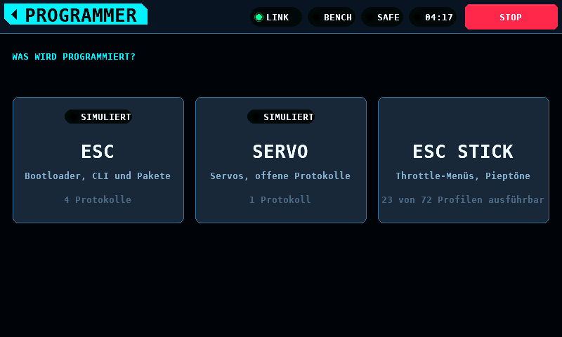

Die Klassen ESC und SERVO sind ein Modell im Panel. Kein Transport trägt
ihre Protokolle: VERBINDEN, AUSLESEN und SCHREIBEN ändern die eigene Kopie des
Panels von einem Gerät und senden nichts auf eine Leitung. Das nach
VERBINDEN genannte Gerät stammt aus dem Modell, nicht aus einer Antwort der
Hardware, und SCHREIBEN erreicht kein Gerät. Jede Seite der beiden Klassen
trägt die Marke SIMULIERT: auf der Kachel der Klasse, auf jeder
Protokollzeile und in der Gerätezeile, dort anstelle des Verbindungspunkts.
Der Punkt der Marke ist bernsteinfarben, solange eine Sitzung offen ist,
und grau, solange keine offen ist; grün wird er nie. Unter den Parametern
sagt die Seite, dass kein Gerät erreicht wird. ESC STICK trägt keine Marke:
ein Stick-Lauf läuft wie die Befehle des Bildschirms MOTOR über die
Arming-Policy und die Ausgangsbank.

Jede Protokollzeile nennt ihren Transport. Eine automatische Erkennung gibt
es nicht:

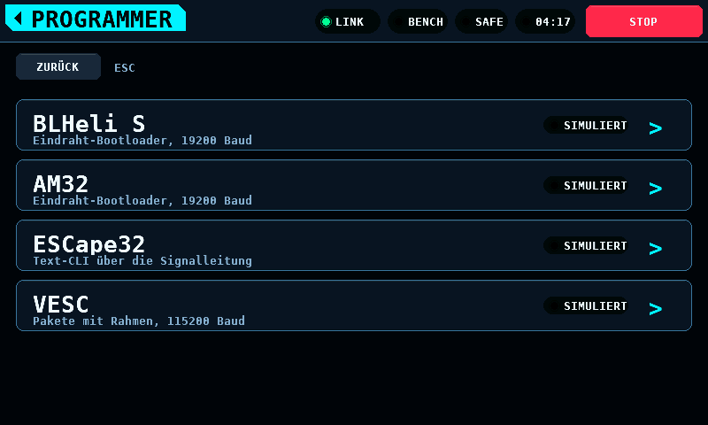

Die ESC-Liste hat keinen Eintrag für ESCs mit BLHeli_32-Firmware. Der
Prüfstand erkennt diese ESCs, steuert sie an und sendet die DShot Special
Commands, kann ihre Parameter aber nicht lesen:
[Parameter von ESCs mit BLHeli_32-Firmware](BLHeli32-de.md).

Bevor VERBINDEN eine simulierte Sitzung öffnet, ist nichts editierbar:

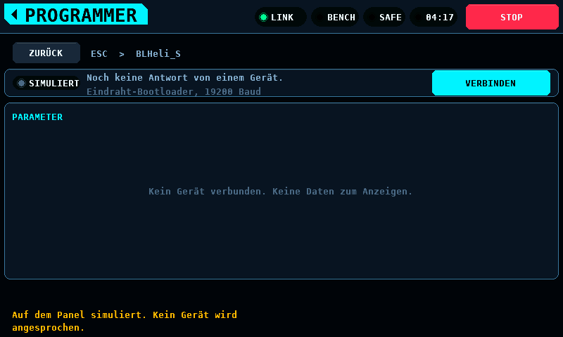

Bei offener Sitzung erscheinen die Parameter in Gruppen, mit der Hilfe zur
ausgewählten Zeile unter der Liste:

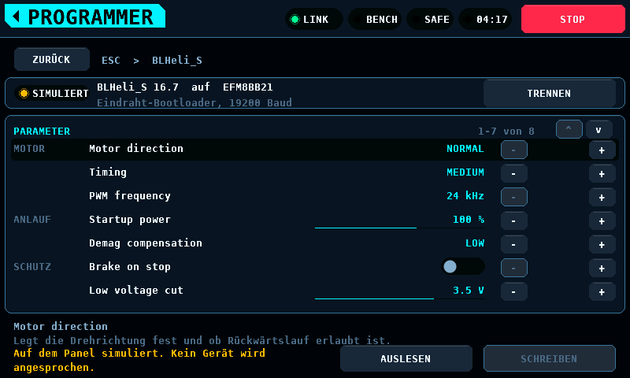

Die Einstellungen jeder Firmware erscheinen in ihren eigenen Einheiten. Die
Tabelle für BLHeli_S-Firmware zeigt das Timing als benannte Stufen, die
anderen in Grad Vorzündung:

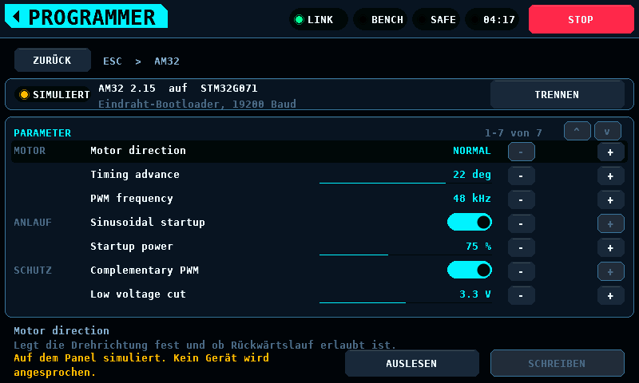

Ein geänderter Wert wird erst ins Modell geschrieben, wenn SCHREIBEN
gedrückt wird. Vorgemerkte Änderungen tragen eine Markierung und eine eigene
Farbe, und der SCHREIBEN-Knopf zeigt, wie viele vorgemerkt sind:

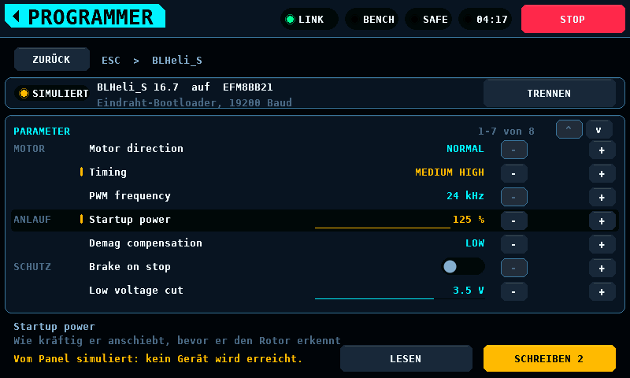

Stepper halten an den Enden einer Liste an; sie springen nicht auf die andere
Seite.

Jedes Bedienelement auf PROGRAMMER nimmt ein Tippen. Es wirkt, wenn der
Finger innerhalb des Elements abhebt, das er gedrückt hat, in x und in y
höchstens 8 px vom Aufsetzpunkt entfernt. Ein Finger, der auf einem Element
aufsetzt und weiterwandert, drückt nichts, ebenso einer, der ein Element
überquert. Ein Finger zur Zeit drückt ein Element. Drei Bedienelemente wirken
schon beim Aufsetzen:

- HALTEN ZUM STARTEN: Das Halten über 2 s beginnt mit dem Aufsetzen.
- ABBRECHEN eines Stick-Laufs, auf der Seite des Laufs und in der Abfrage
  eines manuellen Schritts. Es hält einen Motor an, wartet deshalb nicht auf
  das Abheben und reagiert auch auf einen zweiten Finger.
- Die Tasten der Such-Tastatur, die ihrem eigenen Aufsetzen und Abheben
  folgen.

Eine Ebene zurück schließt die Sitzung. ZURÜCK und das Home-Tag im Band
gehen eine Ebene auf einmal zurück: eine Geräteseite zu ihren Protokollen,
die Seite eines Stick-Profils zur Liste, die Modelle eines Herstellers zu den
Herstellern, eine Liste zu den Klassen. Das Home-Tag verlässt PROGRAMMER nur
von den Klassen aus. Über der Warnung vor dem Lauf ist das Home-Tag
ABBRECHEN, über den manuellen Schritten OK. Während eines Stick-Laufs ist es
ABBRECHEN des Laufs: Der Lauf endet, und sein Ergebnis bleibt auf der Seite.

### ESC STICK

Die Liste zeigt zuerst die Hersteller, alphabetisch, jeden mit der Zahl
seiner Modelle, die laufen:

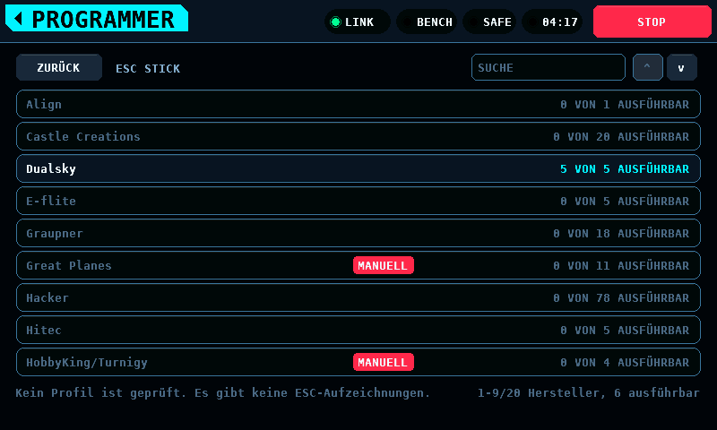

Ein Hersteller öffnet seine Modelle, eine Zeile je Modell, nach Strom, dann
Spannung, dann Name, jedes mit seiner Familie und was das Profil ist oder
warum es nicht läuft. Ein Modell öffnet das Profil seiner Familie:

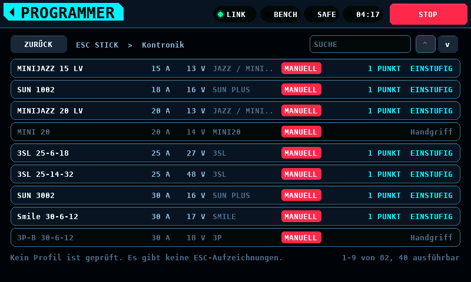

SUCHE filtert die gezeigte Ebene. Ihre Tastatur dockt rechts an, die
Zeilen werden daneben schmaler, und jede Taste filtert sofort. Ein Modell
wird gefunden, wenn der Text in Hersteller und Familie steht, als ein Text
gelesen, oder in Hersteller und seinem eigenen Namen; ein Hersteller
erscheint, wenn eines seiner Modelle gefunden ist. Groß- und
Kleinschreibung spielen keine Rolle, und `*` steht für eine beliebige Folge
von Zeichen:

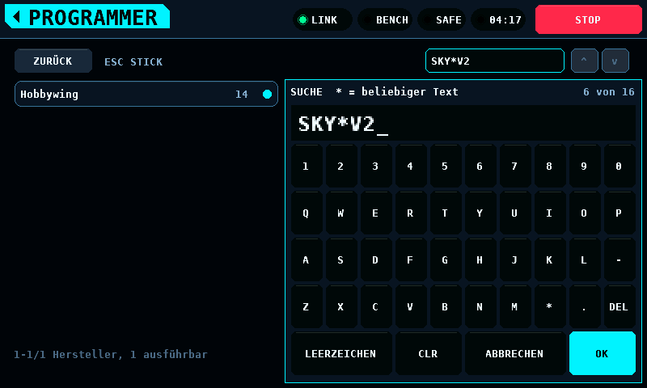

OK behält die Suche auf beiden Ebenen, X leert sie:

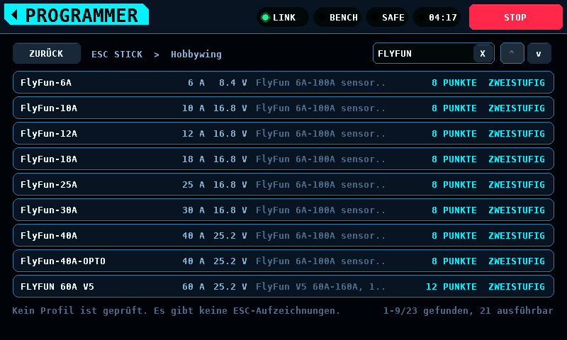

Die Punkte eines Profils stehen anfangs auf BEHALTEN. Die Stepper wählen einen
Wert; START zählt die gewählten Werte:

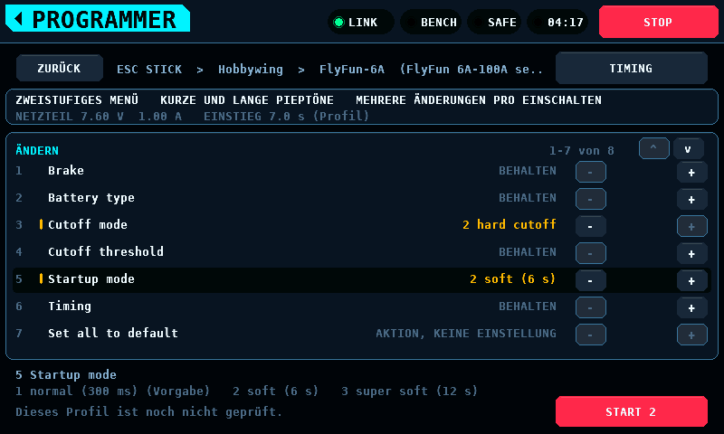

START öffnet eine Warnung über den ganzen Bildschirm, PROPELLER AB? MOTOR GESICHERT?: ein Motor am ESC muss fest montiert sein und darf keinen
Propeller tragen, oder ein Lastwiderstand tritt an seine Stelle. Der Lauf
beginnt, wenn HALTEN ZUM STARTEN 2 s gehalten ist:

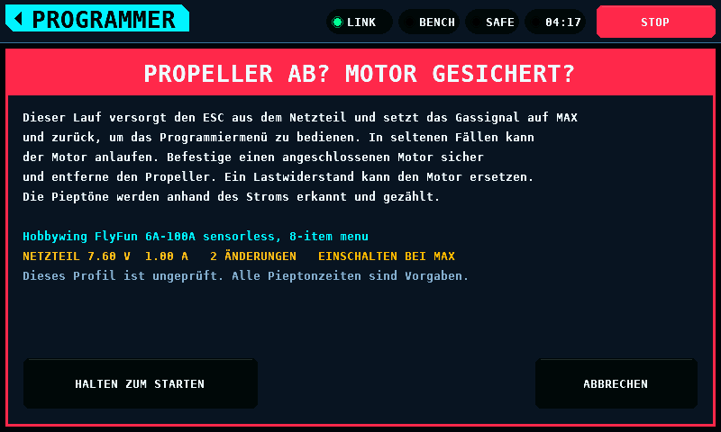

START öffnet nichts, und die Zeile daneben nennt den Grund, solange kein Pin
als Throttle gebunden ist, solange die Ausgangsbindung nicht gelesen ist
und solange das Netzteil das Modell des Panels ist; ein solcher Grund
schließt eine offene Warnung ([Vor einem Lauf](StickProgramming-de.md#vor-einem-lauf)).

Ein Profil, dessen ESC einen Menschen am ESC braucht -- einen Jumper stecken
und abziehen, einen Taster drücken --, trägt in der Liste ein rotes Schild
MANUELL und auf seiner Seite rot MANUELLER EINGRIFF NÖTIG. Der Knopf zeigt die
Schritte und wann jeder fällig ist; ebenso das erste Öffnen des Profils. Die
Warnung nennt die Schritte vor dem Einschalten, und der Lauf hält für jeden
späteren Schritt mit ERLEDIGT und ABBRECHEN an und wartet höchstens 60 s
([Handgriffe](StickProgramming-de.md#handgriffe)):

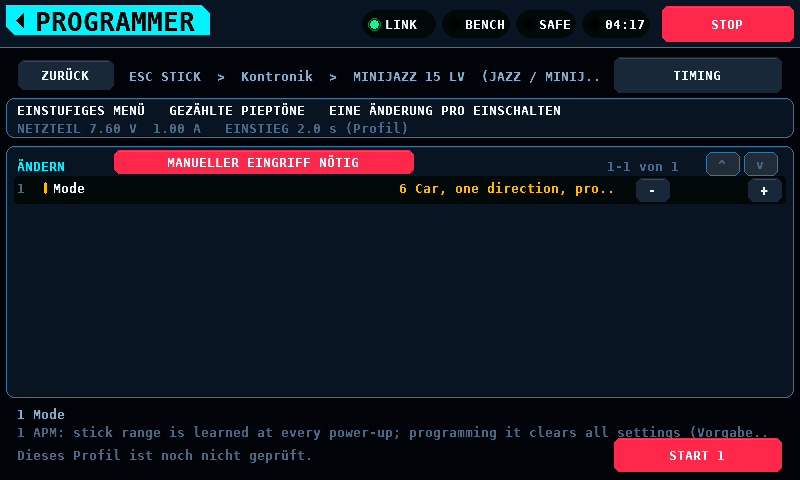

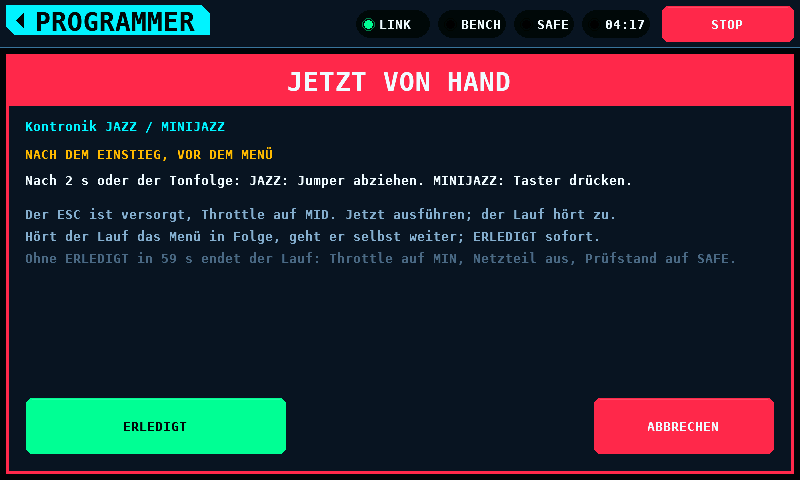

Ein Kontronik-ESC, der sich sperrt, wenn sein Netzteil ausschaltet, bevor
er den gespeicherten Modus bestätigt hat, hält den Lauf nach dem Speichern
versorgt, den Knüppel, wo er speicherte, bis ERLEDIGT:

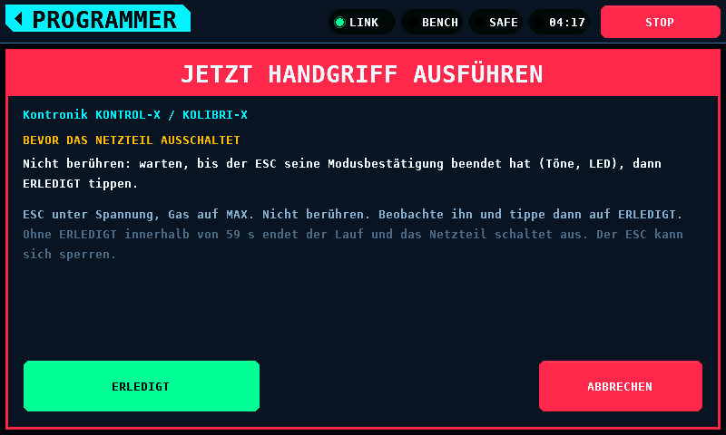

Während er läuft, zeigt die Seite die Phase, die Pieptöne der laufenden
Gruppe und die letzte Gruppe. ABBRECHEN, das Home-Tag, STOP und das Verlassen
des Bildschirms beenden ihn mit dem Gas auf MIN, dem Netzteil aus und dem Prüfstand
SAFE. Das Grün der Signalsäule leuchtet, solange ein Piepton erkannt
ist, mindestens 150 ms:

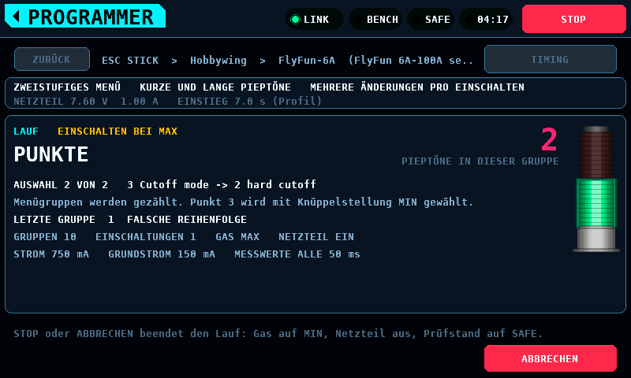

Solange der Phasenabgriff unter SETUP eingeschaltet ist, ergänzt die Seite des
Laufs unter der Stromzeile eine reine Anzeige: den Zustand des Abgriffs, die
Tonhöhe seines letzten 8-ms-Fensters, die Zähler der Pieptöne, die der
Koprozessor verlor, und der Pieptöne, die das Panel nicht gelesen hat, und die letzten vier Pieptöne
mit Nummer, Länge in ms und mittlerer Tonhöhe in Hz. Der Lauf zählt seine
Pieptöne weiter aus dem Netzteilstrom.

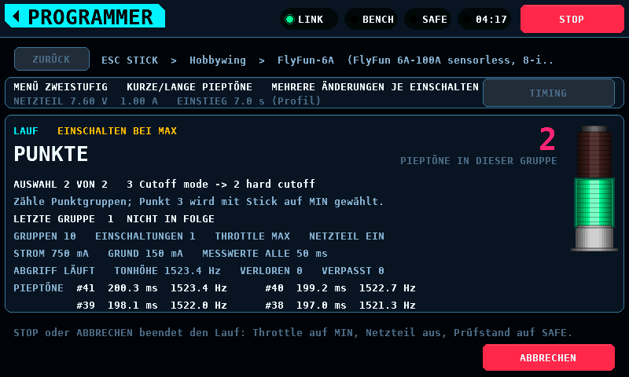

| Zustand | Bedeutung |
| --- | --- |
| `LÄUFT` | die Aufnahme läuft |
| `ÜBERLAUF` | sie läuft, und der Aufnahmering oder die FIFO ist seit dem Einschalten des Abgriffs übergelaufen |
| `WARTET` | kein Link, oder die TONE-Page hat in den letzten 500 ms nicht geantwortet, oder ihre Flags sagen, dass der Abgriff läuft, und ihre Fensternummer hat sich 1,5 s nicht bewegt, oder der Abgriff wurde ausgeschaltet, und die Page hält ihn noch an |
| `KEINE TONE-PAGE` | der Koprozessor spricht ein Protokoll älter als 4.8 |
| `PIN BELEGT` | der Koprozessor hält den Abgriff aus: sein Pin ist anderweitig gebunden, oder der Koprozessor führt seit seinem Start keine Erfassung aus (Core 1 nicht gestartet), und seine gespeicherte Einstellung hat den Abgriff an; das Zweite endet nur mit einem Neustart des Koprozessors |
| `LÄUFT NICHT` | eingeschaltet, und die Page hält den Abgriff aus oder lässt ihn nicht laufen: die Einstellung wurde abgelehnt oder ist noch nicht geschrieben |

TONHÖHE und VERLOREN sind Werte der Page aus dem letzten Status-Read. Sie
zeigen `--`, und `ÜBERLAUF` erscheint nicht, solange kein Read jünger als
500 ms den Zustand liefert: bei `WARTET`, bei `KEINE TONE-PAGE` und bei
`LÄUFT NICHT`, solange die Einstellung der Page den Abgriff aus hat.
VERPASST und die Pieptöne zählt und speichert das Panel selbst; sie bleiben.

Das Ergebnis bleibt bis OK. Sein Rot leuchtet, wenn der Lauf endete, weil
etwas nicht wie erwartet war, ein Stopp des Prüfstands selbst eingeschlossen,
und bleibt aus bei FERTIG, gedrücktem STOP, ABBRECHEN, dem Home-Tag und
dem Verlassen des Bildschirms ([die Liste](StickProgramming-de.md#wie-ein-lauf-endet)):

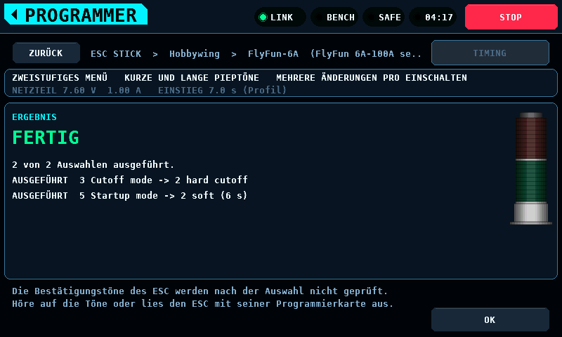

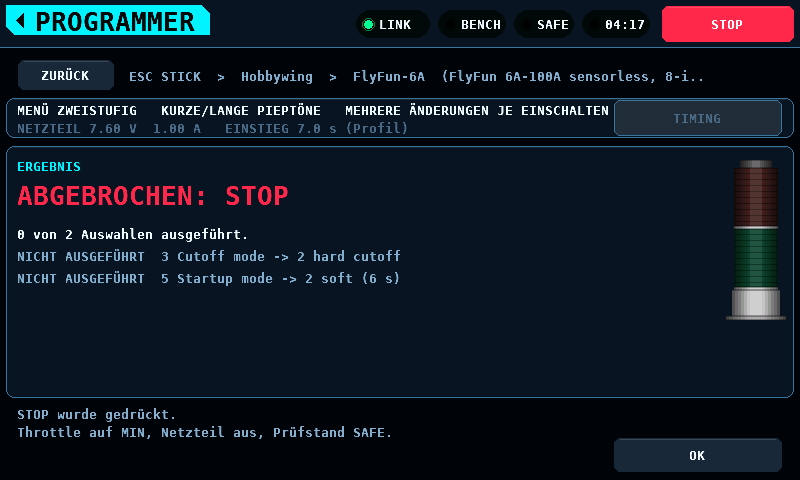

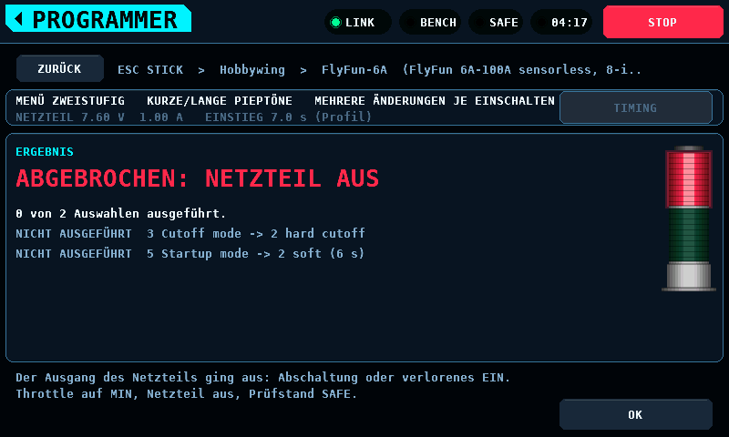

TIMING enthält die Zeiten der Pieptöne und die Netzteil-Einstellungen. Keine
davon ist gemessen:

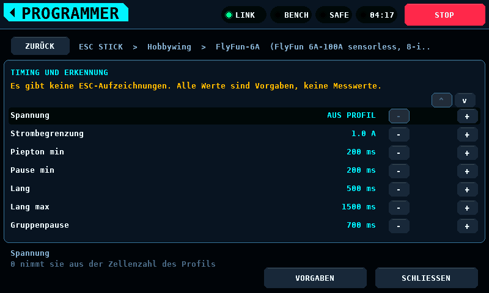

## Akku


Die Zellen werden als Abweichung vom Mittelwert des Packs gezeichnet. Das
Urteil folgt der Spreizung, dem größten Abstand zwischen zwei beliebigen
Zellen: GUT unter 30 mV, BEOBACHTEN ab 30 mV, ERSETZEN ab 60 mV. Die Skala folgt
dem Pack bis hinunter zu einer Untergrenze von 12 mV und steht neben dem Plot.

Unter Last messen. In Ruhe liest sich eine schwache Zelle wie die anderen.

Keine Firmware speist diesen Bildschirm: Kein Zellenmonitor wird gelesen,
ein Prüfstand zeigt also KEIN AKKU. Das Bild oben ist aus einem Modell gerendert.

## Logs


Karte durchsehen, Datei öffnen, prüfen, was der Import erkannt hat, dann
plotten:


Das Home-Tag geht eine Ebene zurück, wie ZURÜCK: vom Plot zur Importansicht,
von der Importansicht zur Dateiliste, von der Dateiliste zum Menü. Über der
Rückfrage zu LÖSCHEN ist es ABBRECHEN. WLAN, in der unteren Reihe neben
AKTUALISIEREN, öffnet [WLAN](#wlan).

Der Reader für CSV (Comma-Separated Values) akzeptiert Dezimalkomma und
Dezimalpunkt, eine Einheitenzeile und Zeilen ungleicher Länge; die
Importansicht zeigt, was er entschieden hat, bevor die Datei geplottet wird.
Jede numerische Spalte zeigt ihren Bereich vom kleinsten zum größten Wert:
mit einer Nachkommastelle, solange beide Enden unter 1000 liegen, ab 1000
ohne (`11.9..12.6 V`, `2392..14639 rpm`). Ein Bereich breiter als die 17
Zeichen seines Felds verliert die Nachkommastelle, dann das Leerzeichen vor
der Einheit (`-1000..-1000 rpm`, `-14639..-14639rpm`); ein noch breiterer
wird am Rand des Felds abgeschnitten. Eine Zeile endet an ihrem
Zeilenvorschub (LF, 0x0A). Text nach dem letzten Zeilenvorschub ist eine
Zeile, die ein Stromausfall oder eine volle Karte abgeschnitten hat: Sie
kann jedes Feld enthalten und eine gekürzte Zahl, `95` von `9554`, deshalb
fehlt sie in den Zeilen, den Kennwerten und im Plot. ZEILEN steht dann in
der Warnfarbe, und die Importansicht meldet `LETZTE ZEILE UNVOLLSTÄNDIG. ÜBERSPRUNGEN.`. Eine Datei eines anderen Programms, die ohne Zeilenvorschub endet,
verliert ihre letzte Zeile genauso. Leerzeichen nach dem letzten
Zeilenvorschub sind keine Zeile, ebenso Tabs und Wagenrückläufe (CR). Vom
Prüfstand aufgezeichnete Läufe werden im Wurzelverzeichnis der Karte unter
dem Namen des Schreibers und einer Nummer von 001 bis 999 abgelegt:

| Name | Lauf |
| --- | --- |
| `SERVOnnn.CSV` | ein automatischer Servotest; sein Bericht ist `SERVOnnn.TXT` |
| `SERVOnnn.TXT` | der Bericht eines Endlagenlaufs, ohne CSV daneben |
| `ESCnnn.CSV` | ein Schalten der Throttle-Ausgänge auf ARMED, von MOTOR & ESC oder einem Stick-Lauf auf PROGRAMMER |
| `BENCHnnn.CSV` | ein Schalten der Surfaces auf ARMED, von SERVO, oder ein Einschalten des SUPPLY-Ausgangs, solange der Prüfstand SAFE ist |

An einem Koprozessor älter als Protokoll 4.18 umfasst jedes Schalten auf
ARMED auch die Throttle-Ausgänge. Ein Schalten auf ARMED von SERVO schreibt
dann `ESCnnn.CSV`.

Die Nummern sind eine Reihe über alle drei Namen: der nächste Lauf nimmt
eins über der höchsten Nummer auf der Karte, gleich unter welchem Namen, auf
`BENCH041.CSV` und `SERVO042.CSV` folgt also `ESC043.CSV` oder
`BENCH043.CSV`. Eine Lücke, die eine gelöschte Datei hinterlässt, wird nicht
gefüllt. Eine Karte mit einer Nummer 999 unter irgendeinem Namen nimmt keinen
weiteren Lauf an, auch wenn niedrigere Nummern frei sind: das Band meldet
`Karte voll oder nicht beschreibbar. Lauf nicht aufgezeichnet.`, für einen
Servotest `Karte fehlt oder ist voll. Servotest nicht aufgezeichnet.` Eine Karte, die
nur `BENCHnnn`-Dateien trägt, auch die eines Servotests, wird genauso
gelistet, und der nächste Lauf zählt über ihren Nummern weiter. Eine Nummer,
die eine CSV- oder TXT-Datei trägt, ist vergeben. Firmware 0.20.0 und älter
nummeriert Läufe nur über der höchsten `BENCHnnn`-Datei. Läuft sie wieder auf
einer Karte, die diese Firmware beschrieben hat, kann ein Lauf eine Nummer
bekommen, die schon eine `ESCnnn`- oder `SERVOnnn`-Datei trägt. Nichts wird
überschrieben: Die beiden Dateien haben verschiedene Namen, und die Liste
ordnet sie nach dem Namen. Sie zeigt die CSV-Dateien und nicht die
Berichte, und LÖSCHEN auf einem Lauf löscht den Bericht mit demselben Namen
und derselben Nummer mit. Die Läufe stehen nach Nummer, der neueste zuerst,
über alle drei Namen: `ESC043.CSV`, dann `SERVO042.CSV`, dann
`BENCH041.CSV`.

Die Liste zeigt die Karte in Seiten zu 48 Einträgen, und eine Karte fasst bis
zu 999 Läufe. Die Seiten beginnen mit dem neuesten Lauf: erst die Läufe nach
Nummer, die höchste zuerst, dann die Dateien, die der Prüfstand nicht
geschrieben hat, nach Namen. Die Zeilen einer Seite stehen in derselben
Reihenfolge, der neueste Lauf oben. Was neu heißt, steht in der Nummer im
Namen: die Panel-Platine hat keine Uhr, die einen Stromausfall übersteht,
deshalb trägt jede Datei auf der Karte das Datum 1980-01-01.


Mit mehr als 48 Dateien auf der Karte stehen `VORIGE` und `NÄCHSTE` in der
Kopfzeile, und der Reiter nennt den Teil der Karte, den die Seite zeigt,
`DATEIEN 145 BIS 192 VON 1000`, statt `DATEIEN`. `VORIGE` ist auf der ersten
Seite grau, `NÄCHSTE` auf der letzten. Die Seiten werden von oben zu je 48
geschnitten: stehen vor der gezeigten Seite weniger als 48 Einträge, etwa
nachdem ein Lauf aufgezeichnet wurde, liest `VORIGE` die erste Seite von oben.
Läufe, die aufgezeichnet werden, während eine spätere Seite offen ist,
stehen auf Seite 1. `VORIGE` überspringt dann auf dem Rückweg ab Seite 3 so
viele Einträge, wie aufgezeichnet wurden; `NÄCHSTE` von Seite 1 zeigt sie,
und die Zahlen im Reiter zeigen die Verschiebung. Jede
Seite liest das Wurzelverzeichnis der Karte einmal: der Durchlauf behält die
48 Einträge dieser Seite und zählt den Rest, sodass das Panel eine Seite im
Speicher hält, unabhängig davon, wie viele Dateien die Karte enthält. Das
Lesen läuft auf der Task, die den Bildschirm zeichnet und Berührungen
verarbeitet. Bei 999 Läufen braucht die Auswahl auf einem Desktop-Rechner
(x86-64, gemessen) etwa 2 ms; auf dem Panel sind 20 bis 40 ms geschätzt, und
das Verzeichnis sind 63 Sektoren zu 512 Bytes, etwa 25 ms beim SPI-Takt (SPI:
Serial Peripheral Interface) der Karte von 20 MHz, oder 125 Sektoren, etwa
50 ms, mit einem Bericht neben jedem Lauf. Beides ist auf dem Panel nicht
gemessen. Die Größe jedes Eintrags kommt mit dem Lesen des Verzeichnisses,
eine Seite kostet also einen Durchlauf und die Auswahl.

Der Rollbalken am rechten Rand der Liste ist 42 px breit, 8,1 mm bei 0,194 mm
Pixelabstand. Die Länge des Griffs entspricht dem Anteil der sichtbaren Zeilen
an der Seite, und er rollt innerhalb der Seite. Ein Tippen auf die Bahn bringt
die Mitte des Griffs unter den Finger; ein Finger auf dem Griff zieht ihn.

`AKTUALISIEREN` liest die gezeigte Seite erneut. Auf der ersten Seite liest es
von oben, sodass ein inzwischen aufgezeichneter Lauf erscheint. Auf einer
anderen Seite liest es ab dem ersten Eintrag dieser Seite, auch wenn diese
Datei inzwischen gelöscht ist. Enthält die Karte inzwischen weniger Einträge,
zeigt `AKTUALISIEREN` die letzte Seite. Jedes Lesen wählt den neuesten Lauf
der Seite aus, die oberste Zeile, sodass `ÖFFNEN` den gerade aufgezeichneten
Lauf öffnet. Eine Seite ohne nummerierten Lauf wählt nichts aus. `LÖSCHEN`
liest die Seite genauso erneut und behält die Rollposition, ohne Auswahl:
`LÖSCHEN` und `ÖFFNEN` sind grau, bis eine Zeile gewählt ist. Das Löschen der
einzigen Datei der letzten Seite zeigt die Seite davor.

Die Kopfzeile nennt die Karte mit ihrer Datenträgerbezeichnung, gelesen
einmal beim Einbinden der Karte. Eine Karte ohne Bezeichnung zeigt den
Produktnamen, den die Karte meldet (zum Beispiel `SC16G`), und eine Karte,
die keines von beiden meldet, zeigt `SD-KARTE`.

Wird eine Karte eingesteckt, während keine eingebunden ist, bindet
`AKTUALISIEREN` sie ein; sie öffnet auf ihrer ersten Seite. Eine Karte, die
gegen eine andere getauscht wird, während eine eingebunden ist, wird bis zum
Neustart des Panels nicht neu eingebunden
([STATUS](https://github.com/subtilitas/rcbench/blob/main/STATUS.md)); was die
Liste in diesem Zustand zeigt, ist nicht gemessen. Der Betrachter liest von
der ersten Seite, sobald sich der Name in der Kopfzeile ändert, und auf dem
Panel ändert sich dieser Name nur mit einem neuen Einbinden. Zwei Karten mit
derselben Bezeichnung oder zwei Karten eines Modells ohne Bezeichnung tragen
denselben Namen.

In der Grafik zoomen zwei Finger: Auseinanderziehen vergrößert,
Zusammenziehen verkleinert, beide zusammen bewegt verschiebt den Ausschnitt.
Der Ausschnitt bleibt, wo die Finger ihn lassen, und ein Balken unter der
Grafik zeigt, welcher Teil des Laufs zu sehen ist. Der engste Ausschnitt sind
8 Messpunkte, der weiteste der ganze Lauf. Ein Finger und die Knöpfe `<` und
`>` bewegen den Cursor wie bisher; läuft der Cursor über den Rand eines
vergrößerten Ausschnitts, wandert der Ausschnitt mit. ZURÜCK führt zur
Importansicht.

Der Plot setzt die Zeilen gleichmäßig nach Zeilennummer. Die Beschriftung
darunter und die Anzeige des Cursors sind die Zeitspalte der Datei, gezählt
ab ihrer ersten Zeile, und die Dauer in der Kopfzeile ist die Zeit der
letzten Zeile abzüglich der der ersten. Eine Lücke in den Zeilen ist ein
Sprung in diesen Zeiten, keine breitere Strecke im Plot. Beim Lauf eines
Prüfstands in ARMED ist die Zeit die Uhrzeit seit dem ARM, die Dauer also
die des Laufs; bei einer Datei von Firmware 0.15.0 oder älter ist sie kürzer
als der Lauf (siehe Motor & ESC, die CSV-Datei).

SETUP → ANWENDUNG → Ein Finger schiebt, standardmäßig aus, lässt einen
einzelnen Finger den vergrößerten Ausschnitt verschieben. Ist die Einstellung
an und der Ausschnitt vergrößert, zieht ein Finger, der sich mehr als 10 px
von der Stelle entfernt, an der er aufgesetzt wurde, den Ausschnitt zur Seite,
und der Messpunkt unter dem Finger bleibt unter ihm. Eine Berührung, die
innerhalb von 10 px bleibt, wählt einen Wert wie bei ausgeschalteter
Einstellung, und nach dem Verschieben bleibt der Cursor, wo er war. Ein
Ausschnitt, der den ganzen Lauf zeigt, wird nicht verschoben: ein Finger
bewegt den Cursor. Ein zweiter Finger auf der Grafik beginnt wie bisher das
Zoomen.

Eine Schaltfläche oder eine Zeile auf LOGS nimmt ein Tippen. Sie wirkt, wenn
der Finger, der sie gedrückt hat, innerhalb von ihr abhebt und in x und in y
nie mehr als 8 px vom Aufsetzpunkt entfernt war. Ein senkrechter Drag von
mehr als 8 px auf der Dateiliste oder der Spaltenliste scrollt sie und wählt
nichts aus. In diesen beiden Ansichten drückt ein Finger zur Zeit; ein
zweiter Finger bewirkt nichts.

LÖSCHEN löscht die ausgewählte Datei von der Karte. Vorher kommt eine Rückfrage:
ein zweites Feld nennt die Datei und ihre Größe, und erst dessen eigenes
LÖSCHEN, auf dem Knopf gedrückt und losgelassen, löscht sie. ABBRECHEN oder das
Verlassen des Bildschirms schließt die Rückfrage, ohne zu löschen. Der Lauf,
den der Logger offen hat, wird abgewiesen. Eine Datei, die in der
Importansicht oder im Plot offen war, verschwindet beim Löschen aus beiden.
Der Logger nummeriert jeden Lauf über dem höchsten Lauf, den er auf der Karte
gefunden hat. Er liest die Karte beim ersten Lauf nach dem Start und nach einem
Lauf, der sich nicht öffnen ließ, und zählt sonst von dort weiter. Eine
gelöschte Nummer wird nur wieder vergeben, wenn sie bei diesem Lesen über allen
verbliebenen Läufen lag.


Ein Lauf wird alle 20 Zeilen oder 1000 ms Laufzeit auf die Karte festgeschrieben,
je nachdem, was zuerst eintritt. Ein Stromausfall mitten im Lauf kostet die
Zeilen, mit denen das Festschreiben noch nicht fertig ist, und die Zeilen, die
noch in der Queue zwischen der Control-Task und der Karten-Task stehen: unter
1,0 s Laufzeit, solange die Karte mitkommt, und 84 Zeilen, 4,20 s bei den 20 Hz
des Panels, wenn die Karte hängt und die Queue voll ist. Der Rest der Datei
bleibt in beiden Fällen lesbar; eine Zeile, die der Ausfall mittendrin
abgeschnitten hat, hat keinen Zeilenvorschub und fehlt beim Lesen (siehe
[Logs](#logs)). Geschrieben wird von
einer eigenen Task. Eine SD-Karte (Secure Digital) darf sich für einen Schreibvorgang
250 ms Zeit nehmen, und die Task, die die Sicherheitsleitung schlägt, hat eine
Obergrenze von 150 ms.

Acht Meldungen sagen, was die Karte mit einem Lauf gemacht hat. Jede
erscheint im Band:

| Meldung | Was passiert ist |
|---|---|
| `Keine Karte. Dieser Lauf wird nicht aufgezeichnet.` | nichts ist gemountet, der Lauf wurde nie geöffnet |
| `Karte nicht lesbar. Lauf nicht aufgezeichnet.` | die Karte ließ sich nicht auflisten, es war keine Laufnummer wählbar |
| `Karte voll oder nicht beschreibbar. Lauf nicht aufgezeichnet.` | es ließ sich keine Laufnummer anlegen |
| `Karte zu langsam. Lauf nicht aufgezeichnet.` | jede Zeile wurde verworfen, es gibt für diesen Lauf gar keine Datei |
| `Die Karte war zu langsam. In der Aufzeichnung fehlen Daten.` | einzelne Zeilen wurden verworfen; die Zeitspalte der Datei zeigt, wo |
| `Daten können nicht mehr auf die Karte gespeichert werden. Aufzeichnung endet hier.` | ein Schreibvorgang ist mitten im Lauf fehlgeschlagen, jede weitere Zeile wird abgewiesen |
| `Daten konnten nicht mehr auf die Karte geschrieben werden. Aufzeichnung unvollständig.` | derselbe Fehler, beim Schließen des Laufs noch einmal gemeldet |
| `Letzter Schreibvorgang auf die Karte fehlgeschlagen. Aufzeichnung unvollständig.` | das Schließen ist fehlgeschlagen, die Zeilen seit dem letzten Festschreiben fehlen in der Datei |

Bei den ersten vier gibt es keine Datei zu suchen. Bei den letzten vier gibt
es eine, und sie hört zu früh auf.

Ein Lauf, der gerade geschrieben wird, erscheint nicht in LOGS. Die Länge einer
Datei steht in ihrem Verzeichniseintrag und wird beim Schließen geschrieben, ein
noch offener Lauf stünde also mit seiner zuletzt festgeschriebenen Länge in der
Liste und läse sich wie ein fertiger.

## WLAN


WI-FI betreibt das WLAN des Panels für zwei Aufgaben im Browser: jede Datei
der Karte zum Herunterladen und ein Panel-Firmware-Image zum Hochladen. Der
Bildschirm öffnet über die Kachel WI-FI auf [SETUP](#setup) und über WLAN in
der unteren Reihe von [LOGS](#logs). Sein Home-Tag führt zu dem Bildschirm
zurück, der ihn geöffnet hat, SETUP oder LOGS; ebenso SCHLIESSEN auf PANEL
UPDATE, nachdem die Installation eines Uploads scheiterte. Der Funk läuft nur, solange dieser Bildschirm offen ist,
und für die Release-Suche und den Download unter [Updates](#updates). Er
ist bei jedem Start des Panels aus und geht aus, wenn der Bildschirm
verlassen wird, bevor eine Installation den Flash schreibt und nach 10 min
ohne Anfrage.

Der Funk startet nur, wenn der Prüfstand SAFE ist, der Netzteilausgang aus
und kein Log-Lauf offen. Sonst sind die Tasten, die ihn starten, grau, und
die Karte sagt, was fehlt:


Er geht von selbst aus beim Schalten auf ARMED, bei STOP, beim Einschalten
des Netzteilausgangs, beim Beginn eines Log-Laufs, nach 10 min ohne Anfrage
und nach 16 falschen Zugangscodes. Die Karte sagt dann in einer Zeile,
warum: `WLAN ausgeschaltet: Prüfstand ARMED.`, `WLAN ausgeschaltet: STOP.`,
`WLAN ausgeschaltet: Netzteilausgang ein.`, `WLAN ausgeschaltet: Aufzeichnungslauf gestartet.`,
`WLAN nach 10 min ohne Anfrage ausgeschaltet.`,
`WLAN nach 16 falschen Zugangscodes ausgeschaltet.` oder `WLAN konnte nicht starten.` Ein
STOP oder ein Schalten auf ARMED verwirft auch ein hochgeladenes Image, das
am Panel wartet. Solange der Funk läuft, laufen der Link zum Koprozessor und
der Heartbeat wie auf jedem anderen Bildschirm.

Ließ sich das WLAN beim Start nicht einrichten (kein Speicher für seine
Sperre oder seine Puffer), sind alle Tasten grau, und die Karte sagt
`WLAN wurde beim Start nicht eingerichtet und ist nicht verfügbar. Starte für einen neuen Versuch neu.` Der Rest des Panels läuft wie ohne WLAN.

### WLAN-HOTSPOT

WLAN-HOTSPOT startet das eigene Netz des Panels. Der Bildschirm zeigt, was
ein Telefon oder ein Rechner braucht:


| | |
| --- | --- |
| Band und Kanal | 2.4 GHz, Kanal 6 (`WIFI_ACCESS_AP_CHANNEL`) |
| Sicherheit | WPA2 (Wi-Fi Protected Access 2) Personal |
| Netzname | `rcbench-` und 4 Hex-Ziffern der MAC-Adresse (Media Access Control) des Panels, `rcbench-3F7A` |
| Passwort | 8 Zeichen, bei jedem Start neu, aus `abcdefghjkmnpqrstuvwxyz23456789` (kein 0, 1, i, l oder o) |
| Clients | 1 gleichzeitig |
| IP-Adresse | `http://192.168.4.1/` |
| Reichweite | nicht gemessen |

1. SETUP → WI-FI → WLAN-HOTSPOT, oder LOGS → WLAN → WLAN-HOTSPOT.
2. Am Telefon oder Rechner dem Netz beitreten, das der Bildschirm nennt, mit
   dem Passwort, das er zeigt.
3. `http://192.168.4.1/` öffnen und den Zugangscode eingeben, den der
   Bildschirm zeigt.

### Heimnetz

Das Panel kann stattdessen einem vorhandenen Netz beitreten: WPA2 oder WPA3
(Wi-Fi Protected Access 3) Personal. Enterprise-Netze und offene Netze
werden nicht angeboten.

HEIMNETZ WÄHLEN sucht höchstens 10 s lang und listet dann bis zu 16 Netze,
das stärkste zuerst, mit ihrem Signal in dBm. Ein Netz ohne Namen, ein
offenes und ein Enterprise-Netz fehlen in der Liste. Ein Netz mit mehreren
Access Points steht einmal darin.


Ein Tippen auf ein Netz öffnet die Tastatur für sein Passwort.
VERSTECKTES NETZWERK öffnet sie für den Namen eines Netzes, das sich nicht
ankündigt, und danach für das Passwort. NEU SUCHEN sucht erneut; ABBRECHEN
geht zurück.


Die Tastatur hat drei Ebenen desselben Rasters: Kleinbuchstaben, `ABC` für
Großbuchstaben, `#+=` für die 32 druckbaren Zeichen von ASCII (American
Standard Code for Information Interchange), die keine Buchstaben oder
Ziffern sind. Jedes der 95 druckbaren ASCII-Zeichen liegt einmal auf einer
Ebene; LEERZEICHEN ist die breite Taste. Ein Name hat 1 bis 32 Bytes. Ein
Passwort hat 8 bis 63 Zeichen, den Bereich von WPA2 und WPA3 Personal: Das
64. Zeichen wird abgewiesen, und OK unter 8 Zeichen sagt es.


Das Passwort steht als Punkte da bis ANZEIGEN; VERBERGEN verbirgt es wieder.
OK behält das Netz: Name und Passwort gehen in den NVS (Non-Volatile
Storage), und der Bildschirm bietet dann MIT HEIMNETZ VERBINDEN an.


Verbunden zeigt der Bildschirm das Netz, die Adresse des Panels und seinen
Namen, `http://rcbench-3F7A.local/`, mit denselben 4 Hex-Ziffern wie der
Name des Access Points. Der Name antwortet über mDNS (Multicast Domain Name
System) auf Rechnern, die `.local`-Namen auflösen; welche Telefone das tun,
ist nicht gemessen. Die Adresse geht auf jedem. Ein Namensdienst, der nicht
startet (kein Task, kein Socket, keine Multicast-Gruppe), wird noch 3-mal im
Abstand von 5 s versucht (`WA_MDNS_RETRIES`, `WA_MDNS_RETRY_MS`); danach
bleibt der Name bis zum nächsten Verbinden stumm, und die Adresse geht
weiter.

Ein Verbinden, das scheitert, sagt warum und bietet WLAN-HOTSPOT an, das
ohne Heimnetz geht:

| Zeile auf der Karte | Bedingung |
| --- | --- |
| `Verbindung fehlgeschlagen. Passwort abgelehnt.` | 3 Abbrüche der Authentifizierung in Folge innerhalb 20 s (`WA_AUTH_TRIES`): Schlüssel abgelehnt, MIC-Fehler (Message Integrity Code) oder Schlüssel-Handshake ohne Antwort in der Zeit; oder keine Verbindung innerhalb 20 s (`WA_JOIN_MS`) mit einem Abbruch der Authentifizierung als letztem Abbruch |
| `Verbindung fehlgeschlagen. Netzwerk nicht gefunden.` | keine Verbindung innerhalb 20 s (`WA_JOIN_MS`), und der letzte Abbruch von anderer Art oder keiner |
| `Keine Verbindung. Nach 15 s noch keine IP-Adresse.` | verbunden, aber keine Adresse per DHCP (Dynamic Host Configuration Protocol) innerhalb 15 s (`WA_ADDRESS_MS`) |
| `Verbindung zum Heimnetz verloren.` | verbunden, dann hat das Netz das Panel getrennt |

Ein Abbruch während des Verbindens verbindet neu. Ein einzelner Abbruch der
Authentifizierung beendet das Verbinden nicht: ESP-IDF meldet ein falsches
Passwort und einen zu spät beantworteten Schlüssel-Handshake mit denselben
Gründen, 15 und 204, und ein richtiges Passwort wird zu spät beantwortet,
wenn Panel oder Router beschäftigt sind. Jeder andere Abbruch setzt die
Zählung auf 0 zurück. Jeder Abbruch steht als eine Zeile mit seiner
Grundnummer im seriellen Log (`wifi_err_reason_t` von ESP-IDF).

HEIMNETZ LÖSCHEN löscht Name und Passwort aus dem NVS und schaltet den
Zugangscode wieder ein.

Eine Änderung des Gespeicherten (ein Netz, VERGESSEN, der Schalter des
Zugangscodes) gilt sofort und erreicht den NVS im nächsten Frame, der den
Flash schreiben darf. Ein Schreiben, das fehlschlägt, wird noch 3-mal im
Abstand von 10 s versucht (`WA_PENDING_RETRIES`, `WA_PENDING_RETRY_MS`),
und die Karte sagt `Nicht gespeichert. Schreiben in den Flash fehlgeschlagen. Bei der nächsten Änderung wird es erneut versucht.`, bis eines gelingt. Die Änderung gilt in jedem
Fall bis zum Neustart des Panels; nur ein gelungenes Schreiben überdauert
ihn.

Aktuelle Einschränkungen:

- Der NVS ist nicht verschlüsselt. Das Passwort des Heimnetzes liegt im
  Klartext im Flash des Panels, wo es jeder liest, der den Flash über USB
  (Universal Serial Bus) ausliest.
- Die Seite ist einfaches HTTP (Hypertext Transfer Protocol). Im Heimnetz
  gehen der Zugangscode und jede Datei unverschlüsselt durchs Netz. Der
  Bildschirm sagt es, solange das Panel verbunden ist.
- Ein hochgeladenes Image wird gegen seinen eigenen SHA-256 geprüft, nicht
  gegen eine Signatur. Jedes Image, das als `rcbench-panel` für den ESP32-S3
  gebaut ist, wird nach dem 2-s-Halten installiert, und im Heimnetz kann ein
  Gerät zwischen Browser und Panel das Image unterwegs austauschen. Das
  Koprozessor-Image, das ein Panel-Image mitbringt, kommt mit und wird dem
  Koprozessor beim nächsten Link-up angeboten.
- Das Panel ist nur verbunden, solange dieser Bildschirm offen ist. Ein
  Panel, das immer verbunden bleibt, solange der Prüfstand SAFE ist, ist
  nicht gebaut.

### Der Zugangscode

Die Seite fragt nach einem Code aus 8 Zeichen, bevor sie eine Datei listet
oder einen Upload annimmt. Der Bildschirm zeigt ihn, und er entsteht bei
jedem Start des Funks neu; ein Code aus einer früheren Sitzung öffnet
nichts. Der Browser behält ihn für die Sitzung. 16 falsche Codes schalten
den Funk aus.

ZUGANGSCODE schaltet ihn, für beide Wege. Er ist voreingestellt ein, nach
HEIMNETZ LÖSCHEN und auf einem Panel ohne gespeicherte Werte. Der Schalter
liegt im NVS. Aus listet die Seite, sendet Dateien und nimmt einen Upload
ohne Code an, und der Bildschirm sagt
`Zugangscode aus. Jedes Gerät im Netzwerk kann die Seite öffnen.` Ein Upload
installiert trotzdem erst nach 2 s Halten am Panel.

### Die Seite

Eine HTML-Seite (Hypertext Markup Language) ohne Skript oder Stil von
anderswo, sie geht also auf einem Telefon ohne andere Verbindung. Sie folgt
der Sprache des Panels. Sie hat zwei Teile.

**Panel-Firmware.** Die installierte Version, eine Dateiauswahl, Hochladen
mit Fortschrittsbalken und die Antwort des Panels als Textzeile. Die Datei
ist das Release-Asset `rcbench-panel-vX.Y.Z.bin`. Eine Datei, die größer
als der Slot des Panels ist, 4 063 232 Bytes, wird abgewiesen, bevor ein
Byte gesendet ist. Das Panel prüft das ganze Image, bevor es etwas fragt:
den ESP-Image-Header für den ESP32-S3, den Projektnamen `rcbench-panel`
der Anwendung, eine Version der Form MAJOR.MINOR.PATCH und den angehängten
SHA-256 (Secure Hash Algorithm, 256 Bit). Ein zweiter Upload, während einer
wartet, wird abgewiesen, bis ABBRECHEN am Panel. Während ein Upload läuft,
zeigt der Bildschirm die empfangenen Bytes.

**Dateien auf der Karte.** Jede Datei, Ordner für Ordner, mit Namen, Größe
in Bytes und Änderungszeit, wie die Karte sie hat. Jeder Name lädt seine
Datei herunter. Die Seite liest die Karte nur: Nichts darauf wird gelöscht,
umbenannt oder geschrieben. Ein Name über 255 Zeichen, ein Pfad über
384 Bytes und ein Ordner tiefer als 16 fehlen, und die Seite sagt, wie
viele. Ohne Karte oder mit einer Karte, die nicht lesbar ist, sagt die Seite
es, und der Upload geht trotzdem.

**Alles als eine ZIP-Datei herunterladen** sendet die ganze Karte als eine
ZIP-Datei. Die Seite nennt vor dem Klick die Zahl der Dateien, ihre Bytes
und die Bytes der ZIP-Datei. Die Dateien liegen darin, wie sie sind, nicht
komprimiert, mit ihren Ordnerpfaden ab der Wurzel der Karte, Namen in UTF-8
und den Zeiten der Karte. Eine Datei über 4 GiB − 1 B, ein Archiv über
4 GiB − 1 B und mehr als 65 535 Einträge nutzen ZIP64. Nichts wird dafür im
Speicher gehalten oder auf die Karte geschrieben: Es wird gesendet, wie es
gelesen wird.

Die Übertragungsrate ist nicht gemessen. Ein Download von S Bytes bei einer
Rate von R Bytes pro Sekunde dauert S / R Sekunden: bei 1 000 000 B/s
braucht eine Karte mit 50 000 000 Bytes 50 s. Eine Karte, die während eines
Downloads gezogen wird, beendet den Download zu kurz; der Browser meldet ihn
als fehlgeschlagen, und das Panel läuft weiter.

### Installieren: PANEL UPDATE

Ein Image, das die Seite empfangen hat, wartet am Panel als Frage mit
beiden Versionen:


Eine ältere Version ist erlaubt, und die Frage sagt, dass sie älter ist.
Eine Platinenzeichnung, die geladen oder gespeichert wird, lässt die
Installation warten:


Dieselbe Version aus einem anderen Build wird als Neuinstallation
angeboten. Der Build, der schon läuft, wird nicht angeboten:


INSTALL ist 2 s Halten (`2 s HALTEN: INSTALLIEREN`). Der Browser kann es nicht
starten. Es braucht SAFE, den Netzteilausgang aus, keinen offenen Log-Lauf,
keine Platinenzeichnung, die geladen oder gespeichert wird, und kein
laufendes Update des Koprozessors (`Installation wartet auf das Ende des Koprozessor-Updates.`). ABBRECHEN verwirft das Image.


Das Halten schaltet zuerst den Funk aus. Dann stoppt der Control-Task seine
Abfragen und hält den Heartbeat absichtlich zurück, sodass der Koprozessor
seine Ausgänge im Failsafe hält, wie bei jedem Neustart des Panels.
PANEL UPDATE nimmt den ganzen Bildschirm, ohne Band und ohne STOP: Nichts
kann dahinter auf ARMED geschaltet werden. Es schreibt den Slot, der nicht
läuft, in Stücken von 64 KiB und zeigt die Bytes und den Prozentwert. Das
Bild kann gestört sein, während der Flash gelöscht wird, und sitzt ab dem
ersten ganzen Bild nach jedem Löschen wieder an seinem Platz. Dann wird der Slot
zurückgelesen und geprüft, er wird der Slot, der startet, und das Panel
startet neu.


Der Splash zeigt die neue Version, und das Band sagt
`Panel-Firmware 0.19.0 installiert.`. Ein Schreiben, das fehlschlägt, ändert
nichts, was startet: Der laufende Build bleibt, und SCHLIESSEN geht zurück
zu dem Bildschirm, der WI-FI geöffnet hat, SETUP oder LOGS, nach einem
Download von GitHub dorthin, wo der Download begann.


Der erste Start eines neuen Builds ist ein Versuch. Der Build bleibt, sobald
Display und Touch laufen. Ein Start, der nicht so weit kommt, durch einen
Fehler, einen Neustart oder einen fehlenden Touch-Controller, geht zurück
zum Build davor, der dann
`Panel-Firmware 0.19.0 ist nicht gestartet. Version 0.18.0 läuft wieder.` im Band
zeigt. Ein gescheiterter Start bleibt nie: Schlägt das Markieren als
ungültig fehl, startet das Panel mit unbestätigtem Versuch neu, und der
Bootloader geht trotzdem zurück. Schlägt das Behalten eines guten Starts
fehl (otadata nicht geschrieben), sagt das Band
`Panel-Firmware 0.19.0 wurde nicht übernommen. Beim nächsten Start läuft wieder die vorherige Version.`;
der Build läuft bis dahin.

Aktuelle Einschränkungen:

- Ein Stromausfall während des Versuchsstarts verliert diese Zeile; das
  Panel geht trotzdem zum Build davor zurück.
- Wie lange Löschen und Schreiben dauern, ist nicht gemessen, ebenso wenig,
  was das Glas während eines Löschens zeigt.

Vor dem ersten Update über WLAN braucht das Panel einmal einen Flash über
USB, um das Layout mit zwei Anwendungs-Slots zu bekommen:
[Erster Start, §1](FirstRun-de.md#1-beide-platinen-flashen).

## Setup

Die SETUP-Kachel des Menüs öffnet eine Seite mit Kacheln, 3 mal 3, im Stil
des Menüs. Jede Kachel ist 256 x 108 px groß, ihr Symbol mittig über ihrem
Namen.


- Zwei Kategorien: ANWENDUNG und ANSCHLÜSSE, die Einstellungen für den
  ganzen Prüfstand. Jede Kachel nennt die Zahl ihrer Einstellungen. Ein
  Tippen öffnet die Liste der Kategorie. Die Einstellungen von
  ESC / PRÜFSTAND stehen unter MOTOR & ESC
  ([MOTOR & ESC, Optionen](#motor--esc-optionen)).
- Vier eigene Bildschirme: OUTPUTS ([Outputs](#outputs)), PICK A PIN
  ([Pin auswählen](#pin-auswählen)), WI-FI ([WLAN](#wlan)) und UPDATES
  ([Updates](#updates)). Das Band jedes Bildschirms nennt ihn wie seine
  Kachel, und das Band dieser Seite zeigt SETUP.
- Drei Plätze sind frei. Ein zehnter Eintrag hat keinen Platz: Die Seite
  fasst 9, und der Build scheitert am zehnten.
- SPEICHERN, unten rechts, ist dieselbe Taste wie auf den Listen
  ([Werte behalten](#werte-behalten)). Eine ungespeicherte Änderung in
  einer beliebigen Kategorie zeigt sich auch hier:


Dieselbe Seite im hellen Design:


Die Liste einer Kategorie reicht über die Breite des Panels, 776 px, und
zeigt 348 px davon, 6 Zeilen, über einer Leiste mit drei Spalten: dem Namen
der Kategorie, KATEGORIE ZURÜCKSETZEN und SPEICHERN. Die Leiste endet bei
y 442 des Panels, 4 px über dem Alert-Band ([Das Alert-Band](#das-alert-band)).
Ein Alert verdeckt damit weder eine Taste noch eine Zeile, KATEGORIE
ZURÜCKSETZEN oder SPEICHERN, auf den Kacheln wie auf einer Liste.


Das Home-Tag führt eine Ebene nach der anderen zurück:

| Von | Das Home-Tag führt zu |
| --- | --- |
| der Liste einer Kategorie | den Kacheln; die Liste behält ihre Position |
| den Kacheln | dem Menü; mit einem ungespeicherten Wert zuerst der Warnung ([Mit ungespeicherten Werten verlassen](#mit-ungespeicherten-werten-verlassen)) |
| OUTPUTS, PICK A PIN, WI-FI, UPDATES | den Kacheln; WI-FI, aus LOGS geöffnet, führt zurück zu LOGS, OUTPUTS, aus ZIEL auf MOTOR & ESC geöffnet, zurück zu MOTOR & ESC |

Die SETUP-Kachel des Menüs öffnet immer die Kacheln. SETUP zu verlassen
schreibt nichts, von den Kacheln wie von einer Liste.

Sprache unter ANWENDUNG schaltet die ganze Oberfläche ab dem nächsten Bild
zwischen Englisch und Deutsch um, ohne Neustart. Was ihr folgt, was Englisch
bleibt und warum: [Sprache der Oberfläche](Language-de.md). Ein Finger
schiebt, in derselben Kategorie, legt fest, ob ein Finger die vergrößerte
Log-Grafik verschiebt; die Einstellung ist standardmäßig aus und steht unter
[Logs](#logs) beschrieben.

Neun Einstellungen werden gespeichert und angezeigt, und kein Teil der
Firmware liest sie: Beleuchtung, Einheiten und Dimmen nach unter ANWENDUNG;
Zellen, Kapazität und Innenwiderstand unter MOTOR & ESC; Vibration, Optischer Tacho und
Tacho-Pin. Rampengrenze wird nur als Anstieg des simulierten Prüfstands
gelesen.

### Tasten und Liste

Die Tasten `-` und `+` einer Zeile (`<` und `>` bei einem Schalter oder einer
Auswahl) ändern ihren Wert um einen Schritt. Ein geänderter Wert gilt sofort;
SPEICHERN entscheidet, ob er einen Neustart übersteht
([Werte behalten](#werte-behalten)).

- **Tippen.** Eine Taste stellt einmal, wenn der Finger abhebt. Das Abheben
  zählt, wenn es der Finger ist, der die Taste gedrückt hat, wenn er
  innerhalb der Taste liegt und in x und in y höchstens 8 px vom Aufsetzpunkt
  entfernt ist. Die Taste wird ab dem Aufsetzen gedrückt gezeichnet.
- **Halten.** Eine gehaltene Taste stellt zum ersten Mal 0,45 s nach dem
  Aufsetzen, dann 8-mal pro Sekunde und ab 2,25 s nach dem Aufsetzen 30-mal
  pro Sekunde. Nach 1,00 s hat sie 5-mal gestellt, nach 3,00 s 38-mal. Das
  Abheben nach einem Halten stellt nicht mehr. Das Halten endet, wenn der
  Finger mehr als 8 px vom Aufsetzpunkt entfernt oder außerhalb der Taste
  ist.
- **Scrollen.** Ein senkrechter Drag von mehr als 8 px, der irgendwo auf der
  Liste beginnt, scrollt sie, die Tastenspalten eingeschlossen. Ein Scrollen
  ändert keinen Wert. Der Balken am rechten Rand der Liste zeigt die Position
  und nimmt keine Berührung an.
- Eine Taste ist ihre Spalte, 44 px breit, über die 54 px ihrer Zeile. Die
  4 px zwischen zwei Zeilen gehören zu keiner Taste.
- Ein Finger zur Zeit. Solange einer drückt oder scrollt, bewirkt ein zweiter
  Finger auf diesem Bildschirm nichts.

Zwei Grenzen:

- Ein Finger, der 0,45 s oder länger auf einer Taste ruht und dann scrollt,
  hat die Taste gestellt: Das ist ein Halten.
- Ein Kontakt, den der Touch-Controller in einem Report auslässt, kommt als
  Abheben und neues Aufsetzen an. Liegt das neue Aufsetzen auf einer Taste
  und hebt dort ab, ohne sich zu bewegen, ist es ein Tippen. Wie oft der
  GT911 einen bewegten Kontakt in einem Report auslässt, ist nicht gemessen.

### ANWENDUNG: der Drehknopf

Ein magnetischer Winkelsensor MT6701 unter 0x06 am I2C-Anschluss des Panels
(I2C: Inter-Integrated Circuit) dreht den Regler des obersten Prüfstandsbildschirms:
das Gas auf MOTOR & ESC, das Horn auf SERVO. Verdrahtung:
[Bauen](Building-de.md#verdrahtung-des-drehknopfs). Andere Bildschirme
ignorieren ihn.

| Einstellung | Bereich | Standard |
| --- | --- | --- |
| `Drehknopf` | AUS, EIN | AUS |
| `Knopf-Skala` | 90 bis 720 deg in Schritten von 10 | 270 deg |

`Knopf-Skala` ist der Knopfwinkel, der den Regler über seinen ganzen Weg
bewegt. Bei 270 deg bewegt eine Vierteldrehung das Gas um 33,3 Punkte und das
Horn über ein Drittel seines Wegs von -Weg bis +Weg.

- Der Knopf bewegt einen Wert um die Strecke, die er gedreht wird, nie auf
  die Stelle, auf die er zeigt. Eine Drehung addiert sich zum Gas oder zum
  Winkel des Horns und endet bei 0 und 100 % oder am Wegende. Über ein Ende
  hinaus und zurück gedreht, bewegt sich der Wert vom Ende aus.
- Er schaltet nie auf ARMED. ARM bleibt derselbe Hold auf derselben Taste.
- Die erste Messung nach dem Einschalten und die erste nach einem Ausfall des
  Sensors setzen eine Referenz und bewegen nichts; ein Knopf, der verdreht
  zurückkommt, lässt den Regler also nicht springen.
- Der Sensor wird alle 10 ms gelesen, und alle 100 ms, solange er nicht
  antwortet. Eine Abfrage sind drei Lesezugriffe, 0x03, 0x04 und noch einmal
  0x03, jeder mit 5 ms Bus-Timeout; ein NACK oder ein Timeout bei einem davon
  gilt als keine Antwort. Solange der Knopf keine Referenz hat, geht eine
  Adressprobe an 0x06 voraus (nur das Adressbyte), und die Lesezugriffe folgen
  nur, wenn sie bestätigt wird. Eine Abfrage, deren zwei 0x03-Bytes sich
  unterscheiden, bewegt nichts und behält die Referenz. Ein High-Byte, das sich
  zwischen den zwei 0x03-Lesezugriffen ändert und wieder zurückändert, wird
  angenommen; ein Schritt von bis zu 64 Zählern (0,52 % des Wegs bei 270 deg)
  an einem Reglerende bleibt also möglich; wie oft, ist nicht gemessen. Der Sensor meldet über I2C keinen
  Magnetstatus, also ist eine Antwort ein Messwert. Ein Sprung von mehr als 90 deg zwischen zwei Messungen
  gilt als Störung und wird verworfen.
- Ein Finger auf dem Gas-Track oder dem SERVO-Zifferblatt besitzt den Wert,
  solange er aufliegt, und für den ganzen Frame, in dem er das Bedienelement
  berührt hat, auch wenn er in diesem Frame abhebt. Auf SERVO nimmt der Knopf das Horn nicht aus einem
  laufenden oder pausierten Sweep, einem Testlauf oder dem offenen
  Einstellungsfeld.
- Ein Frame, der Touch-Ereignisse verloren hat, verwirft die Bewegung des
  Knopfs zusammen mit den Gesten, ebenso ein Frame, in dem der Router
  überhaupt navigiert hat, auch weg vom Bildschirm und zurück. Das Kommando
  des Knopfs geht mit dem nächsten Frame hinaus; findet dieser Frame zuerst
  verlorene Touch-Ereignisse, wird das Kommando zurückgenommen, und der
  Regler kehrt auf seinen Wert vor dem Knopf zurück.
- Der Knopf ersetzt nur ein Gas oder eine Horn-Position. Wartet ein anderes
  Kommando auf den Frame (ein eben vollendetes Schalten auf ARMED, ein Schalten auf SAFE, ein
  Zurücksetzen der Spitzen, ein Freigeben), wird die Bewegung des Knopfs in
  diesem Frame verworfen, nicht aufgehoben.
- Auf SERVO bewegt eine Drehung auf einem Prüfstand in SAFE nichts und
  wird nicht aufgehoben. Das ARM setzt das Horn auf die Ruhelage, und die
  nächste Drehung zählt von dort. Eine gepostete und noch nicht gesendete
  Drehung wird zurückgenommen, wenn der Prüfstand auf SAFE schaltet oder stoppt.
  Auch auf MOTOR & ESC bewegt eine Drehung auf einem Prüfstand
  in SAFE nichts und wird nicht aufgehoben; das Schalten auf SAFE setzt den
  Schieberegler auf 0 %, und die nächste Drehung nach einem ARM zählt von
  dort.
- Das Panel legt weder den Knopf noch ein anderes selbst angeschlossenes
  Gerät auf eine Adresse, auf der die Platine an diesem Bus antwortet, 0x14,
  0x20 bis 0x27, 0x30 bis 0x3F und 0x5D, oder auf eine, die die
  I2C-Spezifikation reserviert, 0x00 bis 0x03 und 0x78 bis 0x7F. Bei 0x20 bis
  0x27 und 0x30 bis 0x3F erreicht ein Zugriff den Expander CH422G als Befehl.
  Ohne Sensor sendet `Drehknopf` EIN alle 100 ms eine unbestätigte
  Adressprobe an 0x06. Im Busmodell der Host-Tests ändert das sonst nichts. Am Panel ist es
  nicht gemessen: 0x00 bis 0x07 sind auf dieser Platine nicht gescannt.
- Der Knopf ist an Hardware nicht gemessen: seine Drehrichtung, sein Rauschen
  und sein Verhalten ohne Magnet darüber.

### ANSCHLÜSSE: die Strommonitore


Der Koprozessor liest zwei I2C-Strommonitore (I2C: Inter-Integrated Circuit)
an einem Bus auf zwei seiner Pins: einen TI INA228 im Strompfad des ESC und
einen TI INA3221 an der Servoschiene. Ihre Zeilen stehen oben unter
ANSCHLÜSSE:

| Einstellung | Bereich | Standard | |
| --- | --- | --- | --- |
| INA228 | EIN, AUS | AUS | der Monitor im Strompfad des ESC |
| INA228 Adresse | 0x40 bis 0x4F | 0x45 | der MATEK I2C-INA-BM ab Werk; seine Lötbrücken geben 0x44 oder 0x41 |
| INA228 Shunt | 50 bis 20000 µΩ, Schritte von 1 µΩ | 200 | der des MATEK |
| INA228 Höchststrom | 1,0 bis 300,0 A, Schritte von 0,1 A | 204,8 | der Strom, für den der Messbereich eingestellt wird: er wählt den ADC-Bereich (ADC: Analog-Digital-Wandler) und sonst nichts. 300 A ist das Auslegungsmaximum des Prüfstands; mehr lehnt der Koprozessor ab. Seine Ablehnung eines Bereichs über 2000 A Vollausschlag bleibt, und 300 A am kleinsten Shunt, 50 µΩ, erreichen sie nicht |
| INA3221 | EIN, AUS | AUS | die drei Kanäle der Servoschiene |
| INA3221 Adresse | 0x40 bis 0x43 | 0x40 | das DAOKAI-Modul mit geschlossener A0-Lötbrücke nach GND. Ab Werk sind alle vier A0-Brücken offen, und die Adresse schwankt zwischen 0x40 und 0x41 |
| INA3221 Shunt | 5,0 bis 1000,0 mΩ, Schritte von 0,1 mΩ | 100,0 | einer je Kanal; der R100 des DAOKAI misst bis 1,64 A |
| INA3221 Kanäle | CH1, CH1+2+3 | CH1 | CH1 ist der des Servotests, CH2 und CH3 die eines synchronisierten Paars |
| Sensor-SDA | −1, 0, 4, 6, 14, 16, 18, 20, 26 | 16 | GPIO des Koprozessors (GPIO: General-Purpose Input/Output). `-` und `+` gehen von einem dieser Werte zum nächsten und halten bei −1 und bei 26. −1: die Pins sind nicht gesetzt, und auf der Page ist kein Bauteil eingeschaltet |
| Sensor-SCL | SDA + 1 oder −1 | 17 | der GPIO nach Sensor-SDA, und −1 mit ihm. Die Zeile zeigt den Wert und hat keine Tasten |


SDA und SCL sind das Paar eines I2C-Blocks: die GPIO-Nummer von SDA ist
modulo 4 gleich 0 oder 2, und SCL ist der GPIO danach. Sensor-SDA nimmt nur
die Pins eines solchen Paars, die das RP2350-CAN herausführt und nicht
reserviert: GP2 fehlt, weil GP3 der Heartbeat ist, GP8 bis GP12 gehören dem
CAN-Controller, und GP22, GP24 und GP28 fehlen, weil das Modul GP23, GP25 und
GP29 nicht herausführt. Die Regel ist die, nach der die SENSE-Page des
Koprozessors ein Schreiben beurteilt (`link_sn_pins_pair()`,
`settings_sense_sda_valid()`). Ein Pin, den ein Ausgang, der PD mini oder der
Phasenabgriff hält, wird trotzdem angeboten, und der Koprozessor lehnt ihn
ab. Mit Sensor-SDA auf −1 schreibt das Panel ENABLE 0, SDA 0 und SCL 0 auf
die Page.

Gespeicherte Einstellungen: der Schlüssel `sns_scl` wird nicht gelesen.
Sensor-SCL wird aus dem gespeicherten Sensor-SDA abgeleitet, und der
Schlüssel wird mit dem abgeleiteten Wert gespeichert. Ein gespeichertes
Sensor-SDA außerhalb der Werte oben lädt als 16, ohne Alert und ohne die
Einstellungen als geändert zu markieren.

Der Bus läuft mit
400 kHz, und das ist keine Einstellung: der Koprozessor nimmt keinen anderen
Takt. Ein Messwert am oberen Ende des Bereichs des INA3221, 163,8 mV über dem
Shunt, wird als übersteuert gezeigt und nie als Wert.

Das Panel schreibt die Einstellung 500 ms nach der letzten Änderung auf die
SENSE-Page des Koprozessors (Protokoll 4.7), nur bei einem Prüfstand in SAFE,
und nur, was von dem abweicht, was die Page hält: der Koprozessor lehnt eine
Änderung ab, solange er Ausgänge treibt, und legt jede Änderung im Flash ab.
Bei jedem Link-Aufbau liest es die Page zuerst, eine Einstellung, die der
Koprozessor schon hält, wird also nicht noch einmal geschrieben. Ändern sich
die eigenen Werte eines Monitors, während beide eingeschaltet sind, werden
zuerst beide auf der Page ausgeschaltet und danach wieder ein, sodass kein
Schritt dazwischen die zwei Bauteile auf eine Adresse legt. Einem Koprozessor älter als 4.7 wird nichts
gesendet. Nachdem ein Schreiben angenommen ist, liest das Panel die Identität
des Koprozessors erneut: die Capability-Bits 3 und 4 folgen der Einstellung,
und mit eingeschaltetem INA228 verliert die Kachel MOTOR & ESC ihre Marke
`SIMULIERT`.

Solange ein Monitor eingeschaltet ist, liest das Panel die 14
Nur-Lese-Register der SENSE-Page alle 50 ms; solange der INA3221
eingeschaltet ist, die Kanalfenster der SERVO_SENSE-Page alle 50 ms, jedes 50-ms-Fenster
einmal. Mit einem Koprozessor mit Protokoll 4.11 und CH1 unter den Kanälen
des INA3221 liest es außerdem alle 50 ms SERVO_WIN, das die letzten vier
Fenster von CH1 hält, und SENSE bis Register 31
([Link](Link-de.md#der-fenster-ring)).

Die Servo-Schiene hat zu jeder Zeit ein Messgerät: CH1 des INA3221, solange
er mit CH1 eingeschaltet ist, der Koprozessor Protokoll 4.11 spricht, der
Koprozessor die Einstellung hält, das Bauteil als INA3221 an einem Bus
antwortet, der nicht hängt, in den letzten 200 ms ein Fenster mit
Strommessungen geschlossen hat, sein Reset-Zähler steht und all das seit
1000 ms gilt; sonst der PD mini. Die Zeile STROM, die Zeile über dem Plot
und der Plot des SERVO-Bildschirms zeigen den Messwert des Messgeräts
([Servo](#servo)); der Servotest liest den PD mini, welches es auch ist.

Das
Band sagt, was sie zeigen, jedes einmal und eines nach dem anderen: das
Dringendste zuerst und das nächste frühestens 5 s später, sodass zwei
gleichzeitige beide gesagt werden. In dieser Reihenfolge:

| Meldung | Wann |
| --- | --- |
| `Koprozessor hat keine SENSE-Page. Stromsensoren werden nicht ausgelesen.` | ein Monitor ist eingeschaltet, und der Koprozessor spricht ein Protokoll älter als 4.7; gesagt beim Link-Aufbau und wenn ein Monitor eingeschaltet wird, während er antwortet |
| `SDA oder SCL der Sensoren nicht festgelegt. SETUP > ANSCHLÜSSE prüfen.` | ein Monitor ist mit einem Pin auf −1 eingeschaltet; auf der Page ist keiner eingeschaltet |
| `INA228 und INA3221 nutzen beide 0x40. SETUP > ANSCHLÜSSE prüfen.` | beide auf einer Adresse eingeschaltet; auf der Page ist keiner eingeschaltet |
| `Sensor-Pins GP16/GP17 abgelehnt. SETUP > ANSCHLÜSSE prüfen.` | der Koprozessor hat die Pins abgelehnt: an einen Ausgang gebunden, vom PD mini oder vom Phasenabgriff belegt oder reserviert; beide Monitore bleiben aus. 30 s lang gezeigt oder bis zum Antippen, einmal je Änderung |
| `INA228-Shunt oder Höchststrom abgelehnt. SETUP > ANSCHLÜSSE prüfen.` | die Spannung über dem Shunt beim Höchststrom übersteigt 163,84 mV, oder der Messbereich, den er ergibt, übersteigt 2000 A; der INA228 bleibt aus |
| `INA3221-Einstellungen abgelehnt. SETUP > ANSCHLÜSSE prüfen.` | der INA3221 bleibt aus |
| `Sensorbus blockiert: SDA auf Low. Freitakten wird versucht.` | der Koprozessor fand SDA auf low gehalten und taktet ihn frei |
| `INA228 antwortet nicht unter 0x45.` | eingeschaltet, und 2,5 s nach Annahme seiner Einstellung keine Antwort, oder keine Antwort mehr, nachdem er geantwortet hat. `Ein Gerät antwortet unter 0x44.` wird angefügt, wenn der Adress-Scan des Koprozessors dort etwas gefunden hat, wo das Bauteil sein könnte |
| `0x40 meldet 1408h, kein INA3221. Gerät wird nicht verwendet.` | an der Adresse des Bauteils antwortet etwas mit einer anderen Identität |
| `INA228-Strom am Messbereichsende. Anzeige zeigt nur den Grenzwert.` | der INA228 hat im letzten 50-ms-Fenster oder seit dem Schalten auf ARMED das Ende seines Bereichs gelesen |
| `INA3221 CH1 bei 1.64 A übersteuert. Anzeige zeigt nur den Grenzwert.` | ein Kanal, den der INA3221 liest, hat das obere Ende seines Bereichs erreicht; der Strom ist sein Vollausschlag |
| `Koprozessor-Speicher nicht verfügbar. Einstellungen gehen beim Neustart verloren.` | STATUS-Fehlerbit 6: der Koprozessor speichert in diesem Boot nichts, die Einstellung, die Bindungen und die Verdrahtung des Netzteils sind bei seinem Neustart verloren; einmal je Link-Aufbau gesagt |
| `Koprozessor-Firmware älter als 4.11. Servostrom wird vom PD mini ausgelesen.` | der INA3221 ist mit CH1 eingeschaltet, und der Koprozessor spricht Protokoll 4.7 bis 4.10: er hat keinen Fenster-Ring, und der PD mini ist das Messgerät der Servo-Schiene. Gesagt beim Link-Aufbau und wenn der INA3221 eingeschaltet wird, während er antwortet |
| `INA3221 hat sich zurückgesetzt. Versorgung prüfen.` | der Koprozessor fand den INA3221 mit seiner Einschalt-Konfiguration und hat ihn 1000 ms später neu eingestellt; einmal je Reset gesagt. Die Fenster dieser 1000 ms halten keine Messungen |

Eine abgelehnte Einstellung wird erst wieder geschrieben, wenn sie sich unter
SETUP ändert. Pins, die das Paar eines I2C-Blocks sind und abgelehnt wurden,
weil ein Ausgang, der PD mini oder die Platine einen davon hält, werden alle
5 s ohne weiteren Alert erneut angeboten; einen Pin unter OUTPUTS oder
NETZTEIL freizugeben öffnet den Bus also. Ein Monitor, der nicht mehr antwortet, schaltet den Prüfstand
nicht auf SAFE: auf den Messwerten der Monitore löst nichts aus.

#### Eine Zeile, die der Koprozessor nicht hält


Eine Zeile, deren Wert nicht der ist, den die Page des Koprozessors hält,
ist markiert: ihr Rand und ihr Wert sind in der Warnfarbe gezeichnet, und
ihre Hilfezeile lautet `Vom Koprozessor nicht übernommen.`. Das Panel
vergleicht die Einstellung, die es verlangt, mit der, die die Page zuletzt
bestätigt oder zurückgelesen hat (`sense_link_unheld()`,
`tone_link_unheld()`). Die Marke gilt für die Zeilen der Strommonitore, für
Sensor-SDA und Sensor-SCL (eine Marke, die Pins sind ein Frame), für AS5600
und für die Zeilen des Phasenabgriffs in zwei Gruppen: Phasenabgriff,
Abgriff-Pin und die zwei Töne, sowie Tonsprung, Abgriff-Pause und Min.
Perioden.

| Die Marke steht | Bis |
| --- | --- |
| ab einer Änderung | das Schreiben bestätigt ist: 500 ms nach der letzten Änderung, und bei den Strommonitoren erst bei einem Prüfstand in SAFE |
| auf einem Wert, den der Koprozessor abgelehnt hat | der Wert auf einen geändert ist, den er annimmt; bei anderswo belegten Pins, bis der Versuch alle 5 s angenommen wird |
| auf INA228, INA3221 oder AS5600 auf EIN, während die Page das Bauteil aus hat | die Ursache weg ist: ein abgelehnter Frame, Sensor-SDA auf −1, beide Monitore auf einer Adresse, ein Koprozessor älter als das Bauteil |
| nach einem Neustart des Koprozessors oder einem Link-Aufbau auf dem, was seine Page anders liest | das Panel es geschrieben hat |

Keine Zeile ist markiert, solange kein Koprozessor antwortet oder die Page
nach einem Link-Aufbau noch nicht gelesen ist: es gibt nichts zum
Vergleichen. AS5600-Mitte gehört dem Panel und wird nie markiert. Der Alert
auf dem Band ist davon getrennt und bleibt wie oben beschrieben.

### ANSCHLÜSSE: der Ausgangsencoder

Ein magnetischer Winkelsensor AS5600 von ams OSRAM auf der Ausgangswelle des
Servos, am Sensorbus neben den Monitoren, an seiner festen Adresse 0x36
(Protokoll 4.9):

| Einstellung | Bereich | Standard | |
| --- | --- | --- | --- |
| AS5600 | EIN, AUS | AUS | der Ausgangsencoder; er nimmt SDA und SCL des Sensorbusses oben, beide Pins müssen gesetzt sein |
| AS5600-Mitte | 0 bis 4095, Schritt 1 | 0 | der 12-Bit-Zählerstand des Sensors, wenn das Servo in Neutral steht; 4096 Schritte je Umdrehung, 0,0879 Grad je Schritt. SENSOR-MITTE auf der Seite SERVO setzt ihn aus dem aktuellen Wert |

Das Panel schreibt das Freigabe-Bit mit dem Rest des Bus-Frames, 500 ms nach
der letzten Änderung und nur bei einem Prüfstand in SAFE, an einen Koprozessor,
der Protokoll 4.9 nennt; einem älteren wird nichts gesendet. Solange der Encoder
freigegeben ist, liest es die Register 12 bis 31 von SENSE alle 40 ms. Das Band
sagt, jeweils einmal und eins nach dem anderen wie bei den Monitoren:

| Meldung | Wann |
| --- | --- |
| `Koprozessor-Firmware älter als 4.9. AS5600 nicht ausgelesen.` | der Encoder ist eingeschaltet, und der Koprozessor spricht ein Protokoll älter als 4.9; gesagt beim Link-Aufbau und wenn der Encoder eingeschaltet wird, während er antwortet |
| `AS5600 antwortet nicht unter 0x36.` | eingeschaltet, und 2,5 s nach seiner Einstellung ohne Antwort, oder nicht mehr antwortend, nachdem er es tat; auch wenn etwas an 0x36 einen STATUS gibt, den kein AS5600 gibt, ML und MH zugleich |
| `AS5600 erkennt keinen Magneten. Magnet an der Servoabtriebswelle prüfen.` | er antwortet, ein Winkel wurde gelesen, und STATUS MD (Magnet erkannt) ist nicht gesetzt. Der Zählerstand ist kein Winkel: GEMESSEN zeigt `---`, SENSOR-MITTE setzt nichts, und ein Lauf protokolliert und beurteilt keinen Winkel |
| `AS5600: Magnetfeld zu schwach. Magnet näher heranbringen.` | STATUS MD und ML sind gesetzt. Der Winkel wird verwendet; das Datenblatt des Sensors spezifiziert sein Rauschen nur für 30 bis 90 mT |
| `AS5600: Magnetfeld zu stark. Abstand zum Magneten vergrößern.` | STATUS MD und MH sind gesetzt. Der Winkel wird verwendet, wie bei ML |

Eine Magnetmeldung wird einmal gesagt, bis das Feld wieder stimmt, und noch
einmal, wenn ein als schwach oder stark gelesener Magnet verschwindet oder ein
fehlender schwach oder stark zurückkommt: mit dem ersten hört der Winkel auf,
mit dem zweiten kommt er wieder. Der DIR-Pin
des Sensors bestimmt die Richtung, in der sein Zählerstand steigt; das Panel
nimmt an, dass er mit der Pulsbreite des Servos steigt.

### ANSCHLÜSSE: der Phasenabgriff


Der Phasenabgriff hört die Pieptöne eines ESC an einer Motorphase. Ein GPIO
des Koprozessors liest die Phase über einen Vorwiderstand und eine
Zener-Klemme; der Koprozessor misst die Zeiten der Flanken am Pin und meldet
Länge und Tonhöhe jedes Pieptons. Die Verdrahtung steht nicht im Bauhandbuch.
Der Abgriff ist ein Eingang: er treibt nichts, und der Koprozessor nimmt eine
Änderung in ARMED wie in SAFE an. Seine Zeilen folgen den
Pins des Busses:

| Einstellung | Bereich | Standard | |
| --- | --- | --- | --- |
| Phasenabgriff | EIN, AUS | AUS | die Aufnahme läuft auf dem Koprozessor |
| Abgriff-Pin | 0 bis 47 | 22 | GPIO des Koprozessors; GP22 ist Pad 29. Abgelehnt: ein ADC-Pin (ADC: Analog-Digital-Wandler), GP26 bis GP29 am RP2350A und GP40 bis GP47 am RP2354B; ein Pin, der an einen Ausgang gebunden ist; ein Pin, den die SENSE- oder SUPPLY-Page hält |
| Tiefster Ton | 50 bis 2000 Hz, Schritte von 10 Hz | 400 | ein tieferer Ton ist kein Piepton |
| Höchster Ton | 100 bis 6900 Hz, Schritte von 50 Hz | 6500 | über dem tiefsten Ton |
| Tonsprung | 0 bis 50 %, Schritte von 1 % | 8 | ein Tonhöhensprung dieser Größe beginnt einen neuen Piepton ohne Stille dazwischen; 0 trennt nur an Stille |
| Abgriff-Pause | 1 bis 100 ms | 3 | die Stille, die einen Piepton beendet; mindestens eine Periode des tiefsten Tons, bei 50 Hz also 20 ms |
| Min. Perioden | 1 bis 64 | 3 | die Tonperioden, die einen Piepton ergeben |

Das Panel schreibt die Einstellung 500 ms nach der letzten Änderung auf die
TONE-Page des Koprozessors (Protokoll 4.8), und nur, was von dem abweicht,
was die Page hält: der Koprozessor legt jede Änderung im Flash ab. Bei jedem
Link-Aufbau liest es die Page zuerst. Die Einstellung geht in zwei Frames,
der Pin und der Tonbereich, dann der Sprung, die Pause und die Perioden.
Ändern sich beide, geht der zuerst, der der Page eine gültige Einstellung
lässt: ein tieferer Ton mit einer Pause kürzer als seine Periode wird
abgelehnt, die Pause wird also geschrieben, bevor der Ton sinkt, und nachdem
er steigt. Einem Koprozessor älter als 4.8 wird nichts gesendet.

Solange die Page den Abgriff eingeschaltet hält, liest das Panel ihre 16
Leseregister alle 50 ms: die Flags, die Tonhöhe des letzten 8-ms-Fensters,
die Nummer des neuesten Pieptons und die Zähler der verlorenen Pieptöne und
der ignorierten Tiefs. Ein Lesen, dessen Flags sagen, dass der Abgriff
läuft, spricht für ihn, solange sich seine Fensternummer bewegt: der
Koprozessor schließt alle 8 ms ein Fenster, eine Nummer, die 1,5 s
(`TONE_LINK_WINDOW_STALE_MS`) stehen bleibt, ist also eine Aufnahme, die
anhielt, während die Page noch antwortet, und der Bildschirm zeigt `WARTET`
wie bei einem Lesen, das älter als 500 ms ist. Die Pieptöne holt es einzeln
nach Nummer. Der
Koprozessor hält die letzten 64 Pieptöne, nummeriert von 1 bis 65535 und
dann wieder ab 1, und ein Lesen entfernt keinen, eine auf dem Link verlorene
Antwort kostet also keinen Piepton. Ein Piepton, der den Ring verlassen hat,
bevor er gelesen wurde, oder an dem der Ring vorbeizog, während das Panel
mehr als 64 zurücklag, wird als verpasst gezählt. Die letzten 8 Pieptöne
hält das Panel für den Bildschirm; die Laufseite von ESC STICK zeigt 4
davon ([Programmierer](#programmierer)).

Das Band sagt, was der Abgriff meldet, je einmal und eins nach dem anderen,
wie bei den Strommonitoren:

| Meldung | Wann |
| --- | --- |
| `Koprozessor hat keine TONE-Page. Phasenabgriff nicht ausgelesen.` | der Abgriff ist eingeschaltet und der Koprozessor spricht ein Protokoll älter als 4.8; gesagt beim Link-Aufbau und wenn der Abgriff eingeschaltet wird, während er antwortet |
| `Phasenabgriff an GP22, 400 bis 6500 Hz abgelehnt. SETUP > ANSCHLÜSSE prüfen.` | der Koprozessor lehnte den ersten Frame ab: der Pin ist nicht erlaubt, der Tonbereich nicht einer, den er nimmt (der höchste Ton nicht über dem tiefsten, oder die Pause kürzer als die Periode des tiefsten Tons), oder er führt seit seinem Start keine Erfassung aus (Core 1 nicht gestartet). Ein Pin, den ein Ausgang, der Sensorbus, der PD mini oder ein Programmierport hält, wird als belegt abgelehnt (BUSY, Protokoll 4.17): alle 5 s ohne weitere Meldung erneut angeboten, damit ein freigegebener Pin den Abgriff startet. Jede andere Ablehnung wird erst nach der nächsten Änderung unter SETUP ANSCHLÜSSE oder dem Link-Aufbau erneut geschrieben. Von einem Koprozessor mit 4.16 oder älter, der für beides BAD_VALUE sagt, wird der Frame alle 5 s erneut angeboten, wenn sein Tonbereich und seine Pause gültig sind ([Link](Link-de.md#ein-belegter-pin-am-phasenabgriff)) |
| `Phasenabgriff: Sprung, Pause oder Perioden abgelehnt. SETUP > ANSCHLÜSSE prüfen.` | der Koprozessor lehnte den zweiten Frame ab; nicht erneut geschrieben, bis sich ein Wert ändert |
| `Pin GP22 für den Phasenabgriff ist belegt. Erfassung läuft nicht.` | der Koprozessor meldet den Pin als abgelehnt, aus einem von zwei Gründen. Eine im Flash gehaltene Einstellung traf bei seinem Start auf eine Bindung: der erste Frame wird alle 5 s ohne weitere Meldung erneut angeboten, damit ein freigegebener Pin den Abgriff startet. Der Koprozessor führt seit seinem Start keine Erfassung aus (Core 1 nicht gestartet, Protokoll 4.17): kein Pin ist gebunden, und einen freizugeben ändert nichts. Das nächste Angebot des ersten Frames wird ohne weitere Meldung mit BAD_VALUE abgelehnt, und der Frame wird erst nach der nächsten Änderung unter SETUP ANSCHLÜSSE oder dem Link-Aufbau erneut angeboten; nur ein Neustart des Koprozessors lässt den Abgriff laufen. Das Band sagt `Phasenabgriff an GP22, 400 bis 6500 Hz abgelehnt. SETUP > ANSCHLÜSSE prüfen.` nur für eine andere Einstellung als die, die der Koprozessor behalten hat, geschrieben beim Link-Aufbau vor dem ersten Lesen des Status oder weniger als 5 s, nachdem der Pin zuerst als nicht frei gemeldet oder zuletzt angeboten wurde; eine spätere Änderung geht als stilles Angebot hinaus |
| `Phasenabgriff: Erfassung übergelaufen. Pieptöne unvollständig.` | der Aufnahmering oder die FIFO (First in, first out: Warteschlange) des Koprozessors ist seit dem Einschalten des Abgriffs übergelaufen; der laufende Piepton wurde abgeschnitten |

### Werte behalten

Ein geänderter Wert wirkt sofort und wird erst in den Flash geschrieben, wenn
SPEICHERN gedrückt wird. SPEICHERN, neben KATEGORIE ZURÜCKSETZEN auf einer
Liste und allein auf den Kacheln, nennt einen von vier Zuständen der Werte.
Die Werte sind ein Satz: Der Zustand ist auf den Kacheln und auf jeder Liste
derselbe.

| Beschriftung | Bedeutung |
| --- | --- |
| `GESPEICHERT` | Nichts ist ungeschrieben. Die Taste ist inaktiv. |
| `SPEICHERN` | Etwas ist ungeschrieben. Ein Druck fordert das Schreiben an. |
| `BEI STILLSTAND` | Das Schreiben ist angefordert und wartet auf einen Moment dafür. |
| `NICHT GESPEICHERT` | Der Store hat das Schreiben abgelehnt. Was auf das Medium gelangt ist, geht aus dem Bildschirm nicht hervor: Eine Ablehnung bei einem Key lässt die davor geschriebenen Keys committed, der nächste Boot kann also eine Mischung aus neuen und alten Werten laden. Ein Druck versucht es erneut. |


Der Druck fordert an, er schreibt nicht. Einstellungen zu schreiben committet
eine Page im NVS (Non-Volatile Storage), und eine Flash-Operation auf dem
ESP32-S3 schaltet den Instruction Cache ab, es läuft also für ihre Dauer auf
keinem der beiden Kerne Code. Geschrieben wird im ersten Frame, in dem der
Prüfstand SAFE ist und kein Schalten auf ARMED wartet, der Ausgang des
Netzteils aus ist und kein ON eingereiht ist und keine Zeichnung der Platine geholt
oder abgelegt wird. Auf
dem Einstellungs-Bildschirm ist das der nächste Frame, und die Beschriftung
steht auf `GESPEICHERT`, so schnell wie das Auge dem Druck folgt. In ARMED steht die
Anforderung als `BEI STILLSTAND`, bis der Prüfstand auf SAFE schaltet.

Ein Store, der ablehnt, lässt die Beschriftung in der Danger-Farbe auf
`NICHT GESPEICHERT` stehen, bis das nächste erfolgreiche Schreiben oder die nächste
Änderung kommt. Eine Ablehnung macht nicht rückgängig, was schon geschrieben
wurde: Die Werte werden Key für Key gesetzt, und ein Fehlschlag mittendrin
lässt die früheren Keys committed, das Medium kann also eine Mischung aus
neuen und alten Werten halten. Der Bildschirm kann nicht sagen, welche. Ein
Panel, dessen NVS gar nicht hochkam, lehnt jedes Schreiben der Sitzung ab,
schreibt nichts und sagt das zusätzlich einmal auf dem Splash als
`NVS nicht verfügbar`.

Nicht gespeicherte Werte bleiben, bis das Panel ausgeschaltet wird. Das
Verlassen des Bildschirms schreibt nichts.

Ein Wert, der auf den gespeicherten zurückgestellt ist, ist keine Änderung,
und die Beschriftung kehrt zu `GESPEICHERT` zurück; ein angefordertes, noch
nicht ausgeführtes Schreiben entfällt. Eine Kommazahl, die weg- und
zurückgestellt ist, kann ihr gespeichertes Wort um eine Rundung verfehlen
und gilt als zurück, solange sie weniger als einen halben Schritt davon
entfernt ist. Die gespeicherten Werte
sind eine Kopie, die das Panel hält: die beim Start geladenen, die Vorgaben,
wo der Store keine hatte, oder die, die das letzte gelungene Speichern
geschrieben hat. Ein abgelehntes Speichern lässt die Kopie, wie sie war, aber
nicht mehr als Inhalt des Mediums gesichert. Die Beschriftung bleibt deshalb
bei `NICHT GESPEICHERT` oder `SPEICHERN`, bis ein Speichern gelingt, auch wenn
jeder Wert zurückgestellt ist.

### Mit ungespeicherten Werten verlassen

Das Home-Tag auf den Kacheln, der einzige Weg von SETUP zum Menü, wird
gehalten, solange die Beschriftung `SPEICHERN` oder `NICHT GESPEICHERT`
lautet. Stattdessen deckt eine Warnung den Inhalt ab: eine Karte von
784 x 344 px mit einem 3 px breiten Rand in der Warnfarbe, über der Leiste.


Sie nennt jeden Wert und jeden Text, der von der gespeicherten Kopie
abweicht, eine Zeile von 22 px je Änderung, als `Name: gespeichert -> jetzt`.
Ein Wert steht so da, wie die Liste ihn schreibt, mit Einheit; ein Text, der
Name des Prüflings (DUT, device under test), so, wie er ist. Werte anderer
Bildschirme, etwa die Einstellungen von SERVO, ESC STICK oder MOTOR & ESC,
stehen mit darin: Sie gehören zum selben Satz, und dasselbe Speichern behält
sie. Eine Änderung unter MOTOR & ESC, OPTIONEN fordert dieses Speichern
selbst an. Die
Zeilen folgen der Reihenfolge des Schemas, die Texte nach den Werten. Bei
mehr als 10 Änderungen zeigen sich 9 Zeilen, und die zehnte lautet bei 12
`und 3 weitere`.


Die drei Spalten der Leiste tragen die Antworten:

| Taste | Was sie tut |
| --- | --- |
| BLEIBEN | Schließt die Warnung. Die Kacheln zeigen sich wieder; eine Liste behält ihre Kategorie und ihre Scroll-Position. |
| VERWERFEN | Stellt jeden geänderten Wert auf dem Weg eines Schritts von Hand auf den gespeicherten zurück und öffnet dann das Menü. |
| SPEICHERN | Fordert das Schreiben an wie die Speichertaste und öffnet dann das Menü. Das Schreiben folgt derselben Regel: der erste ruhige Frame. |

VERWERFEN setzt jeden Wert mit demselben Aufruf wie eine Taste, in der
Reihenfolge des Schemas. Der Koprozessor erfährt so jeden Pin und Port, der
sich bewegt, und Sprache, Theme, Helligkeit und Kontrast aus ANWENDUNG
gelten ab dem nächsten Frame. Eine zurückgestellte Verdrahtung des PD mini
schaltet den Netzteilausgang ab und meldet denselben Alert wie eine Änderung
von Hand. PWM-Ziel und Port-PWM werden nicht zurückgestellt, solange der
Servo-Programmierer den Servo-Port hält, so wie eine Taste sie dann nicht
schaltet; sie bleiben ungespeichert. Nach einem abgelehnten Speichern
fordert VERWERFEN zusätzlich das Schreiben der zurückgestellten Werte an:
Das Medium kann einen Teil des abgelehnten Schreibens halten, und ein
Neustart würde ihn laden.

Bei ARMED ist VERWERFEN inaktiv gezeichnet, und die Zeile
`VERWERFEN wartet, bis der Prüfstand SAFE ist.` sagt warum. Mehrere Werte auf einmal
zurückzustellen, Pins darunter, ist auf einem laufenden Prüfstand eine
Änderung, die der Bediener in diesem Moment nicht vorgenommen hat. BLEIBEN
und SPEICHERN wirken bei ARMED; ein Speichern wartet als `BEI STILLSTAND` auf
SAFE. Nach einem abgelehnten Speichern steht die Zeile
`Speichern fehlgeschlagen. Tippe erneut auf SPEICHERN.` in der
Danger-Farbe.

Die Warnung hält nur das Home-Tag:

- Nichts ungespeichert oder ein Speichern angefordert (`BEI STILLSTAND`):
  keine Warnung, das Menü öffnet.
- OUTPUTS, PICK A PIN, WI-FI und UPDATES öffnen von einer Kachel und kehren
  zu SETUP zurück: keine Warnung auf dem Hin- oder Rückweg.
- Das Home-Tag über der Warnung ist BLEIBEN.
- STOP stoppt den Prüfstand und lässt die Warnung, wie sie ist.
- Ein Bildschirm, den das Panel selbst öffnet, etwa der Bus-Fehler-Bildschirm
  nach einem Verbindungsverlust, schließt die Warnung sofort. Die Werte
  gelten weiter und bleiben ungespeichert.

## Der Bus-Fehler-Bildschirm

Das Panel führt den CAN-Echo-Selbsttest (Controller Area Network) bei jedem
Start aus, 1200 ms lang innerhalb des Splash. Ein anderes Urteil als „alle
Probes kamen unversehrt zurück" bringt diesen Bildschirm auf das Panel statt
des Menüs.


Es gibt ihn, weil der Fehler von jedem anderen Bildschirm aus unsichtbar ist:
ein Bus, der keine Frames trägt, sieht genauso aus wie ein Koprozessor, der
nicht bestückt ist, und beides sieht aus wie ein Prüfstand, der einfach keine
Zahlen zeigt. Das Urteil ist die Überschrift, die Liste ist das, was der
Reihe nach zu prüfen ist, und die rechte Spalte ist das, was beide Enden
gezählt haben.


Verlassen kostet zwei Sekunden Halten — die ARM-Geste und dieselbe
Überblendung. Das Quittieren repariert nichts: der Prüfstand läuft in
Simulation, nichts treibt einen Ausgang, und der Test läuft beim nächsten
Start wieder. Es gibt kein Band und kein STOP, denn dahinter kann nichts
ARMED sein.

### Ein Link, der abreißt

Derselbe Bildschirm trägt die andere Hälfte: ein Link, der stand und seit 4 s
weg ist. Die Überschrift ist das, was der CAN-Controller dieses Panels gerade
tut — der Draht hat eben noch Frames getragen.


| Überschrift | Bedeutung |
| --- | --- |
| `Panel vom Bus getrennt.` | zu viele Frames blieben unquittiert; es hat aufgehört zu senden |
| `Panel verbindet sich neu.` | es zählt die Ruhezeit ab, die ein Rejoin braucht, rund 3 s |
| `CAN-Controller des Panels ist gestoppt.` | untätig und nicht neu gestartet — ein Fehler in der Firmware |
| `Verbindung antwortet nicht mehr.` | der Controller ist am Bus und niemand antwortet |
| `Controller-Zustand nicht auslesbar.` | der Treiber läuft nicht; es kann nichts gesendet werden |

Vier Sekunden, nicht eine: der Link fällt gelegentlich für einen Poll aus, und
ein Bildschirm, der bei jedem Zucken übernimmt, ist einer, den man wegklickt.

**Niemals bei einem Prüfstand in ARMED.** Der Bildschirm hat kein STOP, und einem
Prüfstand, an dem sich etwas dreht, darf keine Diagnose die Stopptaste
verdecken. In ARMED sagt das Alert-Band, dass der Link weg ist, und der
Bildschirm wartet auf das Schalten auf SAFE.

Dieselben Zahlen gehen in `RCBENCH.LOG` auf der SD-Karte, eine Zeile je
Report, solange der Link unten ist:

    t=182s link=down for 47s  bus=OFF tx_err=248 rx_err=0 bus_err=1976 rejoins=44/44  polls=5323 replies=5279 timeouts=44

Die Felder sind jedes Mal dieselben in derselben Reihenfolge. `rejoins` ist
dieser Ausfall über der Gesamtzahl seit dem Start, und ein Controller, der
sich nicht lesen lässt, schreibt `?` in seine Spalten statt einer anders
geformten Zeile: die Ablesung, die einen Zeitstempel am nötigsten hat, ist
genau die, bei der der Controller nicht geantwortet hat.

Die Karte ist dafür da, weil die Konsole des Panels nicht auf jeder Platine
erreichbar ist. Die native USB-Buchse führt GPIO19 und GPIO20, die der
Multiplexer etwa eine Sekunde nach dem Start an CAN übergibt — sie ist also
weg, bevor ein Fehler am Prüfstand passiert. Die gebrückte Buchse liegt an
UART0 und trägt die Konsole normalerweise durchgehend; womit sie verbunden
ist, ist aber umschaltbar: ein Schiebeschalter neben den Tastern BOOT und
RESET ist mit UART1 und UART2 beschriftet. In einer Stellung meldet sich der
Bridge-Chip an und lässt in keine Richtung etwas durch, und dann hat das Panel
gar keine Konsole.

[Den Link in Betrieb nehmen](Link-de.md) hat die Urteile und was jedes
bedeutet.

## Koprozessor-Update

Ein Panel, das mit dem Image des Koprozessors gebaut ist, bringt es mit und
bietet es an, wenn der Koprozessor einen anderen Build laufen hat. Die
Prüfung läuft bei jedem Link-up und vergleicht SHA-256-Digests (Secure Hash
Algorithm), nicht Versionsnummern. Ein anderer Build meldet den Alarm
`Koprozessor nutzt einen anderen Build. Update im Menü verfügbar.`, und
die Frage öffnet sich auf dem Menü, solange der Prüfstand SAFE ist, der
Ausgang der Versorgung aus, der Funk des Panels ganz aus und
keine Installation eines Panel-Images im Gang. Ein START, während eines
davon gilt, verfällt, und die Frage öffnet sich wieder, sobald beides vorbei
ist.


Die Frage nennt die Version, die der Koprozessor laufen hat, und die Version,
die dieses Panel mitbringt. CANCEL ist ein Tippen: die Frage schließt sich,
und das Panel fragt für diese Koprozessor-Version nicht noch einmal, bis es
neu startet. Die Frage auf andere Weise zu verlassen lehnt ebenso ab.
SETUP > UPDATES startet das Update auch nach einer Ablehnung
([Der Koprozessor](#der-koprozessor)). START braucht das 2-s-Halten, die
ARM-Geste mit demselben Überblenden.

Ein älteres Image wird ebenfalls angeboten. Die Frage sagt dann `Die Firmware auf diesem Panel ist älter.` in der Warnfarbe, und START braucht dasselbe
Halten.


Sobald das Halten von START vollständig ist, gehört das Panel dem Update: der
Link zum Koprozessor geht herunter, die Ausgänge sind aus, der Koprozessor
lehnt ARM bis zum Ende des Updates ab, und der Fortschritt füllt den
Bildschirm. Er hat kein Band und kein STOP, wie der Bus-Fehler-Bildschirm:
hinter ihm kann der Prüfstand nicht auf ARMED schalten.


| Schritt | Gezeigt, während |
| --- | --- |
| `Firmware wird vorbereitet.` | das Panel das Image hasht, 8 KiB je Schritt |
| `Firmware wird gesendet.` | die Blöcke hinausgehen, je 64 Byte; der Balken und `Block 1497 von 2994, 50 %` zählen sie |
| `Koprozessor prüft die Firmware.` | der Koprozessor den geschriebenen Slot hasht |
| `Koprozessor startet die neue Firmware.` | er in den neuen Slot neu startet, auf Probe |
| `Neue Firmware wird dauerhaft übernommen.` | das Panel die Identität des neuen Images liest und BUY schreibt |

Der Bildschirm kehrt zum Menü zurück, wenn das Update endet, oder zu
UPDATES, wenn das Halten auf UPDATES es gestartet hat. Das Alarmband sagt
dann, wie es endete:

| Alarm | Bedeutung |
| --- | --- |
| `Koprozessor auf 0.18.0 aktualisiert.` | das neue Image läuft und bleibt |
| `Koprozessor-Update abgebrochen: keine Antwort. Vorherige Firmware läuft.` | 4 s lang hat nichts geantwortet |
| `Koprozessor-Update abgebrochen: abgelehnt, Fehler 6. Vorherige Firmware läuft.` | der Koprozessor hat einen Schritt abgelehnt; die Fehlernummern stehen in [Link](Link-de.md#die-pages) |
| `Koprozessor-Update abgebrochen: Firmware-Prüfung fehlgeschlagen. Vorherige Firmware läuft.` | der SHA-256 des Slots ist nicht der des Images |
| `Koprozessor-Update abgebrochen: Flash-Speicher blieb belegt. Vorherige Firmware läuft.` | die Sperre des Speichers blieb 10 s zu |
| `Koprozessor-Update abgebrochen: Koprozessor 3-mal neu gestartet. Vorherige Firmware läuft.` | drei Anläufe ab Block 0 |
| `Koprozessor-Update abgebrochen: neue Firmware ist nicht gestartet. Vorherige Firmware läuft.` | keine Identität vom neuen Image innerhalb 12 s; das Boot-ROM kehrt zum alten zurück |
| `Koprozessor kann nicht über CAN aktualisiert werden. Firmware einmal über USB installieren.` | ein Koprozessor ohne die Update-Pages oder ohne die Partitionstabelle ([Erster Lauf](FirstRun-de.md#die-partitionstabelle-des-koprozessors)) |
| `Neue Koprozessor-Firmware dauerhaft übernommen.` | ein beim Link-up gefundenes Image auf Probe wurde behalten |

Ausschalten während des Updates: der Koprozessor startet sein altes Image,
und das nächste Link-up bietet das Update wieder an. Das Update schreibt den
Slot, aus dem der Koprozessor nicht läuft.
[Link](Link-de.md#firmware-update-über-den-link) hat die Übertragung, die
Aufteilung des Flash und die Grenzen. Die Dauer der Übertragung ist nicht
gemessen.

Die Frage öffnet sich vom Menü aus, nicht von LOGS: das Angebot kommt mit dem
Link, und LOGS gehört der SD-Karte.

## Updates

UPDATES fragt GitHub, welches Release der Panel-Firmware das neueste ist,
und installiert es. Der Bildschirm öffnet über die Kachel UPDATES auf
SETUP, und sein Home-Tag führt dorthin zurück. Eine Erinnerung beim Start stellt dieselbe Frage einmal
pro Start des Panels.


| Bedienelement | Wirkung |
| --- | --- |
| `NACH UPDATES SUCHEN` | Fragt GitHub einmal. `ABBRECHEN` auf derselben Taste, solange die Suche läuft. |
| `ERINNERUNG BEIM START: EIN` / `AUS` | Schaltet die Suche beim Start und ihre Erinnerung. Gespeichert mit SPEICHERN auf SETUP, wie jede Einstellung. Ab Werk an. |
| `2 s HALTEN: LADEN & INSTALLIEREN` | Erscheint, sobald eine Suche ein neueres Release gefunden hat. Lädt es, prüft es und installiert es. |
| `2 s HALTEN: IOMCU AKTUALISIEREN` | Startet das Update des Koprozessors aus dem Image, das dieses Panel mitbringt ([Der Koprozessor](#der-koprozessor)). |

Die Karte nennt die laufende Version und das gespeicherte Heimnetz. Suche
und Download brauchen:

- ein auf WI-FI gespeichertes Heimnetz ([Heimnetz](#heimnetz)).
  Ohne eines sagt die Karte `Kein Heimnetz gespeichert.` und
  `Speichere ein Netzwerk unter SETUP > WI-FI.`, und NACH UPDATES SUCHEN ist grau;
- den Prüfstand SAFE, den Netzteilausgang aus und keinen offenen Log-Lauf.
  Sonst ist die Taste grau, und die Karte sagt
  `Für WLAN muss SAFE aktiv und das Netzteil aus sein.` und `Es darf kein Aufzeichnungslauf offen sein.`;
- kein laufendes Update des Koprozessors und keine Panel-Installation im
  Gang.

Der Download braucht wie eine Installation außerdem, dass keine
Platinenzeichnung geladen oder gespeichert wird.

### Die Suche

Das Panel verbindet sich mit dem Heimnetz, sendet eine HTTPS-Anfrage (HTTP
über Transport Layer Security) an
`https://github.com/subtilitas/rcbench/releases/latest` und liest den
`Location`-Header der Antwort, der den Tag des neuesten Release nennt
(`.../releases/tag/v0.20.0`). Den Body der Antwort liest es nicht. Danach
geht der Funk aus. Verbinden, Adresse und Anfrage dauern zusammen höchstens
30 s.


Die Karte zeigt den Schritt (`Verbindung mit Workshop 2.4 wird aufgebaut`, `GitHub wird geprüft.`)
und die verbleibenden Sekunden (`noch 26 s`). Das Ergebnis bleibt auf der
Karte bis zur nächsten Suche:


| Karte | Bedeutung |
| --- | --- |
| `Version 0.20.0 ist verfügbar.` | Das neueste Release ist neuer als der laufende Build. Das Halten erscheint. |
| `Aktuell. Panel-Version: 0.19.0.` und `Neuestes Release auf GitHub: 0.19.0.` | Das neueste Release ist die laufende Version oder älter. |
| `Verbindung fehlgeschlagen. Passwort abgelehnt.`, `Verbindung fehlgeschlagen. Netzwerk nicht gefunden.`, `Keine Verbindung. Nach 15 s noch keine IP-Adresse.`, `Verbindung zum Heimnetz verloren.` | Das Verbinden scheiterte, wie auf WI-FI. |
| `Keine Antwort innerhalb von 30 s.` | Die 30 s sind abgelaufen. |
| `Keine Verbindung zu GitHub.` | Namensauflösung, Verbindung oder Zertifikatsprüfung scheiterten. |
| `GitHub hat die Anfrage abgelehnt: HTTP 404.` | Eine andere Antwort als ein Redirect. |
| `Unerwartete Antwort von GitHub.` | Der `Location`-Header fehlt oder ist ungültig; eine zweite Zeile sagt, was (Tabelle unten). |
| `WLAN ausgeschaltet: Prüfstand ARMED.`, `...: Netzteilausgang ein.`, `...: Aufzeichnungslauf gestartet.`, `...: STOP.` | Die Suche endete deshalb. |
| `Abgebrochen: Der Bildschirm WI-FI nutzt das WLAN.` | WI-FI wurde geöffnet. |
| `Abgebrochen: Koprozessor-Update gestartet.` | Das Update des Koprozessors begann. |
| `Abgebrochen.` | ABBRECHEN. |
| `WLAN konnte nicht starten.` | Der Funk kam nicht hoch. |


Der Versionstext wird streng gelesen: `v`, dann MAJOR.MINOR.PATCH, nur
Ziffern, jede Zahl von 0 bis 65535 in höchstens 5 Ziffern und ohne führende
Null (`v0.20.0`, nicht `v0.020.0`), und nichts danach. Ein Release ist
neuer, wenn sein MAJOR größer ist, oder MAJOR gleich und MINOR größer, oder
beide gleich und PATCH größer.

| Zweite Zeile | Bedeutung |
| --- | --- |
| `In der Antwort fehlt der Location-Header.` | Der Redirect trägt keinen `Location`-Header. |
| `Die Adresse ist zu lang.` | Ein `Location` über 69 Bytes: die Tag-Adresse und 18 Bytes. |
| `Ein Byte liegt außerhalb von druckbarem ASCII.` | Ein Leerzeichen, ein Steuerzeichen oder ein Byte über 126. |
| `Die Adresse steht an einer unerwarteten Stelle.` | Nicht `https://github.com/subtilitas/rcbench/releases/tag/...`. |
| `Der Versionstext hat ein ungültiges Format.` | Der Tag verletzt die Regel oben. |

### Der Koprozessor

Unter den Tasten zeigt UPDATES das Update des Koprozessors: die Version, die
der Koprozessor laufen hat (`Läuft: 0.17.0`), die Version des Images, das
dieses Panel mitbringt (`Auf diesem Panel: 0.18.0`), eine Zeile Zustand und
`2 s HALTEN: IOMCU AKTUALISIEREN`. Das Halten startet das Update, das
die Frage beim Link-up startet, mit demselben Fortschritt
([Koprozessor-Update](#koprozessor-update)). Es startet es auch, nachdem
diese Frage abgelehnt wurde. Endet das Update, oder verfiel der START ohne
eines, kehrt der Bildschirm zu UPDATES zurück.


Das Halten ist nur in der letzten Zeile der Tabelle unten aktiv. Sonst ist
es grau, und die Zeile nennt den ersten Grund, der gilt, in dieser
Reihenfolge:

| Zeile | Bedingung |
| --- | --- |
| `Dieses Panel enthält keine IOmcu-Firmware.` | Das Panel ist ohne das Image des Koprozessors gebaut. `Auf diesem Panel: unbekannt`. |
| `Wartet auf das Ende des Koprozessor-Updates.` | Ein Update läuft, ein Image auf Probe wird übernommen, oder ein START ist noch nicht angenommen. |
| `Kein IOmcu antwortet.` | Keine Verbindung, und kein Koprozessor einer anderen Protokoll-Hauptversion antwortet. `Läuft: unbekannt`. |
| `Wartet auf die Build-Prüfung des IOmcu.` | Ein Koprozessor antwortet; sein Build ist noch nicht verglichen. |
| `Build des IOmcu wird geprüft.` | Der SHA-256-Vergleich läuft. |
| `Build-Prüfung fehlgeschlagen. Sie läuft bei der nächsten Verbindung erneut.` | Der Vergleich endete ohne Antwort. |
| `Kein Update über CAN. Firmware einmal über USB installieren.` | Der Koprozessor hat keine Update-Pages oder keine Partitionstabelle. |
| `Der IOmcu nutzt den Build dieses Panels.` | Die Digests sind gleich: es gibt nichts zu senden. |
| `Für das Update muss SAFE aktiv und der Netzteilausgang aus sein.` | ARMED, ein wartendes Arm, oder der Netzteilausgang ist an oder schaltet ein. |
| `Wartet, bis das WLAN des Panels aus ist.` | Eine Suche, ein Download oder der Bildschirm WI-FI hat den Funk an, oder er schaltet noch ab. |
| `Wartet: Die Installation der Panel-Firmware läuft.` | Eine Panel-Installation ist im Gang. |
| `Ausgänge bleiben aus. ARMED ist bis zum Ende des Updates gesperrt.` | Das Halten startet das Update. Bei einem älteren Image lautet die Zeile `Die Firmware auf diesem Panel ist älter.` in der Warnfarbe, bei gleicher Versionsnummer `Gleiche Versionsnummer, aber ein anderer Build.` |

Die Bedingungen sind die der Frage: ein anderer Build, der Prüfstand SAFE,
der Netzteilausgang aus, der Funk ganz aus und keine Panel-Installation. Ein
Koprozessor, der den mitgebrachten Build laufen hat, bekommt kein Halten;
die Frage beim Link-up öffnet sich für ihn auch nicht. Ein Koprozessor einer
anderen Protokoll-Hauptversion zeigt KEINE VERBINDUNG im Band und nimmt das
Update trotzdem, wie die Frage es auch ihm anbietet.

### Die Erinnerung


Mit ERINNERUNG BEIM START an und einem gespeicherten Heimnetz sucht das
Panel einmal nach jedem Start. Die Suche wartet auf einen Moment, den der
Prüfstand erlaubt: Splash vorbei, Prüfstand SAFE, Netzteilausgang aus, kein
offener Log-Lauf, WI-FI geschlossen und kein Update des
Koprozessors angeboten oder im Gang. Findet sie 10 min nach dem Start keinen
solchen Moment, läuft sie bei diesem Start nicht.

Findet die Suche ein neueres Release, öffnet sich die Erinnerung auf dem
Menü (OVERVIEW). Sie öffnet sich nicht, solange der Prüfstand ARMED ist oder
ein Schalten auf ARMED wartet, solange der Netzteilausgang an ist und solange
die Frage oder der Fortschritt des Koprozessor-Updates zu sehen ist: Diese
gehen vor, und die Erinnerung öffnet sich, sobald sie vorbei sind und das
Menü zu sehen ist.

| Bedienelement | Wirkung |
| --- | --- |
| `JETZT NICHT` | Schließt die Erinnerung bis zum nächsten Start des Panels. Verlassen über den HOME-Tag wirkt genauso. |
| `NICHT MEHR ERINNERN` | Schaltet ERINNERUNG BEIM START aus und fordert das Speichern an, das im nächsten Moment geschieht, in dem die Einstellungen geschrieben werden dürfen ([Werte behalten](#werte-behalten)). SETUP > UPDATES schaltet sie wieder ein. |
| `2 s HALTEN: LADEN & INSTALLIEREN` | Dasselbe Halten wie auf UPDATES. |

Findet die Suche beim Start kein neueres Release oder scheitert sie, zeigt
sie nichts. Ihr Ergebnis steht auf UPDATES.

### Der Download

Das Halten über 2 s ist die einzige Bestätigung: Nach dem Download folgt
keine Frage. Das Panel verbindet sich innerhalb von 30 s mit dem Heimnetz
und lädt dann zwei Dateien des Release-Tags über HTTPS, `SHA256SUMS` und
`rcbench-panel-v0.20.0.bin`. GitHub beantwortet beide mit einem Redirect zu
seinem Datei-Host; das Panel folgt höchstens 3 Redirects und nur zu
`github.com`, `release-assets.githubusercontent.com` und
`objects.githubusercontent.com`. Dann:

1. `SHA256SUMS` hat höchstens 4096 Bytes und genau eine Zeile für den
   Dateinamen des Image.
2. Das Image kündigt seine Größe an, bevor ein Byte behalten wird. Ein Image
   ohne Größe, mit 0 Bytes oder größer als der Slot (4.063.232 Bytes) wird
   abgelehnt. Das Image liegt im PSRAM (Pseudo-Static Random-Access Memory).
3. Der SHA-256 (Secure Hash Algorithm, 256 Bit) des Image muss seiner Zeile
   in `SHA256SUMS` gleichen.
4. Jede Prüfung, die ein hochgeladenes Image besteht
   ([Installieren](#installieren-panel-update)), läuft, und das Image muss
   die Version des Release nennen.

Erst dann beginnt die Installation, so wie INSTALL sie beginnt: Funk ganz
aus, Schreiben, Neustart, Versuchsstart. Vom Halten bis zum Schreiben
berührt nichts den Flash.


| Schritt | Zu sehen, solange |
| --- | --- |
| `Verbindung mit Workshop 2.4 wird aufgebaut` | Verbinden und Adresse laufen |
| `SHA256SUMS wird gelesen.` | die erste Datei kommt |
| `Firmware wird heruntergeladen.` | das Image kommt; der Balken und `720896 von 1843200 Bytes (39 %)` zählen es |
| `SHA-256-Prüfsumme und Firmware werden geprüft.` | die Prüfungen laufen |

ABBRECHEN beendet den Download. Er endet auch bei STOP, bei ARMED, wenn der
Netzteilausgang angeht, wenn ein Log-Lauf beginnt, wenn eine
Platinenzeichnung geladen wird, und 180 s nach dem Halten. Der laufende
Build bleibt, und SCHLIESSEN geht zurück zu UPDATES, oder zum Menü, wenn das
Halten das der Erinnerung war.


| Zeile | Bedeutung |
| --- | --- |
| `SHA256SUMS-Datei nicht verwendbar.` | `SHA256SUMS` fehlt (`HTTP-Status 404.`), ist über 4096 Bytes groß, `Eine Prüfsummenzeile hat ein ungültiges Format.`, `Kein Prüfsummeneintrag für diese Firmware.` oder `Zwei Prüfsummeneinträge für diese Firmware.` |
| `SHA-256-Prüfsumme stimmt nicht mit SHA256SUMS überein.` | Das Image ist nicht das, das das Release nennt. |
| `Die Firmware hat die Prüfungen des Panels nicht bestanden.` | Eine der Prüfungen des Image lehnte es ab. |
| `GitHub hat die Anfrage abgelehnt: HTTP 404.` | Eine Antwort auf das Image, die weder die Datei noch ein Redirect ist. |
| `Unerwartete Antwort von GitHub.` | `Mehr als 3 Weiterleitungen.`, `Weiterleitung zu einem nicht erlaubten Host.`, `Die Adresse ist zu lang.` (ein `Location` über 2048 Bytes), `Die Antwort enthält keine Größenangabe.`, `Die Antwort ist leer.`, `Der Download ist zu groß für das Panel.`, `Weniger Daten als angekündigt empfangen.`, `Die Firmware-Datei nennt eine andere Version.` |
| `Nicht genug Speicher für die Firmware.` | Der PSRAM hatte keinen Platz für die angekündigte Größe. |
| `Keine Antwort innerhalb von 30 s.`, `Keine Antwort innerhalb von 180 s.` | Die 30 s des Verbindens oder die 180 s des Downloads sind abgelaufen. |

Aktuelle Einschränkungen:

- Wie lange Suche und Download in einem echten Netz dauern, ist nicht
  gemessen.
- Die Daten der Zertifikate werden nicht geprüft: Das Panel hat keine Uhr.
- Ein Release, dessen Dateien nicht `rcbench-panel-vX.Y.Z.bin` und
  `SHA256SUMS` heißen, lässt sich nicht laden.

## Outputs

Hinter der Kachel OUTPUTS auf SETUP; das Home-Tag führt dorthin zurück.
Die Protokolle, die an die
Pins des Koprozessors gebunden sind, und welche Pins jedes davon treibt. Der
Bildschirm öffnet auf der [Übersicht](#die-übersicht-off): OFF gewählt,
jeder gebundene Pin mit seinem Protokoll benannt, und kein Pin änderbar, bis
ein Protokoll gewählt ist.


Ein Pin-Satz je Protokoll, nicht acht unabhängige Slots: ein Prüfstand wird
protokollweise verkabelt — vier Servokabel, dann ein ESC (Electronic Speed
Controller) — und erst nach dem Protokoll und dann nach seinen Pins zu fragen
ist die Form dieser Arbeit. Mehr als ein Protokoll kann gleichzeitig gebunden
sein, und ein Pin gehört höchstens einem davon.

Jeder angehakte Pin wird ein Slot auf der [OUTPUTS-Page](Link-de.md#page-map),
in Pin-Reihenfolge über alle Protokolle hinweg, mit Kanälen ab null — der
niedrigste angehakte Pin ist also Kanal 0, in welcher Reihenfolge der
Bildschirm auch berührt wurde und welches Protokoll ihn auch hält. Acht Slots
und acht Kanäle sind das Budget, geteilt. PPM rendert acht Kanäle auf seinem
einen Pin, ein Prüfstand mit PPM hat also für nichts anderes Platz. Es läuft
mit 40 Hz und nicht mit den 50 Hz der übrigen Pulstreiber: acht Kanäle
brauchen 23 300 us Rahmen, und 50 Hz geben 20 000.

SERVO PWM und MOTOR PWM sind derselbe Puls mit denselben 50 Hz und
unterscheiden sich darin, wofür der Kanal da ist. Ein Servokanal geht in die
Mitte, wenn ihn nichts kommandiert; ein Motorkanal geht auf null. Am Puls ist
nicht zu erkennen, was am Pin hängt, also sagt es der Eintrag: einen ESC als
MOTOR PWM binden, ein Ruder als SERVO PWM. Der Gasregler auf MOTOR & ESC
treibt jeden als Motor gebundenen Kanal — MOTOR PWM und die DShot-Einträge —
und lässt die Servokanäle in Ruhe.

Ein MOTOR-PWM-Kanal sendet 0 % Gas als Leerlaufpuls und 100 % als Vollpuls:
1000 us und 2000 us ab Werk, einstellbar unter MOTOR & ESC, OPTIONEN, in Schritten
von 10 us (Leerlaufpuls 800 bis 1600 us, Vollpuls 1400 bis 2400 us). Die
beiden Einstellungen gehen an die als Motor gebundenen Kanäle und an keine
anderen: ein SERVO-PWM-Kanal behält 1000 bis 2000 us oder den Bereich, den der
SERVO-Bildschirm für das dort gewählte Servo sendet. Eine Änderung erreicht
den Coprozessor 300 ms nach der letzten Eingabe, solange der Prüfstand SAFE
ist; eine Änderung in ARMED wartet auf das Schalten auf SAFE.
Ein Coprozessor, der sich verbindet, bekommt die beiden Einstellungen, bevor
der Prüfstand ihn treibt: bei einem Prüfstand in ARMED bleibt er
SAFE, bis er sie hat. Ein
Leerlaufpuls, der nicht unter dem Vollpuls liegt, wird nicht gesendet, und das
Band zeigt `Leerlaufpuls muss kürzer als Vollgaspuls sein. Nicht gesendet.`.

Ein ESC, dessen Gasweg an einem Sender kalibriert wurde, nimmt den kürzesten
Puls dieses Senders als null. Einen Leerlaufpuls darüber liest der ESC als Gas,
das nicht ganz unten ist, und er schaltet nicht scharf; viele ESCs piepen dann
schnell. Den Leerlaufpuls auf oder unter den kürzesten Puls des Senders stellen
und den Vollpuls auf oder über seinen längsten: bei einem Sender mit 985 bis
2012 us also 980 us und 2020 us.

Wenn das Protokoll keinen Pin mehr nehmen kann, steht der Grund in Bernstein
darunter: `BENÖTIGT 8 KANÄLE, 4 FREI`, `ALLE 8 PLÄTZE BELEGT` oder
`SERVO PWM BELEGT 8 PINS`. Eine komplett graue Platine ohne Begründung daneben liest sich
wie ein Defekt, und PPM färbt die ganze Platine grau, sobald irgendetwas
anderes gebunden ist.


Das Protokoll ist eine Liste und kein Stepper: es gibt acht davon, und sich
an sieben vorbeizuschieben, um das achte zu erreichen, ist keine Auswahl.


Reservierte Pins werden gezeigt und lassen sich nicht anhaken. GP3 trägt die
Safety-Heartbeat-Leitung und GP8 bis GP12 den CAN-Controller (Controller Area
Network); jeder sagt das unter seinem Namen. Sie zu verstecken hieße, dass
jemand GP10 sucht und eine Lücke findet. [DShot und die
Output-Treiber](DShot-de.md#welcher-pin) hat die ganze Übersicht.

Der Pin des Programmierports des Koprozessors, im Auslieferzustand GP13,
wird als `PROG-PORT` gezeigt und lässt sich ebenfalls nicht anhaken:


Eine gespeicherte Bindung, die diesen Pin hält, behält ihn: der Port hat
dann keinen Pin, und VERBINDEN im Programmierer endet mit der Zeile für
einen Port ohne Pin ([der Port](ServoProgrammer-de.md#der-port)).

SERVO PWM und MOTOR PWM laufen auf den PWM-Slices, und der Koprozessor lehnt
dort zwei Bindungen ab ([Servo-PWM](DShot-de.md#servo-pwm)). Unter diesen
beiden Einträgen hält der Bildschirm einen solchen Pin, wie er einen Pin
eines anderen Protokolls hält: grau, ohne Haken, und unter seinem Namen der
Pin, mit dem er kollidiert.

| Zelle | Zeile nach einem Tippen darauf | Regel |
| --- | --- | --- |
| `SLICE VON GP13` | `GP28: TEILT PWM-SLICE MIT PROG-PORT GP13` | der Pin teilt sich einen Slice mit dem Pin des Programmierports, solange der Port ihn hält; GP13 und GP28 sind Slice 6 |
| `KANAL VON GP0` | `GP16: GLEICHER PWM-KANAL WIE GP0` | der Pin teilt sich ein Compare-Register mit einem als SERVO PWM oder MOTOR PWM gebundenen Pin: GP0 und GP16, GP1 und GP17, GP2 und GP18, GP4 und GP20, GP5 und GP21, GP6 und GP22 |

Die Zeile steht in Bernstein unter dem Protokoll bis zur nächsten Auswahl,
zum nächsten Haken, der greift, zum nächsten Besuch des Bildschirms oder zu
einem Wechsel der Platine. Eine Zeile zum Budget des Protokolls (`ALLE 8 PLÄTZE BELEGT` und die anderen) geht vor. DShot und PPM laufen auf PIO
(Programmable I/O), nicht auf einem Slice, und bekommen beide Pins
angeboten.

Einschränkung: Die Slice-Regel braucht den Pin des Programmierports, den das
Panel vom Koprozessor liest. Bis diese Lesung da ist, bis zu 500 ms nach dem
Aufbau der Verbindung oder einem Wechsel des Port-Pins, wird GP28 angeboten,
und ein Tippen darauf endet in `LETZTER SCHREIBVORGANG: ABGELEHNT`. Andere
Prüfungen des Koprozessors, etwa die Bildrate der SERVO-Seite auf einem Pin
neben MOTOR PWM, lehnen auf diesem Bildschirm ebenfalls ohne Grund ab.

Die Pad-Nummer unter jedem Pin ist die auf der Platine aufgedruckte, damit wer
Pads zählt und wer GPIO-Nummern (General-Purpose Input/Output) liest beim
gleichen Pin ankommen.

Einen Pin anzuhaken oder den Haken zu entfernen schreibt die Bindung sofort.
Es gibt keine ÜBERNEHMEN-Taste: ein Bildschirm mit einer nicht gesendeten
Auswahl ist ein Bildschirm, der dem Prüfstand widerspricht, und nichts sagt,
welcher von beiden treibt. Danach liest das Panel beide Pages zurück und
zeigt, was der Koprozessor hält. Was aus dem Schreiben wurde, steht unter dem
Protokoll als LETZTER SCHREIBVORGANG:

| LETZTER SCHREIBVORGANG | Bedeutung |
| --- | --- |
| `NICHT GESCHRIEBEN` | seit dem Start des Panels wurde nichts geschrieben, oder ein Schreibvorgang wurde nicht gesendet, weil die Bindung auf dem Bildschirm nicht durch ein Lesen bestätigt war |
| `GESCHRIEBEN` | der Koprozessor hat jeden Austausch des Schreibvorgangs bestätigt |
| `KEINE VERBINDUNG` | ein Austausch des Schreibvorgangs blieb 1000 ms ohne Antwort, oder der Link war unten |
| `ABGELEHNT` | der Koprozessor hat geantwortet und abgelehnt: ein Pin, den er nicht binden kann, eine Änderung bei einem Prüfstand in ARMED oder eine Frame Rate, die er nicht zurücksetzen konnte |

An einen Koprozessor mit Protokoll 4.10 wird die Bindung als Ganzes
geschrieben: die beiden Pages werden neben den geltenden vorbereitet und von
einem Commit gemeinsam übernommen
([Link](Link-de.md#eine-bindung-als-ganzes)). `KEINE VERBINDUNG` und `ABGELEHNT`
lassen die geltende Bindung dann genau, wie sie war, außer wenn allein die
Bestätigung des Commits verloren geht: dann gilt die Bindung, der Bildschirm
meldet `KEINE VERBINDUNG`, und das Lesen beim nächsten Link-Aufbau zeigt sie. Ein
älterer Koprozessor übernimmt die Pages Eintrag für Eintrag, und ein
Schreibvorgang, der mittendrin endet, lässt die Einträge davor in Kraft.

Ein Protokoll in der Liste zu wählen schreibt nichts. Es sagt, welchen
Pin-Satz der Bildschirm als angehakt zeigt und welchem Satz der nächste Haken
zufällt. Nichts wird verworfen: die Pins des verlassenen Protokolls bleiben
gebunden, und die Pins des erreichten kommen zurück, wie sie waren. Ein
Selektor, der die aktuellen Pins umlenkte, hieße, dass ein zweites Protokoll
zu binden das erste löst. Beim Betreten zeigt die Liste OFF, die Übersicht.
Ein gewähltes Protokoll bleibt über das Zurücklesen derselben Platine
gewählt. Die Liste auf PICK A PIN wählt dasselbe Protokoll.

`DSHOT600 BIDIR` und `DSHOT300 BIDIR` sind die längsten Einträge, 14 Zeichen:


Ein Pin, den ein anderes Protokoll hält, wird grau gezeichnet, mit dem Namen
dieses Protokolls darunter, wo ein freier Pin seine Pad-Nummer zeigt. Das ist
eine Auswahl, rückgängig gemacht bei diesem Protokoll — anders als ein
reservierter Pin, der rot und durchgestrichen ist, weil er die Verkabelung ist
und keine Auswahl.

Vier Servokabel und ein ESC, mit DSHOT300 als bearbeitetem Protokoll. GP5 ist
angehakt; GP0, GP1, GP2 und GP4 sagen SERVO PWM und lassen sich hier nicht
anhaken; GP3 und GP8 bis GP12 sind rot, weil der Koprozessor sie reserviert:


Eine Zelle ist also in einem von vier Zuständen, und jeder sagt, was zu tun
ist: in diesem Protokoll angehakt, von einem anderen gehalten und benannt,
reserviert und durchgestrichen, oder frei und mit seiner Pad-Nummer.

### Die Übersicht: OFF

Jeder Besuch des Bildschirms öffnet mit OFF gewählt. OFF ist der erste
Eintrag der Liste und bindet nichts: er nimmt 0 Pins, darum steht unter ihm
keine Pin-Zählung. Mit OFF gewählt zeigt jeder gebundene Pin den
Namen des Protokolls, das ihn hält, in voller Helligkeit; die ganze Bindung
und jeder Pin, den der Koprozessor treibt, stehen also auf einem Bildschirm.
Kein Pin lässt sich anhaken oder lösen: ein Tippen auf einen Pin bewirkt
nichts und schreibt nichts, und die Zeile unter der Liste sagt
`PROTOKOLL WÄHLEN, DANN PIN TIPPEN`. Das Öffnen des Bildschirms schreibt
nichts. Ein Protokoll in der Liste zu wählen verlässt die Übersicht, OFF zu
wählen kehrt zu ihr zurück; keines von beiden schreibt etwas oder löst eine
Bindung.

OFF bleibt gewählt, bis ein anderer Eintrag gewählt wird: über das
Zurücklesen, über Neuzeichnen, über einen Link, der abreißt und wiederkommt,
und über das Verlassen des Bildschirms. Ein Wechsel der Platine wählt OFF,
was auch gewählt war: ein Koprozessor, der während des Besuchs zum ersten
Mal antwortet, oder einer, der gegen eine andere Platine getauscht wird. Ein
zuvor gewähltes Protokoll geht nicht auf die Platine über, die antwortet;
der nächste Tipp schreibt also nichts. Ein Druck auf einen Pin zeigt keine
gedrückte Fläche. PICK A PIN öffnet ebenfalls mit OFF gewählt.

Ein Schreibvorgang ist mit OFF gewählt erreichbar. Bei Pages, die keine
Bindung beschreiben, lautet die Zeile `KEINE GÜLTIGE ZUORDNUNG IN DEN PAGES`,
und `HALTEN: ALLE PIN-ZUORDNUNGEN LÖSCHEN` 2 s gehalten schreibt eine Bindung
ohne Pin. Dieses Halten ist der Weg aus diesen Pages
([Eine Bindung, die nicht bestätigt ist](#eine-bindung-die-nicht-bestätigt-ist)).

GP0 als DSHOT600 BIDIR gebunden, GP1 als MOTOR PWM, GP2 und GP13 als SERVO
PWM, mit OFF gewählt. Auf diesem Prüfstand hält ein Slot GP13, der
Programmierport hat also keinen Pin:


Mit SERVO PWM gewählt sind auf demselben Prüfstand GP2 und GP13 angehakt und
zeigen `PAD 4` und `PAD 17`: ein im gewählten Protokoll angehakter Pin zeigt
seine Pad-Nummer, denn das Protokoll ist das in der Liste genannte.

### Eine Bindung, die nicht bestätigt ist

Der Bildschirm bearbeitet eine Bindung erst, nachdem er sie gelesen hat. Ein
Lesen hat eines von vier Ergebnissen:

| Gelesen | Der Bildschirm |
| --- | --- |
| beide Pages gelesen, und sie beschreiben eine Bindung, auch eine ohne gebundenen Pin | zeigt sie und nimmt Änderungen an |
| eine Page wurde nicht gelesen: keine Antwort in 1000 ms, eine Ablehnung, oder der Link ist unten | behält die zuletzt gelesene Bindung, abgedunkelt, mit `ZUORDNUNG NICHT AUSGELESEN. ÄNDERN GESPERRT.` |
| beide Pages gelesen, und keine Bindung beschreibt sie: ein Pin in zwei Slots, eine Rate oder ein Treiber, den kein Protokolleintrag hat, ein Pin außerhalb der Platine oder reserviert, Kanäle nicht in Slot-Reihenfolge | behält die zuletzt gelesene Bindung, abgedunkelt, mit `KEINE GÜLTIGE ZUORDNUNG IN DEN PAGES` und der Taste `HALTEN: ALLE PIN-ZUORDNUNGEN LÖSCHEN` |
| der Koprozessor ist eine Platine, für die dieser Build keine Pin-Tabelle hat | zeigt keine Pins |

Im zweiten und dritten Zustand bewirkt ein Tippen auf einen Pin hier und auf
PICK A PIN nichts, und es wird nichts geschrieben. Ein Haken, der kurz vor dem
fehlgeschlagenen Lesen gesetzt wurde, wird zurückgenommen: gezeigt werden die
zuletzt gelesenen Pins, nicht die zuletzt angetippten. Die Liste öffnet sich
weiterhin, und eine Wahl ändert weiterhin, welches Protokolls Pins ihre
Pad-Nummer zeigen. Das Panel liest bei jedem Link-Aufbau erneut und alle
500 ms, solange der Link oben und die Bindung nicht bestätigt ist; das erste
Lesen, das eine Bindung ergibt, beendet den Zustand.


Pages, die keine Bindung beschreibt, werden durch erneutes Lesen nicht
lesbar. `HALTEN: ALLE PIN-ZUORDNUNGEN LÖSCHEN`, 2 s gehalten, schreibt eine Bindung ohne
Pin; das Zurücklesen zeigt dann nichts gebunden, und Änderungen werden wieder
angenommen. Es ist der einzige Schreibvorgang, den der Bildschirm in diesem
Zustand sendet. Ein Finger, der die Taste verlässt, ein Abheben vor 2 s und
das Verlassen des Bildschirms brechen das Halten ab.


Ein Koprozessor älter als 4.10 kann durch einen Schreibvorgang, der
mittendrin einen Frame verlor, in diesem Zustand bleiben. Ein Koprozessor mit
4.10, den dieses Panel beschreibt, nicht; er zeigt diesen Zustand nur für
Pages, die ein anderer Host oder ein älteres Panel in seinem Flash
hinterlassen hat.

### Pin auswählen

Hinter der Kachel PICK A PIN auf SETUP; das Home-Tag führt dorthin zurück.
Dieselbe Bindung,
die der Outputs-Bildschirm hält. Die Liste beantwortet „welcher GPIO ist
gebunden“; dieser beantwortet „wo stecke ich das Kabel an“.


Die Tasten sind nicht die Pads. In jeder Größe, die auf ein 480-Pixel-Panel
passt, ist ein Pad unter 40 Pixel breit und damit kleiner als eine
Fingerkuppe. Also werden die Pads gezeichnet, wo sie sind, und berührt wird
auf zwei versetzten Tastenreihen über der Platine und zwei darunter, 43 px
breit, jede an einer geraden Leitung zu ihrem eigenen Pad.

Die Farbe einer Taste sagt, was ein Tippen auf sie tut:

| Taste | Pin | Ein Tippen |
| --- | --- | --- |
| Elfenbein (Reihe näher an der Platine) oder Ebenholz (Reihe dahinter) | frei | bindet ihn an das gewählte Protokoll |
| Akzentfarbe | im gewählten Protokoll gebunden | gibt ihn zurück |
| grau | ein anderes Protokoll hält ihn, der Programmierport hat ihn, das gewählte Protokoll kann keinen Pin mehr nehmen, oder die Bindung ist nicht bestätigt | ändert nichts |
| keine, rotes Kreuz auf dem Pad | vom Koprozessor reserviert: GP3 Heartbeat, GP8 bis GP12 CAN | — |

Benachbarte Tasten unterscheiden sich in Höhe und Farbe, wie die Tasten einer
Klaviatur. Ein reservierter Pin hat keine Taste, denn eine Taste unter einem
Pin, der nicht gewählt werden kann, sagt, er ließe sich wählen.

Oben links steht die Protokollliste, dasselbe Bedienelement wie auf dem
Outputs-Bildschirm. Sie nennt das gewählte Protokoll. Ein Tippen öffnet sie
über der Platine; eine Wahl bestimmt das Protokoll, dem ein Tippen auf eine
Taste zufällt, auf diesem Bildschirm und auf dem Outputs-Bildschirm, und
schreibt nichts. Ein Tippen neben die offene Liste schließt sie und wählt
nichts. Jeder Besuch öffnet mit OFF gewählt, auf diesem Bildschirm und auf
dem Outputs-Bildschirm: keine Taste bindet oder löst einen Pin, bis ein
Protokoll gewählt ist, und die Zeile unter der Liste sagt
`PROTOKOLL WÄHLEN, DANN PIN TIPPEN`. OFF bleibt über das Zurücklesen
gewählt, bis ein Protokoll gewählt wird, und ein Wechsel der Platine wählt
OFF, was auch gewählt war.


Unter der Liste steht `N VON 8 PLÄTZEN BELEGT`, gezählt über alle Protokolle:
die Protokolle teilen sich die 8 Slots der OUTPUTS-Page. Darunter steht in
Bernstein der Grund, warum keine Taste hinzukommen kann, in den Worten des
Outputs-Bildschirms:

| Zeile | Wann |
| --- | --- |
| `ALLE 8 PLÄTZE BELEGT` | über alle Protokolle sind 8 Pins gebunden |
| `BENÖTIGT 8 KANÄLE, 4 FREI` | PPM, das 8 Kanäle auf einem Pin trägt, bei 4 gebundenen Servo-Pins |
| `SERVO PWM BELEGT 8 PINS` | das gewählte Protokoll hält so viele Pins, wie es nimmt |
| `PROTOKOLL WÄHLEN, DANN PIN TIPPEN` | OFF ist gewählt |
| `NICHT AUSGELESEN` | die Bindung ist nicht bestätigt |

Ohne diese Zeile liest sich eine ganz grau gezeichnete Platine als Fehler.


Links unter PINS stehen die Pins des gewählten Protokolls in
Kanalreihenfolge, jeder mit der auf der Platine aufgedruckten Padnummer in
der Spalte PAD. Rechts unter BELEGT stehen die Pins, die andere Protokolle
halten, jede Gruppe mit Namen und dort eingereiht, wo ihr erster Pin liegt.
Beide Tabellen zusammen lesen sich als ein Lauf von Kanälen, denn das ist,
was die OUTPUTS-Page trägt. Mit OFF gewählt fehlt die Tabelle PINS, denn OFF
hält keinen Pin; die Slot-Zählung und BELEGT bleiben, und BELEGT führt dann
jeden gebundenen Pin.

Der Pin des Programmierports des Koprozessors, ab Werk GP13 (Pad 17), ist grau
gezeichnet, solange kein Protokoll ihn hält, ein Tippen auf ihn ändert
nichts, und BELEGT führt ihn als ersten unter `PROG-PORT`, ohne Kanal. Ein
Protokoll, dessen gespeicherte Bindung diesen Pin hält, behält ihn, der
Koprozessor gibt dem Port dann keinen Pin, und die Taste gehört diesem
Protokoll wie jede andere.

Unter SERVO PWM und MOTOR PWM ist auch eine Taste grau, die der Koprozessor
auf einem PWM-Slice ablehnt, wie auf dem Outputs-Bildschirm: GP28, solange
der Port GP13 hält, und der Partner eines als PWM gebundenen Pins, GP16
neben GP0. Ein Tippen darauf ändert nichts und setzt die Zeile des
Outputs-Bildschirms unter die Zählung: `GP28: TEILT PWM-SLICE MIT PROG-PORT GP13`,
`GP16: GLEICHER PWM-KANAL WIE GP0`.


BELEGT führt jeden Pin, den es hält. Der Name eines Protokolls nimmt eine
Zeile von 20 px, ein Pin eine von 28 px. Reichen diese über den Fuß der
Tabelle hinaus, ist jede Pin-Zeile 20 px hoch, mit dem GPIO in der kleineren
Schrift. Die höchste Tabelle ergibt sich mit OFF gewählt, dem Programmierport
aufgeführt und den 8 Slots auf den 6 Protokollen, die einen Kanal je Pin
nehmen: 16 Zeilen, 320 px der 360 px unter der Überschrift.


Ein Tippen auf eine Taste schreibt die Bindung über dieselbe Folge wie ein
Haken auf dem Outputs-Bildschirm, mit denselben Ergebnissen. Solange die
Bindung nicht bestätigt ist — ein Lesen schlug fehl, oder die Pages
beschreiben keine Bindung — ist jede Taste grau, `NICHT AUSGELESEN` steht unter
der Zählung, und ein Tippen auf eine Taste ändert nichts und schreibt nichts.
Die Protokollliste wählt weiterhin.

Wo die Pads liegen, kommt von der Platine und nicht vom Panel: die
[Shape-Page](Link-de.md#page-map) trägt den Umriss, das Raster und die Ecke,
an der Pad 1 sitzt. Eine Platine, die das nicht sagt, wird gar nicht
gezeichnet — ein Bild aus einer geratenen Form zeigt mit derselben
Überzeugung auf den falschen wie auf den richtigen Pad, und die ganze Aufgabe
dieses Bildschirms ist es, einen Pad auf der Platine vor dir zu finden. Ihre
Pins stehen weiterhin auf dem Outputs-Bildschirm.

Auch die Zeichnung der Platine kommt von der Platine. Der Koprozessor trägt
eine Zeichnung von sich selbst, die, die der Konfigurator zeichnet: den
Umriss, die Bauteile als flache Formen und jedes Pad, maßstäblich in
0,01 mm ([Die Zeichnung der Platine](Link-de.md#die-zeichnung-der-platine)).
Das Panel zeichnet sie auf das Pad-Raster der Form, die Platine auf dem
Bildschirm ist also angeordnet wie die Platine in deinen Händen. Ohne
Zeichnung werden Umriss und jedes Pad aus der Form gezeichnet, und die
Tasten liegen an denselben Stellen:


Das Panel zeigt eine Zeichnung nur, wenn sie die Platine beschreibt, die das
Panel bindet: Umriss und jede Pad-Position stimmen mit der Form überein, jedes
Pin-Pad trägt den GPIO des Katalogs und jedes andere Pad die Masse oder
Versorgung des Katalogs. Eine Zeichnung, die widerspricht, wird nicht
gezeigt, und die Form wird stattdessen gezeichnet.

Die Zeichnung des RP2350-CAN hat 1 560 Bytes und wird über den Link in 26
Blöcken zu 62 Bytes geholt, in einem Abschnitt von 15 ms je Abfrage von
50 ms. Wie lange das auf einem Prüfstand dauert, ist nicht gemessen. Das
Panel behält sie in seinem Flash mit Länge, CRC (zyklische Redundanzprüfung)
und Hash der Zeichnung und zeigt die behaltene Kopie nur, solange der
Koprozessor dieselben drei meldet; ein Koprozessor, der mit einer anderen
Zeichnung geflasht wurde, wird neu geholt. Das Schreiben in den Flash wartet
auf einen Prüfstand in SAFE mit ausgeschaltetem Netzteil und hält zwischen
zwei Sektoren von 4 kB an, wenn der Prüfstand auf ARMED schaltet oder das
Netzteil einschaltet ([Sicherheit](Safety-de.md#verhaltensweisen-die-absicht-sind)).
Eine Platine ohne Zeichnung, oder eine, deren Übertragung nicht fertig wurde,
wird aus der Form gezeichnet statt leer gelassen.

Ein Servokabel hat drei Adern, und die Tasten beschreiben eine davon. Die
anderen beiden sind auf der Platine selbst markiert, an einer kurzen Leitung
vom Pad nach innen:

| Markierung | Pad |
| --- | --- |
| weiße runde Marke, 36 px, mit großem **G**, 40 px vom Pad nach innen | Masse |
| bernsteinfarbene runde Marke, 32 px, mit der Spannung: **5V0**, **3V3** | Versorgung mit fester Spannung |
| bernsteinfarbene runde Marke mit **PWR** | Versorgung, die ein Eingang ist, VSYS: eine Zahl, die nur manchmal stimmt, ist hier schlechter als keine |
| blasses Kreuz auf dem Pad | keines von beidem, etwa RUN und 3V3_EN |

Die Markierungen liegen innerhalb des Umrisses, weil dort der einzige
verbleibende Platz ist: der Raum neben der Platine gehört den Tasten, und eine
Markierung auf dem Pad selbst wäre so klein wie das Pad. Versorgungen sitzen
auf benachbarten Pads, 25 px auseinander, also liegt die Marke einer
Versorgung 30 px oder 78 px vom Pad nach innen, abwechselnd entlang der Reihe;
die tiefere liegt frei von der Marke einer Masse auf dem Nachbarpad.

Sie kommen von der [Pads-Page](Link-de.md#page-map), die vom Katalog getrennt
ist, weil sie dort nicht hineinpassen — eine Page hat 32 Register, und eine
Platine mit 40 Pads hat zwischen beiden mehr Pads als das. Eine Platine, die
sie nicht bedient, hat ihre Massen und Versorgungen unmarkiert, und ein Kabel
wird gesteckt, indem man die Platine liest statt den Bildschirm.

### Der Koprozessor hält sie, nicht das Panel

Eine Bindung beschreibt die Verkabelung, und das Panel ist nicht die Platine,
in der die Drähte stecken. Der Koprozessor schreibt die Pages OUTPUTS und
CHAN_CFG in seinen eigenen Flash und stellt sie beim Booten wieder her; das
Panel speichert keine Bindung und sendet keine ungefragt. Kommt der Link hoch,
liest das Panel die Page und zeigt, was drüben konfiguriert ist. Nach einem
Panel-Neustart sind das, was dieser Bildschirm zeigt, und das, was Pins treibt,
dieselbe Sache.

Das Wiederherstellen konfiguriert die Outputs. Es treibt sie nicht: jeder
Treiber ist daran gebunden, dass die Rolle seines Pins ARMED ist, was der
Koprozessor nur gewährt, solange das ARM-Register diese Rolle nennt, der Link nicht im Failsafe ist
und der Heartbeat vertraut wird. Eine wiederhergestellte Bindung belegt also
ihre Pins und hält sie im Idle, bis jemand auf ARMED schaltet. Kanalbefehle werden nicht
wiederhergestellt — eine Konfiguration überlebt einen Power-Cycle, eine
Gasstellung nicht.

Das Speichern wartet, bis der Prüfstand nicht mehr treibt, und dann auf eine
Lücke im Verkehr. Flash zu schreiben hält den Koprozessor mit abgeschalteten
Interrupts an, und solange antwortet er auf nichts: auf dem
Inbetriebnahme-Modul wurde ein Speichervorgang, der in einem Fenster gelöscht
und programmiert hat, mit 19.178 us gemessen, gegen einen CAN-Frame von etwa
130 us und zwei Frames Puffer im Controller. Der Wert ist eine einzelne
Messung: 1 Probe, auf dem Inbetriebnahme-Modul genommen, das Flash-Bauteil ist
noch nicht bestimmt. Löschen und Page Program sind nicht getrennt voneinander
gemessen. Das Fenster wird gegen das Maximum im Datenblatt neu begründet,
sobald das Bauteil bekannt ist. Ein in diesem Fenster verlorener Request
kostet das Panel 1000 ms Wartezeit, was über dem 200-ms-Failsafe des
Koprozessors liegt; ein einziger verlorener Frame endet also als `FEHLER 01`
(`LINK_FAULT_LINK_SILENT`) an einem Kabel, an dem nichts fehlt.

Der Sektor wird deshalb nicht je Speichervorgang gelöscht. Zwei Sektoren
halten je sechzehn Records; ein Speichervorgang schreibt den nächsten Record,
und ein Sektor wird erst gelöscht, wenn jeder Record darin überholt ist.
Dieses Löschen wird vor den Speichervorgang gezogen, der es braucht: beim
Booten, bevor der Koprozessor antwortet, oder in einem Durchlauf nach dem
Speichervorgang, der zuerst in den anderen Sektor schreibt, sobald der Bus
5 ms ruhig war. Gelöscht wird der zurückgelassene Sektor, nicht der gerade
gefüllte, und zwischen dem Löschen und dem Speichervorgang, der es braucht,
liegen die fünfzehn Speichervorgänge dazwischen.
Fünfzehn von sechzehn Speichervorgängen kosten damit ein Page Program und
kein Löschen. Wie lange ein Page Program auf dem Flash des Moduls dauert, ist
nicht gemessen; die Konsolenzeile nach jedem Speichervorgang trägt den Wert.

Ein Stromausfall während des Speicherns lässt die Bindung von davor stehen.
Der gerade geschriebene Record fällt durch seine Prüfsumme, der Record davor
ist weiterhin der neueste gültige, und der gelöschte Sektor ist nie der, in
dem der noch gebrauchte Record liegt.

Pages, die der Bildschirm nicht beschreiben kann — ein Pin in zwei Slots,
eine Rate, die kein Eintrag anbietet, ein Pin, der nicht auf dem Header liegt
— werden als solche gezeigt und nicht als „nichts konfiguriert“: siehe [Eine
Bindung, die nicht bestätigt
ist](#eine-bindung-die-nicht-bestätigt-ist).

## Auswuchten

Auf einer eigenen Seite beschrieben: [Auswuchten](Balance-de.md).

Der Reiter WUCHTEN zeigt einen festen Winkel (265°) und zwei feste Werte
(0,42 g Vibration, 0,35 g zuzufügende Masse), solange kein Sensor verbaut ist.
Die Pille SIMULIERT und der Text „Nicht gemessen.“ stehen unter den Werten,
20 px hoch und 88 px breit. Die Reiter PRÜFGESTELL und FLUGMODELL zeigen
Platzierungshilfen und tragen keine Marke.

## Unbekannte Bildschirm-IDs

Eine Bildschirm-ID, die keinen Bildschirm benennt, zeigt die Übersicht.
