# Bildschirme

<sub>[English](Screens.md) · **Deutsch**</sub>

Was auf jedem Bildschirm steht, was die Marken im Menü bedeuten und wie die
einzelnen Bildschirme bedient werden.

## Das Statusband

Das obere Band ist auf allen Bildschirmen gleich. Von rechts: STOP, die
Laufzeituhr (in ARMED oder nach einem Lauf), der Arm-Chip, ein
FEHLER-Code, sobald einer gemeldet wird, der Modus und LINK oder KEINE VERBINDUNG.
Der Modus ist BENCH, solange der Link steht und das Panel die Ausgänge des
IOmcu ansteuert, und SIM, solange kein IOmcu antwortet und das
Panel mit seinen eigenen Modellen rechnet. INJECT steht an Stelle von BENCH
und SIM, solange ein Touch-Injector an der I2C-Adresse 0x14
(Inter-Integrated Circuit) antwortet; das Panel sucht ihn einmal, beim Start.

Der Arm-Chip nennt, was ein ARM treibt:

| Chip | Ausgänge, die treiben |
| --- | --- |
| SAFE | keine |
| ARMED MOTOR | die Throttle-Ausgänge, von ARM auf MOTOR & ESC oder einem Stick-Lauf auf dessen PROGRAMMIEREN; keine Surface und kein Programmierport |
| ARMED SERVO | die Surfaces und ein pulsender PROG PORT, von SERVO; kein Throttle-Ausgang |
| ARMED | jeder gebundene Ausgang, an einem IOmcu älter als Protokoll 4.18 |

STOP funktioniert auf jedem Bildschirm. Es schaltet auf SAFE und rastet ein: der
Prüfstand bleibt SAFE, bis er erneut auf ARMED geschaltet wird. Ein
Bildschirmwechsel, ein ablaufender Hinweis oder ein zurückkehrender Link hebt
einen Stopp nicht auf.

ARM sitzt unten auf einem Prüfstandsbildschirm; STOP sitzt oben im Band.

Eine Berührung gehört dem, worauf sie aufgesetzt hat, bis sie abhebt. Das
Band sind die oberen 60px des Panels.

- Eine Berührung, die auf dem Band aufsetzt, bleibt beim Band. Rutscht sie
  nach unten in den Bildschirm, bewegt sie dort nichts, und hebt sie dort ab,
  drückt sie nichts.
- Eine Berührung, die auf dem Bildschirm aufsetzt und nach oben ins Band
  rutscht, wird an der letzten Stelle losgelassen, die sie auf dem Bildschirm
  hatte. Ein Drag auf einem Schieberegler oder auf dem SERVO-Zifferblatt endet
  mit dem Wert von dieser Stelle, und der Weg auf dem Band wird nicht
  dazugerechnet. Ein Halten auf ARM oder AUSGANG EIN ist abgebrochen. Eine
  Schaltfläche, eine Taste, eine Kachel, ein Tab oder eine Listenzeile unter
  dieser Stelle ist nicht gedrückt: Das Release stammt vom Panel und nicht
  vom Finger. Drei Bedienelemente nehmen es an, weil sie etwas anhalten:
  DISARM, AUSGANG AUS und START TEST, solange ein Servotest läuft. Die
  Berührung wird nicht wieder aufgenommen, wenn der Finger zurück auf den
  Bildschirm kommt; abheben und neu drücken.
- Ein Kontakt, der mehr als 120px (x- und y-Abstand addiert) von der Stelle
  des vorigen Reports entfernt liegt, gilt als dort abgehoben und hier neu
  aufgesetzt. Der Touch-Controller wird alle 10ms gelesen; sein
  Report-Intervall am Panel ist nicht gemessen. Auch dieses Abheben drückt
  nichts, mit denselben drei Ausnahmen und STOP. Das neue Aufsetzen ist ein
  Druck wie jeder andere, außer auf einer Taste der SETUP-Liste: Dort scrollt
  es und stellt nichts.
- STOP und das Home-Tag reagieren auf einen Druck, der auf ihnen aufsetzt.
  Ein Finger, der vom Bildschirm auf STOP rutscht, stoppt nichts.
- Ein zweiter Finger auf STOP, auf dem Home-Tag oder auf dem Alert-Band wird
  bedient, während der erste zieht. Nach dem Home-Tag bewegt der Finger, der
  noch auf dem Glas liegt, auf dem Bildschirm, zu dem das Tag führt, nichts.

STOP ist 168 x 48px groß und sitzt am rechten Ende des Bands, ab x 850.
Die Chips stehen von STOP aus nach links, 8px davon entfernt und 6px
auseinander. Jeder Chip ist 44px hoch, seine Beschriftung in der Schrift
10 x 20px, 28px von der linken Kante des Chips. Die breiteste Reihe, eine
Laufzeituhr von 10 Stunden, ARMED MOTOR, ein FEHLER-Code, BENCH und LINK auf
Deutsch, beginnt bei x 276.

Das Home-Tag ist 44px hoch, bei x 8, y 8, sein Name in der Schrift
20 x 36px. Die Home-Tags enden bei x 268 (MOTOR & ESC) und auf den anderen
Bildschirmen bei x 248 oder weniger, also reicht keine Chip-Reihe unter ein
Home-Tag.

### Hilfe zu den Chips

Ein Tipp auf einen Chip des Bands öffnet unter dem Band einen Kasten, der
sagt, was der Zustand des Chips für den Prüfstand bedeutet und was zu tun
ist: LINK oder KEINE VERBINDUNG, der Modus, FEHLER, der Arm-Chip und die
Laufzeituhr. Der Kasten öffnet 4px unter dem Band an der linken Kante des
getippten Chips, so weit nach links verschoben, dass er 8px innerhalb des
Panels bleibt. Er ist 640px breit, 60 Zeichen der Schrift 10 x 20px auf
Zeilen von 21px; der Kasten von FEHLER reicht über das Panel (1008px,
97 Zeichen), mit einem Absatz pro gesetztem Bit. Kein Kasten reicht ins
Band, also verdeckt keiner STOP, und keiner reicht bis zum Alert-Band.

- Ein Tipp öffnet ihn: Drücken und Abheben auf demselben Chip. Ein Druck,
  der vor dem Abheben vom Chip rutscht, öffnet nichts.
- Der Text folgt dem Zustand, solange der Kasten offen ist. Ein neuer Fehler
  erscheint sofort, ein gelöschter verschwindet, und ein Kasten folgt seinem
  Chip, wenn die Laufzeituhr erscheint und die Chips verschiebt.
- Ein Kasten, dessen Chip verschwindet, schließt sich: FEHLER, wenn die
  Fehler gelöscht sind, die Laufzeituhr, wenn sie verschwindet.
- Ein Tipp auf einen anderen Chip schließt den Kasten und öffnet den Kasten
  dieses Chips, mit einem Tipp. Ein Druck auf den anderen Chip, der vor dem
  Loslassen vom Chip rutscht, schließt den Kasten und öffnet nichts.
- Jeder andere Tipp schließt ihn und tut sonst nichts: auf den Chip des
  Kastens, auf das Band neben den Chips, auf das Home-Tag oder auf den
  Bildschirm. Eine Kachel, eine Schaltfläche oder das Alert-Band unter dem
  Finger wird nicht gedrückt.
- STOP ist die Ausnahme: Ein Druck auf STOP schließt den Kasten und stoppt
  sofort, wie ohne Kasten.
- Ebenso ein Bedienelement, das anhält, was der Prüfstand treibt: DISARM,
  AUSGANG AUS, ABBRECHEN eines Stick-Laufs, TEST BEENDEN und LAUF BEENDEN,
  und START TEST oder START LIMIT-LAUF, solange ihr Lauf läuft. Ein Druck
  darauf schließt den Kasten und wirkt, wie ohne Kasten. ARM und AUSGANG EIN
  gehören nicht dazu: Ein Druck dort schließt den Kasten und startet kein
  Halten.
- Das Verlassen des Bildschirms schließt ihn.
- Ein Finger, der auf dem Bildschirm zieht, während ein zweiter Finger einen
  Kasten öffnet, wird wie an der Kante des Bands losgelassen.

Solange der Link steht und der IOmcu Link-Frames abgelehnt hat, endet
der Kasten von VERBINDUNG mit ihrer Zahl, derselben Zeile, die MOTOR & ESC in
der Zeile unter der Leiste von LIVE zeigt: `Abgelehnte Verbindungsframes: 37`
([Abgelehnte Frames](Link-de.md#abgelehnte-frames)). Die Zeile folgt der
Zahl, solange der Kasten offen ist, und verschwindet mit dem Link.

Der Kasten von FEHLER nennt jedes Bit, seinen Code und seine Bedeutung:

| Code | Bit | Von diesem Release gesetzt |
| --- | --- | --- |
| 01 | LINK_SILENT | der IOmcu hat 200ms keine Anfrage gehört; bleibt bis zum nächsten ARM |
| 02 | OVERCURRENT | nie |
| 04 | OVERTEMP | nie |
| 08 | STALL | nie |
| 10 | HEARTBEAT | die Sicherheitsleitung vom Panel steht: nach jedem STOP bis zum nächsten ARM, bei gedrücktem Not-Aus oder offener Heartbeat-Leitung |
| 20 | VERSION | nie |
| 40 | STORE_OFF | der IOmcu kann in diesem Start nicht in seinen Flash schreiben |

Bei einem Bit, das dieses Release nie setzt, oder einem, das das Panel nicht
kennt, sagt der Kasten, beide Platinen mit demselben Release zu flashen.

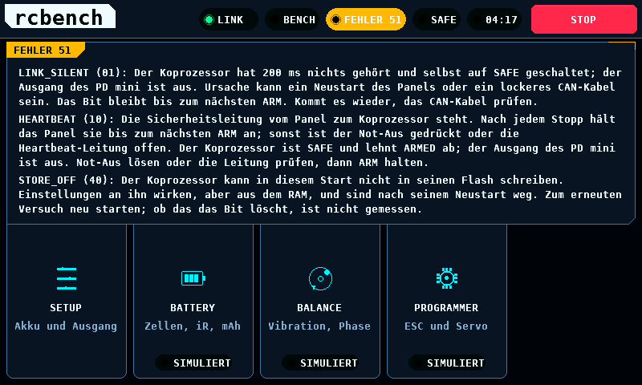

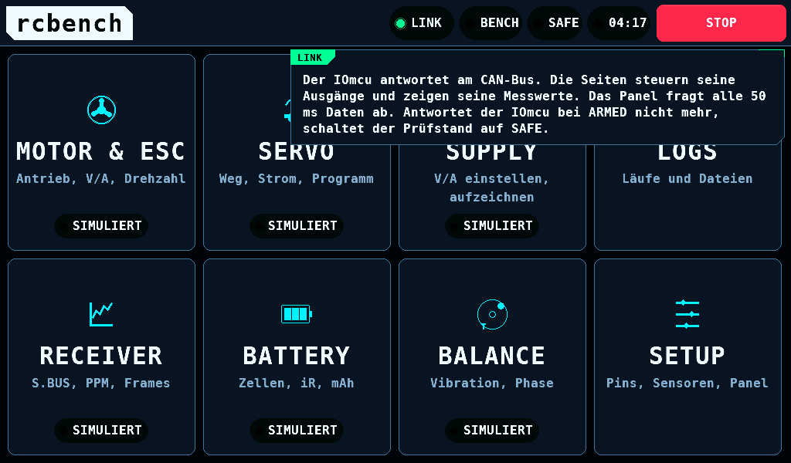

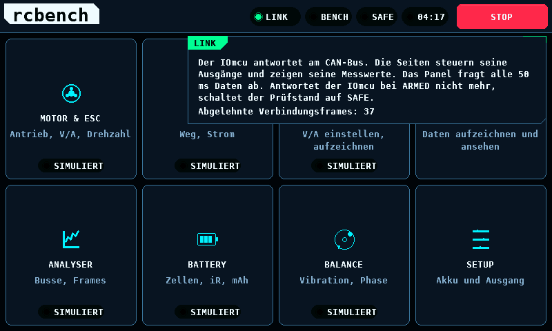

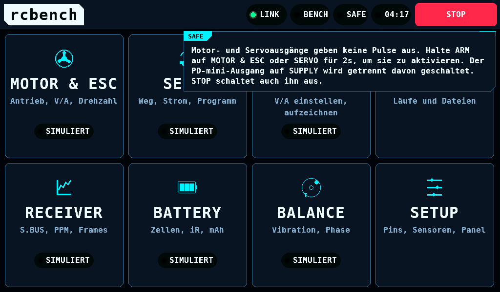

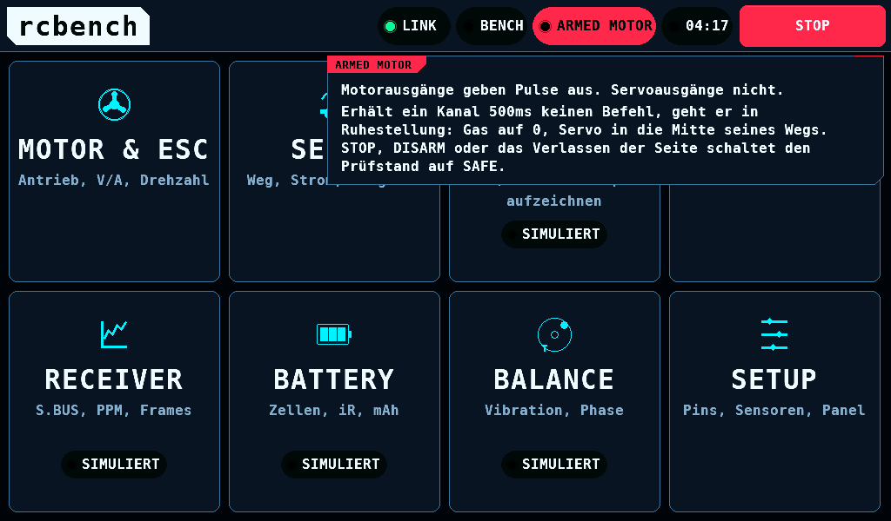

## Das Alert-Band

Eine Störung, die der Bildschirm selbst nicht zeigt, erscheint in einem roten
Band, 44px hoch, unten über jedem Bildschirm mit Statusband. Sein Text
steht in der Schrift 10 x 20px, höchstens 97 Zeichen je Zeile auf bis zu
2 Zeilen. Solange es steht, verdeckt es die unteren 44px des Bildschirms;
ARM und jedes Bedienelement, das den Prüfstand anhält, enden darüber.

- Es verschwindet 30s nach dem Frame, in dem es kam. Ein neuer Alert, auch
  mit demselben Text, startet die 30s neu.
- Ein Tippen auf das Band löscht es früher: auf dem Band drücken und
  loslassen, rechts mit einem `x` markiert. Der Bildschirm darunter bekommt
  weder dieses Tippen noch das eines zweiten Fingers auf dem Band; nur das
  Loslassen des ersten Fingers löscht.
- Ein Alert, der kommt, während ein Finger auf dem Band liegt, wird durch
  dieses Loslassen nicht gelöscht.
- Die Bedienelemente, die anhalten, was der Prüfstand treibt, enden über dem
  Band, Panel-y 556 bis 599: DISARM, AUSGANG AUS, ABBRECHEN eines
  Stick-Laufs (y 496 bis 551), ABBRECHEN bei einem Handschritt (y 444 bis
  491), TEST BEENDEN und LAUF BEENDEN. Ein Druck darauf bei angezeigtem
  Alert gehört dem Bedienelement, und der Alert bleibt. Ein solches
  Bedienelement, das ein Bildschirm unter das Band zeichnet, wirkt beim
  ersten Druck, und der Druck löscht das Band; ARM und AUSGANG EIN unter
  dem Band werden nicht gedrückt: Der Tipp löscht das Band und startet kein
  Halten.
- Ein Alert, der kommt, während ein Finger schon auf einem Bedienelement
  liegt, lässt diesen Druck dem Bedienelement: Sein Loslassen wirkt wie ohne
  Alert.
- "Touchscreen antwortet nicht. ARMED ist gesperrt." beim Start
  bleibt bis zum Neustart und hat kein `x`: es gibt keinen Touch, mit dem man tippen könnte.
  Ein späterer Alert erscheint darüber; ist er gelöscht, steht wieder dieser.

## Marken im Menü

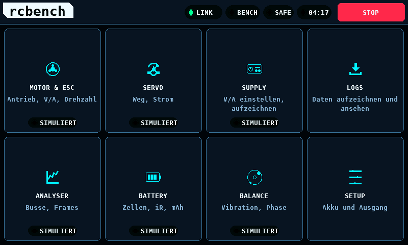

Das Menü ist ein Raster aus 4 Spalten und 2 Reihen, jede Kachel 243 x 255px
mit 10px Rand. Eine Kachel trägt ein Symbol von 40px, ihren Namen in der
Schrift 20 x 36px und eine Zeile in der Schrift 10 x 20px. Die erste Reihe hält die Werkbänke, MOTOR & ESC, SERVO und
SUPPLY; die zweite die Instrumente, RECEIVER, BATTERY und BALANCE; die
letzte Spalte LOGS über SETUP. Eine vierte Werkbank oder ein viertes
Instrument lässt den Build bei 4 Spalten scheitern
(`shared/ui/overview_screen.c`). Das Programmieren hat keine Kachel: Es ist
die Aufgabe PROGRAMMIEREN von MOTOR & ESC und von SERVO.

Jede Kachel trägt unter ihrem Namen eine Zeile, 2 Reihen zu höchstens 22
Zeichen, 8px frei von den Seiten der Kachel:

| Kachel | Zeile |
| --- | --- |
| MOTOR & ESC | Antrieb, V/A, Drehzahl |
| SERVO | Weg, Strom, Programm |
| SUPPLY | V/A einstellen, aufzeichnen |
| LOGS | Läufe und Dateien |
| RECEIVER | S.BUS, PPM, Frames |
| BATTERY | Zellen, iR, mAh |
| BALANCE | Vibration, Phase |
| SETUP | Pins, Sensoren, Panel |

Eine Kachel mit der Marke SIMULIERT öffnet einen Bildschirm, dessen Quelle
der Prüfstand nicht meldet: Der IOmcu meldet dafür keine Fähigkeit, oder
sein Sensor ist in SETUP unter INTERFACES nicht aktiviert. Ein Bildschirm ohne
seine Hardware öffnet trotzdem und arbeitet aus dem Modell. Die Marke ordnet
nicht jeden Wert auf einem Bildschirm ein. RECEIVER und BATTERY tragen die
Marke und zeigen keine Werte. SERVO ohne Marke zeigt das Versorgungsmodell des
Panels als Messung der Servoschiene, wenn weder ein PD mini noch ein INA3221
aktiviert ist. Jeder Bildschirm nennt die Quelle seiner Werte selbst.

| Kachel | Ohne Marke, wenn |
| --- | --- |
| MOTOR & ESC | der IOmcu ESCs ansteuert und eine INA228-Einstellung hält, die unter SETUP, INTERFACES eingeschaltet ist |
| SERVO | der IOmcu Servo-PWM-Ausgänge ansteuert |
| SUPPLY | der PD mini unter SETUP, INTERFACES eingeschaltet ist, unabhängig davon, was der IOmcu meldet; sonst rechnet das Panel sein eigenes Modell eines Netzteils |
| RECEIVER, BATTERY, BALANCE | in diesem Release nie: kein IOmcu meldet diese Fähigkeiten |
| LOGS, SETUP | immer: sie enthalten keine Messung |

Die Capability-Bits meldet der IOmcu beim Hochfahren. Ohne antwortenden
IOmcu tragen MOTOR & ESC und SERVO die Marke ebenfalls.

Das Menü im hellen Design:

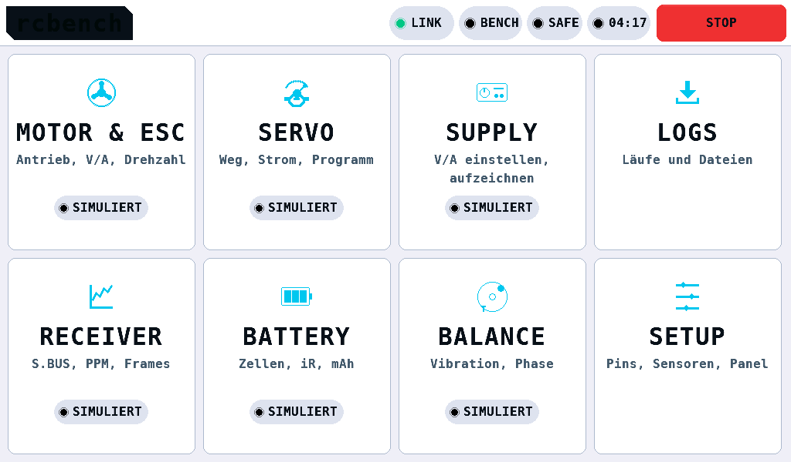

## Tastenfeld, Tastatur und die gemeinsamen Bedienelemente

Tastenfeld, Tastatur, Auswahllisten, Reiter und die ZIEL-Zeile sehen auf
jedem Bildschirm gleich aus. Jeder Bildschirm gibt ihnen ihre Fläche oder
ihre Zeile; die Fonts und Abstände darin sind ihre eigenen.

- **Tastenfeld.** Eine Titelzeile von 32px, die Eingabe von 60px, dann
  4 x 4 Tasten mit 8px Abstand, 8px vom Rand der Fläche; die Tasten enden
  spätestens 4px über dem Alarmband (unten). Auf SERVO ist eine Taste
  145 x 88px groß (21,8 x 13,2mm), auf SUPPLY 145 x 76px.
  Titel und Bereich stehen im Font 10 x 20, oder in 8 x 16, wo beide nicht
  nebeneinander passen. Die Eingabe steht in den Ziffern 32 x 44 mit der
  Einheit in 12 x 24; eine Eingabe, die nicht passt, nimmt die Ziffern
  24 x 30 mit der Einheit in 10 x 20. Ziffern und Punkt stehen im größten
  von 20 x 36, 16 x 28, 12 x 24 und 10 x 20, dessen Zelle mit 6px Rand je
  Seite auf eine Zifferntaste passt, sonst in 8 x 16; 20 x 36 braucht
  eine Taste von 32 x 48px und ist der Font jedes Tastenfelds, das das
  Panel öffnet. DEL, CLR, ABBRECHEN, OK und `+/-` teilen einen Font: den
  größten derselben Fonts, nie größer als der der Ziffern, in dem alle
  mit 6px Rand je Seite auf ihre Taste passen. Das englische Wort für
  ABBRECHEN braucht für 20 x 36 eine Taste von 132px. `ABBRECHEN` braucht für 20 x 36 192px,
  für 16 x 28 156px, für 12 x 24 120px und für 10 x 20 102px; die
  deutschen Tastenfelder von SERVO, SUPPLY und den SETTINGS von
  MOTOR & ESC zeigen ihre Wörter darum in 12 x 24.
- **Tastatur.** Eine Titelzeile von 32px, das Textfeld von 52px, dann 5
  Tastenreihen mit 6px Abstand. Titel und Zähler stehen in 10 x 20, oder
  in 8 x 16, wo beide nicht nebeneinander passen. Der Text steht im Font
  20 x 36, wenn 23 Zeichen und die Schreibmarke ins Feld passen, sonst in
  16 x 28. Buchstaben, Ziffern und Zeichen stehen im größten von 20 x 36,
  16 x 28, 12 x 24 und 10 x 20, dessen Zelle mit 4px Rand je Seite auf
  eine Zeichentaste passt, sonst in 8 x 16; 20 x 36 braucht eine Taste
  von 28 x 44px und ist der Font jeder Tastatur, die das Panel öffnet.
  Die Worttasten (die untere Reihe, DEL, `ABC`, `abc`, `#+=`) teilen
  einen Font: den größten derselben Fonts, nie größer als der der
  Zeichen, in dem alle mit 4px Rand je Seite auf ihre Taste passen;
  VERBERGEN zählt dabei wie ANZEIGEN, so ändert ein Tippen den Font
  nicht. Auf WI-FI nimmt die Tastatur den Körper über dem Alarmband,
  1008 x 484px, mit Tasten von 93 x 71px (14,0 x 10,7mm) und jedem Wort
  in 20 x 36; die Wörter der Passworttastatur stehen auf Deutsch in
  16 x 28, da `LEERZEICHEN` zwei Tasten von 192px hat. Die
  Namenstastaturen von SERVO, Tasten von 55 x 72px, zeigen ihre Wörter
  in 12 x 24, die Suchtastatur von ESC STICK, Tasten von 59 x 57px, in
  16 x 28.
- **Auswahlliste.** Ein Feld oder eine Zeile ab 56px Höhe zeigt den Text
  im Font 20 x 36, 12px eingerückt, mit einem 11px breiten Winkel 28px
  vor dem rechten Rand. Ein niedrigeres zeigt ihn in 16 x 28, 10px
  eingerückt, mit einem 7px breiten Winkel 22px vor dem Rand. Ein Text,
  der in 20 x 36 nicht vor den Winkel passt, steht in 16 x 28:
  `DSHOT600 BIDIR` auf einem Feld von 292px. Jedes Feld und jede Zeile
  wählt für sich, die Zeilen einer Liste können sich also unterscheiden.
  OUTPUTS und PICK A PIN zeichnen ihre niedriger als 56px.
- **Reiter.** Eine Reiterzeile ab 32px Höhe zeigt ihre Beschriftungen im
  Font 10 x 20, wenn jede in der gezeigten Sprache mit 6px Rand je Seite
  auf ihren Reiter passt; sonst in 8 x 16. ROOT, USER und BENCH auf LOGS und
  die Segmente des PROG-PORT-Eintrags auf OUTPUTS stehen in 10 x 20. Die
  Streifen von SERVO und MOTOR & ESC sind 40px hoch und zeigen 10 x 20;
  der von SUPPLY ist 24px hoch und bleibt bei 8 x 16. Die Reiter von
  RECEIVER und BALANCE sind 150 x 48px groß und zeigen 10 x 20.
- **ZIEL-Zeile.** Eine Zeile ab 40px Höhe zeigt Beschriftung und Wert in
  10 x 20, mit 88px für die Beschriftung, und zählt die genannten Pins in
  Zellen von 10px. Eine niedrigere zeigt sie in 8 x 16 mit 64px für die
  Beschriftung und zählt in Zellen von 8px. SERVO und MOTOR & ESC zeichnen
  ihre 48px hoch.
- **Plot.** Ein Plot hält 1.024 Werte je Reihe, einen je Pixelspalte eines
  Plots so breit wie das Panel: 51,2s bei 20 Werten je Sekunde.

Tastenraster enden auf jedem Bildschirm 4px über dem Alarmband, bei
Körper-y 492. Ein Tastenfeld oder eine Tastatur, deren Fläche weiter reicht,
malt die ganze Fläche und lässt ihre Tasten dort enden, so verdeckt ein
Alert keine Taste. Auf SERVO sind die Tasten der Tastenfelder dann
145 x 88px groß und die der Tastaturen 55 x 72px; auf SUPPLY die des
Tastenfelds 145 x 76px; auf der Suchtastatur von ESC STICK 59 x 57px; auf
SETTINGS von MOTOR & ESC die des Tastenfelds 145 x 89px; auf BALANCE die
des Tastenfelds der Blattzahl 242 x 72px.

## Splash

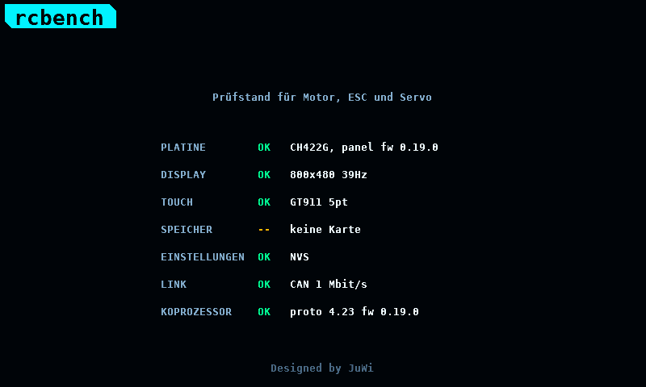

Der Splash füllt das Panel, ohne Band. Die Marke `rcbench` steht in der
Schrift 20 x 36px in doppelter Größe auf einem Akzent-Tag von 88px Höhe,
oben mittig. Die Unterzeile steht darunter in der Schrift 12 x 24px. Jeder
Schritt hat ab y 200 eine Zeile von 40px: seinen Namen, sein Zeichen
(`OK`, `--`, `!!`, `..` solange er läuft) und sein Detail, alles in der
Schrift 12 x 24px. Ein Detail beginnt bei x 432 und endet 24px vor dem
rechten Rand, nach 47 Zeichen.

Jedes Subsystem meldet beim Hochfahren sein Ergebnis: Platine, Display,
Touch, SD-Karte, Einstellungen, Link, IOmcu. Die Zeile der Platine
trägt die Firmware-Version des Panels selbst, die Zeile des IOmcu die
Protokollversion und die Firmware-Version, die dieser IOmcu gemeldet
hat — zwei Platinen können dasselbe Protokoll sprechen und verschiedene
Builds sein, und hier zeigt sich das. Eine fehlende Karte ist
eine Warnung. Die Zeile SD-Karte zeigt `keine Karte`, `nicht FAT32/exFAT` (FAT:
File Allocation Table) oder `nicht lesbar` ([Das Format der SD-Karte](#das-format-der-sd-karte)). Ein Touch-Controller, der nicht antwortet, oder ein IOmcu
mit einer anderen Major-Version des Protokolls ist ein Fehler, und der
Prüfstand schaltet nicht auf ARMED. Wenn alle Schritte geantwortet haben,
übergibt der Splash nach 1,6s an das Menü; ein Tippen überspringt das Warten.

## Motor & ESC

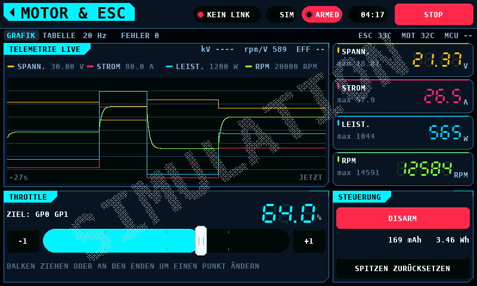

MOTOR & ESC ist eine Werkbank: oben eine Leiste mit Aufgaben, LIVE,
PROGRAMMIEREN und OPTIONEN, je 150 x 40px ab Körper-y 8, und darunter ab
y 56 eine Seite. Die
Kachel im Menü öffnet immer LIVE. Ein Tipp auf einen Reiter wechselt die
Aufgabe; ein Wechsel ist keine Navigationsebene und lässt die Ansicht von
LIVE, GRAFIK oder TABELLE, wie sie war.

| Aufgabe | Die linke Spalte, 620px |
| --- | --- |
| LIVE | der Plot oder die Tabelle über dem Gas |
| PROGRAMMIEREN | die Liste der ESC-Programmierer; eine Zeile öffnet ihre Sitzung über den ganzen Körper ([Programmieren](#programmieren)) |
| OPTIONEN | die 8 ESC-Einstellungen unter AKKU, MOTOR und GASAUSGANG ([Optionen](#motor--esc-optionen)) |

Zwei Spalten, wie auf SERVO. Die Seite nimmt die linken 620px, die rechte
Leiste 380px, damit das Ablesen der Werte und das Bedienen des Gases nicht
um denselben Teil des Bildschirms konkurrieren. Die Leiste hält von oben
nach unten die drei Temperaturen, die vier Anzeigen, je 56px mit Ziffern
in 32 x 44, und die Karte STEUERUNG: ihre Titelzeile mit mAh und Wh des
Laufs, die Zeile ZIEL (48px), SPITZENWERTE ZURÜCKSETZEN (48px) und ARM
(60px). Die Zeile ZIEL und ARM liegen dort, wo die Ausgangskarte von SERVO
ihre Zeile ZIEL und ARM hat: ARM von Körper-y 424 bis 484, 8px über dem
Alarmband. Die rechte Leiste ist auf LIVE, der Liste von PROGRAMMIEREN
und OPTIONEN dieselbe, und ARM wirkt auf allen dreien; eine Sitzung aus
PROGRAMMIEREN deckt sie ab. Bei eingeschaltetem Drehknopf bewegt dessen
Drehung auf LIVE das Gas ([der Knopf](#panel-der-drehknopf)); auf
PROGRAMMIEREN und OPTIONEN bewegt eine Drehung nichts.

Das Home-Tag steigt eine Ebene nach der anderen:

| Von | Das Home-Tag führt zu |
| --- | --- |
| dem Tastenfeld auf OPTIONEN | OPTIONEN; der Wert bleibt unverändert |
| einer Sitzung auf PROGRAMMIEREN | eine Ebene höher in der Sitzung; von ihrer obersten Ebene zur Liste von PROGRAMMIEREN ([Programmieren](#programmieren)) |
| LIVE, der Liste von PROGRAMMIEREN oder OPTIONEN | dem Menü; der Prüfstand schaltet auf SAFE |

### ZIEL nennt das Protokoll und die Pins

Die Karte STEUERUNG beginnt mit der Zeile ZIEL: der Beschriftung, 88px, und
einem Wertefeld von 25 Zeichen, das nennt, was das Gas treibt, das Protokoll
und dann die Pins, `DSHOT300 GPIO 0 GPIO 1`. Es sind die Pins, die als MOTOR PWM
oder als DShot-Protokoll gebunden sind, gelesen aus denselben Pages unter
SETUP > OUTPUTS, die auch die Gas-Rolle des IOmcu liest. Die Pins stehen in
Pin-Reihenfolge; die nicht passen, werden gezählt. Sind GPIO 0 bis GPIO 7 als
DSHOT300 gebunden, steht dort `DSHOT300 GPIO 0 GPIO 1 +6`.

Ein Programmierport, dessen
FUNKTION DSHOT150, DSHOT300 oder DSHOT600 ist und dessen Pin der IOmcu hält,
folgt den Pins als `PORT n` und zählt mit ihnen. Ein Port allein wird
vollständig genannt, wo das passt, `DSHOT300 PROG-PORT 2 GPIO 14` (28 Zeichen),
als `DSHOT300 PORT 2 GPIO 14` (23 Zeichen) in den 25 der Karte STEUERUNG und
als `DSHOT300 PORT 2` in einem kürzeren Feld.

| ZIEL lautet | Bedingung |
| --- | --- |
| `DSHOT300 GPIO 0 GPIO 1` | ein Protokoll treibt jeden Gas-Pin |
| `GEMISCHT GPIO 0 GPIO 4` | die Gas-Pins laufen mit zwei oder mehr Protokollen, oder einer davon mit einer Rate, die kein Protokoll von OUTPUTS hat |
| `GPIO 0 GPIO 1` | jeder Gas-Pin läuft mit einer Rate, die kein Protokoll von OUTPUTS hat |
| `KEIN MOTOR-PIN` | die Bindung ist gelesen und weder ein Pin noch ein Programmierport ist als Motor gebunden; Warnfarbe |
| `PINS NICHT GELESEN` | keine Bindung wurde gelesen: der Link ist unten, die Pages ließen sich nicht lesen, oder für das Board gibt es keine Pin-Belegung; Warnfarbe |

Mit DShot-Programmierports:

| ZIEL lautet | Bedingung |
| --- | --- |
| `DSHOT300 PORT 2 GPIO 14` | ein DSHOT300-Programmierport an GPIO 14 treibt das Gas, und kein Pin ist als Motor gebunden |
| `DSHOT300 GPIO 0 PORT 2` | GPIO 0 als DSHOT300 gebunden und ein DSHOT300-Port |
| `GEMISCHT GPIO 0 PORT 2` | die Pins und die Ports laufen mit verschiedenen Raten, oder die Pins mit einer Rate, die kein Protokoll des Katalogs hat |

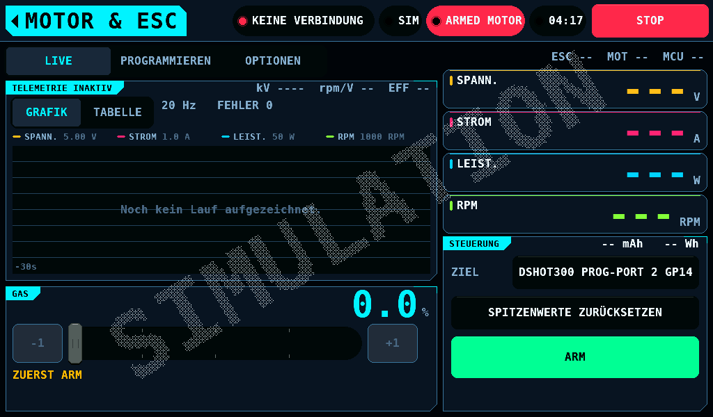

Das Gas bewegt sich in den beiden Warnzuständen weiter. ARM schaltet die
ganze Bank auf ARMED, nicht nur die hier genannten Pins.

Ein Tipp auf ZIEL öffnet [OUTPUTS](#outputs) auf dem Protokoll, an das die
Gas-Pins gebunden sind, auf dem Eintrag PROG-PORT eines DShot-Ports, der
das Gas allein treibt, auf der Übersicht, solange sie an mehrere gebunden
sind oder keines bekannt ist. Das Verlassen schaltet den
Prüfstand auf SAFE, wie jeder Weg vom Bildschirm. Das Home-Tag auf OUTPUTS
führt zurück zu MOTOR & ESC, auf die Aufgabe, auf der ZIEL getippt wurde; ein
anderer Bildschirm dazwischen macht den nächsten Eintritt zu dem einer
Kachel, auf LIVE. ZIEL nimmt keinen Tipp an und ist mit dem gesperrten Rand
gezeichnet, solange eine dieser Bedingungen gilt:

| Bedingung | Grund |
| --- | --- |
| ARMED, ein ARM gefragt und nicht beantwortet, oder ein DISARM gefragt und nicht beantwortet | eine Bindung ändert die Pins, die der Prüfstand treibt |
| ARM gehalten | der Druck gehört ARM |
| der [Servo-Programmierer](ServoProgrammer-de.md) hält einen Port | ARM ist aus demselben Grund gesperrt |
### Der Plot zeigt einen Lauf

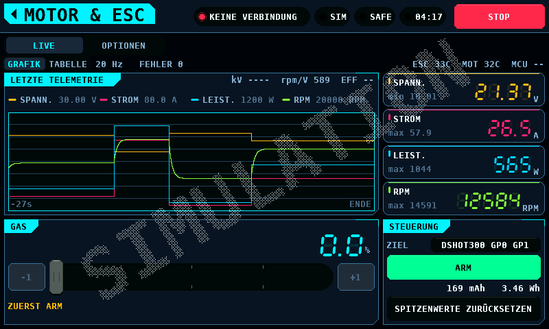

Die Kurve ist die Aufzeichnung eines Laufs. Sie läuft nur, solange der
Prüfstand ARMED ist: das Schalten auf ARMED löscht sie, das Schalten auf SAFE hält sie
so an, wie sie stand. Die Beschriftung der Fläche liest `TELEMETRIE LIVE`,
solange sie läuft, `TELEMETRIE, LETZTE TELEMETRIE`, solange sie einen Lauf hält, und
`TELEMETRIE INAKTIV` vor dem ersten Schalten auf ARMED, wenn im Plot
`Noch kein Lauf aufgezeichnet.` steht. Die rechte Achsenbeschriftung liest `JETZT`, solange
sie läuft, und `ENDE` dort, wo eine gehaltene stehen geblieben ist. Die
Anzeigen, die TABELLE-Seite, die Summen und die Temperaturleiste sind
jederzeit live, ob ARMED oder SAFE.

Der Plot ist 600 x 184px. Das Fenster ist 600 Spalten breit bei 20
Abtastungen je Sekunde, also 30,0s. Ein längerer Lauf hält seine letzten
30,0s; was davor liegt, steht in der CSV-Datei und nicht auf dem
Bildschirm.

Die Kurve endet beim Schalten auf SAFE, nicht wenn der Motor steht. Das Schalten auf SAFE
kommandiert null Gas, und die Luftschraube läuft danach aus. Dieses Auslaufen
steht auf den Anzeigen und nicht im Plot, und auch nicht in der CSV-Datei, die
an derselben Flanke schliesst.

Das Schalten auf ARMED löscht den Plot, und ein eingerasteter Stopp wird durch
Schalten auf ARMED gelöst -- die Kurve eines Laufs, den ein STOP beendet hat,
überlebt es also nicht, den Prüfstand wieder benutzbar zu machen. Ein
Schalten auf ARMED schreibt eine CSV-Datei, und LOGS stellt sie dar.


Auf LIVE trägt die Telemetriekarte unter ihrem Titel GRAFIK und TABELLE,
zwei Reiter in 200 x 40px, und daneben die Abfragerate und die Fehlerzahl
des Links (CRC-Fehler und Resyncs zusammengezählt; CRC: Cyclic Redundancy
Check). Solange der Link steht und der IOmcu seit dem Einschalten
Link-Frames abgelehnt hat, zeigt die Zeile darunter in 8 x 16, wie viele:
`Abgelehnte Verbindungsframes: 37`. Ein IOmcu älter als Protokoll 4.21
sendet keine Zahl, und die Zeile zeigt keine
([Abgelehnte Frames](Link-de.md#abgelehnte-frames)). Die drei Temperaturen
stehen auf jeder Aufgabe in der Zeile über der rechten Leiste. ESC und MOT
kommen von der Bench-Page. MCU ist der eigene Die des Panels, gelesen vom
Sensor des ESP32-P4: die Temperatur der Displayplatine, nicht die des
IOmcu.

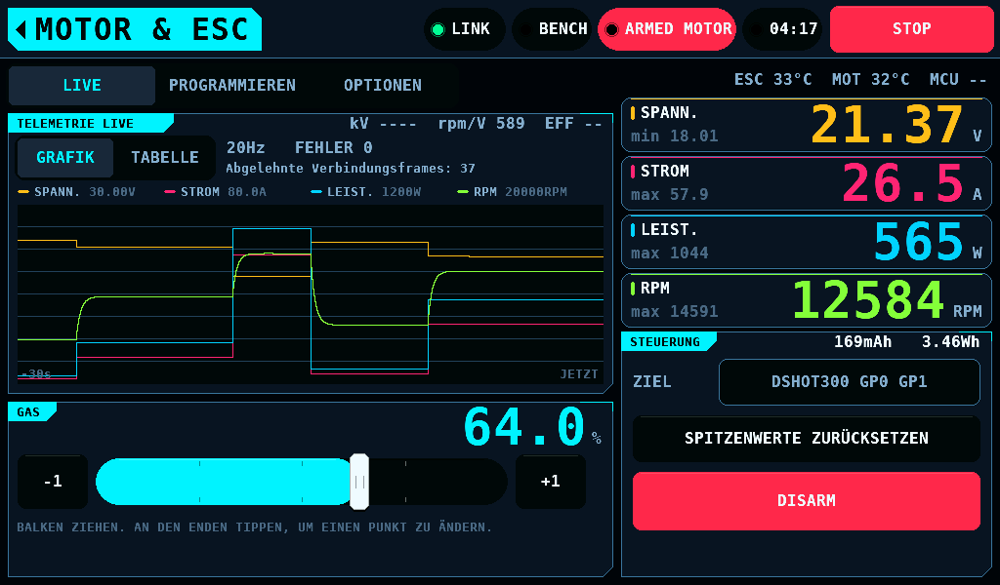

Das Gas bewegt sich um die Strecke, die ein Finger zurücklegt, nicht auf die
Stelle, an der er landet. Ein Druck auf den Track kommandiert nichts, eine
Berührung am Ende fordert also nichts an; ein Drag über den ganzen Track
fordert den ganzen Weg an, und der Pin folgt ihm ohne Rampe. `-1` und `+1` an
den Enden des Tracks schalten um einen Prozentpunkt.

Das Gas ändert sich nur auf einem Prüfstand in ARMED. Was jedes
Bedienelement tut:

| Bedienelement | SAFE | ARMED |
| --- | --- | --- |
| Der Track | abgelehnt: kein Kommando, Schieberegler und Anzeige bleiben; gedimmt gezeichnet | bewegt das Gas um den Weg des Fingers |
| `-1`, `+1` | abgelehnt; gedimmt gezeichnet | schalten um einen Prozentpunkt |
| Drehknopf | abgelehnt; die Drehung wird nicht aufgehoben | bewegt das Gas von seinem Wert aus |
| ARM | schaltet nach seinem Halten von 2s die Throttle-Ausgänge auf ARMED; gesperrt gezeichnet und ohne Wirkung, solange der [Servo-Programmierer](ServoProgrammer-de.md) einen Port hält | schaltet bei einem Tap auf SAFE |
| SPITZENWERTE ZURÜCKSETZEN | setzt die Spitzen zurück | setzt die Spitzen zurück |
| GRAFIK, TABELLE | wechseln die Ansicht von LIVE | wechseln die Ansicht von LIVE |

In SAFE zeigt die Zeile unter dem Track `ZUERST ARM`. Die Ablehnung reicht
vom Schalten auf SAFE, bis der Prüfstand ARMED meldet: Auch ein
Bedienelement, das nach dem durchgelaufenen Halten auf ARM und vor dieser
Meldung berührt wird, wird abgelehnt. Von einem DISARM an, das der
Bildschirm anfordert, durch den Tap oder durch das Verlassen, oder einem
STOP auf einem Prüfstand in ARMED, bis der Prüfstand SAFE meldet,
werden die Bedienelemente ebenfalls abgelehnt.

Ein Schalten auf SAFE setzt das Gas auf 0%, gleich wie es geschieht: der Tap auf
DISARM, STOP, eine verlorene Verbindung, ein Touch-Controller, der nicht
mehr antwortet, oder das Verlassen des Bildschirms. Schieberegler, Anzeige
und die Schritte `-1` und `+1` bleiben dann bis zum nächsten Schalten auf ARMED
auf 0,0%; das erste `+1` nach einem Schalten auf ARMED fordert also 1,0% an,
und die erste Knopfdrehung von 1% fordert 1,0% an. Auch ein Prüfstand, der
ohne das Halten auf ARM auf ARMED schaltet, durch einen Knüppel-Lauf auf
PROGRAMMIEREN, beginnt bei 0%. Ein Gas, das der Bildschirm gepostet und das
Panel noch nicht gesendet hat, wenn der Prüfstand auf SAFE schaltet, wird nicht
gesendet. Ein Finger, der auf dem Track liegt, wenn der Prüfstand auf ARMED
oder SAFE schaltet, bewegt nichts, bis er abhebt und neu drückt.

ARM wird gehalten. Die Füllung blendet über zwei Sekunden von Grün ins
Gefahrenrot, und der Prüfstand schaltet auf ARMED, wenn die Blende
durchgelaufen ist; früher loszulassen schaltet nichts auf ARMED, und das
Loslassen selbst ebenfalls nicht.

Der Finger muss auf dem Button bleiben. Verlässt er ihn, ist das Halten
abgebrochen — die Geste ist der Kontakt mit dem Bedienelement und nicht mit
dem Panel. Zurückrutschen setzt es nicht fort: der Kontakt ist für ARM
beendet, und Schalten auf ARMED verlangt danach, den Finger abzuheben und neu zu
drücken. Wird der Prüfstand unter einem noch gehaltenen Finger auf SAFE geschaltet,
endet die Geste ebenfalls — sonst würde genau der Kontakt, mit dem angehalten
wurde, zwei Sekunden später wieder auf ARMED schalten. Das Schalten auf ARMED lässt den ganzen Button
zweimal aufblitzen: weiss, schwarz, rot, und noch einmal, je ein gezeichneter
Frame. Ein Prüfstand in ARMED trägt das Gefahrenrot, und DISARM ist ein Druck
und kein Halten: Anhalten braucht nie ein Halten, und DISARM wirkt beim
Aufsetzen, nicht beim Abheben. DISARM und STOP halten den
Ausgang sofort an, ohne Rampe. SPITZENWERTE ZURÜCKSETZEN löscht die Spitzenwertmarken und
lässt die Live-Anzeigen unverändert.

### EFF ist eine Guessimetrik

Der Header des Telemetrie-Panels zeigt die Nenn-kV, die Umdrehungen je Minute
und Volt, die der Motor tatsächlich dreht, und EFF: das Zweite geteilt durch
das Erste.

Die Rechnung dahinter ist tragfähig. Die Klemmenspannung teilt sich in den
ohmschen Abfall und die Gegen-EMK (elektromotorische Kraft) auf, weshalb rpm/V
unter Last die Nenn-kV skaliert mit dem Anteil der Spannung ist, der die
Gegen-EMK erreicht, und dieser Anteil ist der Anteil der Eingangsleistung, der
mechanisch wird. Im idealen Motor ist das Verhältnis exakt der
Umsetzungswirkungsgrad.

Die Zahl auf dem Bildschirm ist das nicht, aus drei Gründen, und sie heisst
deshalb EFF und nicht Wirkungsgrad:

- Sie erfasst nur die Kupferverluste (I hoch 2 mal R). Eisenverluste, Reibung
  und Luftwiderstand fallen auf die mechanische Seite der Aufteilung, also ist
  die Zahl eine obere Schranke des Wellenwirkungsgrads und nicht sein Wert.
- Der Prüfstand misst die Pack-Spannung, nicht die Klemmen des Motors, also
  stecken die Durchlass- und Schaltverluste des ESC in der Zahl. Sie
  beschreibt den Antriebsstrang; ein Vergleich mit einem Motordatenblatt
  vergleicht zwei verschiedene Dinge.
- Sie ist nur so gut wie die Nenn-kV. Ein Fehler dort geht direkt in den
  Prozentwert, und ein Wert über 100% bedeutet, dass die Nennangabe falsch
  ist; der Bildschirm zeigt das, statt es zu verbergen, gedeckelt bei 199%.

Die Nenn-kV kommt vom angeschlossenen ESC, sobald einer sie meldet. Noch
meldet sie keiner, also ist es in der Praxis die Einstellung `Nenn-kV`, deren
Standardwert null ist: eine geratene kV ergibt einen plausibel aussehenden,
aber falschen Prozentwert, und ohne Wert bleibt das Feld leer und es wird kein
Prozentwert gezeigt. Die gemessene rpm/V wird in jedem Fall gezeigt, weil sie
eine Messung und keine Herleitung ist.

Solange die Werte simuliert sind, steht SIMULATION quer über dem Bildschirm.
Das Panel simuliert nur, solange kein IOmcu antwortet; das Watermark
verschwindet also, sobald einer antwortet. An seine Stelle tritt, was dieser
IOmcu tatsächlich messen kann: heute rpm über Bidirectional DShot, und
seine eigenen Sensoren, sobald ein Messfrontend bestückt ist. Eine Größe, die
nichts misst, wird als leeres Feld gezeichnet und nicht als modellierter
Wert.

### TABELLE, und was der ESC meldet

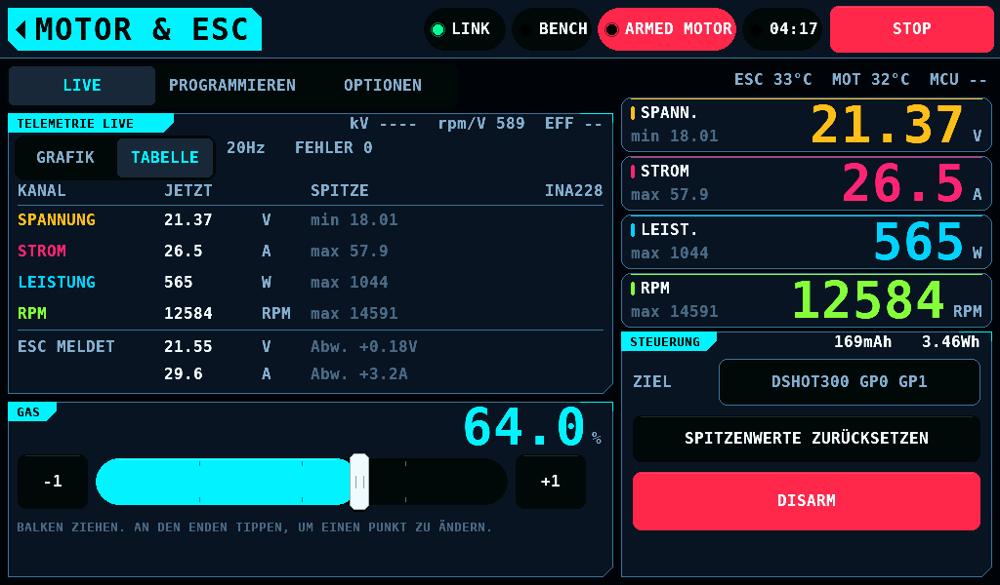

TABELLE listet die vier Kanäle, jeden mit seinem Extremwert. Ein Kanal, für
den nichts geantwortet hat, liest `--`.

Ist der INA228 unter SETUP, INTERFACES eingeschaltet und antwortet er
(BENCH-Flag Bit 5), sind Spannung, Strom und Leistung die des INA228: die
Mittelwerte des letzten 50-ms-Fensters des IOmcu, gelesen mit 20Hz,
mit den Spitzen des Laufs aus seinen 500-Hz-Abtastungen. Die Kopfzeile nennt
die Quelle, `INA228`, und fügt `ÜBERSTEUERT` an, solange ein Strom im letzten
Fenster oder seit dem Schalten auf ARMED das Ende des Messbereichs des Bauteils
erreicht hat: Strom und Leistung, oder ihre Spitzen, sind dann Grenzen und
keine Werte. Unter den Kanälen listet `ESC MELDET` die eigene
Telemetriespannung und den eigenen Telemetriestrom des ESC von der SENSE-Page,
und `Abw.` ist der Wert des ESC minus den des INA228. Ein ESC, der einen
Strom meldet, den er nicht misst, zeigt eine Abweichung so groß wie der
Messwert. Hört der INA228 während eines Laufs auf zu antworten, bleiben
Spannung, Strom und Leistung bis zum Ende dieses Laufs leer; sie fallen
nicht auf die Werte des ESC zurück. Die Spitzen, die er in diesem Lauf
gemessen hat, bleiben sichtbar, hier und in der Leiste. Ohne INA228 sind die
Kanäle die Telemetrie des ESC, und `ESC MELDET` wird nicht gezeigt.

Die mAh und Wh in der Titelzeile der Karte STEUERUNG sind die eigenen des
INA228, solange BENCH-Flag
Bit 6 gesetzt ist: seine Ladung und Energie seit dem Schalten auf ARMED, im
Bauteil bei jeder Wandlung aufsummiert und in Schritten von 0,01mAh und
0,01Wh gelesen. Der IOmcu nimmt die Summen des letzten Laufs und
Bit 6 beim Schalten auf ARMED von der Bench-Page, und das Panel zählt die ersten
100ms eines Laufs zusätzlich selbst, sodass eine vor dem Schalten auf ARMED
gebaute Page die Summen des letzten Laufs nicht in diesen trägt. Ohne Bit 6 zählt das Panel beide aus dem gezeigten Strom
und der gezeigten Leistung. Hört der INA228 mitten im Lauf auf zu antworten,
zählt das Panel von seiner letzten Summe weiter, und die Summe geht nicht
zurück.

Die CSV-Datei eines Laufs hat für jeden Messwert, den das Panel nimmt, eine
Zeile, und ohne Messwert keine:

- Bei stehendem Link ist ein Messwert ein beantwortetes Lesen der
  BENCH-Page. Das Panel fragt alle 50ms ab, dazu kommen der 5-ms-Durchlauf
  seiner Control-Task, der das Gate prüft, und die Exchanges des Durchlaufs:
  im Mittel 52,9ms auf einem Prüfstand, etwa 19 Zeilen je Sekunde. Andere
  Prüfstände sind nicht gemessen.
- Ohne Link ist ein Messwert ein Schritt des Modells, alle 50ms.
- Ein Messwert ist eine Zeile. Wird der INA3221 über den Fenster-Ring
  gelesen (IOmcu-Protokoll 4.11, CH1 eingeschaltet), schreibt ein
  Poll, der mehr als ein 50-ms-Fenster bringt, für jedes eine Zeile: die
  Zeilen eines Polls tragen dieselbe `time`, der Messwert steht in der
  letzten davon mit dem neuesten Fenster, und die Zeilen davor halten
  `window` und die Kanalspalten und sind sonst leer. Bei einem Poll von
  53ms schreibt einer von 17 Polls zwei Zeilen.
- Sonst hält nichts eine Zeile zurück. Eine Zeile, die die Queue zur Karte
  nicht aufnimmt, wird verworfen und gezählt, und das Band meldet es am Ende
  des Laufs (siehe [Logs](#logs)).

`time` ist die Uhrzeit seit dem ARM in Sekunden, auf 1ms geschrieben, und
kein Zeilenzähler: Die erste Zeile steht nicht bei 0, und eine Strecke ohne
Messwerte oder mit verworfenen Zeilen ist ein Sprung in `time` von ihrer
Länge. Der Wert löst in den ersten 4,5h eines Laufs auf 1ms auf, bis 9,1h
auf 2ms.

Eine Datei von Firmware 0.15.0 oder älter weicht in zwei Punkten ab. Nach
einem Servobefehl fehlen Zeilen über Strecken von bis zu 30s, und
`time` läuft nur mit einer geschriebenen Zeile weiter, endet also vor der
Länge des Laufs und zeigt keine Lücke. In einer solchen Datei geben die
`window`-Nummern im Abstand von 50ms den Abstand der Zeilen an, solange der
INA3221 eingeschaltet ist.


```
time (s);voltage (V);current (A);power (W);rpm (rpm);esc (C);motor (C);charge (mAh);energy (Wh);ina voltage (V);ina current (A);esc current (A);window;ch1 current (A);ch1 max (A);ch1 voltage (V);ch2 current (A);ch2 max (A);ch2 voltage (V);ch3 current (A);ch3 max (A);ch3 voltage (V);source
```

In einer MOTOR-Datei sind `voltage`, `current` und `power`, was MOTOR & ESC
zeigt. Eine SERVO-Datei, nach einem ARM auf SERVO, hat zwei Spalten mehr vor
`source`:

```
...;ch3 voltage (V);pulse (us);angle (deg);source
```

- `voltage`, `current`, `power`, `charge` und `energy` sind die des
  Messgeräts der Servoschiene ([das Messgerät](#servo)):
  - solange ein INA3221-Kanal das Messgerät ist, sein neuestes
    50ms-Fenster zum Messwert: die mittlere Busspannung, der mittlere Strom
    und ihr Produkt;
  - sonst der letzte Messwert des PD mini zum Messwert.
  - Spannung und Leistung stehen auf 0,01, Strom auf 0,001.
  - Ladung und Energie zählt das Panel aus diesen Messwerten seit dem ARM,
    auf 1mAh und 0,01Wh.
- `pulse` ist der Puls, den COMMANDED zeigt, in ganzen us. Leer, solange
  eine Programmiersitzung den Port hält.
- `angle` ist der Winkel des AS5600, den MEASURED zeigt, auf 0,1deg. Leer,
  solange AS5600 in SETUP aus ist, der Sensor keinen gültigen Messwert
  liefert oder der Link fehlt.
- Eine Zelle ist leer, solange ihr Messgerät diesen Wert nicht geliefert
  hat.
- Eine Zeile nimmt einen Wert nur aus einer Quelle, die ihre `source` ist:
  - alle fünf Zellen des Messgeräts sind leer in einer `measured`-Zeile,
    solange das Netzteil das Modell des Panels ist (PD mini in SETUP
    INTERFACES ausgeschaltet);
  - sie sind leer in einer `model`-Zeile, solange nach dem Verlust des Links
    noch der letzte Messwert des PD mini gezeigt wird;
  - eine `model`-Zeile hat keinen Wert des INA3221 und kein `angle`, die über
    den IOmcu gelesen werden. `pulse` ist der eigene Befehl des Panels und
    steht in Zeilen beider Quellen.
- Die Werte des Messgeräts, `pulse` und `angle` stehen in der letzten Zeile
  eines Messwerts. Die Zeilen davor in einem Poll halten nur das Fenster und
  die Kanalspalten.
- Die übrigen Spalten einer SERVO-Datei sind die einer MOTOR-Datei.

`source`
ist `measured` in einer Zeile, deren Werte ein Messgerät geliefert hat, und
`model` in einer Zeile, die das Modell des Panels geliefert hat (die Marke
SIMULIERT); eine Netzteil-Datei hat dieselbe letzte Spalte. Eine Datei ohne
die Spalte endet bei `ch3 voltage` oder `energy`; LOGS und die
Werkzeuge lesen beide Formen, denn `source` ist eine Textspalte und
wird nie gezeichnet.
`ina voltage` und `ina current` sind die des INA228 und leer, solange er
nicht die Quelle ist; `esc current` ist der eigene Telemetriestrom des ESC,
von der SENSE-Page, solange der INA228 die Quelle ist, sonst von der
BENCH-Page, und leer, wenn der ESC keinen meldet oder das Panel den
Prüfstand simuliert. Eine Größe, die nichts gemessen hat, ist eine leere
Zelle. `window` und die neun Kanalspalten sind das 50-ms-Fenster des
INA3221 -- je Kanal der mittlere und der höchste Strom und die niedrigste
Busspannung -- in der ersten Zeile, nachdem das Panel es gelesen hat, und in
keiner anderen, sodass jedes Fenster einmal in der Datei steht, unter seiner
Nummer; ein Kanal ohne Messwerte im Fenster ist leer, ebenso die
Stromzellen oder die Spannungszelle von CH1 für ein Fenster, das von dieser
Größe keine Messung hält. Mit einem IOmcu
mit Protokoll 4.11 und eingeschaltetem CH1 steht jedes Fenster von CH1 in
der Datei, solange zwei Lesezugriffe höchstens 200ms auseinanderliegen,
und ein Schritt in `window` von mehr als 1 ist ein verlorenes Fenster oder
eine Nummer, die der IOmcu übersprungen hat. Ein Fenster, das in
SAFE genommen wurde, steht in keiner Datei. Die Werte
von CH1 zählen eine übersteuerte Messung am Ende des Bereichs, 1,638A am
0,1-Ω-Shunt, und behalten das Vorzeichen eines negativen Stroms. CH2 und
CH3 stehen in der Zeile ihres Fensters, wenn das Panel beide Pages
innerhalb dieses Fensters gelesen hat, und sind leer in einer Zeile, die
der Poll nachgeholt hat. Mit einem älteren IOmcu oder ohne CH1 halten
die Spalten das letzte Fenster jedes Lesens: ein Poll, der länger als 50ms
dauert, überspringt Fenster, 1 von 17 bei 53ms, und eine übersteuerte
Messung bleibt aus den Werten heraus. LOGS
gruppiert `ina voltage`, `ina current` und `esc current` unter INA228 und
ESC und die Spalten des Fensters unter INA3221.

Mit einem IOmcu mit Protokoll 4.25, dessen Sensor-Map das Panel gelesen
hat, folgen die Kanalspalten dieser Map, wie sie beim Öffnen der Datei
steht: eine Gruppe aus drei Spalten je Kanal, der ein Ziel überwacht, nach
dem Ziel benannt:

```
window;port 1 current (A);port 1 max (A);port 1 voltage (V);out 3 current (A);out 3 max (A);out 3 voltage (V);supply current (A);supply max (A);supply voltage (V);source
```

- Ein Kanal bekommt eine Gruppe, solange sein Baustein bestückt ist, sein
  Shunt nicht 0 ist und er einen Ausgang, einen Programmier-Port oder die
  Versorgung überwacht ([SENSORS](#sensors-die-ina3221-bausteine)).
- Der Kanal, der das Ziel des Servotesters überwacht, steht vorn, danach
  die anderen von 0x40 CH1 bis 0x43 CH3.
- Zwei Kanäle an einem Ziel tragen den Kanal im Namen:
  `out 3 0x41 ch2 current (A)`.
- Höchstens 3 Gruppen, 23 Spalten in einer MOTOR-Datei und 25 in einer
  SERVO-Datei: der vierte überwachende Kanal und alle weiteren stehen in
  keiner Datei. LOGS liest höchstens 25 Spalten.
- Eine Datei mit weniger Gruppen endet früher mit `source`: 13 + 3 x
  Gruppen + 1 Spalten, in einer SERVO-Datei 2 mehr. Überwacht kein Kanal etwas, hat die Datei keine
  Kanalspalte.

Die Gruppe des Kanals, der das Ziel des Servotesters überwacht, stammt aus
dem Fenster-Ring, SERVO_WIN, und steht in jeder Zeile mit `window`. Die
anderen Gruppen stammen aus SENSE_WIN_A und SENSE_WIN_B
([Link](LinkSensors-de.md#sense_win_a-und-sense_win_b)), die nur das letzte
Fenster jedes Kanals halten. Das Panel liest sie in jedem Poll nach
SERVO_WIN, mit einer Sperre von 40ms, solange ein Baustein der Page
bestückt ist. Eine solche Gruppe steht in der Zeile ihres Fensters, wenn das
letzte Lesen ihrer Page oder das davor diese Fensternummer hält, und ist
sonst leer. Ein Fenster, das zwischen zwei Lesezugriffen schloss und auf
das schon das nächste folgte, steht in keiner Zeile: bei einem Poll von
53ms etwa 1 Zeile von 17 (`test_sense_win_link`). Die Map gilt, sobald der
IOmcu sie in Kraft hält; mit der aus SENSE abgeleiteten Map behält die
Datei `ch1` bis `ch3`. Die Map nimmt kein Schreiben an, solange die Bank
treibt, also halten die Spalten den ganzen Lauf. LOGS gruppiert die Spalten `out`, `port` und
`supply` unter INA3221.

### MOTOR & ESC, Optionen

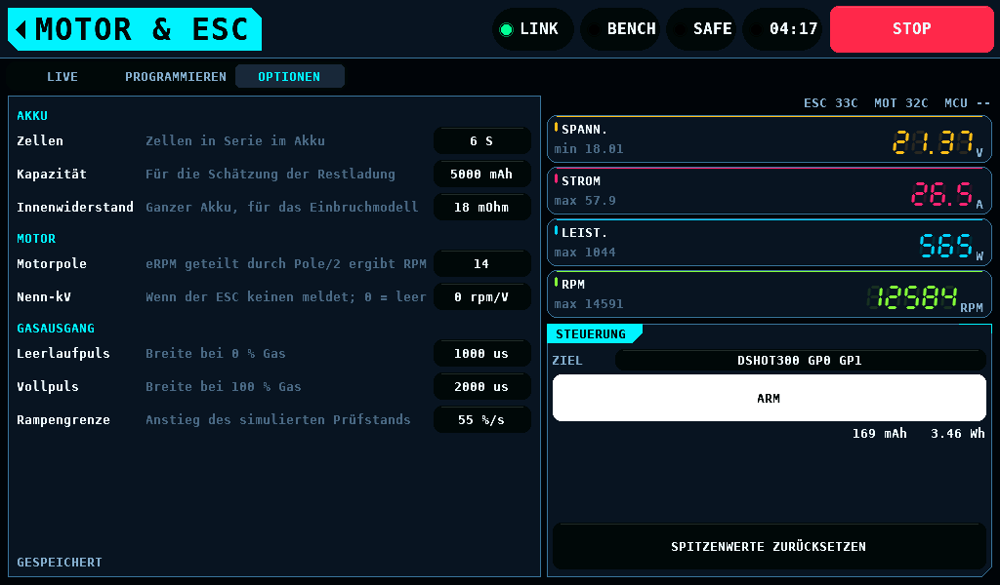

OPTIONEN hält die 8 Einstellungen von Akku, Motor und Gasausgang
(`SET_CAT_ESC` im Einstellungsschema) in der Reihenfolge des Schemas, unter drei Überschriften:

| Überschrift | Einstellungen |
| --- | --- |
| AKKU | Zellen, Kapazität, Innenwiderstand |
| MOTOR | Motorpole, Nenn-kV |
| GASAUSGANG | Leerlaufpuls, Vollpuls, Rampengrenze |

Die Zeilen stehen in zwei Spalten von 295px: AKKU und MOTOR links,
GASAUSGANG rechts. Eine Zeile ist 68px hoch: die Beschriftung und rechts
davon der Wert mit Einheit in einem Feld von 120 x 48px, darunter die
Hilfezeile in 8 x 16. Ein Tipp auf das Feld öffnet das Tastenfeld über der
linken Spalte und der Leiste, 620 x 529px, so dass kein
Reiter die Aufgabe darunter wechselt; die rechte Leiste bleibt erreichbar.
Das Tastenfeld nennt die Einstellung, ihren Bereich und ihre Einheit. OK
übernimmt einen Wert im Bereich und legt ihn auf den Schritt der
Einstellung, 4321mAh als 4300mAh; außerhalb des Bereichs bleibt das
Tastenfeld offen und nennt den Bereich in der Warnfarbe. ABBRECHEN und das
Home-Tag schließen es, und der Wert bleibt unverändert.

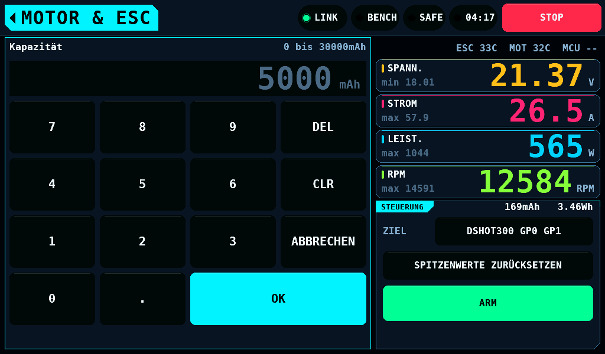

Das Tastenfeld des Leerlaufpulses lehnt einen Wert ab, der nicht mindestens
100us unter dem Vollpuls liegt (`LINK_CC_THROTTLE_GAP_US`), das des Vollpulses
einen, der nicht mindestens 100us über dem Leerlaufpuls liegt. Die Bereiche
überlappen sich, 800 bis 1600us und 1400 bis 2400us. Das Tastenfeld bleibt
offen, zeigt `Leerlaufpuls höchstens 1900us (100us unter Vollpuls)` oder
`Vollpuls mindestens 1100us (100us über Leerlaufpuls)` in der Warnfarbe statt
des Bereichs, und die Zeile behält ihren Wert. Die Zahlung des Paars an den
IOmcu hält dieselbe Lücke; die eigene Schreibprüfung des IOmcu hält jeden
Puls auf 400 bis 2500us und liest sie nicht.

Leerlaufpuls und Vollpuls nehmen nur bei einem Prüfstand in SAFE einen Wert
an: Der IOmcu übernimmt die Endpunkte, solange er entschärft ist, 300ms
nach der letzten Änderung, und das Schalten auf ARMED sendet keine. Solange
der Prüfstand ARMED ist, ARM gehalten wird oder ein ARM oder ein DISARM auf
seine Antwort wartet, lautet ihre Hilfezeile `Nur bei SAFE einstellbar` in
der Warnfarbe, und das Feld nimmt keinen Tipp an; ein offenes Tastenfeld für
einen von beiden schließt, wenn ARM gedrückt wird oder der Prüfstand SAFE
verlässt. Das Halten von ARM über 2s lässt einer Änderung vor dem Druck die
Zeit, den IOmcu zu erreichen. Solange bei bestehendem Link eine Änderung dem
IOmcu noch geschuldet ist, wird das Schalten auf ARMED mit `Pulsbereich noch
nicht an den IOmcu gesendet. ARM erneut halten.` abgelehnt, und der
Prüfstand bleibt SAFE. Ein Paar, das der IOmcu abgelehnt oder anders
gespeichert hat, hält das Schalten mit einem Text gesperrt, der nennt, was zu
ändern ist, bis eine Änderung hier, eine Zuordnung auf OUTPUTS oder ein
Link-up das Paar in Kraft bringt ([Ein Pulsbereich
unterwegs](Safety-de.md#ein-pulsbereich-unterwegs)). Die anderen 6 Zeilen nehmen
jederzeit einen Wert an.

Die Einstellungen sind ein Speicher. Jeder Wert, den OK setzt, gilt sofort
und fordert das Schreiben an; das Panel schreibt den ganzen Speicher im
ersten Frame mit dem Prüfstand SAFE, abgeschaltetem Netzteilausgang und ohne
Platinenzeichnung, die geladen oder gespeichert wird, dasselbe Schreiben, das
SPEICHERN in SETUP anfordert ([Werte behalten](#werte-behalten)). Ein
in SETUP ungespeicherter Wert wird mitgeschrieben, so dass SETUP nichts mehr
zu warnen hat. Ein abgelehntes Schreiben lässt jeden Wert ungespeichert, und
die Warnung von SETUP beim Verlassen nennt die ESC-Zeilen mit ihren eigenen.
Die Zeile am Fuß der Seite, die 4px über dem Alarmband endet, nennt den
Stand des Speichers:

| Zeile | Stand |
| --- | --- |
| `GESPEICHERT` | nichts ist ungeschrieben |
| `SPEICHERN AUSSTEHEND` | das Schreiben ist angefordert und wartet auf einen ruhenden Prüfstand |
| `NICHT GESPEICHERT` | das letzte Schreiben wurde abgelehnt |
| `ÄNDERUNGEN IN SETUP NICHT GESPEICHERT` | Werte sind ungespeichert, und kein Schreiben ist angefordert; die nächste Änderung hier schreibt sie |

### Programmieren

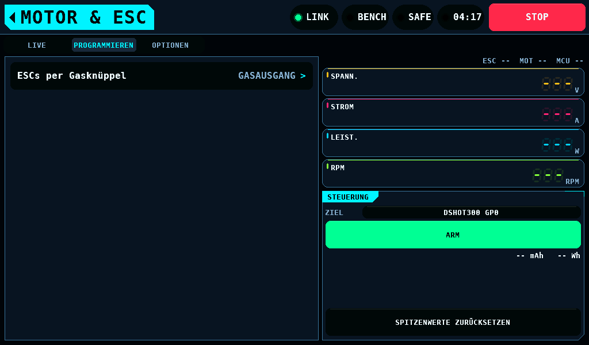

PROGRAMMIEREN in der Leiste zeigt die Liste der ESC-Programmierer im
Seitenbereich, aus derselben Tabelle wie die Liste von SERVO
(`shared/ui/prog_registry.c`, [Programmierer](#programmierer) auf SERVO).
Die Liste hat eine Zeile, `ESCs per Gasknüppel`, in der Gruppe
STICK-MENÜ; eine Liste zeichnet ihre Gruppenüberschriften erst über 8 Zeilen. Rechts steht in der
Zeile `GASAUSGANG >`: Sie treibt die als Throttle gebundenen Pins, keinen
Programmierport, und braucht keine Fähigkeit des IOmcu. Die Ausgangskarte
bleibt rechts, solange die Liste zu sehen ist.

Ein Tippen auf die Zeile öffnet ESC STICK, eine Ebene tiefer. ESC STICK ist
eine Sitzung über die volle Breite: Sie deckt die linke Spalte, die Leiste
und die Reiter ab, und solange sie offen ist, erreicht kein Druck ARM oder
einen Reiter. Das Öffnen auf einem Prüfstand, der nicht SAFE ist, schaltet
ihn auf SAFE, auch bei einem DISARM, den ein anderer Finger hält. In der Zeile der Reiter steht an ihrer Stelle der
Ausgangsstreifen, eine Zeile in der Schrift 10 x 20 ab x 12, y 4:

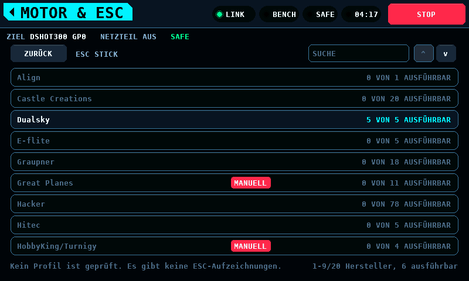

```
ZIEL DSHOT300 GPIO 0 GPIO 1   NETZTEIL 7.60V  1.00A   SAFE
```

| Teil | Zeigt |
| --- | --- |
| `ZIEL` | das Protokoll und die als Throttle gebundenen Pins, wie sie die Zeile ZIEL der Karte STEUERUNG nennt, in höchstens 26 Zeichen; in der Warnfarbe, solange kein Pin gebunden oder die Bindung nicht gelesen ist |
| `NETZTEIL` | den Ausgang des PD mini, wie er liest: `NETZTEIL 7.60V  1.00A`; `NETZTEIL EIN`, solange er ohne Spannungs- und Stromwert an ist; `NETZTEIL AUS`; `NETZTEIL --`, solange das Netzteil nicht antwortet |
| `SAFE` oder `ARMED` | der Prüfstand; ARMED in der Gefahrenfarbe |

Der Streifen ist höchstens 100 Zeichen breit, 1000px, auf Englisch und auf
Deutsch. Er wird neu gezeichnet, wenn sich sein Text ändert. Seine Werte
stehen mit Dezimalpunkt, wie auf dem Panel.

Von den Herstellern in ESC STICK schließt das Home-Tag die Sitzung zur Liste
von PROGRAMMIEREN; von der Liste führt es zum Menü. Das Verlassen von MOTOR &
ESC von jeder Ebene beendet einen Stick-Lauf, schaltet den Netzteilausgang
aus, den der Lauf eingeschaltet hat, schaltet den Prüfstand auf SAFE und
schließt ESC STICK. Zurück auf MOTOR & ESC zeigt PROGRAMMIEREN seine Liste.

Die Parametertabellen für ESCs mit BLHeli_S-, AM32-, ESCape32- und
VESC-Firmware sind ein Modell in der Firmware (`shared/ui/prog_models.c`). Kein Transport trägt ihre Protokolle,
und keine Liste von PROGRAMMIEREN hat eine Zeile für sie. Der Prüfstand
erkennt ESCs mit BLHeli_32-Firmware, steuert sie an und sendet die DShot
Special Commands, kann ihre Parameter aber nicht lesen:
[Parameter von ESCs mit BLHeli_32-Firmware](BLHeli32-de.md).

### ESC STICK

ESC STICK programmiert einen ESC über sein Gasknüppel-Menü, nach einem
ESC-Profil; [Stick-Programmierung](StickProgramming-de.md) beschreibt die
Läufe.

Jedes Bedienelement auf ESC STICK nimmt ein Tippen. Es wirkt, wenn der
Finger innerhalb des Elements abhebt, das er gedrückt hat, in x und in y
höchstens 8px vom Aufsetzpunkt entfernt. Ein Finger, der auf einem Element
aufsetzt und weiterwandert, drückt nichts, ebenso einer, der ein Element
überquert. Ein Finger zur Zeit drückt ein Element. Drei Bedienelemente wirken
schon beim Aufsetzen:

- 2s HALTEN ZUM STARTEN: Das Halten über 2s beginnt mit dem Aufsetzen.
- ABBRECHEN eines Stick-Laufs, auf der Seite des Laufs und in der Abfrage
  eines manuellen Schritts. Es hält einen Motor an, wartet deshalb nicht auf
  das Abheben und reagiert auch auf einen zweiten Finger.
- Die Tasten der Such-Tastatur, die ihrem eigenen Aufsetzen und Abheben
  folgen.

ESC STICK liegt auf dem Körper unter dem Ausgangsstreifen, ab Körper-y 28,
mit Beschriftungen, Zeilen und Schaltflächen in der Schrift 10 x 20:

| Teil | Ort und Größe |
| --- | --- |
| Pfadzeile | y 30 bis 78: ZURÜCK 120 x 48px, der Pfad in der Schrift 12 x 24 und rechts das Suchfeld (260px, sein X 48px), `^` und `v` (je 56px) auf der Liste oder TIMING (168px) auf der Seite eines Profils |
| Liste | 7 Zeilen je Seite, 48px hoch im Abstand von 56px ab y 84, 984px breit; der Name eines Modells in 30 Zeichen; die Fußzeile endet 4px über dem Alarmband |
| Seite eines Profils und TIMING | links die Parameterkarte, 660px: 6 Zeilen je Seite, 48px hoch im Abstand von 56px, jede mit ihrer Nummer, ihrem Namen (bis 23 Zeichen), ihrem Wert in einer 250px breiten Spalte und `-` und `+` von 48 x 48px, 8px zwischen je zweien |
| Seitenspalte | 340px rechts der Parameterkarte: ÄNDERN (auf TIMING dessen Titel), die gezeigten Zeilen und `^` und `v` von 48 x 48px; MANUELLER EINGRIFF NÖTIG, 310 x 48px; darunter, wie das Menü des Profils arbeitet, Netzteil und Einstiegszeit und die Hilfe der gewählten Zeile, umbrochen auf 31 Zeichen je Zeile |
| Fußzeile | y 436 bis 492, 4px über dem Alarmband: links der Hinweis auf bis zu 2 Zeilen, VORGABEN und START, ABBRECHEN, OK oder SCHLIESSEN, je 168 x 56px |
| Lauf und Ergebnis | die Gerätekarte über die Breite ab y 84 mit ihren zwei Zeilen, darunter ab y 136 die Karte des Laufs mit der Signalsäule rechts, zwei Hilfezeilen ab y 390 und die Fußzeile; MANUELLER EINGRIFF NÖTIG eines Ergebnisses, 330 x 56px, links von OK |
| Warnung, manuelle Schritte, Abfrage | eine Tafel über den Seiten ab y 28, ihr Titel in der Schrift 20 x 36, ihre Zeilen im Abstand von 22px, ihre Schaltflächen 48px hoch und 4px über der Fußzeile endend, sodass ein zweites Tippen auf die Stelle von START keine davon trifft |

ZURÜCK und das Home-Tag im Band gehen eine Ebene auf einmal zurück: die
Seite eines Stick-Profils zur Liste, die Modelle eines Herstellers zu den
Herstellern, die Hersteller zur Liste von PROGRAMMIEREN. Über der Warnung
vor dem Lauf ist das Home-Tag ABBRECHEN, über den manuellen Schritten OK.
Während eines Stick-Laufs ist es ABBRECHEN des Laufs: Der Lauf endet, und
sein Ergebnis bleibt auf der Seite.

Die Liste zeigt zuerst die Hersteller, alphabetisch, jeden mit der Zahl
seiner Modelle, die laufen:


Ein Hersteller öffnet seine Modelle, eine Zeile je Modell, nach Strom, dann
Spannung, dann Name, jedes mit seiner Familie und was das Profil ist oder
warum es nicht läuft. Ein Modell öffnet das Profil seiner Familie:

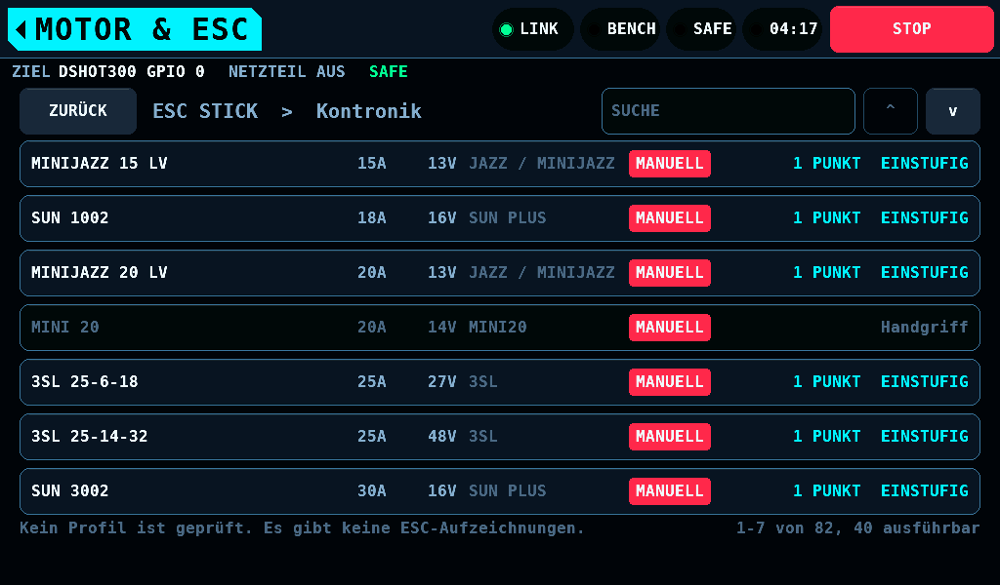

SUCHE filtert die gezeigte Ebene. Ihre Tastatur dockt rechts an, die
Zeilen werden daneben schmaler, und jede Taste filtert sofort. Ein Modell
wird gefunden, wenn der Text in Hersteller und Familie steht, als ein Text
gelesen, oder in Hersteller und seinem eigenen Namen; ein Hersteller
erscheint, wenn eines seiner Modelle gefunden ist. Groß- und
Kleinschreibung spielen keine Rolle, und `*` steht für eine beliebige Folge
von Zeichen:

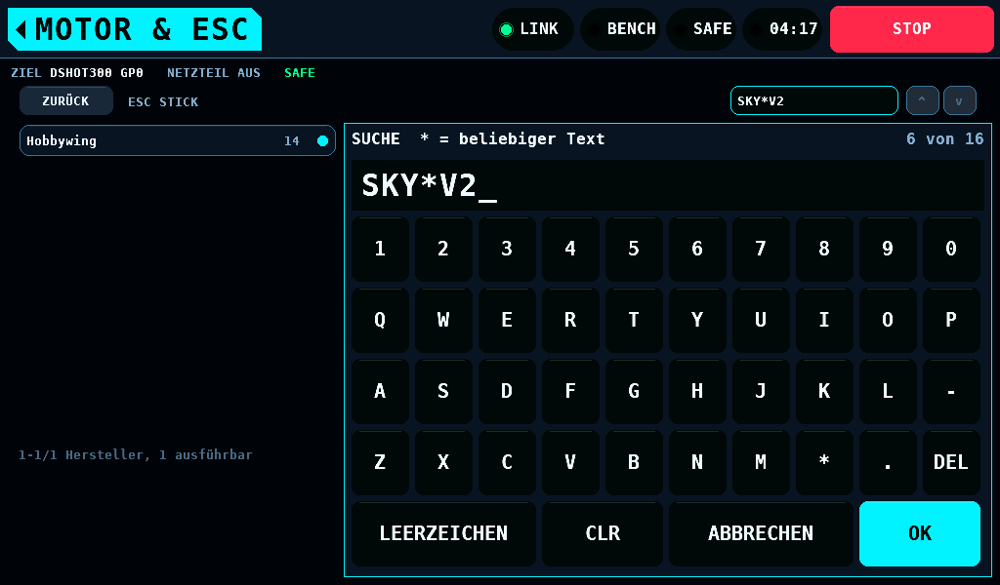

OK behält die Suche auf beiden Ebenen, X leert sie:

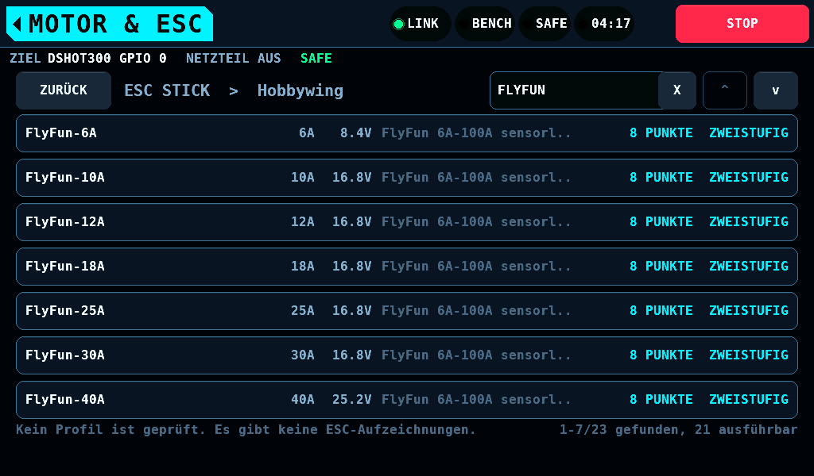

Die Punkte eines Profils stehen anfangs auf BEHALTEN. Die Stepper wählen einen
Wert; START zählt die gewählten Werte:

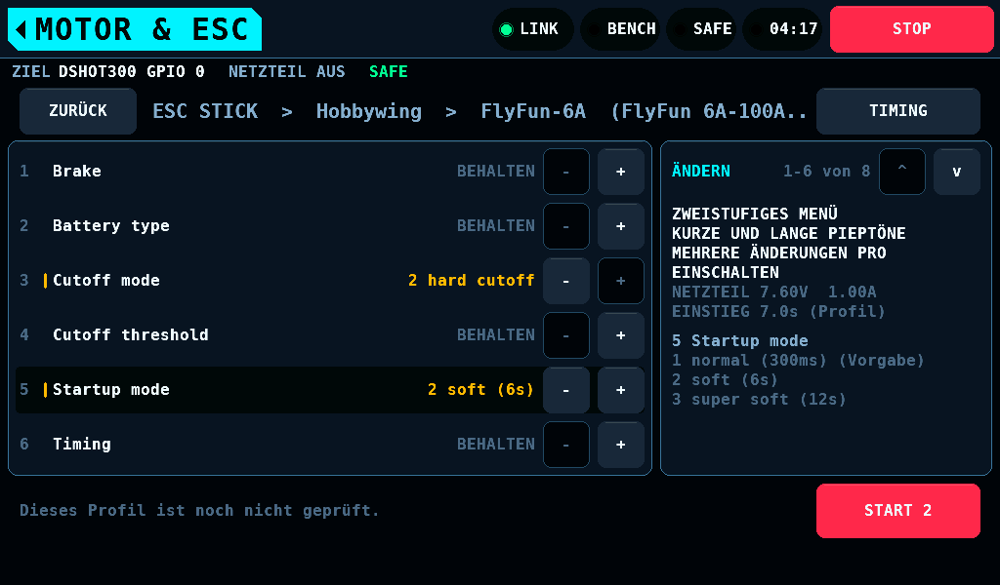

START öffnet eine Warnung über den ganzen Bildschirm, PROPELLER AB? MOTOR GESICHERT?: ein Motor am ESC muss fest montiert sein und darf keinen
Propeller tragen, oder ein Lastwiderstand tritt an seine Stelle. Der Lauf
beginnt, wenn 2s HALTEN ZUM STARTEN gehalten ist:

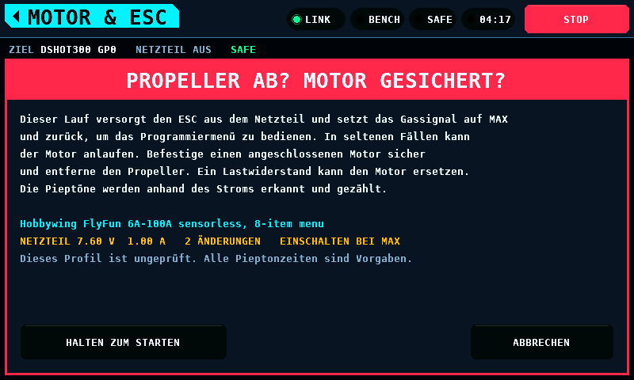

START öffnet nichts, und die Zeile daneben nennt den Grund, solange kein Pin
als Throttle gebunden ist, solange die Ausgangsbindung nicht gelesen ist
und solange das Netzteil das Modell des Panels ist; ein solcher Grund
schließt eine offene Warnung ([Vor einem Lauf](StickProgramming-de.md#vor-einem-lauf)).

Ein Profil, dessen ESC einen Menschen am ESC braucht -- einen Jumper stecken
und abziehen, einen Taster drücken --, trägt in der Liste ein rotes Schild
MANUELL und auf seiner Seite rot MANUELLER EINGRIFF NÖTIG. Der Knopf zeigt die
Schritte und wann jeder fällig ist; ebenso das erste Öffnen des Profils. Die
Warnung nennt die Schritte vor dem Einschalten, und der Lauf hält für jeden
späteren Schritt mit ERLEDIGT und ABBRECHEN an und wartet höchstens 60s
([Handgriffe](StickProgramming-de.md#handgriffe)):

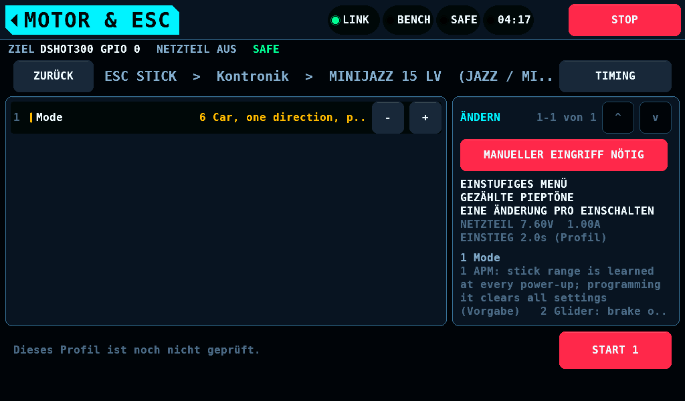

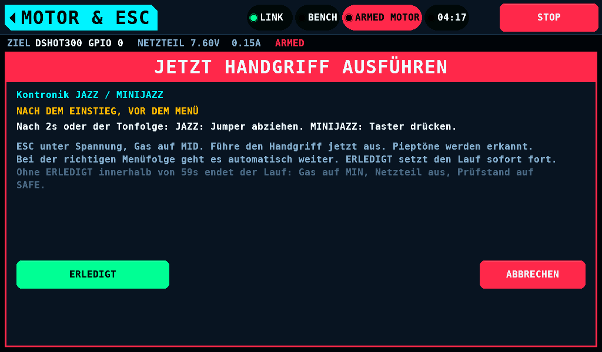

Ein Kontronik-ESC, der sich sperrt, wenn sein Netzteil ausschaltet, bevor
er den gespeicherten Modus bestätigt hat, hält den Lauf nach dem Speichern
versorgt, den Knüppel, wo er speicherte, bis ERLEDIGT:

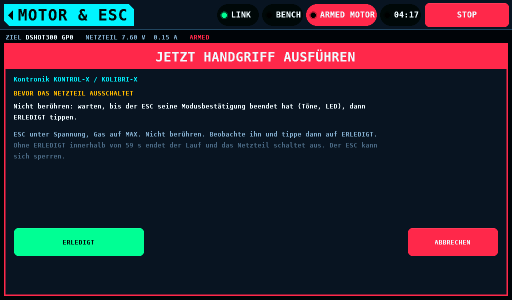

Während er läuft, zeigt die Seite die Phase, die Pieptöne der laufenden
Gruppe und die letzte Gruppe. ABBRECHEN, das Home-Tag, STOP und das Verlassen
des Bildschirms beenden ihn mit dem Gas auf MIN, dem Netzteil aus und dem Prüfstand
SAFE. Das Grün der Signalsäule leuchtet, solange ein Piepton erkannt
ist, mindestens 150ms:

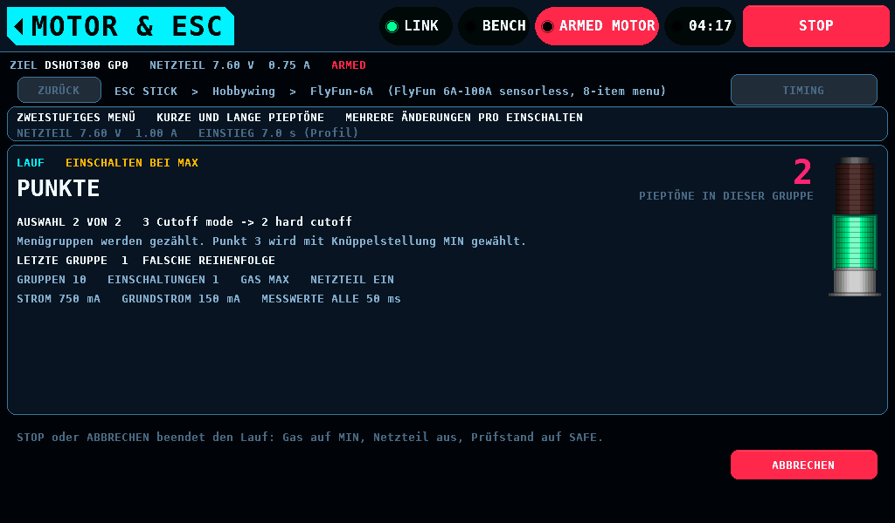

Solange der Phasenabgriff unter SETUP eingeschaltet ist, ergänzt die Seite des
Laufs unter der Stromzeile eine reine Anzeige: den Zustand des Abgriffs, die
Tonhöhe seines letzten 8-ms-Fensters, die Zähler der Pieptöne, die der
IOmcu verlor, und der Pieptöne, die das Panel nicht gelesen hat, und die letzten vier Pieptöne
mit Nummer, Länge in ms und mittlerer Tonhöhe in Hz. Der Lauf zählt seine
Pieptöne weiter aus dem Netzteilstrom.

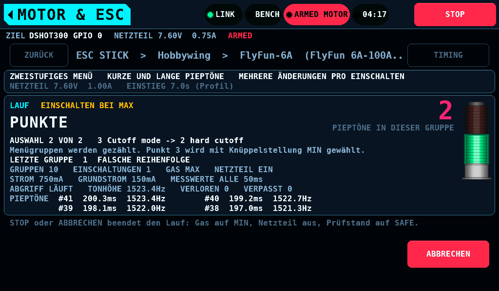

| Zustand | Bedeutung |
| --- | --- |
| `LÄUFT` | die Aufnahme läuft |
| `ÜBERLAUF` | sie läuft, und der Aufnahmering oder die FIFO ist seit dem Einschalten des Abgriffs übergelaufen |
| `WARTET` | kein Link, oder die TONE-Page hat in den letzten 500ms nicht geantwortet, oder ihre Flags sagen, dass der Abgriff läuft, und ihre Fensternummer hat sich 1,5s nicht bewegt, oder der Abgriff wurde ausgeschaltet, und die Page hält ihn noch an |
| `KEINE TONE-PAGE` | der IOmcu spricht ein Protokoll älter als 4.8 |
| `PIN BELEGT` | der IOmcu hält den Abgriff aus: sein Pin ist anderweitig gebunden, oder der IOmcu führt seit seinem Start keine Erfassung aus (Core 1 nicht gestartet), und seine gespeicherte Einstellung hat den Abgriff an; das Zweite endet nur mit einem Neustart des IOmcu |
| `LÄUFT NICHT` | eingeschaltet, und die Page hält den Abgriff aus oder lässt ihn nicht laufen: die Einstellung wurde abgelehnt oder ist noch nicht geschrieben |

TONHÖHE und VERLOREN sind Werte der Page aus dem letzten Status-Read. Sie
zeigen `--`, und `ÜBERLAUF` erscheint nicht, solange kein Read jünger als
500ms den Zustand liefert: bei `WARTET`, bei `KEINE TONE-PAGE` und bei
`LÄUFT NICHT`, solange die Einstellung der Page den Abgriff aus hat.
VERPASST und die Pieptöne zählt und speichert das Panel selbst; sie bleiben.

Das Ergebnis bleibt bis OK. Sein Rot leuchtet, wenn der Lauf endete, weil
etwas nicht wie erwartet war, ein Stopp des Prüfstands selbst eingeschlossen,
und bleibt aus bei FERTIG, gedrücktem STOP, ABBRECHEN, dem Home-Tag und
dem Verlassen des Bildschirms ([die Liste](StickProgramming-de.md#wie-ein-lauf-endet)):

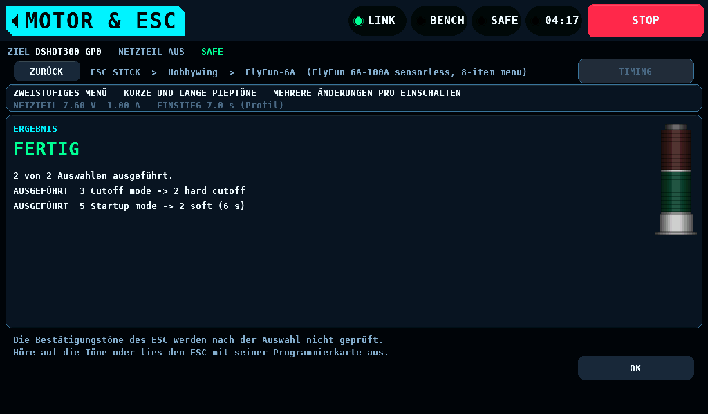

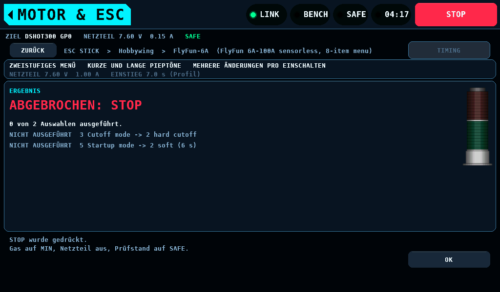

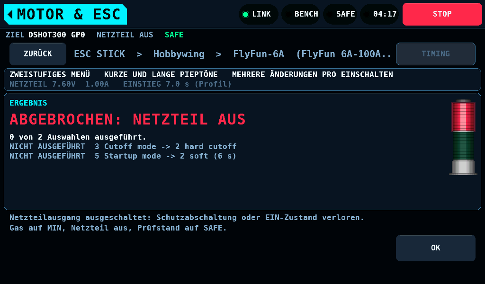

TIMING enthält die Zeiten der Pieptöne und die Netzteil-Einstellungen. Keine
davon ist gemessen:

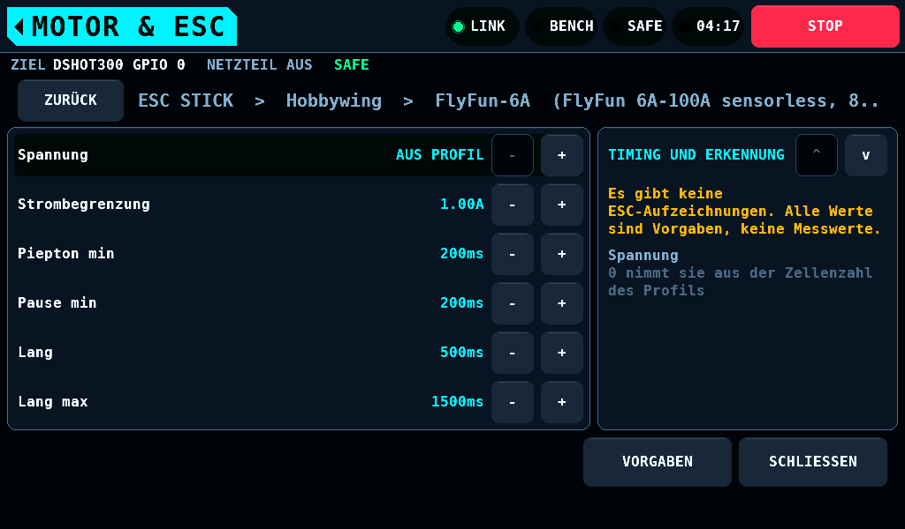

`-` und `+` einer Zeile stellen ihren Wert um einen Schritt. Ein Tipp auf
den Wert, die 250px breite Spalte zwischen dem Namen und den Tasten, öffnet
das Tastenfeld über der Seite, von unter dem Ausgangsstreifen bis 4px über
dem Alarmband: 1008 x 464px, Tasten von 242 x 81px. Es nennt die
Einstellung, ihren Bereich und ihre Einheit und nimmt die Stellen des
Schritts nach dem Punkt: eine für die 0,1V von Spannung, zwei für die
0,05A von Strombegrenzung. OK setzt den Wert wie ein Schritt auf den
näheren Schritt (1,23A sind 1,25A); SCHLIESSEN fordert das Speichern an,
wie nach einem Schritt. Ein Wert außerhalb des Bereichs lässt das
Tastenfeld offen und nennt den Bereich in der Warnfarbe. ABBRECHEN, OK ohne
getippten Wert und das Home-Tag schließen es und ändern nichts; TIMING
bleibt. Nichts darunter nimmt einen Druck an. Die Punkte eines Profils sind
Listen der eigenen Werte des Reglers und öffnen kein Tastenfeld.

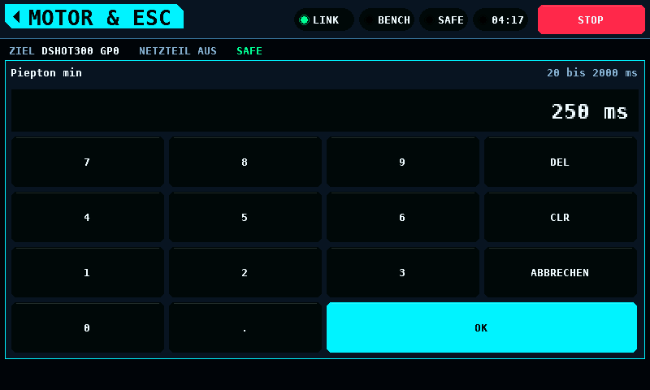

## Servo

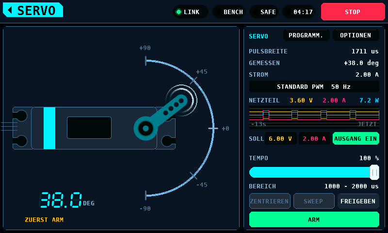

SERVO ist eine Werkbank. Die Leiste unter dem Band trägt ihre Aufgaben,
**LIVE**, **TEST**, **PROGRAMMIEREN** und **OPTIONEN**, 150 x 40px je
Reiter, 4px Abstand, ab y 8 unter dem Band.
Die Kachel öffnet LIVE. Ein Wechsel des Reiters ist keine Navigationsebene:
das Home-Tag führt von jeder Aufgabe nach Hause und steigt nur aus den
Einstellungen eines Laufs eine Ebene zurück zu TEST und aus einem
Programmierer zurück zur Liste von PROGRAMMIEREN. Jede Aufgabe behält ihre Seite und ihre
Auswahl bis zum Neustart des Panels. Das Verlassen von SERVO schaltet den
Prüfstand auf SAFE, aus jeder Aufgabe.

| Aufgabe | Linke Karte, der Seitenbereich |
| --- | --- |
| LIVE | das Zifferblatt, darüber das Feld eines Laufs, solange er läuft oder sein Ergebnis steht |
| TEST | die Karten AUTOMATISCHER TEST und ENDLAGENLAUF und die Grenzen von SUPPLY, nur lesbar |
| PROGRAMMIEREN | die Liste der Programmierer, eine Zeile je Programmierer; eine Zeile öffnet ihren Programmierer über der linken Spalte |
| OPTIONEN | die Seiten AUSGANG, SWEEP und PRÜFLING |

Die linke Karte ist 620px breit und beginnt unter der Leiste, bei y 56.
Die rechte Karte ist die Ausgangskarte, 380px breit, vom oberen Rand bis
zum unteren neben der Leiste, auf jeder Aufgabe dieselbe: der geltende
Typ, die Zeile und der Plot der Servo-Schiene, die Zeile SOLL, TEMPO, die
Zeile ZIEL, ZENTRIEREN, SWEEP, FREIGEBEN und ARM. Jede Zeile, die man dort
antippt, ist 48px hoch oder höher; ARM ist 60px hoch und endet 4px über
dem Alert-Band, wie AUSGANG AUS. Ein Feld -- ein Tastenfeld, die
Buchstabentastatur, eine Liste, eine Warnung, die Frage oder ein
Programmierer -- bedeckt die ganze linke Spalte samt den Reitern der
Leiste und wird beantwortet oder geschlossen, bevor die Aufgabe wechselt.

Die Karte von LIVE trägt oben links den Winkel des Horns in den Ziffern
des Prüfstands, darunter `ZUERST ARM`, solange der Prüfstand in SAFE ist,
das Zifferblatt (Radius 150px) mit dem Servo und an ihrem Fuß die drei
Messwerte, je ein Drittel der Karte: SOLL-PULSBREITE in Mikrosekunden,
GEMESSEN in Grad und STROM in Ampere, Name und Einheit über 44px hohen
Ziffern. Ziffern, die breiter als ihre Spalte von 198px sind -- ein auf
`-1000000.00` begrenzter Strom --, stehen in einer kleineren Schrift und
bleiben so in ihr. Die Messwerte stehen nur auf LIVE; auf den anderen
Aufgaben trägt die Zeile über dem Plot den Strom.

Das Horn wird in Bruchteilen eines Pixels gezeichnet: Seine Spitze, 98px
von der Welle, bewegt sich 1,7px pro Grad und steht bei jedem Schritt
höchstens 0,1px neben ihrem Winkel. Ein Horn, das sich bewegt, malt die
Kästen um sich neu, wie jeder Bildpuffer es zuletzt zeichnete und wie es
jetzt steht, etwa 160px breit, und die Ziffern des Winkels, von
SOLL-PULSBREITE und von GEMESSEN; die beiden Karten werden dafür nicht neu
gemalt.

Auf LIVE bei einem Prüfstand in ARMED an beliebiger Stelle auf dem Bogen ziehen, um
eine Stellung zu befehlen. Der
kräftige Arm ist die gemessene Stellung, der blasse Arm die befohlene. Der
Abstand zwischen beiden ist die Verzögerung des Servos selbst. Die Ringe um
die Spitze pulsieren, solange das Servo angesteuert wird. Den Finger zu heben
lässt noch nicht los: Der Bildschirm wiederholt die letzte Stellung alle
SERVO_HOLD_MS, ein Servo bleibt also stehen, wo es hingestellt wurde. Erst
**FREIGEBEN**, die Schaltfläche, führt die Ruderflächen auf die Mitte zurück --
und auch dann bleiben die Pins gebunden und treiben weiter, auf der Mitte
ihres Wegs. Beendet werden die Flanken durch ein Schalten auf SAFE oder durch das
Verlassen des Bildschirms, was auf SAFE schaltet. Bei eingeschaltetem Drehknopf
bewegt dessen Drehung das Horn von dort aus, wo es steht
([der Knopf](#panel-der-drehknopf)), nur auf LIVE: auf TEST, auf
PROGRAMMIEREN, auf OPTIONEN, unter einem Feld und unter einem
Programmierer ist das
Zifferblatt nicht zu sehen, und eine Drehung bewegt nichts. Eine Drehung im
Frame, in dem LIVE zurückkommt, bewegt ebenfalls nichts; die nächste
bewegt.

Ein Finger zieht das Zifferblatt. Ein Druck eines zweiten Fingers irgendwo
auf dem Bildschirm beendet den Drag, wie er einen Drag auf TEMPO beendet: Das
Ziel läuft weiter bis zum letzten Winkel, den der Finger gab, und das
Zifferblatt folgt wieder nach einem neuen Druck darauf.

Der Druck auf das Zifferblatt befiehlt seinen Winkel sofort. Der Drag danach
läuft durch einen einpoligen Filter mit einer Zeitkonstante von 20ms
(`SV_DRAG_TAU_MS`), gerechnet nach der Länge jedes Frames, und ist damit bei
30, 60 und 120 Frames pro Sekunde derselbe. Das Horn und der Puls, den das
Servo bekommt, folgen beide dem gefilterten Winkel, 1,8° hinter einem
Finger, der sich mit 90°/s bewegt. Der Filter gleicht den Takt zwischen den
Abfragen des Touch-Controllers, alle 10,5ms, und den Frames, alle 16,6ms,
aus: Bei 90°/s macht das Horn Schritte von 1,0° bis 1,8° pro Frame, die
Abfragen allein ergeben 0,5° bis 2,1°. Hebt sich der Finger, läuft das Ziel
weiter bis zum letzten Winkel des Fingers, 99% des Wegs in 100ms. Jeder
andere Befehl beendet den Filter sofort: ein Schalten auf SAFE, DISARM,
STOP, FREIGEBEN, ZENTRIEREN, SWEEP oder der Drehknopf, auch eine
Drehknopf-Bewegung, die auf den Puls kommt, den der Filter zuletzt gesendet
hat. Ebenso jeder Druck, der den Drag vor dem Abheben beendet: ein zweiter
Finger irgendwo auf dem Bildschirm, auf dem Band, auf STOP oder auf dem
Alert-Band, und der ziehende Finger, der aufs Band geführt wird. Der Filter
bleibt dann stehen, wo er ist, und kommandiert nichts mehr. Bei SAFE bewegt er
nichts, und ein ARM beginnt in der Ruhestellung, ohne etwas von einem Drag
davor.

Der Bildschirm treibt die Kanäle, die die Bindung als Ruderflächen markiert,
und weder einen festen Pin noch ein festes Protokoll. Die acht Kanäle von PPM
sind ebenfalls Ruderflächen, ein gebundener PPM-Ausgang bewegt sich also mit
diesem Bildschirm genau wie ein gebundener SERVO-PWM-Ausgang. Ist überhaupt
kein Ruderflächen-Kanal gebunden, kommandiert er nichts und kein Pin bewegt
sich.

TEMPO ist die Geschwindigkeit, mit der der Prüfstand den Ausgang bewegen
darf, und nicht nur eine Geschwindigkeit für die Zeichnung. Bei 100% geht
der Befehl unverändert durch und das Servo läuft mit seiner eigenen
Geschwindigkeit; darunter rampt der Prüfstand den Befehl davor, 30% braucht
also dreimal so lange wie 90%. Die Änderung wirkt sofort auf einen
gehaltenen Ausgang. Ohne Rückmeldung wird das Horn mit derselben Rate
bewegt gezeichnet, bei 100% sofort am Befehl.

**Vor jeder Bewegung ARM.** ARM schaltet hier die Surfaces und einen
pulsenden PROG PORT auf ARMED; ein Throttle-Ausgang sendet keinen Puls ([Ein Arm
für eine Rolle](Link-de.md#ein-arm-für-eine-rolle)). Solange der Prüfstand
nicht für die Surfaces ARMED ist, schreibt der IOmcu auf jeden PWM-Pin
einen Impuls der Länge null, und der
Bildschirm nimmt keine Stellung an: Der befohlene Wert ändert sich nur,
solange das Servo ihm folgt. Der Knopf ist ein
Zwei-Sekunden-Halten, dieselbe Geste und dieselbe Blende wie auf MOTOR & ESC,
und ein Druck darauf in ARMED schaltet auf SAFE. Das Verlassen des
Bildschirms schaltet auf SAFE und gibt den Pin frei: ein Bildschirm, den man
nicht sieht, darf weder ein Servo halten noch den Prüfstand in ARMED
zurücklassen.

Was jedes Bedienelement auf einem Prüfstand in SAFE tut:

| Bedienelement | SAFE | ARMED |
| --- | --- | --- |
| Das Zifferblatt | abgelehnt: kein Kommando, Horn und SOLL-PULSBREITE bleiben | befiehlt die Stellung unter dem Finger |
| Drehknopf | abgelehnt; die Drehung wird nicht aufgehoben | bewegt das Horn vom befohlenen Wert aus |
| ZENTRIEREN | abgelehnt; gedimmt gezeichnet | befiehlt PULS MITTE plus TRIMMUNG |
| SWEEP, PAUSE, PAUSIERT | abgelehnt; gedimmt gezeichnet | startet, pausiert und setzt den Sweep fort |
| FREIGEBEN | sendet die Freigabe; der gezeigte Wert bleibt | zentriert die Ruderflächen; der gezeigte Wert wird zur Ruhelage |
| TEMPO | wird gesetzt; sendet nichts | wird gesetzt; eine gehaltene Stellung wird mit der neuen Rate erneut gesendet |
| OPTIONEN > AUSGANG: TYP, PULSRATE, PULS MIN, MITTE und MAX, TRIMMUNG, WEG, UMKEHREN | werden gesetzt; senden nichts | werden gesetzt; eine gehaltene Stellung oder die Ruhelage wird unter ihnen erneut gesendet |
| ZIEL | ein Tippen öffnet SETUP > OUTPUTS | gesperrt; nennt das Ziel |
| SOLL, AUSGANG EIN, AUSGANG AUS | wie auf SUPPLY | wie auf SUPPLY |
| START TEST | abgelehnt: `ZUERST ARM` | startet den Lauf nach seinem Halten |

In SAFE wird das Horn gedimmt gezeichnet, und die linke Karte von LIVE zeigt
`ZUERST ARM`. Horn und SOLL-PULSBREITE zeigen die zuletzt gefahrene Stellung, nach einem
Neustart PULS MITTE. Eine in SAFE geänderte Pulsbreiten-Einstellung ändert
die Mikrosekunden, die SOLL-PULSBREITE für diesen Winkel zeigt, und WEG begrenzt
ihn nicht. Von einem DISARM an, das der Bildschirm anfordert, durch den Tap
oder durch das Verlassen, oder einem STOP auf einem Prüfstand in ARMED, bis
der Prüfstand SAFE meldet, gilt die Spalte SAFE ebenfalls, und ein
Sweep, eine Pause, eine gehaltene Stellung und ein Lauf des automatischen
Tests enden dort, wo es angefordert wird.

Schaltet der Prüfstand auf ARMED, wird der befohlene Wert zur Ruhelage, die die Pins
treiben: die Mitte zwischen den Endpunkten des Kanals, 1500us bei STANDARD
PWM und 760us bei NARROW 760, ohne TRIMMUNG. Ohne Rückmeldung wird das Horn
sofort dort gezeichnet. Der erste Drag oder die erste Knopfdrehung nach einem
ARM beginnt bei diesem Wert, gleich was der Bildschirm vorher zeigte; 1%
Knopfdrehung bei STANDARD PWM fordert 1510us an. Ein Typ oder eine
Pulsbreite, die auf einem Prüfstand in ARMED vor der ersten Stellung geändert
wird, verschiebt die Ruhelage und den Wert mit ihr.

Ein Finger auf dem Zifferblatt bewegt nichts, wenn der Prüfstand auf ARMED oder SAFE schaltet
oder stoppt, bis er abhebt und neu drückt. Eine Stellung, ein
Sweep oder eine Pause, die der Bildschirm gepostet und das Panel noch nicht
gesendet hat, wenn der Prüfstand auf SAFE schaltet oder stoppt, wird nicht
gesendet, und eine Knopfdrehung in diesem Zustand wird zurückgenommen: Der
Wert kehrt auf den vor der Drehung zurück.

Für FREIGEBEN auf einem Prüfstand in ARMED gilt die Regel des ARM erneut.
Die Pins gehen in die Ruhelage, und der befohlene Wert wird zu dieser
Ruhelage: 1500us bei STANDARD PWM, 760us bei NARROW 760, ohne TRIMMUNG. Das
Horn wird mit TEMPO dorthin laufend gezeichnet. Ein laufender Drag endet.
Ein Druck auf das Zifferblatt steuert das Servo wieder an, und die erste
Knopfdrehung zählt von der Ruhelage: 1% Knopfdrehung bei STANDARD PWM
fordert 1510us an. Dasselbe gilt für die Freigabe, mit der ein Lauf des
automatischen Tests endet, und für die, die ein geänderter Typ oder eine
geänderte Pulsbreite auf einem ruhenden Prüfstand sendet. Auf jeden Frame
wartet ein Kommando: Von einer Stellung und einem FREIGEBEN im selben Frame
wird das spätere gesendet, und der gezeigte Wert ist dessen Wert. Eine
Knopfdrehung in einem Frame, in dem FREIGEBEN wartet, wird verworfen.

Die Ausgangskarte zeigt Typ, Bildwiederholrate und Pulsbereich, die
gelten -- in der Gefahrenfarbe, solange sie ein Servo zerstören können, das
nicht dafür gebaut ist -- und die Servo-Schiene, wie ihr Messgerät sie
misst: Spannung, Strom und Leistung in der Zeile über dem Plot, über die
letzten 17,8s geplottet (356px bei 20 Punkten je Sekunde). STROM auf LIVE
zeigt den Strom noch einmal. Die Typzeile, 44px hoch, lautet
`STANDARD PWM  50Hz  1000-2000`: der Typ, die
Bildwiederholrate und PULS MIN bis PULS MAX in Mikrosekunden, mit je zwei
Leerzeichen dazwischen. Die längste, ein Typ mit 13 Zeichen bei 560Hz mit
zwei vierstelligen Enden, belegt 32 der 35 Zeichen der Zeile; der Bereich
trägt deshalb keine Einheit. Eine in den Einstellungen eingetippte Pulsbreite
erscheint sofort in der Zeile.

| Messgerät der Servo-Schiene | Name in der Zeile | STROM auf LIVE, die Zeile und der Plot zeigen |
| --- | --- | --- |
| ein INA3221-Kanal | `INA`, die Adresse seines Bausteins und der Kanal: `INA 0x41 CH2` | das letzte 50-ms-Fenster des Kanals: den mittleren Strom, die mittlere Busspannung auf der Lastseite des Shunts und ihr Produkt. Ein Punkt im Plot je Fenster, 20 in der Sekunde |
| der PD mini | `PD MINI` | das letzte Sample des Netzteils. Ein Punkt je Sample |
| das Modell, solange kein IOmcu antwortet | `PD MINI` | das letzte Sample des Netzteils: das des Netzteilmodells unter dem SIMULATION-Watermark, und keinen Messwert, wo SETUP INTERFACES den PD mini einschaltet, der ohne Link nicht antwortet |

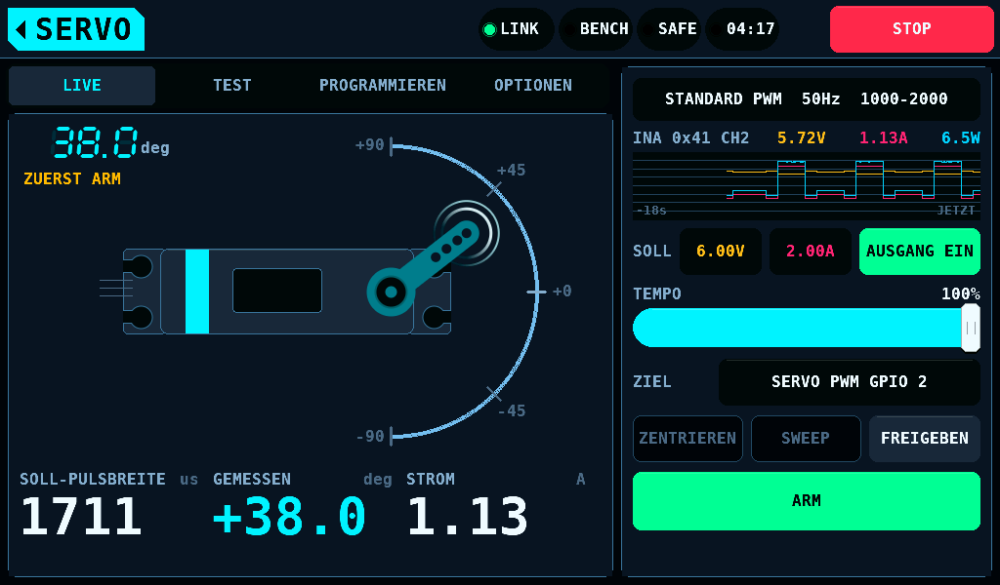

Der Name bleibt in beiden Sprachen `PD MINI`. Solange der PD mini in SETUP
unter INTERFACES abgeschaltet ist, ist das Netzteil das Modell des Panels,
wie auf SUPPLY: dann sitzt eine Pille SIMULIERT (englisch SIMULATED), 26px
hoch und 30px plus das Wort breit, mindestens 110px (120px für SIMULATED
und SIMULIERT), auf der oberen linken Ecke des Plots unter dem Namen,
weil die Zeile neben dem Namen die drei Messwerte trägt. Die Pille kommt und
geht mit dem Modell, ohne Tippen. Mit einem INA3221-Kanal als Messgerät
nennt die Zeile den Kanal, `INA 0x40 CH1` bis `INA 0x43 CH3`, und trägt keine Pille,
ob das Netzteil simuliert ist oder nicht. Der Kanal ist der, der das Ziel
des Servotesters überwacht
([SENSORS](#sensors-die-ina3221-bausteine)); an einem IOmcu älter als
4.25 ist es CH1 des einen Bausteins, den SENSE liest.

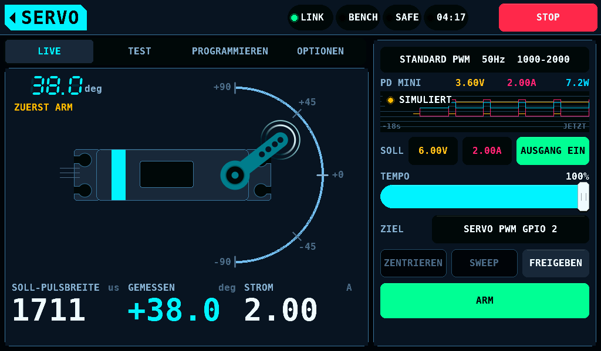

Welches Messgerät es ist, wird einmal je Poll entschieden
([die Strommonitore](#interfaces-die-strommonitore)): der INA3221 1000ms,
nachdem seine Bedingungen gelten, der PD mini ab dem ersten Poll, in dem
eine nicht gilt.

- Ein Strom hat ein Vorzeichen und wird in Hundertstel Ampere gezeigt:
  `0.41A`, `-0.02A`, `-1.64A`. Ein Messwert, der auf null rundet, ist
  `0.00A`. Die Leistung in der Zeile hat ein Vorzeichen und Zehntel Watt.
  Neben dem Namen eines Kanals, 134px, haben die drei Messwerte 64, 84 und
  74px, 6, 8 und 7 Zeichen zu 10px; neben PD MINI, 90px, 88, 88 und
  90px: eine Spannung ab 10V wird in Zehnteln
  gezeigt, `26.0V`, und eine Leistung, die in Zehnteln mehr als 7 Zeichen
  braucht, ab `-100.0W` und ab `1000.0W`, in ganzen Watt.
- Ein Messwert, der nicht ankam, ist `---` in STROM auf LIVE, `--` in der
  Zeile über dem Plot und eine Lücke im Plot: noch kein Sample, ein Netzteil,
  das nicht antwortet, kein Fenster seit dem Link-Aufbau, ein Fenster ohne
  Messungen dieser Größe.
- Ein Fenster, in dem eine Messung ein Ende des Messbereichs des INA3221
  las, 1,638A oder -1,638A an einem Shunt von 0,1Ω, zeigt seinen
  Mittelwert, wie er ist, in der Warnfarbe in STROM auf LIVE und in der
  Zeile über dem Plot. Die übersteuerten Messungen zählen in diesem
  Mittelwert mit dem Ende des Bereichs.

  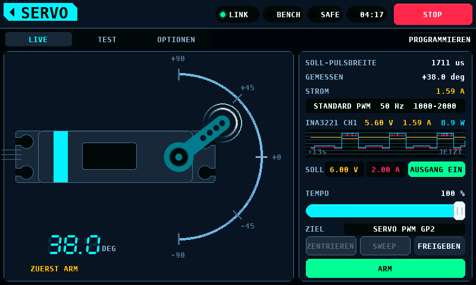

- Ein Link, der ausfällt, nimmt das letzte Fenster des INA3221 mit: `---`
  und `--`, bis das Messgerät wechselt oder ein Fenster über den Link
  ankommt.
- Der Plot wird geleert, wenn der INA3221 das Messgerät wird und wenn er es
  nicht mehr ist: die Kurve gehört dem Messgerät, das die Zeile nennt. Jedes
  Fenster und jedes Sample des Netzteils trägt das Messgerät des Polls, der
  es genommen hat: ein Messwert von vor dem Wechsel zu seinem Messgerät ist
  kein Punkt der Kurve, und keiner von danach fehlt. Die Skala des Plots
  beginnt bei 0, und ein negativer Strom wird an seinem unteren Rand
  gezeichnet.
- Die Ziffern von STROM auf LIVE werden neu gezeichnet, wenn sich ihre
  Ziffern oder ihre Farbe ändern, und für sich allein.

Der automatische Test liest das Messgerät der Servo-Schiene, wie das Panel
es bei START TEST nennt: den INA3221-Kanal, solange der INA3221 dieses
Messgerät ist und das Netzteil der PD mini, sonst die Messwerte des PD
mini, und die des Modells, wenn das Netzteil modelliert ist
([Der Strommesser des Laufs](Servo-de.md#der-strommesser-des-laufs)).

GEMESSEN ist der Winkel des Horns ab dem Mittenwert, solange AS5600 in SETUP,
INTERFACES eingeschaltet ist, der Sensor antwortet und seinen Magneten
erkennt: `+38.0deg`, Zehntelgrad, -180.0 bis +179.9, 20-mal in der Sekunde
gelesen. Antwortet der Sensor nicht oder meldet er keinen Magneten (STATUS MD
nicht gesetzt), steht dort `---`: sein Zählerstand ist dann kein Winkel. Ein
als zu schwach oder zu stark gemeldeter Magnet lässt den Winkel stehen; das
Alert-Band sagt, welches von beiden. Bei ausgeschaltetem AS5600 zeigt die Zeile
den Winkel der Rückmeldung. Die befohlene Stellung
daneben ist die Pulsbreite in Mikrosekunden.

**Das Netzteil wird auch hier eingestellt und geschaltet.** Die Zeile SOLL
unter dem Plot trägt die beiden Sollwerte von SUPPLY, Spannung und
Strombegrenzung, und seinen Ausgangsschalter. Es sind die von SUPPLY, keine
Kopie: eine Änderung auf einem Bildschirm ist die Änderung auf beiden.

- Ein Tippen auf einen Sollwert öffnet das Keypad über der linken Karte. Ein
  Wert außerhalb der Grenzen wird hineingeholt, wie auf SUPPLY.
- Ist der Ausgang an, wartet ein getippter Sollwert auf die Rückfrage von
  SUPPLY, AUSGANG IST EINGESCHALTET, mit ÜBERNEHMEN und ABBRECHEN, außer SUPPLYs OPTIONEN, RÜCKFRAGE
  IM BETRIEB, TASTENFELD ist aus. Die Rückfrage verschwindet unbeantwortet, wenn
  der Ausgang ausgeht oder STOP gedrückt wird. Ein ÜBERNEHMEN im selben Frame
  wie STOP übernimmt nichts, auch wenn das Netzteil den Ausgang erst eine
  Messung später als aus meldet.
- Eine Spannung, die von 6,0V oder darunter auf mehr als 6,0V erhöht wird,
  öffnet die Warnung NUR HV-SERVOS: Standardservos sind für 4,8 bis 6,0V
  ausgelegt, darüber arbeitet nur ein als HV (high voltage) spezifiziertes
  Servo innerhalb seiner Spezifikation; ein Standardservo kann darüber sofort
  zerstört werden. Die Spannung gilt erst, nachdem 2s HALTEN ZUM ÜBERNEHMEN gehalten wurde, dieselbe Geste wie bei der Profilwarnung;
  ABBRECHEN verwirft sie. STOP beendet das Halten. Bei eingeschaltetem Ausgang ersetzt sie die Rückfrage
  von SUPPLY und bleibt stehen, wenn der Ausgang ausgeht. Eine Spannung, die
  schon über 6,0V liegt, ändert sich ohne sie. Eine auf SUPPLY eingestellte
  Spannung öffnet sie nicht.

  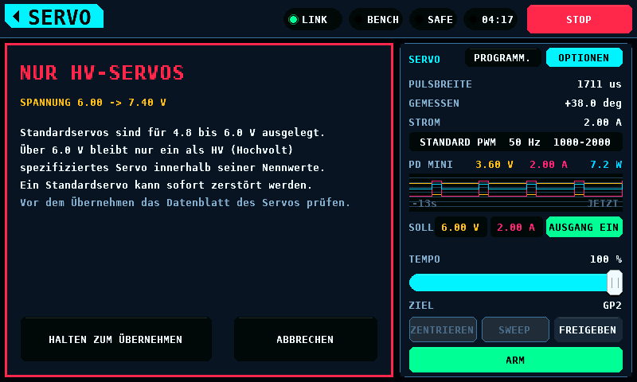

- AUSGANG EIN ist ein Halten über zwei Sekunden, AUSGANG AUS ein Tippen, wie auf
  SUPPLY. STOP beendet ein laufendes Halten. Liegt der Spannungssollwert über
  6,0V, gleich wo er eingestellt wurde, öffnet AUSGANG EIN stattdessen NUR
  HV-SERVOS mit der Spannung, und der Ausgang geht erst an, nachdem 2s HALTEN ZUM
  ÜBERNEHMEN 2s gehalten wurde; das Halten des Schalters selbst und ein Tippen
  auf ÜBERNEHMEN schalten nichts ein. Ein Sollwert, der während des gewöhnlichen
  Haltens über 6,0V steigt -- auf SUPPLY, oder nach einem Lauf
  zurückgesetzt --, wird beim Abschluss des Haltens gesehen: NUR HV-SERVOS
  öffnet sich, und nichts geht an. Das Verlassen von SERVO schaltet einen
  Ausgang aus, den SERVO eingeschaltet hat: mit AUSGANG EIN, mit einem Test
  oder mit VERBINDEN des Servo-Programmierers. Solange der
  Servo-Programmierer einen Port hält, bleibt der Ausgang an, weil ein OFF
  die Sitzung beenden und ein laufendes Schreiben abschneiden würde; er geht
  aus, wenn der Port loslässt, außer SERVO wird vorher wieder gezeigt. Ein
  ON, das SERVO verlangt hat und das auf dem Weg ist, wenn der Port das
  Netzteil übernimmt, zählt als eingeschaltet. Ein
  Ausgang, den SERVO nicht eingeschaltet hat, bleibt, wie er ist. Der
  Servo-Programmierer, die Tastenfelder und die Fragen gehören zu SERVO und
  sind kein Verlassen. Ein Druck auf AUSGANG AUS beim Verlassen wird als das
  OFF gesendet, das er war.

**SWEEP fährt das Servo eine Kurve ab**, auf dem IOmcu, wo das Timing
nicht vom Link abhängt: KURVE (Rechteck, Sinus oder Dreieck) und TEMPO
(0,05 bis 5 Zyklen je Sekunde) von OPTIONEN > SWEEP und HALTEZEIT (die
Haltezeit an jedem Ende) des automatischen Tests, um PULS MITTE herum. BEREICH ist ein Anteil des Wegs, den das
Servo machen darf: von WEG und vom näheren von PULS MIN und MAX, damit die
Kurve kein Ende erreicht, das sie nicht erreichen darf. TEMPO auf der rechten
Karte begrenzt sie wie ein Ziehen, Trim gilt nicht. Das Horn folgt derselben
Kurve, im Panel gerechnet und ab dem Moment, in dem der IOmcu seine
gestartet hat. Das Panel zeichnet nur, was der IOmcu bekanntermaßen
tut: ein verlangter oder fortgesetzter Sweep wird gezeichnet, sobald sein
Start quittiert ist, und bis dahin bleibt das Horn, wo der Ausgang ist.
Ohne Rückmeldung wird es dann ab der Stelle weitergerechnet, an der der
Ausgang war, als der IOmcu begann, entlang der Kurve mit TEMPO. Zwei
Tipper auf den Sweep-Knopf, die den Bildschirm im selben Frame erreichen,
bevor der Befehl des ersten hinaus ist, heben sich auf: nichts wird
gesendet, und der Sweep läuft weiter wie zuvor.

**PAUSE hält sie an.** Während ein Sweep läuft, heißt der Knopf PAUSE, in der
Akzentfarbe. Ein Tippen hält die Kurve dort an, wo der Ausgang gerade steht
-- TEMPO kann ihn hinter der Kurve zurücklassen --, und hält ihn dort; der
Knopf heißt dann PAUSIERT, gefüllt in der Warnfarbe. Das Halten übernimmt der
IOmcu (das HOLD des Links, SWEEP-Register 4), weil nur er genau weiß,
wo das ist; ohne Rückmeldung ist das im Panel gezeichnete Horn eine Schätzung
davon. Das Panel wiederholt das Halten alle 100ms (`SERVO_HOLD_MS`), daher
überdauert eine Pause die 500-ms-Regel des IOmcu. Eine Pause wartet
nicht hinter Sweep-Schreibvorgängen, die schon auf dem Draht sind. Ein
Tippen auf PAUSIERT setzt den Sweep an dem Punkt der Kurve fort, an dem er
angehalten wurde: die Stelle in einem Verweilen und die erreichten Enden
laufen von dort weiter, und das Horn wird ab dieser Phase gezeichnet. Die
Phase ist die der Kurve, als der IOmcu das HOLD quittiert hat, nicht
die beim Tippen: dort läuft die Kurve während des Austauschs dazwischen
weiter, und so läuft auch die Zeichnung weiter, mit dem TEMPO, das beim
Tippen galt, höchstens 500ms lang -- so lange führt der IOmcu einen
Sweep, von dem er nichts mehr hört. Ohne Rückmeldung wird das Horn dann
dorthin gesetzt, wo der Ausgang bei der Quittung war: die Kurve bis zu
dieser Phase, verlangsamt wie in der Zeichnung. Ein dazwischen geändertes TEMPO erreicht den IOmcu erst mit dem
Fortsetzen. Ein Tippen auf PAUSIERT lässt das Horn stehen, bis das
Fortsetzen quittiert ist; dann misst das Panel die Zeichnung ab der Phase,
die der IOmcu behalten hat, so wie es die beiden Quittungen gemessen
hat, auch wenn das Tippen vor der Quittung des HOLD kam; diese Quittung
setzt das Horn dann noch dorthin, wo der IOmcu den Ausgang gehalten
hat, und das Fortsetzen geht von dort weiter. Der
IOmcu behält die Phase, solange er hält, und setzt die Kurve fort
(`LINK_SV_RESUME`, Protokoll 4.6); der Ausgang fährt mit der Rate von TEMPO
von der gehaltenen Stelle zur Kurve, bei 100% sofort, und ist meist schon
dort. Eine während der Pause auf OPTIONEN > SWEEP geänderte Kurve startet
stattdessen als neuer Sweep. Ein IOmcu älter als 4.6, oder einer, der
das Fortsetzen abweist, weil sein Halten geendet hat, startet die Kurve von
ihrem Anfang -- in der Mitte bei Sinus und Dreieck, am ersten Ende beim
Rechteck --, und das Alert-Band sagt es: `IOmcu-Firmware älter als 0.13.0. Sweep beginnt von vorn.` oder `IOmcu hat das Fortsetzen abgelehnt. Sweep beginnt von vorn.`. Ebenso ein Tippen auf PAUSIERT, während der HOLD
unbeantwortet ist, denn der IOmcu kann dann halten oder noch laufen:
`Pause wurde nicht bestätigt. Sweep beginnt von vorn.`. Ein Tippen auf
PAUSIERT vor einem HOLD, den das Panel dann loslässt (siehe unten),
startet nichts: die Pause endet mit diesem HOLD.

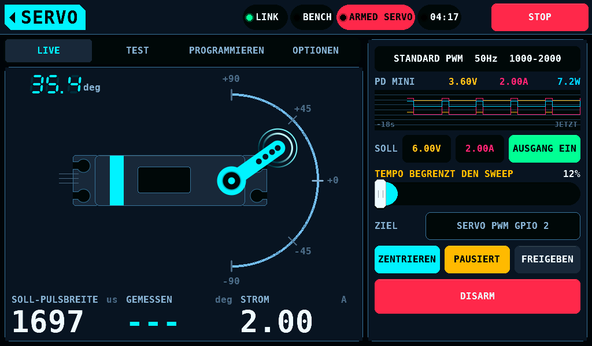

Ein Halten, das der Link 500ms nicht wiederholt hat, hat das andere Ende
losgelassen; das Panel gibt die Surfaces dann zur Mitte frei, und das Horn
geht dorthin. Ebenso ein HOLD, der erst bei einer Wiederholung oder nach
mehr als 500ms beantwortet wurde: der IOmcu kann ihn losgelassen und
anderswo erneut gehalten haben, wo er hält, ist im Panel also nicht
bekannt, und die Pause endet, statt einen Winkel zu behalten, den eine
spätere Profiländerung an das Servo schicken würde. Fällt der Link weg,
endet ein Sweep oder eine Pause ebenfalls, und das Horn wird in Ruhe
gezeichnet, wie der IOmcu die Surfaces 500ms nach dem letzten
Schreiben in Ruhe setzt; kein vorher verlangter Sweep und kein Halten
wird gesendet, wenn der Link zurückkommt, und das nächste Tippen startet
einen Sweep. Ein Finger auf der Skala, ZENTRIEREN, FREIGEBEN, STOP, ein
DISARM und das Verlassen der Seite beenden einen Sweep, ob er läuft oder
angehalten ist, und der Knopf heißt wieder SWEEP. Ein geänderter Typ, eine
geänderte Frame Rate, Pulsbreite, Trim, WEG oder UMKEHREN beenden auch eine
Pause; das Servo wird dann als Position am Winkel der Pause gehalten. Mit
Rückmeldung ist das der Winkel, den das Servo zuletzt gemeldet hat und zu
dem es sich nach dem Tippen noch bewegen kann; ohne Rückmeldung ist es die
gezeichnete Schätzung bei der Quittung. Ein
geändertes TEMPO lässt die Pause stehen; das Fortsetzen läuft mit dem neuen
TEMPO. Verlorene Touch-Ereignisse halten einen laufenden Sweep an wie PAUSE.
Eine geänderte Einstellung startet einen laufenden Sweep mit der neuen Kurve
neu, gezeichnet ab der Quittung des IOmcu; bis dahin wird die alte
Kurve weitergezeichnet, wie der IOmcu sie fährt, mit den Pulsen und
dem WEG, mit denen sie gesendet wurde. Jede Quittung wird dem Befehl
zugeordnet, den sie beantwortet: ein TEMPO oder eine Kurve, die geändert
wird, während ein Start wartet, wird nicht von der Quittung des früheren
Befehls gezeichnet. Ein geändertes
Profil oder eine geänderte Frame Rate geht sofort mit.
SWEEP gibt es bei einem Prüfstand in ARMED, mit einer gebundenen Surface und
stehendem Link und einem IOmcu mit Protokoll 4.2, sonst ist der Knopf ausgegraut;
der IOmcu hält eine Kurve an, die das Panel 500ms nicht wiederholt hat,
und lässt jede Surface dort stehen, wo ihr Ausgang gerade ist.

**TEMPO BEGRENZT DEN SWEEP** steht in der Warnfarbe statt der Beschriftung
TEMPO auf der rechten Karte, solange TEMPO langsamer ist als die schnellste
Änderung, die die Kurve verlangt. Dann bestimmt TEMPO die Bewegung, nicht
KURVE: Rechteck, Sinus und Dreieck laufen alle als Rampen mit der Rate von
TEMPO und sehen gleich aus, und der Ausgang kann umkehren, bevor er ein Ende
erreicht. Die Zeile folgt den Einstellungen; sie erscheint also schon vor
dem Druck auf SWEEP und ebenso, während ein Sweep läuft. TEMPO erhöhen oder
TEMPO (die Rate in Hz) oder BEREICH auf OPTIONEN > SWEEP senken, dann
verschwindet sie. Ein Rechteck springt zwischen seinen Enden, daher erscheint
sie dort bei jedem TEMPO unter 100%. Mit den Vorgaben der Seite SWEEP
(Sinus, 0,5Hz, BEREICH 80%) und WEG +/-90 Grad verschwindet sie
ab TEMPO 63%, beim Dreieck ab 40%.
[Servoverfahren](Servo-de.md#sweep-und-tempo) nennt die Regel.

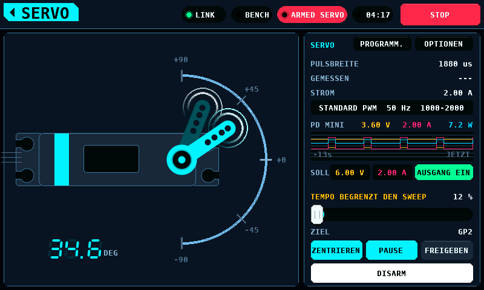

**TEST STARTEN startet den automatischen Test** von der Karte AUTOMATISCHER TEST auf TEST: das Servo
wird durch die dort gewählten Spannungen geführt, sein Strom in Ruhe, in
Bewegung und beim Halten gemessen, seine Stellzeit gemessen, und die
Spannung gesucht, bei der es sich nicht mehr bewegt. [Servoverfahren](Servo-de.md#automatischer-test)
beschreibt das Verfahren und die Dateien. Die Karte, 600 x 200px, trägt
den Namen des Laufs, eine Zusammenfassung (`4.8 6.0V BROWN-OUT, JE
60s` oder `..., JE 20 BEWEGUNGEN`), TEST STARTEN (300 x 56px) mit den
OPTIONEN der Karte (160 x 48px) daneben, die Zustandszeile, das
letzte Ergebnis mit seinen Dateien (`ZULETZT: BESTANDEN ATEST004.CSV +
.TXT`) und den Hinweis zu BLOCKIERT AB. TEST STARTEN braucht einen Prüfstand
in ARMED und ein Netzteil, das antwortet; die Zustandszeile sagt ZUERST ARM,
KEINE STUFE GEWÄHLT, NETZTEIL ANTWORTET NICHT, BEREICH ZU KLEIN (die Enden aus BEREICH
und WEG fallen auf PULS MITTE), STUFE ÜBER DEN OBERGRENZEN (eine
gewählte Stufe über der geltenden Spannungsgrenze, geprüft, bevor eine
Warnung aufgeht) oder LETZTER BERICHT SCHREIBT NOCH und folgt dem Prüfstand und
den Einstellungen, wenn sie sich ändern. Der Hinweis unter dem letzten Ergebnis sagt, wenn kein Messwert BLOCKIERT AB
überschreiten kann: `BLOCKIERT AB 2.00A unerreichbar: Strombegrenzung
2.00A`, solange BLOCKIERT AB bei oder über der Strombegrenzung der Zeile
SOLL liegt, sonst `BLOCKIERT AB 2.00A unerreichbar: INA3221-Bereich
1.638A`, solange der INA3221 das Messgerät der Schiene ist und BLOCKIERT AB
bei oder über seinem Bereich liegt. TEST STARTEN bleibt offen: siehe
[Blockieren und Konstantstrom](Servo-de.md#blockieren-und-konstantstrom).
Es ist ein Halten über zwei Sekunden,
die Geste von AUSGANG EIN, weil ein Lauf das Netzteil einschaltet und das Servo
bewegt. Ist HV-SERVO an und eine Stufe über 6,0V gewählt, öffnet ein Tippen
stattdessen NUR HV-SERVOS mit der höchsten Stufe, und der Lauf startet erst,
nachdem 2s HALTEN ZUM ÜBERNEHMEN gehalten wurde. HV-SERVO gilt für die Sitzung:
jeder Neustart schaltet es aus.

TEST bleibt beim Start zu sehen, und die Zustandszeile der Karte nennt die
Stufe. LIVE zeigt links auf seiner Karte, unter `ZUERST ARM`, das Feld des
Laufs, 346px breit und in jedem Winkel neben dem Horn: Stufe und
Phase, neben TEST BEENDEN das Messgerät, das der Lauf liest: `PD mini`, der INA3221-Kanal, `INA 0x41 CH2`, oder `SIMULATION`. Es ist das Messgerät der
Servo-Schiene bei TEST STARTEN, und der Lauf liest es bis zu seinem Ende
([Der Strommesser des Laufs](Servo-de.md#der-strommesser-des-laufs)). Der
Lauf führt das Servo und die Sollwerte und den Schalter von SUPPLY, bis er
endet. Er endet vorzeitig, mit ausgeschaltetem
Ausgang und dem Servo zur Mitte freigegeben, bei TEST BEENDEN (im Feld auf LIVE
oder auf der Karte), STOP, einem DISARM, wenn der Link geht, beim
Verlassen der Seite, bei einem Finger auf der Skala, ZENTRIEREN, SWEEP,
FREIGEBEN, einem Tippen auf einen Sollwert, einer Änderung an Typ, Impulsen,
Trim, Weg, Reverse oder TEMPO des Servos, bei verlorenen Touch-Ereignissen
und beim Netzteil: siehe [die Liste](Servo-de.md#was-einen-lauf-beendet).
Ist ein Lauf vorbei, gehen die Sollwerte von SUPPLY auf ihre Werte vor dem
Lauf zurück, gleich welche Seite oben ist. Das wartet, bis das OFF des
Laufs gesendet ist, ein danach genommener Messwert zeigt, dass das
Netzteil selbst den Ausgang aus meldet -- nicht die Anforderung des Panels,
der das PD mini einen Link-Austausch und eine Modultransaktion später
folgt --,
kein ON unterwegs ist und AUSGANG EIN weder auf SERVO noch auf SUPPLY
gehalten wird. Sollwerte, die nach
dem Ende des Laufs geändert wurden, bleiben, wie sie sind.

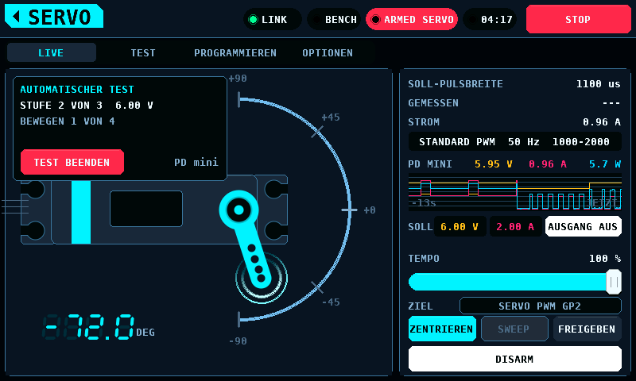

Das Ergebnis bleibt bis SCHLIESSEN im Feld auf LIVE und bis zum nächsten Lauf in
der Zeile ZULETZT der Karte: BESTANDEN, NICHT BESTANDEN oder ABGEBROCHEN
und der Grund, die längste Stellzeit und der höchste Haltestrom, und die
Dateien, die die Karte in `USER/LOGS` angenommen hat: `ATESTnnn.CSV`, und
`+ .TXT`, sobald die Karte den Bericht vollständig angenommen hat. Mit
User-Logs AUS unter [Setup](#setup) > SD CARD steht dort `USER-LOGS AUS`,
und keine Datei wird geschrieben.

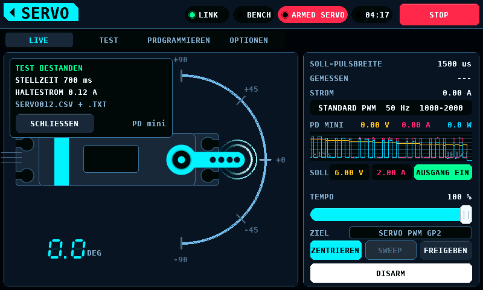

Ein Lauf, der die Fenster des INA3221 las, nennt ihn dort, wie die Zeile
über dem Plot:


**ENDLAGENLAUF STARTEN führt die Endlagensuche aus**, von der Karte
ENDLAGENLAUF auf TEST: das Servo wird in Schritten von 10us nach außen gefahren, bis
sein Strom ein blockiertes Gestänge zeigt, und mit ENDLAGENLAUF auf
SUCHEN + PROGRAMMIEREN werden LEFT ANGLE und RIGHT ANGLE eines KST- oder
Chaservo-Servos gesenkt, bis kein Ende mehr anläuft. An einem SERVO-PWM-Pin
läuft die Suche von PULS MITTE bis PULS MIN und PULS MAX; am PROG-PORT
kommt zuerst eine Lesesitzung, und die Suche läuft von NEUTRAL des Servos
bis zu seinem eigenen PULSE LOWER und PULSE UPPER.
[Servoverfahren](Servo-de.md#eingebaute-mechanische-endlage) beschreibt
das Verfahren, die Schutzmechanismen und den Bericht. Es ist ein Halten von
2s bei einem Prüfstand in ARMED und dem INA3221 als Messgerät der
Servoschiene. Darüber nennt die Zusammenfassung der Karte die Betriebsart,
`NUR SUCHE` oder `SUCHEN + PROGRAMMIEREN`, und SERVOPULSE, solange der Lauf
den Port liest. Darunter nennt eine Zeile den Ausgang, den er treibt, und
das Messgerät, `AUSGANG PROG-PORT 1 GPIO 13, STROM INA3221 0x41 CH2` oder
`AUSGANG SERVO PWM GPIO 2, STROM INA3221 0x40 CH1` (`STROM INA3221`, solange
kein Kanal das Ziel überwacht), die nächste sagt, warum er nicht starten
kann oder was er gerade tut, dann folgen das letzte Ergebnis und sein
Bericht. Diese vier Zeilen stehen in der Schrift 10 x 20, 20px
auseinander, die erste 2px unter ENDLAGENLAUF STARTEN, sodass die vierte
2px innerhalb der 200px hohen Karte endet. TEST bleibt beim Start zu
sehen. Sein Feld auf der linken Karte von
LIVE zeigt die geschriebenen Werte
von 8, die Phase mit Seite und Puls und den Ausgang, den er treibt, mit
LAUF BEENDEN; nach dem Lauf bis SCHLIESSEN das Urteil, die Werte oder die
Enden und `LIMITnnn.TXT` (`USER-LOGS AUS` mit User-Logs AUS). Der Lauf schaltet den Prüfstand für jedes
Schreiben selbst auf SAFE und auf ARMED; STOP und SAFE durch den Bediener
oder einer der Gründe des automatischen Tests beenden ihn mit
ausgeschaltetem Ausgang.

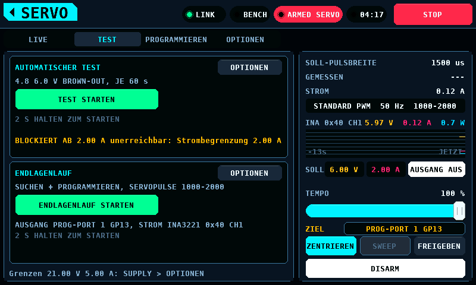
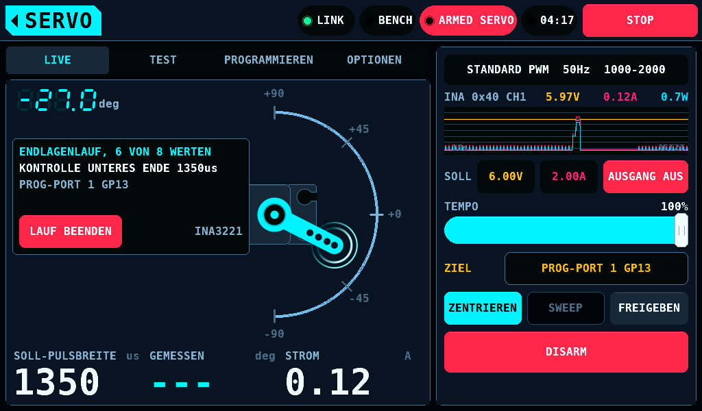
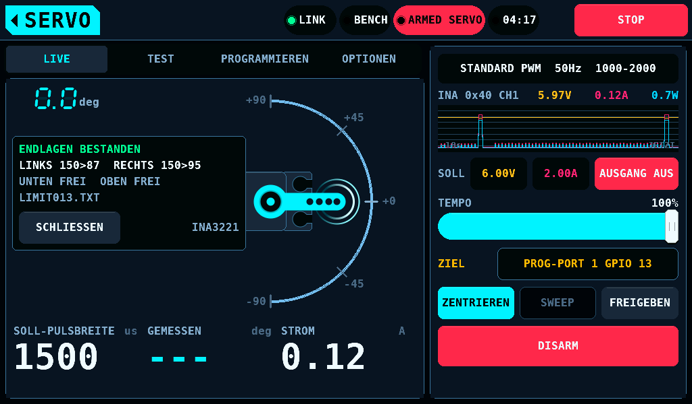
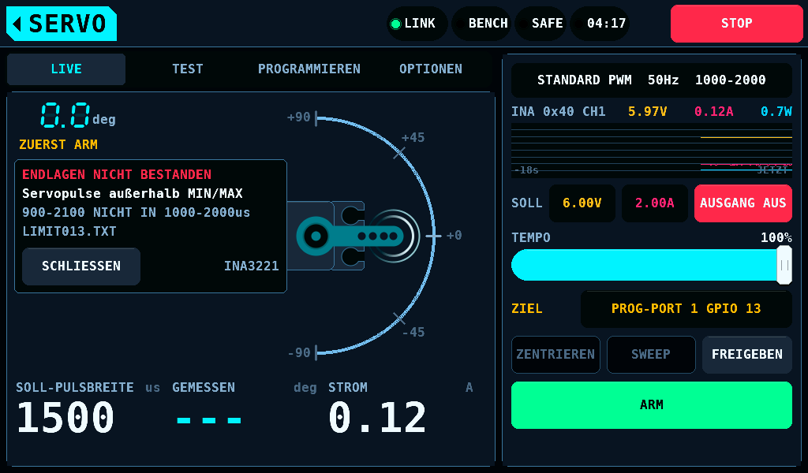

### Programmierer

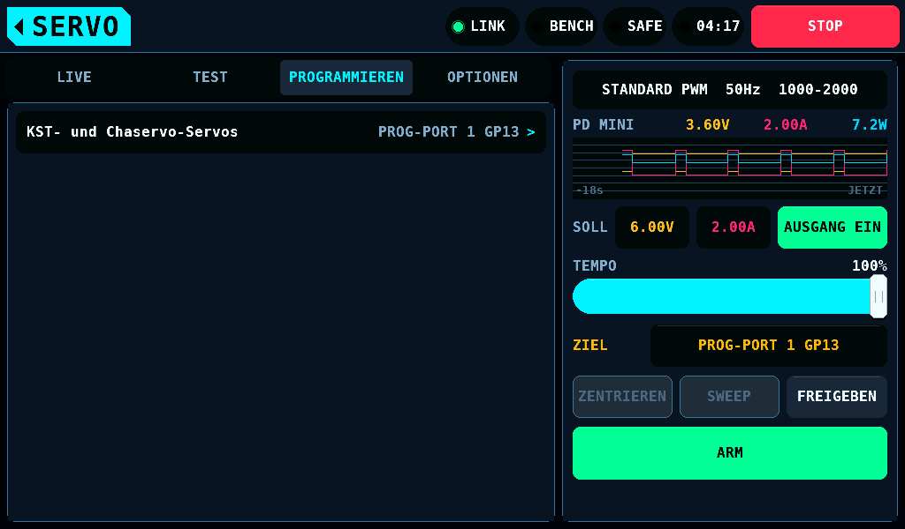
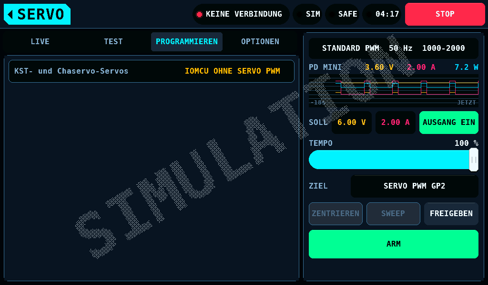


PROGRAMMIEREN in der Leiste zeigt die Liste der Programmierer im
Seitenbereich, eine Zeile je Programmierer: links der Name, rechts, was die
Zeile ansteuert, mit dem Pin, `PROG-PORT 1 GPIO 13`, dann `>`. Die Zeile für
KST und Chaservo liegt auf dem Port, den SERVO-TESTER nennt, PORT 1, PORT 2,
PORT 3 oder PORT 4, und lautet `PROG-PORT` mit ihrem Pin, solange
SERVO-TESTER auf OUTPUTS steht. Eine Zeile ist mit `PORT BELEGT` ausgegraut,
solange eine andere Sitzung ihren Port hält: die einer anderen Zeile oder
eine HITEC-Sitzung, die die Bench-Konsole geöffnet hat; das Panel liest
dazu alle 500ms STATE der HITEC-Seite. Die Hitec-Zeile wird von einer
HITEC-Sitzung nicht ausgegraut: sobald ihre Programmierung die Seite gelesen
hat, öffnet ein Port, den die Seite für eine andere Sitzung hält, diese
Programmierung mit PORT FREIGEBEN
([Ein Port, den eine andere Sitzung hält](HitecProgrammer-de.md#ein-port-den-eine-andere-sitzung-hält)).
Die Liste hat zwei Zeilen, `KST- und Chaservo-Servos` und `Hitec-Servos`.
Ein Tippen auf eine aktive Zeile
öffnet ihren Programmierer über der linken Spalte samt den Reitern der
Leiste, eine Ebene tiefer, und beendet einen laufenden automatischen Test.
SCHLIESSEN im Programmierer oder das Home-Tag steigt zurück zur Liste; das
nächste Home-Tag führt nach Hause. Über einem Tastenfeld, einer Liste, einer
Warnung oder der Buchstabentastatur im Programmierer schließt das Home-Tag
dieses Feld, und der Programmierer bleibt.

Eine Zeile wird gedimmt gezeichnet, mit ihrem Grund an der Stelle des Ports,
und ein Tippen auf sie öffnet nichts:

| Grund | Wann |
| --- | --- |
| `IOMCU OHNE SERVO PWM` | der IOmcu, die RP2350-Platine, meldet die Fähigkeit nicht, die die Zeile braucht; antwortet kein IOmcu, meldet er keine. Der Name der Fähigkeit ist der des Links und bleibt englisch |
| `PORT BELEGT` | der Programmierer einer anderen Zeile hält denselben Programmierport |

Die Zeilen stammen aus einer Tabelle in der Firmware,
`shared/ui/prog_registry.c`. Ein neuer Servohersteller ist dort eine Zeile
und sein Programmierer, nie eine Kachel und nie ein Reiter. Eine Liste mit
mehr als 9 Zeilen erhält ein Feld SUCHE, das die Buchstabentastatur öffnet,
`*` für beliebigen Text; eine Liste, die mehr als 8 Zeilen zeigt, zeichnet
sie unter den Überschriften ihrer Gruppen; eine Liste, die höher ist als
der Seitenbereich, blättert mit `^` und `v`. Eine Liste fasst höchstens 48
Zeilen. Mit zwei Zeilen ist nichts davon gezeichnet. Modellierte
Protokolle ohne Transport auf dem IOmcu haben keine Zeile
([Programmieren](#programmieren) auf MOTOR & ESC).

Eine Zeile ist 48px hoch mit 8px darunter, eine Überschrift 28px mit
4px darunter, beide in der Schrift 10 x 20. Die Leiste über einer
blätternden Liste ist 48px hoch: SUCHE 260px breit links, `^` und `v` je
56px rechts. Jeder Eintrag endet 4px über dem Alert-Band: auf der linken
Karte von SERVO passen 7 Zeilen ohne die Leiste, 6 unter ihr. Die Liste
von MOTOR & ESC ist dieselbe Liste.

Der Programmierer für KST- und Chaservo-Servos nimmt den Programmierport,
den der Tester treibt, aus PWM (Pulsweitenmodulation) und liest und
schreibt die Einstellungen des Servos über dessen Signalleitung. PROG-PORT 1
ist im Auslieferzustand GPIO 13 an Pad 17. Er verbindet nur, wenn SERVO-TESTER auf SETUP > OUTPUTS auf
einem Port steht, PORT 1, PORT 2, PORT 3 oder PORT 4; mit OUTPUTS zeigt er `Zum Programmieren muss das Servo am Programmierport angeschlossen sein.` und `Unter SETUP > OUTPUTS den SERVO-TESTER auf PORT 1 bis PORT 4 stellen.`, und VERBINDEN ist gesperrt. Solange er den Port hält,
bleibt er offen: SCHLIESSEN und das Home-Tag öffnen PROGRAMMIERMODUS
VERLASSEN, und während der Port ins Programmieren oder hinaus wechselt,
tun sie nichts. Das Verlassen von SERVO lässt den Port, wie er ist; zurück
auf SERVO ist der Programmierer auf PROGRAMMIEREN wieder offen. ARM ist gesperrt gezeichnet;
ein Druck darauf schaltet nichts und zeigt `ARMED gesperrt: Die
Servoprogrammierung belegt einen Port.` im Alert-Band, auf SERVO wie auf
MOTOR & ESC. ZENTRIEREN, FREIGEBEN und STOP funktionieren, und
SOLL-PULSBREITE zeigt `---`: der Tester sendet keinen Puls auf den Port. In PWM
mit einem antwortenden PD mini nennt die Zeile PORT des Programmierers die
Spannung und die Stromgrenze, die VERBINDEN stellt, `PORT  5.0V  1000mA`.
Die Sollwerte und AUSGANG EIN der Zeile SOLL und des SUPPLY-Bildschirms sind
so lange gedimmt und nehmen keinen Druck; AUSGANG AUS funktioniert. Er verlässt das Programmieren, ohne die Versorgung
des Servos aus- und einzuschalten. Ob ein KST-Servo im Programmiermodus PWM
folgt, ist nicht gemessen.

Das Layout des Programmierers auf der linken Karte von 620px; jedes
Bedienelement ist 48px hoch oder höher und endet 4px über dem
Alert-Band:

| Teil | Größe |
| --- | --- |
| Reiter und SCHLIESSEN | eine Zeile oben, 48px hoch: fünf Reiter von 95px, SCHLIESSEN 120px |
| Zeilen | 48px hoch im Abstand von 56px, bis zu 5 je Reiter, in zwei Spalten von 295px; eine breite Zeile nimmt beide |
| Werte | 150px (15 Zeichen der Schrift 10 x 20); bei einer breiten Zeile 260px, darin ihre Tasten `-` und `+` von 56px |
| Hinweise und Meldungen | unter der letzten Zeile, Schrift 10 x 20, 60 Zeichen je Zeile, 20px je Zeile, bis 4px über dem Alert-Band: 7 Zeilen unter dem Reiter SERVO |
| Listen (DATEIEN, ZURÜCKSPIELEN, WEITERES, ein Faktor) | ein Titel, dann bis zu 7 Einträge, 48px hoch im Abstand von 56px, ABBRECHEN 150 x 48px am Fuß |
| Warnseiten | der Titel in der Schrift 20 x 36, bis zu 16 Zeilen in der Schrift 10 x 20 (in einem niedrigeren Bereich weniger: die Zeilen, die 8px über den Tasten Platz haben), die Halte-Taste 300 x 56px und ABBRECHEN 180 x 56px am Fuß |

Die Beschriftungen der Reiter stehen in der Schrift 10 x 20, wenn jede in
ihren Reiter von 95px passt, wie im Englischen, und in der Schrift
8 x 16, wenn eine nicht passt, wie das deutsche `ABSTIMMEN`. Kein Hinweis,
keine Meldung und kein Bedienelement liegt unter dem Alert-Band. Jede Zeile
einer Meldung wird gezeichnet: die längste nimmt 5 der 7 Zeilen unter dem
Reiter SERVO. Lassen die beiden stehenden Zeilen neben der Meldung keine
Zeile für die Seitenzahl frei, weichen sie ihr: sie blättern mit den
anderen Hinweisen, zuerst, und eine Zeile, die höher ist als eine Seite,
wartet, bis die Meldung geht. Im Deutschen brauchen das längste Paar
(4 Zeilen) und die längste Meldung (5 Zeilen) 9 Zeilen; dort wartet das
Paar.

[Servo-Programmierer für KST- und Chaservo-Servos](ServoProgrammer-de.md)
beschreibt ihn.

#### Hitec-Programmierung

Die Hitec-Programmierung öffnet sich aus der Zeile `Hitec-Servos` mit
denselben Maßen: fünf Reiter (SERVO, BEWEGUNG, WEG, SCHUTZ, INFO) und
SCHLIESSEN, Zeilen von 48px im Abstand von 56px, Werte von 150px und die
breiten Werte eines Wertereiters von 260px, Hinweise in der Schrift 10 x 20
bis 4px über dem Alert-Band, und Halteseiten mit einer Haltetaste von
300 x 56px und ABBRECHEN von 180 x 56px. Sie liest das Servo und schreibt
die geänderten Werte zurück: ein Tipp auf einen schreibbaren Wert öffnet
eine Liste mit bis zu 6 Einträgen oder das Tastenfeld, SCHREIBEN INS SERVO
FREIGEBEN auf SERVO ist der Schreibschalter, und n WERTE SCHREIBEN, 220px
breit, öffnet die Schreibseite. Die Zeile SERIE
stellt vor VERBINDEN D-SERIE oder KLASSISCH ein; die Zeile PORT nennt den
Port, seinen GPIO, die Serie, die Empfangsart und die Versorgung, die
VERBINDEN einstellt. Solange sie den Port hält, sind ARM, die Sollwerte und
AUSGANG EIN der Zeile SOLL und die der Seite SUPPLY gesperrt wie unter der
KST-Programmierung, und ein Druck auf ein gesperrtes Element des Netzteils
sagt `Servoprogrammierung belegt das Netzteil: Sollwerte und EIN gesperrt.`
Solange der Port gehalten ist, steht DATEIEN an der Stelle der Zeile SERIE:
die Servodateien in `BENCH/HITEC/CONF`, 5 je Seite unter dem Eintrag, der
speichert, die Texttastatur für einen neuen Namen und DIESE DATEI PRÜFEN für
eine Datei eines anderen Modells oder jenseits einer weichen Regel.
ZURÜCKSPIELEN schreibt das Backup der Sitzung zurück, und WEITERES enthält
WERKSEINSTELLUNG für ein klassisches Servo.
Ein Port, den die HITEC-Page für eine andere Sitzung hält, öffnet sie mit
PORT FREIGEBEN, 2s Halten, das den Port mit unveränderter Versorgung an PWM
zurückgibt. [Servoprogrammierung für Hitec-Servos](HitecProgrammer-de.md)
enthält die Zeilen, den Ablauf und die Meldungen.

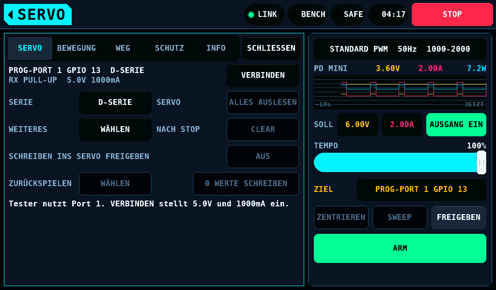
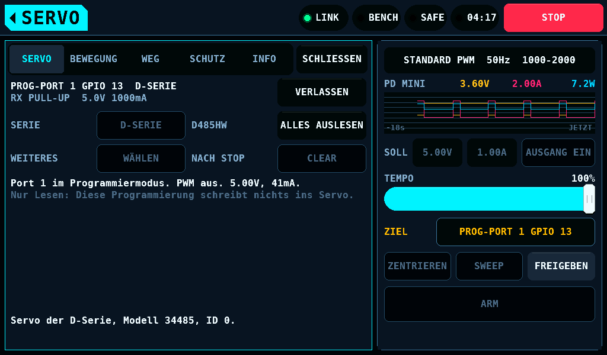
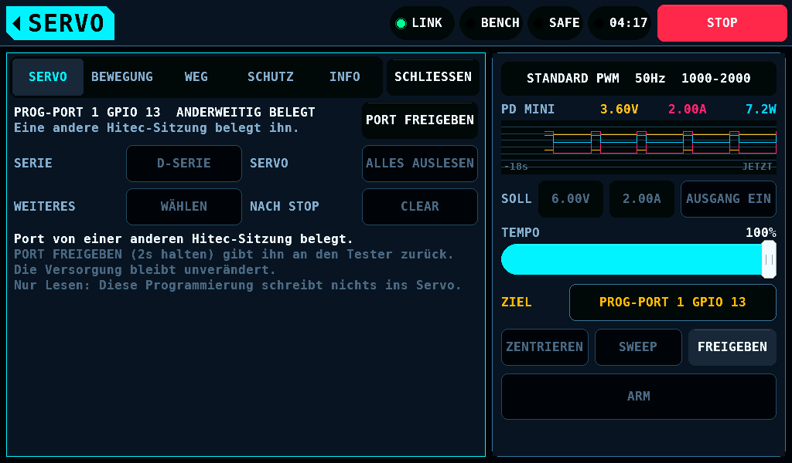


### Einstellungen

OPTIONEN in der Leiste zeigt die Einstellungen des Servos im Seitenbereich,
auf drei Seiten unter eigenen Reitern: AUSGANG, SWEEP und PRÜFLING. Die
Einstellungen jedes Laufs öffnen sich mit OPTIONEN auf seiner Karte auf
TEST, als Liste im Seitenbereich eine Ebene tiefer. SCHLIESSEN oben rechts
in der Liste, in der Zeile mit dem Namen des Laufs, oder das Home-Tag führt
zurück zu den Karten. Eine andere Aufgabe blendet die Liste aus, und TEST
zeigt sie wieder. Die Ausgangskarte bleibt, wo sie ist, und
funktioniert. Ein Wert öffnet die Tastatur, eine Liste eine Liste, ein
Schalter kippt beim Tippen, und der Name öffnet eine Buchstabentastatur.

Die Seitenreiter von OPTIONEN sind 197 x 40px quer über die Karte. Ihre
Zeilen stehen in zwei Spalten zu 295px, jede Zeile 48px hoch und 52px
von der nächsten, der Name links und der Wert rechts, 140px breit (TYP,
PULSRATE und NAME belegen beide Spalten). Die Hinweise unter den Zeilen von
AUSGANG sind Zeilen zu 60 Zeichen, 21px Abstand. Die Einstellungen eines
Laufs stehen in drei Spalten zu 193px, jede Zeile ihr Name über ihrem
48px hohen Wert, 71px von der nächsten: die 15 Zeilen des automatischen
Tests zu fünf je Spalte, die Stufen mit HV-SERVO, die Grenzwerte mit
BROWN-OUT, und Dauer und Zeiten. TESTDAUER NACH steht oben in der rechten
Spalte, unter den OPTIONEN der Karte: ein zweites Tippen auf OPTIONEN
öffnet ihre Liste und ändert keine Einstellung. Die Hinweise, die
Speicherzeile, der Hinweis zu BLOCKIERT AB und die Zeile der Grenzen unter
den Karten von TEST enden 4px oder mehr über dem Alert-Band. Die Auswahl einer Liste steht
in zwei Spalten zu fünf, 48px hoch und 56px Abstand; die Warnungen
stehen in 12 x 24px großen Buchstaben, 49 Zeichen je Zeile, mit 2s HALTEN ZUM ÜBERNEHMEN und ABBRECHEN 56px hoch, die 4px über dem Alert-Band
enden.


| Ort | Einstellung | Wirkung |
| --- | --- | --- |
| OPTIONEN > AUSGANG | TYP | das Servoprofil: STANDARD PWM, NARROW 760, WIDE, HELI CYCLIC oder HELI TAIL 760 |
| OPTIONEN > AUSGANG | PULSRATE | wie oft ein Impuls gesendet wird; die Liste des Typs oder EIGENE EINSTELLUNG über die Tastatur |
| OPTIONEN > AUSGANG | PULS MIN, PULS MITTE, PULS MAX | die Impulsbreiten, auf die der Weg abgebildet wird, 400 bis 2500us: -90 Grad ist MIN, 0 ist MITTE, +90 Grad ist MAX, und FREIGEBEN ruht auf MITTE. Ein Ende liegt nicht weiter von MITTE entfernt als MITTE von 400us oder 2500us |
| OPTIONEN > AUSGANG | TRIMMUNG | zur Mitte addiert, 5us je Schritt, bis 200us in jede Richtung; `-` und `+` stellen sie, ein Tipp auf den Wert öffnet das Tastenfeld mit Vorzeichen |
| OPTIONEN > AUSGANG | WEG | wie weit der Arm in jede Richtung darf, 10 bis 90 Grad |
| OPTIONEN > AUSGANG | UMKEHREN | die Richtung, in der der Winkel auf den Impuls abgebildet wird |
| OPTIONEN > SWEEP | KURVE, TEMPO, BEREICH | die Bewegung von SWEEP: Rechteck, Sinus oder Dreieck, 0,05 bis 5Hz, 10 bis 100% des Wegs. Der automatische Test springt zwischen den Enden, die BEREICH ergibt |
| AUTOMATISCHER TEST > OPTIONEN | TESTDAUER NACH, TESTZEIT, BEWEGUNGEN | wie lange jede Spannungsstufe läuft: eine Zeit oder eine Zahl von Bewegungen |
| AUTOMATISCHER TEST > OPTIONEN | HALTEZEIT, EINSCHWINGZEIT | Haltezeit an jedem Ende, im Test und bei SWEEP; Wartezeit nach einer Spannungsstufe vor dem Messen |
| AUTOMATISCHER TEST > OPTIONEN | STUFE 4.8 / 6.0 / 7.4 / 8.4V, BROWN-OUT | die Spannungsstufen und der Brown-out-Lauf ab 5,0V abwärts; 7,4 und 8,4V laufen nur mit HV-SERVO an |
| AUTOMATISCHER TEST > OPTIONEN | HV-SERVO | nimmt die Stufen 7,4 und 8,4V hinzu, vorgegeben aus und nach jedem Neustart aus; ein Lauf mit ihnen startet nur über NUR HV-SERVOS |
| AUTOMATISCHER TEST > OPTIONEN | BLOCKIERT AB | über diesem Strom gilt das Servo als blockiert |
| AUTOMATISCHER TEST > OPTIONEN | RUHESTROM, HALTESTROM, STELLZEIT | Pass/Fail-Grenzen; 0 wird nicht geprüft |
| ENDLAGENLAUF > OPTIONEN | ENDLAGENLAUF | NUR SUCHE oder SUCHEN + PROGRAMMIEREN, ein Tippen schaltet um; SUCHEN + PROGRAMMIEREN wird nur für ein Servo am Programmierport angeboten, sonst lautet die Zeile NUR SUCHE mit dem Grund darunter. Für die Sitzung |
| ENDLAGENLAUF > OPTIONEN | SERVOPULSE | BEHALTEN oder 1000-2000, ein Tippen schaltet um; nur mit ZIEL auf PROG-PORT angezeigt. 1000-2000 schreibt PULSE LOWER und PULSE UPPER des Servos in der Lesesitzung des Laufs, vor der Suche, auf 1000,0 und 2000,0us. Vorgabe BEHALTEN; für die Sitzung |
| OPTIONEN > PRÜFLING | NAME | das Testobjekt, bis 23 Zeichen, für den Bericht |
| OPTIONEN > PRÜFLING | BERICHT | ein Textbericht neben dem Log jedes Tests |
| OPTIONEN > PRÜFLING | SENSOR-MITTE | ein Tippen nimmt den aktuellen Zählerstand als Mitte, wenn das Servo in Neutral steht, und setzt nichts ohne einen Messwert vom aktuellen Link (keinen nach einem Linkverlust, bis ein neuer eintrifft) und solange der Sensor keinen Magneten meldet; die Zeile zeigt den gespeicherten Zählerstand, 0 bis 4095, und ist bei ausgeschaltetem AS5600 gedimmt. Dieselbe Einstellung wie SETUP, INTERFACES, AS5600-Mitte |

Das Tastenfeld der TRIMMUNG ist das eine Tastenfeld mit Vorzeichen: Seine
Taste `+/-`, zwischen dem Punkt und OK, setzt ein Minuszeichen vor die
Eingabe oder nimmt es weg, vor oder nach den Ziffern. OK nimmt -200 bis
+200us und legt den Wert auf den näheren der 5-us-Schritte von `-` und
`+`: 13 wird 15, -12 wird -10, -0 ist 0. -201 lässt das Tastenfeld offen und
nennt den Bereich in der Warnfarbe; das Vorzeichen allein ist nichts
Getipptes. Die anderen Tastenfelder haben keine Taste `+/-`, und ihre Tasten
bleiben, wo sie sind.


AS5600, der Ausgangsencoder, wird nur auf SETUP > INTERFACES ein- und
ausgeschaltet ([der Ausgangsencoder](#interfaces-der-ausgangsencoder)); der
Hinweis auf PRÜFLING sagt das. Er fügt den Winkel des Horns der Zeile
GEMESSEN sowie der CSV und dem Bericht eines Laufs hinzu
([Servo](Servo-de.md#der-ausgangsencoder)).

Die Grenzen von SUPPLY, Spannung und Strom, in denen die Sollwerte und die
Stufen eines Laufs bleiben, stehen nur lesbar unter den Karten auf TEST und
auf PRÜFLING, mit ihrem Ort und den geltenden Werten: `Grenzen 21.00V 5.00
A: SUPPLY > OPTIONEN`. Eingestellt werden sie auf SUPPLY > OPTIONEN.


Die Zeile ZIEL der Ausgangskarte, zwischen TEMPO und ZENTRIEREN, nennt, was
der Tester treibt, als `Protokoll Pins`, mittig in ihrem Wertfeld, und ist
das Bedienelement, das es wählt, wie die Zeile ZIEL von MOTOR & ESC. Ein
Tippen auf das Feld öffnet SETUP > OUTPUTS auf dem, was die Zeile zeigt,
wohin der IOmcu die Befehle jetzt schickt, nicht auf der Einstellung ZIEL:
auf dem Eintrag PROG-PORT, solange er den Port treibt, auf SERVO PWM,
solange er die Ausgänge treibt, und auf der Übersicht, solange das Ziel
nicht bekannt ist oder kein IOmcu antwortet ([Outputs](#outputs)). Ein
noch ausstehender Schreibvorgang von ZIEL oder PROG-PORT ohne Pin am Port
öffnet auf dem, was getrieben wird. Dort wählt SERVO-TESTER OUTPUTS oder PROG-PORT, die
Einstellung ZIEL, und PORT-PWM den Puls des Ports, beide im NVS
(Non-Volatile Storage) gespeichert. Das Verlassen von SERVO schaltet den
Prüfstand auf SAFE und beendet einen Sweep oder einen Test; das Home-Tag auf
OUTPUTS führt zurück zu SERVO, auf die Aufgabe, auf der die Zeile angetippt
wurde. Die Zeile ist gesperrt -- umrandet, ihr Wert gedimmt, und sie
nimmt keinen Druck --, solange der Prüfstand ARMED ist, während eines
Sweeps (laufend oder pausiert), eines automatischen Tests oder eines
Endlagenlaufs und solange der Servo-Programmierer den Port hält; das Ziel
nennt sie trotzdem. Die Ausgangskarte bleibt unter den Seiten, ihren
Tastenfeldern und dem Servo-Programmierer sichtbar, die Zeile nennt den Pin
also auch, während einer davon die linke Spalte bedeckt.

SERVO-TESTER hält OUTPUTS, PORT 1, PORT 2, PORT 3 oder PORT 4. Mit
OUTPUTS nennt die Zeile die GPIOs, die in der vom Tester getriebenen
Bindung als SERVO PWM gebunden sind: `SERVO PWM GPIO 4`, `SERVO PWM GPIO 2 GPIO 4`;
so viele Pins, wie in die 25 Zeichen des Werts passen, dann `+N`: 8 Pins ab
GPIO 40 lauten `SERVO PWM GPIO 40 +7`. Die Zeile ist in der Warnfarbe, Name und Wert, ohne einen solchen Pin
(`KEIN SERVO-PWM-PIN`) und bevor eine Bindung gelesen wurde
(`PINS NICHT AUSGELESEN`). Mit einem Programmierport lautet sie `PROG-PORT
1 GPIO 13` in der Warnfarbe, die Nummer des Ports und der GPIO, den der IOmcu
für ihn meldet. Die Befehle des Testers erreichen dann die SERVO-PWM-Ausgänge nicht;
bei einer Bank in ARMED halten diese ihren Ruhepuls, die Mitte zwischen
ihren Endpunkten. Ein Port als Ziel ohne nutzbaren Pin (keiner, beim Start
abgelehnt, FUNKTION KEINE, oder ein Port, den der IOmcu nicht hat) lautet
`PROG-PORT 1`, ebenfalls in der Warnfarbe. Der IOmcu behält dann die
Standardausgänge als Ziel, und der Tester sendet ihnen keinen Befehl außer
einer Freigabe, und SWEEP ist ausgegraut, bis der Port einen SERVO-PWM-Pin
hat oder SERVO-TESTER auf OUTPUTS steht. Mit
PORT-PWM aus gibt der Port keinen Puls aus, und die Zeile lautet `PORT 1
GPIO 13 PWM AUS`, 22 Zeichen mit einem zweistelligen Pin, oder `PROG-PORT 1
PWM AUS`. Zwei
Zustände nennen kein Ziel, beide in der Warnfarbe, und in keinem sendet der
Tester einen Befehl: `KEINE VERBINDUNG`, solange kein IOmcu antwortet, und
`UNBEKANNT`, solange die Programmierport-Seite des IOmcu seit dem
Linkaufbau nicht gelesen wurde, ein Schreiben auf sie nicht bestätigt wurde
oder ein Lesen nicht beantwortet wurde. Solange der Servo-Programmer den Port
hält, ändert sich die Zeile nicht: sie nennt weiter das Ziel, das der
IOmcu hält, einen Port oder die Ausgänge; der Programmer treibt den
Port, und der Tester sendet nichts. Die Seite wird alle 500ms gelesen. Ein
IOmcu ohne diese Seite (Protokoll älter als 4.13) hat die
Standardausgänge als Ziel. Die Zeile folgt dem Ziel, das der IOmcu
hält, nicht der Einstellung: eine Änderung von SERVO-TESTER wartet auf einen
ruhigen Prüfstand und erscheint in der Zeile, sobald der IOmcu sie
übernommen hat. Der IOmcu startet mit den Ausgängen als Ziel und legt das
Ziel auf die Ausgänge, solange eine Programmiersitzung ihren Port ohne Pin
lässt. In SAFE schreibt das Panel den eingestellten Port innerhalb eines
Lesens der Seite, 500ms, zurück, ohne auf das nächste ARM zu warten.


| Typ | Mitte | Weg | Bildwiederholraten |
| --- | --- | --- | --- |
| STANDARD PWM | 1500us | 1000-2000us | 50, 60, 100, 150, 200, 250, 300, 333Hz |
| NARROW 760 | 760us | 660-860us | wie STANDARD PWM |
| WIDE | 1500us | 800-2200us | wie STANDARD PWM, bis 312Hz |
| HELI CYCLIC | 1520us | 820-2220us | 50, 120, 200, 333Hz |
| HELI TAIL 760 | 760us | 410-1110us | 200, 333, 560Hz |

Ein Impuls braucht eine Pause vor dem nächsten Frame. STANDARD PWM, NARROW 760
und WIDE halten mindestens 1ms zwischen den Impulsen, ihre höchste Rate ist
also 1 / (längster Impuls + 1ms): 333Hz bei 2000us. Die Heli-Profile laufen
mit den Raten, die Rotorflight für digitale Taumelscheiben- und
Schmalband-Heckservos nennt, mit mindestens 0,5ms zwischen den Impulsen. Eine
Rate, die den Impulsen keine Pause lässt, wird abgelehnt, ebenso ein längerer
PULS MAX bei einer Rate, in die er nicht passt. Die Pause gilt nach dem
längsten Impuls, den der IOmcu ausgeben kann, dem oberen Ende des
Bereichs, den ein Befehl trägt: PULS MAX, oder darüber hinaus, wenn PULS MITTE
nicht in der Mitte liegt, um so viel, wie PULS MITTE näher an MAX liegt als an MIN.
Eine PULS MITTE, die dieses Ende über die Pause der Rate schieben würde, wird
ebenfalls abgelehnt.

**Ein Heli-Typ oder jede Bildwiederholrate über 60Hz kann ein Servo zerstören,
das nicht dafür gebaut ist.** Die Wahl öffnet eine Warnung in der
Gefahrenfarbe, die nennt, was gewählt ist und was es mit einem nicht dafür
gebauten Servo macht; angewendet wird es erst, nachdem 2s HALTEN ZUM ÜBERNEHMEN gehalten wurde. ABBRECHEN, ein abrutschender Finger, ein Touch-Verlust und das
Verlassen des Bildschirms wenden nichts an. Typ und Rate bleiben auf der
rechten Karte rot, und jeder Neustart geht auf STANDARD PWM mit 50Hz zurück:
ein nach einem Neustart angestecktes Servo bekommt nie eine Rate, die für ein
anderes gedacht war.


**Die Frame Rate erreicht die Pins** über die SERVO-Page des IOmcu
(Protokoll 4.1). Sie gilt nur für das ZIEL. Mit OUTPUTS, den Standard-Servoports,
als Ziel ist das jeder PWM-Ausgang, dessen erster Kanal die Rolle surface hat; ein
PPM-Ausgang behält seinen eigenen Frame. Mit PROG-PORT als Ziel ist es der Pin
des Programmierports, und jeder Slot behält seine eigene Rate (Protokoll
4.19). Jeder andere Programmierport läuft mit 50Hz. Ein Port, dessen Pin
seinen PWM-Slice mit dem Pin eines anderen Programmierports teilt, läuft nur
mit 50Hz: der RP2350 gibt beiden Pins eines Slices einen Teiler und einen
Wrap, eine schnellere Rate dort wird also abgelehnt. Eine Änderung des
ZIELS setzt die Rate auf 0 zurück, jeden Ausgang auf seine eigene Rate,
und die Seite sendet ihre Rate mit der nächsten Stellung erneut. Sie geht mit jeder
gehaltenen Stellung hinaus, und ein Profilwechsel, während das Servo in ARMED
ruht, setzt die Ruhelage mit ihr neu; einer, der während eines laufenden Arm
geschieht, ist der, den der Arm verwendet. Eine schnellere Rate folgt den
Impulsbreiten, sobald alle angekommen sind; jede andere Rate geht ihnen voraus,
und nichts Breiteres geht hinaus, bevor sie angekommen ist. So tragen die Pins
nie eine schnelle Rate mit den breiteren Impulsen eines langsameren Profils.
Die AUSGANG-Seite sagt, was aus ihr wurde:

| Hinweis | Bedeutung |
| --- | --- |
| Aktiv | die Rate läuft auf dem Ziel, das der IOmcu hält, benannt nach seiner PROG-Seite: `Aktiv: AUSGÄNGE laufen mit 330Hz.` oder `Aktiv: PROG-PORT GPIO 13 läuft mit 330Hz.` Der Hinweis steht in der Warnfarbe, solange dieses Ziel vom gewählten ZIEL abweicht (zweite Zeile `Das gewählte ZIEL ist nicht aktiv.`; PROG-PORT ohne an den Port gebundenen Pin lässt OUTPUTS das Ziel), solange das Port-Ziel keinen Pin hat, solange PORT-PWM AUS ist (`PORT-PWM ist AUS. Der Port gibt keine Pulse aus.`) und solange das Ziel unbekannt ist. Mit einem IOmcu vor Protokoll 4.19 lautet der Hinweis "jedes PWM-Ruder läuft mit": ein solcher IOmcu fährt jede PWM-Surface mit der Rate, gleich was ZIEL nennt. Ohne Link lauten beide `Keine Verbindung. Die aktive Pulsrate ist unbekannt.` in der Warnfarbe: ein IOmcu, der bei unterbrochenem Link neu startet, fährt jeden Pin wieder mit seiner eigenen Rate |
| Die Pulsrate wird mit der nächsten Position | noch nicht geschrieben |
| ABGELEHNT | ein Puls des Ziels -- einer Surface, oder des Programmierports, solange sein Puls eingeschaltet ist -- ist länger als der Frame bei dieser Rate, oder ein Pin des Ziels teilt sich einen PWM-Slice mit einem Ausgang auf einer anderen Rate; die Pins behalten ihre Rate |
| Dieser IOmcu nimmt keine Frame Rate | Protokoll 4.0: jeder PWM-Ausgang läuft mit den 50Hz seiner Bindung |

Ein Neustart des IOmcu und jede auf OUTPUTS geschriebene Bindung setzen
jeden Slot auf seine eigene Rate zurück, 50Hz für ein Servo; die Seite sendet
ihre Rate mit der nächsten Stellung erneut, gegen die dann geltende Bindung.
Eine Bindung wird nicht geschrieben, solange das Zurücksetzen auf die eigene
Rate jedes Slots unbeantwortet bleibt (OUTPUTS meldet `KEINE VERBINDUNG`) oder
abgelehnt wird (`ABGELEHNT`), und der Prüfstand wird von keiner
Seite aus ARMED, solange die Rate des ZIELS nicht bekannt ist: Der Arm
wird mit `Pulsrate des Servos unbekannt. ARM erneut halten.` abgelehnt, und ein Arm, der
bei unterbrochenem Link gemacht wurde, erreicht den IOmcu erst, wenn das
Zurücksetzen angekommen ist.

Die AUSGANG-Einstellungen, HV-SERVO, ENDLAGENLAUF und SERVOPULSE gelten für
die Sitzung; die Einstellungen von SWEEP, des automatischen Tests und von
PRÜFLING und ZIEL liegen im NVS. Eine Änderung fordert das Schreiben sofort
an; der Speicher nimmt es im ersten Frame, in dem der Prüfstand ruht
([Werte behalten](#werte-behalten)). Die Speicherzeile sagt
`GESPEICHERT`, `SPEICHERN AUSSTEHEND`, `NICHT GESPEICHERT` oder
`ÄNDERUNGEN IN SETUP NICHT GESPEICHERT`: unten auf jeder Seite von OPTIONEN,
und auf den Einstellungen eines Laufs unter seinem Namen.


Aktuelle Einschränkungen:

- Bis die Seite eine Stellung sendet, laufen die Pins mit der Rate, die die
  SERVO-Page hält; nach einem Neustart oder einer neuen Bindung sind das 50Hz.
- Am Netzteilmodell des Panels sind die Ströme des automatischen Tests die Last des Modells, nicht die
  des Servos: ein Lauf dort misst das Modell. [Was nicht gemessen ist](Servo-de.md#was-nicht-gemessen-ist).
- Das Netzteil auf der rechten Karte ist das von SUPPLY: der PD mini, wenn
  SETUP ihn einschaltet, sonst das Modell des Panels, dessen Spannung, Strom
  und Leistung simuliert und nicht gemessen sind.

## Netzteil


Stellt ein programmierbares Netzteil ein, schaltet es und zeichnet es auf: den
PD mini, einen USB-PD-Trigger (USB Power Delivery), der über einen UART
(Universal Asynchronous Receiver-Transmitter) gesteuert wird. Der
IOmcu steuert ihn über einen PIO-UART (PIO: Programmable
Input/Output) auf zwei seiner Pins, über die SUPPLY-Link-Page (Protokoll
4.3). Das Panel schreibt die Page und liest sie alle 100ms. Ist der PD mini
in SETUP unter INTERFACES eingeschaltet, nennt die Kopfzeile das Modul und die UART-Pins des IOmcu, an denen
es hängt: `PD MINI TX GPIO 12 RX GPIO 13`, aus den Einstellungen PD mini TX und
PD mini RX. Ist einer der beiden Pins nicht gesetzt oder liegen beide auf
einem GPIO, steht `PD MINI OHNE PINS` in der Kopfzeile. Ist der PD mini abgeschaltet, rechnet das Panel an seiner Stelle ein Modell eines
Netzteils: die Kopfzeile sagt SIMULIERTES NETZTEIL, und die Kachel im Menü trägt
SIMULIERT.

SUPPLY ist eine Werkbank: oben eine Leiste mit Aufgaben, LIVE und OPTIONEN,
je 150 x 40px, und darunter eine Seite. Die Kachel im Menü öffnet immer
LIVE. Ein Tipp auf einen Reiter wechselt die Aufgabe; ein Wechsel ist keine
Navigationsebene und lässt die Ansicht von LIVE, GRAFIK oder TABELLE, wie
sie war.

| Aufgabe | Die linke Spalte, 620px |
| --- | --- |
| LIVE | der Plot oder die Tabelle über den Sollwerten |
| OPTIONEN | die 9 Einstellungen des Netzteils unter OBERGRENZEN, NACH DEM NEUSTART, ABSCHALTUNGEN und RÜCKFRAGE IM BETRIEB ([Netzteil, Optionen](#netzteil-optionen)) |

Die Kopfzeile ist die Zeile rechts neben der Leiste: das Modul und seine
Pins, ONLINE oder ANTWORTET NICHT in 10 x 20 und am rechten Ende der Bereich,
den die Sollwerte annehmen können, in 8 x 16, zum Beispiel
`3.3-8.4V  0.50-5.00A`. Sie bleibt
auf beiden Aufgaben und unter der Tastatur und der Frage sichtbar. Die
Leiste rechts, 380px, ist auf beiden Aufgaben dieselbe: vier Messwertkarten
von 64px, SPANN., STROM, LEIST. und MODUS, und die Karte STEUERUNG mit mAh
und Wh des Laufs in ihrer Titelzeile, SPITZENWERTE ZURÜCKSETZEN (48px) und
AUSGANG EIN / AUS (60px) an ihrem Fuß, wo SERVO und MOTOR & ESC ARM und
DISARM haben.

Das Layout ist das von MOTOR & ESC. Auf LIVE trägt die linke Spalte die
Karte des Ausgangs, GRAFIK | TABELLE unter ihrem Titel, und darunter
SOLLWERTE. Jeder Sollwert ist eine Zeile: sein Name, dann die Taste `-0.1`
(72 x 48px), die Spur (312 x 48px), die Taste `+0.1` und der Wert in einem
Feld von 120 x 48px. Der Plot zeigt Spannung, Strom und Leistung der
letzten 30s. Die Leiste rechts zeigt die Messwerte, die
niedrigste Spannung des Laufs und seinen höchsten Strom und seine höchste
Leistung. MODUS sagt, welchen Sollwert das Netzteil hält: CV (constant voltage)
bei der eingestellten Spannung oder CC (constant current) an der
Strombegrenzung. CC steht in der Warnfarbe: ein Netzteil in CC liefert der
Last nicht die Spannung, auf die es gestellt ist.

Ein Sollwert steht neben seinem Messwert. SPANN. und STROM tragen ihn in Klammern
hinter dem Namen, und der Plot zeichnet ihn gestrichelt in der Farbe und auf
der Skala des Messwerts. TABELLE führt beide auf. Der Wert in Klammern ist der
Sollwert, den das Netzteil zu halten meldet; solange es nicht antwortet, der
des Bildschirms.

| Sollwert | Modell | PD mini | Knöpfe |
| --- | --- | --- | --- |
| SPANNUNG | 3,3 bis 21V, Schritte von 20mV | 1 bis 20V, Schritte von 10mV | 0,1V |
| STROMBEGRENZUNG | 0,5 bis 5A, Schritte von 50mA | 0,05 bis 3A, Schritte von 10mA | 0,1A |

Die Bereiche des Modells sind das weiteste Profil einer USB-PD-PPS-Quelle
(Programmable Power Supply), 3,3 bis 21V bei bis zu 5A. Die des PD mini
stammen von der Seite des Herstellers und sind nicht gemessen. Der PD mini
ist ein Abwärtswandler und gibt nicht mehr ab, als er bekommt: seine
Spannung ist zusätzlich auf 0,7V unter der Eingangsspannung begrenzt, die
er meldet, bei 5V Eingangsspannung also höchstens 4,3V. Unter 1,7V Eingangsspannung bleibt der Mindestwert von 1V, den der Bildschirm als Grenze zeigt, und unter 1,5V bleibt der Ausgang aus; solange keine Eingangsspannung gelesen ist, gilt 20V. Ein Sollwert über der
Eingangsspannung bringt das Modul in ERR, bis es stromlos war; welchen Abstand es
braucht, ist nicht gemessen. Die Grenze liegt 0,2V über der Linie, an der
der Ausgang abgeschaltet wird (siehe unten): die Eingangsspannung darf unter
Last um 0,2V sinken, bevor ein Sollwert an der Grenze abgeschaltet wird. Beide engen
die Grenzen unter OPTIONEN ein, und die Schieber folgen dem Netzteil, das
in Gebrauch ist. Ein Tippen auf eine Spur setzt den Wert unter dem Finger.

**Ein Tippen auf die Karte SPANN. oder STROM oder auf das Wertfeld eines
Sollwerts öffnet eine Tastatur** über der linken Spalte, unter der Leiste,
mit Tasten von 145 x 76px. Sie zeigt den Bereich in der
Titelzeile und den aktuellen Wert blass, bis eine Ziffer getippt ist. OK
übernimmt einen Wert im Bereich, gerundet auf den Schritt des Netzteils; ein
Wert außerhalb wird abgelehnt, und der Bereich wechselt in die Warnfarbe. OK
ohne Eingabe und ABBRECHEN lassen den Sollwert, wie er war.


**Eine Änderung an einem eingeschalteten Ausgang fragt zuerst.** Solange der
Ausgang an ist, öffnet ein neuer Sollwert vom Schieber oder seinen
Schrittknöpfen oder von der Tastatur eine Frage, die die Änderung nennt.
ÜBERNEHMEN gibt sie dem Netzteil; ABBRECHEN verwirft sie, und der Schieber geht
zurück. Ein Ziehen fragt einmal, beim Loslassen, und bis dahin hält das
Netzteil den alten Sollwert. Ein Ziehen, das endet, ohne dass sein Finger
abhebt -- das Home-Tag mit einem zweiten Finger getippt oder ein Kontakt,
den der Touch-Controller verliert --, fragt nichts, und der Schieber geht
zurück. Bei ausgeschaltetem Ausgang wird nichts gefragt.
STOP schließt die Frage unbeantwortet: ein ÜBERNEHMEN im selben Frame (etwa
50ms) wie STOP übernimmt nichts. OPTIONEN schaltet die Frage für den Schieber und für die Tastatur getrennt
ab.


**AUSGANG EIN ist ein Zwei-Sekunden-Halten**, dieselbe Geste und dieselbe Blende
wie ARM. AUSGANG AUS ist ein Tippen. STOP schaltet den Ausgang auf jedem
Bildschirm ab. Ebenso jeder andere Stopp, den der Prüfstand zählt -- ein Touch,
der nicht mehr antwortet, ein ON, dessen Touch-Ereignisse verloren gingen, bevor
ein ganzer Frame den Ausgang eingeschaltet sah, und ein IOmcu, der nicht
ARMED bleiben will -- sowie ein Netzteil, das nicht mehr antwortet, und eine
Abschaltung. Der Ausgang bleibt aus, bis er wieder eingeschaltet wird. Das
Verlassen des Bildschirms schaltet einen Ausgang aus, den SUPPLY eingeschaltet
hat: einen, der als an gemeldet ist, oder ein ON auf dem Weg. SERVO und ESC
STICK tun dasselbe für den Ausgang, den jeder eingeschaltet hat, so dass ein
Ausgang nur an ist, solange der Bildschirm gezeigt wird, der ihn eingeschaltet
hat. Die Ausnahme: ein Ausgang, den SERVO eingeschaltet hat, bleibt nach dem
Verlassen von SERVO an, solange der Servo-Programmierer seinen Port hält, bis
der Port loslässt (siehe SERVO). Ein Servo wird von SERVO versorgt, ein ESC von
ESC STICK. MOTOR & ESC schaltet keine Versorgung; ein ESC, der dort läuft, wird
aus seiner eigenen Quelle versorgt. Ein Ausgang, den ein anderer Bildschirm
eingeschaltet hat, bleibt beim Verlassen von SUPPLY, wie er ist. Das Tastenfeld,
die Frage, die übrigen Overlays von SUPPLY und ein Wechsel der Aufgabe sind
kein Verlassen. Der
Bildschirm für den verlorenen Link, der kein STOP hat, öffnet sich nicht,
solange der Ausgang an ist.

**Das Home-Tag führt eine Ebene nach der anderen zurück.** Der Ausgang
bleibt dabei, wie er ist:

| Von | Das Home-Tag führt zu |
| --- | --- |
| der Frage | dem, was darunter liegt; die Änderung wird verworfen, wie ABBRECHEN sie verwirft |
| einer Tastatur | dem, was darunter liegt, LIVE oder OPTIONEN; der Wert bleibt unverändert |
| LIVE oder OPTIONEN | dem Menü; ein Ausgang, den SUPPLY eingeschaltet hat, geht aus |

Die Aufgaben sind Geschwister, keine Ebenen, wie bei MOTOR & ESC und SERVO:
Das Home-Tag steigt nie von OPTIONEN zu LIVE.

**Mit dem PD mini** geht ein OFF vor allem anderen an die SUPPLY-Page, was
das Panel ihr schuldet, und der IOmcu schaltet den Ausgang selbst ab,
wenn der Heartbeat des Panels ausbleibt. Ein eingeschalteter PD mini zeigt
ANTWORTET NICHT, solange kein IOmcu antwortet, der Protokoll 4.3
spricht, oder solange die Messwerte der Page älter als 1500ms sind; ein
Ausgang, der an ist, wird dann abgeschaltet. Antwortet die Page, während der
Messwertzähler des Moduls (SAMPLES) steht -- ein Lesen der Anzeige, das
fehlschlägt, während die anderen Lesungen antworten --, bleibt ONLINE: nach
1500ms ohne neuen Messwert zeigen die Karten für Spannung, Strom und
Leistung Striche, und keine Abschaltschwelle, kein Spitzenwert und keine
Summe übernimmt einen Messwert; nach
3000ms (`SUPPLY_LINK_BLIND_MS`) wird ein Ausgang, der an ist, abgeschaltet,
und das Band sagt `Keine Messwerte vom Netzteil. Ausgang aus.`. Ein Sollwert, der sich
schneller ändert, als das Modul ihn übernimmt -- der Slider gezogen mit
REGLER UND SCHRITTE aus, etwa ein neuer Sollwert alle 50ms --, hält die
Messwerte nicht auf: eine Lesung, die 400ms über ihre Fälligkeit hinaus
ist (`PDMINI_POLL_LATE_MS`), geht vor das nächste Schreiben eines Sollwerts,
eine nach der anderen mit einer anderen Transaktion dazwischen; das Lesen
des Zustands und das Lesen der Eingangsspannung vor einem Schreiben dürfen auch
direkt auf eine andere Lesung folgen. Bei einem Modul, das sofort antwortet,
wird die Anzeige dann etwa 500ms nach dem letzten Lesen der Anzeige gelesen
und der Zustand des Ausgangs etwa 900ms nach dem letzten Lesen des
Zustands, jeweils mit bis zu zwei Transaktionen mehr. Ein Ausgang, den das
Modul einschaltet, während er am Panel aus ist, oder selbst abschaltet, wird
auch während des Ziehens erkannt. Die Eingangsspannung wird vor dem Schreiben eines
Sollwerts oder einem ON nur gelesen, wenn eines davon wartet, und nicht
zwischen den Lesungen für ein ON. Sollwerte und ein ON erreichen ein Modul,
das bis zu 390ms spät antwortet (der Treiber wartet 400ms; Host-Modell,
40 Startphasen): ein Sollwert innerhalb von 2,5s; ein ON innerhalb von
3,6s, wenn die Sollwerte schon geschrieben sind, bis zu 7,5s, wenn es
direkt nach einer Änderung des Sollwerts oder einem Ziehen kommt; ein Modul,
das seinen Ausgang selbst schaltet, wird während des Ziehens innerhalb von
2,1s erkannt. Ein Ausgang, den das Modul einschaltet, während OFF verlangt
ist, wird bei einem Modul, das sofort antwortet, etwa 500ms später
abgeschaltet, bei einem, das bis zu 390ms spät antwortet, in Ruhe bis zu
1,8s und während des Ziehens bis zu 2,1s später. Die echte Antwortzeit des
Moduls ist nicht gemessen.
Aktuelle Einschränkung: ein Modul, das spät antwortet, dehnt die 500ms der
Lesungen von Zustand und Eingangsspannung, denn jede Transaktion dauert seine
Antwortzeit. In Ruhe wird die Eingangsspannung bei 100ms Verspätung 850ms
auseinander gelesen, bei 200ms 1,3s und bei 390ms 2,5s; der Zustand bis
zu 1,5s auseinander.
Aktuelle Einschränkung: antwortet das Modul 279ms oder später und wird der
Slider gezogen, wird die Anzeige erst 3,7s bis 5,0s nach dem letzten
Lesen der Anzeige gelesen (5,0s bei 390ms), über `SUPPLY_LINK_BLIND_MS`
hinaus; ein Ausgang, der an ist, wird abgeschaltet, und das Band sagt
`Keine Messwerte vom Netzteil. Ausgang aus.`. Das Panel liest die Page
alle 100ms, was die Lücke, die es sieht, um bis zu 100ms verlängert: ab
263ms Verspätung ist die Lücke des Treibers über 2,9s, die Abschaltung ist
also ab 263ms möglich. In Ruhe steht das Lesen der Anzeige bis zu 2,5s bei
390ms. Es steht über 1,4s ab 259ms Verspätung und 1,5s ab 279ms, die
Karten können also ab etwa 260ms Striche zeigen. Ebenfalls abgeschaltet, mit
einer Zeile im Band, wird der Ausgang, wenn der IOmcu ein ON abweist
(kein Heartbeat) oder eines fallen lässt (sein Heartbeat blieb aus, oder er
ist neu gestartet). Schaltet das Modul den Ausgang selbst ab -- sein Überstromschutz oder sein
Knopf --, wird er ebenfalls abgeschaltet und erst mit einem neuen Halten
wieder eingeschaltet. Das Band sagt außerdem, wenn die Pins abgewiesen werden,
wenn der Ausgang nicht schalten will und wenn die Sollwerte nicht übernommen
werden. Eine Änderung der Pins oder der Baudrate und das Ein- oder Ausschalten
des PD mini schalten den Ausgang ab.

**Eine einbrechende Eingangsspannung schaltet den PD mini ab.** Solange der Ausgang an
ist, liest der IOmcu die Eingangsspannung des Moduls alle 500ms bei einem
Modul, das sofort antwortet, und weiter auseinander bei einem, das spät
antwortet (siehe oben). Liegt die Eingangsspannung bei 2 Lesungen hintereinander
unter dem Sollwert plus 0,5V, schaltet er den Ausgang sofort ab, und das
Band nennt Eingangsspannung und Sollwert, zum Beispiel
`PD-mini-Eingang 6.18V liegt unter den nötigen 6.00V + 0.5V. Ausgang aus.`.
Vom Einbruch bis zur Abschaltung vergeht bei einem Modul, das sofort
antwortet, etwa 1,0s. Aktuelle Einschränkung: bei einem, das spät
antwortet, sind es 1,7s bei 100ms Verspätung, 1,9s bei 200ms und bis zu
4,7s bis 390ms (Host-Modell). Der Ausgang bleibt aus bis zu einem neuen
Halten. Eine Eingangsspannung unter 1,5V
lässt keinen Platz für den kleinsten Sollwert, 1,0V: das ON wird nicht
geschrieben, und das Band zeigt dieselbe Meldung. Eine einzelne niedrige
Lesung schaltet nichts, und eine fehlgeschlagene Lesung zählt weder mit noch
setzt sie zurück. Solange der Ausgang an ist, wird sein Sollwert einer
fallenden Eingangsspannung nicht nachgeführt. Die Regel ist ohne Messung am Prüfstand
gewählt: ob ein eingeschaltetes Modul bei einbrechender Eingangsspannung in ERR geht,
ist nicht gemessen, also kann die Regel einen Lauf abbrechen, der
durchgehalten hätte.

AUSGANG EIN und AUS, SPITZENWERTE ZURÜCKSETZEN und die Messwerte bleiben auf
OPTIONEN und unter der Tastatur und der Frage bedienbar. Ein Finger zur Zeit: solange einer ein
Bedienelement hält, bewirkt ein zweiter Finger nirgends auf dem Bildschirm
etwas.

### Netzteil, Optionen

OPTIONEN, der zweite Reiter der Leiste, zeigt die Einstellungen des
Netzteils in der linken Spalte: die Obergrenzen und die Startwerte links,
die Abschaltungen und die Rückfragen rechts, jede eine Zeile von 48px mit
ihrem Wert in einem Feld von 120 x 48px, und die Speicherzeile am Fuß. Jede liegt im NVS (Non-Volatile Storage)
des Panels und übersteht einen Neustart. Ein Wert öffnet die Tastatur über
der Seite, ein Schalter kippt beim Tippen. Ein Tipp auf LIVE bei offener
Tastatur schließt sie, und die Einstellung behält ihren Wert, wie ABBRECHEN
ihn lässt. Dasselbe gilt für die Tastatur eines Sollwerts und einen Tipp auf
OPTIONEN. Solange die Frage zu einem eingeschalteten Ausgang offen ist,
nimmt die Leiste keinen Tipp an, bis ÜBERNEHMEN oder ABBRECHEN sie
beantwortet. Jede Änderung wird im nächsten Frame geschrieben,
in dem der Prüfstand SAFE ist und kein Schalten auf ARMED wartet, der Ausgang
des Netzteils aus ist und kein ON eingereiht ist und die Zeichnung der Platine
weder geladen noch abgelegt wird, und mit ihr jede ungespeicherte Änderung
aus SETUP: ein Flash-Schreibvorgang hält beide Kerne an, AUSGANG AUS und die
Abschaltungen eingeschlossen. Die unterste Zeile sagt GESPEICHERT, SPEICHERN AUSSTEHEND, NICHT GESPEICHERT
(der Schreibvorgang wurde abgelehnt) oder SETUP NICHT GESPEICHERT: eine
Änderung in SETUP, die ohne SPEICHERN verlassen wurde und die nichts schreibt, bis
SPEICHERN dort oder eine Änderung hier danach fragt.


| Einstellung | Bereich | Vorgabe | Wirkung |
| --- | --- | --- | --- |
| SPANNUNG MAX | 3,3 bis 21V | 21,00V | die höchste Spannung, die ein Sollwert annimmt |
| STROM MAX | 0,5 bis 5A | 5,00A | die höchste Strombegrenzung, die ein Sollwert annimmt |
| STARTSPANNUNG | bis SPANNUNG MAX | 6,00V | der Spannungs-Sollwert nach einem Neustart |
| STARTSTROM | bis STROM MAX | 2,00A | die Strombegrenzung nach einem Neustart |
| ÜBERSTROM | 0 bis 5A | AUS | Ausgang aus, wenn der Strom ABSCHALTZEIT lang darüber lag |
| ÜBERSPANNUNG | 0 bis 21V | AUS | Ausgang aus, wenn die Spannung ABSCHALTZEIT lang darüber lag |
| ABSCHALTZEIT | 0 bis 5000ms | 100ms | wie lange ein Messwert über einer Abschaltschwelle liegt, bevor sie auslöst |
| REGLER UND SCHRITTE | EIN, AUS | EIN | fragen, bevor der Schieber einen eingeschalteten Ausgang ändert |
| TASTENFELD | EIN, AUS | EIN | fragen, bevor die Tastatur einen eingeschalteten Ausgang ändert |

Eine Grenze, die unter einen Sollwert gesenkt wird, holt den Sollwert sofort
auf sie herunter, und einen Startwert mit ihm. Ein getippter Wert kommt in der
sicheren Richtung auf den Schritt der Einstellung: eine Grenze rundet ab, 12,01V
erlauben also 12,00V, und eine Abschaltschwelle über 0 ist mindestens ein Schritt, nie
AUS. Eine Abschaltschwelle von 0 ist aus. Die Zeit über einer
Abschaltschwelle zählt ab dem ersten Messwert darüber. Ein Messwert unter
seiner Abschaltschwelle beginnt die Zählung neu; ein Messwert, der nicht
ankam, lässt sie stehen. Eine Abschaltung schaltet den Ausgang ab, MODUS zeigt
ABGESCHALTET, bis der Ausgang wieder eingeschaltet wird, und das Band sagt, welche
Schwelle ausgelöst hat. Das Netzteil hält seine Strombegrenzung in CC, daher löst ein
ÜBERSTROM auf oder über STROMBEGRENZUNG nicht aus; unter der Begrenzung
gesetzt, schaltet er eine Last ab, die zu lange zu viel zieht.

Nach einem Neustart ist der Ausgang aus, welche Startwerte auch gelten.

Ist der PD mini das Netzteil, bietet OPTIONEN außerdem PD MINI ZURÜCKSETZEN. Das
schaltet den Ausgang ab und startet das Modul neu (sein Befehl
SYSTEM_RESET), für ein Modul, das ERR zeigt -- ein Sollwert über seiner
Eingangsspannung bringt es dorthin --, ohne es abzustecken. Etwa 1s später wird es
wieder gefragt, wer es ist. Ob ein Neustart jedes ERR löst, ist nicht
gemessen. Ein IOmcu älter als Protokoll 4.4 kann nicht neu starten:
der Ausgang geht aus, und das Band sagt es.

### Das Log

Ein Lauf ist ein Einschalten des Ausgangs. Der Plot leert sich, wenn der
Ausgang angeht, und hält den Lauf, nachdem er ausgeht. mAh und Wh in der
Titelzeile von STEUERUNG zählen den Lauf aus den angezeigten Messwerten, jeder Schritt auf 1s
begrenzt. SPITZENWERTE ZURÜCKSETZEN beginnt die niedrigsten und höchsten Werte neu ab dem
aktuellen Messwert.

Ein Lauf wird in eine eigene `SUPPLnnn.CSV` in `BENCH/LOGS` geschrieben,
eine Zeile alle 50ms, solange Auto-Logs unter [Setup](#setup) > SD CARD
auf EIN steht:

```
time (s);set (V);voltage (V);limit (A);current (A);power (W);mode;charge (mAh);energy (Wh);source
```

Ein Messwert, der nicht ankam, ist eine leere Zelle. `mode` ist CV, CC oder
OFF und leer, solange das Netzteil nicht antwortet. `source` ist `measured`
für die Werte des PD mini und `model` für das Modell des Panels. Der Prüfstand hat beim
Log Vorrang: ARM während eines Netzteil-Laufs beendet dessen Datei, und ein
Ausgang, der beim Schalten auf SAFE noch an ist, beginnt eine neue. Ladung und
Energie dieser Datei zählen von den Summen seit dem Einschalten des Ausgangs
weiter, wie auf dem Bildschirm; ihre erste Zeile beginnt also nicht bei 0. Das
Netzteil wird in seinem eigenen 50-ms-Takt geführt und geloggt, auch während
die Steuer-Task auf den Link wartet; ein IOmcu, der nicht antwortet,
dünnt weder den Plot noch das Log des Netzteils aus.

Das Modell ist eine Last von 6Ω mit einem Stoß von 1,4A für 0,6s alle
3s, hinter einem Quellwiderstand von 0,05Ω. Bei den Startwerten, 6,00V
und 2,00A, bringt der Stoß es in CC. Seine Messwerte sind nicht gemessen,
und am Prüfstand wird nichts versorgt.

Die Verdrahtung des PD mini -- PD mini, PD mini TX, PD mini RX und PD mini
Baud -- steht in SETUP unter INTERFACES. TX und RX sind GPIO-Nummern des
IOmcu: TX geht zum DM des Moduls, RX kommt von seinem DP. Ihre Tasten `-`
und `+` springen über den GPIO, den die andere Zeile hält, und tun am Ende
des Bereichs nichts: mit RX auf GPIO 47 bleibt TX auf GPIO 46. Das Tastenfeld
lehnt den GPIO der anderen Zeile ab und zeigt statt des Bereichs `Diesen
GPIO hält der andere PD-mini-Pin`. Eine gespeicherte
Einstellung mit beiden auf einem GPIO wird so geladen: das Panel schreibt die
Page abgeschaltet, der PD mini bleibt aus, und beide Zeilen sagen `TX und RX
auf einem Pin. Der PD mini bleibt aus.`, bis eine verstellt wird. Der
Schalter PD mini schaltet das Modul ab. Der
IOmcu weist einen Pin ab, der reserviert, an einen Ausgang gebunden,
vom Sensorbus oder vom Phasenabgriff gehalten oder der andere Pin ist, und
das Band sagt `PD-mini-Pins abgelehnt. SETUP > INTERFACES prüfen.`: RX auf
GPIO 17 wird abgewiesen, solange Sensor-SDA GPIO 16 ist, denn Sensor-SCL ist dann
GPIO 17. Der Alert verlässt das Band, sobald eine Lesung die Page mit der
verlangten Verdrahtung zeigt: sofort, wenn der Pin auf den zurückgestellt
wird, den die Page noch hält. Hat das Modul einmal geantwortet, wartet eine
Änderung auf eine danach gesendete Zustandslesung des Moduls, höchstens etwa
1,2s, und wird nur übernommen, wenn diese den Ausgang aus zeigt: das Modul
kann sich zwischen zwei Zustandslesungen selbst einschalten, über seinen
Knopf oder seine Einstellung AUTO OUT, und neue Pins ließen ihm keinen Weg
zum OFF. Zeigt die Lesung den Ausgang an oder schlägt sie fehl, wird die
Änderung abgewiesen, und das Band sagt
`PD-mini-Anschlüsse abgelehnt. Sein Ausgang kann noch eingeschaltet sein.`. Eine
abgewiesene Änderung wird erst wieder geschrieben, wenn sich die Verdrahtung
in SETUP ändert; auch dieser Alert verlässt das Band, sobald eine Lesung die
Page mit der verlangten Verdrahtung zeigt. PD mini Baud ist die eigene UART-Baudrate-
Einstellung des Moduls: 9600, 19200 (ab Werk), 38400, 57600, 115200, 230400
oder 460800 Baud, oder AUTO. AUTO, die Vorgabe, lässt den IOmcu sie
finden: er versucht jede der 7 Raten, eine pro Sekunde. Die Kopfzeile von
SUPPLY zeigt die Rate in Gebrauch hinter ONLINE, z. B. `ONLINE 38400`, bei
AUTO wie bei einer festen Rate.


## Receiver


Sechzehn Kanäle in zwei Spalten mit je acht Spuren von 52px. Eine Spur zeigt
den Namen des Kanals in 10 x 20, seinen Verlauf, einen Balken von 56px Breite
für den aktuellen Wert und den Wert in us in 8 x 16. Der Verlauf sind 200
Werte, je einer pro Pixel: etwa 2,8s bei 71 Frames je Sekunde (ein
S.BUS-Frame alle 14ms). CH17 und CH18 sind die beiden Digitalkanäle. Ein
Glitch ist eine Spitze in einer Spur; ein Dropout ist eine Kerbe durch alle
sechzehn im selben Moment.

Die Zustandskarte rechts ist 260px breit: das Zustandswort in 20 x 36, seine
Zeile in bis zu drei Zeilen 12 x 24, BUS, RATE, FRAMES, RESYNC und ENDBYTE FALSCH in
Zeilen von 32px, und CH17 und CH18 als Leuchten von 44px Höhe, deren Punkt leuchtet, solange der Kanal gesetzt ist; sie nehmen keinen Tipp an. KANÄLE
und ROHDATEN sind Reiter von 150 x 48px. ROHDATEN zeigt die Bytes des
letzten Frames, acht je Zeile, und die Zähler des Decoders in 8 x 16.

Keine Firmware speist diesen Bildschirm bisher (siehe
[Empfängerbusse](Receivers-de.md)); er zeigt KEIN SIGNAL.

Der Zustandsblock zeigt einen von KEIN SIGNAL, FAILSAFE, FRAME LOST und LIVE, mit
einer Zeile Erklärung:


Im FAILSAFE sendet der Empfänger wohlgeformte Werte, die er selbst erzeugt;
jede Spur wird rot gezeichnet. FAILSAFE als Stopp behandeln, nicht als
sechzehn gültige Kanäle. [Empfängerbusse](Receivers-de.md) beschreibt die
Zustände.

## Akku


Die Zellen werden als Abweichung vom Mittelwert des Packs gezeichnet. Das
Urteil folgt der Spreizung, dem größten Abstand zwischen zwei beliebigen
Zellen: GUT unter 30mV, BEOBACHTEN ab 30mV, ERSETZEN ab 60mV. Die Skala folgt
dem Pack bis hinunter zu einer Untergrenze von 12mV und steht neben dem Plot.

Die Plotkarte ist 640px breit, die rechte Karte 360px. Ein Balken ist
höchstens 48px breit und reicht 164px zu jeder Seite des Mittelwerts. Unter
jedem Balken stehen Nummer und Spannung der Zelle in 12 x 24 bis 11 Zellen und
in 10 x 20 von 12 bis 14. Das Urteil steht in 20 x 36, seine Zeile in bis zu
zwei Zeilen 12 x 24, die sechs Zeilen sind je 36px hoch, der Hinweis in
10 x 20.

Unter Last messen. In Ruhe liest sich eine schwache Zelle wie die anderen.

Keine Firmware speist diesen Bildschirm: Kein Zellenmonitor wird gelesen,
ein Prüfstand zeigt also KEIN AKKU. Das Bild oben ist aus einem Modell gerendert.

## Logs


Karte durchsehen, Datei öffnen, prüfen, was der Import erkannt hat, dann
plotten:


Das Home-Tag geht eine Ebene zurück, wie ZURÜCK: vom Plot zur Importansicht,
von der Importansicht zur Dateiliste, von der Dateiliste zum Menü. Über der
Rückfrage zu LÖSCHEN ist es ABBRECHEN. WLAN, in der unteren Reihe neben
AKTUALISIEREN, öffnet [WLAN](#wlan), und DATEIEN daneben öffnet
[Files](#files).

Die Dateiliste teilt den Körper in drei Teile. Die Kopfzeile, Körper-y 4 bis
52, trägt STAMM, USER und BENCH (je 110 x 40px), den Ordner und den Namen
der Karte und, solange der Ordner mehr als eine Seite hält, VORIGE und
NÄCHSTE (140 x 48px). Die Liste darunter ist 1008px breit und zeigt 7
Zeilen von 44px im Abstand von 48px: Jede Zeile nimmt einen Tipp auf ihren
ganzen 48px an. Eine Zeile zeigt den Namen der Datei, ihr Datum und
rechtsbündig ihre Größe, in der Schrift 10 x 20. Der Name nimmt bis zu 60
Zeichen; ein längerer zeigt seine ersten 58 und `..`. Das Datum ist die
Änderungszeit, die die Karte führt, wie INFO in [Files](#files) sie zeigt:
in der Zone von SETUP > PANEL, `Zeitzone`, `2026-10-26 09:41`, in einer
Spalte von 160px. Eine Datei mit einem Zeitstempel in 1980, dem einer nicht
gestellten Uhr ([PANEL: Zeitzone und Uhr](#panel-zeitzone-und-uhr)), oder
ohne Zeitstempel lässt die Spalte leer. Die Größe steht in einem Feld von
100px am Ende der Zeile. Art und Länge der Datei zeigt sie nicht. Die Fußzeile,
Körper-y 440 bis 492, trägt links AKTUALISIEREN (140 x 52px), WLAN und
DATEIEN (100 x 52px), rechts LÖSCHEN und ÖFFNEN (140 x 52px), und endet
4px über dem Alarmband. Eine Meldung zu einer Datei steht zwischen DATEIEN
und LÖSCHEN auf bis zu zwei Zeilen von 28 Zeichen.

Die Importansicht zeigt ERKANNT (400px breit) neben der Spaltenliste
(600px, 7 Zeilen im Abstand von 48px), darunter vier Tasten von 246 x
52px. Der Plot ist 992 x 316px groß, über ihm vier Chips der Reihen von
240 x 44px; unter ihm stehen die Zeitmarken, dann ZURÜCK (140 x 52px),
`<` und `>` (96 x 52px) und die Zeile des Cursors. Die Rückfrage zu LÖSCHEN
ist ein Kasten von 700 x 280px mit ABBRECHEN und LÖSCHEN von 300 x 56px.
Beschriftungen, Zeilen, Tasten und die Warnungen des Imports stehen in der
Schrift 10 x 20; die Sätze der leeren Liste, der Rückfrage, der Kästen, die
sagen, warum nichts erscheint, und die Meldungen zu Dateien in 12 x 24; die
Zeitmarken des Plots und die Bereiche der Spalten und der Chips in 8 x 16.

Der Reader für CSV (Comma-Separated Values) akzeptiert Dezimalkomma und
Dezimalpunkt, eine Einheitenzeile und Zeilen ungleicher Länge; die
Importansicht zeigt, was er entschieden hat, bevor die Datei geplottet wird.
Eine Datei öffnet mit bis zu 4 gewählten Spalten: in einer SERVO-Datei
`pulse`, `angle`, `current` und `voltage`, jede, wo sie Zahlen hält, dann
die nächsten Zahlenspalten; in jeder anderen Datei ihre ersten 4
Zahlenspalten. Jede numerische Spalte zeigt ihren Bereich vom kleinsten zum größten Wert:
mit einer Nachkommastelle, solange beide Enden unter 1000 liegen, ab 1000
ohne (`11.9..12.6V`, `2392..14639rpm`). Ein Bereich breiter als die 17
Zeichen seines Felds verliert die Nachkommastelle (`-999.9..-999.9mOhm`
wird `-1000..-1000mOhm`); ein noch breiterer
wird am Rand des Felds abgeschnitten. Eine Zeile endet an ihrem
Zeilenvorschub (LF, 0x0A). Text nach dem letzten Zeilenvorschub ist eine
Zeile, die ein Stromausfall oder eine volle Karte abgeschnitten hat: Sie
kann jedes Feld enthalten und eine gekürzte Zahl, `95` von `9554`, deshalb
fehlt sie in den Zeilen, den Kennwerten und im Plot. ZEILEN steht dann in
der Warnfarbe, und die Importansicht meldet `LETZTE ZEILE UNVOLLSTÄNDIG. ÜBERSPRUNGEN.`. Eine Datei eines anderen Programms, die ohne Zeilenvorschub endet,
verliert ihre letzte Zeile genauso. Leerzeichen nach dem letzten
Zeilenvorschub sind keine Zeile, ebenso Tabs und Wagenrückläufe (CR).

Vom Prüfstand aufgezeichnete Läufe werden in zwei Ordner der Karte
geschrieben, jeder Lauf unter dem Namen dessen, was ihn gestartet hat, und
einer Nummer von 001 bis 999. Das Panel legt jeden Ordner an, eine Ebene
nach der anderen, wenn es zum ersten Mal hineinschreibt. Die Tabelle nennt
die vorgegebenen Ordner; Ordner Auto-Logs und Ordner User-Logs unter
[Setup](#setup) > SD CARD stellen andere ein:

| Ordner | Name | Lauf |
| --- | --- | --- |
| `BENCH/LOGS` | `SERVOnnn.CSV` | ein Schalten auf ARMED von SERVO |
| `BENCH/LOGS` | `MOTORnnn.CSV` | ein Schalten auf ARMED von ARM auf MOTOR & ESC oder einem Stick-Lauf auf dessen PROGRAMMIEREN |
| `BENCH/LOGS` | `SUPPLnnn.CSV` | ein Einschalten des SUPPLY-Ausgangs, solange der Prüfstand SAFE ist |
| `USER/LOGS` | `ATESTnnn.CSV` | ein AUTOMATISCHER TEST; sein Bericht ist `ATESTnnn.TXT` |
| `USER/LOGS` | `LIMITnnn.TXT` | der Bericht eines ENDLAGENLAUFS, ohne CSV daneben |

Der Name folgt dem Bildschirm, der den Prüfstand geschaltet hat: Ein ARM,
das die Throttle-Ausgänge verlangt, schreibt `MOTORnnn`, eines, das die
Surfaces verlangt, `SERVOnnn`. Ein IOmcu älter als Protokoll 4.18 schaltet
mit jedem ARM die Throttle-Ausgänge mit; ein Schalten auf ARMED von SERVO
schreibt trotzdem `SERVOnnn.CSV`.

Zwei Schalter unter [Setup](#setup) > SD CARD entscheiden, was geschrieben
wird. Auto-Logs AUS schreibt nichts nach `BENCH/LOGS`; während eines Laufs
ausgeschaltet, beendet es dessen Datei. User-Logs AUS schreibt nichts nach
`USER/LOGS`; ein Test behält den Zustand, mit dem er gestartet ist. Beide
stehen ab Werk auf EIN. Das Fehlerprotokoll, `BENCH/RCBENCH.LOG`, wird
unabhängig von den Schaltern geschrieben.

Ein unter [Setup](#setup) > SD CARD geänderter Ordner gilt ab der nächsten
Datei: Ein schon offener Lauf oder Test endet in dem Ordner, in dem er
begonnen hat. Der nächste wird nach dem nummeriert, was der neue Ordner
enthält. Beide Arten dürfen denselben Ordner nennen; seine Nummern sind
dann eine Reihe über alle fünf Namen. Die Dateien in einem vorher benutzten
Ordner werden nicht gelistet: Die Tabs USER und BENCH listen die jetzt
eingestellten Ordner. Die Dateien bleiben auf der Karte, und mit dem alten
Ordner wieder eingestellt sind sie wieder gelistet.

Firmware 0.21.0 und älter schrieb jeden Lauf ins Stammverzeichnis der Karte:
`BENCHnnn.CSV`, `ESCnnn.CSV`, `SERVOnnn.CSV` mit seiner `SERVOnnn.TXT` (ein
Servotest) und `SERVOnnn.TXT` allein (ein Endlagenlauf). Diese Dateien
bleiben, wo sie sind, und bleiben lesbar: Nichts verschiebt sie, und der Tab
STAMM listet sie.

Die Nummern sind eine Reihe je Ordner, über alle Namen darin: Der nächste
Lauf nimmt eins über der höchsten Nummer im Ordner, gleich unter welchem
Namen, in `BENCH/LOGS` folgt auf `SUPPL041.CSV` und `SERVO042.CSV` also
`MOTOR043.CSV` oder `SUPPL043.CSV`. Eine Nummer, die eine CSV- oder
TXT-Datei trägt, ist vergeben, ebenso eine im Namen eines Ordners. Das Panel
liest einen Ordner einmal, wenn es nach einem Start zum ersten Mal
hineinschreibt, und merkt sich die Nummer danach; bevor es eine Nummer
nimmt, prüft es die 10 Namen, die diese Nummer tragen kann (5 Namen, CSV und
TXT), sodass eine inzwischen geschriebene Datei übersprungen und nicht
überschrieben wird. Eine Lücke, die eine gelöschte Datei hinterlässt, wird
nicht gefüllt. Ein Ordner mit einer Nummer 999 unter irgendeinem Namen nimmt
keinen weiteren Lauf an, auch wenn niedrigere Nummern frei sind: Das Band
meldet `Karte voll oder nicht beschreibbar. Lauf nicht aufgezeichnet.`, für
einen Test `Karte fehlt oder ist voll. Servotest nicht aufgezeichnet.` Eine
Karte im Steckplatz, die sich nicht mounten lässt, meldet für einen Test
`Karte ist weder FAT32 noch exFAT. Servotest nicht aufgezeichnet.` oder
`Karte nicht lesbar. Servotest nicht aufgezeichnet.` Ein
Ordner, der sich nicht anlegen lässt, weil eine Datei seinen Namen trägt
oder die Karte schreibgeschützt oder voll ist, meldet
`Ordner BENCH/LOGS nicht anlegbar. Lauf nicht aufgezeichnet.` Nach einem
gescheiterten Lauf liest das Panel den Ordner beim nächsten Mal neu, sodass
eine inzwischen gelöschte Datei ihre Nummer freigibt. Die Liste zeigt die
CSV-Dateien und die Berichte, und LÖSCHEN auf einem Lauf löscht den Bericht
mit demselben Namen und derselben Nummer mit. Ein Bericht ist eine
`.TXT`-Datei mit dem Namen eines Laufs (`log_report_number()`), dieselbe
Regel, nach der FILES einen Bericht kennzeichnet: `ATESTnnn.TXT` neben
`ATESTnnn.CSV` oder ohne sie, `LIMITnnn.TXT`, das ein ENDLAGENLAUF ohne
CSV-Datei schreibt, und im Stammverzeichnis `SERVOnnn.TXT` von Firmware
0.21.0 und älter. Ein Lauf und sein Bericht sind zwei Zeilen, die CSV-Datei
zuerst: ÖFFNEN auf der CSV-Datei liest sie in den Import, ÖFFNEN auf dem
Bericht öffnet ihn im [Textbetrachter](#der-textbetrachter). Andere `.TXT`-Dateien stehen nicht in der Liste.
Die Läufe stehen nach Nummer, der neueste zuerst, über alle Namen im
Ordner, ein Bericht nach seiner eigenen Nummer: `LIMIT044.TXT`, dann
`MOTOR043.CSV`, dann `SERVO042.CSV`, dann `SERVO042.TXT`, dann
`SUPPL041.CSV`.


ÖFFNEN auf einem Bericht öffnet ihn im
[Textbetrachter](#der-textbetrachter) auf FILES, nur lesend. Der Titel im
Band lautet FILES; das Home-Tag führt zurück zu LOGS, und der Bericht ist
in der Liste wieder gewählt. Ein Bericht über 1MiB bleibt in der Liste,
und die Fußzeile meldet
`Über 1MB: zu groß. Lade die Datei über Wi-Fi herunter.`


Drei Tabs links in der Kopfzeile wählen den Ordner der Liste, in dieser
Reihenfolge: STAMM (das Stammverzeichnis der Karte), USER (Ordner
User-Logs, vorgegeben `USER/LOGS`) und BENCH (Ordner Auto-Logs, vorgegeben
`BENCH/LOGS`). Ein angetippter Tab listet seinen Ordner ab der ersten Seite. Ohne Karte
wechseln die Tabs ebenso: Der angetippte Tab ist gewählt gezeichnet, der
Kasten zeigt `Keine Karte. Setze eine Karte ein und tippe auf AKTUALISIEREN.`
mit der Zeile dieses Tabs darunter, und der Tipp sucht erneut nach einer
Karte, wie AKTUALISIEREN. Eine Karte im Steckplatz, die sich nicht mounten
lässt, meldet stattdessen
`Karte ist weder FAT32 noch exFAT. Am Computer formatieren.` oder
`Karte nicht lesbar. Am Computer prüfen, dann AKTUALISIEREN.`
([Das Format der SD-Karte](#das-format-der-sd-karte)). Die
Kopfzeile rechts der Tabs zeigt den Ordner, `BENCH/LOGS`, und auf STAMM
nichts. Der Name der Karte, `UNITEST`, schließt die Zeile rechtsbündig ab:
am rechten Rand der Liste, und links von VORIGE, wenn VORIGE und NÄCHSTE
sichtbar sind. Ein leerer Ordner
sagt, warum, und was hineingehört: `Keine .csv-Dateien in BENCH/LOGS.` und
die Namen, die er aufnimmt, oder mit seinem Schalter auf AUS
`AUTO-LOGS AUS unter SETUP > SD CARD.`. Unter der Rückfrage zu LÖSCHEN sind
die Tabs ausgeblendet. Eine Datei, die von einem Tab aus geöffnet wurde,
bleibt die Datei dieses Tabs: Ihre Importansicht und ihr Plot lesen sie aus
diesem Ordner, gleich welcher Tab inzwischen gewählt ist.

Die Liste zeigt den Ordner in Seiten zu 48 Einträgen, und ein Ordner fasst
bis zu 999 Läufe. Die Seiten beginnen mit dem neuesten Lauf: erst die Läufe und
die Berichte nach Nummer, die höchste zuerst, dann die
Dateien, die der Prüfstand nicht geschrieben hat, nach Namen. Die Zeilen einer Seite stehen in derselben
Reihenfolge, der neueste Lauf oben. Was neu heißt, steht in der Nummer im
Namen: Das Datum einer Datei ist nur so gut wie die Uhr des Panels, die bei
jedem Einschalten ungestellt startet und im Heimnetz über NTP (Network Time
Protocol) gestellt wird ([PANEL: Zeitzone und Uhr](#panel-zeitzone-und-uhr)).
Eine Datei, die vorher geschrieben wurde, trägt das Datum 1980.


Mit mehr als 48 Dateien im Ordner stehen `VORIGE` und `NÄCHSTE` in der
Kopfzeile, und der Reiter nennt den Teil der Karte, den die Seite zeigt,
`DATEIEN 145 BIS 192 VON 1000`, statt `DATEIEN`. `VORIGE` ist auf der ersten
Seite grau, `NÄCHSTE` auf der letzten. Die Seiten werden von oben zu je 48
geschnitten: stehen vor der gezeigten Seite weniger als 48 Einträge, etwa
nachdem ein Lauf aufgezeichnet wurde, liest `VORIGE` die erste Seite von oben.
Läufe, die aufgezeichnet werden, während eine spätere Seite offen ist,
stehen auf Seite 1. `VORIGE` überspringt dann auf dem Rückweg ab Seite 3 so
viele Einträge, wie aufgezeichnet wurden; `NÄCHSTE` von Seite 1 zeigt sie,
und die Zahlen im Reiter zeigen die Verschiebung. Jede
Seite liest den Ordner des Tabs einmal: der Durchlauf behält die
48 Einträge dieser Seite und zählt den Rest, sodass das Panel eine Seite im
Speicher hält, unabhängig davon, wie viele Dateien die Karte enthält. Das
Lesen läuft auf der Task, die den Bildschirm zeichnet und Berührungen
verarbeitet. Bei 999 Läufen braucht die Auswahl auf einem Desktop-Rechner
(x86-64, gemessen) etwa 2ms; auf dem Panel sind 20 bis 40ms geschätzt, und
das Verzeichnis sind 63 Sektoren zu 512 Bytes, etwa 25ms beim SPI-Takt (SPI:
Serial Peripheral Interface) der Karte von 20MHz, oder 125 Sektoren, etwa
50ms, mit einem Bericht neben jedem Lauf. Beides ist auf dem Panel nicht
gemessen. Ein Ordner mit einem Bericht neben jedem Lauf listet bis zu 1 998
Einträge; die Zeit der Auswahl dafür ist nicht gemessen. Die Größe jedes
Eintrags kommt mit dem Lesen des Verzeichnisses, eine Seite kostet also
einen Durchlauf und die Auswahl.

Der Rollbalken am rechten Rand der Liste ist 56px breit, 8,4mm bei den 0,150
mm Pixelabstand, die für das Panel angenommen sind (nicht gemessen). Die Länge
des Griffs entspricht dem Anteil der sichtbaren Zeilen an der Seite, und er
rollt innerhalb der Seite. Ein Tippen auf die Bahn bringt die Mitte des Griffs
unter den Finger; ein Finger auf dem Griff zieht ihn.

LOGS liest die Karte bei jedem Öffnen, aus dem Menü oder zurück aus WLAN:
die erste Seite des Ordners des Tabs, ihr neuester Lauf gewählt. Ein Lauf,
der aufgezeichnet wurde, während LOGS geschlossen war, steht so ohne
`AKTUALISIEREN` in der Liste. Hat das Panel seit dem letzten Öffnen von LOGS
eine Datei geschrieben, öffnet LOGS auf dem Tab dieser Datei; sonst bleibt
der Tab, wie er verlassen wurde, nach einem Neustart BENCH.
Eine offen gelassene Import- oder Diagrammansicht einer Datei bleibt offen;
die Liste dahinter ist die gerade gelesene.

`AKTUALISIEREN` liest die gezeigte Seite erneut. Auf der ersten Seite liest es
von oben, sodass ein inzwischen aufgezeichneter Lauf erscheint. Auf einer
anderen Seite liest es ab dem ersten Eintrag dieser Seite, auch wenn diese
Datei inzwischen gelöscht ist. Enthält der Ordner inzwischen weniger Einträge,
zeigt `AKTUALISIEREN` die letzte Seite. Jedes Lesen wählt den neuesten Lauf
der Seite aus, die oberste Zeile, sodass `ÖFFNEN` den gerade aufgezeichneten
Lauf öffnet. Eine Seite ohne nummerierten Lauf wählt nichts aus. `LÖSCHEN`
liest die Seite genauso erneut und behält die Rollposition, ohne Auswahl:
`LÖSCHEN` und `ÖFFNEN` sind grau, bis eine Zeile gewählt ist. Das Löschen der
einzigen Datei der letzten Seite zeigt die Seite davor.

Die Kopfzeile nennt die Karte mit ihrer Datenträgerbezeichnung, gelesen
einmal beim Einbinden der Karte. Eine Karte ohne Bezeichnung zeigt den
Produktnamen, den die Karte meldet (zum Beispiel `SC16G`), und eine Karte,
die keines von beiden meldet, zeigt `SD CARD`.

Eine Karte, die eingesteckt, entnommen oder getauscht wird, während das Panel
läuft, findet das nächste `AKTUALISIEREN`, das nächste Öffnen von LOGS, die
nächste Seite und das nächste `ÖFFNEN`, ohne Neustart
([Das Format der SD-Karte](#das-format-der-sd-karte)). Kopfzeile, Liste und
der Text der leeren Liste gehören dann zur Karte im Steckplatz: Eine neue
Karte öffnet auf ihrer ersten Seite, ein leerer Steckplatz sagt `Keine Karte.
Setze eine Karte ein und tippe auf AKTUALISIEREN.` `ÖFFNEN` und `LÖSCHEN`
wirken nur auf der Karte, von der die Seite gelesen wurde, und eine in der
Import- oder Grafikansicht offene Datei wird nur von ihrer eigenen Karte
erneut gelesen: Nach einem Tausch werden sie abgewiesen, und die neue Karte
bleibt unberührt. Der Betrachter liest nach jedem neuen
Einbinden von der ersten Seite, auch bei einer Karte mit derselben
Bezeichnung wie die vorige: Zwei Karten mit derselben Bezeichnung oder zwei
Karten eines Modells ohne Bezeichnung tragen in der Kopfzeile denselben
Namen und werden trotzdem unterschieden.

In der Grafik zoomen zwei Finger: Auseinanderziehen vergrößert,
Zusammenziehen verkleinert, beide zusammen bewegt verschiebt den Ausschnitt.
Der Ausschnitt bleibt, wo die Finger ihn lassen, und ein Balken unter der
Grafik zeigt, welcher Teil des Laufs zu sehen ist. Der engste Ausschnitt sind
8 Messpunkte, der weiteste der ganze Lauf. Ein Finger und die Knöpfe `<` und
`>` bewegen den Cursor wie bisher; läuft der Cursor über den Rand eines
vergrößerten Ausschnitts, wandert der Ausschnitt mit. ZURÜCK führt zur
Importansicht.

Der Plot setzt die Zeilen gleichmäßig nach Zeilennummer. Die Beschriftung
darunter und die Anzeige des Cursors sind die Zeitspalte der Datei, gezählt
ab ihrer ersten Zeile, und die Dauer in der Kopfzeile ist die Zeit der
letzten Zeile abzüglich der der ersten. Eine Lücke in den Zeilen ist ein
Sprung in diesen Zeiten, keine breitere Strecke im Plot. Beim Lauf eines
Prüfstands in ARMED ist die Zeit die Uhrzeit seit dem ARM, die Dauer also
die des Laufs; bei einer Datei von Firmware 0.15.0 oder älter ist sie kürzer
als der Lauf (siehe Motor & ESC, die CSV-Datei).

SETUP → PANEL → Ein Finger schiebt, standardmäßig aus, lässt einen
einzelnen Finger den vergrößerten Ausschnitt verschieben. Ist die Einstellung
an und der Ausschnitt vergrößert, zieht ein Finger, der sich mehr als 10px
von der Stelle entfernt, an der er aufgesetzt wurde, den Ausschnitt zur Seite,
und der Messpunkt unter dem Finger bleibt unter ihm. Eine Berührung, die
innerhalb von 10px bleibt, wählt einen Wert wie bei ausgeschalteter
Einstellung, und nach dem Verschieben bleibt der Cursor, wo er war. Ein
Ausschnitt, der den ganzen Lauf zeigt, wird nicht verschoben: ein Finger
bewegt den Cursor. Ein zweiter Finger auf der Grafik beginnt wie bisher das
Zoomen.

Eine Schaltfläche oder eine Zeile auf LOGS nimmt ein Tippen. Sie wirkt, wenn
der Finger, der sie gedrückt hat, innerhalb von ihr abhebt und in x und in y
nie mehr als 8px vom Aufsetzpunkt entfernt war. Ein senkrechter Drag von
mehr als 8px auf der Dateiliste oder der Spaltenliste scrollt sie und wählt
nichts aus. In diesen beiden Ansichten drückt ein Finger zur Zeit; ein
zweiter Finger bewirkt nichts.

LÖSCHEN löscht die ausgewählte Datei von der Karte. Vorher kommt eine Rückfrage:
ein zweites Feld nennt die Datei und ihre Größe, und erst dessen eigenes
LÖSCHEN, auf dem Knopf gedrückt und losgelassen, löscht sie. ABBRECHEN oder das
Verlassen des Bildschirms schließt die Rückfrage, ohne zu löschen. Der Lauf,
den der Logger offen hat, wird abgewiesen. Eine Datei, die in der
Importansicht oder im Plot offen war, verschwindet beim Löschen aus beiden.
Der Logger nummeriert jeden Lauf über dem höchsten Lauf, den er auf der Karte
gefunden hat. Er liest die Karte beim ersten Lauf nach dem Start und nach einem
Lauf, der sich nicht öffnen ließ, und zählt sonst von dort weiter. Eine
gelöschte Nummer wird nur wieder vergeben, wenn sie bei diesem Lesen über allen
verbliebenen Läufen lag.


Ein Lauf wird alle 20 Zeilen oder 1000ms Laufzeit auf die Karte festgeschrieben,
je nachdem, was zuerst eintritt. Ein Stromausfall mitten im Lauf kostet die
Zeilen, mit denen das Festschreiben noch nicht fertig ist, und die Zeilen, die
noch in der Queue zwischen der Control-Task und der Karten-Task stehen: unter
1,0s Laufzeit, solange die Karte mitkommt, und 84 Zeilen, 4,20s bei den 20Hz
des Panels, wenn die Karte hängt und die Queue voll ist. Der Rest der Datei
bleibt in beiden Fällen lesbar; eine Zeile, die der Ausfall mittendrin
abgeschnitten hat, hat keinen Zeilenvorschub und fehlt beim Lesen (siehe
[Logs](#logs)). Geschrieben wird von
einer eigenen Task. Eine SD-Karte (Secure Digital) darf sich für einen Schreibvorgang
250ms Zeit nehmen, und die Task, die die Sicherheitsleitung schlägt, hat eine
Obergrenze von 150ms.

Neun Meldungen sagen, was die Karte mit einem Lauf gemacht hat. Jede
erscheint im Band:

| Meldung | Was passiert ist |
|---|---|
| `Keine Karte. Dieser Lauf wird nicht aufgezeichnet.` | nichts ist gemountet, der Lauf wurde nie geöffnet |
| `Karte ist weder FAT32 noch exFAT. Lauf nicht aufgezeichnet.` | die Karte im Steckplatz trägt kein FAT-Volume, nichts ist gemountet ([Das Format der SD-Karte](#das-format-der-sd-karte)) |
| `Karte nicht lesbar. Lauf nicht aufgezeichnet.` | die Karte ließ sich nicht auflisten, es war keine Laufnummer wählbar, oder die Karte im Steckplatz lässt sich nicht mounten |
| `Karte voll oder nicht beschreibbar. Lauf nicht aufgezeichnet.` | es ließ sich keine Laufnummer anlegen |
| `Karte zu langsam. Lauf nicht aufgezeichnet.` | jede Zeile wurde verworfen, es gibt für diesen Lauf gar keine Datei |
| `Die Karte war zu langsam. In der Aufzeichnung fehlen Daten.` | einzelne Zeilen wurden verworfen; die Zeitspalte der Datei zeigt, wo |
| `Daten können nicht mehr auf die Karte gespeichert werden. Aufzeichnung endet hier.` | ein Schreibvorgang ist mitten im Lauf fehlgeschlagen, jede weitere Zeile wird abgewiesen. Eine während des Laufs entnommene Karte wird bei diesem Fehler gefunden: Die Datei wird sofort geschlossen, der Lauf geht ohne Aufzeichnung weiter, und das Schließen des Laufs meldet nichts weiter |
| `Daten konnten nicht mehr auf die Karte geschrieben werden. Aufzeichnung unvollständig.` | derselbe Fehler, beim Schließen des Laufs noch einmal gemeldet |
| `Letzter Schreibvorgang auf die Karte fehlgeschlagen. Aufzeichnung unvollständig.` | das Schließen ist fehlgeschlagen, die Zeilen seit dem letzten Festschreiben fehlen in der Datei |

Bei den ersten fünf gibt es keine Datei zu suchen. Bei den letzten vier gibt
es eine, und sie hört zu früh auf.

Ein Lauf, der gerade geschrieben wird, erscheint nicht in LOGS. Die Länge einer
Datei steht in ihrem Verzeichniseintrag und wird beim Schließen geschrieben, ein
noch offener Lauf stünde also mit seiner zuletzt festgeschriebenen Länge in der
Liste und läse sich wie ein fertiger.

### Das Format der SD-Karte

Das Panel mountet eine Karte, die mit FAT12, FAT16, FAT32 oder exFAT
(extended File Allocation Table) formatiert ist. Das Volume ist entweder die
ganze Karte oder die erste der 4 primären Partitionen eines MBR (Master Boot
Record), die eines dieser Formate trägt. Lange Dateinamen bis 255 Zeichen
werden gelesen und geschrieben.

| Karte | Größe | Format ab Werk | Am Panel |
| --- | --- | --- | --- |
| SDSC (SD Standard Capacity) | bis 2GB | FAT12 oder FAT16 | mountet |
| SDHC (SD High Capacity) | 4GB bis 32GB | FAT32 | mountet |
| SDXC (SD eXtended Capacity) | 64GB bis 2 TB | exFAT | mountet |
| SDUC (SD Ultra Capacity) | über 2 TB | exFAT | mountet nicht |

Nicht unterstützt:

- eine Karte mit GPT-Partitionierung (GUID Partition Table; GUID: Globally
  Unique Identifier) statt MBR;
- ein Volume über 2 TiB;
- NTFS (New Technology File System), ext4, HFS+ und APFS.

Eine solche Karte mountet nicht. Das Panel formatiert nie eine Karte.

Zum Formatieren für den Prüfstand dient der SD Memory Card Formatter der SD
Association: Er schreibt bis 32GB FAT32 und ab 64GB exFAT, auf einen MBR.
Unter Windows tut der Formatieren-Dialog mit FAT32 oder exFAT dasselbe.
Unter macOS das Festplattendienstprogramm mit Löschen, Schema
`Master Boot Record` und Format `MS-DOS (FAT)` oder `ExFAT`. Unter Linux,
für die erste Partition der Karte unter `/dev/sdX1` auf einer
Partitionstabelle `dos`: `sudo mkfs.vfat -F 32 /dev/sdX1` oder
`sudo mkfs.exfat /dev/sdX1`.

Formatieren löscht die Karte. Das Panel sucht eine Karte beim Start, bei
AKTUALISIEREN, beim Öffnen von LOGS, bei einer Seite oder einem Tab von
LOGS, bei ÖFFNEN, beim Start eines Laufs und eines Servotests und bei den
Tipps des Servo-Programmierers, die
[Servo-Programmierer](ServoProgrammer-de.md) nennt. Es sucht nicht in jedem
Frame. Der Blick auf eine gemountete Karte ist ein Befehl SEND_STATUS
(CMD13). Eine Karte, die darauf nicht antwortet, wurde entnommen oder
getauscht: Das Panel gibt ihr Volume frei und mountet, was jetzt im
Steckplatz steckt. Eine auf dieser Karte offene Datei, etwa der Lauf, der
gerade geschrieben wird, oder ein WLAN-Download, wird zuerst geschlossen;
bis die letzte geschlossen ist, gilt der Steckplatz als leer. Auf ein
fehlgeschlagenes Lesen folgt derselbe Befehl: Eine Karte, die darauf
antwortet und ihr Lesen nicht schafft, gilt als nicht lesbar, und das Panel
mountet sie einmal je Blick, nicht in einer Schleife.
Was im Steckplatz steckt, steht an jeder Stelle, die eine Karte braucht:

| Steckplatz | [Splash](#splash), Zeile SD-Karte | LOGS | Lauf im Band |
|---|---|---|---|
| leer | `keine Karte` | `Keine Karte. Setze eine Karte ein und tippe auf AKTUALISIEREN.` | `Keine Karte. Dieser Lauf wird nicht aufgezeichnet.` |
| eine Karte ohne FAT- oder exFAT-Volume: NTFS, GPT oder nicht formatiert | `nicht FAT32/exFAT` | `Karte ist weder FAT32 noch exFAT. Am Computer formatieren.` | `Karte ist weder FAT32 noch exFAT. Lauf nicht aufgezeichnet.` |
| eine Karte, die sich aus anderem Grund nicht mounten lässt oder antwortet und ein Lesen nicht schafft: ein Lesefehler, eine Karte, die ihren Start nicht abschließt | `nicht lesbar` | `Karte nicht lesbar. Am Computer prüfen, dann AKTUALISIEREN.` | `Karte nicht lesbar. Lauf nicht aufgezeichnet.` |

Die Konsolenzeile des Panels sagt, welcher Fall vorliegt, mit dem Code
dahinter: `I storage: SK64G mounted, exFAT, 61002 MB` mit dem Format einer
Karte, die mountet, `I storage: no card (ESP_ERR_TIMEOUT)`,
`W storage: card holds no FAT volume (FatFs 13): format it FAT32 or exFAT`
oder `W storage: mount failed: FatFs <n>` und `W storage: mount failed:
<Name des ESP-IDF-Fehlers>`. Eine entnommene oder getauschte Karte ist
`I storage: card gone (check: FatFs 3)`, ohne E-Zeile von ESP-IDF, und die
nächste Zeile sagt, was jetzt im Steckplatz steckt. Eine Karte, die antwortet
und ein Lesen nicht schafft, ist `W storage: card answers and does not
read (walk: FatFs 1)`. Eine während eines Laufs
entnommene Karte findet der Schreibvorgang, der fehlschlägt, und ESP-IDF
schreibt dessen E-Zeilen (`sdmmc_cmd`, `diskio_sdmmc`) vor die Zeile
`I storage: card gone`. Eine Karte, die startet und sich nicht mounten
lässt, wird ein zweites Mal gestartet, um FatFs nach dem Grund zu fragen.
Dieser Blick fügt jedem gescheiterten Versuch einen Kartenstart hinzu, seine
Dauer ist nicht gemessen, und einer Karte, die sich mounten lässt, nichts.

Die Größe einer Datei wird mit 64 Bit gelesen, eine Datei ab 4GiB auf
einer exFAT-Karte steht also mit ihrer Größe in der Liste, `8.00GB`. OPEN
liest Dateien bis 2GiB weniger 1 Byte: Eine größere, auch eine FAT32-Datei
von 2GiB bis 4GiB weniger 1 Byte, bleibt in der Liste, und OPEN meldet
`BENCH001.CSV ist 2GB oder größer. Nicht geöffnet.` Die Größen in der
Liste sind binär: 1kB sind 1024 Bytes, 1MB 1024kB und 1GB 1024MB.
[WLAN](#wlan) listet und lädt eine Datei jeder Größe herunter, die die Karte
trägt.

## Files

FILES zeigt die SD-Karte (Secure Digital) in zwei Spalten und kopiert,
verschiebt, benennt um und löscht ihre Dateien; er legt Ordner und leere
Textdateien an und zeigt eine Datei als Text im
[Textbetrachter](#der-textbetrachter). Er öffnet über DATEIEN in der unteren Reihe von
[Logs](#logs) und über die Kachel FILES auf [Setup](#setup). Das Home-Tag
schließt zuerst eine Box oder die Tastatur und führt dann zu dem
Bildschirm zurück, der FILES geöffnet hat. FILES steuert keinen Ausgang.


Jede Spalte ist ein Ordner der Karte, 500px breit, bei x 8 und x 516. Die
linke Spalte öffnet im Stammverzeichnis der Karte, die rechte im Ordner
User-Logs (vorgegeben `USER/LOGS`). Die Spalte mit der farbigen Überschrift
ist die aktive: ÖFFNEN, UMBENENNEN, LÖSCHEN, NEU und INFO wirken in ihr,
KOPIEREN und VERSCHIEBEN bringen ihren gewählten Eintrag in den Ordner der
anderen Spalte. Ein Tipp auf eine Zeile wählt sie und macht ihre Spalte
zur aktiven; ein zweiter Tipp auf die gewählte Zeile ist ÖFFNEN.

Die Kopfzeile einer Spalte, Körper-y 4 bis 52, trägt den Pfad des Ordners
auf einer 312px breiten Taste, die einen Ordner höher geht; im
Stammverzeichnis zeigt sie den Volumennamen der Karte oder `SD CARD` und
führt nirgendwohin. VORIGE und NÄCHSTE, 88 x 48px, stehen am rechten Ende
der Spalte, solange der Ordner mehr als 48 Einträge hält:


Die Überschrift über den Zeilen zählt die Einträge: `6 EINTRÄGE`, oder
`EINTRÄGE 49 BIS 96 VON 120` bei einem Ordner mit mehr als einer Seite.
Einträge, die das Panel nicht listet, zählt sie dahinter,
`+ 1 NICHT GELISTET`: Namen, die mit einem Punkt beginnen (`.DS_Store`,
`._RCBENCH.LOG`), und Namen über 63 Bytes. Ein Ordner, der nur solche
Einträge hält, ist nicht leer, und LÖSCHEN lehnt ihn ab.

Die Liste zeigt 6 Zeilen im Abstand von 48px, 44px hoch gezeichnet; ein
Ziehen auf der Liste oder auf dem 56px breiten Rollbalken bewegt sie.
Zuerst kommen die Ordner, dann die Dateien, jede Gruppe nach Namen
geordnet. Eine Zeile zeigt ein Symbol, den Namen, rechtsbündig die Größe
(`512B`, `14kB`, `7.0MB`, `8.00GB`; binäre Einheiten, 1kB sind 1.024 Bytes)
und unter dem Namen die Art und ein Zustandswort:

| Art | Eintrag |
|---|---|
| ORDNER | ein Ordner |
| AUFZEICHNUNG | eine CSV-Datei im Ordner Auto-Logs oder User-Logs |
| BERICHT | ein `.TXT`-Bericht in einem der beiden Log-Ordner |
| SERVODATEI | eine Datei in `BENCH/KST/CONF` |
| ESC-PROFIL | eine `.JSON`-Datei in `BENCH/ESC/CONF` |
| FEHLERPROTOKOLL | `BENCH/RCBENCH.LOG` und seine ältere und seine vorläufige Kopie |
| CSV, JSON, TEXT | eine `.CSV`-, `.JSON`- oder `.TXT`-Datei anderswo |
| DATEI | jede andere Datei |

| Zustand | Bedeutung |
|---|---|
| FEST | ein Ordner, den der Prüfstand führt: die beiden Log-Ordner, `BENCH/ESC/CONF`, `BENCH/KST/CONF`, `BENCH/HITEC/CONF` und die Ordner auf dem Weg dorthin, darunter `BENCH` und `USER`. Kein UMBENENNEN, VERSCHIEBEN oder LÖSCHEN |
| GESPERRT | die Vermerke der Servoprogrammierungen, `BENCH/KST/CONF/KST.TXT` und `BENCH/HITEC/CONF/HITEC.TXT`, und ihre `KST.NEW` und `HITEC.NEW`, solange sie geschrieben werden. Nur INFO |
| WIRD GESCHRIEBEN | eine Datei, die der Logger offen hat. Nur INFO |

Das Fehlerprotokoll nimmt KOPIEREN und LÖSCHEN nur bei bestehender
Verbindung zur IOmcu an: Ohne Verbindung schreibt das Panel alle 5s
hinein.

Die Fußzeile, Körper-y 440 bis 492, trägt links AKTUALISIEREN,
140 x 52px, wie auf [Logs](#logs), dann KOPIEREN, VERSCHIEBEN,
UMBENENNEN, LÖSCHEN, NEU, INFO und ÖFFNEN, 118 x 52px, ÖFFNEN am rechten
Rand; die Tasten stehen 6px auseinander, und die Fußzeile endet 4px über
dem Alarmband. Eine Taste, die abgelehnt würde, ist gedimmt; ein Tipp
darauf nennt den Grund in der Meldungszeile, zwei Zeilen in der Schrift
12 x 24 über der Fußzeile.

| Taste | Was sie tut |
|---|---|
| AKTUALISIEREN | sieht in den Steckplatz und liest jede Spalte an der Seite neu, die sie zeigt; siehe [AKTUALISIEREN](#aktualisieren) |
| KOPIEREN | kopiert die gewählte Datei in den Ordner der anderen Spalte. Ordner werden nicht kopiert |
| VERSCHIEBEN | verschiebt die gewählte Datei oder den gewählten Ordner in den Ordner der anderen Spalte |
| UMBENENNEN | öffnet die Tastatur mit dem Namen des Eintrags |
| LÖSCHEN | fragt zuerst. Die CSV-Datei eines Laufs nimmt ihren Bericht mit; ein Ordner wird nur gelöscht, wenn er leer ist |
| NEU | ORDNER oder TEXTDATEI, dann die Tastatur für den Namen; eine Textdatei wird leer angelegt |
| INFO | Name, Ordner, Art, Größe oder Einträge, Zeit und Regel des Eintrags |
| ÖFFNEN | öffnet einen Ordner; eine CSV-Datei in einem der drei Ordner von LOGS (STAMM, USER, BENCH), die LOGS listet, öffnet auf [Logs](#logs) im Tab dieses Ordners, im Import; eine CSV-Datei über 2GiB weniger 1 Byte zeigt die Liste von LOGS mit dem Grund, und nach einem Kartentausch seit dem Listen öffnet sich nichts, und FILES meldet `Die Karte wurde entnommen oder getauscht. Tippe auf AKTUALISIEREN.` Jede andere Datei, auch ein Bericht, öffnet im [Textbetrachter](#der-textbetrachter). Eine Datei über 1MiB öffnet sich nicht: ÖFFNEN ist grau und meldet `Über 1MB: zu groß. Lade die Datei über Wi-Fi herunter.` Eine Datei, die der Logger noch schreibt, öffnet sich nicht, ÖFFNEN ist grau und meldet `ATEST012.TXT wird gerade geschrieben.`; die Vermerke der Servoprogrammierung nehmen nur INFO |

Ein vorhandener Name wird nie überschrieben: KOPIEREN, VERSCHIEBEN,
UMBENENNEN und NEU lehnen ihn ab mit `NOTES.TXT gibt es dort schon.` Eine
Kopie wird unter dem Namen mit angehängtem `.NEW` geschrieben und erst
umbenannt, wenn sie vollständig ist; eine abgebrochene Kopie hinterlässt
also keine halbe Datei unter dem richtigen Namen. Nach jeder Operation
liest der Logger seine Ordner vor der nächsten Datei neu ein; der nächste
Lauf nimmt also eine Nummer über einer Aufzeichnung, die in einen
Log-Ordner kopiert oder umbenannt wurde. KOPIEREN und VERSCHIEBEN
in den Ordner, in dem der Eintrag liegt, oder eines Ordners in sich selbst
werden abgelehnt:
`Beide Seiten zeigen diesen Ordner, oder das Ziel liegt darin.`

### Der Textbetrachter


Der Textbetrachter zeigt eine Datei der Karte als Text, nur lesend.
ÖFFNEN auf einer Datei in FILES öffnet ihn, ebenso ÖFFNEN auf einem
Bericht in [Logs](#logs). Das Home-Tag schließt ihn: zu den Spalten, wenn
FILES ihn geöffnet hat, zurück zu LOGS, wenn LOGS ihn geöffnet hat. Das
Verlassen von FILES schließt ihn auch. Er öffnet eine Datei von bis zu
1MiB (1.048.576 Bytes) und bis zu 65.536 Zeilenenden; die Kartenaufgabe
liest sie ganz, in Stücken von 16KiB, während der Bildschirm
`Lese die Karte.` zeigt.

Die Kopfzeile, Körper-y 4 bis 52, zeigt Ordner und Namen der Datei (vorne
auf `..` gekürzt ab 44 Zeichen), ihre Größe, NUR LESEN und rechts
`ZEILE 23 VON 57`: die Zeile in der obersten Bildschirmzeile und die
Zeilen der Datei. Ein Zeilenende am Ende der Datei beginnt keine eigene
Zeile.

Der Text steht in einem Feld von 1008 x 372px ab Körper-y 60: 18 Zeilen
zu 92 Zeichen in der Schrift 10 x 20, 20px auseinander. KLEIN, links in
der Fußzeile, schaltet auf die Schrift 8 x 16: 22 Zeilen zu 115 Zeichen,
16px auseinander, für die Stufentabelle eines Berichts; der Knopf heißt
dann NORMAL. Die Wahl gilt für jede Datei, bis das Panel neu startet.


Eine Zeile, die breiter ist als eine Bildschirmzeile, setzt sich in der
nächsten fort, links mit `..` markiert. Ein Tabulator reicht bis zum
nächsten Vielfachen von 8 Zeichen; am Ende einer Bildschirmzeile endet er
dort. Ein Byte, das keine UTF-8-Folge beginnt, ein Steuerzeichen und ein
NUL-Byte nach den ersten 4KiB erscheinen als `?`, je ein Zeichen; ein
Zeichen, für das die Schriften kein Glyph haben, ebenso. Eine UTF-8-Byte
Order Mark am Anfang wird nicht gezeichnet. Eine Zeile endet an LF, an
CR LF und an einem einzelnen CR; eine Datei mit mehr als einer Art zeigt
`GEMISCHTE ZEILENENDEN` in der Fußzeile.

Ziehen auf dem Text bewegt ihn eine Zeile je 20px (16px mit KLEIN), von
der Stelle aus, an der er beim Aufsetzen stand; ein Druck, der sich 8px
oder weniger bewegt, ist kein Ziehen. Ziehen am 56px breiten Rollbalken
legt den Schieber unter den Finger, der Weg des Balkens über die Zeilen
der Datei verteilt; ein Tipp auf den Balken neben dem Schieber setzt den
Schieber dorthin. SEITE HOCH und SEITE RUNTER, 140 x 52px rechts in der
Fußzeile, bewegen einen Bildschirm voll Zeilen, 18 oder 22; jeder ist am
ersten oder letzten Bildschirm grau, beide, wenn der ganze Text zu sehen
ist.

Die Farben folgen den Wörtern des Prüfstands, nach dem Namen der Datei:
eine `.TXT`-Datei nach den Regeln eines Berichts, eine `.JSON`-Datei als
JSON, eine `.CSV`-Datei als CSV, jede andere Datei als einfacher Text.

| Klasse | In einer `.TXT`-Datei | Farbe |
|---|---|---|
| Überschrift | Zeile 1 und eine Zeile in Großbuchstaben wie `AKTIVE EINSTELLUNGEN` | Akzent |
| Bezeichnung | `Ergebnis:` oder `Neutral =` vom Zeilenanfang, innerhalb von 24 Zeichen | gedimmt |
| OK | BESTANDEN des Berichts, in jeder Sprache | OK-Grün |
| FEHLER | NICHT BESTANDEN des Berichts, in jeder Sprache | Gefahr-Rot |
| WARNUNG | ABGEBROCHEN, NICHT MESSBAR, nicht gemessen, nicht geprüft, nicht gelaufen, verkürzt, `--`, `[not loaded]` | Warnfarbe |
| Zahl mit Einheit | `6.00V`, `0.210A`, `400ms`, `333Hz` | Farbe der Einheit: V und mV Spannung, A und mA Strom, W Leistung, rpm und Hz Drehzahl, andere Türkis |
| Kommentar | `#` bis zum Zeilenende | blass |
| Register | `00: 1A 2B ...`, `checksum 9F3A77C1`, `journal=...` | gedimmt |

Die Wörter sind die Texte der Berichtschreiber selbst, auf Englisch und
auf Deutsch; ein auf Deutsch geschriebener Bericht erscheint auch auf
einem englisch eingestellten Panel in seinen Farben.


Eine Datei, die der Betrachter nicht zeigt, hinterlässt den Grund im
Feld: `Keine Textdatei: ein NUL-Byte in den ersten 4kB.`,
`Zu viele Zeilen: höchstens 65536.`, eine Datei, die seit dem Listen über
1MiB gewachsen ist, und die Antworten der Karte selbst, etwa
`Die Karte wurde entnommen oder getauscht. Tippe auf AKTUALISIEREN.`
Eine leere Datei zeigt `Die Datei ist leer.`

Der Betrachter hält die Datei in einem Puffer von 1MiB und ihren
Zeilenindex von 256KiB, beide im PSRAM (Pseudo-Static Random-Access
Memory). Wie lange das Lesen von 1MiB von der Karte des Panels dauert, ist
nicht gemessen.

### AKTUALISIEREN

AKTUALISIEREN sieht in den Steckplatz und liest dann den Ordner jeder
Spalte neu, eine Spalte nach der anderen, an der Seite, die die Spalte
zeigt: ab dem ersten Eintrag dieser Seite, so wie VORIGE und NÄCHSTE ihre
Seiten benennen. Jede Spalte behält ihre Stelle:

- der Eintrag in der obersten Zeile der Spalte bleibt oben; ist er nicht
  mehr auf der Karte, steht der Eintrag oben, der jetzt an seiner Stelle
  in der Reihenfolge steht;
- der gewählte Eintrag bleibt gewählt, solange er auf der gelesenen Seite
  steht. Ist er nicht mehr auf der Karte oder steht er jetzt auf einer
  anderen Seite, ist nichts gewählt, wie nach LÖSCHEN: VERSCHIEBEN und
  UMBENENNEN wirken ohne Rückfrage auf den gewählten Eintrag, daher
  übernimmt kein anderer Eintrag die Wahl. Ein Tipp wählt neu;
- fehlt der erste Eintrag der Seite auf der Karte, benennt er trotzdem
  seine Stelle, und die Seite beginnt beim nächsten Eintrag. Eine Seite,
  auf der ab dieser Stelle nichts mehr steht, ist die letzte Seite des
  Ordners;
- eine Seite mit weniger Zeilen als zuvor zeigt ihre letzten 6 Zeilen,
  ohne leere Zeile darunter;
- ein Ordner, der am Computer von der Karte gelöscht wurde, zeigt
  `Dieser Ordner ist nicht auf der Karte.` ohne Zeilen, und die Taste mit
  dem Pfad führt aus ihm heraus;
- ohne Karte zeigen beide Spalten
  `Keine Karte. Setze eine Karte ein und tippe auf AKTUALISIEREN.`; eine
  danach eingesetzte Karte ist eine neue Karte, und beide Spalten beginnen
  wieder im Stammverzeichnis und im Ordner User-Logs.

Neue Einträge stehen an ihrer Stelle in der Reihenfolge. AKTUALISIEREN
während einer Liste, einer INFO oder eines Auftrags wartet, bis diese
Anfrage beantwortet ist: Die Karten-Task nimmt eine Anfrage nach der
anderen.

### Die Schreibsperre

FILES schreibt nur, solange der Prüfstand SAFE ist und keine Log-Datei
offen ist. Solange der Prüfstand ARMED ist oder ein Lauf aufgezeichnet
wird, sind alle Tasten außer INFO und AKTUALISIEREN gedimmt, und die
Meldungszeile zeigt `Prüfstand ARMED. Die Karte ist nur lesbar.` oder
`Ein Lauf wird aufgezeichnet. Die Karte ist nur lesbar.` Durchsehen und
INFO gehen in jedem Zustand.


Eine Kopie, die läuft, wenn der Prüfstand auf ARMED schaltet oder ein Lauf
die Aufzeichnung beginnt, hält vor ihrem nächsten Block von 16KiB an und
meldet `Gestoppt: Der Prüfstand ist ARMED.` oder
`Gestoppt: Ein Lauf wird aufgezeichnet.` Die halbe Kopie wird entfernt.

### Die Boxen


Die Rückfrage zu LÖSCHEN ist eine Box von 700 x 280px mit ABBRECHEN und
LÖSCHEN von 300 x 56px. Sie nennt den Eintrag und seine Größe; bei der
CSV-Datei eines Laufs mit einem Bericht derselben Nummer nennt sie den
Bericht, der mitgelöscht wird.


Ein Kopieren, Verschieben, Umbenennen, Löschen oder Anlegen, das länger als
0.25s dauert, zeigt seinen Fortschritt in derselben Box. Eine Kopie zeigt
einen Balken und die kopierten von den zu kopierenden Bytes, und ABBRECHEN
hält sie vor ihrem nächsten Block an: `Mit ABBRECHEN gestoppt.`


INFO ist eine Box von 800 x 420px mit SCHLIESSEN von 300 x 56px. Eine
Datei zeigt Name, Ordner, Art, Größe, Zeit und Regel; ein Ordner zeigt
seine Einträge, die Bytes der Dateien direkt in ihm, die nicht gelisteten
Einträge, seine Zeit und seine Regel. Die Zeit ist die Änderungszeit, die
die Karte führt, in der Zone von SETUP > PANEL, `Zeitzone`,
`2024-05-17 12:34`. Ein Zeitstempel in 1980 liest sich `nicht bekannt`: FAT
(File Allocation Table) schreibt 1980 für eine Uhr, die nicht gestellt war,
und das Panel nennt kein Datum, das es nicht hat
([PANEL: Zeitzone und Uhr](#panel-zeitzone-und-uhr)).


NEU öffnet über NEU eine Liste mit zwei Zeilen von 56px: ORDNER und
TEXTDATEI. Ein Druck neben die Liste schließt sie.

### Die Tastatur für Namen


UMBENENNEN und NEU nehmen den Namen auf der Tastatur von [WLAN](#wlan)
über den ganzen Körper auf. Sie fasst bis zu 59 Bytes; Ä Ö Ü ä ö ü ß zählen
je 2, und DEL entfernt ein ganzes Zeichen. OK lehnt einen Namen ab, den
die Karte nicht fassen kann, und nennt den Grund rechts neben dem Titel:
einen leeren Namen (`Gib einen Namen ein.`), eines von
`" * / : < > ? \ |`, ein Leerzeichen oder einen Punkt an einem Ende oder
einen Gerätenamen wie `CON`, `NUL`, `COM1` allein oder vor einem Punkt.
ABBRECHEN schließt die Tastatur und ändert nichts.

### Keine Karte


Ohne Karte zeigen beide Spalten
`Keine Karte. Setze eine Karte ein und tippe auf AKTUALISIEREN.`, und alle
Tasten außer AKTUALISIEREN sind gedimmt. Eine entnommene oder getauschte
Karte findet die nächste Anfrage oder AKTUALISIEREN: Beide Spalten gehen
zurück zum Stammverzeichnis und zum Ordner User-Logs der Karte im
Steckplatz.

### Die Kartenaufgabe

FILES ruft die Karte nicht selbst auf. Jede Liste, jedes INFO und jede
Operation ist eine Anfrage an die Aufgabe `cardjob` (Priorität 1, Kern 0,
ein Stack von 6656B und ein Kopierpuffer von 16KiB internem RAM), die mit
der ersten Anfrage von FILES startet. Der Bildschirm zeichnet weiter,
während die Karte arbeitet. Nach jeder Kopie schreibt das Panel ihre Rate
auf die Konsole,
`files: copy of <bytes>B in <time>ms: <rate>kB/s, done; cardjob stack <bytes>B unused`,
`not done` für eine angehaltene Kopie. Die Rate auf einer Karte ist nicht
gemessen.

## WLAN


WI-FI betreibt das WLAN des Panels für zwei Aufgaben im Browser: jede Datei
der Karte zum Herunterladen und ein Panel-Firmware-Image zum Hochladen. Der
Bildschirm öffnet über die Kachel WI-FI auf [SETUP](#setup) und über WLAN in
der unteren Reihe von [LOGS](#logs). Sein Home-Tag führt zu dem Bildschirm
zurück, der ihn geöffnet hat, SETUP oder LOGS; ebenso SCHLIESSEN auf PANEL
UPDATE, nachdem die Installation eines Uploads scheiterte. Über der
Netzwerkliste oder einer Tastatur führt das Home-Tag zuerst eine Ebene
zurück, wie ABBRECHEN: von einer Tastatur zur Liste, ohne das Getippte zu
behalten, und von der Liste zu den Tasten. Über der Frage zu einem
hochgeladenen Image ist das Home-Tag ABBRECHEN: Das Image wird verworfen,
eine Liste oder Tastatur unter der Frage schließt mit ihr, und der
Bildschirm bleibt. Ein zweites Tippen, solange das Image noch da ist,
verlässt den Bildschirm. Der Funk läuft nur, solange dieser Bildschirm offen ist,
und für die Release-Suche und den Download unter [Updates](#updates). Er
ist bei jedem Start des Panels aus und geht aus, wenn der Bildschirm
verlassen wird, bevor eine Installation den Flash schreibt und nach 10min
ohne Anfrage.

Jede Ansicht von WI-FI endet 4px über dem Alarmband, bei Körper-y 492,
damit ein Alarm keine Taste verdeckt. Zeilen, Tasten und Tastaturtasten
sind 48px hoch oder höher.

| Ansicht | Aufbau |
| --- | --- |
| Funk aus | fünf Tasten von 460 x 60px (69,0 x 9,0mm), 8px Abstand, links; rechts eine Karte von 524px mit Zeilen von 49 Zeichen in 10 x 20, 24px Abstand |
| Funk an | Zeilen von 56px: die Bezeichnung in 10 x 20 auf 240px, der Wert in 20 x 36 auf 740px, wo ein Netzwerkname von 32 Zeichen 640px braucht; die Zeilen darunter in 12 x 24, 28px Abstand; WLAN AUS 460 x 60px ab Körper-y 424 |
| Netzwerkliste | zwei Spalten mit je acht Zeilen von 492 x 48px, 52px Abstand: der Name in 12 x 24 (32 Zeichen sind 384px), das Signal in 10 x 20; NEU SUCHEN, VERSTECKTES NETZWERK und ABBRECHEN je 328 x 56px |
| Frage zu einem Image | eine Karte von 1008 x 484px: Titel und Versionen in 20 x 36, die Sätze in 12 x 24, umbrochen bei 80 Zeichen; ABBRECHEN und 2s HALTEN ZUM INSTALLIEREN 460 x 72px |
| Tastatur | 1008 x 484px, Tasten von 93 x 71px ([Tastatur](#tastenfeld-tastatur-und-die-gemeinsamen-bedienelemente)) |

Der Funk startet nur, wenn der Prüfstand SAFE ist, der Netzteilausgang aus
und kein Log-Lauf offen. Sonst sind die Tasten, die ihn starten, grau, und
die Karte sagt, was fehlt:


Er geht von selbst aus beim Schalten auf ARMED, bei STOP, beim Einschalten
des Netzteilausgangs, beim Beginn eines Log-Laufs, nach 10min ohne Anfrage
und nach 16 falschen Zugangscodes. Die Karte sagt dann in einer Zeile,
warum: `WLAN ausgeschaltet: Prüfstand ARMED.`, `WLAN ausgeschaltet: STOP.`,
`WLAN ausgeschaltet: Netzteilausgang ein.`, `WLAN ausgeschaltet: Aufzeichnungslauf gestartet.`,
`WLAN nach 10min ohne Anfrage ausgeschaltet.`,
`WLAN nach 16 falschen Zugangscodes ausgeschaltet.` oder `WLAN konnte nicht starten.` Ein
STOP oder ein Schalten auf ARMED verwirft auch ein hochgeladenes Image, das
am Panel wartet. Solange der Funk läuft, laufen der Link zum IOmcu und
der Heartbeat wie auf jedem anderen Bildschirm.

Ließ sich das WLAN beim Start nicht einrichten (kein Speicher für seine
Sperre oder seine Puffer), sind alle Tasten grau, und die Karte sagt
`WLAN wurde beim Start nicht eingerichtet und ist nicht verfügbar. Starte für einen neuen Versuch neu.` Der Rest des Panels läuft wie ohne WLAN.

### WLAN-HOTSPOT

WLAN-HOTSPOT startet das eigene Netz des Panels. Der Bildschirm zeigt, was
ein Telefon oder ein Rechner braucht:


| | |
| --- | --- |
| Band und Kanal | 2.4GHz, Kanal 6 (`WIFI_ACCESS_AP_CHANNEL`) |
| Sicherheit | WPA2 (Wi-Fi Protected Access 2) Personal |
| Netzname | `rcbench-` und 4 Hex-Ziffern der MAC-Adresse (Media Access Control) des Panels, `rcbench-3F7A` |
| Passwort | 8 Zeichen, bei jedem Start neu, aus `abcdefghjkmnpqrstuvwxyz23456789` (kein 0, 1, i, l oder o) |
| Clients | 1 gleichzeitig |
| IP-Adresse | `http://192.168.4.1/` |
| Reichweite | nicht gemessen |

1. SETUP → WI-FI → WLAN-HOTSPOT, oder LOGS → WLAN → WLAN-HOTSPOT.
2. Am Telefon oder Rechner dem Netz beitreten, das der Bildschirm nennt, mit
   dem Passwort, das er zeigt.
3. `http://192.168.4.1/` öffnen und den Zugangscode eingeben, den der
   Bildschirm zeigt.

### Heimnetz

Das Panel kann stattdessen einem vorhandenen Netz beitreten: WPA2 oder WPA3
(Wi-Fi Protected Access 3) Personal. Enterprise-Netze und offene Netze
werden nicht angeboten.

HEIMNETZ WÄHLEN sucht höchstens 10s lang und listet dann bis zu 16 Netze,
das stärkste zuerst, mit ihrem Signal in dBm. Ein Netz ohne Namen, ein
offenes und ein Enterprise-Netz fehlen in der Liste. Ein Netz mit mehreren
Access Points steht einmal darin.


Ein Tippen auf ein Netz öffnet die Tastatur für sein Passwort.
VERSTECKTES NETZWERK öffnet sie für den Namen eines Netzes, das sich nicht
ankündigt, und danach für das Passwort. NEU SUCHEN sucht erneut; ABBRECHEN
geht zurück.

`Kein WPA2- oder WPA3-Netzwerk gefunden.` heißt: Eine Suche ist fertig und
hat kein Netz gefunden, das die Liste behält. Eine Suche, die das Funkmodul
als gescheitert meldet, läuft erneut, höchstens 3 Suchen (`WA_SCAN_TRIES`)
in denselben 10s. Scheitert jede, lehnt das Funkmodul die Suche ab oder endet
sie nicht in den 10s, steht an der Stelle der Liste
`WLAN konnte nicht starten.`; ein STOP, ein Wechsel nach ARMED, der
eingeschaltete Netzteilausgang oder ein geöffneter Aufzeichnungslauf
hinterlässt dort seine eigene Zeile. NEU SUCHEN versucht es erneut.
HEIMNETZ WÄHLEN steht nur auf den Tasten: Mit laufendem Access Point oder
verbundenem Panel bietet der Bildschirm zuerst WLAN AUS an.


Die Tastatur hat drei Ebenen desselben Rasters: Kleinbuchstaben, `ABC` für
Großbuchstaben, `#+=` für die 32 druckbaren Zeichen von ASCII (American
Standard Code for Information Interchange), die keine Buchstaben oder
Ziffern sind. Jedes der 95 druckbaren ASCII-Zeichen liegt einmal auf einer
Ebene; LEERZEICHEN ist die breite Taste. Die Tastatur deckt den Körper über
dem Alarmband, 1008 x 484px, mit Tasten von 93 x 71px
([Tastenfeld, Tastatur und die gemeinsamen Bedienelemente](#tastenfeld-tastatur-und-die-gemeinsamen-bedienelemente)).
Ein Name hat 1 bis 32 Bytes; OK auf einem leeren Namen lässt die Tastatur
offen und sagt `Gib einen Netzwerknamen ein.` Ein
Passwort hat 8 bis 63 Zeichen, den Bereich von WPA2 und WPA3 Personal: Das
64. Zeichen wird abgewiesen, und OK unter 8 Zeichen sagt es.


Das Passwort steht als `*` da bis ANZEIGEN; VERBERGEN verbirgt es wieder.
OK behält das Netz: Name und Passwort gehen in den NVS (Non-Volatile
Storage), und der Bildschirm bietet dann MIT HEIMNETZ VERBINDEN an.


Verbunden zeigt der Bildschirm das Netz, die Adresse des Panels und seinen
Namen, `http://rcbench-3F7A.local/`, mit denselben 4 Hex-Ziffern wie der
Name des Access Points. Der Name antwortet über mDNS (Multicast Domain Name
System) auf Rechnern, die `.local`-Namen auflösen; welche Telefone das tun,
ist nicht gemessen. Die Adresse geht auf jedem. Ein Namensdienst, der nicht
startet (kein Task, kein Socket, keine Multicast-Gruppe), wird noch 3-mal im
Abstand von 5s versucht (`WA_MDNS_RETRIES`, `WA_MDNS_RETRY_MS`); danach
bleibt der Name bis zum nächsten Verbinden stumm, und die Adresse geht
weiter.

Ein Verbinden, das scheitert, sagt warum und bietet WLAN-HOTSPOT an, das
ohne Heimnetz geht:

| Zeile auf der Karte | Bedingung |
| --- | --- |
| `Verbindung fehlgeschlagen. Passwort abgelehnt.` | 3 Abbrüche der Authentifizierung in Folge innerhalb 20s (`WA_AUTH_TRIES`): Schlüssel abgelehnt, MIC-Fehler (Message Integrity Code) oder Schlüssel-Handshake ohne Antwort in der Zeit; oder keine Verbindung innerhalb 20s (`WA_JOIN_MS`) mit einem Abbruch der Authentifizierung als letztem Abbruch |
| `Verbindung fehlgeschlagen. Netzwerk nicht gefunden.` | keine Verbindung innerhalb 20s (`WA_JOIN_MS`), und der letzte Abbruch von anderer Art oder keiner |
| `Keine Verbindung. Nach 15s noch keine IP-Adresse.` | verbunden, aber keine Adresse per DHCP (Dynamic Host Configuration Protocol) innerhalb 15s (`WA_ADDRESS_MS`) |
| `Verbindung zum Heimnetz verloren.` | verbunden, dann hat das Netz das Panel getrennt |

Ein Abbruch während des Verbindens verbindet neu. Ein einzelner Abbruch der
Authentifizierung beendet das Verbinden nicht: ESP-IDF meldet ein falsches
Passwort und einen zu spät beantworteten Schlüssel-Handshake mit denselben
Gründen, 15 und 204, und ein richtiges Passwort wird zu spät beantwortet,
wenn Panel oder Router beschäftigt sind. Jeder andere Abbruch setzt die
Zählung auf 0 zurück. Jeder Abbruch steht als eine Zeile mit seiner
Grundnummer im seriellen Log (`wifi_err_reason_t` von ESP-IDF).

HEIMNETZ LÖSCHEN löscht Name und Passwort aus dem NVS und schaltet den
Zugangscode wieder ein.

Eine Änderung des Gespeicherten (ein Netz, VERGESSEN, der Schalter des
Zugangscodes) gilt sofort und erreicht den NVS im nächsten Frame, der den
Flash schreiben darf. Ein Schreiben, das fehlschlägt, wird noch 3-mal im
Abstand von 10s versucht (`WA_PENDING_RETRIES`, `WA_PENDING_RETRY_MS`),
und die Karte sagt `Nicht gespeichert. Schreiben in den Flash fehlgeschlagen. Bei der nächsten Änderung wird es erneut versucht.`, bis eines gelingt. Die Änderung gilt in jedem
Fall bis zum Neustart des Panels; nur ein gelungenes Schreiben überdauert
ihn.

Aktuelle Einschränkungen:

- Der NVS ist nicht verschlüsselt. Das Passwort des Heimnetzes liegt im
  Klartext im Flash des Panels, wo es jeder liest, der den Flash über USB
  (Universal Serial Bus) ausliest.
- Die Seite ist einfaches HTTP (Hypertext Transfer Protocol). Im Heimnetz
  gehen der Zugangscode und jede Datei unverschlüsselt durchs Netz. Der
  Bildschirm sagt es, solange das Panel verbunden ist.
- Ein hochgeladenes Image wird gegen seinen eigenen SHA-256 geprüft, nicht
  gegen eine Signatur. Jedes Image, das als `rcbench-panel` für den ESP32-P4
  gebaut ist, wird nach dem 2-s-Halten installiert, und im Heimnetz kann ein
  Gerät zwischen Browser und Panel das Image unterwegs austauschen. Das
  IOmcu-Image, das ein Panel-Image mitbringt, kommt mit und wird dem
  IOmcu beim nächsten Link-up angeboten.
- Das Panel ist nur verbunden, solange dieser Bildschirm offen ist. Ein
  Panel, das immer verbunden bleibt, solange der Prüfstand SAFE ist, ist
  nicht gebaut.
- Die Seite kommt langsam an. In einem Heimnetz brauchte die Seite, 18,9kB
  mit ihrer Kartenliste, 4,54s, etwa 4,2kB/s, gegen 688-757kB/s eines
  Downloads. Die Ursache ist nicht gemessen.

### Der Zugangscode

Die Seite fragt nach einem Code aus 8 Zeichen, bevor sie eine Datei listet
oder einen Upload annimmt. Der Bildschirm zeigt ihn, und er entsteht bei
jedem Start des Funks neu; ein Code aus einer früheren Sitzung öffnet
nichts. Der Browser behält ihn für die Sitzung. 16 falsche Codes schalten
den Funk aus.

ZUGANGSCODE schaltet ihn, für beide Wege. Er ist voreingestellt ein, nach
HEIMNETZ LÖSCHEN und auf einem Panel ohne gespeicherte Werte. Der Schalter
liegt im NVS. Aus listet die Seite, sendet Dateien und nimmt einen Upload
ohne Code an, und der Bildschirm sagt
`Zugangscode aus. Jedes Gerät im Netzwerk kann die Seite öffnen.` Ein Upload
installiert trotzdem erst nach 2s Halten am Panel.

Jede Anfrage wird vor dem Zugangscode geprüft, mit Code ein und aus
(`shared/webaccess/wa_guard.h`):

| Prüfung | Abgelehnt mit |
| --- | --- |
| Der `Host`-Header nennt das Panel: `rcbench-3F7A.local`, `rcbench-3F7A` oder die Adresse, mit der sich der Browser verbunden hat (`192.168.4.1` als Access Point), in beliebiger Groß- und Kleinschreibung, ohne Port oder mit Port 80. Eine IPv6-Adresse wird abgelehnt. | 421 Misdirected Request |
| Eine Anfrage nach der Seite, einer Datei oder dem ZIP hat keinen Body. | 400 Bad Request |
| Eine Code-Eingabe hat höchstens 95 Bytes Body. | 413 Content Too Large |
| Code-Eingabe und Upload tragen einen `Origin`-Header aus `http://` und einem der Namen oben; ohne `Origin` einen `Referer`, der so beginnt. Keiner der beiden, `Origin: null` und jede andere Seite werden abgelehnt. | 403 Forbidden |
| Ein Upload trägt den Header `X-Rcbench-Upload: 1`, den das Skript der Seite selbst sendet. | 403 Forbidden |

Eine andere Webseite im selben Browser erreicht die Karte damit nicht
unter einem eigenen DNS-Namen (Domain Name System), sendet keine Codes, die
zu den 16 zählen, und sendet kein Image. Ein Browser sendet einen eigenen
Header an eine andere Seite erst, nachdem er diese Seite gefragt hat, und
das Panel beantwortet keine solche Frage mit Ja. Eine abgelehnte Anfrage
wird beantwortet, bevor ihr Body gelesen ist, und die Verbindung schließt
mit der Antwort.

### Die Seite

Eine HTML-Seite (Hypertext Markup Language) ohne Skript oder Stil von
anderswo, sie geht also auf einem Telefon ohne andere Verbindung. Sie folgt
der Sprache des Panels. Sie hat zwei Teile.

**Panel-Firmware.** Die installierte Version, eine Dateiauswahl, Hochladen
mit Fortschrittsbalken und die Antwort des Panels als Textzeile. Die Datei
ist das Release-Asset `rcbench-panel-p4-vX.Y.Z.bin`. Eine Datei, die größer
als der Slot des Panels ist, 8 126 464 Bytes, wird abgewiesen, bevor ein
Byte gesendet ist. Das Panel prüft das ganze Image, bevor es etwas fragt:
den ESP-Image-Header für den ESP32-P4 (Chip-ID 0x0012), den Projektnamen `rcbench-panel`
der Anwendung, eine Version der Form MAJOR.MINOR.PATCH und den angehängten
SHA-256 (Secure Hash Algorithm, 256 Bit). Ein zweiter Upload, während einer
wartet, wird abgewiesen, bis ABBRECHEN am Panel. Während ein Upload läuft,
zeigt der Bildschirm die empfangenen Bytes. Der Upload schreibt keinen
Flash: Das Panel hält die Datei im PSRAM (Pseudo-Static Random-Access
Memory), bis PANEL UPDATE sie schreibt. Das Panel
schreibt das Image erst nach dem Halten auf PANEL UPDATE in den Flash
([Installieren: PANEL UPDATE](#installieren-panel-update)). Während es
schreibt, tastet der DSI-Host (Display Serial Interface) die Framebuffer
weiter per DMA (Direct Memory Access) aus dem PSRAM ab, und sein Interrupt
läuft während jedes Flash-Löschens (`CONFIG_LCD_DSI_ISR_CACHE_SAFE=y` in
`firmware/panel/sdkconfig.defaults`). Was die Anzeige während des Löschens
zeigt, ist nicht gemessen.

**Dateien auf der Karte.** Jede Datei, Ordner für Ordner, mit Namen, Größe
in Bytes und Änderungszeit, wie die Karte sie hat, in der Zone von SETUP >
PANEL, `Zeitzone`. Ein Zeitstempel in 1980, der einer ungestellten Uhr, lässt
die Zeitzelle leer. Jeder Name lädt seine Datei herunter. Die Seite liest die Karte nur: Nichts darauf wird gelöscht,
umbenannt oder geschrieben. Ein Name über 255 Zeichen, ein Pfad über
384 Bytes und ein Ordner tiefer als 16 fehlen, und die Seite sagt, wie
viele. Ohne Karte oder mit einer Karte, die nicht lesbar ist, sagt die Seite
es, und der Upload geht trotzdem.

**Alles als eine ZIP-Datei herunterladen** sendet die ganze Karte als eine
ZIP-Datei. Die Seite nennt vor dem Klick die Zahl der Dateien, ihre Bytes
und die Bytes der ZIP-Datei. Die Dateien liegen darin, wie sie sind, nicht
komprimiert, mit ihren Ordnerpfaden ab der Wurzel der Karte, Namen in UTF-8
und den Zeiten der Karte in der Zone von SETUP > PANEL, `Zeitzone`, wie ZIP
Ortszeiten nimmt. Eine Datei über 4GiB − 1B, ein Archiv über
4GiB − 1B und mehr als 65 535 Einträge nutzen ZIP64. Nichts wird dafür auf
die Karte geschrieben. Das Panel hält 24 Bytes je Eintrag im PSRAM, nicht
das Archiv: Es wird gesendet, wie es gelesen wird. Die Zahl der Einträge hat
keine eigene Grenze; eine Karte, deren Einträge nicht in den freien PSRAM
passen, bekommt 503 Service Unavailable.

Der Download zählt die Einträge, geht die Karte noch einmal durch, um die
Größe jedes Eintrags festzulegen, und kommt dann zweimal an jedem Eintrag
vorbei: einmal für seine Daten, einmal am Ende für das Verzeichnis der
ZIP-Datei.

- Eine Datei, die durch Anhängen wächst wie ein Log, wird gesendet, wie sie
  beim Start des Downloads war: ihre ersten Bytes bis zur Größe, die sie da
  hatte.
- Eine Datei, die an Ort und Stelle neu geschrieben wird, wird mit ihren
  ersten Bytes gesendet, wie der Download sie liest.
- Eine Datei oder ein Ordner, die während des Downloads hinzukommen, fehlen
  darin. Mehr als 16, die zwischen dem Zählen und dem zweiten Durchgang
  hinzukommen, bekommen 503 Service Unavailable.
- Eine Datei, die kürzer wird, bevor der Download sie liest, und eine Datei
  oder ein Ordner, die gelöscht oder umbenannt werden, bevor der Download
  zum letzten Mal an ihnen vorbeikommt, beenden den Download zu kurz; der
  Browser meldet ihn als fehlgeschlagen. Das Rotieren von
  `BENCH/RCBENCH.LOG` bei 1MiB ist ein Umbenennen.

In einem Heimnetz lief ein Download einer Datei von 16MiB mit 688-757kB/s,
Kartenlesen und Funk zusammen, nicht getrennt, und ein Upload eines Image
von 2,56MB über `/update` mit 556-599kB/s. Der Ping lag im Mittel bei
14,6ms; kein SDIO-Fehler (Secure Digital Input/Output) wurde gemeldet, und
das Panel zeichnete während der Downloads 60fps. Die Reichweite ist nicht
gemessen. [Performance](Performance-de.md#wlan-downloads) nennt, was die
Rate begrenzt, und die Schritte, sie zu messen. Ein Download von S Bytes
bei einer Rate von R Bytes pro Sekunde dauert S / R Sekunden: bei 700kB/s
braucht eine Karte mit 50MB etwa 71s. Die Seite beantwortet eine
Anfrage nach der anderen, also wartet eine Anfrage während eines Downloads
auf dessen Ende. Eine Karte, die während eines Downloads gezogen wird,
beendet den Download zu kurz, ebenso ein Browser, der 30s lang nichts
annimmt; der Browser meldet ihn als fehlgeschlagen, und das Panel läuft
weiter.

### Installieren: PANEL UPDATE

Ein Image, das die Seite empfangen hat, wartet am Panel als Frage mit
beiden Versionen:


Eine ältere Version ist erlaubt, und die Frage sagt, dass sie älter ist.
Eine Platinenzeichnung, die geladen oder gespeichert wird, lässt die
Installation warten:


Dieselbe Version aus einem anderen Build wird als Neuinstallation
angeboten. Der Build, der schon läuft, wird nicht angeboten:


INSTALL ist 2s Halten (`2s HALTEN ZUM INSTALLIEREN`). Der Browser kann es nicht
starten. Es braucht SAFE, den Netzteilausgang aus, keinen offenen Log-Lauf,
keine Platinenzeichnung, die geladen oder gespeichert wird, und kein
laufendes Update des IOmcu (`Installation wartet auf das Ende des IOmcu-Updates.`). ABBRECHEN verwirft das Image.


Das Halten schaltet zuerst den Funk aus. Dann stoppt der Control-Task seine
Abfragen und hält den Heartbeat absichtlich zurück, sodass der IOmcu
seine Ausgänge im Failsafe hält, wie bei jedem Neustart des Panels.
PANEL UPDATE nimmt den ganzen Bildschirm, ohne Band und ohne STOP: Nichts
kann dahinter auf ARMED geschaltet werden. Ein Balken von 64px trägt den
Titel; die Bytes stehen in der Schrift 20 x 36px über einem Balken von
36px Höhe und 976px Breite, die Zeilen darunter in der Schrift
12 x 24px. Es schreibt den Slot, der nicht
läuft, in Stücken von 64KiB und zeigt die Bytes und den Prozentwert. Die
Anzeige wird während jedes Flash-Löschens weiter abgetastet; was sie dann
zeigt, ist nicht gemessen. Dann wird der Slot
zurückgelesen und geprüft, er wird der Slot, der startet, und das Panel
startet neu.


Der Splash zeigt die neue Version, und das Band sagt
`Panel-Firmware 0.22.1 installiert.`. Ein Schreiben, das fehlschlägt, ändert
nichts, was startet: Der laufende Build bleibt, und SCHLIESSEN geht zurück
zu dem Bildschirm, der WI-FI geöffnet hat, SETUP oder LOGS, nach einem
Download von GitHub dorthin, wo der Download begann.


Der erste Start eines neuen Builds ist ein Versuch. Ohne Touch startet das
Panel beim Touch-Schritt in den Build davor neu: Ein Prüfstand ohne Touch hat
kein STOP. Laufen Display und Touch, bleibt der Build, sobald das Panel als
Ganzes läuft:

- die Karte wurde versucht, eine fehlende oder unlesbare Karte zählt;
- die Einstellungen sind geladen;
- der Steuer-Task und der Logger-Task sind je einen Durchlauf gelaufen;
- ein ganzes Bild hat das Display erreicht, und die Bildschirmschleife ist
  danach einmal gelaufen.

Auf den IOmcu wird nicht gewartet: Ein Panel ohne IOmcu bleibt genauso.
30s nach dem Start bleibt der Build, sobald die Bildschirmschleife läuft,
was auch sonst fehlt. Das Behalten schreibt otadata und wartet darum auf
einen Moment, der einen Flash-Schreibvorgang verträgt, nach der Regel des
Speicherns der Einstellungen: nicht, solange der Prüfstand ARMED ist oder ein
Schalten auf ARMED wartet, nicht bei eingeschaltetem Netzteilausgang und nicht,
solange eine Platinenzeichnung abgerufen oder gespeichert wird. Die Konsole
sagt, wie es ausging:

    I (…) rcbench: 0.22.1 on trial: kept once every task runs and a frame is on the display, or at 30s after the start with the screen loop running
    I (…) rcbench: 0.22.1 kept: every task runs and a frame is on the display, 4210ms after the start
    W (…) rcbench: 0.22.1 kept at the 30s bound with the screen loop running; not seen: logger task

Die 4210ms sind ein Beispiel; die Zeit ist nicht gemessen. Ein Start, der
nicht so weit kommt, durch einen Panic, einen Watchdog-Reset, einen Neustart
oder einen Stromausfall, geht zurück zum Build davor, der dann
`Panel-Firmware 0.22.1 ist nicht gestartet. Version 0.22.0 läuft wieder.` im Band
zeigt. Ein gescheiterter Start bleibt nie: Schlägt das Markieren als
ungültig fehl, startet das Panel mit unbestätigtem Versuch neu, und der
Bootloader geht trotzdem zurück. Schlägt das Behalten eines guten Starts
fehl (otadata nicht geschrieben), sagt das Band
`Panel-Firmware 0.22.1 wurde nicht übernommen. Beim nächsten Start läuft wieder die vorherige Version.`;
der Build läuft bis dahin.

Aktuelle Einschränkungen:

- Ein Stromausfall während des Versuchsstarts verliert diese Zeile; das
  Panel geht trotzdem zum Build davor zurück.
- Ein Versuchsstart, der vor der Bildschirmschleife stehen bleibt, etwa in
  einem Einhängen der Karte, das nicht zurückkehrt, bleibt nicht und wird
  auch nicht zurückgesetzt: Der Task-Watchdog meldet und startet nicht neu
  (CONFIG_ESP_TASK_WDT_PANIC ist aus). Das Panel bleibt auf dem Splash bis
  zu einem Neustart oder Stromausfall, der zum Build davor zurückgeht.
- Wie lange Löschen und Schreiben dauern, ist nicht gemessen. Die dunkle
  Anzeige bei jedem Löschen ist auf 0.20.0 gemeldet und auf 0.21.x nicht
  gemessen.

Vor dem ersten Update über WLAN braucht das Panel einmal einen Flash über
USB, um das Layout mit zwei Anwendungs-Slots zu bekommen:
[Erster Start, §1](FirstRun-de.md#1-beide-platinen-flashen).

## Setup

Die SETUP-Kachel des Menüs öffnet eine Seite mit Kacheln, 3 mal 3, im Stil
des Menüs. Jede Kachel ist 328 x 130px groß, mit 10px Rand: ein Symbol
von 36px mittig über ihrem Namen in der Schrift 12 x 24px, darunter eine
Zeile in der Schrift 10 x 20px.


- Vier Kategorien: PANEL, INTERFACES, SD CARD und SENSORS, die
  Einstellungen für den ganzen Prüfstand. Jede Kachel nennt die Zahl der
  Einstellungen, die ihre Liste zeigt. Ein Tippen öffnet die Liste der
  Kategorie. Die Einstellungen von Akku,
  Motor und Gasausgang stehen unter MOTOR & ESC > OPTIONEN
  ([MOTOR & ESC, Optionen](#motor--esc-optionen)).
- Fünf eigene Bildschirme: OUTPUTS ([Outputs](#outputs)), PICK A PIN
  ([Pin auswählen](#pin-auswählen)), WI-FI ([WLAN](#wlan)), UPDATES
  ([Updates](#updates)) und FILES ([Files](#files)). Das Band jedes
  Bildschirms nennt ihn wie seine Kachel, und das Band dieser Seite zeigt
  SETUP.
- Kein Platz ist frei. Ein zehnter Eintrag hat keinen Platz: Die Seite
  fasst 9, und der Build scheitert am zehnten.
- SPEICHERN, unten rechts, ist dieselbe Taste wie auf den Listen
  ([Werte behalten](#werte-behalten)). Eine ungespeicherte Änderung in
  einer beliebigen Kategorie zeigt sich auch hier:


Dieselbe Seite im hellen Design:


Die Liste einer Kategorie ist 984px breit, ab dem linken Rand des Panels, und
zeigt 428px davon, 6 ganze Zeilen, über einer Leiste mit drei Spalten, 48px
hoch: dem Namen der Kategorie, KATEGORIE ZURÜCKSETZEN und SPEICHERN. Eine
Zeile ist 64px hoch bei 70px Zeilenabstand: der Name der Einstellung in der
Schrift 20 x 36px, ihre Hilfezeile darunter in der Schrift 10 x 20px, ihr
Wert in der Schrift 12 x 24px. Ein Wert, der breiter ist als die Lücke
zwischen den Tasten, nähme die Schrift 10 x 20px; kein Wert einer
SETUP-Einstellung braucht sie, auf Englisch wie auf Deutsch. Die Leiste endet bei y
552 des Panels, 4px über dem Alert-Band ([Das Alert-Band](#das-alert-band)).
Ein Alert verdeckt damit weder eine Taste noch eine Zeile, KATEGORIE
ZURÜCKSETZEN oder SPEICHERN, auf den Kacheln wie auf einer Liste.


Das Home-Tag führt eine Ebene nach der anderen zurück:

| Von | Das Home-Tag führt zu |
| --- | --- |
| der Liste einer Kategorie | den Kacheln; die Liste behält ihre Position |
| den Kacheln | dem Menü; mit einem ungespeicherten Wert zuerst der Warnung ([Mit ungespeicherten Werten verlassen](#mit-ungespeicherten-werten-verlassen)) |
| OUTPUTS, PICK A PIN, WI-FI, UPDATES, FILES | den Kacheln; WI-FI und FILES, aus LOGS geöffnet, führen zurück zu LOGS, OUTPUTS, aus ZIEL auf MOTOR & ESC oder SERVO geöffnet, dorthin zurück. Eine Liste oder eine Tastatur, die auf einem davon offen ist, schließt zuerst ([Outputs](#outputs), [Pin auswählen](#pin-auswählen), [WLAN](#wlan)) |

Die SETUP-Kachel des Menüs öffnet immer die Kacheln. SETUP zu verlassen
schreibt nichts, von den Kacheln wie von einer Liste.

Sprache unter PANEL schaltet die ganze Oberfläche ab dem nächsten Bild
zwischen Englisch und Deutsch um, ohne Neustart. Was ihr folgt, was Englisch
bleibt und warum: [Sprache der Oberfläche](Language-de.md). Ein Finger
schiebt, in derselben Kategorie, legt fest, ob ein Finger die vergrößerte
Log-Grafik verschiebt; die Einstellung ist standardmäßig aus und steht unter
[Logs](#logs) beschrieben.

Acht Einstellungen werden gespeichert und angezeigt, und kein Teil der
Firmware liest sie: Einheiten und Dimmen nach unter PANEL;
Zellen, Kapazität und Innenwiderstand unter MOTOR & ESC; Vibration, Optischer Tacho und
Tacho-Pin. Rampengrenze wird nur als Anstieg des simulierten Prüfstands
gelesen.

### Tasten und Liste

Die Tasten `-` und `+` einer Zeile (`<` und `>` bei einem Schalter oder einer
Auswahl) ändern ihren Wert um einen Schritt. Ein geänderter Wert gilt sofort;
SPEICHERN entscheidet, ob er einen Neustart übersteht
([Werte behalten](#werte-behalten)). Eine Zahl bleibt an den Enden ihres
Bereichs stehen, ebenso INA228 Adresse, die Tasten `-` und `+` hat: 0x40
bis 0x4F. Ein Shunt unter SENSORS nimmt 0 (AUS) oder 5,0 bis 1000,0mΩ:
`+` von AUS gibt 5,0 und `-` von 5,0 gibt AUS. Ein Schalter oder eine
Auswahl springt vom letzten Wert auf den ersten.

- **Tippen.** Eine Taste stellt einmal, wenn der Finger abhebt. Das Abheben
  zählt, wenn es der Finger ist, der die Taste gedrückt hat, wenn er
  innerhalb der Taste liegt und in x und in y höchstens 8px vom Aufsetzpunkt
  entfernt ist. Die Taste wird ab dem Aufsetzen gedrückt gezeichnet.
- **Halten.** Eine gehaltene Taste stellt zum ersten Mal 0,45s nach dem
  Aufsetzen, dann 8-mal pro Sekunde und ab 2,25s nach dem Aufsetzen 30-mal
  pro Sekunde. Nach 1,00s hat sie 5-mal gestellt, nach 3,00s 38-mal. Das
  Abheben nach einem Halten stellt nicht mehr. Das Halten endet, wenn der
  Finger mehr als 8px vom Aufsetzpunkt entfernt oder außerhalb der Taste
  ist.
- **Scrollen.** Ein senkrechter Drag von mehr als 8px, der irgendwo auf der
  Liste beginnt, scrollt sie, die Tastenspalten eingeschlossen. Ein Scrollen
  ändert keinen Wert. Der Balken rechts der Liste, 12px breit, zeigt die
  Position und nimmt keine Berührung an. Eine Liste, die in ihre 428px
  passt, hat keinen Balken.
- Eine Taste ist 56 x 48px gezeichnet und nimmt ihre Spalte, 56px breit,
  über die 64px ihrer Zeile. Die 6px zwischen zwei Zeilen gehören zu keiner
  Taste.
- **Tastenfeld.** Ein Tipp auf den Wert einer Zahl, die 166px zwischen
  ihren Tasten `-` und `+`, öffnet das Tastenfeld über der Liste und der
  Leiste: 1004 x 482px, Tasten von 241 x 85px, sein Fuß 4px über dem
  Alarmband. Es nennt die Einstellung, ihren Bereich und ihre Einheit, zeigt
  den Wert blass, bis eine Ziffer getippt ist, und nimmt so viele Stellen
  nach dem Punkt, wie der Schritt hat: eine für die 0,1mΩ eines Shunts,
  keine für einen Pin. OK setzt den Wert, wie ein Schritt ihn setzt: Er gilt
  sofort, SPEICHERN behält ihn. Ein Wert zwischen zwei Schritten wird auf
  den näheren Schritt gesetzt: 73% Helligkeit sind 75%. Ein Wert außerhalb
  des Bereichs lässt das Tastenfeld offen und nennt den Bereich in der
  Warnfarbe. Ein Wert im Bereich, den die Tasten nie erreichen, lässt es
  ebenfalls offen und nennt statt des Bereichs den Grund in der Warnfarbe:
  `0 oder 5.0 bis 1000.0mΩ` für einen Shunt zwischen 0 und 5,0mΩ,
  `0 oder 10 bis 32767mA` für eine Stromgrenze zwischen 0 und 10mA,
  `Pins, die der Bus nimmt: 0 4 6 14 16 18 20 26` für einen Pin für
  Sensor-SDA, den der Bus nicht haben kann, `Pins, die der Abgriff nimmt: 0 1
  2 4 5 6 7 13 14 15 16 17 18 19 20 21 22` für einen Abgriff-Pin, den das
  Modul nicht herausführt, und `Diesen GPIO hält der andere PD-mini-Pin` für
  den GPIO, den der andere PD-mini-Pin hält. Die Pinlisten entstehen aus
  `settings_sense_sda_valid()` und `settings_tap_pin_valid()`, den
  Prüfungen, nach denen die Tasten der Zeilen gehen. Die nächste Taste bringt den Bereich zurück. Das
  Tastenfeld eines
  Pins hat keine Taste `+/-`: -1, ein nicht gesetzter Pin, wird mit `-`
  gesetzt. Eine Zahl zeigt so viele Stellen nach dem Punkt, wie ihr Schritt
  hat, damit die Zeile zeigt, was das Tastenfeld nimmt: 1.25A, nicht
  1.2A.
  ABBRECHEN, OK ohne getippten Wert und das Home-Tag schließen es und ändern
  nichts; das Verlassen von SETUP schließt es ebenfalls. Nichts darunter
  nimmt einen Druck an. Ein Schalter, eine Auswahl, INA228 Adresse und
  Sensor-SCL öffnen kein Tastenfeld, und ein Drag, der auf einem Wert
  beginnt, scrollt und öffnet nichts. Der Zustand des Prüfstands sperrt das
  Tastenfeld nicht. Er sperrt die Tasten einer Zeile, `Bilddrehung`,
  solange der Prüfstand ARMED ist
  ([PANEL: Bilddrehung](#panel-bilddrehung)).
- Ein Finger zur Zeit. Solange einer drückt oder scrollt, bewirkt ein zweiter
  Finger auf diesem Bildschirm nichts.

Zwei Grenzen:

- Ein Finger, der 0,45s oder länger auf einer Taste ruht und dann scrollt,
  hat die Taste gestellt: Das ist ein Halten.
- Ein Kontakt, den der Touch-Controller in einem Report auslässt, kommt als
  Abheben und neues Aufsetzen an. Liegt das neue Aufsetzen auf einer Taste
  und hebt dort ab, ohne sich zu bewegen, ist es ein Tippen. Wie oft der
  GT911 einen bewegten Kontakt in einem Report auslässt, ist nicht gemessen.

### PANEL: Bilddrehung

`Bilddrehung` dreht Bild und Touch um 180°, für ein Panel, das kopfüber
eingebaut ist.

| Einstellung | Werte | Standard |
| --- | --- | --- |
| `Bilddrehung` | NORMAL, 180° | NORMAL |


- Der Flush dreht das Bild. Bei 180° zeichnet jeder Bildschirm das aufrechte
  Bild in einen logischen Puffer, je einen neben den beiden Frame Buffern
  (2 x 1.228.800 Byte PSRAM, Pseudo-Static RAM, beim Start in beiden
  Einstellungen belegt). Jeder Flip kopiert, was der Frame gezeichnet hat,
  als höchstens 8 Rechtecke aus 16-zeiligen Bändern in den Frame Buffer,
  den das Panel abtastet, um 180° gedreht, über die PPA (Pixel-Processing
  Accelerator) des ESP32-P4. NORMAL zeichnet direkt in den Frame Buffer und
  kopiert nichts. Die eigene Scanrichtung des EK79007 (DCS-Befehl 0x36,
  DCS: Display Command Set) kann das Bild auf diesem Board nicht drehen:
  Der Strap an seinem PINCTL-Pin hält die Scanrichtung fest, beim Start wie
  bei laufendem Video.
- Die Kopie läuft in der Render-Schleife, im Flip. Der Steuer-Task, dem
  STOP gehört, wartet nie auf sie. Ihre Zeit je Flip ist der Wert `TURN`
  der Konsole. Auf SERVO LIVE beim Schwenken, ARMED, las ein Lauf am
  Prüfplatz TURN 3,8 bis 4,8ms und 30,2fps, gegen 39 bis 45fps bei NORMAL:
  mit der Kopie braucht jeder Frame zwei Panel-Frames
  ([Performance](Performance-de.md#auf-dem-board)). Auf dem Host kopiert
  SERVO LIVE beim Schwenken im Mittel 77.093px je Frame, MOTOR & ESC LIVE
  bei ARMED 192.911px, ein ruhender Bildschirm 0px (`test_gfx_turn`).
- Die Kontakte des Glases drehen sich mit dem Bild. Ein Kontakt, den das
  Glas bei NORMAL am logischen Pixel (x, y) meldet, meldet es bei 180° an
  (1023 - x, 599 - y). Beide lesen ein Flag: das, das der Flip setzt,
  sobald der gedrehte Frame auf dem Glas ist. Jeder Bildschirm, das Band,
  STOP und die Sicherheitsregeln sehen in beiden Einstellungen logische
  Pixel.
- Kontakte des Touch-Injectors sind in beiden Einstellungen logische Pixel
  und drehen sich nicht. Station-Skripte und die Koordinaten im README des
  Injectors gelten in beiden.
- Ein Schritt wirkt ab dem nächsten Frame, ohne Neustart, mit einem
  vollständigen Neuzeichnen und zwei vollständigen Kopien. SPEICHERN behält
  ihn, und der nächste Start zeichnet schon sein erstes Bild, den
  Startbildschirm, gedreht.
- Ein Flip, dessen Kopien länger als 50ms brauchen oder den die PPA
  ablehnt, schickt seinen Frame ungedreht hinaus. Bild und Touch sind ab
  diesem Frame NORMAL, das Band sagt `Bilddrehung 180° fehlgeschlagen.
  NORMAL bis zum Neustart.`, und die Konsole sagt `rotation 180 off: PPA
  timeout` (oder `PPA error`). Die gespeicherte Einstellung bleibt 180°, und
  der nächste Start dreht wieder. Eine Kopie, die die PPA nach ihrem
  Timeout beendet, schreibt ihren Block noch einmal: Dieser Block steht
  gedreht, bis sein Bildschirm ihn neu zeichnet.
- Die SRM-Einheit der PPA (Scale, Rotate, Mirror) läuft mit Espressifs
  Workaround für den Hardwarefehler DIG-734 bei jeder Kopie, so wie
  Espressifs esp_lvgl_adapter 0.6.4 ihn patcht
  (`firmware/panel/ppa_dig734.cmake`).
- Gesperrt, solange der Prüfstand ARMED ist: Die Zeile hat keine Tasten,
  und KATEGORIE ZURÜCKSETZEN und VERWERFEN lassen sie stehen. Eine Drehung
  bewegt jedes Bedienelement unter dem Finger weg, STOP eingeschlossen. Die
  Regel ist die von Leerlaufpuls und Vollpuls auf MOTOR & ESC,
  EINSTELLUNGEN: ein Wert nur für einen Prüfstand in SAFE.

### PANEL: Zeitzone und Uhr

Die Panel-Platine trägt keinen RTC-Chip (Real-Time Clock). Ihre Uhr ist die
Systemzeit des ESP32-P4 ([Aufbau](Building-de.md#die-uhr-des-panels)).

| Einstellung | Werte | Vorgabe |
| --- | --- | --- |
| `Zeitzone` | UTC, LONDON, BERLIN, HELSINKI, NEW YORK, CHICAGO, DENVER, LOS ANGELES, TOKYO, SYDNEY | BERLIN |


- `Zeitzone` legt die Zone fest, in der Dateidaten geschrieben und gezeigt
  werden: die FAT-Zeitstempel auf der Karte, FILES INFO, die Dateiliste der
  Wi-Fi-Seite und die ZIP-Datei. Ein Schritt gilt ab dem nächsten
  Zeitstempel und dem nächsten Frame, ohne Neustart. SPEICHERN behält ihn;
  der nächste Start setzt ihn, bevor die Karte eingebunden wird. Die
  Sommerzeit folgt der Regel jeder Zone: Berlin hat MEZ (UTC+1) und MESZ
  (UTC+2) vom letzten Sonntag im März 01:00 UTC bis zum letzten Sonntag im
  Oktober 01:00 UTC. Die Regeln sind POSIX-TZ-Zeichenketten in
  `shared/clock/wall_clock.c`.
- FAT speichert die Zeit einer Datei als Ortszeit im Moment des Schreibens,
  ohne Zone (`get_fattime()` von ESP-IDF liest `localtime_r()`). Ein
  späterer Wechsel der Zone verschiebt die Zeiten der Dateien auf der Karte
  nicht: Eine Datei, um 12:00 geschrieben, zeigt nach einem Schritt auf
  eine Zone 1h dahinter weiter 12:00.
- Die Zeile ist bei ARMED nicht gesperrt: Sie bewegt kein Bedienelement.
- Bei jedem Einschalten startet die Uhr ungestellt, bei 1970-01-01 00:00:00
  UTC. Eine Datei, die dann geschrieben wird, trägt 1980-01-01 plus die Zeit
  seit dem Einschalten, `1980-01-02 06:54` einen Tag und 6h 54min danach:
  FAT kennt kein früheres Datum. FILES INFO liest einen solchen Zeitstempel
  als `nicht bekannt`, und die Dateiliste der Wi-Fi-Seite lässt seine Zeit
  leer.
- Ein Software-Neustart behält die Uhr: ein Firmware-Update, ein Neustart
  nach einem Fehler. ESP-IDF hält die Systemzeit im RTC-Timer des ESP32-P4,
  den nur das Einschalten zurücksetzt. Der Timer zählt den Quarz Y3 der
  Platine mit 32.768kHz, oder den internen RC-Oszillator, wenn der Quarz
  nicht anschwingt ([Aufbau](Building-de.md#der-langsame-rtc-takt)). Mit
  dem Quarz beträgt die Abweichung höchstens etwa 30ppm, gemessen über
  65min. Auf dem RC ist sie kein fester Wert: 584ppm über 2h04min in einem
  Lauf, unter 15ppm über 1h51min in einem anderen. Die Abweichung summiert
  sich nur über einen Hardware-Reset; ein Software-Neustart
  (`esp_restart`) setzt die Uhr bei der nächsten Verbindung wieder auf die
  NTP-Zeit.
- Jede Verbindung mit dem Heimnetz fragt `pool.ntp.org` einmal über SNTP
  (Simple Network Time Protocol): die Release-Prüfung beim Start, NACH
  UPDATES SUCHEN und der Download unter [Updates](#updates) und das
  Heimnetz von WI-FI ([WLAN](#wlan)). Die Anfrage geht hinaus, sobald das
  Panel seine Adresse hat. Sie endet mit der Antwort oder nach 30000ms
  ohne Antwort, was zuerst kommt.
- Eine Verbindung, die endet, während die Anfrage unbeantwortet ist, hält
  das Funkteil für sie an, bis zur Antwort oder höchstens 30000ms: das
  eigene Ende der Release-Prüfung, AUS auf WI-FI, das Verlassen von WI-FI
  und die Leerlaufzeit von 10min. Die Konsole sagt `wifi: radio held for
  the NTP answer, 30000ms at most from the request`. ARM, auch ein
  gefragtes, die Versorgung, die einschaltet, ein Log-Lauf, der sich öffnet,
  STOP, eine Installation, START eines IOmcu-Updates, ein ausgefallenes
  Funkteil, ein verlorenes Netz, 16 falsche Zugangscodes und eine neue
  WI-FI- oder GitHub-Sitzung nehmen das Funkteil sofort herunter; die
  Anfrage endet dann unbeantwortet, und die Uhr bleibt bis zur nächsten
  Verbindung, wie sie war. Wie lange eine Antwort in einem echten Netz
  braucht, ist nicht gemessen; im Heimnetz des Prüfstands kam eine 7,2s
  nach der Adresse.
- Eine GitHub-Anfrage, die noch auf ihre Namensauflösung wartet, hält das
  Funkteil nicht an: Das Funkteil wartet höchstens 1,5s auf die Anfrage,
  geht dann aus, und die Auflösung endet, wenn lwIP sie aufgibt. Bis dahin
  startet keine neue Suche und kein Download.
- Nach jeder Verbindung nennt die Konsole die DNS-Server (Domain Name
  System), die das Heimnetz vergeben hat, in der Reihenfolge, in der lwIP
  sie fragt, zum Beispiel `wifi: dns 192.0.2.53, 192.0.2.1`.
- Aktuelle Einschränkung: Ein erster DNS-Server, der nicht antwortet,
  verzögert nach einer Verbindung jede Namensauflösung um etwa 7s, die der
  NTP-Anfrage wie die der Release-Prüfung. lwIP fragt einen Server bei 0s,
  1s, 2s und 4s und den nächsten bei 7s; ESP-IDF v5.5.5 bietet keinen der
  beiden Werte in seiner Konfiguration an.
- Eine Antwort stellt die Uhr und schreibt eine Konsolenzeile: den Server,
  die gesetzte Zeit in UTC und wie weit sie die Uhr bewegt hat, zum Beispiel
  `ntp: pool.ntp.org set 2026-10-24 14:03:12 UTC, offset +1792739352.345s from the old clock`.
  Keine Antwort: `ntp: no answer from pool.ntp.org in 30000ms; clock unchanged`.
  Eine Verbindung, die zuerst endet: `ntp: join ended before an answer from pool.ntp.org; clock unchanged`.
- Bei jedem Start nennt die Konsole den langsamen Takt, den der RTC-Timer
  zählt: `clock: rtc slow clock 32k crystal, 32768.012Hz calibrated`, oder
  als Warnung `clock: rtc slow clock internal RC, 136012.345Hz calibrated:
  the 32k crystal did not start`.
- Bei jedem Start sagt die Konsole, was die Uhr hält: `clock: not set
  (...s since 1970); file dates read 1980 until an NTP answer` nach dem
  Einschalten, oder die über einen Neustart behaltene Zeit in UTC und in der
  Zone.
- Der Access Point (WI-FI ohne Heimnetz) hat keinen Weg nach draußen und
  fragt keinen Zeitserver. Ein Panel, das nur den Access Point nutzt, behält
  Daten in 1980.
- Die Uhr im Band (`04:17`) ist die Zeit des Laufs seit ARM, nicht die
  Uhrzeit. Lauf-Logs zählen ihre Zeitspalte ab dem Start des Laufs, und die
  Berichte (ATESTnnn.TXT, LIMITnnn.TXT) tragen kein Datum: Der Zeitstempel
  der Datei ist ihr Datum.

### PANEL: der Drehknopf

Ein magnetischer Winkelsensor MT6701 unter 0x06 an einem eigenen Bus, IO30 (SDA) und
IO31 (SCL) des Headers P3 (I2C: Inter-Integrated Circuit), dreht den Regler des obersten Prüfstandsbildschirms:
das Gas auf MOTOR & ESC, das Horn auf SERVO. Verdrahtung:
[Bauen](Building-de.md#verdrahtung-des-drehknopfs). Andere Bildschirme
ignorieren ihn.

| Einstellung | Bereich | Standard |
| --- | --- | --- |
| `Drehknopf` | AUS, EIN | AUS |
| `Knopf-Skala` | 90 bis 720deg in Schritten von 10 | 270deg |

`Knopf-Skala` ist der Knopfwinkel, der den Regler über seinen ganzen Weg
bewegt. Bei 270deg bewegt eine Vierteldrehung das Gas um 33,3 Punkte und das
Horn über ein Drittel seines Wegs von -Weg bis +Weg.

- Der Knopf bewegt einen Wert um die Strecke, die er gedreht wird, nie auf
  die Stelle, auf die er zeigt. Eine Drehung addiert sich zum Gas oder zum
  Winkel des Horns und endet bei 0 und 100% oder am Wegende. Über ein Ende
  hinaus und zurück gedreht, bewegt sich der Wert vom Ende aus.
- Er schaltet nie auf ARMED. ARM bleibt derselbe Hold auf derselben Taste.
- Die erste Messung nach dem Einschalten und die erste nach einem Ausfall des
  Sensors setzen eine Referenz und bewegen nichts; ein Knopf, der verdreht
  zurückkommt, lässt den Regler also nicht springen.
- Der Sensor wird alle 10ms gelesen, und alle 100ms, solange er nicht
  antwortet. Eine Abfrage sind drei Lesezugriffe, 0x03, 0x04 und noch einmal
  0x03, jeder mit 5ms Bus-Timeout; ein NACK oder ein Timeout bei einem davon
  gilt als keine Antwort. Solange der Knopf keine Referenz hat, geht eine
  Adressprobe an 0x06 voraus (nur das Adressbyte), und die Lesezugriffe folgen
  nur, wenn sie bestätigt wird. Eine Abfrage, deren zwei 0x03-Bytes sich
  unterscheiden, bewegt nichts und behält die Referenz. Ein High-Byte, das sich
  zwischen den zwei 0x03-Lesezugriffen ändert und wieder zurückändert, wird
  angenommen; ein Schritt von bis zu 64 Zählern (0,52% des Wegs bei 270deg)
  an einem Reglerende bleibt also möglich; wie oft, ist nicht gemessen. Der Sensor meldet über I2C keinen
  Magnetstatus, also ist eine Antwort ein Messwert. Ein Sprung von mehr als 90deg zwischen zwei Messungen
  gilt als Störung und wird verworfen.
- Ein Finger auf dem Gas-Track oder dem SERVO-Zifferblatt besitzt den Wert,
  solange er aufliegt, und für den ganzen Frame, in dem er das Bedienelement
  berührt hat, auch wenn er in diesem Frame abhebt. Auf SERVO nimmt der Knopf das Horn nicht aus einem
  laufenden oder pausierten Sweep, einem Testlauf oder dem offenen
  Einstellungsfeld.
- Ein Frame, der Touch-Ereignisse verloren hat, verwirft die Bewegung des
  Knopfs zusammen mit den Gesten, ebenso ein Frame, in dem der Router
  überhaupt navigiert hat, auch weg vom Bildschirm und zurück. Das Kommando
  des Knopfs geht mit dem nächsten Frame hinaus; findet dieser Frame zuerst
  verlorene Touch-Ereignisse, wird das Kommando zurückgenommen, und der
  Regler kehrt auf seinen Wert vor dem Knopf zurück.
- Der Knopf ersetzt nur ein Gas oder eine Horn-Position. Wartet ein anderes
  Kommando auf den Frame (ein eben vollendetes Schalten auf ARMED, ein Schalten auf SAFE, ein
  Zurücksetzen der Spitzen, ein Freigeben), wird die Bewegung des Knopfs in
  diesem Frame verworfen, nicht aufgehoben.
- Auf SERVO bewegt eine Drehung auf einem Prüfstand in SAFE nichts und
  wird nicht aufgehoben. Das ARM setzt das Horn auf die Ruhelage, und die
  nächste Drehung zählt von dort. Eine gepostete und noch nicht gesendete
  Drehung wird zurückgenommen, wenn der Prüfstand auf SAFE schaltet oder stoppt.
  Auch auf MOTOR & ESC bewegt eine Drehung auf einem Prüfstand
  in SAFE nichts und wird nicht aufgehoben; das Schalten auf SAFE setzt den
  Schieberegler auf 0%, und die nächste Drehung nach einem ARM zählt von
  dort.
- Der Bus des Knopfs ist der zweite I2C-Controller des ESP32-P4, und nichts
  sonst von der Platine liegt an ihm. Das Panel legt weder den Knopf noch ein
  anderes selbst angeschlossenes Gerät auf 0x14 oder 0x5D, die beiden
  Adressen des Touch-Controllers GT911 am Touch-Bus, oder auf eine, die die
  I2C-Spezifikation reserviert, 0x00 bis 0x03 und 0x78 bis 0x7F.
  Ohne Sensor sendet `Drehknopf` EIN alle 100ms eine unbestätigte
  Adressprobe an 0x06. Im Busmodell der Host-Tests ändert das sonst nichts. Am Panel ist es
  nicht gemessen: 0x00 bis 0x07 sind auf dieser Platine nicht gescannt.
- Der Knopf ist an Hardware nicht gemessen: seine Drehrichtung, sein Rauschen
  und sein Verhalten ohne Magnet darüber.

### INTERFACES: die Strommonitore

INTERFACES listet seine 23 Einstellungen in fünf Abschnitten. Eine
Überschrift über der ersten Zeile jedes Abschnitts benennt ihn: I2C-BUS (der
INA228, Sensor SDA und SCL und der AS5600), PHASENABGRIFF,
BALANCE SENSORS (Vibration und Optischer Tacho), SUPPLY (der PD mini) und
PROG-PORT (Hitec-D-Empfang).
Eine Überschrift ist eine eigene Zeile, 64px hoch bei 70px Zeilenabstand
der Liste, in der Akzentfarbe über einer Linie, ohne Tasten und ohne Wert:
ein Tippen darauf ändert nichts, und ein Ziehen verschiebt die Liste. Die
Liste ist 28 Zeilen lang.


Der IOmcu liest I2C-Strommonitore (I2C: Inter-Integrated Circuit) an einem
Bus auf zwei seiner Pins: einen TI INA228 im Strompfad des ESC, hier
eingestellt, und bis zu vier TI INA3221, unter SENSORS eingestellt
([SENSORS: die INA3221-Bausteine](#sensors-die-ina3221-bausteine)). Die
Zeilen des INA228 und die Pins des Busses stehen oben unter INTERFACES:

| Einstellung | Bereich | Standard | |
| --- | --- | --- | --- |
| INA228 | EIN, AUS | AUS | der Monitor im Strompfad des ESC |
| INA228 Adresse | 0x40 bis 0x4F | 0x45 | der MATEK I2C-INA-BM ab Werk; seine Lötbrücken geben 0x44 oder 0x41 |
| INA228 Shunt | 50 bis 20000 µΩ, Schritte von 1 µΩ | 200 | der des MATEK |
| INA228 Höchststrom | 1,0 bis 300,0A, Schritte von 0,1A | 204,8 | der Strom, für den der Messbereich eingestellt wird: er wählt den ADC-Bereich (ADC: Analog-Digital-Wandler) und sonst nichts. 300A ist das Auslegungsmaximum des Prüfstands; mehr lehnt der IOmcu ab. Seine Ablehnung eines Bereichs über 2000A Vollausschlag bleibt, und 300A am kleinsten Shunt, 50 µΩ, erreichen sie nicht |
| Sensor-SDA | −1, 0, 4, 6, 14, 16, 18, 20, 26 | 16 | GPIO des IOmcu (GPIO: General-Purpose Input/Output). `-` und `+` gehen von einem dieser Werte zum nächsten und halten bei −1 und bei 26. −1: die Pins sind nicht gesetzt, und auf der Page ist kein Bauteil eingeschaltet |
| Sensor-SCL | SDA + 1 oder −1 | 17 | der GPIO nach Sensor-SDA, und −1 mit ihm. Die Zeile zeigt den Wert und hat keine Tasten |

SDA und SCL sind das Paar eines I2C-Blocks: die GPIO-Nummer von SDA ist
modulo 4 gleich 0 oder 2, und SCL ist der GPIO danach. Sensor-SDA nimmt nur
die Pins eines solchen Paars, die das RP2350-CAN herausführt und nicht
reserviert: GPIO 2 fehlt, weil GPIO 3 der Heartbeat ist, GPIO 8 bis GPIO 12 gehören dem
CAN-Controller, und GPIO 22, GPIO 24 und GPIO 28 fehlen, weil das Modul GPIO 23, GPIO 25 und
GPIO 29 nicht herausführt. Die Regel ist die, nach der die SENSE-Page des
IOmcu ein Schreiben beurteilt (`link_sn_pins_pair()`,
`settings_sense_sda_valid()`). Ein Pin, den ein Ausgang, der PD mini oder der
Phasenabgriff hält, wird trotzdem angeboten, und der IOmcu lehnt ihn
ab. Mit Sensor-SDA auf −1 schreibt das Panel ENABLE 0, SDA 0 und SCL 0 auf
die Page.

Das Tastenfeld lehnt einen Pin ab, den die Regel nicht nimmt, und zeigt
statt des Bereichs die Pins, die sie nimmt, aus derselben Regel gelistet:
GPIO 5 getippt zeigt `Pins, die der Bus nimmt: 0 4 6 14 16 18 20 26`.


Ein Pin steht mit dem Wort voran, `GPIO 1`, im Eintrag des Tastenfelds, in
der Zeile und in der Frage beim Verlassen von SETUP ohne Speichern. Der Kopf
des Tastenfelds nennt den Bereich ebenso, `GPIO -1 bis 47`.


Gespeicherte Einstellungen: der Schlüssel `sns_scl` wird nicht gelesen.
Sensor-SCL wird aus dem gespeicherten Sensor-SDA abgeleitet, und der
Schlüssel wird mit dem abgeleiteten Wert gespeichert. Ein gespeichertes
Sensor-SDA außerhalb der Werte oben lädt als 16, ohne Alert und ohne die
Einstellungen als geändert zu markieren.

Der Bus läuft mit
400kHz, und das ist keine Einstellung: der IOmcu nimmt keinen anderen
Takt. Ein Messwert am oberen Ende des Bereichs des INA3221, 163,8mV über dem
Shunt, wird als übersteuert gezeigt und nie als Wert.

Das Panel schreibt die Einstellung 500ms nach der letzten Änderung auf die
SENSE-Page des IOmcu (Protokoll 4.7), nur bei einem Prüfstand in SAFE,
und nur, was von dem abweicht, was die Page hält: der IOmcu lehnt eine
Änderung ab, solange er Ausgänge treibt, und legt jede Änderung im Flash ab.
Bei jedem Link-Aufbau liest es die Page zuerst, eine Einstellung, die der
IOmcu schon hält, wird also nicht noch einmal geschrieben. Ändern sich
die eigenen Werte eines Monitors, während beide eingeschaltet sind, werden
zuerst beide auf der Page ausgeschaltet und danach wieder ein, sodass kein
Schritt dazwischen die zwei Bauteile auf eine Adresse legt. Einem IOmcu älter als 4.7 wird nichts
gesendet. Nachdem ein Schreiben angenommen ist, liest das Panel die Identität
des IOmcu erneut: die Capability-Bits 3 und 4 folgen der Einstellung,
und mit eingeschaltetem INA228 verliert die Kachel MOTOR & ESC ihre Marke
`SIMULIERT`.

Solange ein Monitor eingeschaltet ist, liest das Panel die 14
Nur-Lese-Register der SENSE-Page alle 50ms; solange der INA3221
eingeschaltet ist, die Kanalfenster der SERVO_SENSE-Page alle 50ms, jedes 50-ms-Fenster
einmal. Mit einem IOmcu mit Protokoll 4.11 und CH1 unter den Kanälen
des INA3221 liest es außerdem alle 50ms SERVO_WIN, das die letzten vier
Fenster des Messkanals hält, und SENSE bis Register 31
([Link](Link-de.md#der-fenster-ring)). Mit einem IOmcu mit Protokoll 4.25
liest es SENSE_WIN_A und SENSE_WIN_B in jedem Poll, nach SERVO_WIN und höchstens alle 40ms, solange ein Baustein der
Page bestückt ist, für die Spalten des Lauf-Logs
([TABELLE](#tabelle-und-was-der-esc-meldet)).

Die Servo-Schiene hat zu jeder Zeit ein Messgerät: der Kanal des INA3221,
der das Ziel des Servotesters misst ([SENSORS](#sensors-die-ina3221-bausteine))
-- bei einem IOmcu älter als 4.25 CH1 des einen Bausteins, den SENSE liest
--, solange ein bestückter Baustein diesen Kanal hat, der IOmcu Protokoll
4.11 spricht, der
IOmcu die Einstellung hält, das Bauteil als INA3221 an einem Bus
antwortet, der nicht hängt, in den letzten 200ms ein Fenster mit
Strommessungen geschlossen hat, sein Reset-Zähler steht und all das seit
1000ms gilt; sonst der PD mini. Die Zeile STROM, die Zeile über dem Plot
und der Plot des SERVO-Bildschirms zeigen den Messwert des Messgeräts
([Servo](#servo)); der Servotest liest den PD mini, welches es auch ist.

Das
Band sagt, was sie zeigen, jedes einmal und eines nach dem anderen: das
Dringendste zuerst und das nächste frühestens 5s später, sodass zwei
gleichzeitige beide gesagt werden. In dieser Reihenfolge:

| Meldung | Wann |
| --- | --- |
| `IOmcu hat keine SENSE-Page. Stromsensoren werden nicht ausgelesen.` | ein Monitor ist eingeschaltet, und der IOmcu spricht ein Protokoll älter als 4.7; gesagt beim Link-Aufbau und wenn ein Monitor eingeschaltet wird, während er antwortet |
| `SDA oder SCL der Sensoren nicht festgelegt. SETUP > INTERFACES prüfen.` | ein Monitor ist mit einem Pin auf −1 eingeschaltet; auf der Page ist keiner eingeschaltet |
| `INA228 und INA3221 nutzen beide 0x40. SETUP > INTERFACES prüfen.` | der INA228 auf der Adresse eines bestückten INA3221; keiner wird gelesen |
| `Sensor-Pins GPIO 16/GPIO 17 abgelehnt. SETUP > INTERFACES prüfen.` | der IOmcu hat die Pins abgelehnt: an einen Ausgang gebunden, vom PD mini oder vom Phasenabgriff belegt oder reserviert; beide Monitore bleiben aus. 30s lang gezeigt oder bis zum Antippen, einmal je Änderung |
| `INA228-Shunt oder Höchststrom abgelehnt. SETUP > INTERFACES prüfen.` | die Spannung über dem Shunt beim Höchststrom übersteigt 163,84mV, oder der Messbereich, den er ergibt, übersteigt 2000A; der INA228 bleibt aus |
| `INA3221-Einstellungen abgelehnt. SETUP > SENSORS prüfen.` | der IOmcu hat die Einstellung der INA3221 abgelehnt: die Zuordnung auf SENSE_MAP, bei einem IOmcu älter als 4.25 den Frame des einen Bausteins; der IOmcu behält, was er hielt |
| `INA3221 0x41 hat alle Kanäle aus. SETUP > SENSORS prüfen.` | alle drei Shunts eines bestückten Bausteins stehen auf AUS; keine Zuordnung wird geschrieben, bis einer wieder an ist, und die Zeile verlässt dann das Band |
| `Sensorbus blockiert: SDA auf Low. Freitakten wird versucht.` | der IOmcu fand SDA oder SCL auf low gehalten und taktet den Bus frei. Eine Leitung, die low liest, ohne dass etwas sie hält -- Pins ohne angeschlossenes Bauteil und ohne Pull-up --, ist das nicht: sie steigt innerhalb von 50µs am eigenen Pad-Pull-up des IOmcu (32 bis 86kΩ), und die Monitore gelten als nicht antwortend |
| `INA228 antwortet nicht unter 0x45.` | eingeschaltet, und 2,5s nach Annahme seiner Einstellung keine Antwort, oder keine Antwort mehr, nachdem er geantwortet hat. `Ein Gerät antwortet unter 0x44.` wird angefügt, wenn der Adress-Scan des IOmcu dort etwas gefunden hat, wo das Bauteil sein könnte |
| `0x40 meldet 1408h, kein INA3221. Gerät wird nicht verwendet.` | an der Adresse des Bauteils antwortet etwas mit einer anderen Identität |
| `INA228-Strom am Messbereichsende. Anzeige zeigt nur den Grenzwert.` | der INA228 hat im letzten 50-ms-Fenster oder seit dem Schalten auf ARMED das Ende seines Bereichs gelesen |
| `INA3221 0x40 CH1 bei 1.64A übersteuert. Anzeige zeigt nur den Grenzwert.` | ein Kanal des Bausteins, den SERVO_SENSE liest, hat das obere Ende seines Bereichs erreicht; der Strom ist sein Vollausschlag |
| `IOmcu-Speicher nicht verfügbar. Einstellungen gehen beim Neustart verloren.` | STATUS-Fehlerbit 6: der IOmcu speichert in diesem Boot nichts, die Einstellung, die Bindungen und die Verdrahtung des Netzteils sind bei seinem Neustart verloren; einmal je Link-Aufbau gesagt |
| `IOmcu-Firmware älter als 0.16.0. Servostrom wird vom PD mini ausgelesen.` | der INA3221 ist mit CH1 eingeschaltet, und der IOmcu spricht Protokoll 4.7 bis 4.10: er hat keinen Fenster-Ring, und der PD mini ist das Messgerät der Servo-Schiene. Gesagt beim Link-Aufbau und wenn der INA3221 eingeschaltet wird, während er antwortet |
| `INA3221 hat sich zurückgesetzt. Versorgung prüfen.` | der IOmcu fand den INA3221 mit seiner Einschalt-Konfiguration und hat ihn 1000ms später neu eingestellt; einmal je Reset gesagt. Die Fenster dieser 1000ms halten keine Messungen |

Eine abgelehnte Einstellung wird erst wieder geschrieben, wenn sie sich unter
SETUP ändert. Pins, die das Paar eines I2C-Blocks sind und abgelehnt wurden,
weil ein Ausgang, der PD mini oder die Platine einen davon hält, werden alle
5s ohne weiteren Alert erneut angeboten; einen Pin unter OUTPUTS oder
SUPPLY freizugeben öffnet den Bus also. Ein Monitor, der nicht mehr antwortet, schaltet den Prüfstand
nicht auf SAFE: auf den Messwerten der Monitore löst nichts aus.

Ein Alert über die Einstellung verlässt das Band, sobald seine Ursache
vorbei ist, vor Ablauf seiner 30s: `SDA oder SCL der Sensoren nicht
festgelegt.` und `INA228 und INA3221 nutzen beide 0x40.` mit der Änderung,
die die Einstellung richtigstellt, und eine Ablehnung, sobald der IOmcu den
Frame wie verlangt hält -- sofort, wenn der Wert auf den zurückgestellt
wird, den die Page noch hält, sonst wenn das Schreiben des neuen Werts
übernommen ist, 500ms nach der letzten Änderung und bei einem Prüfstand in
SAFE (`sense_link_event_stands()`). Ein Alert, der ersetzt wurde, bevor ein
Frame ihn zeigte, und dessen Ursache bei seinem nächsten Zug vorbei ist,
wird nicht gezeigt. Was eine Lesung gesagt hat -- antwortet nicht, andere
Kennung, Bereichsgrenze, blockierter Bus --, bleibt seine 30s oder bis
zum Antippen.

#### Eine Zeile, die der IOmcu nicht hält


Eine Zeile, deren Wert nicht der ist, den die Page des IOmcu hält,
ist markiert: ihr Rand und ihr Wert sind in der Warnfarbe gezeichnet, und
ihre Hilfezeile lautet `Vom IOmcu nicht übernommen.`. Das Panel
vergleicht die Einstellung, die es verlangt, mit der, die die Page zuletzt
bestätigt oder zurückgelesen hat (`sense_link_unheld()`,
`tone_link_unheld()`). Die Marke gilt für die Zeilen der Strommonitore, für
Sensor-SDA und Sensor-SCL (eine Marke, die Pins sind ein Frame), für AS5600
und für die Zeilen des Phasenabgriffs in zwei Gruppen: Phasenabgriff,
Abgriff-Pin und die zwei Töne, sowie Tonsprung, Abgriff-Pause und Min.
Perioden. SENSORS markiert seine Zeilen je Baustein
([SENSORS: die INA3221-Bausteine](#sensors-die-ina3221-bausteine)).

| Die Marke steht | Bis |
| --- | --- |
| ab einer Änderung | das Schreiben bestätigt ist: 500ms nach der letzten Änderung, und bei den Strommonitoren erst bei einem Prüfstand in SAFE |
| auf einem Wert, den der IOmcu abgelehnt hat | der Wert auf einen geändert ist, den er annimmt; bei anderswo belegten Pins, bis der Versuch alle 5s angenommen wird |
| auf INA228 oder AS5600 auf EIN, während die Page das Bauteil aus hat | die Ursache weg ist: ein abgelehnter Frame, Sensor-SDA auf −1, der INA228 auf der Adresse eines bestückten INA3221, ein IOmcu älter als das Bauteil |
| nach einem Neustart des IOmcu oder einem Link-Aufbau auf dem, was seine Page anders liest | das Panel es geschrieben hat |

Keine Zeile ist markiert, solange kein IOmcu antwortet oder die Page
nach einem Link-Aufbau noch nicht gelesen ist: es gibt nichts zum
Vergleichen. AS5600-Mitte gehört dem Panel und wird nie markiert. Der Alert
auf dem Band ist davon getrennt und bleibt wie oben beschrieben.

### SENSORS: die INA3221-Bausteine

SENSORS stellt bis zu vier TI INA3221 ein, Dreikanal-Strommonitore am
Sensorbus auf 0x40 bis 0x43, und sagt je Kanal, was er misst. Der INA228
und die Pins des Busses bleiben unter INTERFACES.


Die Liste beginnt mit der Überschrift INA3221-BAUSTEINE über vier Zeilen:

| Einstellung | Bereich | Standard | |
| --- | --- | --- | --- |
| 0x40 bestückt bis 0x43 bestückt | EIN, AUS | AUS | ein INA3221 an dieser Adresse. Das DAOKAI-Modul nimmt 0x40 mit geschlossener A0-Lötbrücke nach GND. Ab Werk sind alle vier A0-Brücken offen, und die Adresse schwankt zwischen 0x40 und 0x41 |

Jeder bestückte Baustein folgt unter einer eigenen Überschrift,
`INA3221 0x40` bis `INA3221 0x43`, mit neun Zeilen, drei je Kanal. Ein
Baustein, der nicht bestückt ist, hat keine Überschrift und keine Zeilen.

| Einstellung | Bereich | Standard | |
| --- | --- | --- | --- |
| 0x40 CH1 misst | KEINE, AUSGANG 1 bis AUSGANG 8, PORT 1 bis 4, NETZTEIL | AUSGANG 1 für 0x40 CH1, KEINE für jeden anderen Kanal | worin der Shunt des Kanals liegt: ein Ausgangskanal, ein Programmierport oder die Versorgungsschiene |
| 0x40 CH1 Shunt | AUS, 5,0 bis 1000,0mΩ, Schritte von 0,1mΩ | 100,0 | AUS: der Kanal wird nicht gelesen. Der R100 des DAOKAI misst bis 1,64A |
| 0x40 CH1 Grenze | AUS, 10 bis 32767mA, Schritte von 10mA mit den Pfeilen | AUS | ein 50-ms-Fenster, dessen höchster Strom sie überschreitet, wird auf dem Band gesagt. Nur eine Meldung: nichts stoppt, schaltet auf SAFE oder treibt etwas. AUS: keine Grenze |

Ein Tipp auf den Wert eines Shunts öffnet das Tastenfeld
([Tasten und Liste](#tasten-und-liste)). 44,4mΩ vom Standardwert 100,0
sind fünf Tasten, `4`, `4`, `.`, `4` und OK, wo `-` 556 Schritte braucht.
0 ist AUS; 0,1 bis 4,9 wird abgelehnt, und das Tastenfeld zeigt bis zur
nächsten Taste `0 oder 5.0 bis 1000.0mΩ` statt des Bereichs.
Eine Zeile LIMIT nimmt 0 (AUS) oder 10 bis 32767mA; 1 bis 9 wird mit
`0 oder 10 bis 32767mA` abgelehnt.


Die Überschrift eines Bausteins zeigt rechts, was der Baustein tut:

| Zustand | Wann |
| --- | --- |
| `ONLINE` | der IOmcu liest den Baustein, der als INA3221 antwortet |
| `SUCHT DEN BAUSTEIN` | die Einstellung ist angenommen, und der IOmcu hat den Baustein noch nicht gefunden: die ersten 2,5s |
| `ANTWORTET NICHT` | an der Adresse des Bausteins antwortet 2,5s nach der angenommenen Einstellung nichts, oder der Baustein antwortet nicht mehr |
| `ANDERE ID ANTWORTET` | an der Adresse antwortet etwas mit einer anderen Identität |
| `NOCH NICHT GESCHRIEBEN` | eine Änderung wartet: 500ms nach der letzten Änderung, und nur bei einem Prüfstand in SAFE |
| `NOCH NICHT GELESEN` | kein IOmcu antwortet, oder seine Page ist seit dem Link-Aufbau nicht gelesen |
| `VOM IOMCU NICHT ÜBERNOMMEN` | der IOmcu hat die Zuordnung abgelehnt; er behält die, die er hielt |
| `ALLE KANÄLE AUS` | alle drei Shunts des Bausteins stehen auf AUS: keine Zuordnung wird geschrieben |
| `INA228 AUF DIESER ADRESSE` | der INA228 ist auf der Adresse des Bausteins eingeschaltet: der Baustein bleibt aus der Zuordnung und der INA228 aus |
| `IOMCU ÄLTER ALS 0.22.0: NICHT GELESEN` | ein IOmcu älter als Protokoll 4.25 liest nur einen Baustein, und nicht diesen |
| `SENSOR-SDA ODER -SCL NICHT FESTGELEGT` | INTERFACES hat keinen Pin für SDA oder SCL des Sensorbusses: kein Baustein ist eingeschaltet |

Die Zeilen eines abgelehnten Bausteins, eines mit allen Kanälen aus, eines
auf der Adresse des INA228, eines ohne Sensorbus oder eines, den ein
älterer IOmcu nicht liest,
sind markiert wie eine Zeile, die der IOmcu nicht hält: Rand und Wert in
der Warnfarbe und eine Zeile statt der Hilfe. Bei einem IOmcu älter als
4.25 lautet sie `IOmcu älter als 0.22.0: ein INA3221, CH1 mit 1kHz.`:


Eine Zeile GRENZE ist ebenso markiert, solange der IOmcu ihre Grenze nicht
hält: von der Änderung bis zum angenommenen Schreiben, nach einem
abgelehnten Schreiben oder einer abgelehnten Page mit
`Vom IOmcu nicht übernommen.` und bei einem IOmcu
älter als 4.27 für jede Grenze, die nicht AUS ist, mit
`IOmcu älter als 0.22.0: keine Grenze wird geprüft.`:


Das Panel schreibt die Grenzen in die Page SENSE_LIMIT des IOmcu
(Protokoll 4.27), in einem Schreiben von 12 Registern, LIMIT_MA in mA,
500ms nach der letzten Änderung, in jedem Zustand der Bank und nur, wo die
Page etwas anderes hält. Bei jedem Link-Aufbau liest es die Page ganz.
Solange die Page eine Grenze hält, die nicht AUS ist, liest es alle 200ms
OVER und OVER_COUNT, in ARMED wie in SAFE; dieses Lesen löscht OVER im
IOmcu. Der IOmcu prüft jedes 50-ms-Fenster eines Kanals einmal, wenn es
schließt: darüber, wenn der höchste Strom des Fensters über der Grenze
liegt oder ein Messwert das Ende des Bereichs erreicht hat und dieses Ende
über ihr liegt ([Link](LinkSensors-de.md#sense_limit)). Bevor das Panel
neue Grenzen über gehaltene schreibt, liest es OVER einmal; ein Fenster,
das an der alten Grenze geprüft wurde, wird mit der alten Grenze gesagt.
Das Band sagt, höchstens einmal alle 5s und für einen Kanal höchstens
einmal alle 30s, solange er sie weiter überschreitet. Kanäle, die
gleichzeitig darüber liegen, kommen reihum dran, ab dem Kanal nach dem
zuletzt gesagten: sind alle 12 darüber, wird jeder innerhalb von 12
Meldungen gesagt, 60s.

| Band | Wann |
| --- | --- |
| `INA3221 0x41 CH2 (PORT 1) über der Grenze von 0.80A.` | ein Fenster des Kanals hat seit dem letzten Lesen seine Grenze überschritten; in Klammern, was der Kanal misst, nichts bei KEINE; die Grenze ist die, an der das Fenster geprüft wurde |
| `Ein INA3221-Kanal hat seine Grenze überschritten; welcher, ging auf dem Link verloren.` | OVER_COUNT hat sich ohne OVER-Bit bewegt: die Antwort mit den Bits kam nicht an. Eine Antwort, die nicht ankommt, beendet den Link; das sagt also das Lesen beim nächsten Link-Aufbau. Ein Zähler von 0 dort ist ein neu gestarteter IOmcu und wird nicht gesagt |
| `INA3221-Grenzen abgelehnt. SETUP > SENSORS prüfen.` | der IOmcu hat das Schreiben abgelehnt; er behält die Grenzen, die er hielt, und das Panel schreibt erst wieder, wenn sich eine Grenze ändert. Ebenso ein IOmcu, der Protokoll 4.27 oder neuer nennt und die Page mit BAD_PAGE beantwortet: das Panel schickt der Page bis zum nächsten Link-Aufbau nichts mehr |

OVER-Bits, die der IOmcu von vor dem Link-Aufbau hält, auch die eines
neu gestarteten IOmcu, sagt das erste Lesen mit ihrem Kanal.

Das Panel schreibt die Zuordnung in die Page SENSE_MAP des IOmcu
(Protokoll 4.25), in einem Schreiben von 26 Registern: die bestückten
Bausteine, den Kanal, der mit 1kHz gelesen wird, die zwölf Shunts und was
jeder Kanal misst. Wie bei SENSE liest es die Page bei jedem Link-Aufbau
zuerst, schreibt 500ms nach der letzten Änderung und nur bei einem
Prüfstand in SAFE, und schreibt nichts, was die Page hält. Eine abgelehnte
Zuordnung wird erst wieder geschrieben, wenn sie sich ändert. Solange ein
Baustein bestückt ist, liest das Panel alle 500ms die IDs und Zustände der
Bausteine. Ein Baustein, der nicht mehr antwortet oder als etwas anderes
antwortet, wird einmal auf dem Band gesagt, wie unter INTERFACES; den
Baustein, über den SENSE berichtet (unten), sagen die Lesevorgänge von
SENSE selbst.

Der Kanal, der mit 1kHz gelesen wird und dessen Fenster der Servotest und
der SERVO-Bildschirm nutzen, ist der niedrigste Kanal mit Shunt an einem
bestückten Baustein, der das Ziel des Servotesters misst: einen Ausgang,
AUSGANG 1 bis AUSGANG 8, solange das Ziel OUTPUTS ist, und PORT n, solange
es Programmierport n ist. Jeder andere Kanal mit Shunt wird reihum gelesen,
einer je Millisekunde: 90,9Hz je Kanal bei elf ([Link](Link-de.md)).

An einem IOmcu älter als 4.25 nehmen der Servotest und der
SERVO-Bildschirm den INA3221 nur als Messgerät der Servo-Schiene, solange
dieser Kanal CH1 seines Bausteins ist: dieser IOmcu liest CH1 mit 1kHz.
Liegt er auf CH2 oder CH3, ist das Messgerät dort der PD mini.

Ein IOmcu älter als 4.25 hat kein SENSE_MAP und liest einen INA3221 über
SENSE: den Baustein des Kanals, der mit 1kHz gelesen wird, sonst den
niedrigsten bestückten, mit seinem CH1-Shunt (oder dem ersten, der nicht AUS
ist) und den Kanälen auf diesem Shunt. SENSE trägt einen Shunt für alle
Kanäle, die er liest; ein Kanal auf einem anderen Shunt wird nicht gelesen.

Mit der Zuordnung in Kraft spiegeln Adresse, Shunt und Kanäle des INA3221
auf SENSE sie im IOmcu, und das Panel schreibt sie nie.

Gespeicherte Einstellungen: Ein Panel, das von 0.21 aktualisiert wurde, hat
keine Schlüssel für SENSORS. Jeden, der fehlt, nimmt es beim Start aus den
vier INA3221-Einstellungen, die 0.21 hielt: der Baustein an der alten
Adresse bestückt, wenn der INA3221 EIN war, sein CH1 auf dem alten Shunt,
CH2 und CH3 darauf bei CH1+2+3 und AUS bei CH1, und sein CH1 misst PORT 1,
wenn das Ziel des Servotesters der Programmierport war, sonst AUSGANG 1;
jeder andere Kanal 100,0mΩ und KEINE; jede Grenze AUS. Die alten
Einstellungen bleiben
unverändert gespeichert, damit ein Panel, das auf 0.21 zurückgeht, seine
Einstellung findet. Das nächste SPEICHERN schreibt jeden Schlüssel von
SENSORS.

### INTERFACES: der Ausgangsencoder

Ein magnetischer Winkelsensor AS5600 von ams OSRAM auf der Ausgangswelle des
Servos, am Sensorbus neben den Monitoren, an seiner festen Adresse 0x36
(Protokoll 4.9):

| Einstellung | Bereich | Standard | |
| --- | --- | --- | --- |
| AS5600 | EIN, AUS | AUS | der Ausgangsencoder; er nimmt SDA und SCL des Sensorbusses oben, beide Pins müssen gesetzt sein |
| AS5600-Mitte | 0 bis 4095, Schritt 1 | 0 | der 12-Bit-Zählerstand des Sensors, wenn das Servo in Neutral steht; 4096 Schritte je Umdrehung, 0,0879 Grad je Schritt. SENSOR-MITTE auf der Seite SERVO setzt ihn aus dem aktuellen Wert |

Das Panel schreibt das Freigabe-Bit mit dem Rest des Bus-Frames, 500ms nach
der letzten Änderung und nur bei einem Prüfstand in SAFE, an einen IOmcu,
der Protokoll 4.9 nennt; einem älteren wird nichts gesendet. Solange der Encoder
freigegeben ist, liest es die Register 12 bis 31 von SENSE alle 40ms. Das Band
sagt, jeweils einmal und eins nach dem anderen wie bei den Monitoren:

| Meldung | Wann |
| --- | --- |
| `IOmcu-Firmware älter als 0.15.0. AS5600 nicht ausgelesen.` | der Encoder ist eingeschaltet, und der IOmcu spricht ein Protokoll älter als 4.9; gesagt beim Link-Aufbau und wenn der Encoder eingeschaltet wird, während er antwortet |
| `AS5600 antwortet nicht unter 0x36.` | eingeschaltet, und 2,5s nach seiner Einstellung ohne Antwort, oder nicht mehr antwortend, nachdem er es tat; auch wenn etwas an 0x36 einen STATUS gibt, den kein AS5600 gibt, ML und MH zugleich |
| `AS5600 erkennt keinen Magneten. Magnet an der Servoabtriebswelle prüfen.` | er antwortet, ein Winkel wurde gelesen, und STATUS MD (Magnet erkannt) ist nicht gesetzt. Der Zählerstand ist kein Winkel: GEMESSEN zeigt `---`, SENSOR-MITTE setzt nichts, und ein Lauf protokolliert und beurteilt keinen Winkel |
| `AS5600: Magnetfeld zu schwach. Magnet näher heranbringen.` | STATUS MD und ML sind gesetzt. Der Winkel wird verwendet; das Datenblatt des Sensors spezifiziert sein Rauschen nur für 30 bis 90 mT |
| `AS5600: Magnetfeld zu stark. Abstand zum Magneten vergrößern.` | STATUS MD und MH sind gesetzt. Der Winkel wird verwendet, wie bei ML |

Eine Magnetmeldung wird einmal gesagt, solange die STATUS-Bits MD, ML und MH
des Sensors bleiben, wie sie gesagt wurden, auch über die Konfigurationen
hinweg, die eine Änderung einer anderen Zeile von INTERFACES schreibt. Sie
wird noch einmal gesagt, wenn sich eines der Bits ändert -- ein schwacher
Magnet, der verschwindet, ein fehlender, der schwach zurückkommt, ein
schwacher, der stark liest --, wenn das Feld dazwischen stimmte, wenn der
Sensor als nicht antwortend gemeldet wurde, nachdem der Sensor ausgeschaltet
war, und nach einem Link-Aufbau. Der
Winkel hört auf, wenn MD erlischt, und kommt wieder, wenn es gesetzt ist. Der DIR-Pin
des Sensors bestimmt die Richtung, in der sein Zählerstand steigt; das Panel
nimmt an, dass er mit der Pulsbreite des Servos steigt.

### INTERFACES: der Phasenabgriff


Der Phasenabgriff hört die Pieptöne eines ESC an einer Motorphase. Ein GPIO
des IOmcu liest die Phase über einen Vorwiderstand und eine
Zener-Klemme; der IOmcu misst die Zeiten der Flanken am Pin und meldet
Länge und Tonhöhe jedes Pieptons. Die Verdrahtung steht nicht im Bauhandbuch.
Der Abgriff ist ein Eingang: er treibt nichts, und der IOmcu nimmt eine
Änderung in ARMED wie in SAFE an. Seine Zeilen folgen den
Pins des Busses:

| Einstellung | Bereich | Standard | |
| --- | --- | --- | --- |
| Phasenabgriff | EIN, AUS | AUS | die Aufnahme läuft auf dem IOmcu |
| Abgriff-Pin | 0, 1, 2, 4 bis 7, 13 bis 22 | 22 | GPIO des IOmcu; GPIO 22 ist Pad 29. Das Tastenfeld und die Tasten bieten die Pins, die das RP2350-CAN herausführt und nicht belegt, ohne die ADC-Pins (ADC: Analog-Digital-Wandler) GPIO 26 bis GPIO 29: GPIO 3 ist der Heartbeat, GPIO 8 bis GPIO 12 gehören dem CAN-Controller, und das Modul führt GPIO 23 bis GPIO 25 und GPIO 29 nicht heraus. Vom IOmcu abgelehnt: ein Pin, der an einen Ausgang gebunden ist; ein Pin, den die SENSE- oder SUPPLY-Page hält |
| Tiefster Ton | 50 bis 2000Hz, Schritte von 10Hz | 400 | ein tieferer Ton ist kein Piepton |
| Höchster Ton | 100 bis 6900Hz, Schritte von 50Hz | 6500 | über dem tiefsten Ton |
| Tonsprung | 0 bis 50%, Schritte von 1% | 8 | ein Tonhöhensprung dieser Größe beginnt einen neuen Piepton ohne Stille dazwischen; 0 trennt nur an Stille |
| Abgriff-Pause | 1 bis 100ms | 3 | die Stille, die einen Piepton beendet; mindestens eine Periode des tiefsten Tons, bei 50Hz also 20ms |
| Min. Perioden | 1 bis 64 | 3 | die Tonperioden, die einen Piepton ergeben |

Das Panel schreibt die Einstellung 500ms nach der letzten Änderung auf die
TONE-Page des IOmcu (Protokoll 4.8), und nur, was von dem abweicht,
was die Page hält: der IOmcu legt jede Änderung im Flash ab. Bei jedem
Link-Aufbau liest es die Page zuerst. Die Einstellung geht in zwei Frames,
der Pin und der Tonbereich, dann der Sprung, die Pause und die Perioden.
Ändern sich beide, geht der zuerst, der der Page eine gültige Einstellung
lässt: ein tieferer Ton mit einer Pause kürzer als seine Periode wird
abgelehnt, die Pause wird also geschrieben, bevor der Ton sinkt, und nachdem
er steigt. Einem IOmcu älter als 4.8 wird nichts gesendet.

Solange die Page den Abgriff eingeschaltet hält, liest das Panel ihre 16
Leseregister alle 50ms: die Flags, die Tonhöhe des letzten 8-ms-Fensters,
die Nummer des neuesten Pieptons und die Zähler der verlorenen Pieptöne und
der ignorierten Tiefs. Ein Lesen, dessen Flags sagen, dass der Abgriff
läuft, spricht für ihn, solange sich seine Fensternummer bewegt: der
IOmcu schließt alle 8ms ein Fenster, eine Nummer, die 1,5s
(`TONE_LINK_WINDOW_STALE_MS`) stehen bleibt, ist also eine Aufnahme, die
anhielt, während die Page noch antwortet, und der Bildschirm zeigt `WARTET`
wie bei einem Lesen, das älter als 500ms ist. Die Pieptöne holt es einzeln
nach Nummer. Der
IOmcu hält die letzten 64 Pieptöne, nummeriert von 1 bis 65535 und
dann wieder ab 1, und ein Lesen entfernt keinen, eine auf dem Link verlorene
Antwort kostet also keinen Piepton. Ein Piepton, der den Ring verlassen hat,
bevor er gelesen wurde, oder an dem der Ring vorbeizog, während das Panel
mehr als 64 zurücklag, wird als verpasst gezählt. Die letzten 8 Pieptöne
hält das Panel für den Bildschirm; die Laufseite von ESC STICK zeigt 4
davon ([ESC STICK](#esc-stick)).

Das Band sagt, was der Abgriff meldet, je einmal und eins nach dem anderen,
wie bei den Strommonitoren:

| Meldung | Wann |
| --- | --- |
| `IOmcu hat keine TONE-Page. Phasenabgriff nicht ausgelesen.` | der Abgriff ist eingeschaltet und der IOmcu spricht ein Protokoll älter als 4.8; gesagt beim Link-Aufbau und wenn der Abgriff eingeschaltet wird, während er antwortet |
| `Phasenabgriff an GPIO 22, 400 bis 6500Hz abgelehnt. SETUP > INTERFACES prüfen.` | der IOmcu lehnte den ersten Frame ab: der Pin ist nicht erlaubt, der Tonbereich nicht einer, den er nimmt (der höchste Ton nicht über dem tiefsten, oder die Pause kürzer als die Periode des tiefsten Tons), oder er führt seit seinem Start keine Erfassung aus (Core 1 nicht gestartet). Ein Pin, den ein Ausgang, der Sensorbus, der PD mini oder ein Programmierport hält, wird als belegt abgelehnt (BUSY, Protokoll 4.17): alle 5s ohne weitere Meldung erneut angeboten, damit ein freigegebener Pin den Abgriff startet. Jede andere Ablehnung wird erst nach der nächsten Änderung unter SETUP INTERFACES oder dem Link-Aufbau erneut geschrieben. Von einem IOmcu mit 4.16 oder älter, der für beides BAD_VALUE sagt, wird der Frame alle 5s erneut angeboten, wenn sein Tonbereich und seine Pause gültig sind ([Link](Link-de.md#ein-belegter-pin-am-phasenabgriff)) |
| `Phasenabgriff: Sprung, Pause oder Perioden abgelehnt. SETUP > INTERFACES prüfen.` | der IOmcu lehnte den zweiten Frame ab; nicht erneut geschrieben, bis sich ein Wert ändert |
| `Pin GPIO 22 für den Phasenabgriff ist belegt. Erfassung läuft nicht.` | der IOmcu meldet den Pin als abgelehnt, aus einem von zwei Gründen. Eine im Flash gehaltene Einstellung traf bei seinem Start auf eine Bindung: der erste Frame wird alle 5s ohne weitere Meldung erneut angeboten, damit ein freigegebener Pin den Abgriff startet. Der IOmcu führt seit seinem Start keine Erfassung aus (Core 1 nicht gestartet, Protokoll 4.17): kein Pin ist gebunden, und einen freizugeben ändert nichts. Das nächste Angebot des ersten Frames wird ohne weitere Meldung mit BAD_VALUE abgelehnt, und der Frame wird erst nach der nächsten Änderung unter SETUP INTERFACES oder dem Link-Aufbau erneut angeboten; nur ein Neustart des IOmcu lässt den Abgriff laufen. Das Band sagt `Phasenabgriff an GPIO 22, 400 bis 6500Hz abgelehnt. SETUP > INTERFACES prüfen.` nur für eine andere Einstellung als die, die der IOmcu behalten hat, geschrieben beim Link-Aufbau vor dem ersten Lesen des Status oder weniger als 5s, nachdem der Pin zuerst als nicht frei gemeldet oder zuletzt angeboten wurde; eine spätere Änderung geht als stilles Angebot hinaus |
| `Phasenabgriff: Erfassung übergelaufen. Pieptöne unvollständig.` | der Aufnahmering oder die FIFO (First in, first out: Warteschlange) des IOmcu ist seit dem Einschalten des Abgriffs übergelaufen; der laufende Piepton wurde abgeschnitten |

Die drei Alerts über die Einstellung -- erster Frame abgelehnt, zweiter
Frame abgelehnt, Pin belegt -- verlassen das Band, sobald die Ursache vorbei
ist, vor Ablauf ihrer 30s (`tone_link_event_stands()`): ein abgelehnter
Frame, sobald der IOmcu ihn wie verlangt hält, sofort, wenn der Wert auf den
zurückgestellt wird, den die Page noch hält, sonst wenn das Schreiben des
neuen Werts 500ms nach der letzten Änderung übernommen ist; ein belegter
Pin, sobald ein Statuslesen den Pin als genommen zeigt oder der Abgriff
ausgeschaltet ist und die Page ihn aus hält. Abgriff-Pause 2ms mit Tiefster
Ton 400Hz wird gewollt abgelehnt: die Pause muss mindestens eine Periode
des tiefsten Tons lang sein, 2,5ms bei 400Hz (`tone_init()`,
`protocols/phase_tap/tone.c`).

### INTERFACES: der Programmierport

Die letzte Zeile von INTERFACES, unter PROG-PORT, sagt, wie der IOmcu die
Antwort eines Hitec-Servos der D-Serie an seinem Programmierport empfängt,
GPIO 13 als Voreinstellung ([Empfangsmodus](LinkHitec-de.md#empfangsmodus)):

| Einstellung | Werte | Voreinstellung | |
| --- | --- | --- | --- |
| Hitec-D-Empfang | PULL-UP, PRECHARGE | PULL-UP | PULL-UP: ein Widerstand von 2,2kΩ von der Signalleitung zur Servoversorgung hebt die Leitung, und der IOmcu liest sie losgelassen. PRECHARGE: kein Widerstand; der IOmcu treibt das Pad alle 1086,7ns für 100,0ns auf High und tastet es 113,3ns nach dem Loslassen ab |

Sie wird wie die übrigen Zeilen im NVS gehalten; ein fehlender oder
unlesbarer gespeicherter Wert ist PULL-UP. Das Panel schreibt sie bei jedem
Link-Aufbau und nach jeder Änderung auf die HITEC-Page, ARMED oder nicht;
der IOmcu nimmt sie beim nächsten OPEN einer Leitung der D-Serie.
classic-Servos (HS-5xxx, HS-7xxx) brauchen keins davon und übergehen sie.
Die Einstellung erreicht die Leitungen, die die Hitec-Programmierung auf
SERVO öffnet ([Servoprogrammierung für Hitec-Servos](HitecProgrammer-de.md)),
und die, die die Prüfstandskonsole öffnet
([Die Prüfstandskonsole](BenchConsole-de.md)).

Unmarkiert folgt die Hilfezeile dem Wert: `PULL-UP braucht 2.2kΩ an der
Signalleitung` bei PULL-UP, `PRECHARGE: kein Pull-up an der Signalleitung`
bei PRECHARGE.

Die Zeile wird markiert wie die Zeilen unter
[Eine Zeile, die der IOmcu nicht hält](#eine-zeile-die-der-iomcu-nicht-hält),
mit eigener Hilfezeile:

| Die Hilfezeile lautet | Solange |
| --- | --- |
| `Vom IOmcu nicht übernommen.` | der Wert noch nicht bestätigt ist oder der IOmcu ihn abgewiesen hat |
| `IOmcu älter als 0.22.0: empfängt mit PULL-UP.` | PRECHARGE eingestellt ist und der IOmcu Protokoll 4.23 spricht: er hat kein Register für den Modus |
| `IOmcu älter als 0.21.1: keine Hitec-Leitung.` | PRECHARGE eingestellt ist und der IOmcu Protokoll 4.22 oder älter spricht: er hat keine HITEC-Seite |

Keine Markierung, solange kein IOmcu antwortet, und keine für PULL-UP an
einem älteren IOmcu.


### SD CARD: welche Logs geschrieben werden, und wohin


| Einstellung | Bereich | Vorgabe | Schreibt |
| --- | --- | --- | --- |
| Auto-Logs | AUS, EIN | EIN | `SERVOnnn.CSV`, `MOTORnnn.CSV` und `SUPPLnnn.CSV` in Ordner Auto-Logs: ein Log je ARMED- und Netzteil-Lauf |
| User-Logs | AUS, EIN | EIN | `ATESTnnn.CSV` mit seiner `ATESTnnn.TXT` und `LIMITnnn.TXT` in Ordner User-Logs: den AUTOMATISCHEN TEST und den ENDLAGENLAUF |
| Ordner Auto-Logs | ein Ordner, siehe unten | `BENCH/LOGS` | wohin Auto-Logs schreibt |
| Ordner User-Logs | ein Ordner, siehe unten | `USER/LOGS` | wohin User-Logs schreibt |

- AUS schreibt keine Datei und nimmt keine Nummer, und keine Kartenmeldung
  dieser Art von Lauf erscheint.
- Auto-Logs wird bei jedem Durchlauf der Steuer-Task gelesen: während eines
  Laufs auf AUS geschaltet, beendet es dessen Datei, während eines ARMED-
  oder Netzteil-Laufs auf EIN geschaltet, beginnt es eine.
- User-Logs wird bei TEST STARTEN und ENDLAGENLAUF STARTEN gelesen: Ein
  Test behält den Zustand, mit dem er gestartet ist. Steht es auf AUS,
  zeigen die Laufkarte und der Kasten auf LIVE `USER-LOGS AUS` an der
  Stelle der Dateinamen.
- BERICHT unter SERVO > OPTIONEN > PRÜFLING entscheidet bei User-Logs EIN,
  ob `ATESTnnn.TXT` geschrieben wird.
- Das Fehlerprotokoll, `BENCH/RCBENCH.LOG`, wird unabhängig von beiden
  geschrieben.
- [Logs](#logs) nennt die Namen und die Nummerierung.

Ein Tippen auf die Zeile eines Ordners öffnet die Bildschirmtastatur über
der Liste, auf dem geltenden Ordner. Die Taste `.` schreibt dort `/`. OK
übernimmt den Ordner, in Großbuchstaben, als Änderung: SPEICHERN behält
ihn wie einen Wert, und die Warnung beim Verlassen von SETUP nennt ihn.
ABBRECHEN und der Home-Tag lassen den Ordner, wie er war. OK auf einem
Ordner, den die Karte nicht nehmen kann, lässt die Tastatur offen und den
geltenden Ordner unverändert, und die Zeile rechts vom Titel sagt, warum:


| Abgelehnt | Beispiel | Zeile |
| --- | --- | --- |
| ein leerer Ordnername: nichts getippt, oder ein `/` am Anfang, am Ende oder doppelt | `/LOGS`, `LOGS/`, `A//B` | `Ein Ordnername ist leer` |
| ein Ordnername mit mehr als 8 Zeichen | `BENCHLOGS` (`BENCHLOG` wird genommen) | `Höchstens 8 Zeichen je Ordner` |
| mehr als 2 Ordner | `A/B/C` (`A/B` wird genommen) | `Höchstens 2 Ordner tief` |
| ein Zeichen außer A-Z, 0-9, `_` und `-` | `MY LOGS` | `Nur A-Z, 0-9, _ und -` |
| ein Gerätename von Windows: CON, PRN, AUX, NUL, COM1 bis COM9, LPT1 bis LPT9 | `AUX/LOGS` | `Reservierter Name` |
| ein Ordner der eigenen Dateien des Prüfstands: `BENCH/ESC`, `BENCH/KST`, `BENCH/HITEC` | `BENCH/KST` (`BENCH/KSTX` wird genommen) | `Ordner der Prüfstand-Dateien` |

Jeder Ordnername, den das Panel nimmt, ist ein kurzer 8.3-Name von FAT (File
Allocation Table), auf jedem Computer derselbe. Der längste Ordner hat 17
Zeichen, `ABCDEFGH/12345678`. Ein gespeicherter Ordner, den das Panel nicht
mehr nimmt, etwa einer, den eine andere Firmware geschrieben hat, wird nicht
beschrieben: Die Logs gehen in den vorgegebenen Ordner ihrer Art, und LOGS
listet diesen Ordner.

### Werte behalten

Ein geänderter Wert wirkt sofort und wird erst in den Flash geschrieben, wenn
SPEICHERN gedrückt wird. SPEICHERN, neben KATEGORIE ZURÜCKSETZEN auf einer
Liste und allein auf den Kacheln, nennt einen von vier Zuständen der Werte.
Die Werte sind ein Satz: Der Zustand ist auf den Kacheln und auf jeder Liste
derselbe.

| Beschriftung | Bedeutung |
| --- | --- |
| `GESPEICHERT` | Nichts ist ungeschrieben. Die Taste ist inaktiv. |
| `SPEICHERN` | Etwas ist ungeschrieben. Ein Druck fordert das Schreiben an. |
| `BEI STILLSTAND` | Das Schreiben ist angefordert und wartet auf einen Moment dafür. |
| `NICHT GESPEICHERT` | Der Store hat das Schreiben abgelehnt. Was auf das Medium gelangt ist, geht aus dem Bildschirm nicht hervor: Eine Ablehnung bei einem Key lässt die davor geschriebenen Keys committed, der nächste Boot kann also eine Mischung aus neuen und alten Werten laden. Ein Druck versucht es erneut. |


Der Druck fordert an, er schreibt nicht. Einstellungen zu schreiben committet
eine Page im NVS (Non-Volatile Storage), und eine Flash-Operation auf dem
ESP32-P4 schaltet den Cache ab, es läuft also für ihre Dauer auf keinem der
beiden Kerne Code aus dem Flash. Geschrieben wird im ersten Frame, in dem der
Prüfstand SAFE ist und kein Schalten auf ARMED wartet, der Ausgang des
Netzteils aus ist und kein ON eingereiht ist und keine Zeichnung der Platine geholt
oder abgelegt wird. Auf
dem Einstellungs-Bildschirm ist das der nächste Frame, und die Beschriftung
steht auf `GESPEICHERT`, so schnell wie das Auge dem Druck folgt. In ARMED steht die
Anforderung als `BEI STILLSTAND`, bis der Prüfstand auf SAFE schaltet.

Ein Store, der ablehnt, lässt die Beschriftung in der Danger-Farbe auf
`NICHT GESPEICHERT` stehen, bis das nächste erfolgreiche Schreiben oder die nächste
Änderung kommt. Eine Ablehnung macht nicht rückgängig, was schon geschrieben
wurde: Die Werte werden Key für Key gesetzt, und ein Fehlschlag mittendrin
lässt die früheren Keys committed, das Medium kann also eine Mischung aus
neuen und alten Werten halten. Der Bildschirm kann nicht sagen, welche. Ein
Panel, dessen NVS gar nicht hochkam, lehnt jedes Schreiben der Sitzung ab,
schreibt nichts und sagt das zusätzlich einmal auf dem Splash als
`NVS nicht verfügbar`.

Nicht gespeicherte Werte bleiben, bis das Panel ausgeschaltet wird. Das
Verlassen des Bildschirms schreibt nichts.

Ein Wert, der auf den gespeicherten zurückgestellt ist, ist keine Änderung,
und die Beschriftung kehrt zu `GESPEICHERT` zurück; ein angefordertes, noch
nicht ausgeführtes Schreiben entfällt. Eine Kommazahl, die weg- und
zurückgestellt ist, kann ihr gespeichertes Wort um eine Rundung verfehlen
und gilt als zurück, solange sie weniger als einen halben Schritt davon
entfernt ist. Die gespeicherten Werte
sind eine Kopie, die das Panel hält: die beim Start geladenen, die Vorgaben,
wo der Store keine hatte, oder die, die das letzte gelungene Speichern
geschrieben hat. Ein abgelehntes Speichern lässt die Kopie, wie sie war, aber
nicht mehr als Inhalt des Mediums gesichert. Die Beschriftung bleibt deshalb
bei `NICHT GESPEICHERT` oder `SPEICHERN`, bis ein Speichern gelingt, auch wenn
jeder Wert zurückgestellt ist.

### Mit ungespeicherten Werten verlassen

Das Home-Tag auf den Kacheln, der einzige Weg von SETUP zum Menü, wird
gehalten, solange die Beschriftung `SPEICHERN` oder `NICHT GESPEICHERT`
lautet. Stattdessen deckt eine Warnung den Inhalt ab: eine Karte von
1004 x 424px mit einem 3px breiten Rand in der Warnfarbe, über der Leiste.
Ihr Titel steht in der Schrift 20 x 36px, die zwei Zeilen dazu, was
ungespeichert heißt, und die Hinweise in der Schrift 12 x 24px.


Sie nennt jeden Wert und jeden Text, der von der gespeicherten Kopie
abweicht, eine Zeile von 24px je Änderung in der Schrift 10 x 20px, als
`Name: gespeichert -> jetzt`.
Ein Wert steht so da, wie die Liste ihn schreibt, mit Einheit; ein Text, der
Name des Prüflings (DUT, device under test), so, wie er ist. Werte anderer
Bildschirme, etwa die Einstellungen von SERVO, ESC STICK oder MOTOR & ESC,
stehen mit darin: Sie gehören zum selben Satz, und dasselbe Speichern behält
sie. Eine Änderung unter MOTOR & ESC, OPTIONEN fordert dieses Speichern
selbst an. Die
Zeilen folgen der Reihenfolge des Schemas, die Texte nach den Werten. Bei
mehr als 10 Änderungen zeigen sich 9 Zeilen, und die zehnte lautet bei 12
`und 3 weitere`.


Die drei Spalten der Leiste tragen die Antworten:

| Taste | Was sie tut |
| --- | --- |
| BLEIBEN | Schließt die Warnung. Die Kacheln zeigen sich wieder; eine Liste behält ihre Kategorie und ihre Scroll-Position. |
| VERWERFEN | Stellt jeden geänderten Wert auf dem Weg eines Schritts von Hand auf den gespeicherten zurück und öffnet dann das Menü. |
| SPEICHERN | Fordert das Schreiben an wie die Speichertaste und öffnet dann das Menü. Das Schreiben folgt derselben Regel: der erste ruhige Frame. |

VERWERFEN setzt jeden Wert mit demselben Aufruf wie eine Taste, in der
Reihenfolge des Schemas. Der IOmcu erfährt so jeden Pin und Port, der
sich bewegt, und Sprache, Theme, Helligkeit und Kontrast aus PANEL
gelten ab dem nächsten Frame. Eine zurückgestellte Verdrahtung des PD mini
schaltet den Netzteilausgang ab und meldet denselben Alert wie eine Änderung
von Hand. PWM-Ziel und Port-PWM werden nicht zurückgestellt, solange der
Servo-Programmierer den Servo-Port hält, so wie eine Taste sie dann nicht
schaltet; sie bleiben ungespeichert. Nach einem abgelehnten Speichern
fordert VERWERFEN zusätzlich das Schreiben der zurückgestellten Werte an:
Das Medium kann einen Teil des abgelehnten Schreibens halten, und ein
Neustart würde ihn laden.

Bei ARMED ist VERWERFEN inaktiv gezeichnet, und die Zeile
`VERWERFEN wartet, bis der Prüfstand SAFE ist.` sagt warum. Mehrere Werte auf einmal
zurückzustellen, Pins darunter, ist auf einem laufenden Prüfstand eine
Änderung, die der Bediener in diesem Moment nicht vorgenommen hat. BLEIBEN
und SPEICHERN wirken bei ARMED; ein Speichern wartet als `BEI STILLSTAND` auf
SAFE. Nach einem abgelehnten Speichern steht die Zeile
`Speichern fehlgeschlagen. Tippe erneut auf SPEICHERN.` in der
Danger-Farbe.

Die Warnung hält nur das Home-Tag:

- Nichts ungespeichert oder ein Speichern angefordert (`BEI STILLSTAND`):
  keine Warnung, das Menü öffnet.
- OUTPUTS, PICK A PIN, WI-FI, UPDATES und FILES öffnen von einer Kachel
  und kehren zu SETUP zurück: keine Warnung auf dem Hin- oder Rückweg.
- Das Home-Tag über der Warnung ist BLEIBEN.
- STOP stoppt den Prüfstand und lässt die Warnung, wie sie ist.
- Ein Bildschirm, den das Panel selbst öffnet, etwa der Bus-Fehler-Bildschirm
  nach einem Verbindungsverlust, schließt die Warnung sofort. Die Werte
  gelten weiter und bleiben ungespeichert.

## Der Bus-Fehler-Bildschirm

Das Panel führt den CAN-Echo-Selbsttest (Controller Area Network) bei jedem
Start aus, 1200ms lang innerhalb des Splash. Ein anderes Urteil als „alle
Probes kamen unversehrt zurück" bringt diesen Bildschirm auf das Panel statt
des Menüs.


Es gibt ihn, weil der Fehler von jedem anderen Bildschirm aus unsichtbar ist:
ein Bus, der keine Frames trägt, sieht genauso aus wie ein IOmcu, der
nicht bestückt ist, und beides sieht aus wie ein Prüfstand, der einfach keine
Zahlen zeigt. Das Urteil ist die Überschrift, die Liste ist das, was der
Reihe nach zu prüfen ist, und die rechte Spalte ist das, was beide Enden
gezählt haben.

Der Bildschirm füllt das Panel. Ein roter Balken von 64px trägt den Titel,
das Urteil steht darunter, beide in der Schrift 20 x 36px. Die linke
Spalte, 712px, trägt die Bedeutung in höchstens zwei Zeilen und die Liste
der Prüfungen in der Schrift 12 x 24px: 32px je Prüfung und 28px mehr
für jede Zeile, auf die eine Prüfung umbricht. Ab y 432 folgen die drei
Hinweise. Die rechte Spalte, 240px ab x 760, trägt die Zähler in der
Schrift 10 x 20px. `2s HALTEN ZUM BESTÄTIGEN` läuft 976 x 56px über den
Fuß, 16px über dem Rand des Panels.


Verlassen kostet zwei Sekunden Halten — die ARM-Geste und dieselbe
Überblendung. Das Quittieren repariert nichts: der Prüfstand läuft in
Simulation, nichts treibt einen Ausgang, und der Test läuft beim nächsten
Start wieder. Es gibt kein Band und kein STOP, denn dahinter kann nichts
ARMED sein.

### Ein Link, der abreißt

Derselbe Bildschirm trägt die andere Hälfte: ein Link, der stand und seit 4s
weg ist. Die Überschrift ist das, was der CAN-Controller dieses Panels gerade
tut — der Draht hat eben noch Frames getragen.


| Überschrift | Bedeutung |
| --- | --- |
| `Panel vom Bus getrennt.` | zu viele Frames blieben unquittiert; es hat aufgehört zu senden |
| `Panel verbindet sich neu.` | es zählt die Ruhezeit ab, die ein Rejoin braucht, rund 3s |
| `CAN-Controller des Panels ist gestoppt.` | untätig und nicht neu gestartet — ein Fehler in der Firmware |
| `Verbindung antwortet nicht mehr.` | der Controller ist am Bus und niemand antwortet |
| `Controller-Zustand nicht auslesbar.` | der Treiber läuft nicht; es kann nichts gesendet werden |

Vier Sekunden, nicht eine: der Link fällt gelegentlich für einen Poll aus, und
ein Bildschirm, der bei jedem Zucken übernimmt, ist einer, den man wegklickt.

**Niemals bei einem Prüfstand in ARMED.** Der Bildschirm hat kein STOP, und einem
Prüfstand, an dem sich etwas dreht, darf keine Diagnose die Stopptaste
verdecken. In ARMED sagt das Alert-Band, dass der Link weg ist, und der
Bildschirm wartet auf das Schalten auf SAFE.

Dieselben Zahlen gehen in `BENCH/RCBENCH.LOG` auf der SD-Karte, eine Zeile je
Report, solange der Link unten ist, unabhängig von Auto-Logs unter
[Setup](#setup) > SD CARD. Die Datei hält höchstens 1MiB (1.048.576 Bytes):
Eine Zeile, die sie darüber brächte, benennt sie in `BENCH/RCBENCH.OLD` um,
ersetzt die dort liegende und beginnt eine neue `BENCH/RCBENCH.LOG`. Die Karte
hält höchstens 2MiB Fehlerprotokoll; bei 208 Bytes je Zeile alle 5s ist eine
Datei etwa 7 Stunden Link-Verlust. Während des Umbenennens heißt die alte
`RCBENCH.OLD` `BENCH/RCBENCH.TMP`, und ein gescheitertes Umbenennen gibt ihr
den Namen zurück. Eine `RCBENCH.TMP`, die bei einer Zeile noch auf der Karte
liegt, von einem Stromausfall oder einem Löschen, das die Karte abgelehnt hat,
wird zuerst gelöscht oder in `RCBENCH.OLD` umbenannt, wenn keine dort liegt.
Scheitert ein Umbenennen oder dieses Löschen oder lässt sich eine Größe nicht
lesen, wird die Zeile nicht geschrieben. Firmware 0.21.0 und älter schrieb `RCBENCH.LOG` ins
Stammverzeichnis; diese Datei bleibt und wird nicht mehr beschrieben:

    t=182s link=down for 47s  bus=OFF tx_err=248 rx_err=0 bus_err=1976 rejoins=44/44  polls=5323 replies=5279 timeouts=44

Die Felder sind jedes Mal dieselben in derselben Reihenfolge. `rejoins` ist
dieser Ausfall über der Gesamtzahl seit dem Start, und ein Controller, der
sich nicht lesen lässt, schreibt `?` in seine Spalten statt einer anders
geformten Zeile: die Ablesung, die einen Zeitstempel am nötigsten hat, ist
genau die, bei der der Controller nicht geantwortet hat.

Die Karte ist dafür da, weil ein Fehler am Prüfstand auftreten kann, ohne dass
eine Konsole angeschlossen ist. Die Konsole ist UART0 (Universal Asynchronous
Receiver-Transmitter 0) mit USB-Serial-JTAG (die eingebaute USB-Serial- und
Debug-Bridge des ESP32-P4) als zweiter Konsole, und welche der beiden
USB-C-Buchsen der Platine welche erreicht, ist nicht verfolgt. Das CAN des
Links ist das TWAI (Two-Wire Automotive Interface) des ESP32-P4 an GPIO21
(Empfang) und GPIO22 (Senden), zu einem Transceiver TJA1051T/3; keiner der
beiden Pins führt etwas anderes.

[Den Link in Betrieb nehmen](Link-de.md) hat die Urteile und was jedes
bedeutet.

## IOmcu-Update

Ein Panel, das mit dem Image des IOmcu gebaut ist, bringt es mit und
bietet es an, wenn der IOmcu einen anderen Build laufen hat. Die
Prüfung läuft bei jedem Link-up und vergleicht SHA-256-Digests (Secure Hash
Algorithm), nicht Versionsnummern. Ein anderer Build meldet den Alarm
`IOmcu nutzt einen anderen Build. Update unter SETUP > UPDATES.`, und
die Frage öffnet sich auf dem Menü, solange der Prüfstand SAFE ist, der
Ausgang der Versorgung aus, der Funk des Panels ganz aus und
keine Installation eines Panel-Images im Gang. Ein START, während eines
davon gilt, verfällt, und die Frage öffnet sich wieder, sobald beides vorbei
ist.


Die Frage ist ein Kasten von 860 x 248px im Körper, ihre Zeilen in der
Schrift 12 x 24px. ABBRECHEN und START sind je 398 x 56px, nebeneinander,
START rechts; ihre Mitten liegen auf dem Panel bei x 305 und 719, y 376.

Die Frage nennt die Version, die der IOmcu laufen hat, und die Version,
die dieses Panel mitbringt. CANCEL ist ein Tippen: die Frage schließt sich,
und das Panel fragt für diese IOmcu-Version nicht noch einmal, bis es
neu startet. Die Frage auf andere Weise zu verlassen lehnt ebenso ab.
SETUP > UPDATES startet das Update auch nach einer Ablehnung
([Der IOmcu](#der-iomcu)). START braucht das 2-s-Halten, die
ARM-Geste mit demselben Überblenden.

Ein älteres Image wird ebenfalls angeboten. Die Frage sagt dann `Die Firmware auf diesem Panel ist älter.` in der Warnfarbe, und START braucht dasselbe
Halten.


Sobald das Halten von START vollständig ist, gehört das Panel dem Update: der
Link zum IOmcu geht herunter, die Ausgänge sind aus, der IOmcu
lehnt ARM bis zum Ende des Updates ab, und der Fortschritt füllt den
Bildschirm. Er hat kein Band und kein STOP, wie der Bus-Fehler-Bildschirm:
hinter ihm kann der Prüfstand nicht auf ARMED schalten.


Der Fortschritt hat einen Titelbalken von 64px, den Schritt in der Schrift
20 x 36px, darunter die Versionen, einen Balken von 36px Höhe und 976px
Breite ab y 180, die Blockzahl und drei Hinweise in der Schrift 12 x 24px,
28px auseinander.

| Schritt | Gezeigt, während |
| --- | --- |
| `Firmware wird vorbereitet.` | das Panel das Image hasht, 8KiB je Schritt |
| `Firmware wird gesendet.` | die Blöcke hinausgehen, je 64 Byte; der Balken und `Block 1497 von 2994, 50%` zählen sie |
| `IOmcu prüft die Firmware.` | der IOmcu den geschriebenen Slot hasht |
| `IOmcu startet die neue Firmware.` | er in den neuen Slot neu startet, auf Probe |
| `Neue Firmware wird dauerhaft übernommen.` | das Panel die Identität des neuen Images liest und BUY schreibt |

Der Bildschirm kehrt zum Menü zurück, wenn das Update endet, oder zu
UPDATES, wenn das Halten auf UPDATES es gestartet hat. Das Alarmband sagt
dann, wie es endete:

| Alarm | Bedeutung |
| --- | --- |
| `IOmcu auf 0.22.0 aktualisiert.` | das neue Image läuft und bleibt |
| `IOmcu-Update abgebrochen: keine Antwort. Vorherige Firmware läuft.` | 4s lang hat nichts geantwortet |
| `IOmcu-Update abgebrochen: abgelehnt, Fehler 6. Vorherige Firmware läuft.` | der IOmcu hat einen Schritt abgelehnt; die Fehlernummern stehen in [Link](Link-de.md#die-pages) |
| `IOmcu-Update abgebrochen: Firmware-Prüfung fehlgeschlagen. Vorherige Firmware läuft.` | der SHA-256 des Slots ist nicht der des Images |
| `IOmcu-Update abgebrochen: Flash-Speicher blieb belegt. Vorherige Firmware läuft.` | die Sperre des Speichers blieb 10s zu |
| `IOmcu-Update abgebrochen: IOmcu 3-mal neu gestartet. Vorherige Firmware läuft.` | drei Anläufe ab Block 0 |
| `IOmcu-Update abgebrochen: neue Firmware ist nicht gestartet. Vorherige Firmware läuft.` | keine Identität vom neuen Image innerhalb 12s; das Boot-ROM kehrt zum alten zurück |
| `IOmcu kann nicht über CAN aktualisiert werden. Firmware einmal über USB installieren.` | ein IOmcu ohne die Update-Pages oder ohne die Partitionstabelle ([Erster Lauf](FirstRun-de.md#die-partitionstabelle-des-iomcu)) |
| `Neue IOmcu-Firmware dauerhaft übernommen.` | ein beim Link-up gefundenes Image auf Probe wurde behalten |

Ausschalten während des Updates: der IOmcu startet sein altes Image,
und das nächste Link-up bietet das Update wieder an. Das Update schreibt den
Slot, aus dem der IOmcu nicht läuft.
[Link](Link-de.md#firmware-update-über-den-link) hat die Übertragung, die
Aufteilung des Flash und die Grenzen. Die Dauer der Übertragung ist nicht
gemessen.

Die Frage öffnet sich vom Menü aus, nicht von LOGS: das Angebot kommt mit dem
Link, und LOGS gehört der SD-Karte.

## Updates

UPDATES fragt GitHub, welches Release der Panel-Firmware das neueste ist,
und installiert es. Der Bildschirm öffnet über die Kachel UPDATES auf
SETUP, und sein Home-Tag führt dorthin zurück. Eine Erinnerung beim Start stellt dieselbe Frage einmal
pro Start des Panels. 0.22 ist das letzte Release für das ESP32-S3-Panel;
dem ESP32-P4-Panel wird jedes neuere Release angeboten
([Die Release-Linie](#die-release-linie)).


Die Tasten sind 460 x 56px, 64px auseinander, links. Die Karte rechts ist
532px breit und endet 8px über dem Alarmband; ihr Text läuft in Zeilen
von 41 Zeichen der Schrift 12 x 24px, 28px auseinander. Unter den Tasten
stehen die Zeilen des IOmcu-Abschnitts in der Schrift 10 x 20px, und sein
Halten ist eine fünfte Taste derselben Größe, ab y 428 im Körper.

| Bedienelement | Wirkung |
| --- | --- |
| `NACH UPDATES SUCHEN` | Fragt GitHub einmal. `ABBRECHEN` auf derselben Taste, solange die Suche läuft. |
| `ERINNERUNG BEIM START: EIN` / `AUS` | Schaltet die Suche beim Start und ihre Erinnerung. Gespeichert mit SPEICHERN auf SETUP, wie jede Einstellung. Ab Werk an. |
| `RELEASES: STABLE` / `TESTING` | Legt fest, welche Releases eine Suche liest ([Die Suche](#die-suche)). Gespeichert mit SPEICHERN auf SETUP. Ab Werk `STABLE`. Ein Wechsel blendet das Ergebnis der letzten Suche aus: ein Release, das mit der anderen Einstellung gefunden wurde, wird nicht angeboten. |
| `2s HALTEN ZUM LADEN & INSTALLIEREN` | Erscheint, sobald eine Suche ein neueres Release gefunden hat. Lädt es, prüft es und installiert es. |
| `2s HALTEN ZUM IOMCU-UPDATE` | Startet das Update des IOmcu aus dem Image, das dieses Panel mitbringt ([Der IOmcu](#der-iomcu)). |

Die Karte nennt die laufende Version und das gespeicherte Heimnetz. Suche
und Download brauchen:

- ein auf WI-FI gespeichertes Heimnetz ([Heimnetz](#heimnetz)).
  Ohne eines sagt die Karte `Kein Heimnetz gespeichert.` und
  `Speichere ein Netzwerk unter SETUP > WI-FI.`, und NACH UPDATES SUCHEN ist grau;
- den Prüfstand SAFE, den Netzteilausgang aus und keinen offenen Log-Lauf.
  Sonst ist die Taste grau, und die Karte sagt
  `Für WLAN muss SAFE aktiv und das Netzteil aus sein.` und `Es darf kein Aufzeichnungslauf offen sein.`;
- kein laufendes Update des IOmcu und keine Panel-Installation im
  Gang.

Der Download braucht wie eine Installation außerdem, dass keine
Platinenzeichnung geladen oder gespeichert wird.

### Die Suche

Die Nummer eines Release nennt seine Art. Eine ungerade Minor-Nummer ist ein
Testing-Release, auf GitHub als Pre-Release veröffentlicht (0.21.x). Eine
gerade Minor-Nummer ist ein Stable-Release (0.22.x).

Das Panel verbindet sich mit dem Heimnetz, sendet eine HTTPS-Anfrage (HTTP
über Transport Layer Security) und liest den Tag des neuesten Release aus
der Antwort. RELEASES legt die Anfrage fest:

| RELEASES | Anfrage | Was gelesen wird |
| --- | --- | --- |
| `STABLE` | `GET https://github.com/subtilitas/rcbench/releases/latest` | Der `Location`-Header des Redirects, der den Tag nennt (`.../releases/tag/v0.20.0`). Den Body liest das Panel nicht. Das Latest-Release von GitHub ist nie ein Pre-Release. Liegt dieses Release hinter der Release-Linie und ist neuer als der laufende Build, folgt einmal die Anfrage von `TESTING` ([Die Release-Linie](#die-release-linie)). |
| `TESTING` | `GET https://api.github.com/repos/subtilitas/rcbench/releases?per_page=10` mit `Accept: application/vnd.github+json` und `X-GitHub-Api-Version: 2022-11-28` | `tag_name` und `draft` jedes der 10 nach Datum neuesten Releases in der JSON-Antwort (JavaScript Object Notation), Testing oder Stable. Die höchste Version unter denen, die kein Entwurf sind, ist das neueste Release, gleich in welcher Reihenfolge; das höchste Release der Release-Linie unter ihnen wird daneben gehalten. Die Antwort wird in Stücken von 4096 Bytes bis zum Ende des 10. Release gelesen und nicht gespeichert. |

Danach geht der Funk aus. Verbinden, Adresse und Anfrage dauern zusammen
höchstens 30s. Die Verbindung fragt auch einen NTP-Server nach der Zeit;
eine Antwort, die beim Ende der Prüfung noch aussteht, hält den Funk
höchstens 30s ab der Anfrage an ([PANEL: Zeitzone und Uhr](#panel-zeitzone-und-uhr)). In beiden Einstellungen wird ein Release nur angeboten, wenn
es zur Release-Linie des Panels gehört und neuer als der laufende Build ist.
Die Linie des ESP32-P4-Panels enthält jedes Release
([Die Release-Linie](#die-release-linie)).

Aktuelle Einschränkung beider Einstellungen: Ein erster DNS-Server (Domain
Name System) des Heimnetzes, der nicht antwortet, verzögert jede
Namensauflösung um etwa 7s, von den 30s der Suche
([PANEL: Zeitzone und Uhr](#panel-zeitzone-und-uhr)).

Aktuelle Einschränkungen von `TESTING`: GitHub beantwortet ohne Konto 60
API-Anfragen pro Stunde und öffentlicher IP-Adresse (Internet Protocol), und
die Geräte hinter einer Adresse teilen sie sich. Jede Suche ist eine
Anfrage, und das Panel wiederholt keine. Ein Release, das nach Datum älter
als die 10 neuesten ist, sieht das Panel nicht, wie hoch seine Version auch
ist.


Die Karte zeigt den Schritt (`Verbindung mit Workshop 2.4 wird aufgebaut`, `GitHub wird geprüft.`)
und die verbleibenden Sekunden (`noch 26s`). Das Ergebnis bleibt auf der
Karte bis zur nächsten Suche; eine für WI-FI abgebrochene Suche verschwindet,
sobald die Sitzung von WI-FI geendet hat und das Funkteil aus ist:


| Karte | Bedeutung |
| --- | --- |
| `Version 0.22.1 ist verfügbar.` | Das neueste Release ist neuer als der laufende Build. Das Halten erscheint. |
| `Aktuell. Panel-Version: 0.22.0.` und `Neuestes Release auf GitHub: 0.22.0.` | Das neueste Release ist die laufende Version oder älter. |
| `Kein neueres Release für das ESP32-S3-Panel. Panel-Version: 0.22.0.` und `Neuestes Release auf GitHub: 0.23.0.` | Nur auf einem Panel mit der Linie 0.22: Das neueste Release ist neuer als der laufende Build und liegt hinter der Release-Linie. Es wird nicht angeboten, und die Erinnerung beim Start öffnet sich dafür nicht. |
| `Verbindung fehlgeschlagen. Passwort abgelehnt.`, `Verbindung fehlgeschlagen. Netzwerk nicht gefunden.`, `Keine Verbindung. Nach 15s noch keine IP-Adresse.`, `Verbindung zum Heimnetz verloren.` | Das Verbinden scheiterte, wie auf WI-FI. |
| `Keine Antwort innerhalb von 30s.` | Die 30s sind abgelaufen. |
| `Keine Verbindung zu GitHub.` | Namensauflösung, Verbindung oder Zertifikatsprüfung scheiterten. |
| `GitHub hat die Anfrage abgelehnt: HTTP 404.` | Eine andere Antwort als ein Redirect (`STABLE`) oder als 200 (`TESTING`). |
| `GitHub-Anfragelimit erreicht: HTTP 403.` und `GitHub erlaubt 60 API-Anfragen pro Stunde und Adresse.` | `TESTING`: GitHub antwortete mit 403 oder 429, seinem Limit für Anfragen ohne Konto. |
| `Die eigene Version des Panels ist nicht MAJOR.MINOR.PATCH: kein Update angeboten.` und `Neuestes Release auf GitHub: 0.22.1.` | Die Version des laufenden Builds ist nicht lesbar. Kein Release wird angeboten. |
| `Unerwartete Antwort von GitHub.` | Der `Location`-Header (`STABLE`) oder die Antwort der API (`TESTING`) fehlt oder ist ungültig; eine zweite Zeile sagt, was (Tabellen unten). |
| `WLAN ausgeschaltet: Prüfstand ARMED.`, `...: Netzteilausgang ein.`, `...: Aufzeichnungslauf gestartet.`, `...: STOP.` | Die Suche endete deshalb. |
| `Abgebrochen: Der Bildschirm WI-FI nutzt das WLAN.` | WI-FI wurde geöffnet. Die Zeile verschwindet, sobald die Sitzung von WI-FI geendet hat und das Funkteil aus ist. |
| `Abgebrochen: IOmcu-Update gestartet.` | Das Update des IOmcu begann. |
| `Abgebrochen.` | ABBRECHEN. |
| `WLAN konnte nicht starten.` | Der Funk kam nicht hoch. |


Der Versionstext wird streng gelesen: `v`, dann MAJOR.MINOR.PATCH, nur
Ziffern, jede Zahl von 0 bis 65535 in höchstens 5 Ziffern und ohne führende
Null (`v0.20.0`, nicht `v0.020.0`), und nichts danach. Ein Release ist
neuer, wenn sein MAJOR größer ist, oder MAJOR gleich und MINOR größer, oder
beide gleich und PATCH größer.

| Zweite Zeile | Bedeutung |
| --- | --- |
| `In der Antwort fehlt der Location-Header.` | Der Redirect trägt keinen `Location`-Header. |
| `Die Adresse ist zu lang.` | Ein `Location` über 69 Bytes: die Tag-Adresse und 18 Bytes. |
| `Ein Byte liegt außerhalb von druckbarem ASCII.` | Ein Leerzeichen, ein Steuerzeichen oder ein Byte über 126. |
| `Die Adresse steht an einer unerwarteten Stelle.` | Nicht `https://github.com/subtilitas/rcbench/releases/tag/...`. |
| `Der Versionstext hat ein ungültiges Format.` | Der Tag verletzt die Regel oben. |

Die Antwort der API unter `TESTING` wird ebenso streng gelesen. Sie braucht
Status 200 und entweder eine `Content-Length` von 1 bis 262 144 Bytes oder
die Chunked-Kodierung (`Transfer-Encoding: chunked`), deren Releases
innerhalb von 262 144 Bytes enden. GitHub sendet die Chunked-Form, wenn
sein Cache die Anfrage nicht hält (`Cache-Control: max-age=60`), und die
Form mit `Content-Length` aus seinem Cache. Die 10 neuesten Releases am 2026-10-18, v0.12.0 bis v0.20.0, waren
108 198 Bytes, das größte 13 734. Von jedem Release zählen nur sein eigener
`tag_name` und `draft`: ein Schlüssel in einem verschachtelten Objekt oder
in einem String wird übergangen. Ein Release mit `draft` true wird
übergangen. Ein ungültiges Release, auch ein Entwurf, lehnt die ganze
Antwort ab, und nichts wird angeboten: die zweite Zeile sagt, warum. Ein 11.
Release und alles nach dem 10. liest das Panel nicht.

| Zweite Zeile | Bedeutung |
| --- | --- |
| `Die Antwort enthält keine Größenangabe.` | Weder eine `Content-Length` noch die Chunked-Kodierung. |
| `Die Antwort ist leer.` | Eine `Content-Length` von 0, oder eine Antwort mit Chunked-Kodierung ohne ein Byte. |
| `Der Download ist zu groß für das Panel.` | Eine `Content-Length` über 262 144 Bytes. |
| `Weniger Daten als angekündigt empfangen.` | Die Antwort endete vor ihrer `Content-Length`. |
| `Mehr Daten als angekündigt empfangen.` | Ein Lesen lieferte mehr Bytes als verlangt. |
| `Die Antwort nennt keinen tag_name.` | Ein Release hat keinen `tag_name`, es gibt nur Entwürfe, oder die Antwort endete vor ihrem Array oder ihrem 10. Release. |
| `Der tag_name ist zu lang.` | Ein `tag_name` über 18 Bytes. |
| `Die Antwort hat nicht die erwartete JSON-Form.` | Kein Array von Objekten; ein `tag_name`, der kein einfacher String ist (ein Escape, ein Steuerzeichen, eine Zahl); ein `draft` anders als `true` oder `false`; ein Schlüssel zweimal in einem Release; ein Steuerzeichen in einem anderen String; eine Klammer, die die andere Art schließt; Verschachtelung tiefer als 32 Ebenen. |
| `Die Releases enden nicht innerhalb von 262144 Bytes.` | Die eigene Grenze des Scans von 262 144 Bytes: eine Antwort mit Chunked-Kodierung, deren Array oder 10. Release nicht innerhalb davon endet. Eine Antwort innerhalb ihrer `Content-Length`-Grenze überschreitet sie nicht. |
| `Der Versionstext hat ein ungültiges Format.` | Ein Tag verletzt die Regel oben. |

### Die Release-Linie

0.22 ist das letzte Release für das ESP32-S3-Panel. Spätere Releases sind
für das 7-Zoll-Display-Board mit ESP32-P4 von Waveshare.

Die Linie des ESP32-P4-Panels enthält jedes Release: Eine Suche bietet
jedes Release an, das neuer als der laufende Build ist, mit `STABLE` und mit
`TESTING` gleich (`FW_REL_LINE_CAPPED` 0 in
`shared/fwupdate/include/fw_release.h`). Der Fuß der Karte sind die drei
Zeilen zur Erinnerung und zu RELEASES, die letzte `TESTING bietet auch
Testing-Releases an: ungerade Minor-Nummern.`.

| GitHub nennt | ESP32-P4-Panel mit 0.23.0 |
| --- | --- |
| `v0.24.0`, `v1.0.0` | angeboten: `Version 0.24.0 ist verfügbar.` |
| `v0.23.0` | `Aktuell. Panel-Version: 0.23.0.` |
| `v0.22.1` | `Aktuell. Panel-Version: 0.23.0.`: ein älteres Release wird nie angeboten |

Die Linie des ESP32-S3-Panels, 0.22 (Release 0.22.0; in diesem Baum
`fw_release_set_line_capped(true)`, das die Host-Suite setzt und der
ESP32-P4-Build nicht), bietet nur ein Release mit MAJOR 0 und MINOR 22 an,
das neuer als der laufende Build ist, mit `STABLE` und mit `TESTING` gleich
(`FW_REL_LINE_MAJOR` und `FW_REL_LINE_MINOR`). Der Fuß ihrer Karte sagt das
in seinen ersten Zeilen, `0.22 ist das letzte Release für das
ESP32-S3-Panel. Spätere Releases sind für das 7-Zoll-Display-Board mit
ESP32-P4 von Waveshare.`, und seine letzte Zeile lautet `TESTING liest auch
Testing-Releases. Beide bieten nur 0.22.x an.`:

| GitHub nennt | Panel mit 0.22.0 | Panel mit 0.22.1 |
| --- | --- | --- |
| `v0.22.1` | angeboten: `Version 0.22.1 ist verfügbar.` | `Aktuell. Panel-Version: 0.22.1.` |
| `v0.22.0` | `Aktuell. Panel-Version: 0.22.0.` | `Aktuell. Panel-Version: 0.22.1.`: ein älteres Release wird nie angeboten |
| `v0.23.0`, `v0.24.0`, `v1.0.0` | `Kein neueres Release für das ESP32-S3-Panel. Panel-Version: 0.22.0.` | `Kein neueres Release für das ESP32-S3-Panel. Panel-Version: 0.22.1.` |
| ein ungültiger Tag, etwa `v0.22.1-rc1` | `Unerwartete Antwort von GitHub.` und `Der Versionstext hat ein ungültiges Format.` | dasselbe |

Liegt mit `TESTING` das höchste der 10 neuesten Releases hinter der Linie,
tritt das höchste Release der Linie unter ihnen an seine Stelle, sobald es
neuer als der laufende Build ist: neben einem Pre-Release 0.23.0 wird einem
Panel mit 0.22.0 das Release 0.22.1 angeboten. `STABLE` liest das
Latest-Release von GitHub; ein Stable-Release, das älter als ein
veröffentlichtes ist, wird nicht Latest
([Bauen: Releases](Building-de.md#releases)). Liegt das Latest-Release
hinter der Linie und ist neuer als der laufende Build, sendet `STABLE` eine
Anfrage mehr, die, die `TESTING` sendet, und bietet das neueste 0.22.x unter
den 10 neuesten Releases an, wenn es neuer als der laufende Build ist. Diese
Anfrage zählt gegen GitHubs Grenze von 60 API-Anfragen pro Stunde; scheitert
sie, lautet die Karte wie ohne sie: `Kein neueres Release für das
ESP32-S3-Panel.`. Ist auf der Linie nichts neuer als der laufende Build,
enden beide Einstellungen mit dieser Zeile und nennen das neueste Release.
Der IOmcu bekommt das Image, das dieses Panel mitbringt, aus demselben
Release ([Der IOmcu](#der-iomcu)).

Aktuelle Einschränkung der Linie 0.22: Die Liste enthält die 10 nach Datum
neuesten Releases (`per_page=10`). Ein Patch-Release 0.22.x, nach dem 10 oder mehr
Releases veröffentlicht wurden, wird in keiner Einstellung gefunden.

### Der IOmcu

Unter den Tasten zeigt UPDATES das Update des IOmcu: die Version, die
der IOmcu laufen hat (`Läuft: 0.21.2`), die Version des Images, das
dieses Panel mitbringt (`Auf diesem Panel: 0.22.0`), eine Zeile Zustand und
`2s HALTEN ZUM IOMCU-UPDATE`. Das Halten startet das Update, das
die Frage beim Link-up startet, mit demselben Fortschritt
([IOmcu-Update](#iomcu-update)). Es startet es auch, nachdem
diese Frage abgelehnt wurde. Endet das Update, oder verfiel der START ohne
eines, kehrt der Bildschirm zu UPDATES zurück.


Das Halten ist nur in der letzten Zeile der Tabelle unten aktiv. Sonst ist
es grau, und die Zeile nennt den ersten Grund, der gilt, in dieser
Reihenfolge:

| Zeile | Bedingung |
| --- | --- |
| `Dieses Panel enthält keine IOmcu-Firmware.` | Das Panel ist ohne das Image des IOmcu gebaut. `Auf diesem Panel: unbekannt`. |
| `Wartet auf das Ende des IOmcu-Updates.` | Ein Update läuft, ein Image auf Probe wird übernommen, oder ein START ist noch nicht angenommen. |
| `Kein IOmcu antwortet.` | Keine Verbindung, und kein IOmcu einer anderen Protokoll-Hauptversion antwortet. `Läuft: unbekannt`. |
| `Wartet auf die Build-Prüfung des IOmcu.` | Ein IOmcu antwortet; sein Build ist noch nicht verglichen. |
| `Build des IOmcu wird geprüft.` | Der SHA-256-Vergleich läuft. |
| `Build-Prüfung fehlgeschlagen. Sie läuft bei der nächsten Verbindung erneut.` | Der Vergleich endete ohne Antwort. |
| `Kein Update über CAN. Firmware einmal über USB installieren.` | Der IOmcu hat keine Update-Pages oder keine Partitionstabelle. |
| `Der IOmcu nutzt den Build dieses Panels.` | Die Digests sind gleich: es gibt nichts zu senden. |
| `Für das Update muss SAFE aktiv und der Netzteilausgang aus sein.` | ARMED, ein wartendes Arm, oder der Netzteilausgang ist an oder schaltet ein. |
| `Wartet, bis das WLAN des Panels aus ist.` | Eine Suche, ein Download oder der Bildschirm WI-FI hat den Funk an, oder er schaltet noch ab. |
| `Wartet: Die Installation der Panel-Firmware läuft.` | Eine Panel-Installation ist im Gang. |
| `Ausgänge bleiben aus. ARMED ist bis zum Ende des Updates gesperrt.` | Das Halten startet das Update. Bei einem älteren Image lautet die Zeile `Die Firmware auf diesem Panel ist älter.` in der Warnfarbe, bei gleicher Versionsnummer `Gleiche Versionsnummer, aber ein anderer Build.` |

Die Bedingungen sind die der Frage: ein anderer Build, der Prüfstand SAFE,
der Netzteilausgang aus, der Funk ganz aus und keine Panel-Installation. Ein
IOmcu, der den mitgebrachten Build laufen hat, bekommt kein Halten;
die Frage beim Link-up öffnet sich für ihn auch nicht. Ein IOmcu einer
anderen Protokoll-Hauptversion zeigt KEINE VERBINDUNG im Band und nimmt das
Update trotzdem, wie die Frage es auch ihm anbietet.

### Die Erinnerung


Die Erinnerung ist ein Kasten von 860 x 480px mit ihren Zeilen in der
Schrift 12 x 24px. JETZT NICHT und NICHT MEHR ERINNERN sind 398 x 56px
nebeneinander; das Halten ist 812 x 64px darunter.

Mit ERINNERUNG BEIM START an und einem gespeicherten Heimnetz sucht das
Panel einmal nach jedem Start. Die Suche wartet auf einen Moment, den der
Prüfstand erlaubt: Splash vorbei, Prüfstand SAFE, Netzteilausgang aus, kein
offener Log-Lauf, WI-FI geschlossen und kein Update des
IOmcu angeboten oder im Gang. Findet sie 10min nach dem Start keinen
solchen Moment, läuft sie bei diesem Start nicht.

Findet die Suche ein neueres Release, öffnet sich die Erinnerung auf dem
Menü (OVERVIEW). Sie öffnet sich nicht, solange der Prüfstand ARMED ist oder
ein Schalten auf ARMED wartet, solange der Netzteilausgang an ist und solange
die Frage oder der Fortschritt des IOmcu-Updates zu sehen ist: Diese
gehen vor, und die Erinnerung öffnet sich, sobald sie vorbei sind und das
Menü zu sehen ist.

| Bedienelement | Wirkung |
| --- | --- |
| `JETZT NICHT` | Schließt die Erinnerung bis zum nächsten Start des Panels. Verlassen über den HOME-Tag wirkt genauso. |
| `NICHT MEHR ERINNERN` | Schaltet ERINNERUNG BEIM START aus und fordert das Speichern an, das im nächsten Moment geschieht, in dem die Einstellungen geschrieben werden dürfen ([Werte behalten](#werte-behalten)). SETUP > UPDATES schaltet sie wieder ein. |
| `2s HALTEN ZUM LADEN & INSTALLIEREN` | Dasselbe Halten wie auf UPDATES. |

Findet die Suche beim Start kein neueres Release oder scheitert sie, zeigt
sie nichts. Ihr Ergebnis steht auf UPDATES.

### Der Download

Das Halten über 2s ist die einzige Bestätigung: Nach dem Download folgt
keine Frage. Das Panel verbindet sich innerhalb von 30s mit dem Heimnetz
und lädt dann zwei Dateien des Release-Tags über HTTPS, `SHA256SUMS` und
`rcbench-panel-p4-v0.23.0.bin`. GitHub beantwortet beide mit einem Redirect zu
seinem Datei-Host; das Panel folgt höchstens 3 Redirects und nur zu
`github.com`, `release-assets.githubusercontent.com` und
`objects.githubusercontent.com`. Dann:

1. `SHA256SUMS` hat höchstens 4096 Bytes und genau eine Zeile für den
   Dateinamen des Image.
2. Das Image kündigt seine Größe an, bevor ein Byte behalten wird. Ein Image
   ohne Größe, mit 0 Bytes oder größer als der Slot (8.126.464 Bytes) wird
   abgelehnt. Das Image liegt im PSRAM (Pseudo-Static Random-Access Memory).
3. Der SHA-256 (Secure Hash Algorithm, 256 Bit) des Image muss seiner Zeile
   in `SHA256SUMS` gleichen.
4. Jede Prüfung, die ein hochgeladenes Image besteht
   ([Installieren](#installieren-panel-update)), läuft, und das Image muss
   die Version des Release nennen.

Erst dann beginnt die Installation, so wie INSTALL sie beginnt: Funk ganz
aus, Schreiben, Neustart, Versuchsstart. Vom Halten bis zum Schreiben
berührt nichts den Flash.


| Schritt | Zu sehen, solange |
| --- | --- |
| `Verbindung mit Workshop 2.4 wird aufgebaut` | Verbinden und Adresse laufen |
| `SHA256SUMS wird gelesen.` | die erste Datei kommt |
| `Firmware wird heruntergeladen.` | das Image kommt; der Balken und `720896 von 1843200 Bytes (39%)` zählen es |
| `SHA-256-Prüfsumme und Firmware werden geprüft.` | die Prüfungen laufen |

ABBRECHEN beendet den Download. Er endet auch bei STOP, bei ARMED, wenn der
Netzteilausgang angeht, wenn ein Log-Lauf beginnt, wenn eine
Platinenzeichnung geladen wird, und 180s nach dem Halten. Der laufende
Build bleibt, und SCHLIESSEN geht zurück zu UPDATES, oder zum Menü, wenn das
Halten das der Erinnerung war.


| Zeile | Bedeutung |
| --- | --- |
| `SHA256SUMS-Datei nicht verwendbar.` | `SHA256SUMS` fehlt (`HTTP-Status 404.`), ist über 4096 Bytes groß, `Eine Prüfsummenzeile hat ein ungültiges Format.`, `Kein Prüfsummeneintrag für diese Firmware.` oder `Zwei Prüfsummeneinträge für diese Firmware.` |
| `SHA-256-Prüfsumme stimmt nicht mit SHA256SUMS überein.` | Das Image ist nicht das, das das Release nennt. |
| `Die Firmware hat die Prüfungen des Panels nicht bestanden.` | Eine der Prüfungen des Image lehnte es ab. |
| `GitHub hat die Anfrage abgelehnt: HTTP 404.` | Eine Antwort auf das Image, die weder die Datei noch ein Redirect ist. |
| `Unerwartete Antwort von GitHub.` | `Mehr als 3 Weiterleitungen.`, `Weiterleitung zu einem nicht erlaubten Host.`, `Die Adresse ist zu lang.` (ein `Location` über 2048 Bytes), `Die Antwort enthält keine Größenangabe.`, `Die Antwort ist leer.`, `Der Download ist zu groß für das Panel.`, `Weniger Daten als angekündigt empfangen.`, `Die Firmware-Datei nennt eine andere Version.` |
| `Nicht genug Speicher für die Firmware.` | Der PSRAM hatte keinen Platz für die angekündigte Größe. |
| `Keine Antwort innerhalb von 30s.`, `Keine Antwort innerhalb von 180s.` | Die 30s des Verbindens oder die 180s des Downloads sind abgelaufen. |

Aktuelle Einschränkungen:

- Wie lange Suche und Download in einem echten Netz dauern, ist nicht
  gemessen.
- Die Daten der Zertifikate werden nicht geprüft: mbedTLS ist ohne seine
  Ablaufprüfung gebaut (`CONFIG_MBEDTLS_HAVE_TIME_DATE` aus, die Vorgabe von
  ESP-IDF).
- Ein Release, dessen Dateien nicht `rcbench-panel-p4-vX.Y.Z.bin` und
  `SHA256SUMS` heißen, lässt sich nicht laden.

## Outputs

Hinter der Kachel OUTPUTS auf SETUP und hinter den Zeilen ZIEL von
MOTOR & ESC und SERVO; das Home-Tag führt zu dem Bildschirm zurück, der ihn
geöffnet hat. Über der offenen Protokollliste schließt das Home-Tag die
Liste, ohne zu wählen, und der Bildschirm bleibt. Die Protokolle, die an die
Pins des IOmcu gebunden sind, welche Pins jedes davon treibt, und die
Programmierports des IOmcu. Von SETUP aus öffnet der Bildschirm auf der
[Übersicht](#die-übersicht-off): OFF gewählt, jeder gebundene Pin mit seinem
Protokoll benannt, und kein Pin änderbar, bis ein Protokoll gewählt ist. Von
einer Zeile ZIEL aus öffnet er auf dem, was diese Werkbank treibt:

| Geöffnet von | Öffnet auf |
| --- | --- |
| der Kachel OUTPUTS auf SETUP | der Übersicht, OFF |
| der Zeile ZIEL von MOTOR & ESC | dem Protokoll, an das die Gas-Pins gebunden sind; dem Eintrag PROG-PORT eines DShot-Ports ohne Pin daneben; der Übersicht, solange sie an mehrere gebunden sind (`GEMISCHT`), zwei Ports das Gas treiben oder keines bekannt ist |
| der Zeile ZIEL von SERVO | dem, was die Zeile zeigt: dem Eintrag PROG-PORT, solange der IOmcu den Port treibt, SERVO PWM, solange er die Ausgänge treibt, der Übersicht, solange das Ziel nicht bekannt ist |


Die linke Spalte ist 300px breit: das Label PROTOKOLL, die Fläche der
Protokoll-Liste (300 x 64px), darunter Anzahl und Grund in 10 x 20 und am
Fuß der Spalte LETZTER SCHREIBVORGANG mit dem Ergebnis in 20 x 36. Die Pins
liegen in einem Raster aus 4 Spalten zu 7 Zellen, je 167 x 64px
(25,1 x 9,6mm), quer 8px und längs 6px auseinander, ab x 324. Eine Zelle
hält ein Ankreuzfeld von 24px, den Pin-Namen in 16 x 28 (`GPIO 28`, 112px) und darunter, was
den Pin hält, oder sein Pad in 8 x 16, höchstens 18 Zeichen. Die letzte
Rasterzeile endet bei Körper-y 492, 4px über dem Alarmband. Die offene
Protokoll-Liste hält die 8 Protokolle in einer Spalte mit Zeilen von 48px
(7,2mm) ab der Oberkante der Fläche und die Einträge PROG-PORT in einer
zweiten Spalte mit denselben Zeilen daneben; mit 4 Einträgen ist die Liste
600 x 392px groß und endet bei Körper-y 436.

Ein Pin-Satz je Protokoll, nicht acht unabhängige Slots: ein Prüfstand wird
protokollweise verkabelt — vier Servokabel, dann ein ESC (Electronic Speed
Controller) — und erst nach dem Protokoll und dann nach seinen Pins zu fragen
ist die Form dieser Arbeit. Mehr als ein Protokoll kann gleichzeitig gebunden
sein, und ein Pin gehört höchstens einem davon.

Jeder angehakte Pin wird ein Slot auf der [OUTPUTS-Page](Link-de.md#page-map),
in Pin-Reihenfolge über alle Protokolle hinweg, mit Kanälen ab null — der
niedrigste angehakte Pin ist also Kanal 0, in welcher Reihenfolge der
Bildschirm auch berührt wurde und welches Protokoll ihn auch hält. Acht Slots
und acht Kanäle sind das Budget, geteilt. PPM rendert acht Kanäle auf seinem
einen Pin, ein Prüfstand mit PPM hat also für nichts anderes Platz. Es läuft
mit 40Hz und nicht mit den 50Hz der übrigen Pulstreiber: acht Kanäle
brauchen 23 300us Rahmen, und 50Hz geben 20 000.

SERVO PWM und MOTOR PWM sind derselbe Puls mit denselben 50Hz und
unterscheiden sich darin, wofür der Kanal da ist. Ein Servokanal geht in die
Mitte, wenn ihn nichts kommandiert; ein Motorkanal geht auf null. Am Puls ist
nicht zu erkennen, was am Pin hängt, also sagt es der Eintrag: einen ESC als
MOTOR PWM binden, ein Ruder als SERVO PWM. Der Gasregler auf MOTOR & ESC
treibt jeden als Motor gebundenen Kanal — MOTOR PWM und die DShot-Einträge —
und lässt die Servokanäle in Ruhe.

Ein MOTOR-PWM-Kanal sendet 0% Gas als Leerlaufpuls und 100% als Vollpuls:
1000us und 2000us ab Werk, einstellbar unter MOTOR & ESC, OPTIONEN, in Schritten
von 10us (Leerlaufpuls 800 bis 1600us, Vollpuls 1400 bis 2400us). Die
beiden Einstellungen gehen an die als Motor gebundenen Kanäle und an keine
anderen: ein SERVO-PWM-Kanal behält 1000 bis 2000us oder den Bereich, den der
SERVO-Bildschirm für das dort gewählte Servo sendet. Eine Änderung erreicht
den IOmcu 300ms nach der letzten Eingabe, solange der Prüfstand SAFE
ist; eine Änderung in ARMED wartet auf das Schalten auf SAFE.
Ein IOmcu, der sich verbindet, bekommt die beiden Einstellungen, bevor
der Prüfstand ihn treibt: bei einem Prüfstand in ARMED bleibt er
SAFE, bis er sie hat. Ein
Leerlaufpuls, der nicht mindestens 100us unter dem Vollpuls liegt, wird nicht gesendet, und das
Band zeigt `Leerlaufpuls muss mindestens 100us unter Vollpuls liegen. Nicht gesendet.`.

Ein ESC, dessen Gasweg an einem Sender kalibriert wurde, nimmt den kürzesten
Puls dieses Senders als null. Einen Leerlaufpuls darüber liest der ESC als Gas,
das nicht ganz unten ist, und er schaltet nicht scharf; viele ESCs piepen dann
schnell. Den Leerlaufpuls auf oder unter den kürzesten Puls des Senders stellen
und den Vollpuls auf oder über seinen längsten: bei einem Sender mit 985 bis
2012us also 980us und 2020us.

Wenn das Protokoll keinen Pin mehr nehmen kann, steht der Grund in Bernstein
darunter: `BENÖTIGT 8 KANÄLE, 4 FREI`, `ALLE 8 PLÄTZE BELEGT` oder
`SERVO PWM BELEGT 8 PINS`. Eine komplett graue Platine ohne Begründung daneben liest sich
wie ein Defekt, und PPM färbt die ganze Platine grau, sobald irgendetwas
anderes gebunden ist.


Das Protokoll ist eine Liste und kein Stepper: es gibt acht davon, und sich
an sieben vorbeizuschieben, um das achte zu erreichen, ist keine Auswahl.


Reservierte Pins werden gezeigt und lassen sich nicht anhaken. GPIO 3 trägt die
Safety-Heartbeat-Leitung und GPIO 8 bis GPIO 12 den CAN-Controller (Controller Area
Network); jeder sagt das unter seinem Namen. Sie zu verstecken hieße, dass
jemand GPIO 10 sucht und eine Lücke findet. [DShot und die
Output-Treiber](DShot-de.md#welcher-pin) hat die ganze Übersicht.

Der Pin des Programmierports des IOmcu, im Auslieferzustand GPIO 13,
wird als `PROG-PORT` gezeigt und lässt sich ebenfalls nicht anhaken:


Eine gespeicherte Bindung, die diesen Pin hält, behält ihn: der Port hat
dann keinen Pin, und VERBINDEN im Programmierer endet mit der Zeile für
einen Port ohne Pin ([der Port](ServoProgrammer-de.md#der-port)).

Ein Pin, den SETUP > INTERFACES hält, wird ebenso gezeigt, rot und
durchgestrichen, mit dem, was ihn hält, unter seinem Namen, und lässt sich
nicht anhaken:

| Unter dem Namen | Pins | Solange |
|---|---|---|
| `SENSORBUS` | Sensor-SDA und das Sensor-SCL danach, ab Werk GPIO 16 und GPIO 17 | INA228 oder AS5600 EIN ist oder ein INA3221 unter SENSORS bestückt ist |
| `PD MINI` | PD mini TX und PD mini RX | PD mini EIN ist, beide Pins gesetzt, auf zwei Pins |
| `PHASENABGRIFF` | Abgriff-Pin, ab Werk GPIO 22 | Phasenabgriff EIN ist |

Das sind die Pins, die der IOmcu für diese Teile von den Ausgängen
zurückhält. Solange der IOmcu antwortet, zeigen die Zellen eines Teils
die Pins, die seine Page nach ihrem letzten Lesen oder bestätigten
Schreiben hält. Eine Verlegung auf Pins, die der IOmcu ablehnt, lässt die alten
Pins belegt und die verlangten frei. Ein Teil, das der IOmcu abgelehnt
hat, hält nichts: ein Abgriff auf einem ADC-Pin (Analog-Digital-Wandler)
von GPIO 26 bis GPIO 29, ein Abgriff, dessen Pin der IOmcu als abgelehnt
meldet, ein Sensorbus, von dem die Page kein Teil einschaltet, jedes Teil
an einem IOmcu ohne seine Page. Antwortet kein IOmcu, oder vor dem ersten
Lesen einer Page, folgen die Zellen den Einstellungen: Sensor-SDA auf -1
hält nichts, der PD mini mit einem Pin auf -1 auch nicht, ein Abgriff auf
einem ADC-Pin auch nicht, ebenso wenig ein Teil, dessen Zeile SETUP als
nicht übernommen markiert. Eine Zeile, die in SETUP verstellt wird, gibt
den alten Pin frei und hält den neuen, sobald die Page ihn hält, ohne
Neustart. Eine Bindung, die den Pin schon hält, behält ihn, wie gegenüber
dem Programmierport; der IOmcu lehnt dem Teil dann seinen Pin ab, und
SETUP markiert die Zeile.


### Der Eintrag PROG-PORT

Die Protokollliste von OUTPUTS endet mit einem Eintrag PROG-PORT je Programmierport,
den der IOmcu meldet: 4 ab Protokoll 4.26, 1 bei einem älteren Build.
Solange die Anzahl nicht bekannt ist (keine Verbindung, die Seite seit dem
Aufbau der Verbindung nicht gelesen), hält die Liste einen Eintrag, für
Port 1. Ein IOmcu älter als Protokoll 4.13 hat keinen Programmierport, und
die Liste hält keinen Eintrag. Bei mehr als einem heißen die Einträge
`PROG-PORT 1`, `PROG-PORT 2`, `PROG-PORT 3` und `PROG-PORT 4`. Ein Programmierport ist ein Ausgang
eigener Art, kein Slot und kein Protokoll
([Link](Link-de.md#die-programmierports)). Jeder Eintrag hat dieselben
Zeilen:

| Zeile | Was sie zeigt und tut |
| --- | --- |
| PIN | eine Taste: `PIN GPIO 13`, `PIN WÄHLEN` für einen Port ohne Pin, `PIN GPIO 14 ABGELEHNT` für einen Pin, den der IOmcu nicht hält, `KEIN PIN BEKANNT` vor dem ersten Lesen. Ein Tippen öffnet [PICK A PIN](#pin-auswählen) auf diesem Port |
| FUNKTION | ein Auswahlfeld mit dem, was der Pin trägt, solange keine Programmiersitzung ihn hält. Ein Tippen öffnet die Liste über den Zeilen darunter: SERVO PWM, KEINE, und bei einem IOmcu ab Protokoll 4.28 DSHOT150, DSHOT300 und DSHOT600. Ein Tippen auf einen Eintrag erbittet ihn beim IOmcu und schließt die Liste; ein Druck neben die Liste schließt sie und erreicht nichts darunter. Das Feld ist vertieft und matt gezeichnet und nimmt kein Tippen an, solange die Zeile gesperrt ist |
| ÜBERWACHT VON | der INA3221-Kanal, der den Port in SETUP > SENSORS überwacht, `ÜBERWACHT VON INA3221 0x41 CH2`: der niedrigste Kanal mit Shunt auf einem bestückten Baustein; `VON KEINEM STROMKANAL ÜBERWACHT`, solange keiner es tut |
| SERVO-TESTER | OUTPUTS \| PORT n: das Ziel des Testers ([das Ziel](ServoProgrammer-de.md#das-ziel)) |
| PORT-PWM | EIN \| AUS: der Puls des Ports, der das Ziel des Testers ist |

Die Pins rechts sind gezeichnet, wie die Übersicht sie benennt, den
eigenen Pin des Ports hervorgehoben; kein Pin nimmt dort einen Haken an.

| Funktion | Der Pin | Pin-Regel |
| --- | --- | --- |
| SERVO PWM | der Servopuls aus dem PWM-Generator, solange die Bank für die Servos ARMED ist und PORT-PWM auf dem Port des Testers EIN ist; sonst low | ein PWM-Pin, auf keinem Slice eines PWM-Ausgangs und auf keinem Compare-Register eines anderen SERVO-PWM-Ports |
| KEINE | ein Eingang mit seinem Pull-down; kein Puls | jeder freie Pin der Stiftleiste |
| DSHOT150, DSHOT300, DSHOT600 | einfaches DShot mit 150, 300 oder 600kbit/s, ein Frame alle 1ms, solange die Bank für das Gas ARMED ist; sonst kein Frame. MOTOR & ESC treibt ihn ([ZIEL](#ziel-nennt-das-protokoll-und-die-pins)) | jeder freie Pin der Stiftleiste, den ein PIO-Block erreicht; keine Slice-Regel |

Port 1 beginnt als SERVO PWM auf GPIO 13, die Ports 2 bis 4 als KEINE ohne
Pin. Der IOmcu hält Pin und Funktion jedes Ports in seinem Flash mit der
Bindung der Ausgänge, sie gehören also zur Platine, nicht zum Panel. Ein
Tippen auf FUNKTION und ein in PICK A PIN getippter Pin sind Bitten: das
Panel schreibt sie bei einem Prüfstand in Ruhe (SAFE, kein Test, kein
Sweep, keine Sitzung des Servo-Programmierers) und sagt in der gelben
Zeile, wie die Bitte steht: `WARTET AUF SAFE, KEINEN TEST, SWEEP ODER
SERVO-PROGRAMMIERER`, `DER IOMCU HAT ES ABGELEHNT` oder `VERBINDUNG VOR DEM
SCHREIBEN VERLOREN`. Ein Port, der das Ziel des Testers ist, wird für das
Schreiben losgelassen (sein Puls aus, das Ziel die Ausgänge) und danach
wieder genommen.


Die gelbe Zeile unter den Zeilen nennt den ersten Grund, der zutrifft:

| Zeile | Wann |
| --- | --- |
| `GESPERRT: DER SERVO-PROGRAMMIERER BELEGT DEN PORT` | eine Programmiersitzung hält einen Port |
| die Zeile der Bitte | die letzte Bitte für diesen Port wartet, wurde abgelehnt oder ging verloren |
| `PORTS NOCH NICHT GELESEN` | die Seite seit dem Linkaufbau nicht gelesen: FUNKTION nimmt kein Tippen an |
| `GESPERRT, SOLANGE ARMED ODER EIN TEST ODER SWEEP LÄUFT` | ARMED, oder ein Test oder Sweep läuft |
| `SERVO-TESTER STEUERT PROG-PORT n` | der Tester steuert einen anderen Port, Port n |
| `DER SERVO-TESTER BRAUCHT FUNKTION SERVO PWM` | der Port ist KEINE oder DShot: der Tester nimmt ihn nicht als Ziel |
| `IOMCU ÄLTER ALS 0.22.0: NUR SERVO PWM` | der IOmcu hat keine FUNKTION: jeder Port ist SERVO PWM, und die Zeile nimmt kein Tippen an |
| `SERVO-TESTER STEUERT PROG-PORT n` | der Tester steuert diesen Port, Port n: FUNKTION nimmt kein Tippen an |
| `PORT-PWM BRAUCHT PROG-PORT ALS ZIEL DES TESTERS` | PORT-PWM auf einem Port, der nicht das Ziel des Testers ist |


Die beiden Segmente des Testers schreiben von diesem Bildschirm keine
Seite: die Einstellungen werden im NVS gehalten, und das Panel bringt sie
bei einem Prüfstand in Ruhe zum IOmcu. Das Wählen des Eintrags schreibt
nichts, und LETZTER SCHREIBVORGANG wird auf ihm nicht gezeigt.

SERVO PWM und MOTOR PWM laufen auf den PWM-Slices, und der IOmcu lehnt
dort zwei Bindungen ab ([Servo-PWM](DShot-de.md#servo-pwm)). Unter diesen
beiden Einträgen hält der Bildschirm einen solchen Pin, wie er einen Pin
eines anderen Protokolls hält: grau, ohne Haken, und unter seinem Namen der
Pin, mit dem er kollidiert.

| Zelle | Zeile nach einem Tippen darauf | Regel |
| --- | --- | --- |
| `SLICE VON GPIO 13` | `GPIO 28: TEILT PWM-SLICE MIT PROG-PORT GPIO 13` | der Pin teilt sich einen Slice mit dem Pin eines SERVO-PWM-Programmierports, solange der Port ihn hält, geprüft gegen jeden Port, den der IOmcu meldet; GPIO 13 und GPIO 28 sind Slice 6. Der Pin eines Ports mit KEINE oder DShot steht unter keiner Slice-Regel |
| `KANAL VON GPIO 0` | `GPIO 16: GLEICHER PWM-KANAL WIE GPIO 0` | der Pin teilt sich ein Compare-Register mit einem als SERVO PWM oder MOTOR PWM gebundenen Pin: GPIO 0 und GPIO 16, GPIO 1 und GPIO 17, GPIO 2 und GPIO 18, GPIO 4 und GPIO 20, GPIO 5 und GPIO 21, GPIO 6 und GPIO 22 |

Die Zeile steht in Bernstein unter dem Protokoll bis zur nächsten Auswahl,
zum nächsten Haken, der greift, zum nächsten Besuch des Bildschirms oder zu
einem Wechsel der Platine. Eine Zeile zum Budget des Protokolls (`ALLE 8 PLÄTZE BELEGT` und die anderen) geht vor. DShot und PPM laufen auf PIO
(Programmable I/O), nicht auf einem Slice, und bekommen beide Pins
angeboten.

Einschränkung: Die Slice-Regel braucht den Pin des Programmierports, den das
Panel vom IOmcu liest. Bis diese Lesung da ist, bis zu 500ms nach dem
Aufbau der Verbindung oder einem Wechsel des Port-Pins, wird GPIO 28 angeboten,
und ein Tippen darauf endet in `LETZTER SCHREIBVORGANG: ABGELEHNT`. Andere
Prüfungen des IOmcu, etwa die Bildrate der SERVO-Seite auf einem Pin
neben MOTOR PWM, lehnen auf diesem Bildschirm ebenfalls ohne Grund ab.

Die Pad-Nummer unter jedem Pin ist die auf der Platine aufgedruckte, damit wer
Pads zählt und wer GPIO-Nummern (General-Purpose Input/Output) liest beim
gleichen Pin ankommen.

Einen Pin anzuhaken oder den Haken zu entfernen schreibt die Bindung sofort.
Es gibt keine ÜBERNEHMEN-Taste: ein Bildschirm mit einer nicht gesendeten
Auswahl ist ein Bildschirm, der dem Prüfstand widerspricht, und nichts sagt,
welcher von beiden treibt. Danach liest das Panel beide Pages zurück und
zeigt, was der IOmcu hält. Was aus dem Schreiben wurde, steht unter dem
Protokoll als LETZTER SCHREIBVORGANG:

| LETZTER SCHREIBVORGANG | Bedeutung |
| --- | --- |
| `NICHT GESCHRIEBEN` | seit dem Start des Panels wurde nichts geschrieben, oder ein Schreibvorgang wurde nicht gesendet, weil die Bindung auf dem Bildschirm nicht durch ein Lesen bestätigt war |
| `GESCHRIEBEN` | der IOmcu hat jeden Austausch des Schreibvorgangs bestätigt |
| `KEINE VERBINDUNG` | ein Austausch des Schreibvorgangs blieb 1000ms ohne Antwort, oder der Link war unten |
| `ABGELEHNT` | der IOmcu hat geantwortet und abgelehnt: ein Pin, den er nicht binden kann, eine Änderung bei einem Prüfstand in ARMED oder eine Frame Rate, die er nicht zurücksetzen konnte |

An einen IOmcu mit Protokoll 4.10 wird die Bindung als Ganzes
geschrieben: die beiden Pages werden neben den geltenden vorbereitet und von
einem Commit gemeinsam übernommen
([Link](Link-de.md#eine-bindung-als-ganzes)). `KEINE VERBINDUNG` und `ABGELEHNT`
lassen die geltende Bindung dann genau, wie sie war, außer wenn allein die
Bestätigung des Commits verloren geht: dann gilt die Bindung, der Bildschirm
meldet `KEINE VERBINDUNG`, und das Lesen beim nächsten Link-Aufbau zeigt sie. Ein
älterer IOmcu übernimmt die Pages Eintrag für Eintrag, und ein
Schreibvorgang, der mittendrin endet, lässt die Einträge davor in Kraft.

Ein Protokoll in der Liste zu wählen schreibt nichts. Es sagt, welchen
Pin-Satz der Bildschirm als angehakt zeigt und welchem Satz der nächste Haken
zufällt. Nichts wird verworfen: die Pins des verlassenen Protokolls bleiben
gebunden, und die Pins des erreichten kommen zurück, wie sie waren. Ein
Selektor, der die aktuellen Pins umlenkte, hieße, dass ein zweites Protokoll
zu binden das erste löst. Beim Betreten zeigt die Liste OFF, die Übersicht.
Ein gewähltes Protokoll bleibt über das Zurücklesen derselben Platine
gewählt. Die Liste auf PICK A PIN wählt dasselbe Protokoll.

`DSHOT600 BIDIR` und `DSHOT300 BIDIR` sind die längsten Einträge, 14 Zeichen:


Ein Pin, den ein anderes Protokoll hält, wird grau gezeichnet, mit dem Namen
dieses Protokolls darunter, wo ein freier Pin seine Pad-Nummer zeigt. Das ist
eine Auswahl, rückgängig gemacht bei diesem Protokoll — anders als ein
reservierter Pin, der rot und durchgestrichen ist, weil er die Verkabelung ist
und keine Auswahl.

Vier Servokabel und ein ESC, mit DSHOT300 als bearbeitetem Protokoll. GPIO 5 ist
angehakt; GPIO 0, GPIO 1, GPIO 2 und GPIO 4 sagen SERVO PWM und lassen sich hier nicht
anhaken; GPIO 3 und GPIO 8 bis GPIO 12 sind rot, weil der IOmcu sie reserviert:


Eine Zelle ist also in einem von vier Zuständen, und jeder sagt, was zu tun
ist: in diesem Protokoll angehakt, von einem anderen gehalten und benannt,
reserviert und durchgestrichen, oder frei und mit seiner Pad-Nummer.

### Die Übersicht: OFF

Jeder Besuch von SETUP aus öffnet mit OFF gewählt; eine Zeile ZIEL öffnet
den Bildschirm auf dem, was ihre Werkbank treibt. OFF ist der erste
Eintrag der Liste und bindet nichts: er nimmt 0 Pins, darum steht unter ihm
keine Pin-Zählung. Mit OFF gewählt zeigt jeder gebundene Pin den
Namen des Protokolls, das ihn hält, in voller Helligkeit; die ganze Bindung
und jeder Pin, den der IOmcu treibt, stehen also auf einem Bildschirm.
Kein Pin lässt sich anhaken oder lösen: ein Tippen auf einen Pin bewirkt
nichts und schreibt nichts, und die Zeile unter der Liste sagt
`PROTOKOLL WÄHLEN, DANN PIN TIPPEN`. Das Öffnen des Bildschirms schreibt
nichts. Ein Protokoll in der Liste zu wählen verlässt die Übersicht, OFF zu
wählen kehrt zu ihr zurück; keines von beiden schreibt etwas oder löst eine
Bindung.

OFF bleibt gewählt, bis ein anderer Eintrag gewählt wird: über das
Zurücklesen, über Neuzeichnen, über einen Link, der abreißt und wiederkommt,
und über das Verlassen des Bildschirms. Ein Wechsel der Platine wählt OFF,
was auch gewählt war: ein IOmcu, der während des Besuchs zum ersten
Mal antwortet, oder einer, der gegen eine andere Platine getauscht wird. Ein
zuvor gewähltes Protokoll geht nicht auf die Platine über, die antwortet;
der nächste Tipp schreibt also nichts. Ein Druck auf einen Pin zeigt keine
gedrückte Fläche. PICK A PIN öffnet ebenfalls mit OFF gewählt.

Ein Schreibvorgang ist mit OFF gewählt erreichbar. Bei Pages, die keine
Bindung beschreiben, lautet die Zeile `KEINE GÜLTIGE ZUORDNUNG IN DEN PAGES`,
und `2s HALTEN ZUM LÖSCHEN ALLER PIN-ZUORDNUNGEN` gehalten schreibt eine Bindung
ohne Pin. Dieses Halten ist der Weg aus diesen Pages
([Eine Bindung, die nicht bestätigt ist](#eine-bindung-die-nicht-bestätigt-ist)).

GPIO 0 als DSHOT600 BIDIR gebunden, GPIO 1 als MOTOR PWM, GPIO 2 und GPIO 13 als SERVO
PWM, mit OFF gewählt. Auf diesem Prüfstand hält ein Slot GPIO 13, der
Programmierport hat also keinen Pin:


Mit SERVO PWM gewählt sind auf demselben Prüfstand GPIO 2 und GPIO 13 angehakt und
zeigen `PAD 4` und `PAD 17`: ein im gewählten Protokoll angehakter Pin zeigt
seine Pad-Nummer, denn das Protokoll ist das in der Liste genannte.

### Eine Bindung, die nicht bestätigt ist

Der Bildschirm bearbeitet eine Bindung erst, nachdem er sie gelesen hat. Ein
Lesen hat eines von vier Ergebnissen:

| Gelesen | Der Bildschirm |
| --- | --- |
| beide Pages gelesen, und sie beschreiben eine Bindung, auch eine ohne gebundenen Pin | zeigt sie und nimmt Änderungen an |
| eine Page wurde nicht gelesen: keine Antwort in 1000ms, eine Ablehnung, oder der Link ist unten | behält die zuletzt gelesene Bindung, abgedunkelt, mit `ZUORDNUNG NICHT AUSGELESEN. ÄNDERN GESPERRT.` |
| beide Pages gelesen, und keine Bindung beschreibt sie: ein Pin in zwei Slots, eine Rate oder ein Treiber, den kein Protokolleintrag hat, ein Pin außerhalb der Platine oder reserviert, Kanäle nicht in Slot-Reihenfolge | behält die zuletzt gelesene Bindung, abgedunkelt, mit `KEINE GÜLTIGE ZUORDNUNG IN DEN PAGES` und der Taste `2s HALTEN ZUM LÖSCHEN ALLER PIN-ZUORDNUNGEN` |
| der IOmcu ist eine Platine, für die dieser Build keine Pin-Tabelle hat | zeigt keine Pins |

Im zweiten und dritten Zustand bewirkt ein Tippen auf einen Pin hier und auf
PICK A PIN nichts, und es wird nichts geschrieben. Ein Haken, der kurz vor dem
fehlgeschlagenen Lesen gesetzt wurde, wird zurückgenommen: gezeigt werden die
zuletzt gelesenen Pins, nicht die zuletzt angetippten. Die Liste öffnet sich
weiterhin, und eine Wahl ändert weiterhin, welches Protokolls Pins ihre
Pad-Nummer zeigen. Das Panel liest bei jedem Link-Aufbau erneut und alle
500ms, solange der Link oben und die Bindung nicht bestätigt ist; das erste
Lesen, das eine Bindung ergibt, beendet den Zustand.


Pages, die keine Bindung beschreibt, werden durch erneutes Lesen nicht
lesbar. `2s HALTEN ZUM LÖSCHEN ALLER PIN-ZUORDNUNGEN`, gehalten, schreibt eine Bindung ohne
Pin; das Zurücklesen zeigt dann nichts gebunden, und Änderungen werden wieder
angenommen. Es ist der einzige Schreibvorgang, den der Bildschirm in diesem
Zustand sendet. Ein Finger, der die Taste verlässt, ein Abheben vor 2s und
das Verlassen des Bildschirms brechen das Halten ab.


Ein IOmcu älter als 4.10 kann durch einen Schreibvorgang, der
mittendrin einen Frame verlor, in diesem Zustand bleiben. Ein IOmcu mit
4.10, den dieses Panel beschreibt, nicht; er zeigt diesen Zustand nur für
Pages, die ein anderer Host oder ein älteres Panel in seinem Flash
hinterlassen hat.

### Pin auswählen

Hinter der Kachel PICK A PIN auf SETUP; das Home-Tag führt dorthin zurück.
Über der offenen Protokollliste schließt das Home-Tag die Liste, ohne zu
wählen, und der Bildschirm bleibt.
Dieselbe Bindung,
die der Outputs-Bildschirm hält. Die Liste beantwortet „welcher GPIO ist
gebunden“; dieser beantwortet „wo stecke ich das Kabel an“.


Die Tasten sind nicht die Pads. In jeder Größe, die auf ein Panel mit 1024 x
600 Pixeln passt, ist ein Pad unter 40 Pixel breit und damit kleiner als eine
Fingerkuppe. Also werden die Pads gezeichnet, wo sie sind, und berührt wird
auf zwei versetzten Tastenreihen über der Platine und zwei darunter,
50 x 56px (7,5 x 8,4mm), jede an einer geraden Leitung zu ihrem eigenen
Pad. Die Platine ist 600px breit und höchstens 240px hoch gezeichnet,
maßstabsgetreu: der Umriss des RP2350-CAN, 51 x 21mm, wird 582 x 240px
groß. Zwei Tasten einer Reihe stehen zwei Pads auseinander, 8px frei
voneinander, und die untere Reihe endet bei Körper-y 490, über dem
Alarmband. Fläche der Protokoll-Liste (280 x 56px), Anzahl und Grund
stehen oben links; die Tabelle PINS darunter, 171px breit, Zeilen von
36px mit dem Pin-Namen in 16 x 28; BELEGT rechts, 168px breit. Beide
Tabellen stehen 8px frei von der äußersten Taste, die eine 600px breite
Platine haben kann, auch bei einem Pad direkt an ihrer Kante. Die
Protokoll-Liste öffnet wie auf Outputs: die Protokolle in einer Spalte mit
Zeilen von 48px, die Einträge PROG-PORT in einer zweiten Spalte daneben.

Jeder Besuch zeichnet eine von 8 Katzenzeichnungen, zufällig gewählt, unten
links oder unten rechts, wo keine Zeile, Taste oder Liste näher als 4px
kommt; sie nimmt kein Tippen an.

Aktuelle Einschränkung: Der Kopf bleibt, wo er ist, welche Platine es auch
ist. Auf einer Platine, deren Shape-Page einen Pin in die obere linke Ecke
ihres Umrisses legt, reichen die Tasten der oberen Reihen bis x 187 nach
links, unter die Fläche der Protokoll-Liste (x 8 bis 288), die Anzahl und
den Grund (bis x 358). Eine solche Taste wird über sie gezeichnet, und ein
Druck auf ihren Teil über der Fläche öffnet die Protokoll-Liste, statt den
Pin zu nehmen. Die Pads des RP2350-CAN in dieser Ecke sind Schienen und
Masse, also liegt keine seiner Tasten dort
(`the_built_in_boards_keys_clear_the_head` in `test_picker_layout`).

Die Farbe einer Taste sagt, was ein Tippen auf sie tut:

| Taste | Pin | Ein Tippen |
| --- | --- | --- |
| Elfenbein (Reihe näher an der Platine) oder Ebenholz (Reihe dahinter) | frei | bindet ihn an das gewählte Protokoll |
| Akzentfarbe | im gewählten Protokoll gebunden | gibt ihn zurück |
| grau | ein anderes Protokoll hält ihn, der Programmierport hat ihn, das gewählte Protokoll kann keinen Pin mehr nehmen, oder die Bindung ist nicht bestätigt | ändert nichts |
| keine, rotes Kreuz auf dem Pad | vom IOmcu reserviert: GPIO 3 Heartbeat, GPIO 8 bis GPIO 12 CAN | — |

Benachbarte Tasten unterscheiden sich in Höhe und Farbe, wie die Tasten einer
Klaviatur. Ein reservierter Pin hat keine Taste, denn eine Taste unter einem
Pin, der nicht gewählt werden kann, sagt, er ließe sich wählen.

Oben links steht die Protokollliste, dasselbe Bedienelement wie auf dem
Outputs-Bildschirm. Sie nennt das gewählte Protokoll. Ein Tippen öffnet sie
über der Platine; eine Wahl bestimmt das Protokoll, dem ein Tippen auf eine
Taste zufällt, auf diesem Bildschirm und auf dem Outputs-Bildschirm, und
schreibt nichts. Ein Tippen neben die offene Liste schließt sie und wählt
nichts. Jeder Besuch öffnet mit OFF gewählt, auf diesem Bildschirm und auf
dem Outputs-Bildschirm von SETUP aus: keine Taste bindet oder löst einen Pin, bis ein
Protokoll gewählt ist, und die Zeile unter der Liste sagt
`PROTOKOLL WÄHLEN, DANN PIN TIPPEN`. OFF bleibt über das Zurücklesen
gewählt, bis ein Protokoll gewählt wird, und ein Wechsel der Platine wählt
OFF, was auch gewählt war.


Unter der Liste steht `N VON 8 PLÄTZEN BELEGT`, gezählt über alle Protokolle:
die Protokolle teilen sich die 8 Slots der OUTPUTS-Page. Darunter steht in
Bernstein der Grund, warum keine Taste hinzukommen kann, in den Worten des
Outputs-Bildschirms:

| Zeile | Wann |
| --- | --- |
| `ALLE 8 PLÄTZE BELEGT` | über alle Protokolle sind 8 Pins gebunden |
| `BENÖTIGT 8 KANÄLE, 4 FREI` | PPM, das 8 Kanäle auf einem Pin trägt, bei 4 gebundenen Servo-Pins |
| `SERVO PWM BELEGT 8 PINS` | das gewählte Protokoll hält so viele Pins, wie es nimmt |
| `PROTOKOLL WÄHLEN, DANN PIN TIPPEN` | OFF ist gewählt |
| `NICHT AUSGELESEN` | die Bindung ist nicht bestätigt |

Ohne diese Zeile liest sich eine ganz grau gezeichnete Platine als Fehler.


Links unter PINS stehen die Pins des gewählten Protokolls in
Kanalreihenfolge, jeder mit der auf der Platine aufgedruckten Padnummer in
der Spalte PAD. Rechts unter BELEGT stehen die Pins, die andere Protokolle
halten, jede Gruppe mit Namen und dort eingereiht, wo ihr erster Pin liegt.
Beide Tabellen zusammen lesen sich als ein Lauf von Kanälen, denn das ist,
was die OUTPUTS-Page trägt. Mit OFF gewählt fehlt die Tabelle PINS, denn OFF
hält keinen Pin; die Slot-Zählung und BELEGT bleiben, und BELEGT führt dann
jeden gebundenen Pin.

Der Pin des Programmierports des IOmcu, ab Werk GPIO 13 (Pad 17), ist grau
gezeichnet, solange kein Protokoll ihn hält, ein Tippen auf ihn ändert
nichts, und BELEGT führt ihn als ersten unter `PROG-PORT`, ohne Kanal.
Jeder Port, den der IOmcu meldet, höchstens 4, hält seinen Pin so, jeder
einmal unter dem einen Namen `PROG-PORT` geführt, und die Slice-Regel
unten wird gegen jeden geprüft. Ein
Protokoll, dessen gespeicherte Bindung diesen Pin hält, behält ihn, der
IOmcu gibt dem Port dann keinen Pin, und die Taste gehört diesem
Protokoll wie jede andere.

Die Liste endet mit den Einträgen PROG-PORT, wie auf dem
Outputs-Bildschirm, und beide Bildschirme zeigen eine Auswahl: die Taste
PIN von OUTPUTS öffnet diesen Bildschirm auf ihrem Port. Mit einem
gewählten Port setzen die Tasten den Pin dieses Ports:

| Taste | Ein Tippen |
| --- | --- |
| der Pin des Ports, hervorgehoben | erbittet keinen Pin |
| eine freie Taste | erbittet diesen Pin |
| grau, unter dem Namen eines anderen Ports (`PROG-PORT 2`), eines Protokolls oder einer Schnittstelle | ändert nichts |
| grau, `SLICE VON GPIO 4` oder `KANAL VON GPIO 12`, auf einem SERVO-PWM-Port | ändert nichts; die Zeile sagt `GPIO 5: TEILT PWM-SLICE MIT OUTPUT GPIO 4` oder `GPIO 28: GLEICHER PWM-KANAL WIE GPIO 12` |

Die Zählzeile nennt die Funktion des Ports, `FUNKTION: SERVO PWM`, und PINS
hält den einen Pin des Ports mit seinem Pad. Ein Port mit KEINE nimmt
jede freie Taste. Eine Bitte wartet auf einen Prüfstand in Ruhe und sagt
das in der gelben Zeile, wie auf dem Outputs-Bildschirm. Bevor die Ports
gelesen sind, ist jede Taste grau, und die Zeile lautet `PORTS NOCH NICHT
GELESEN`.


Unter SERVO PWM und MOTOR PWM ist auch eine Taste grau, die der IOmcu
auf einem PWM-Slice ablehnt, wie auf dem Outputs-Bildschirm: GPIO 28, solange
der Port GPIO 13 hält, und der Partner eines als PWM gebundenen Pins, GPIO 16
neben GPIO 0. Ein Tippen darauf ändert nichts und setzt die Zeile des
Outputs-Bildschirms unter die Zählung: `GPIO 28: TEILT PWM-SLICE MIT PROG-PORT GPIO 13`,
`GPIO 16: GLEICHER PWM-KANAL WIE GPIO 0`.


Ein Pin, den SETUP > INTERFACES hält, ist ebenso grau, solange kein
Protokoll ihn hält, ein Tippen darauf ändert nichts, und BELEGT führt ihn
nach dem Programmierport unter `SENSORBUS`, `PD MINI` oder `PHASENABGRIFF`
in Rot, ohne Kanal. Welche Pins das sind und wann, steht in der Tabelle
unter [Outputs](#outputs). Eine in SETUP verstellte Zeile, oder ein Teil,
das der IOmcu übernimmt oder ablehnt, zeichnet die Tasten und die Tabelle
im nächsten Frame neu.


BELEGT führt jeden Pin, den es hält. Der Name eines Protokolls nimmt eine
Zeile von 20px, ein Pin eine von 28px. Reichen diese über den Fuß der
Tabelle hinaus, ist jede Pin-Zeile 20px hoch, mit dem GPIO in der kleineren
Schrift, dann 16px, dann auch die Namen 16px. Die höchste Tabelle aus
Protokollen ergibt sich mit OFF gewählt, dem Programmierport aufgeführt und
den 8 Slots auf den 6 Protokollen, die einen Kanal je Pin nehmen: 16 Zeilen,
392px der 432px unter der Überschrift. Mit 4 Programmierports und allen
Anschlüssen EIN neben dieser Bindung führt die Tabelle 27 Zeilen, die Ports
und die Anschlüsse zuerst, in den kleineren Zeilen. Eine Tabelle, die dann
noch über den Fuß reicht, hält die Zeilen, die passen, und endet in `+N`,
N die ausgelassenen Zeilen.


Ein Tippen auf eine Taste schreibt die Bindung über dieselbe Folge wie ein
Haken auf dem Outputs-Bildschirm, mit denselben Ergebnissen. Solange die
Bindung nicht bestätigt ist — ein Lesen schlug fehl, oder die Pages
beschreiben keine Bindung — ist jede Taste grau, `NICHT AUSGELESEN` steht unter
der Zählung, und ein Tippen auf eine Taste ändert nichts und schreibt nichts.
Die Protokollliste wählt weiterhin.

Wo die Pads liegen, kommt von der Platine und nicht vom Panel: die
[Shape-Page](Link-de.md#page-map) trägt den Umriss, das Raster und die Ecke,
an der Pad 1 sitzt. Eine Platine, die das nicht sagt, wird gar nicht
gezeichnet — ein Bild aus einer geratenen Form zeigt mit derselben
Überzeugung auf den falschen wie auf den richtigen Pad, und die ganze Aufgabe
dieses Bildschirms ist es, einen Pad auf der Platine vor dir zu finden. Ihre
Pins stehen weiterhin auf dem Outputs-Bildschirm.

Auch die Zeichnung der Platine kommt von der Platine. Der IOmcu trägt
eine Zeichnung von sich selbst, die, die der Konfigurator zeichnet: den
Umriss, die Bauteile als flache Formen und jedes Pad, maßstäblich in
0,01mm ([Die Zeichnung der Platine](Link-de.md#die-zeichnung-der-platine)).
Das Panel zeichnet sie auf das Pad-Raster der Form, die Platine auf dem
Bildschirm ist also angeordnet wie die Platine in deinen Händen. Ohne
Zeichnung werden Umriss und jedes Pad aus der Form gezeichnet, und die
Tasten liegen an denselben Stellen:


Das Panel zeigt eine Zeichnung nur, wenn sie die Platine beschreibt, die das
Panel bindet: Umriss und jede Pad-Position stimmen mit der Form überein, jedes
Pin-Pad trägt den GPIO des Katalogs und jedes andere Pad die Masse oder
Versorgung des Katalogs. Eine Zeichnung, die widerspricht, wird nicht
gezeigt, und die Form wird stattdessen gezeichnet.

Die Zeichnung des RP2350-CAN hat 1 560 Bytes und wird über den Link in 26
Blöcken zu 62 Bytes geholt, in einem Abschnitt von 15ms je Abfrage von
50ms. Wie lange das auf einem Prüfstand dauert, ist nicht gemessen. Das
Panel behält sie in seinem Flash mit Länge, CRC (zyklische Redundanzprüfung)
und Hash der Zeichnung und zeigt die behaltene Kopie nur, solange der
IOmcu dieselben drei meldet; ein IOmcu, der mit einer anderen
Zeichnung geflasht wurde, wird neu geholt. Das Schreiben in den Flash wartet
auf einen Prüfstand in SAFE mit ausgeschaltetem Netzteil und hält zwischen
zwei Sektoren von 4kB an, wenn der Prüfstand auf ARMED schaltet oder das
Netzteil einschaltet ([Sicherheit](Safety-de.md#verhaltensweisen-die-absicht-sind)).
Eine Platine ohne Zeichnung, oder eine, deren Übertragung nicht fertig wurde,
wird aus der Form gezeichnet statt leer gelassen.

Ein Servokabel hat drei Adern, und die Tasten beschreiben eine davon. Die
anderen beiden sind auf der Platine selbst markiert, an einer kurzen Leitung
vom Pad nach innen:

| Markierung | Pad |
| --- | --- |
| weiße runde Marke, 36px, mit großem **G**, 40px vom Pad nach innen | Masse |
| bernsteinfarbene runde Marke, 32px, mit der Spannung: **5V0**, **3V3** | Versorgung mit fester Spannung |
| bernsteinfarbene runde Marke mit **PWR** | Versorgung, die ein Eingang ist, VSYS: eine Zahl, die nur manchmal stimmt, ist hier schlechter als keine |
| blasses Kreuz auf dem Pad | keines von beidem, etwa RUN und 3V3_EN |

Die Markierungen liegen innerhalb des Umrisses, weil dort der einzige
verbleibende Platz ist: der Raum neben der Platine gehört den Tasten, und eine
Markierung auf dem Pad selbst wäre so klein wie das Pad. Versorgungen sitzen
auf benachbarten Pads, 29px auseinander, also liegt die Marke einer
Versorgung 30px oder 78px vom Pad nach innen, abwechselnd entlang der Reihe;
die tiefere liegt frei von der Marke einer Masse auf dem Nachbarpad.

Sie kommen von der [Pads-Page](Link-de.md#page-map), die vom Katalog getrennt
ist, weil sie dort nicht hineinpassen — eine Page hat 32 Register, und eine
Platine mit 40 Pads hat zwischen beiden mehr Pads als das. Eine Platine, die
sie nicht bedient, hat ihre Massen und Versorgungen unmarkiert, und ein Kabel
wird gesteckt, indem man die Platine liest statt den Bildschirm.

### Der IOmcu hält sie, nicht das Panel

Eine Bindung beschreibt die Verkabelung, und das Panel ist nicht die Platine,
in der die Drähte stecken. Der IOmcu schreibt die Pages OUTPUTS und
CHAN_CFG in seinen eigenen Flash und stellt sie beim Booten wieder her; das
Panel speichert keine Bindung und sendet keine ungefragt. Kommt der Link hoch,
liest das Panel die Page und zeigt, was drüben konfiguriert ist. Nach einem
Panel-Neustart sind das, was dieser Bildschirm zeigt, und das, was Pins treibt,
dieselbe Sache.

Das Wiederherstellen konfiguriert die Outputs. Es treibt sie nicht: jeder
Treiber ist daran gebunden, dass die Rolle seines Pins ARMED ist, was der
IOmcu nur gewährt, solange das ARM-Register diese Rolle nennt, der Link nicht im Failsafe ist
und der Heartbeat vertraut wird. Eine wiederhergestellte Bindung belegt also
ihre Pins und hält sie im Idle, bis jemand auf ARMED schaltet. Kanalbefehle werden nicht
wiederhergestellt — eine Konfiguration überlebt einen Power-Cycle, eine
Gasstellung nicht.

Das Speichern wartet, bis der Prüfstand nicht mehr treibt, und dann auf eine
Lücke im Verkehr. Flash zu schreiben hält den IOmcu mit abgeschalteten
Interrupts an, und solange antwortet er auf nichts: auf dem
Inbetriebnahme-Modul wurde ein Speichervorgang, der in einem Fenster gelöscht
und programmiert hat, mit 19.178us gemessen, gegen einen CAN-Frame von etwa
130us und zwei Frames Puffer im Controller. Der Wert ist eine einzelne
Messung: 1 Probe, auf dem Inbetriebnahme-Modul genommen, das Flash-Bauteil ist
noch nicht bestimmt. Löschen und Page Program sind nicht getrennt voneinander
gemessen. Das Fenster wird gegen das Maximum im Datenblatt neu begründet,
sobald das Bauteil bekannt ist. Ein in diesem Fenster verlorener Request
kostet das Panel 1000ms Wartezeit, was über dem 200-ms-Failsafe des
IOmcu liegt; ein einziger verlorener Frame endet also als `FEHLER 01`
(`LINK_FAULT_LINK_SILENT`) an einem Kabel, an dem nichts fehlt.

Der Sektor wird deshalb nicht je Speichervorgang gelöscht. Zwei Sektoren
halten je sechzehn Records; ein Speichervorgang schreibt den nächsten Record,
und ein Sektor wird erst gelöscht, wenn jeder Record darin überholt ist.
Dieses Löschen wird vor den Speichervorgang gezogen, der es braucht: beim
Booten, bevor der IOmcu antwortet, oder in einem Durchlauf nach dem
Speichervorgang, der zuerst in den anderen Sektor schreibt, sobald der Bus
5ms ruhig war. Gelöscht wird der zurückgelassene Sektor, nicht der gerade
gefüllte, und zwischen dem Löschen und dem Speichervorgang, der es braucht,
liegen die fünfzehn Speichervorgänge dazwischen.
Fünfzehn von sechzehn Speichervorgängen kosten damit ein Page Program und
kein Löschen. Wie lange ein Page Program auf dem Flash des Moduls dauert, ist
nicht gemessen; die Konsolenzeile nach jedem Speichervorgang trägt den Wert.

Ein Stromausfall während des Speicherns lässt die Bindung von davor stehen.
Der gerade geschriebene Record fällt durch seine Prüfsumme, der Record davor
ist weiterhin der neueste gültige, und der gelöschte Sektor ist nie der, in
dem der noch gebrauchte Record liegt.

Pages, die der Bildschirm nicht beschreiben kann — ein Pin in zwei Slots,
eine Rate, die kein Eintrag anbietet, ein Pin, der nicht auf dem Header liegt
— werden als solche gezeigt und nicht als „nichts konfiguriert“: siehe [Eine
Bindung, die nicht bestätigt
ist](#eine-bindung-die-nicht-bestätigt-ist).

## Auswuchten

Auf einer eigenen Seite beschrieben: [Auswuchten](Balance-de.md).

Der Reiter WUCHTEN zeigt einen festen Winkel (265°) und zwei feste Werte
(0,42g Vibration, 0,35g zuzufügende Masse), solange kein Sensor verbaut ist.
Die Pille SIMULIERT und der Text „Nicht gemessen.“ stehen unter den Werten,
20px hoch und 88px breit. Die Reiter PRÜFGESTELL und FLUGMODELL zeigen
Platzierungshilfen und tragen keine Marke.

WUCHTEN, PRÜFGESTELL und FLUGMODELL sind Reiter von 150 x 48px. Die
Rotorkarte ist 640px breit, ihre Scheibe hat 160px Radius; die rechte Karte
ist 360px breit. PROPELLER und EDF sind 162 x 48px groß, `-` und `+` der
Blattzahl 56 x 48px, die Tippfläche der Zahl 114 x 48px, die vier Werte
Zeilen von 36px. Die Hinweise und die zwei Zeilen der Regeln stehen in
8 x 16; die Köpfe der Regeln und die Beschriftungen, auch die der
Zeichnungen, in 10 x 20.

## Unbekannte Bildschirm-IDs

Eine Bildschirm-ID, die keinen Bildschirm benennt, zeigt die Übersicht.
