# Screens

<sub>**English** · [Deutsch](Screens-de.md)</sub>

A guide to the controls, readings and menu marks on each screen.

## The status band

Every screen shares the top status band. From right to left it shows STOP,
"?" on screens with a [guide](#the-screen-guide), the run clock (while ARMED
or after a run), the arm chip, any reported FAULT code, the mode, and LINK or
NO LINK. BENCH means the link is up and the panel controls the IOmcu's
outputs. SIM means no IOmcu answers and the panel uses its own models.
INJECT replaces either mode while a touch injector answers at I2C
(Inter-Integrated Circuit) address 0x14. The panel checks for an injector
once, at startup.

The arm chip identifies the outputs enabled by switching to ARMED:

| Chip | Outputs that drive |
| --- | --- |
| SAFE | none |
| ARMED MOTOR | the throttle outputs, from MOTOR & ESC's ARM or a stick run on its PROGRAM; no surface and no programming port |
| ARMED SERVO | the surfaces and a pulsing PROG PORT, from SERVO; no throttle output |
| ARMED | every bound output, on an IOmcu older than protocol 4.18 |

STOP works on every screen. It switches to SAFE and latches, as an emergency
stop button does: STOP then reads `STOPPED` over `HOLD 2s TO RESET` in a
yellow frame, the arm chip reads STOP, and ARM and every ON are refused.
Navigating away, an alert expiring, the link recovering or ARM does not
clear it. A hold of STOP for 2s resets it once the IOmcu reports everything
off ([STOP as an emergency stop](Stop.md)).
The bench stays SAFE after the reset.

ARM is at the bottom of a bench screen; STOP is at the top of the band.

A touch remains assigned to the area where it began until the finger lifts.
The status band occupies the top 60px of the panel.

- A touch that comes down on the band stays the band's. Sliding it down into
  the screen moves nothing there, and lifting it there presses nothing.
- A touch that comes down on the screen and slides up into the band is
  released at the last point it had on the screen. A drag on a slider or on
  the SERVO dial ends with the value it had at that point, and the distance
  travelled on the band is not added. A hold on ARM or OUTPUT ON is abandoned.
  A button, a key, a tile, a tab or a list row under that point is not
  pressed: the release is the panel's and not the finger's. Three controls
  take it, because they stop something: DISARM, OUTPUT OFF and START TEST
  while a servo test runs. The touch is not picked up again when the finger
  comes back down onto the screen; lift and press again.
- A contact that is more than 120px (the x and the y distance added) from
  where the previous report had it is taken as a lift there and a new press
  here. The touch controller is read every 10ms; its report interval on the
  panel is not measured. That lift presses nothing either, with the same
  three exceptions and STOP. The new press is a press like any other, except
  on a key of the SETUP list, where it scrolls and steps nothing.
- STOP and the home tag answer to a press that lands on them. A finger that
  slides onto STOP from the screen stops nothing.
- A second finger on STOP, on the home tag or on the alert band is answered
  while the first finger drags. After the home tag, the finger still on the
  glass moves nothing on the screen the tag leads to.

STOP is 168 x 48px at the right end of the band, starting at x 850. "?" is
40 x 44px, 8px left of STOP, from x 802 to 842. Its space stays empty on
screens without a guide, so the other chips keep their positions between
screens. The chips extend left from "?", with 4px gaps. Each is 44px tall,
with its label in the 10 x 20px font, 22px from the chip's left edge. The
touch area spans the band's height and extends 2px beyond each side of the
chip. The widest row combines a 10-hour run clock, ARMED MOTOR, a FAULT
code, BENCH and LINK in German. It is 528px wide and starts at x 270.

The home tag is 44px tall at x 8, y 8, with its name in the 20 x 36px font.
It ends at x 268 on MOTOR & ESC and at x 248 or earlier on other screens.
No chip row overlaps it; even the widest row leaves a 2px gap between the
tag and LINK.

### Chip help

Tap a status chip to open its help box: LINK or NO LINK, the mode, FAULT,
the arm chip or the run clock. The box explains the current state and what
to do. It opens 4px below the band, aligned with the chip's left edge and
shifted left where necessary to remain 8px inside the panel.

The box is 640px wide, fitting 60 characters per line in the 10 x 20px font
with 21px line spacing. The FAULT box spans 1008px and fits 97 characters
per line, with one paragraph per set bit. No box overlaps the status band
or the alert band, so STOP remains visible.

- A tap opens it: press and lift on the same chip. A press that slides off
  the chip before it lifts opens nothing.
- The text follows the state while the box is open. A fault that appears
  shows at once, one that clears goes, and a box follows its chip when the
  run clock appears and moves the chips.
- A box whose chip goes closes: FAULT when the faults clear, the run clock
  when it goes.
- A tap on another chip closes the box and opens that chip's box, in one
  tap. A press on the other chip that slides off it before it lifts closes
  the box and opens nothing.
- Any other tap closes it and does nothing else: on the box's own chip, on
  the band beside the chips, on the home tag or on the screen. A tile, a
  button or the alert band under the finger is not pressed.
- A 1000ms hold on the band's empty part takes a [screenshot](#screenshot):
  the box stays for the picture and closes after it.
- STOP is the exception: a press on STOP closes the box and stops at once,
  as with no box.
- So is a control that stops what the bench drives: DISARM, OUTPUT OFF, a
  stick run's ABORT, STOP TEST and STOP RUN, and START TEST or START LIMIT
  RUN while their run is under way. A press on one closes the box and acts,
  as with no box. ARM and OUTPUT ON are not among them: a press there closes
  the box and starts no hold.
- Leaving the screen closes it.
- A finger dragging on the screen when a second finger opens a box is
  released as at the band's edge.

When the link is up and the IOmcu has rejected link frames, the LINK box
ends with the count: `Rejected link frames: 37`. MOTOR & ESC shows the
same line in its header strip ([Refused frames](Link.md#refused-frames)).
The count updates while the box is open; the line disappears if the link
is lost.

The FAULT box names each bit, its code and what it means:

| Code | Bit | Set by this release |
| --- | --- | --- |
| 01 | LINK_SILENT | the IOmcu heard no request for 200ms; stays until the next arm or the IOmcu's next start |
| 02 | OVERCURRENT | never |
| 04 | OVERTEMP | never |
| 08 | STALL | never |
| 10 | HEARTBEAT | the safety line from the panel stopped while the panel sends it: a pressed emergency stop or an open heartbeat wire; a latched STOP shows STOP instead |
| 20 | VERSION | never |
| 40 | STORE_OFF | the IOmcu cannot write its flash this boot |

For a bit this release never sets, or one the panel has no name for, the box
says to flash both boards from one release.

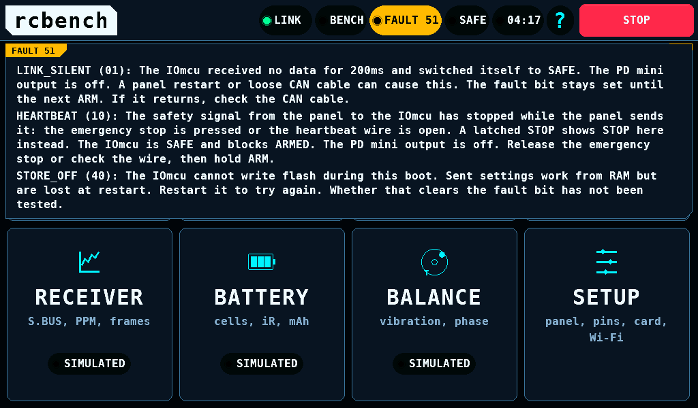


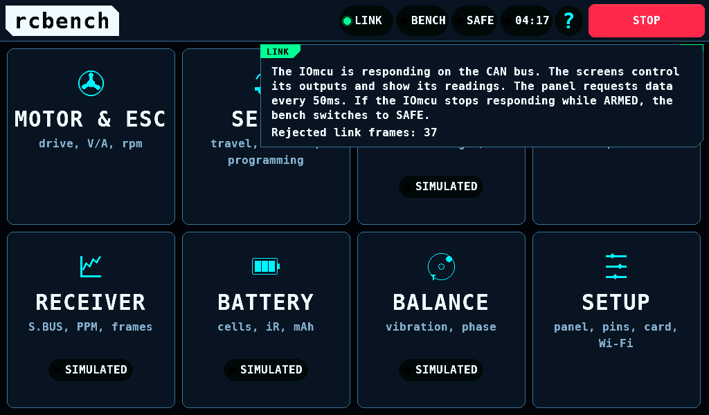

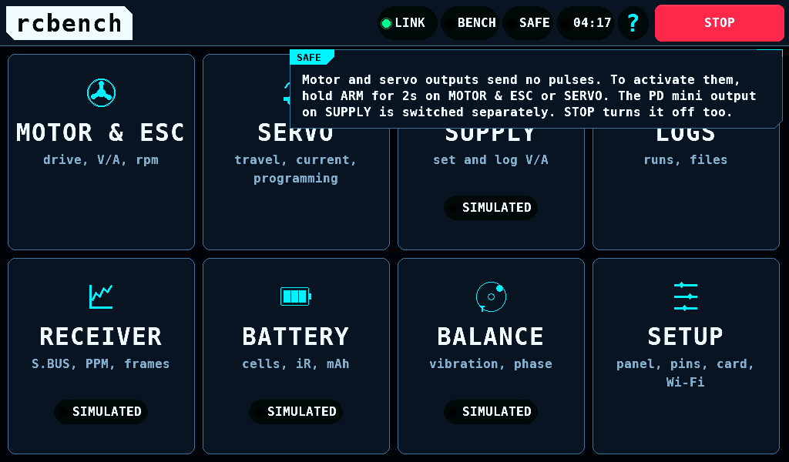

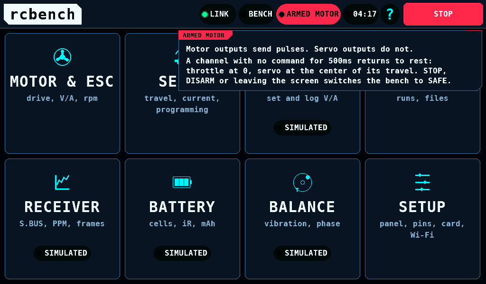

## The screen guide

"?" in the status band opens the current screen's guide. Numbered marks
identify its controls, and a dock explains each one. The menu, OUTPUTS,
SETUP, LOGS and FILES have a guide; the other screens have no "?". Keypads,
keyboards, open lists, boxes and confirmation dialogs also have no "?".

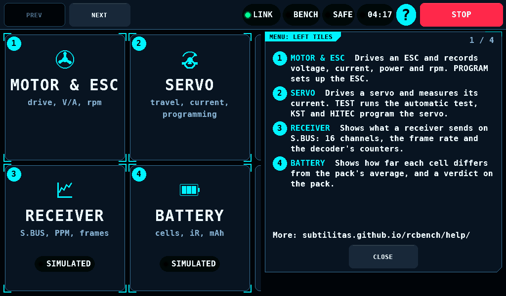

| Part | Figure |
| --- | --- |
| Dock | 480 x 488px, 8px from the panel's left or right edge, y 64 to 552; the page says which side |
| Live half | the other 528px of the body; the screen draws there and keeps running |
| Header | the page's title and "page / pages" |
| Item | its number in a 28px badge, the control's name in the accent colour, then what it does in the 10 x 20px face, 41 characters a row, 3 rows at most |
| Items a page | 5 at most |
| Web line | `More: subtilitas.github.io/rcbench/help/`, German `Mehr: subtilitas.github.io/rcbench/help/de/` |
| PREV and NEXT | 124 x 48px, 8px apart, in the band from x 8 to 264, y 6 to 54, in the home tag's place, the same on every page |
| CLOSE | 140 x 48px, centred at the dock's bottom, y 496 to 544 |
| Marks | a 28px badge with the item's number 4px inside the control's top-left corner, or 4px left of a control less than 56px tall or wide; 2px brackets at the control's corners, 3px outside it |

A control in the band has its badge under the band, below the control's
left end. The dock ends 4px above the alert band, so an alert covers none
of it.

PREV and NEXT stay in place when the dock changes sides, so repeated taps
at the same position keep turning pages. They occupy the band, which no
guide page marks. On the menu, tiles fill the body and each tile is marked
on one of the guide pages.

The buttons replace the home tag, which is inactive while the guide is
open. The band's chips start at x 270 or later, so the buttons cover no
chip, "?" or STOP. The home tag returns when the guide closes.

- A tap on "?" opens page 1. A press that slides off "?" opens nothing.
- PREV and NEXT turn the pages and act on a release on the same button.
  PREV on the first page and NEXT on the last are dimmed and do nothing.
- CLOSE closes the guide, and so does a press on "?".
- A press on the dock or on a badge does nothing.
- Any other press closes the guide and does nothing else: on the live half,
  on the band beside the chips, on the alert band.
- A 1000ms hold on the band's empty part takes a [screenshot](#screenshot):
  the guide stays for the picture and closes after it.
- A press on STOP closes the guide and stops at once. A press on a chip
  closes the guide and opens the chip's box on its release.
- A press on DISARM, OUTPUT OFF, ABORT, STOP TEST or STOP RUN closes the
  guide and acts, as with no guide.
- Opening the guide releases what the screen holds: a drag ends where it
  is, a hold on ARM is abandoned.
- A knob turn moves nothing while the guide is open, and the guide stays
  open.
- Leaving the screen closes the guide, and so does a change of the
  screen's pages. A link lost or back and the switch between SAFE and ARMED
  leave it open; the names on its page follow the state.
- While ARMED the guide offers only the pages whose dock covers no control
  that stops an output and no TARGET row; page 1 then says so in one line.
  The menu's pages all show while ARMED.

The menu guide has four pages:

1. The left two tile columns, with the dock on the right.
2. The right two tile columns, with the dock on the left.
3. STOP, the arm chip, "?" and the SIMULATED mark, with the dock on the left.
4. The empty part of the band used for the screenshot hold, with the dock
   on the right.

The guides of OUTPUTS, SETUP, LOGS and FILES have a set of pages for each state of
their screen. The dock takes the right half on page 1 and the left half on
the last page; a control the dock covers in part is marked where it shows.
None of these screens drives an output, so all their pages show while
ARMED.

| Screen, state | Pages | Marked |
| --- | --- | --- |
| SETUP, tiles | 2 | PANEL, SENSORS, SD CARD, WI-FI, IMU; OUTPUTS, UPDATES, LAYOUT on the carrier, SAVE |
| SETUP, a list | 2 | the first whole row, the list's name, RESET; of the rows whole in view the first whose value opens the keypad, else the first with keys: its `-` or `<`, the value, `+` or `>`; SAVE |
| SETUP, SENSORS | 2 | as a list, with the selected entry first |
| OUTPUTS, board view | 2 | the protocol list's face, LAST WRITE, PINS, the leftmost key; IN USE, UNBIND ALL PINS when offered, the rightmost key |
| OUTPUTS, PROG PORT entry | 2 | the entry's face, PIN, FUNCTION, SERVO TESTER, PORT PWM; then IN USE and a key, in the board view |
| OUTPUTS, grid view | 1 | the protocol list's face, the first cell, LAST WRITE; on a PROG PORT entry its face and rows |
| LOGS, file list | 2 | the folder tabs, a row, RESCAN, WI-FI; FILES, PREV and NEXT when paged, the scroll bar, DELETE, OPEN |
| LOGS, import view | 2 | DETECTED, SEP, NUM; the columns, BACK, PLOT |
| LOGS, plot | 1 | a series chip, the plot, BACK, `<` and `>` |
| FILES, panes | 3 | LOGS, the left pane's folder, a row and scroll bar; RESCAN, COPY, MOVE, RENAME; the right pane, DELETE, NEW, INFO, OPEN |

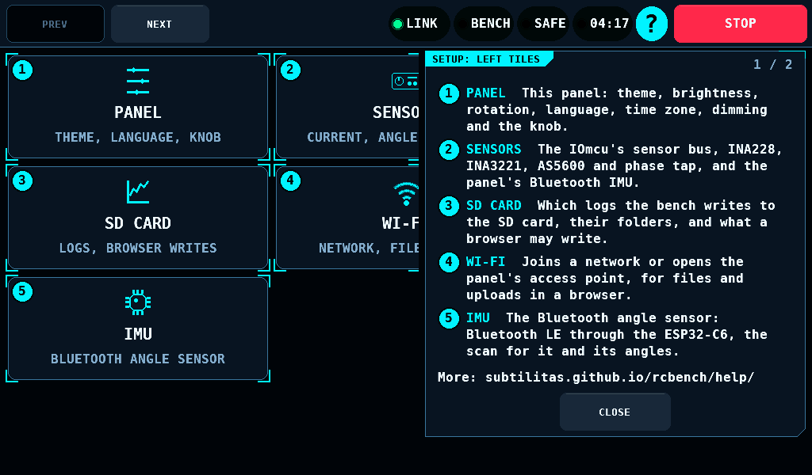

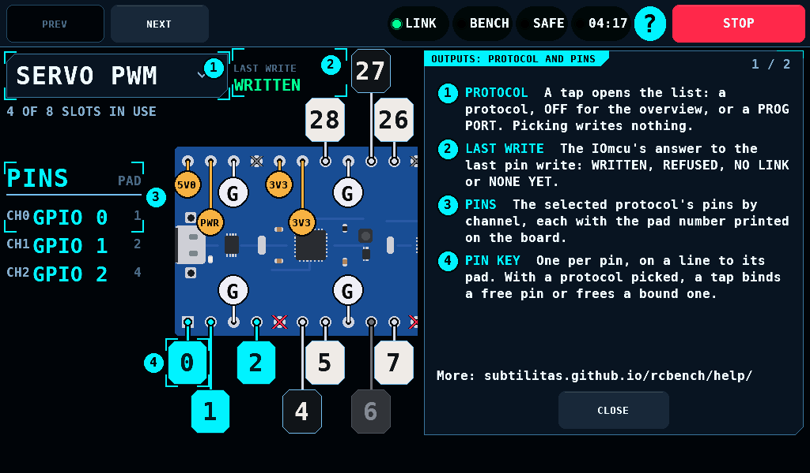

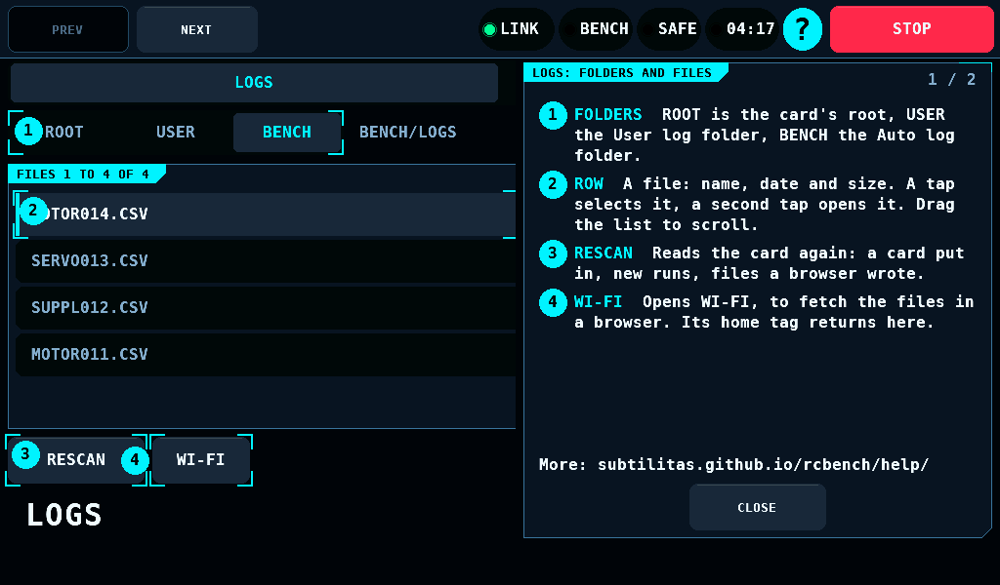

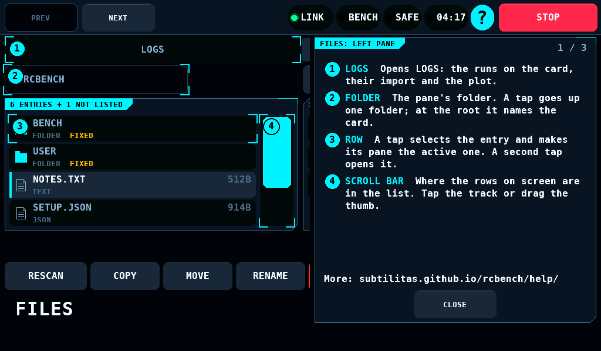

## Screenshot

Hold the empty part of the band for 1000ms to capture the display,
including the band. The area is unmarked; the menu guide and the help
explain where to hold.

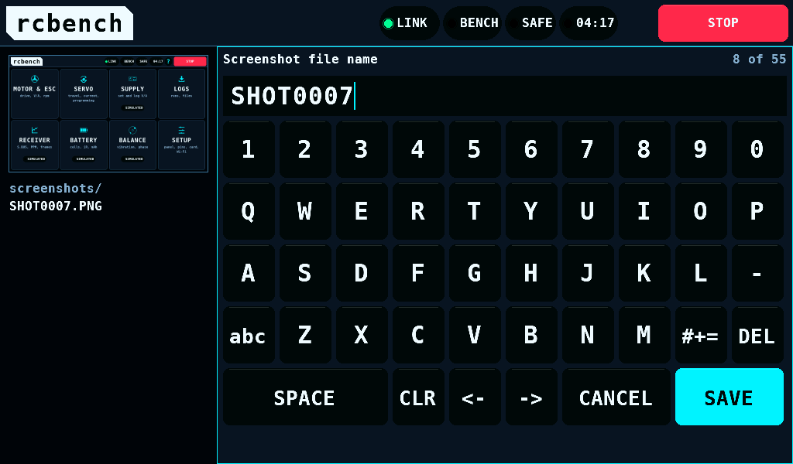

| Part | Figure |
| --- | --- |
| Where | the band's whole height, from 8px right of the home tag to 8px left of the leftmost chip, worked out from the rectangles the band draws. The narrowest gap, over every screen with the band in English and German, is 176px SAFE with no FAULT chip and 106px ARMED MOTOR |
| The hold | 1000ms of frames, a late frame counting 100ms at most, as for a hold button. Nothing at 999ms |
| What ends it | a slide out of the gap, a chip that appears under the contact, any event of another contact, a lost touch event, a change of screen. Its release does nothing |
| Over a chip's box or the guide | they stay up for the picture and close when the hold ends, with a picture or without one. A release before 1000ms closes them and takes nothing. A second contact ends the hold and meets them by their own rules: its press closes them |
| What it is not | a press on a chip, the home tag, "?" or STOP. No screen sees the contact |
| Response at 1000ms | the band's notice, no fill while held: `Screenshot taken.`, or `Screenshot taken. The preview opens when the bench is idle.` |
| Memory | 1,305,600B of PSRAM (pseudo-static RAM), the picture's 1,228,800B and the preview's 76,800B, from the capture to CANCEL or a save that worked. A restart loses it |
| No memory | the band says `Screenshot not taken: 1,305,600B of PSRAM are not free.`, and nothing else changes |
| A hold while one waits | replaces it in the same memory: `New screenshot taken. It replaces the waiting one.` |
| A hold while a stopped save ends | no picture: `Screenshot not taken: the last one is still being written.`, for at most one row of the PNG |
| A kept value on the glass | no picture: `Screenshot not taken: this screen shows a kept password or code.` WI-FI refuses it while it shows a [HOTSPOT PASSWORD or ACCESS CODE](#hotspot-password-and-access-code) that is kept, on that value's view, on its keyboard and on the rows of a running radio with either one kept. A picture on the card can be read from the browser. A RANDOM password and code are taken, since they end with the session |
| Screens with no hold | SPLASH, the bus-fault screen, PANEL UPDATE and the IOmcu update's progress: they have no band. The IOmcu update's question and the release reminder: they cannot say whether a box covers them, and the popup would open after they have gone. MOTOR & ESC, the longest title, has no gap with ARMED MOTOR and a long FAULT chip |

The render task captures the current frame immediately, whatever the bench
is doing. Capture neither reads nor changes an output; STOP, DISARM and
other controls remain active. The image includes any open box, list or
keypad and appears as the operator sees it, including at Screen rotation
180°. The frame is drawn upright, then rotated on its way to the panel.
The capture notice appears one frame later and is absent from the image.

### The popup

The popup opens when the bench is idle, the current screen has a status
band, no other popup is open and no finger touches the glass. It accepts
only a new press, so the press that disarmed the bench or acknowledged a
dialog cannot activate it.

| Part | Figure |
| --- | --- |
| Preview | 256 x 150px, each pixel the mean of 4 x 4, top left of the body |
| Folder and name | `screenshots/` and the name with `.PNG`, under the preview |
| Keyboard | the file-name keyboard, x 280 to the panel's edge. OK reads SAVE, `SPEICH.` in German |
| Band | STOP and the chips stay live. The home tag and the knob do nothing, and "?" does not show |

If any of these conditions stops being true, the popup closes. The image
and typed name wait for the conditions to be met again. Only CANCEL or a
successful save discards the pending image.

| The bench is idle when | Read from |
| --- | --- |
| the link answers, or the bench is simulated | the snapshot's `link_up`, the model's flag |
| SAFE, no arm waits | the snapshot's `armed`, `arm_wanted` |
| no STOP request waits | `s_stop_request` |
| the supply is off, no ON on its way | the snapshot's `supply.output`, the newest sample's output, `supply_live_or_coming()` |
| PROG 5V is off, no ON on its way | `prog5v_box_on()`, `supplies_live_or_coming()` |
| no port is held | `supply_screen_port_held()`, `kst_panel_holds_port()`, `hitec_panel_holds_port()`, the HITEC page's holds in `s_drive` |
| no programming session is open | `kst_panel_is_open()`, `hitec_panel_is_open()`, `esc_stick_panel_stage()` |
| no programmer's card job is out | the KST and Hitec file and card counters |
| no sweep or pause | `servo_screen_sweeping()`, `servo_screen_paused()` |
| no automatic test or limit run | `servo_screen_testing()`, `servo_screen_limit_running()`, `s_servo_testing` |
| no ESC STICK run | `esc_stick_panel_profile()` |
| no update, install or download | the snapshot's `cu.active`, `s_cu_busy`, `s_fw_installing`, the download's flag and fetch |
| no FAULT bit is up | the snapshot's `faults` |
| no fault log write is out | `log_fault_busy()` |
| no log run, test file or capture is open | `panel_run_open()` |

Outputs drive only while ARMED, so SAFE also excludes a pulse on a pin.
Any remaining FAULT bit delays the popup until it clears. An open keypad,
keyboard, list, box or confirmation dialog also delays it.

### Saving

SAVE writes `screenshots/<name>.PNG`, creating the folder if needed. This
is not a FIXED folder: the bench reads nothing from it, and FILES and the
Wi-Fi page can rename or delete it like any other folder. A FILES pane
showing the folder lists the new file when it next refreshes.

| Part | Figure |
| --- | --- |
| Format | PNG (Portable Network Graphics), 1024 x 600, 8-bit RGB, each RGB565 value with its top bits repeated in the low bits |
| Default name | `SHOT` and 4 digits, one above the highest such name in the folder; `SHOT9999` at most |
| Name | up to 55 bytes in front of `.PNG`, the rules of FILES' names (`fm_name.h`) |
| A taken name | refused: `This name is taken. Type another one.` Nothing is overwritten |
| Size | 38,388 to 77,840B on the card, 8 files; the OUTPUTS screen with the board drawing gave the largest |
| Time | 5.3 to 6.3s alone; 0.40 to 1.00s with a Wi-Fi page write waiting for the card's lock. The cause of the difference is not traced. The console logs each save's time and each copy's |
| Memory while saving | 36,928B of PSRAM for the encoder, 16,384B of internal RAM for the card's buffer and 7,168B of internal RAM for the task's stack, freed at its end |
| Task | `shot`, priority 0 on core 0, below the render loop. The control task and the heartbeat take no part |
| Stack of `shot` | lowest 5,116B unused of 7,168B |
| Runs on a panel | 30 shots in a row: no error, no restart. No FLIP TIMEOUT and no watchdog line. `FM_ERR_BUSY` was not produced in 3 runs with a save and a Wi-Fi page write overlapping: both sides wait and complete |
| Second contact on a panel | 6 of 6 checks passed: a second contact during a hold takes no picture and its press acts; a contact already down takes no hold; STOP during a hold acts; a hold over the guide with a second contact takes none; the popup waits for all contacts to lift and presses no key; 5 contacts down at once on a list leave no stuck press |
| Not run on a panel | no card in the slot, pixel equality of the PNG with a rendered frame, a glass contact together with an injector contact |

The save first writes `<name>.PNG.NEW`, then renames it. Canceling the save
or removing the card leaves no file with the requested name. A power cut
leaves the `.NEW` file; saving that name again deletes it.

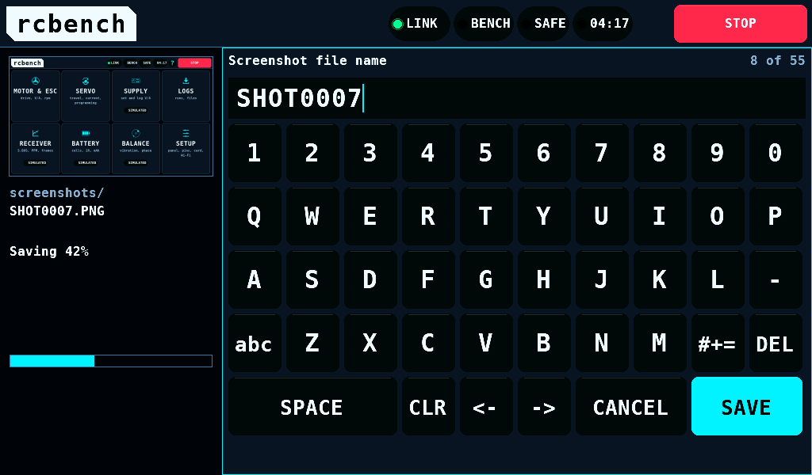


| During or after saving | Popup response |
| --- | --- |
| during | `Saving 42%` and a bar. Only CANCEL responds |
| successful save | closes; the band: `Saved: screenshots/SHOT0007.PNG` |
| missing or removed card | `No card. Put one in and SAVE again.` |
| a full card | `The card is full. Free some room and SAVE again.` |
| write-protected | `The card is write-protected.` |
| a write failed | `The write failed. The picture is kept: SAVE again.` |
| no memory for the encoder or the buffer | `No memory to write the PNG. Nothing was written.` |
| another card job holds the card past 2000ms | `The card is busy. SAVE again in a moment.` |
| the bench stopped being idle during the save | on the next opening: `The bench was busy. Nothing saved. Tap SAVE again.` |

On failure, the popup retains the image and shows the error. Saves share
the card lock with FILES and the Wi-Fi page, so only one card job runs at
a time. Wi-Fi page writes wait up to 2000ms for a save, then return
`PANEL_BUSY`.

CANCEL during a save stops writing at the next row and discards the image
once writing has stopped. If the bench stops being idle, writing stops in
the same way but the image is kept. A message about that interruption, or
an error received while the popup is closed, appears when the popup next
opens. A new capture or CANCEL clears the message.

The render task copies all 1,228,800B in one frame. Spreading the copy
across frames would mix their contents because the frame buffers change
every frame. Copying takes 0.1ms on the build machine and 25.8 to 31.6ms on
the panel, with a median of 28.3ms over 54 copies. The console logs each
copy's duration.

At least 1 panel frame was missed during the run. During a sweep the frame
rate is 30 to 37fps; the 5s measurement remains unchanged around a hold.
The duration of the individual frame containing the copy is not measured.
The control task on the other core does not wait for the copy, and the
frame watchdog allows 1000ms.

## The alert band

A fault that the current screen does not show appears in a red alert band
across the bottom of every screen with a status band. It is 44px high and
uses the 10 x 20px font, with up to 2 lines of 97 characters each. It covers
the bottom 44px while visible; ARM and every control that stops the bench
end above it.

- It clears 30s after the frame it arrived in. A new alert, even with the
  same text, starts the 30s again. A notice, the [hint of a hold
  button](#hold-buttons), shows in amber for 4s and gives way to an alert.
- A tap on the band clears it earlier: press and lift on the band, marked
  with an `x` at its right end. The screen beneath receives neither that tap
  nor a second finger's on the band; only the first finger's lift clears.
- An alert that arrives while a finger is on the band is not cleared by
  that lift.
- The controls that stop what the bench drives end above the band, panel
  y 556 to 599: DISARM, OUTPUT OFF, a stick run's ABORT (y 496 to 551),
  its ABORT on a manual step (y 444 to 491), STOP TEST and STOP RUN. A press
  on one with an alert showing is its own, and the alert stays. A stop
  control a screen draws under the band acts on the first press, and the
  press clears the band; ARM and OUTPUT ON under the band are not pressed:
  the tap clears the band and starts no hold.
- An alert that arrives while a finger is already down on a control leaves
  that press to the control: its release acts as with no alert.
- "Touchscreen not responding. ARMED is blocked.", shown at start, stays
  until restart and has no `x`: no touch is there to tap with. A later alert
  shows over it; once that one clears, it shows again.

## Hold buttons

A hold button acts after 2s of contact (`UI_HOLD_S`). Releasing it earlier
sends no command. Instead, the alert band shows a hint for 4s: amber
(`UI_C_WARN`) with dark text, rather than the danger colour. Tap the band
to dismiss it earlier. The hint fits on one line of at most 97 characters.

A short tap is not a fault, so the hint is a notice. Alerts take priority:
a hint stays hidden while an alert is visible, and an arriving alert
replaces a visible hint.

- The hint appears only when the finger lifts while still on the button. It does
  not show when the finger left the button first (the hold is abandoned),
  when the touch was lost or the release is not a tap (`TOUCH_FLAG_NO_TAP`),
  for a second finger's contact, or on a screen without the status band.
- A release at 2s or later follows a hold that has acted and shows no hint.
- A press on STOP clears the hint in the same frame, and so do a fault bit
  that comes up on the FAULT chip and a switch from ARMED to SAFE,
  including one caused by an error. An alert stays through both.
- HOLD 2s TO ACKNOWLEDGE on the bus-fault screen has no hint: that screen
  has no band.

| Button | Hint |
| --- | --- |
| ARM on MOTOR & ESC and SERVO | `Hold 2s to switch to ARMED.` |
| OUTPUT ON on SUPPLY and in SERVO's supply box | `Hold 2s to switch the output on.` |
| PROG 5V ON in the PROG 5V box on SERVO and SUPPLY, rbmod carrier | `Hold 2s to switch the programming ports' 5V on.` |
| APPLY on the HV, frame rate and soft limit warnings of SERVO, KST and Chaservo, and on Hitec pages | `Hold 2s to apply.` |
| START TEST | `Hold 2s to start the test.` |
| START LIMIT RUN | `Hold 2s to start the limit run.` |
| HOLD 2s TO ENABLE | `Hold 2s to enable.` |
| HOLD 2s TO WRITE | `Hold 2s to write.` |
| HOLD 2s TO RESTORE | `Hold 2s to restore.` |
| HOLD 2s TO CONTINUE | `Hold 2s to continue.` |
| HOLD 2s TO LEAVE | `Hold 2s to leave.` |
| HOLD 2s TO LOAD | `Hold 2s to load.` |
| HOLD 2s TO RELEASE | `Hold 2s to release the port.` |
| HOLD 2s TO REPAIR | `Hold 2s to repair.` |
| HOLD 2s TO RUN on a stick run's warning | `Hold 2s to run.` |
| HOLD 2s TO INSTALL on Wi-Fi | `Hold 2s to install.` |
| HOLD 2s TO DOWNLOAD & INSTALL on UPDATES and in the update reminder | `Hold 2s to download and install.` |
| HOLD 2s TO UPDATE THE IOMCU on UPDATES, and START on the IOmcu update's question | `Hold 2s to update the IOmcu.` |
| HOLD 2s TO CLEAR ALL PIN ASSIGNMENTS on OUTPUTS | `Hold 2s to clear all pin assignments.` |
| OVERWRITE on FILES' editor's question | `Hold 2s to overwrite.` |

## Menu marks

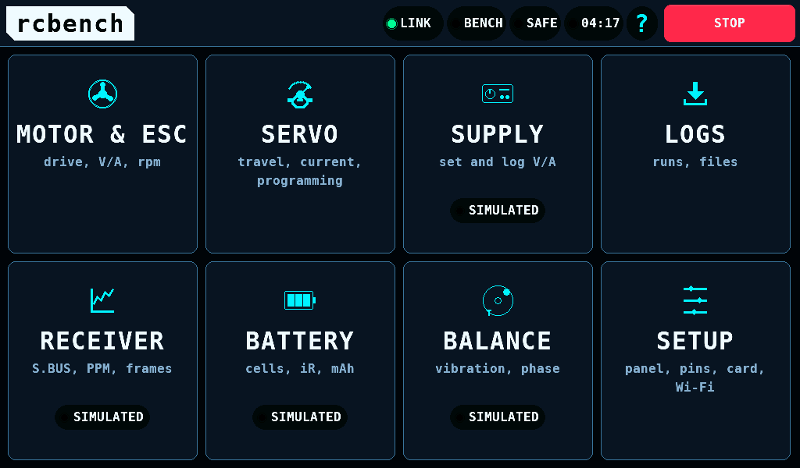

The menu has 4 columns and 2 rows of 243 x 255px tiles, with 10px margins.
Each tile has a 40px icon, a name in the 20 x 36px font and a description
in the 10 x 20px font. The first row contains the workbenches MOTOR & ESC,
SERVO and SUPPLY; the second contains the instruments RECEIVER, BATTERY
and BALANCE. The last column has LOGS above SETUP.

The 4-column layout rejects a fourth workbench or instrument at build time
(`shared/ui/overview_screen.c`). Programming is reached through the PROGRAM
task on MOTOR & ESC and SERVO, with no separate menu tile.

Below each tile name, the description uses up to 2 rows of 22 characters,
with 8px clearance at each side:

| Tile | Line |
| --- | --- |
| MOTOR & ESC | drive, V/A, rpm |
| SERVO | travel, current, programming |
| SUPPLY | set and log V/A |
| LOGS | runs, files |
| RECEIVER | S.BUS, PPM, frames |
| BATTERY | cells, iR, mAh |
| BALANCE | vibration, phase |
| SETUP | panel, pins, card, Wi-Fi |

SIMULATED marks a tile when the bench does not report the screen's data
source: either the IOmcu lacks the capability or the sensor is disabled
under SETUP > SENSORS. The screen still opens and uses its model.

The mark describes the screen as a whole, not each displayed value.
RECEIVER and BATTERY carry the mark and show no values. SERVO can appear
without the mark while using the panel's supply model as its rail meter,
if neither a PD mini nor an INA3221 is enabled. Each screen identifies the
source of its readings.

| Tile | Without the mark when |
| --- | --- |
| MOTOR & ESC | the IOmcu drives ESCs and holds an INA228 set-up enabled on SETUP, SENSORS |
| SERVO | the IOmcu drives servo PWM outputs |
| SUPPLY | the PD mini is enabled on SUPPLY's PD MINI tab, whatever the IOmcu reports; otherwise the panel runs its own model of a supply |
| RECEIVER, BATTERY, BALANCE | never in this release: no IOmcu reports these capabilities |

The capability bits come from the IOmcu at bring-up. With no IOmcu
answering, MOTOR & ESC and SERVO carry the mark too.

The menu in the light theme:

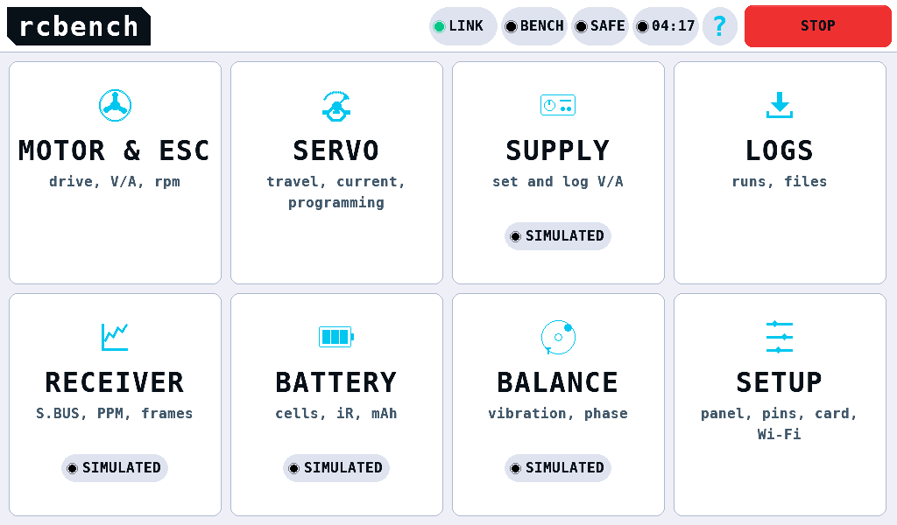

## Keypad, keyboard and the shared controls

Keypads, keyboards, choice lists, tabs and TARGET rows share the same
appearance on every screen. The screen assigns their area or row; the
shared control determines the fonts and internal spacing.

- **Keypad.** A title row of 32px, the entry of 60px, then 4 x 4 keys
  8px apart, 8px from the area's edge, the keys ending 4px above the
  alert band at the latest (below). On SERVO a key is 145 x 88px
  (21.8 x 13.2mm); on SUPPLY 145 x 76px. The title and the range are in the
  10 x 20 face, or in 8 x 16 where the two do not fit side by side. The
  entry is in the 32 x 44 numerals with the unit in 12 x 24; an entry that
  does not fit takes the 24 x 30 numerals with the unit in 10 x 20. The
  digits and the point are in the largest of 20 x 36, 16 x 28, 12 x 24
  and 10 x 20 whose character cell fits a digit key with 6px each side, else in
  8 x 16; 20 x 36 needs a key of 32 x 48px and is the font of every
  keypad the panel opens. DEL, CLR, CANCEL, OK and `+/-` share one font:
  the largest of the same fonts, never larger than the digits', in which
  all of them fit their keys with 6px each side. `CANCEL` needs a key of
  132px for 20 x 36. German `ABBRECHEN` needs 192px for 20 x 36, 156px
  for 16 x 28, 120px for 12 x 24 and 102px for 10 x 20, so the German
  keypads of SERVO, SUPPLY and MOTOR & ESC's SETTINGS draw their words in
  12 x 24.
- **Keyboard.** A title row of 32px, the text field of 52px, then 5 rows
  of keys 6px apart. The title and the count are in 10 x 20, or in 8 x 16
  where the two do not fit side by side. The text is in the 20 x 36 font
  when 23 characters and the caret fit the field, else in 16 x 28. The
  letters, digits and marks are in the largest of 20 x 36, 16 x 28,
  12 x 24 and 10 x 20 whose character cell fits a character key with 4px each side,
  else in 8 x 16; 20 x 36 needs a key of 28 x 44px and is the font of
  every keyboard the panel opens. The word keys (the bottom row, DEL,
  `ABC`, `abc`, `#+=`) share one font: the largest of the same fonts,
  never larger than the characters', in which all of them fit their keys
  with 4px each side, HIDE measured in place of SHOW too, so a press does
  not change it. On WI-FI the keyboard takes the body above the alert
  band, 1008 x 484px, with keys of 93 x 71px (14.0 x 10.7mm) and every
  word in 20 x 36; the German password's in 16 x 28, as `LEERZEICHEN`
  has two keys of 192px. SERVO's name keyboards, keys of 55 x 72px, draw
  their words in 12 x 24; the ESC STICK search keyboard, keys of
  59 x 57px, in 16 x 28. The text editor's keyboard has no title row, no
  field and no digit row: 4 rows of keys of 93 x 56px, every word in
  20 x 36, `123` one more word key
  ([The text editor](#the-text-editor)).
- **Choice list.** A field or a row 56px tall or taller draws its text in
  the 20 x 36 face, 12px in, with an 11px chevron 28px from the font's
  right edge. A shorter one draws in 16 x 28, 10px in, with a 7px chevron
  22px from the edge. Text that does not fit before the chevron in
  20 x 36 uses 16 x 28: `DSHOT600 BIDIR` in a 292px field. Each field
  and row chooses its font independently, so the rows of one list can differ. OUTPUTS uses
  fields less than 56px tall.
- **Tabs.** A row of tabs 32px tall or taller draws its labels in the
  10 x 20 face when every label fits its tab with 6px each side in the
  language shown; another row draws them in 8 x 16. LOGS' ROOT, USER and
  BENCH and the PROG PORT entry's segments on OUTPUTS are in 10 x 20. The
  strips of SERVO and MOTOR & ESC are 40px tall and draw in 10 x 20;
  SUPPLY's is 24px tall and keeps 8 x 16. RECEIVER's and BALANCE's tabs
  are 150 x 48px and draw in 10 x 20.
- **TARGET row.** A row 40px tall or taller draws its label and its value
  in 10 x 20, with 88px for the label, and counts the pins it names in
  10px cells. A shorter row draws in 8 x 16 with 64px for the label and
  counts in 8px cells. SERVO and MOTOR & ESC draw theirs 48px tall.
- **Plot.** A plot keeps 1,024 samples per series, one for each pixel column
  of a plot as wide as the panel: 51.2s at 20 samples a second.

Key grids end 4px above the alert band, at body y 492, on every screen.
A keypad or a keyboard whose area reaches further paints its whole area
and stops its keys there, so an alert covers no key. On SERVO the keypads'
keys are then 145 x 88px and the keyboards' 55 x 72px; on SUPPLY the
keypad's are 145 x 76px; on the ESC STICK search keyboard 59 x 57px; on
MOTOR & ESC's SETTINGS the keypad's are 145 x 89px; on BALANCE the blade
count's keypad's are 242 x 72px.

## Splash

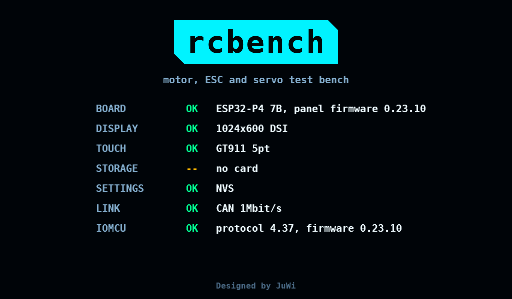

The splash fills the panel without a status band. The `rcbench` name uses
the 20 x 36px font at twice its normal size, centred at the top on an 88px
high accent tag. The tagline below uses the 12 x 24px font. Starting at
y 200, each startup step has a 40px row with its name, status (`OK`, `--`,
`!!`, or `..` while running) and detail, all in 12 x 24px. The detail
starts at x 432 and is clipped after 47 characters, 24px from the right edge.

Each subsystem reports its startup result: board, display, touch, SD card,
settings, link and IOmcu. The board line shows the panel's firmware version.
The IOmcu line shows its reported protocol and firmware versions, allowing
the operator to distinguish builds that use the same protocol.

A missing card or an unusable NVS (non-volatile storage) is a warning. The
SD card line reads `no card`, `not FAT32/exFAT` (FAT: file allocation table) or
`unreadable`
([The SD card's format](#the-sd-cards-format)). A
touch controller that does not answer, or an IOmcu with a different
protocol major version, is a failure and the bench does not switch to ARMED.

After every startup step has reported its result, the splash waits 1.6s
before opening the menu. Tap to skip the wait.

## Motor & ESC

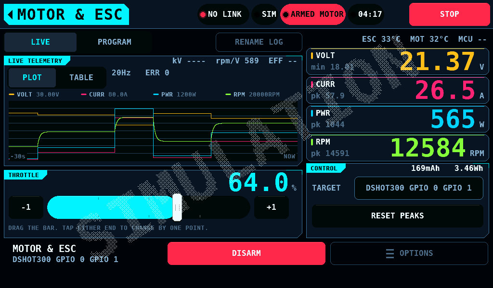

MOTOR & ESC has three tasks along the top: LIVE, PROGRAM and SETTINGS
(German `LIVE`, `PROGRAMMIEREN`, `OPTIONEN`). Each tab is 150 x 40px,
starting at body y 8; the page below starts at y 56. The menu tile always
opens LIVE. Tap a tab to switch tasks. This does not add a navigation level
or change LIVE's selected view, PLOT or TABLE.

| Task | The left column, 620px |
| --- | --- |
| LIVE | the plot or the table over the throttle |
| PROGRAM | the list of ESC programmers; a row opens its session over the whole body ([PROGRAM](#program)) |
| SETTINGS | the 8 ESC settings under PACK, MOTOR and THROTTLE OUTPUT ([Settings](#motor--esc-settings)) |

MOTOR & ESC uses two columns, like SERVO: a 620px task area on the left and
a 380px rail on the right. This keeps readings clear of the throttle
controls. From top to bottom, the rail contains the three temperatures,
four readouts (each 56px tall with 32 x 44 numerals), and the CONTROL card.
That card has a title line showing the run's mAh and Wh, a 48px TARGET row,
a 48px RESET PEAKS button and a 60px ARM button.

TARGET and ARM align with those on SERVO's output card. ARM spans body
y 424 to 484, ending 8px above the alert band. The rail appears on LIVE,
the PROGRAM list and SETTINGS; ARM works on all three. A session opened
from PROGRAM covers the rail. When enabled, the rotary knob changes
throttle on LIVE ([the knob](#panel-the-rotary-knob)). It has no effect on
PROGRAM or SETTINGS.

The home tag moves up one navigation level:

| From | The home tag leads to |
| --- | --- |
| the keypad on SETTINGS | SETTINGS; the value is not changed |
| a session on PROGRAM | one level up in the session; from its top, PROGRAM's list ([PROGRAM](#program)) |
| LIVE, PROGRAM's list or SETTINGS | the menu; the bench switches to SAFE |

### TARGET names the protocol and the pins

The CONTROL card begins with TARGET: an 88px label and a 25-character
value field naming the protocol and pins driven by the throttle, for
example `DSHOT300 GPIO 0 GPIO 1`. These are pins assigned to MOTOR PWM or a
DShot protocol, read from the same SETUP > OUTPUTS pages used by the
IOmcu's throttle role. Pins appear in pin order. Any that do not fit are
counted: GPIO 0 through GPIO 7 assigned to DSHOT300 appear as
`DSHOT300 GPIO 0 GPIO 1 +6`.

A programming port whose FUNCTION is DSHOT150, DSHOT300 or DSHOT600 and whose
pin the IOmcu holds follows the pins as `PORT n`, and counts with them. A
port alone is named in full where it fits, `DSHOT300 PROG PORT 2 GPIO 14` (28
characters), as `DSHOT300 PORT 2 GPIO 14` (23 characters) in the CONTROL
card's 25, and as `DSHOT300 PORT 2` in a shorter field.

| TARGET reads | Condition |
| --- | --- |
| `DSHOT300 GPIO 0 GPIO 1` | one protocol drives every throttle pin |
| `MIXED GPIO 0 GPIO 4` | the throttle pins run on two or more protocols, or one of them on a rate no OUTPUTS protocol has |
| `GPIO 0 GPIO 1` | every throttle pin runs on a rate no OUTPUTS protocol has |
| `NO MOTOR PIN` | the binding is read and neither a pin nor a programming port is bound as a motor; warning colour |
| `PINS NOT READ` | no binding was read: the link is down, the pages did not read, or no pin map exists for the board; warning colour |

With DShot programming ports:

| TARGET reads | Condition |
| --- | --- |
| `DSHOT300 PORT 2 GPIO 14` | a DSHOT300 programming port on GPIO 14 drives the throttle and no pin is bound as a motor |
| `DSHOT300 GPIO 0 PORT 2` | GPIO 0 bound as DSHOT300 and a DSHOT300 port |
| `MIXED GPIO 0 PORT 2` | the pins and the ports run at different rates, or the pins at a rate no catalogue protocol has |

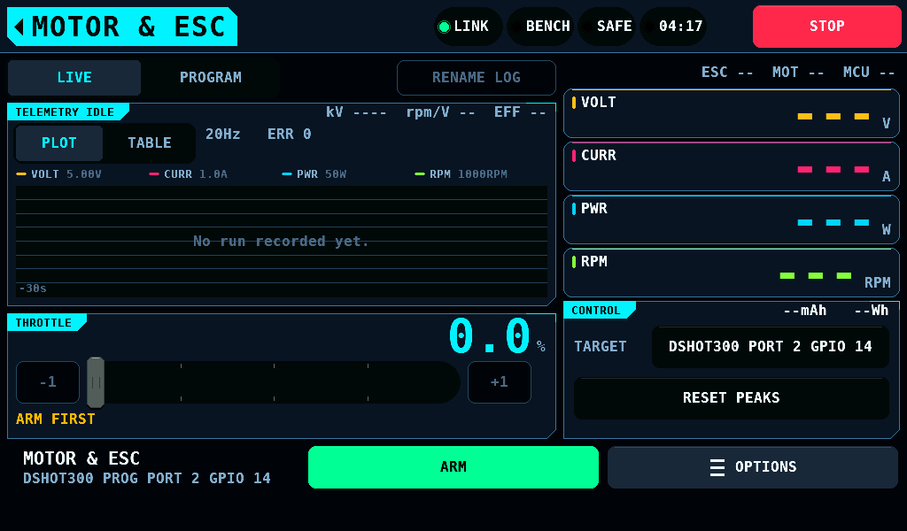

The throttle still moves in the two warning states. ARM switches the whole
bank to ARMED, not only the pins named here.

Tap TARGET to open [OUTPUTS](#outputs). It opens the protocol assigned to
the throttle pins, the PROG PORT entry if a DShot programming port alone
drives the throttle, or the overview if several protocols are assigned or
none is known. Leaving MOTOR & ESC switches the bench to SAFE.

The home tag on OUTPUTS returns to the task where TARGET was tapped. If
another screen is opened in between, the next entry to MOTOR & ESC starts
on LIVE, as from the menu tile. TARGET is locked and shows a locked edge
under any of these conditions:

| Condition | Why |
| --- | --- |
| ARMED, an unanswered ARM request, or an unanswered DISARM request | a binding changes the pins the bench drives |
| ARM held | the press is ARM's |
| the [servo programmer](ServoProgrammer.md) holds a port | ARM is locked for the same reason |

### The plot covers one run

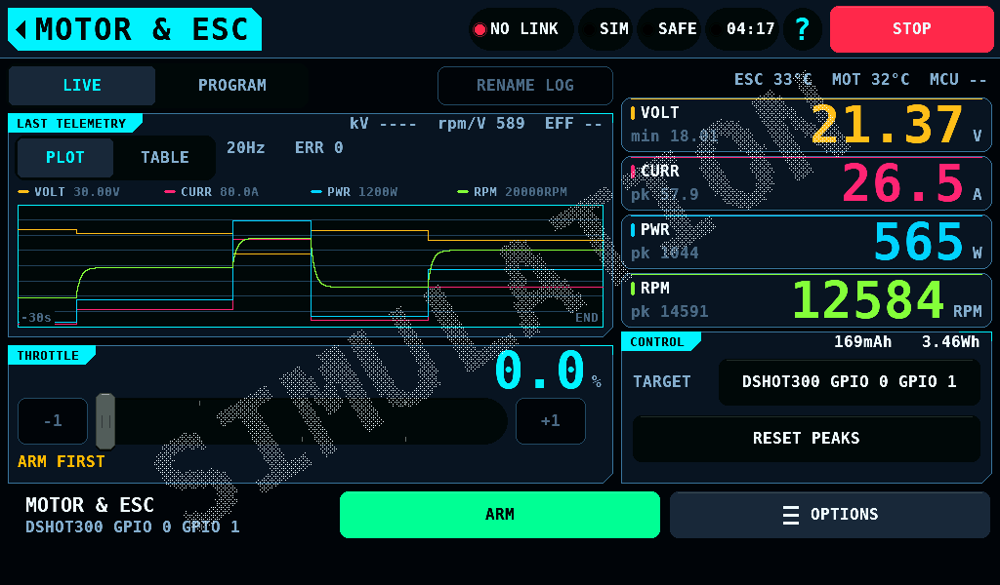

The plot records one run. It advances only while ARMED: switching to ARMED
clears it, and switching to SAFE freezes it. Its tag reads `LIVE TELEMETRY`
while recording, `LAST TELEMETRY` while holding a completed run, and
`TELEMETRY IDLE` before the first ARM, when the plot shows
`No run recorded yet.` The right-hand axis reads `NOW` while recording and
`END` at the end of a held run. The readouts, TABLE pane, totals and
temperature strip update continuously, whether ARMED or SAFE.

The plot is 600 x 184px. The window is 600 columns at 20 samples per second,
30.0s. A longer run holds its last 30.0s; what came before is in the CSV
file and not on the screen.

The trace ends at the switch to SAFE, not when the motor stops. Switching to SAFE commands
zero throttle and the propeller coasts down after it. That coast-down is on
the readouts and not on the plot, and not in the CSV file either, which closes
on the same edge.

Switching to ARMED clears the plot. Resetting a latched STOP leaves the
bench SAFE, so the stopped run's trace remains until the next ARM. Each
switch to ARMED starts one CSV file, which LOGS can plot.

On LIVE the telemetry card carries PLOT and TABLE under its title, two tabs
in 200 x 40px, and beside them the poll rate and the link's error count
(cyclic redundancy check failures and resyncs added together). While the
link is up and the IOmcu has refused link frames since its power-up, the
line under them shows how many, in 8 x 16: `Rejected link frames: 37`. An
IOmcu older than protocol 4.21 sends no count, and the line shows none
([Refused frames](Link.md#refused-frames)). The three temperatures are on
the line over the rail on every task. ESC and MOT come from the bench page.
MCU is the panel's own die, read from the ESP32-P4's sensor: it is the
display board's temperature, not the IOmcu's.

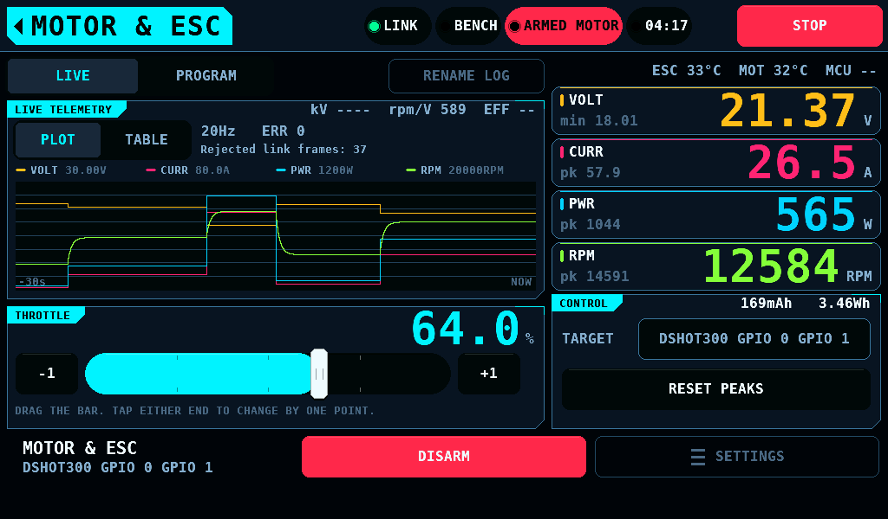

Throttle follows the distance the finger moves, starting from its current
value. Pressing the track sends no command, even at its far end. Dragging
across the full track requests the full span; the pin follows without a
ramp. `-1` and `+1` at the ends change throttle by one percentage point.

The throttle changes only while the bench is ARMED. What each control does:

| Control | SAFE | ARMED |
| --- | --- | --- |
| The track | refused: no command, the slider and the readout stay; drawn dimmed | moves the throttle by the finger's travel |
| `-1`, `+1` | refused; drawn dimmed | step one percentage point |
| Rotary knob | refused; the turn is not kept | moves the throttle from its value |
| ARM | switches the throttle outputs to ARMED after its 2s hold; drawn disabled and without effect while the [servo programmer](ServoProgrammer.md) holds a port | switches to SAFE on a tap |
| RESET PEAKS | resets the peaks | resets the peaks |
| PLOT, TABLE | switch LIVE's view | switch LIVE's view |

While SAFE, the line below the track reads `ARM FIRST`. Throttle controls
remain locked until the bench reports ARMED, including the interval after
the ARM hold completes. They also lock as soon as DISARM is requested
(by a tap or by leaving the screen) or STOP is pressed while ARMED, and
stay locked while the bench's SAFE report is pending.

Every switch to SAFE returns throttle to 0%: DISARM, STOP, loss of the
link, an unresponsive touch controller or leaving the screen. The slider,
readout and `-1`/`+1` controls remain at 0.0% until the next ARM. The first
`+1` or 1% knob turn after that requests 1.0%. A stick run on PROGRAM also
starts at 0%, even though it arms without the ARM button's hold.

Any throttle request posted by the screen but not yet sent when the bench
switches to SAFE is discarded. A finger already on the track when the
bench switches to ARMED or SAFE cannot change throttle; lift it and press
again.

Hold ARM for 2s. Its fill fades from green to danger red, and the bench
switches to ARMED when the fade completes. Releasing early cancels the
hold. The release itself never switches to ARMED.

Keep the finger on ARM throughout the hold. Sliding off cancels the
gesture; sliding back does not resume it. Lift and press again to start a
new hold. A switch to SAFE also cancels any hold still on the button,
preventing that contact from arming the bench again 2s later.

When the bench switches to ARMED, the whole button flashes white, black,
red, then repeats the sequence, with one drawn frame per colour. While
ARMED, it stays danger red and acts as DISARM. DISARM responds immediately
on contact, with no hold or wait for release. DISARM and STOP stop the
output without a ramp. RESET PEAKS clears the peak markers while leaving
live readings unchanged.

### EFF is a guessimetric

The telemetry panel's header shows the rated kV, the revolutions per minute
per volt the motor is actually turning, and EFF, the second divided by the
first.

Terminal voltage divides between the resistive drop and the back
electromotive force (back-EMF). Under load, rpm/V equals rated kV multiplied
by the fraction of voltage reaching the back-EMF. That fraction is also
the fraction of input power converted to mechanical power. For an ideal
motor, the ratio therefore equals conversion efficiency.

The number on the screen is not that, for three reasons, and it is labelled
EFF rather than efficiency because of them:

- It accounts for copper loss (I squared R) only. Iron loss, friction and
  windage fall on the mechanical side of the split, so the figure is an upper
  bound on shaft efficiency rather than a value of it.
- The bench measures pack voltage, not the motor's terminals, so the ESC's
  conduction and switching losses are inside the figure. It describes the
  drivetrain, and comparing it against a motor datasheet compares two
  different things.
- It is only as good as the rated kV. An error there maps straight into the
  percentage, and a figure above 100% means the rated value is wrong; the
  screen shows that rather than hiding it, capped at 199%.

Rated kV comes from the connected ESC if it reports a value. No supported
ESC reports it, so the panel uses `Rated kV`, which defaults to zero. A
guessed kV can produce a plausible but incorrect percentage. With no kV
entered, the field stays empty and no percentage appears. Measured rpm/V
appears regardless because it does not depend on rated kV.

SIMULATION appears across the screen while no IOmcu answers and the panel
uses its model. Once an IOmcu answers, the watermark disappears and the
screen uses the measurements it provides: rpm from bidirectional DShot
and sensor readings where measurement hardware is fitted. An unmeasured
quantity leaves an empty field.

SETUP > PANEL > Demo mode, OFF by default, hides the SIMULATION watermark and
nothing else: the band still shows SIM, the tiles still show SIMULATED and
every other statement that values are simulated stays. The change shows on the
next frame. With an IOmcu answering no watermark is drawn, so the setting
changes nothing on a real bench.

### TABLE, and what the ESC says

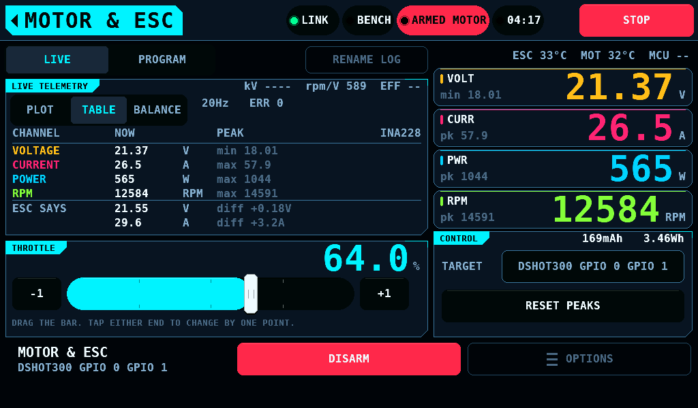

TABLE lists four channels, each with its extreme value. A channel with no
reading shows `--`.

When the INA228 is enabled under SETUP > SENSORS and answers (BENCH flag
bit 5), it supplies voltage, current and power. These are the means of the
IOmcu's last 50ms window, read at 20Hz; run peaks come from its 500Hz samples.
The heading names `INA228` and adds `CLIPPED` if current reached the end of
the part's range in the latest window or at any time since ARM. Current
and power, or their peaks, then represent bounds rather than exact values.

Below the channels, `ESC SAYS` shows the ESC's own telemetry voltage and
current from the SENSE page. `diff` is the ESC value minus the INA228 value.
An ESC reporting current that it does not measure can show a difference
equal to the reading. If the INA228 stops answering during a run, voltage,
current and power stay empty until that run ends; they do not fall back
to ESC telemetry. The run's measured peaks remain visible here and on the
rail. Without the INA228, the channels show ESC telemetry and `ESC SAYS`
is hidden.

While BENCH flag bit 6 is set, the CONTROL card's mAh and Wh totals come
from the INA228. It accumulates charge and energy at each conversion from
ARM onward, reported in steps of 0.01mAh and 0.01Wh. On ARM, the IOmcu
clears the previous run's totals and bit 6 from the BENCH page. The panel
also calculates the first 100ms itself, preventing a page prepared before
ARM from carrying the previous totals into the new run.

Without bit 6, the panel calculates both totals from the displayed current
and power. If the INA228 stops answering mid-run, counting continues from
its last total without decreasing it.

A run's CSV file has one row for every sample the panel takes, and no row
without one:

- With the link up a sample is one answered read of the BENCH page. The
  panel polls every 50ms plus the 5ms pass of its control task that looks
  at the gate and the pass's own exchanges: 52.9ms on average on one bench,
  about 19 rows per second. Other benches are not measured.
- With the link down a sample is one step of the model, every 50ms.
- A sample is one row. With the INA3221 read through the window ring
  (IOmcu protocol 4.11, CH1 enabled) a poll that brings more than one
  50ms window writes one row for each: the rows of one poll carry the same
  `time`, the sample is in the last of them with the newest window, and the
  rows before it hold `window` and the channel columns and are empty
  otherwise. At a 53ms poll one poll in 17 writes two rows.
- Nothing else gates a row. A row the card's queue cannot take is dropped
  and counted, and the band says so at the run's end (see [Logs](#logs)).

`time` is the wall time since the switch to ARMED in seconds, written to 1ms, and is
not a row count: the first row is not at 0, and a stretch without samples or
with dropped rows is a step in `time` of that length. The value keeps 1ms
of resolution for the first 4.5h of a run and 2ms up to 9.1h.

A file written by firmware 0.15.0 or older differs in two ways. Rows are
missing in stretches of up to 30s after a servo command, and
`time` advances only with a written row, so it ends short of the run's
length and shows no gap. In such a file the `window` numbers, 50ms apart,
give the spacing of the rows while the INA3221 is enabled.


```
time (s);voltage (V);current (A);power (W);rpm (rpm);esc (C);motor (C);charge (mAh);energy (Wh);ina voltage (V);ina current (A);esc current (A);window;ch1 current (A);ch1 max (A);ch1 voltage (V);ch2 current (A);ch2 max (A);ch2 voltage (V);ch3 current (A);ch3 max (A);ch3 voltage (V);source
```

In a MOTOR file `voltage`, `current` and `power` are what MOTOR & ESC
shows. A SERVO file, from a switch to ARMED on SERVO, has two more
columns before `source`:

```
...;ch3 voltage (V);pulse (us);angle (deg);source
```

- `voltage`, `current`, `power`, `charge` and `energy` are the servo rail's
  meter's ([the meter](#servo)):
  - while an INA3221 channel is the meter, its newest 50ms window at the
    sample: the mean bus voltage, the mean current and their product;
  - otherwise the PD mini's last reading at the sample.
  - Voltage and power are written to 0.01, current to 0.001.
  - Charge and energy are counted by the panel from those readings since the
    switch to ARMED, to 1mAh and 0.01Wh.
- `pulse` is the pulse COMMANDED shows, in whole us. It is empty while a
  programming session holds the port.
- `angle` is the angle from the selected source, AS5600 or IMU, shown by
  MEASURED, to 0.1°. It is empty when the source is disabled, has no valid
  reading or the link is down.
- A cell is empty while its meter has not delivered that reading.
- A row takes a figure only from a source that is the row's `source`:
  - all five meter cells are empty on a `measured` row while the supply is
    the panel's model (PD mini disabled on SUPPLY's PD MINI tab);
  - they are empty on a `model` row while the PD mini's last reading is
    still shown after the link went down;
  - a `model` row has no INA3221 figure and no `angle`, which require
    a live IOmcu link. `pulse` is the panel's own command and is on rows of both
    sources.
- The meter's figures, `pulse` and `angle` are on the last row of a sample.
  The rows before it in one poll hold the window and the channel columns
  only.
- The other columns of a SERVO file are a MOTOR file's.

`source` is `measured` for rows produced by a meter and `model` for rows
produced by the panel's model (the SIMULATED mark). Supply files use the
same final column. Files without it end at `ch3 voltage` or `energy`;
LOGS and the tools read both forms. `source` is text and is never plotted.

`ina voltage` and `ina current` come from the INA228 and are empty when it
is not the source. `esc current` is the ESC's telemetry current, read from
the SENSE page when the INA228 is the source and the BENCH page otherwise.
It is empty if the ESC reports no current or the panel models the bench.
Any unmeasured quantity leaves an empty cell.

`window` and the nine channel columns describe the INA3221's 50ms window:
mean and highest current, and lowest bus voltage, for each channel. Each
window appears once, on the first row after the panel reads it, under its
window number. A channel with no readings in that window is empty. CH1's
current or voltage cells are also empty if the window contains no sample
of that quantity.

With IOmcu protocol 4.11 and CH1 enabled, every CH1 window reaches the file
provided consecutive reads are at most 200ms apart. A jump greater than 1
in `window` means a window was lost or the IOmcu skipped a number. Windows
taken while SAFE are not written. CH1 includes clipped samples at the end
of the range, 1.638A with the 0.1Ω shunt, and preserves negative currents.
CH2 and CH3 appear on their window's row if the panel reads both pages
within that window. They are empty on rows retrieved when a poll catches up.

With an older IOmcu or CH1 disabled, the columns contain only the latest
window from each read. Polls longer than 50ms skip windows: 1 in 17 at
53ms. Clipped samples are excluded. LOGS groups `ina voltage`, `ina current`
and `esc current` under INA228 and ESC, and the window columns under INA3221.

With an IOmcu of protocol 4.25 whose sensor map the panel has read, the
channel columns follow that map as it stands when the file opens, one group
of three per channel that watches a target, named after the target:

```
window;port 1 current (A);port 1 max (A);port 1 voltage (V);out 3 current (A);out 3 max (A);out 3 voltage (V);supply current (A);supply max (A);supply voltage (V);source
```

- A channel takes a group while its part is fitted, its shunt is not 0 and
  it watches an output, a programming port or the supply
  ([SENSORS](#sensors-the-ina3221-parts)).
- The channel watching the servo tester's target comes first, then the
  others from 0x40 CH1 to 0x43 CH3.
- Two channels on one target add the channel to the name:
  `out 3 0x41 ch2 current (A)`.
- At most 3 groups, 23 columns in a MOTOR file and 25 in a SERVO file: the
  fourth watching channel and later are in no file. LOGS reads at most 25
  columns.
- A file with fewer groups ends `source` earlier: 13 + 3 x groups + 1
  columns, and 2 more in a SERVO file. With no channel watching anything the file has no channel
  column.

The channel watching the servo tester's target comes from the SERVO_WIN
window ring and appears on every row with a `window`. Other channel groups
come from SENSE_WIN_A and SENSE_WIN_B
([Link](LinkSensors.md#sense_win_a-and-sense_win_b)), which hold only each
channel's latest window. The panel reads these pages after SERVO_WIN on
each poll, with a 40ms gate, while a part on the page is fitted.

A group appears on a window's row if the latest or preceding read of its
page contains that window number; otherwise it is empty. A window that
closes and is replaced between reads reaches no row. At a 53ms poll this
loses about 1 row in 17 (`test_sense_win_link`).

The map takes effect once the IOmcu confirms it is in force. With a map
derived from SENSE, the file retains `ch1` through `ch3`. The map cannot
be written while the output bank drives, so columns remain fixed for the
whole run. LOGS groups `out`, `port` and `supply` columns under INA3221.

### MOTOR & ESC settings

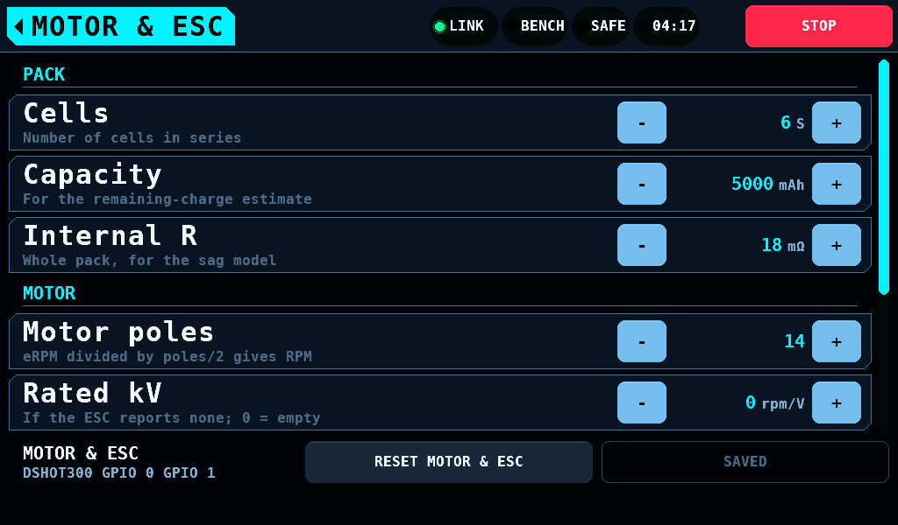

SETTINGS contains the 8 motor, pack and throttle-output settings
(`SET_CAT_ESC`), in schema order under three headings:

| Heading | Settings |
| --- | --- |
| PACK | Cells, Capacity, Internal R |
| MOTOR | Motor poles, Rated kV |
| THROTTLE OUTPUT | Idle pulse, Full pulse, Ramp limit |

The rows occupy two 295px columns: PACK and MOTOR on the left, THROTTLE
OUTPUT on the right. Each 68px row has a label on the left, a 120 x 48px box
containing the value and unit on the right, and a help line below in 8 x 16.

Tap a value box to open the keypad. It covers the left column and task
strip (620 x 529px), preventing task changes, while the right-hand rail
remains accessible. The keypad shows the setting's name, range and unit.
OK accepts an in-range value and rounds it to the setting's step, such as
4321mAh to 4300mAh. Out-of-range values keep the keypad open and show the
range in the warning colour. CANCEL or the home tag closes the keypad
without changing the value.

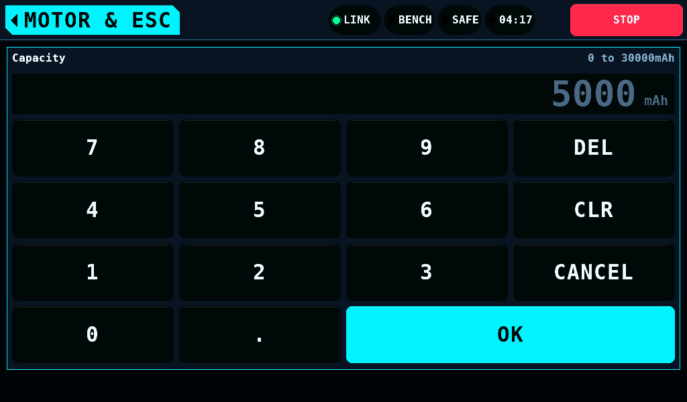

Idle pulse must stay at least 100us below Full pulse
(`LINK_CC_THROTTLE_GAP_US`). Their keypad ranges overlap: 800 to 1600us
and 1400 to 2400us. A value that violates the gap leaves the keypad open
and the setting unchanged. In place of the range it shows a warning:
`Idle pulse at most 1900us (100us below Full pulse)` or
`Full pulse at least 1100us (100us above Idle pulse)`.

The panel checks the same gap before sending the pair to the IOmcu. The
IOmcu's own write check enforces 400 to 2500us for each pulse but does not
check the gap.

Idle pulse and Full pulse can change only while SAFE. The IOmcu accepts
the endpoints while disarmed, 300ms after the last edit; switching to
ARMED sends no endpoints. While ARMED, during an ARM hold, or while an ARM
or DISARM response is pending, both value boxes are locked. Their help
line reads `Set on a SAFE bench only` in the warning colour. An open
endpoint keypad closes when ARM is pressed or the bench leaves SAFE.

The 2s ARM hold gives an edit made before the press time to reach the
IOmcu. If the link is up but an edit is still pending, ARM is refused with
`Pulse range not yet sent to the IOmcu. Hold ARM again.` The bench stays
SAFE. If the IOmcu refuses the pair or stores different values, ARM stays
blocked and a message explains what to change. An edit here, a binding
change on OUTPUTS or a link reconnection must bring the pair into force
([A pulse range on its way](Safety.md#a-pulse-range-on-its-way)). The other
6 settings can change at any time.

All settings share one store. OK applies a value immediately and requests
a save. The panel writes the whole store on the first frame with the bench
SAFE, supply output off and no board drawing being fetched or retained.
This is the same write requested by SETUP's SAVE
([Keeping the values](#keeping-the-values)).

Unsaved SETUP changes are included, clearing its warning on leaving.
A refused write leaves all changes unsaved; SETUP's warning then lists the
ESC settings alongside its own. The line at the page's foot, ending 4px
above the alert band, shows the store's state:

| Line | State |
| --- | --- |
| `SAVED` | nothing is unwritten |
| `SAVE PENDING` | a write is asked and waits for a quiet bench |
| `NOT SAVED` | the last write was refused |
| `SETUP CHANGES NOT SAVED` | values are unsaved and no write is asked; the next change here writes them |

### PROGRAM

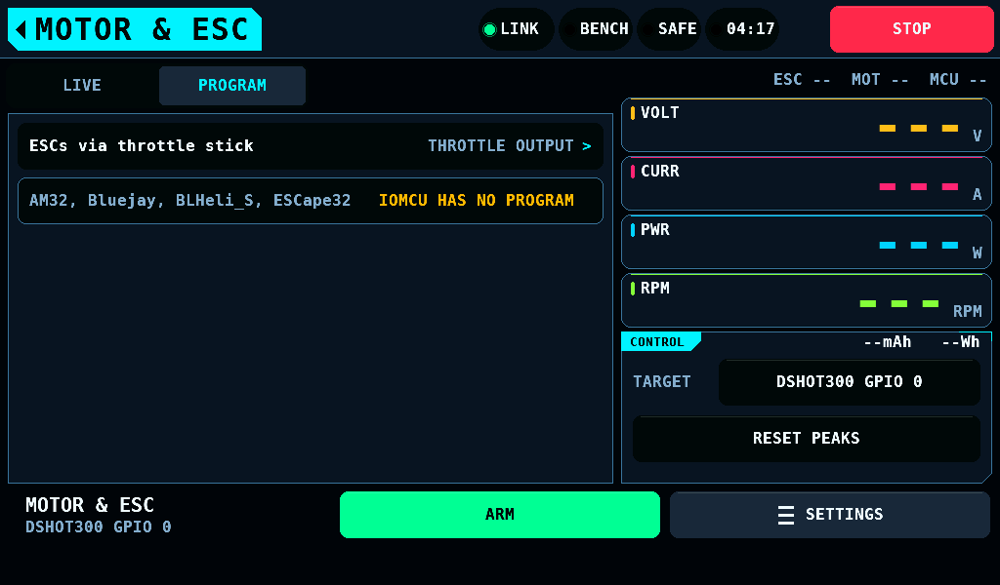

PROGRAM shows two ESC-programming rows in the task area, using the same
registry as SERVO (`shared/ui/prog_registry.c`,
[Programmer](#programmer)). `ESCs via throttle stick` (German
`ESCs per Gasknüppel`) belongs to STICK MENU (`STICK-MENÜ`). Its right side
reads `THROTTLE OUTPUT >`: it drives the throttle pins, uses no programming
port and requires no IOmcu capability. The other row opens the signal-wire
session described below.

Group headings appear only when a list has more than 8 rows. The output
card stays visible on the right while the list is open.

Tap the throttle-stick row to open ESC STICK one level down. The session
fills the body, covering the task area, rail and tabs; ARM and the tabs
cannot receive touches through it. Opening ESC STICK switches the bench to
SAFE if needed, even while another finger holds DISARM. An output strip
replaces the task tabs, with one line in the 10 x 20 font at x 12, y 4:

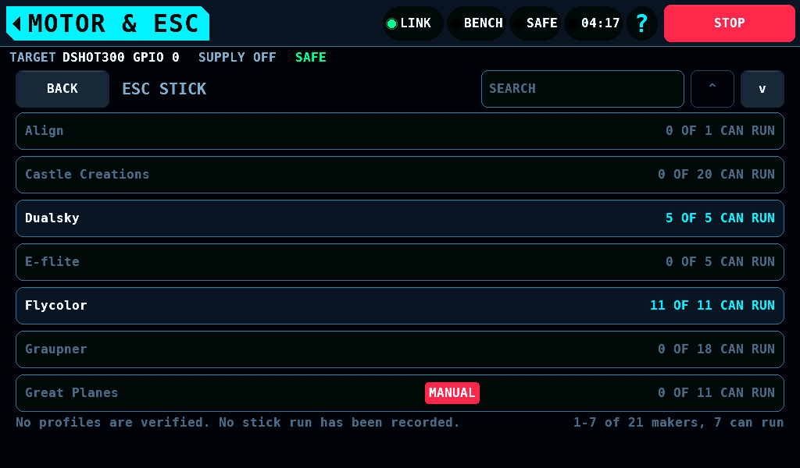

```
TARGET DSHOT300 GPIO 0 GPIO 1   SUPPLY 7.60V  1.00A   SAFE
```

| Part | Shows |
| --- | --- |
| `TARGET` (German `ZIEL`) | the protocol and the pins bound as throttle, as the CONTROL card's TARGET row names them, in at most 26 characters; in the warning colour while no pin is bound or the binding is not read |
| `SUPPLY` (German `NETZTEIL`) | the PD mini's output as it reads: `SUPPLY 7.60V  1.00A`; `SUPPLY ON` while it is on without a voltage and a current reading; `SUPPLY OFF`; `SUPPLY --` while the supply does not answer |
| `SAFE` or `ARMED` | the bench; ARMED in the danger colour |

The strip is at most 100 characters, 1000px, in English and in German. It
is repainted when its text changes.

From ESC STICK's manufacturer list, the home tag closes the session and
returns to PROGRAM. From there it returns to the menu. Leaving MOTOR & ESC
at any level ends a stick run, switches off the supply output that the
run switched on, switches the bench to SAFE and closes ESC STICK. Returning
to MOTOR & ESC leaves PROGRAM at its list.

The row `AM32, Bluejay, BLHeli_S, ESCape32`, `SIGNAL WIRE` at its right, opens the signal-wire session: [ESC signal wire](EscWire.md). It is dimmed until the IOmcu reports `LINK_CAP_PROGRAM`.

The bench identifies and drives ESCs with
BLHeli_32 firmware and sends the DShot special commands, but cannot read
their parameters: [Parameters of ESCs with BLHeli_32 firmware](BLHeli32.md).

### ESC STICK

ESC STICK programs an ESC through its throttle-stick menu, from an ESC
profile; [Stick programming](StickProgramming.md) describes the runs.

ESC STICK controls normally act on a tap: lift inside the pressed control,
within 8px of the starting point on each axis. Sliding away or across a
control does not activate it. Each control accepts one finger at a time.
Three controls use the press directly:

- HOLD 2s TO RUN: its 2s hold starts at the press.
- ABORT of a stick run, on the run's page and on a manual step's prompt. It
  stops a motor, so it does not wait for the lift, and it answers a second
  finger.
- The keys of the search keyboard, which follow their own press and lift.

ESC STICK lays out on the body under the output strip, from body y 28,
with its labels, rows and buttons in the 10 x 20 face:

| Part | Place and size |
| --- | --- |
| crumb row | y 30 to 78: BACK 120 x 48px, the trail in the 12 x 24 face, and at the right the search field (260px, its X 48px), `^` and `v` (56px each) on the list or TIMING (168px) on a profile's page |
| list | 7 rows a page, 48px tall at a 56px pitch from y 84, 984px wide; a model's name in 30 characters; the footer line ends 4px above the alert band |
| profile's page and TIMING | the parameter card on the left, 660px: 6 rows a page, 48px tall at a 56px pitch, each with its number, its name (up to 23 characters), its value in a 250px column and `-` and `+` of 48 x 48px, 8px between any two |
| side column | 340px right of the parameter card: CHANGE (TIMING's title on TIMING), the rows shown and `^` and `v` of 48 x 48px; MANUAL INTERVENTION REQUIRED, 310 x 48px; then how the profile's menu works, the supply and the entry time, and the picked row's help, wrapped to 31 characters a line |
| foot row | y 436 to 492, 4px above the alert band: the note at the left on up to 2 lines, DEFAULTS and RUN, ABORT, OK or CLOSE, 168 x 56px each |
| run and result | the device card across the body from y 84 with its two lines, the run's card under it from y 136 with the stack light at its right, two help lines from y 390, and the foot row; a result's MANUAL INTERVENTION REQUIRED, 330 x 56px, left of OK |
| warning, manual steps, prompt | a panel over the pages from y 28, its title in the 20 x 36 face, its lines at a 22px pitch, its buttons 48px tall ending 4px above the foot row, so a second tap on RUN's place lands on none of them |

BACK and the home tag move up one level: from a stick profile to its list,
from a manufacturer's models to the manufacturer list, then to PROGRAM.
On the RUN warning, the home tag acts as CANCEL; on manual steps it acts
as OK. During a stick run it acts as ABORT, ending the run and leaving its
result visible.

The list starts with manufacturers in alphabetical order, each showing
the number of models with runnable profiles:


Select a manufacturer to list its models, one per row, sorted by current,
then voltage, then name. Each row shows the family and profile status,
including any reason it cannot run. Select a model to open its family's
profile:

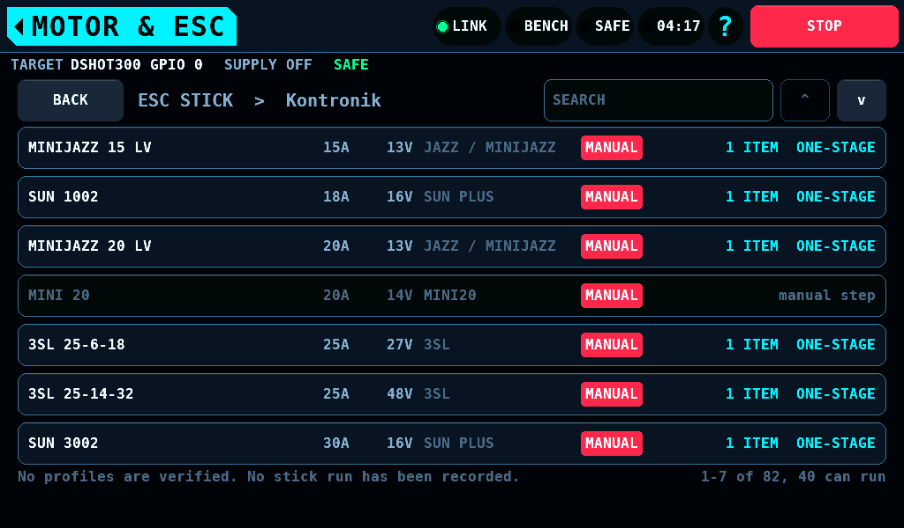

SEARCH filters the current list. Its keyboard opens on the right, narrowing
the list alongside it; each keystroke updates the filter. Search matches
the manufacturer plus family name or the manufacturer plus model name,
each treated as a single string. A manufacturer appears if any of its
models matches. Search ignores case; `*` matches any sequence of characters:

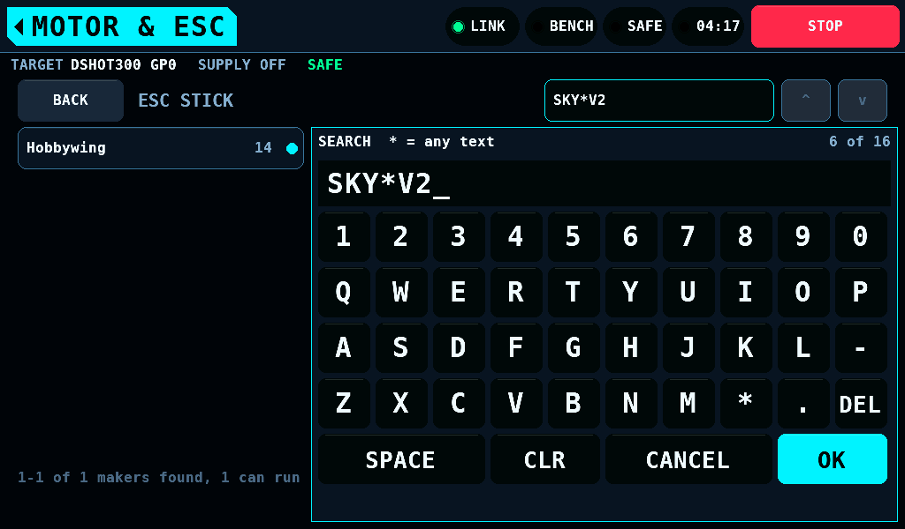

OK keeps the search on both levels, X clears it:

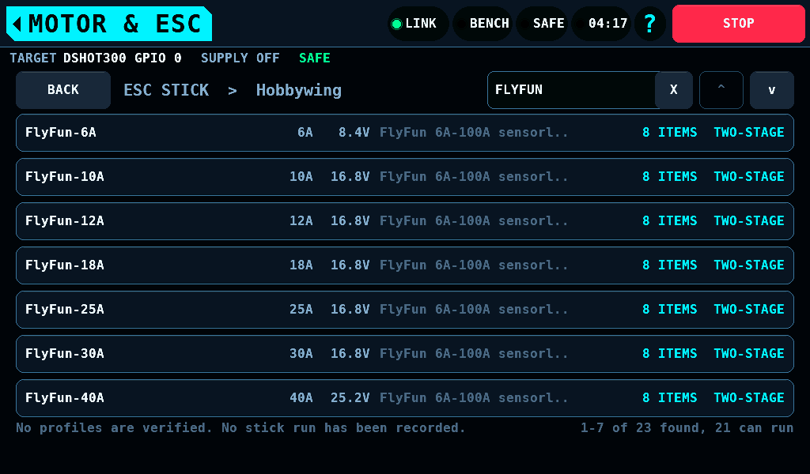

Every profile item starts at KEEP. Use the steppers to choose values; RUN
shows how many have been selected:

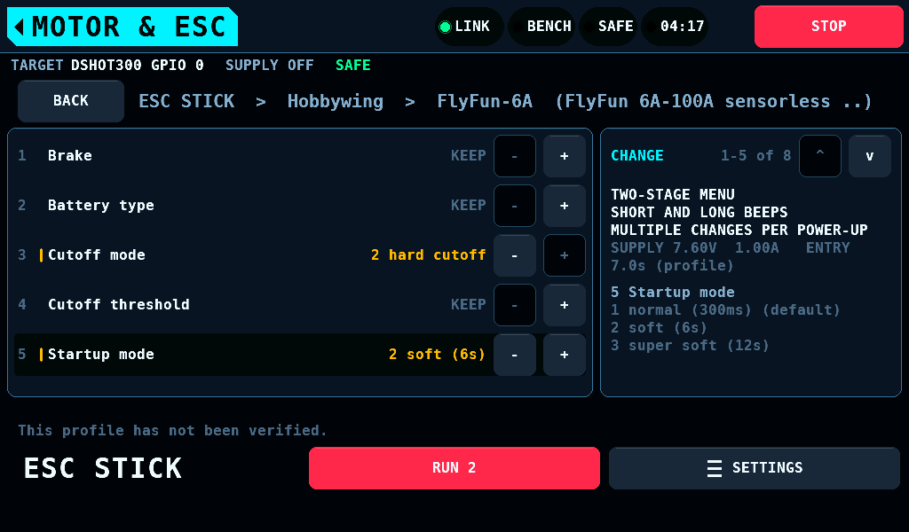

RUN opens the full-screen warning PROPELLER REMOVED? MOTOR SECURED? A motor
connected to the ESC must be secured and have its propeller removed, or be
replaced by a resistor load. Hold HOLD 2s TO RUN for 2s to start:

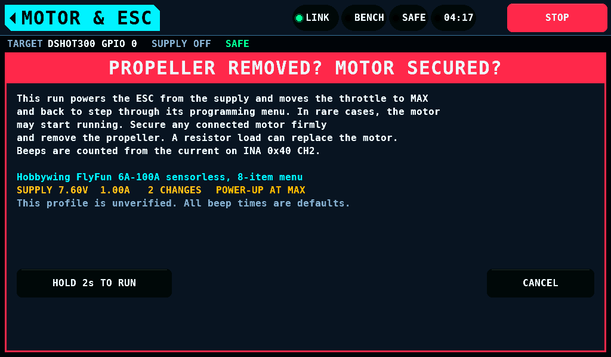

RUN stays closed and shows a reason beside the button if no throttle pin
is assigned, the output bindings have not been read or the supply is the
panel's model. Any of these conditions also closes an open warning
([Before a run](StickProgramming.md#before-a-run)).

Profiles requiring a physical action at the ESC, such as fitting or removing
a jumper or pressing a button, show a red MANUAL tag in the list and a red
MANUAL INTERVENTION REQUIRED button on the profile page. The button lists
the steps and their timing; this list also appears when the profile first
opens. The warning lists steps required before power-up. During the run,
each later step pauses execution with DONE and ABORT, waiting at most 60s
([Manual steps](StickProgramming.md#manual-steps)):

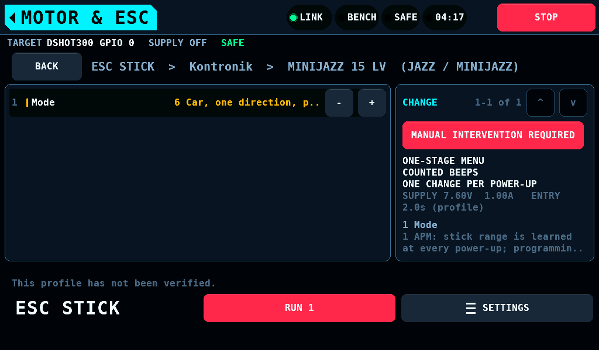

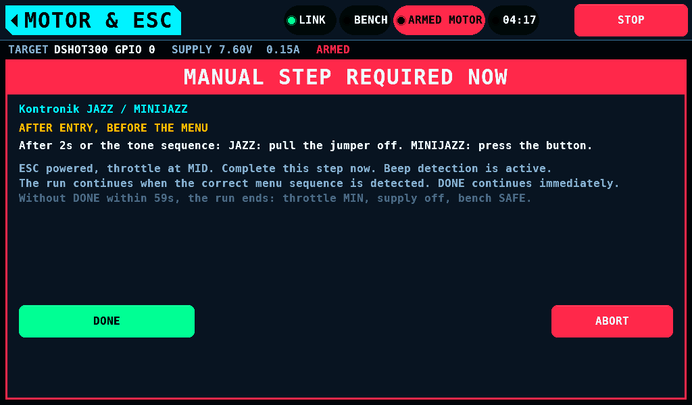

Some Kontronik ESCs lock if power is removed before they confirm the stored
mode. For these ESCs, the run keeps power on and the stick at the store
position until DONE:

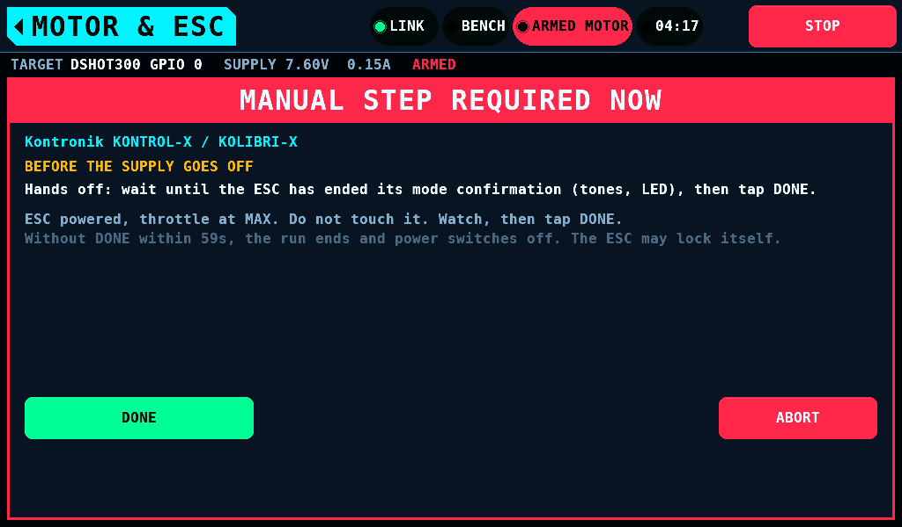

While it runs, the page shows the phase, the beeps of the group under way
and the last group. ABORT, the home tag, STOP and leaving the screen end it
with the throttle at MIN, the supply off and the bench SAFE. The stack light's
green is on while a beep is detected, for at least 150ms:

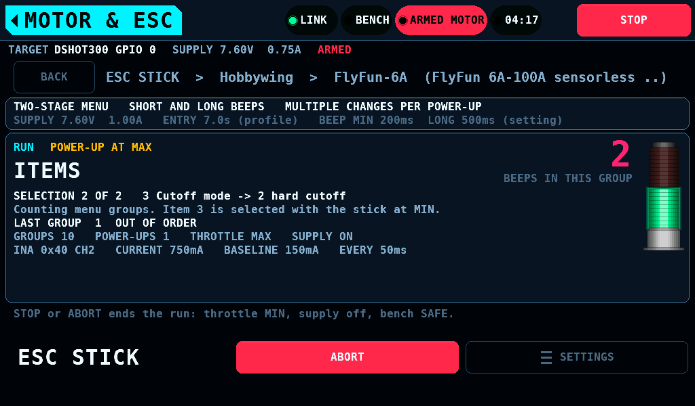

When the phase tap is enabled in SETUP, the run page adds a read-only line
below current. It shows the tap's state, pitch from its latest 8ms window,
counts of beeps lost by the IOmcu or missed by the panel, and the last four
beeps with number, duration in ms and mean pitch in Hz. The run still
counts beeps from supply current.

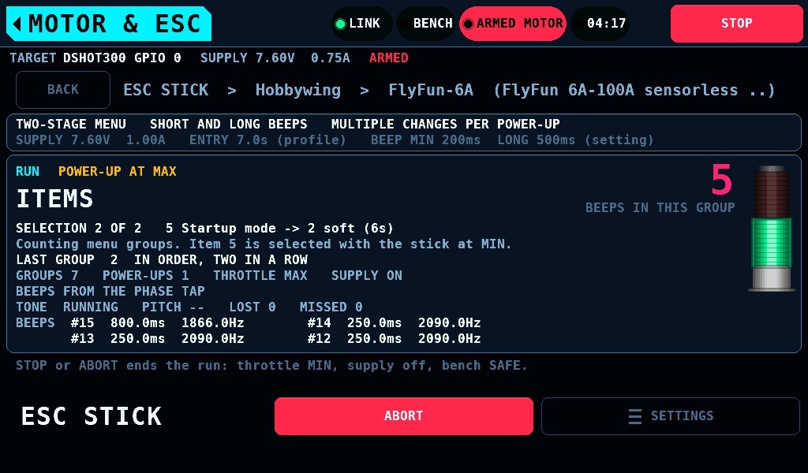

| State | Meaning |
| --- | --- |
| `RUNNING` | the capture runs |
| `OVERRUN` | it runs, and the capture ring or FIFO overran since the tap was enabled |
| `WAITING` | no link, or the TONE page has not answered in the last 500ms, or its flags say the tap runs and its window number has not moved for 1.5s, or the tap was switched off and the page still holds it on |
| `NO TONE PAGE` | the IOmcu speaks a protocol older than 4.8 |
| `PIN NOT FREE` | the IOmcu holds the tap off: its pin is bound elsewhere, or the IOmcu runs no capture since its boot (core 1 not started) and its saved set-up has the tap enabled; the second clears only with a restart of the IOmcu |
| `NOT RUNNING` | enabled, and the page holds the tap off or does not run it: the set-up was refused or is not written yet |

PITCH and LOST come from the latest status read. They show `--` and hide
OVERRUN when no status read newer than 500ms is available: in `WAITING`,
`NO TONE PAGE`, and `NOT RUNNING` when the page reports the tap disabled.
MISSED and the beep history are the panel's own records and remain visible.

The result stays visible until OK. Its red light indicates an unexpected
end, including a stop raised by the bench itself. The light stays dark for
DONE, a pressed STOP, ABORT, the home tag or leaving the screen
([the list](StickProgramming.md#how-a-run-ends)):

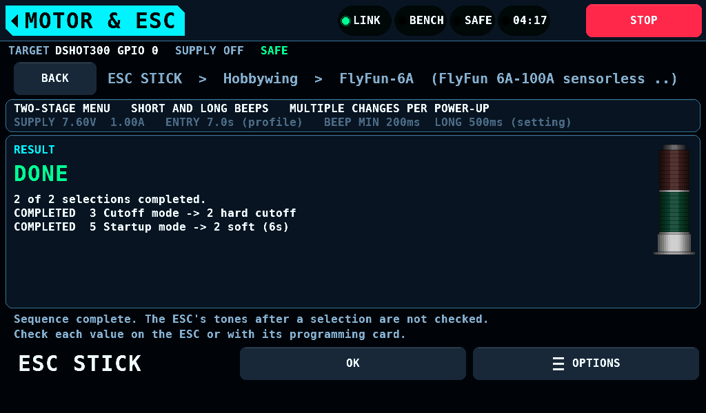

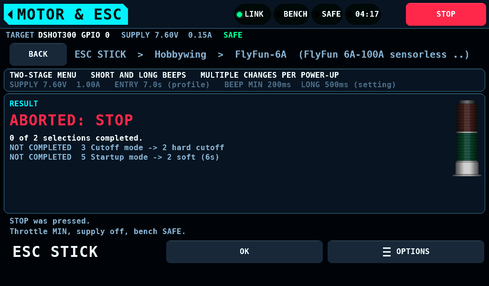

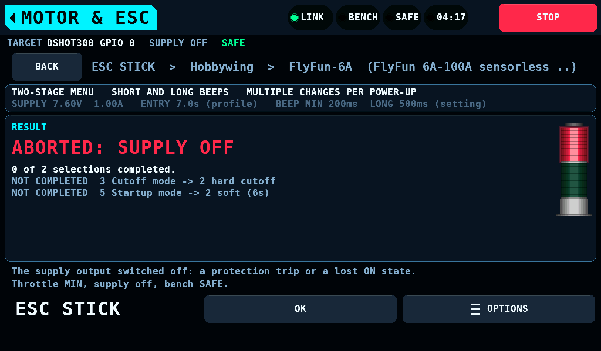

TIMING holds the beep timings and the supply settings. None of them is
measured:

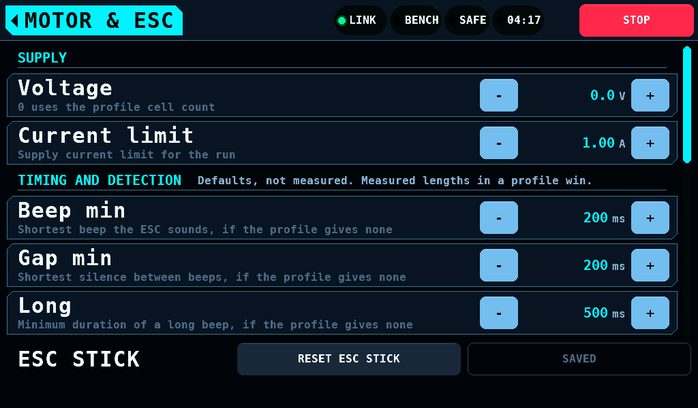

Use a row's `-` and `+` buttons to change its value by one step, or tap the
250px value column to open the keypad. The keypad covers the page from
below the output strip to 4px above the alert band: 1008 x 464px, with
242 x 81px keys. It shows the setting's name, range and unit. Decimal
places follow the step size: one for Voltage's 0.1V, two for Current
limit's 0.05A.

OK rounds to the nearest step, as the step buttons do: 1.23A becomes 1.25A.
CLOSE requests a save, as after a step-button change. An out-of-range value
leaves the keypad open with the range in the warning colour. CANCEL,
empty OK or the home tag closes it without changing the value; TIMING
remains open. Controls behind the keypad receive no touches. Profile items
use lists of the ESC's own values and do not open a keypad.


## Servo

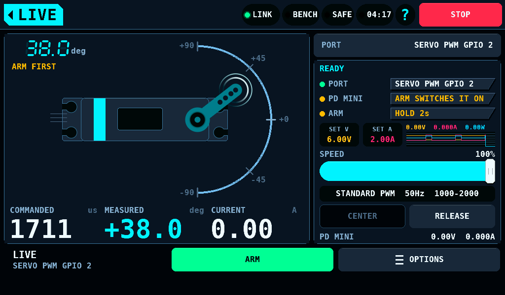

SERVO has five tasks below the status band: **LIVE**, **TEST**, **PROGRAM**,
**RUDDER** and **SETTINGS** (German `LIVE`, `TEST`, `PROGRAMMIEREN`, `RUDER`,
`OPTIONEN`). Tabs are 120 x 40px with 4px gaps, starting at y 8 below the
band. English labels use the 10 x 20 font; German uses 8 x 16 because
`PROGRAMMIEREN` has 13 cells and a 120px tab fits only 10 of the larger font.

The menu tile opens LIVE. Switching tabs adds no navigation level: the
home tag returns to the menu from every task. From run settings it first
returns to TEST, and from a programmer to the PROGRAM list. Each task
retains its page and selection until the panel restarts. Leaving SERVO
from any task switches the bench to SAFE.

| Task | Left card, the page area |
| --- | --- |
| LIVE | the dial, and a run's box over it while a run is under way or its result is shown |
| TEST | the AUTOMATIC TEST and LIMIT RUN cards, and SUPPLY's caps, read-only |
| PROGRAM | the list of programmers, one row each; a row opens its programmer over the left column |
| RUDDER | a control surface's deflection in ° and mm, LENGTH, 1000us, CENTRE and 2000us, ZERO, RESET MAX and AUTO ([Rudder deflection](Servo.md#rudder-deflection), [AUTO end points](Servo.md#auto-end-points)) |
| SETTINGS | the pages OUTPUT, SWEEP and DUT |

The 620px left card begins below the task strip at y 56. The 380px output
card on the right extends from the top to the bottom margin, beside the
strip, and stays the same on every task. It shows the active type, servo
rail readings and plot, SET, SPEED, TARGET, CENTRE, SWEEP, RELEASE and ARM.
Touchable rows are at least 48px tall. ARM is 60px tall and ends 4px above
the alert band, as does OUTPUT OFF.

A keypad, keyboard, list, warning, confirmation dialog or programmer covers
the whole left column, including the tabs. Answer or close it before
switching tasks.

LIVE shows the horn angle at the top left, with `ARM FIRST` below it while
SAFE, and the servo dial with a 150px radius. Three readouts span the foot
of the card in equal columns: COMMANDED in microseconds, MEASURED in
degrees and CURRENT in amps. Labels and units sit above 44px numerals,
ending 4px above the alert band. The +90 and -90 labels sit left of their
dial ticks.

Numerals wider than their 198px column use a smaller font, for example a
current held at `-1000000.00`. These readouts appear only on LIVE; other
tasks show current on the line above the plot.

The horn is drawn at subpixel positions. Its tip is 98px from the shaft,
moves 1.7px per degree and stays within 0.1px of its calculated angle.
Movement redraws only the bounding boxes around its previous and current
positions in each frame buffer, about 160px across, plus the angle,
COMMANDED and MEASURED numerals. It does not redraw both whole cards.

While ARMED on LIVE, drag on the dial's arc to command a position. The
solid arm shows measured position; the faint arm shows commanded position.
Their gap reflects the servo's lag. Rings around the tip pulse while the
servo is driven.

Lifting the finger keeps the position held: the screen repeats the last
command every SERVO_HOLD_MS. **RELEASE** returns the surfaces to the middle
of their travel but leaves the pins assigned and pulsing. Switching to
SAFE stops the pulse edges; leaving SERVO also switches to SAFE.

When enabled, the rotary knob moves the horn from its current position
on LIVE and RUDDER ([the knob](#panel-the-rotary-knob)). It has no effect
on TEST, PROGRAM, SETTINGS or beneath an open panel or programmer. A turn
in the frame when LIVE reappears is ignored; the next turn works.

Only one finger drags the dial. A second press anywhere on the screen
ends that drag, as it does for SPEED. The drag filter stops at the angle
it has reached. Press the dial again to begin a new drag.

The first press commands its dial angle immediately. Subsequent movement
passes through a one-pole filter with a 20ms time constant
(`SV_DRAG_TAU_MS`), calculated from each frame's duration. It behaves the
same at 30, 60 or 120 frames per second. Both the drawn horn and the sent
pulse follow the filtered angle, lagging by 1.8° behind a finger moving
at 90°/s.

The filter smooths the mismatch between touch reads every 10.5ms and frames
every 16.6ms. At 90°/s, the horn advances 1.0° to 1.8° per frame; unfiltered
reads give 0.5° to 2.1°. On a normal release, the target continues to the
finger's final angle, covering 99% of the remaining distance in 100ms.

Any other command ends the filter immediately: SAFE, DISARM, STOP, RELEASE,
CENTRE, SWEEP or the knob, even a turn resulting in the last filtered pulse.
A press that cancels the drag before release also stops the filter: a
second finger on the screen, status band, STOP or alert band, or the
dragging finger moving into the status band. The filter stops at its
current angle and sends no further commands. It cannot move anything while
SAFE. The next ARM starts at rest, with no remaining drag input.

SERVO drives channels assigned the surface role. Their pins and protocols
come from the bindings. All eight PPM channels are surfaces, so an assigned
PPM output follows SERVO like an assigned SERVO PWM output. If no
surface channel is assigned, the screen sends no position command and no
pin moves.

SPEED controls the output's rate of travel in degrees per second of horn
movement. At 100%, commands pass through directly and the servo moves at
its own speed. Below 100%, the bench ramps the command; crossing at 30%
takes three times as long as at 90%. A change applies immediately to a
held output. Without feedback, the drawing follows that rate; at 100% it
jumps to the commanded position.

**ARM before moving a servo.** ARM enables the surface outputs and a
pulsing PROG PORT; throttle outputs send no pulse
([An arm for one role](Link.md#an-arm-for-one-role)). While the surfaces
are SAFE, the IOmcu writes zero-length pulses to the PWM pins and the
screen rejects position commands. The commanded position changes only
while the servo can follow it.

ARM requires the same 2s hold and colour fade as MOTOR & ESC. While ARMED,
a press switches to SAFE. Leaving SERVO also switches to SAFE and releases
the pin, so a hidden screen cannot keep a servo held or the bench ARMED.

What each control does while the bench is SAFE:

| Control | SAFE | ARMED |
| --- | --- | --- |
| The dial | refused: no command, the horn and COMMANDED stay | commands the position under the finger |
| Rotary knob | refused; the turn is not kept | moves the horn from the commanded value |
| CENTRE | refused; drawn dimmed | commands PULSE CENTRE plus TRIM |
| SWEEP, PAUSE, PAUSED | refused; drawn dimmed | starts, pauses and resumes the sweep |
| RELEASE | sends the release; the value shown stays | centres the surfaces; the value shown becomes the rest |
| SPEED | set; sends nothing | set; a held position is sent again at the new rate |
| SETTINGS > OUTPUT: TYPE, FRAME RATE, PULSE MIN, CENTRE and MAX, TRIM, TRAVEL, REVERSE | set; send nothing | set; a held position or the rest is sent again under them |
| TARGET | a tap opens SETUP > OUTPUTS | locked; names the target |
| SET, OUTPUT ON, OUTPUT OFF | as on SUPPLY | as on SUPPLY |
| START TEST | refused: `ARM FIRST` | starts the run after its hold |

While SAFE, the horn is dimmed and LIVE shows `ARM FIRST`. The horn and
COMMANDED retain the last driven position, or PULSE CENTRE after restart.
Changing a pulse-width setting while SAFE changes the microseconds shown
for that angle; TRAVEL does not clamp the angle.

The SAFE-column behavior also applies as soon as the screen requests
DISARM, by a tap or by leaving, or STOP is pressed while ARMED, before the
bench's SAFE report arrives. A sweep, pause, held position or automatic
test ends when that request is made.

On ARM, the commanded value becomes the pins' rest position: the midpoint
of the channel endpoints, 1500us for STANDARD PWM or 760us for NARROW 760,
without TRIM. Without feedback, the horn is drawn there immediately.
The first drag or knob turn starts from that value regardless of the
previous display; a 1% turn with STANDARD PWM requests 1510us. Changing
type or pulse width while ARMED before the first position command moves
the rest position and displayed value together.

A finger on the dial when the bench switches to ARMED, switches to SAFE or stops moves nothing
until it lifts and presses again. A position, a sweep or a pause the screen
has posted and the panel has not sent when the bench switches to SAFE or stops is not
sent, and a knob turn in that state is withdrawn: the value returns to the
one before the turn.

RELEASE while ARMED restores the same rest position as ARM: 1500us for
STANDARD PWM or 760us for NARROW 760, without TRIM. The commanded value
follows, and the horn is drawn moving there at SPEED. Any drag ends.
Press the dial to command a position again. The next knob turn starts
from rest: a 1% turn with STANDARD PWM requests 1510us.

The same behavior applies to release at the end of an automatic test or
a release sent after changing type or pulse width while resting. Only
one command waits per frame. If a position and RELEASE occur in the same
frame, the later command is sent and shown. A knob turn is discarded in
a frame with RELEASE pending.

The output card shows the type, frame rate and pulse range in force (in
the danger colour while they are ones that can destroy a servo not made for
them) and the servo rail as its meter reads it: voltage, current and power
on the line over the plot, plotted over the last 17.8s (356px at 20
points a second). LIVE's CURRENT reading shows the current again. The type
row, 44px tall, reads `STANDARD PWM  50Hz  1000-2000`: the type, the
frame rate and PULSE MIN to PULSE MAX in microseconds, two spaces apart.
The longest, a 13-character type at 560Hz with two 4-digit ends, takes 32
of the row's 35 characters, so the range carries no unit. A pulse width
typed in the settings reaches the row at once.

| The servo rail's meter | Name on the line | LIVE's CURRENT, the line and the plot show |
| --- | --- | --- |
| an INA3221 channel | `INA`, its part's address and channel: `INA 0x41 CH2` | the channel's last 50ms window: the mean current, the mean bus voltage at the load side of the shunt, and their product. One point of the plot per window, 20 a second |
| the PD mini | `PD MINI` | the supply's last sample. One point per sample |
| the model, while no IOmcu answers | `PD MINI` | the supply's last sample: the supply model's under the SIMULATION watermark, and no reading where SUPPLY's PD MINI tab enables the PD mini, which does not answer without the link |

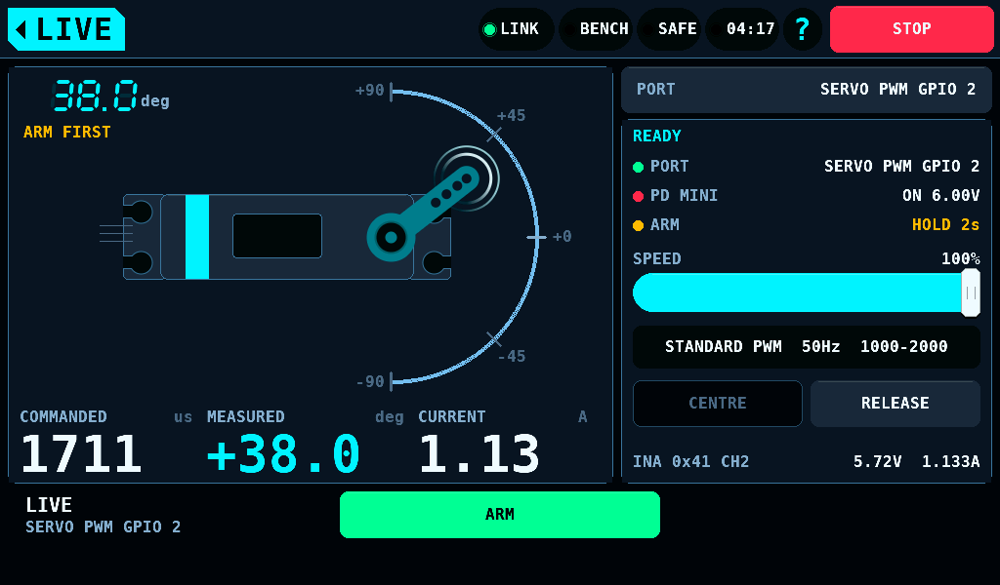

The name stays `PD MINI` in both languages. With the PD mini disabled on
SUPPLY's PD MINI tab, the panel uses its supply model. A SIMULATED pill
(SIMULIERT in German) appears at the plot's upper-left corner below the
name, leaving room for the three readings beside the name. It is 26px
high, with a width of 30px plus the word, at least 110px; SIMULATED and
SIMULIERT use 120px. It appears and disappears automatically with the model.

With an INA3221 meter, the line names its channel, `INA 0x40 CH1` through
`INA 0x43 CH3`, and has no pill regardless of the supply model. This is
the channel watching the servo tester's target
([SENSORS](#sensors-the-ina3221-parts)). Before IOmcu protocol 4.25, it is
CH1 of the single part read through SENSE.

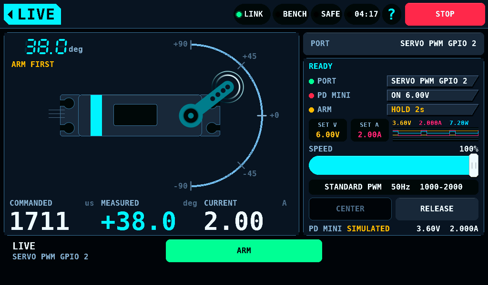

On the [rbmod carrier](Carrier.md#power), the 48px PROG 5V box replaces the
plot below the readings. It controls the programming ports' separate 5V.
The first line shows pin and state, `PROG PORTS 5V, GPIO 21: OFF`. The
second shows the latest 50ms window from INA3221 0x40 CH3, which watches
the 5V: `5.02V  0.120A`, or `--V  --A` without a window.

PROG 5V ON requires a 2s hold; PROG 5V OFF takes a tap, in SAFE or ARMED,
like OUTPUT ON and OFF. If a programming port holds the 5V, the second
line reads `HELD BY PROG PORT n` and the button is dimmed. Pressing it
shows `PROG ports 5V: held by a programming port, or not read.` The box
remains visible under the KST and Hitec programmers. Leaving SERVO turns
off 5V switched on by its box unless a port holds it. With the supply
model active, SIMULATED appears below the box.

SUPPLY has the same box ([Supply](#supply)); see
[Carrier, The PROG 5V box](Carrier.md#the-prog-5v-box) for its rules.
Two windows below 3000mV while the box reports ON cause a fault: SAFE,
all outputs off, and the band message
`PROG 5V lost: INA3221 0x40 CH3 read 0.12V while ON. All outputs off.`
([Carrier, PROG 5V lost](Carrier.md#prog-5v-lost)).

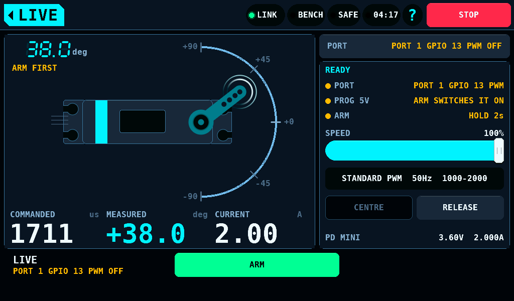

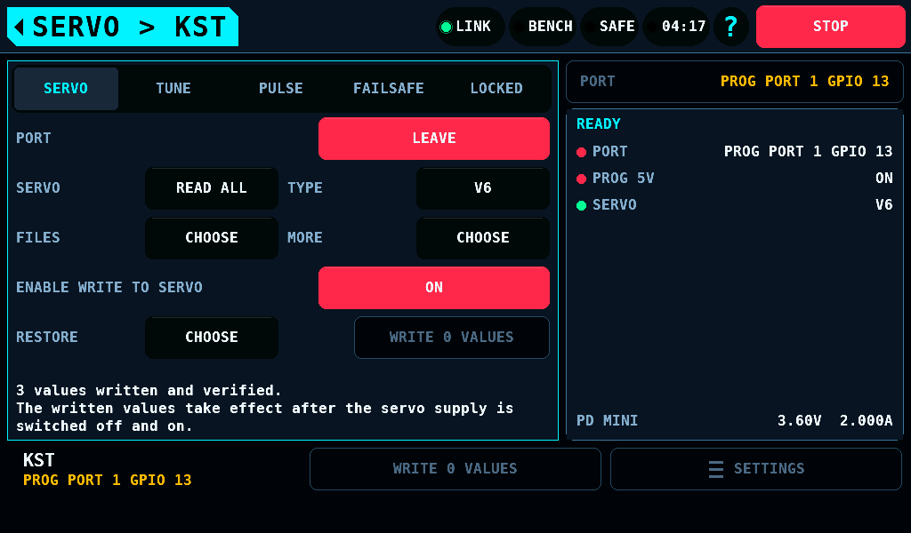

The meter is selected once per poll
([the current monitors](#sensors-the-current-monitors)). The INA3221 takes
over after its conditions remain true for 1000ms. The PD mini takes over
on the first poll where any condition fails.

- A current is signed and shown in hundredths of an amp: `0.41A`,
  `-0.02A`, `-1.64A`. A reading that rounds to zero is `0.00A`. The
  power on the line is signed in tenths of a watt. Beside a channel's name the
  three readings have 64, 84 and 74px, 6, 8 and 7 characters of 10px,
  after the name's 134px; beside PD MINI 88, 88 and 90px after its 90px:
  a voltage of 10V or more is shown in tenths, `26.0V`, and
  a power of more than 7 characters in tenths, `-100.0W` and beyond or
  `1000.0W` and beyond, in whole watts.
- A reading that did not arrive is `---` in LIVE's CURRENT, `--` on the
  line and a gap in the plot: no sample yet, a supply that does not answer,
  no window since the link came up, a window without samples of that
  quantity.
- A window in which a sample read an end of the INA3221's range, 1.638A or
  -1.638A on a 0.1Ω shunt, shows its mean as it is, in the warning colour
  in LIVE's CURRENT and on the line. The clipped samples count in that mean
  at the end of the range.

  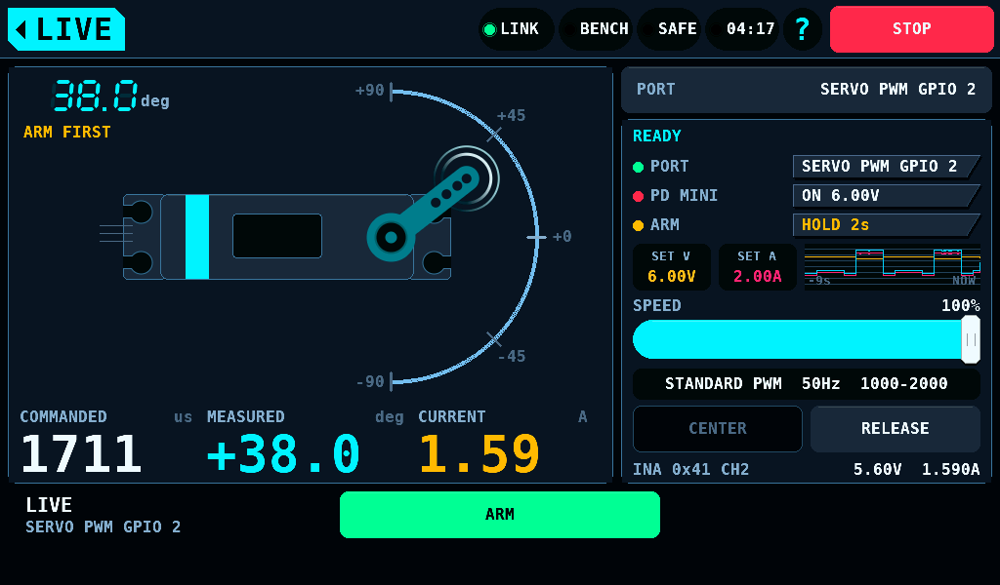

- Loss of the link clears the INA3221's last window. The readouts show
  `---` and `--` until another window arrives or the meter changes.
- Switching to or from the INA3221 clears the plot, so its trace always
  belongs to the named meter. Each window or supply sample is tagged with
  the meter selected by the poll that took it. Samples from before the
  change are excluded; none from after the change is omitted. The scale
  starts at 0, so negative current is drawn along the lower edge.
- LIVE redraws the CURRENT numerals alone when their digits or colour change.

The automatic test reads the servo rail's meter as the panel names it at
START TEST: the INA3221 channel while the INA3221 is that meter and the
supply is the PD mini, the PD mini's readings otherwise, and the model's
with the supply modelled ([The meter](Servo.md#the-meter)).

MEASURED shows the horn angle from the selected source, AS5600 or IMU,
in tenths of a degree from -180.0° to +179.9°. The AS5600 angle is measured
from its centre count and read 20 times per second. It requires AS5600
enabled under SETUP > SENSORS, a responding sensor and a detected magnet.
No response or no magnet (STATUS MD clear) gives `---`; the count is then
not a valid angle. A weak or strong magnet warning leaves the angle visible
and identifies the condition in the alert band.

With IMU selected, MEASURED uses its configured axis and sign. Without a
valid selected-source reading it shows `---`. If AS5600 is selected but
disabled, available servo feedback supplies the angle instead. COMMANDED
beside it shows pulse width in microseconds.

**The supply can also be set and switched here.** Below the plot, SET shows
SUPPLY's voltage and current-limit set points and output switch. Both
screens use the same values; changing either screen updates the other.

- A tap on a set point opens the keypad over the left card. A value outside
  the caps is brought inside them, as on SUPPLY.
- While the output is on, a typed set point waits for SUPPLY's question,
  OUTPUT IS ON, with APPLY and CANCEL, unless SUPPLY's SETTINGS, CONFIRM
  WHILE ON, KEYPAD is off. The question goes, unanswered, when the output
  goes off or on STOP. An APPLY tapped in the same frame as STOP applies
  nothing, though the supply reports the output off a sample later.
- A voltage raised from 6.0V or below to above it opens the warning HV
  SERVOS ONLY: standard servos are rated for 4.8 to 6.0V, and above that
  only a servo specified as HV (high voltage) is within its rating; a
  standard servo above it can be destroyed immediately. The
  voltage is applied after HOLD 2s TO APPLY is held, the gesture of the
  profile warning; CANCEL drops it. STOP ends the hold. With the output on it replaces SUPPLY's
  question, and it stays if the output goes off. A voltage already above
  6.0V changes without it. A voltage set on SUPPLY does not open it.

  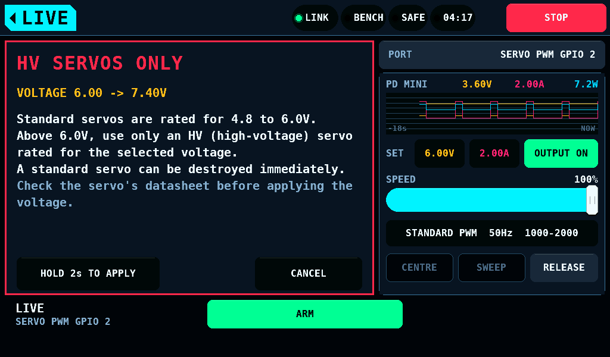

- After a KST or Hitec LEAVE that leaves the output on at the session's set
  points, SERVO asks under OUTPUT IS ON whether the set points from before
  the session go back onto it: `Restore your supply set points 5.50V 2.00A
  on the live output?`, with YES and NO. YES takes the path of a typed set
  point, HV SERVOS ONLY included; NO keeps the session's until the next
  OFF ([Servo programmer, The supply](ServoProgrammer.md#the-supply)).
  No other end of a port's hold asks.

- OUTPUT ON requires a 2s hold; OUTPUT OFF takes a tap, as on SUPPLY.
  STOP cancels a hold. Above a 6.0V set point, wherever it was entered,
  OUTPUT ON opens HV SERVOS ONLY with the voltage. Only a completed HOLD
  2s TO APPLY switches on; the switch's original hold or a tap on APPLY
  cannot. If the set point rises above 6.0V during an ordinary hold, through
  SUPPLY or restoration after a run, the completed hold opens the warning
  and leaves the output off.
- Leaving SERVO turns off an output it switched on, whether through OUTPUT
  ON, a test or the programmer's CONNECT. If a programmer holds the port,
  the output stays on to avoid interrupting the session or a write. It
  turns off when the port is released, unless SERVO has been reopened.
  An ON requested by SERVO and still pending when the port takes the supply
  also counts as switched on by SERVO. An output switched on elsewhere is
  left unchanged. The programmer, keypads and dialogs belong to SERVO;
  opening them is not leaving it. An OUTPUT OFF press made while leaving
  is still sent.

**SWEEP runs a curve on the IOmcu**, keeping its timing independent of the
link. SETTINGS > SWEEP sets CURVE (square, sine or triangle) and SPEED
(0.05 to 5 cycles per second). The automatic test's DWELL TIME sets the
hold at each end. The curve is centred on PULSE CENTRE. RANGE is a share
of the permitted travel, limited by TRAVEL and the nearer of PULSE MIN
and MAX. The right-hand SPEED control limits motion as it does a drag;
trim is not applied.

The panel computes the same curve and times it from the IOmcu's start.
It waits for acknowledgement before drawing a new or resumed sweep; until
then the horn stays at the output position. Without feedback, it continues
from the output's position at the IOmcu start, following the curve at SPEED.
Two sweep-button taps in one frame cancel each other if the first command
has not yet been sent. Nothing is sent and the sweep keeps its previous state.

**PAUSE holds the current output position.** During a sweep the button
reads PAUSE in the accent colour. Tap it to stop where the output has
reached, which may lag behind the curve because of SPEED. The button
changes to PAUSED with the warning-colour fill. The IOmcu holds the
position (link HOLD, SWEEP register 4), because only it knows the exact
output position. Without feedback, the panel draws an estimate. The panel
repeats HOLD every 100ms (`SERVO_HOLD_MS`), keeping the pause active beyond
the IOmcu's 500ms timeout. A pause does not queue behind sweep writes
already on the wire.

Tap PAUSED to resume from the saved curve phase, including progress through
a dwell and the ends already reached. That phase is captured when the
IOmcu acknowledges HOLD, not when PAUSE was tapped. During the exchange,
the IOmcu and drawing continue at the SPEED in force at the tap, for at
most 500ms. Without feedback, the horn is then placed at the estimated
output position at acknowledgement, following the curve with its slew
limit. A SPEED change made during this interval reaches the IOmcu only
when the sweep resumes.

After a tap on PAUSED, the horn stays still until the resume is acknowledged.
The panel then continues from the IOmcu's saved phase, using the timing of
both acknowledgements. This also applies if the resume tap precedes the
HOLD acknowledgement: the later HOLD acknowledgement still moves the horn
to the held position, and resume continues from there.

The IOmcu retains phase through HOLD and resumes with `LINK_SV_RESUME`
(protocol 4.6). The output approaches the curve at SPEED, immediately at
100%; normally it is already there. Changing CURVE under SETTINGS > SWEEP
while paused starts a new sweep instead.

An IOmcu before protocol 4.6, or one whose hold has ended and therefore
refuses resume, restarts the curve: at centre for sine or triangle, at the
first end for square. The alert band reports
`IOmcu firmware older than 0.13.0. Sweep starts again.` or
`IOmcu could not resume. Sweep starts again.` Tapping PAUSED after an
unanswered HOLD also restarts, since the IOmcu may be holding or still
running: `Pause was not confirmed. Sweep starts again.` A tap before a
HOLD that the panel subsequently abandons (below) starts nothing; the
pause ends with that HOLD.

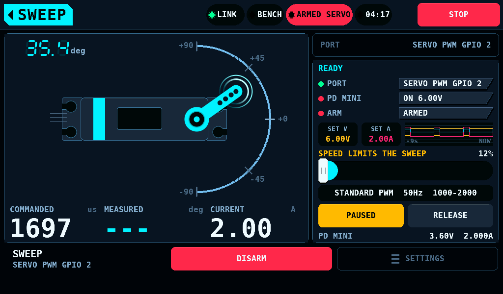

If HOLD is not repeated for 500ms, the IOmcu has released it. The panel
then releases the surfaces to centre and draws the horn there. It also
ends the pause if HOLD is answered only after a retry or more than 500ms:
the IOmcu may have released and held again at another position, leaving
the held angle unknown. Ending the pause avoids retaining an uncertain
angle that a later profile change could command.

Link loss ends sweeps and pauses and draws the horn at rest. The IOmcu
rests the surfaces 500ms after the last write it received. Pending sweep
or hold commands are not sent when the link returns; the next tap starts
a new sweep.

Touching the dial, CENTRE, RELEASE, STOP, switching to SAFE or leaving the
screen ends either a running or paused sweep; the button returns to SWEEP.
Changing type, frame rate, pulse width, trim, travel or reverse also ends
a pause and holds its angle as a position. With feedback, this is the last
reported angle, which the servo may still be approaching after the tap.
Without feedback, it is the drawn estimate at acknowledgement. Changing
SPEED preserves the pause and applies the new speed on resume. Missing
touch events pause a running sweep as PAUSE does.

Changing a setting restarts a running sweep with the new curve. The panel
continues drawing the old curve with its original pulses and TRAVEL until
the IOmcu acknowledges the new one. Each acknowledgement is matched to its
command, so changing SPEED or CURVE while a start is pending cannot make
an older acknowledgement draw the newer command. Profile or frame-rate
changes take effect immediately.

SWEEP is available while ARMED with a surface assigned, a live link and
IOmcu protocol 4.2; otherwise it is dimmed. The IOmcu stops a sweep that
has not been repeated for 500ms and leaves each surface at its reached
output position.

**SPEED LIMITS THE SWEEP** replaces SPEED's label on the right card, in the
warning colour, while SPEED is slower than the fastest change the curve asks
for. SPEED then shapes the motion instead of CURVE: a square, a sine and a
triangle all move as ramps at SPEED's rate and look alike, and the output
can turn back before it reaches an end. The line follows the settings, so it
shows before SWEEP is pressed as well as while a sweep runs. Raise SPEED, or
lower SETTINGS > SWEEP's SPEED (the rate in Hz) or RANGE, to clear it. A square
jumps between its ends, so it shows at every SPEED below 100%. With the
SWEEP page's defaults (sine, 0.5Hz, RANGE 80%) and TRAVEL +/-90° it
clears at SPEED 63%, and for a triangle at 40%.
[Servo procedures](Servo.md#sweep-and-speed) gives the rule.

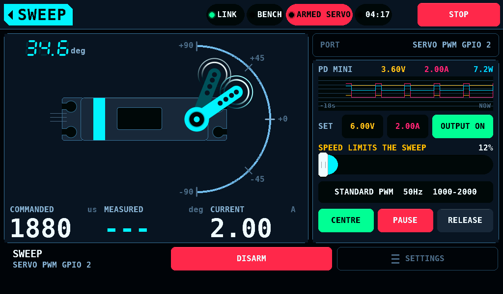

**START TEST begins the automatic test** from TEST's AUTOMATIC TEST card.
It runs the servo at the selected supply voltages, measures current at
rest, moving and holding, measures travel time, and finds the voltage at
which movement stops. [Servo procedures](Servo.md#automatic-test) describes
the method and files.

The 600 x 188px card contains the run name; a summary such as
`4.8V, 6.0V, BROWN-OUT, 60s EACH` or `..., 20 MOVEMENTS EACH`; START TEST
(300 x 48px) beside SETTINGS (160 x 48px); the state line; the last result
and files, such as `LAST: PASS ATEST004.CSV + .TXT`; and the STALL AT note.
An aborted result shows its reason in the warning colour, for example
`LAST: ABORTED - link lost`.

Starting requires ARMED and a responding supply. The state line follows
the bench and settings: ARM FIRST, NO STEP CHOSEN, SUPPLY NOT ANSWERING,
RANGE TOO SMALL (RANGE and TRAVEL place both ends at PULSE CENTRE),
STEP OUTSIDE VOLTAGE LIMITS (a step exceeds the voltage cap, checked before
any warning opens), or REPORT STILL BEING WRITTEN.

The STALL AT note identifies thresholds no reading can exceed. It shows
`STALL AT 2.00A cannot be reached: current limit 2.00A` when STALL AT is at
or above the SET current limit. Otherwise, with the INA3221 as meter and
STALL AT at or above its range, it shows
`STALL AT 2.00A cannot be reached: INA3221 range 1.638A`. The note does not
disable START TEST; see
[Stall and constant current](Servo.md#stall-and-constant-current).

START TEST requires a 2s hold because it switches on the supply and moves
the servo. With HV SERVO enabled and a step above 6.0V selected, a tap
instead opens HV SERVOS ONLY with the highest step. The run starts only
after HOLD 2s TO APPLY completes. HV SERVO is reset to off on every restart.
On an rbmod carrier programming port, voltage steps cannot run: the port
has a fixed 5V supply.

TEST remains visible at startup, with the current step on its state line.
LIVE shows a 346px run box at the left, below `ARM FIRST`, clear of the
horn at every angle. It shows step and phase, with the meter beside STOP
TEST: `PD mini`, an INA3221 channel such as `INA 0x41 CH2`, or `SIMULATION`.
The run uses the meter selected at START TEST until it ends
([The meter](Servo.md#the-meter)). It controls the servo and SUPPLY's set
points and switch throughout.

The run ends early with the output off and servo released to centre on
STOP TEST (on either card), STOP, SAFE, link loss, leaving SERVO, touching
the dial, CENTRE, SWEEP, RELEASE, tapping a set point, changing type,
pulses, trim, travel, reverse or SPEED, missing touch events, or the supply
conditions in [the list](Servo.md#what-ends-a-run).

After the run, SUPPLY's previous set points are restored regardless of the
visible screen. Restoration waits until the run's OFF has been sent and
a later sample confirms that the supply itself is off. A panel request
alone is insufficient: the PD mini follows one link exchange and one
module transaction later. No ON may be pending, and OUTPUT ON must not
be held on SERVO or SUPPLY. Set points edited after the run ends are
left unchanged.

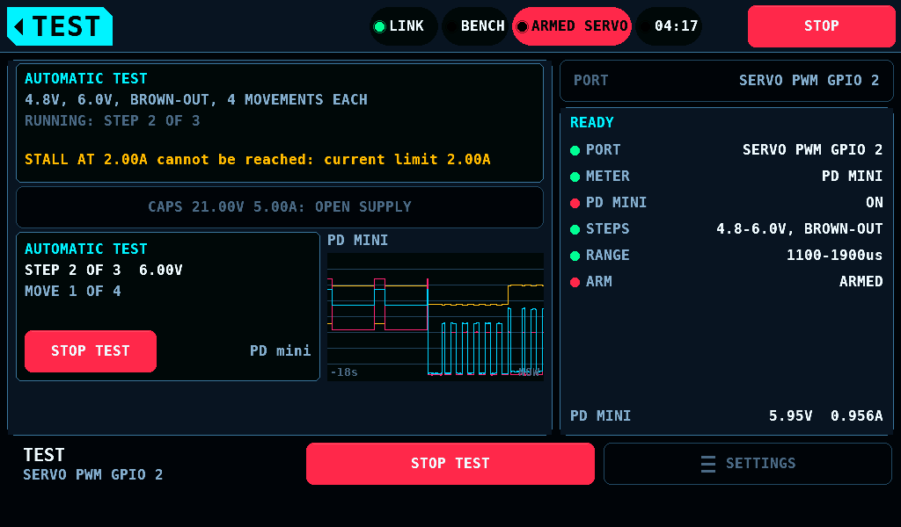

The result remains in LIVE's box until CLOSE and on the card's LAST line
until the next run. It shows PASS, FAIL or ABORTED with a reason, the
longest travel time, highest holding current and files saved in `USER/LOGS`:
`ATESTnnn.CSV`, followed by `+ .TXT` once the complete report reaches the
card. With User logs OFF under [Setup](#setup) > SD CARD, it shows
`USER LOGS OFF` and writes no files.

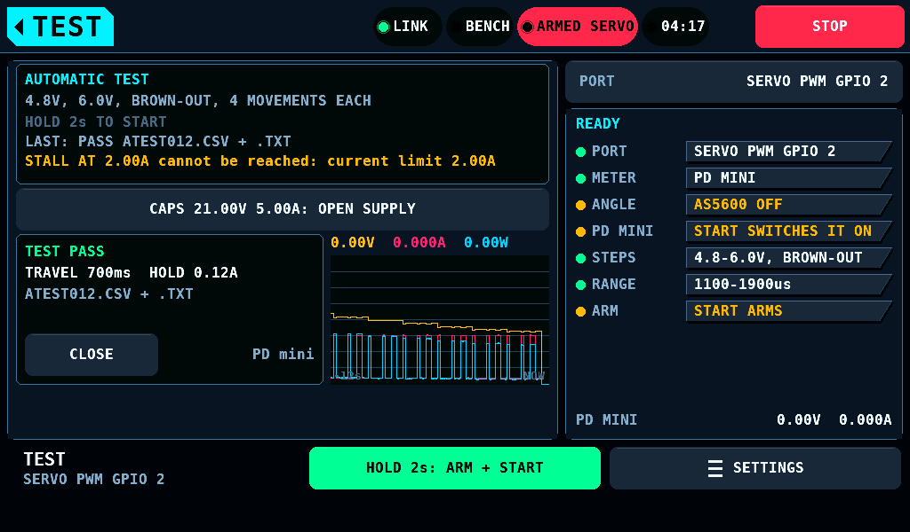

A run that read the INA3221's windows names it there, as the line over the
plot does:

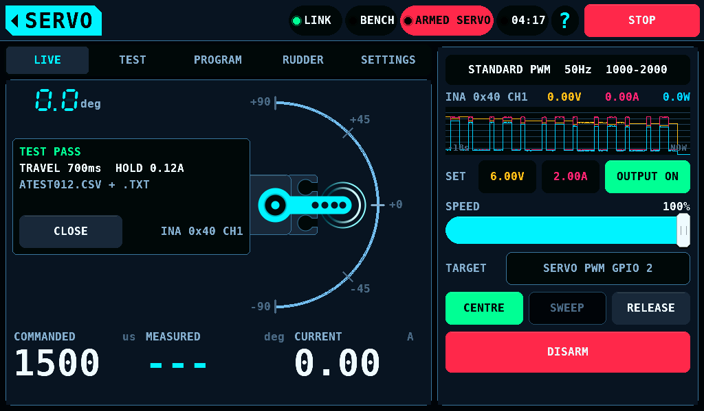

**START LIMIT RUN begins the limit search** from TEST's LIMIT RUN card.
The servo moves outward in 10us steps until current indicates binding.
SEARCH + PROGRAM also reduces the selected servo family's end settings
until both ends are free: LEFT ANGLE and RIGHT ANGLE for KST and Chaservo,
LEFT END and RIGHT END for Hitec.

On a SERVO PWM pin, the search runs from PULSE CENTRE to PULSE MIN and MAX.
On a programming port, a read session comes first. For KST and Chaservo,
the search uses the servo's NEUTRAL, PULSE LOWER and PULSE UPPER; Hitec uses
its family's pulse model.
[Servo procedures](Servo.md#installed-mechanical-limit) describes the
method, protections and report.

Hold START LIMIT RUN for 2s while ARMED with the INA3221 as rail meter.
The card summary shows `SEARCH ONLY` or `SEARCH + PROGRAM`, and SERVO
PULSES while the run reads the port. Below the button, one line names the
output and meter, such as `OUTPUT PROG PORT 1 GPIO 13, CURRENT INA3221 0x41 CH2`
or `OUTPUT SERVO PWM GPIO 2, CURRENT INA3221 0x40 CH1`. Without a channel
watching the target, the meter part is `CURRENT INA3221`. The next line
shows the current action or start refusal, followed by the last result
and report. These four lines use 10 x 20 at 20px spacing, starting 2px
below the button and ending 2px inside the 188px card.

TEST stays visible when the run begins. LIVE's run box shows values written
out of 8, phase, side, pulse and output, with STOP RUN. Afterward it shows
the verdict, values or endpoints and `LIMITnnn.TXT` until CLOSE, or
`USER LOGS OFF` when User logs is OFF. Each write switches the bench to
SAFE and back to ARMED. Operator STOP or SAFE, or an automatic-test abort
condition, ends the run with its output off.

On the rbmod carrier, PROG 5V supplies a programming-port run and replaces
the PD mini for power cycling. It must be on before starting. The PD mini
on the servo rails is neither used nor monitored for that run, so switching
it does not end the run; an abort switches PROG 5V off.

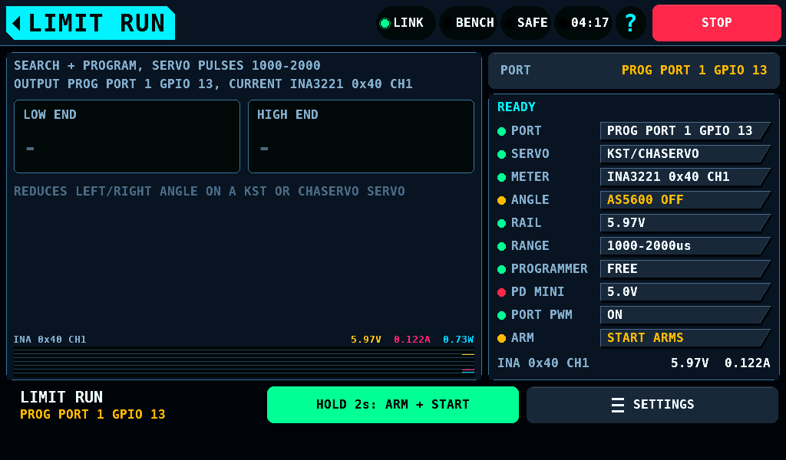


### Programmer


PROGRAM lists programmers in the task area. Each row shows its name on
the left and target port and pin on the right, such as `PROG PORT 1 GPIO 13`,
followed by `>`. KST and Chaservo use the port chosen by SERVO TESTER:
PORT 1, PORT 2, PORT 3 or PORT 4. With SERVO TESTER set to OUTPUTS, the row shows
`PROG PORT` and its pin.

A row is dimmed with `PORT IN USE` if another session holds its port,
including a session from another row or a HITEC session opened by the
bench console. The panel polls the HITEC page's STATE every 500ms. A
HITEC session does not dim the Hitec row itself: after the programmer reads
the page, a port held by another session opens with RELEASE PORT
([A port another session holds](HitecProgrammer.md#a-port-another-session-holds)).

The list has two rows: `KST and Chaservo servos` (German
`KST- und Chaservo-Servos`) and `Hitec servos` (`Hitec-Servos`). Tap an
active row to open its programmer one level down over the left column and
tabs; this ends any automatic test. CLOSE or the home tag returns to the
list, then the home tag returns to the menu. Inside a programmer's keypad,
list, warning or keyboard, the home tag closes only that overlay.

A row is drawn dimmed, with its reason in place of its port, and a tap on
it opens nothing:

| Reason | When |
| --- | --- |
| `IOMCU HAS NO SERVO PWM` | the IOmcu, the RP2350 board, does not report the capability the row needs; with no IOmcu answering it reports none. The capability's name is the link's, the same in German |
| `PORT IN USE` | another row's programmer holds the same programming port |

The firmware registry `shared/ui/prog_registry.c` supplies the rows. A new
servo manufacturer adds a registry row and its programmer, with no tile
or tab. More than 9 rows adds SEARCH and its keyboard, where `*` matches
any text. More than 8 rows shows group headings. A list exceeding the
page height pages with `^` and `v`; it holds at most 48 rows. None of these
controls appears for two rows. Modelled protocols without an IOmcu
transport have no row ([PROGRAM](#program) on MOTOR & ESC).

A row is 48px tall with 8px under it, a heading 28px with 4px under
it, both in the 10 x 20 face. The bar over a paged list is 48px tall:
SEARCH 260px wide on the left, `^` and `v` 56px each on the right.
Every entry ends 4px above the alert band: on SERVO's left card 7 rows
fit without the bar, 6 under it. MOTOR & ESC's list is the same list.

The KST and Chaservo programmer takes the tester's programming port out
of PWM (pulse-width modulation) and reads or writes settings over the
servo's signal wire. PROG PORT 1 defaults to GPIO 13, pad 17. Connecting
requires SERVO TESTER to select PORT 1, PORT 2, PORT 3 or PORT 4 under SETUP > OUTPUTS.
With OUTPUTS selected, CONNECT is locked and the page says
`Use the programming port to program a servo.` and
`Tap TARGET and select one of PORT 1 to PORT 4 for SERVO TESTER.` TARGET
opens PROG PORT 1's OUTPUTS entry containing SERVO TESTER; its home tag
returns to the programmer.

On an rbmod carrier with IOmcu protocol 4.36 or later, tap the programmer's
PORT label before CONNECT to choose a programming port. The fixed pins
are PROGP01 GPIO13, PROGP02 GPIO14, PROGP03 GPIO15 and PROGP04 GPIO0. The
choice sets SERVO TESTER and requests SERVO PWM for that port and NONE
for the other three. The tester waits for readback confirmation.

While the programmer holds a port, CLOSE or the home tag opens LEAVE
PROGRAMMING. During transitions into or out of programming they do nothing.
Leaving SERVO preserves the held port; returning reopens the programmer
on PROGRAM. ARM is disabled on SERVO and MOTOR & ESC; pressing it shows
`Cannot switch to ARMED: a port is in use by the servo programmer.`
CENTRE, RELEASE and STOP remain active. COMMANDED shows `---`, because
the tester sends no pulse to the held port.

In PWM with a responding PD mini, the PORT row shows the voltage and
current limit CONNECT will set: `PORT  5.0V  1000mA`. While the port is
held, the SET row's set points and OUTPUT ON are locked on SERVO and
SUPPLY; OUTPUT OFF still works. On the rbmod carrier, the ports have
separate 5V and those supply controls remain active
([Carrier, Power](Carrier.md#power)). Leaving programming does not cycle
the servo's power. Whether a KST servo follows PWM while in programming
mode is not measured.

The programmer's layout on the 620px left card, every control 48px tall
or more and ending 4px above the alert band:

| Part | Size |
| --- | --- |
| tabs and CLOSE | one row at the top, 48px tall: five tabs of 95px, CLOSE 120px |
| rows | 48px tall at a 56px pitch, up to 5 a tab, in two columns of 295px; a wide row spans both |
| values | 150px (15 cells of the 10 x 20 face); a wide row's 260px, with its `-` and `+` keys of 56px inside it |
| notes and messages | under the last row, 10 x 20 face, 60 cells a row, 20px a row, to 4px above the alert band: 7 rows under the SERVO tab |
| lists (FILES, RESTORE, MORE, a factor) | a title, then up to 7 entries 48px tall at a 56px pitch, CANCEL 150 x 48px at the foot |
| warning pages | the title in the 20 x 36 face, up to 16 rows of lines in the 10 x 20 face (fewer in a shorter area: the rows that fit 8px above the buttons), the hold button 300 x 56px and CANCEL 180 x 56px at the foot |

The tabs' labels are in the 10 x 20 face when every label fits its 95px
tab, as in English, and in the 8 x 16 face when one does not, as German
`ABSTIMMEN` does. No note, message or control lies under the alert band.
Every line of a message is drawn: the longest takes 5 of the 7 rows under
the SERVO tab. Where the two standing lines leave no row beside the
message for a page count, they yield to it: they page with the other
notes, first, and a line taller than a page waits for the message to go.
In German the tallest pair (4 rows) and the tallest message (5 rows) need
9 rows; there the pair waits.

[Servo programmer for KST and Chaservo servos](ServoProgrammer.md)
describes it.

#### Hitec programmer

The Hitec programmer opens from `Hitec servos` with the same layout:
five tabs (SERVO, MOTION, TRAVEL, PROTECT, INFO) and CLOSE; 48px rows at
56px pitch; 150px values and 260px wide values; notes in 10 x 20 ending
4px above the alert band; and hold pages with a 300 x 56px hold button
and 180 x 56px CANCEL.

It reads the servo and writes edited values back. Tap a writable value to
open a list of up to 6 entries or the keypad. ENABLE WRITE TO SERVO enables
writes; WRITE n VALUES, 220px wide, opens the write page. Set SERIES to
D SERIES or CLASSIC before CONNECT. PORT shows the port, GPIO, series,
receive mode and the supply CONNECT will set.

While the port is held, ARM and the supply controls follow the same rules
as the KST programmer, including the carrier's separate 5V. Pressing a
locked supply control shows
`Servo programming holds the supply: set points and ON are locked.`
FILES replaces SERIES and opens `BENCH/HITEC/CONF`, with 5 files per page
below the save entry. A new name uses the keyboard; files for another
model or beyond a soft rule open CHECK THIS FILE.

RESTORE writes the session backup back. MORE offers FACTORY DEFAULT for
a classic servo. A port held by another HITEC session opens with RELEASE
PORT, a 2s hold that returns the port to PWM without changing the supply.
[Servo programmer for Hitec servos](HitecProgrammer.md) details the rows,
workflow and messages.


### Settings

SETTINGS contains three pages: OUTPUT, SWEEP and DUT (German `AUSGANG`,
`SWEEP`, `PRÜFLING`). Run-specific settings open from SETTINGS on the
relevant TEST card, one navigation level down. CLOSE at the upper right,
beside the run name, or the home tag returns to the cards. Switching to
another task hides this list; returning to TEST restores it. The output
card remains visible and active.

Tap a numeric value for the keypad, a choice for its list, a switch to
toggle it or the name for the keyboard.

SETTINGS page tabs span the card at 197 x 40px each. Rows occupy two
295px columns, with 48px height and 52px pitch. Labels are on the left;
values use 140px on the right. TYPE, FRAME RATE and NAME span both columns.
OUTPUT notes use 60-character lines at 21px spacing.

Run settings use three 193px columns. Each row has its label above a
48px value field at 71px pitch. The automatic test has 15 rows, five per
column: voltage steps with HV SERVO, limits with BROWN-OUT, and duration
with timing. TEST LENGTH BY is at the top right below the card's SETTINGS
button, so a second tap there opens its list without changing a setting.
Notes, save status, STALL AT and the caps line end at least 4px above the
alert band.

Choice lists have two columns of five 48px entries at 56px pitch. Warnings
use 12 x 24px letters, 49 characters per line, with 56px high HOLD 2s TO
APPLY and CANCEL buttons ending 4px above the alert band.


| Where | Setting | What it does |
| --- | --- | --- |
| SETTINGS > OUTPUT | TYPE | the servo profile: STANDARD PWM, NARROW 760, WIDE, HELI CYCLIC or HELI TAIL 760 |
| SETTINGS > OUTPUT | FRAME RATE | how often a pulse is sent; the type's list, or CUSTOM on the keypad |
| SETTINGS > OUTPUT | PULSE MIN, CENTRE, MAX | the pulse widths the travel maps onto, 400 to 2500us: -90° is MIN, 0 is CENTRE, +90° is MAX, and RELEASE rests at CENTRE. An end lies no further from CENTRE than CENTRE lies from 400us or 2500us |
| SETTINGS > OUTPUT | TRIM | added to the centre, 5us a step, up to 200us either way; `-` and `+` step it, a tap on the value opens the signed keypad |
| SETTINGS > OUTPUT | TRAVEL | how far the horn may go each way, 10 to 90° |
| SETTINGS > OUTPUT | REVERSE | the direction the horn's angle maps onto the pulse |
| SETTINGS > SWEEP | CURVE, SPEED, RANGE | the movement of SWEEP: square, sine or triangle, 0.05 to 5Hz, 10 to 100% of the travel. The automatic test moves in steps between the ends RANGE gives |
| AUTOMATIC TEST > SETTINGS | TEST LENGTH BY, TEST TIME, MOVEMENTS | how long each supply step runs: a time, or a number of movements |
| AUTOMATIC TEST > SETTINGS | DWELL TIME, SETTLING TIME | held at each end, by the test and by SWEEP; waited after a supply step before measuring |
| AUTOMATIC TEST > SETTINGS | STEP 4.8 / 6.0 / 7.4 / 8.4V | the supply steps; 7.4 and 8.4V run only with HV SERVO on |
| AUTOMATIC TEST > SETTINGS | BROWN-OUT | reads `ON 3.0/0.2V` (LOWEST VOLTAGE and STEP) or `OFF`; a tap opens the brown-out walk's page, whose CLOSE and home tag come back |
| AUTOMATIC TEST > BROWN-OUT | BROWN-OUT, LOWEST VOLTAGE, STEP | the walk from 5.0V down, on or off; its floor, 2.0 to 4.8V, 3.0V by default; its step, 0.1 to 1.0V, 0.2V by default. The note under them names the walk on the supply in force and how many voltages it asks for |
| AUTOMATIC TEST > SETTINGS | HV SERVO | adds the 7.4 and 8.4V steps, off by default and at every restart; a run with them starts only through HV SERVOS ONLY |
| AUTOMATIC TEST > SETTINGS | STALL AT | above this current the servo counts as stalled |
| AUTOMATIC TEST > SETTINGS | IDLE CURRENT, HOLDING CURRENT, TRAVEL TIME | pass/fail limits; 0 is not checked |
| LIMIT RUN > SETTINGS | LIMIT RUN | SEARCH ONLY or SEARCH + PROGRAM, a tap switches; SEARCH + PROGRAM is offered for a servo on the programming port only, and the row reads SEARCH ONLY with the reason under it otherwise. For the session |
| LIMIT RUN > SETTINGS | SERVO | KST/CHASERVO or HITEC; selects the programmer family used by SEARCH + PROGRAM |
| LIMIT RUN > SETTINGS | SERVO PULSES | KEEP or 1000-2000, a tap switches; shown only for KST/CHASERVO with TARGET on PROG PORT. 1000-2000 writes the servo's PULSE LOWER and PULSE UPPER to 1000.0 and 2000.0us in the run's read session, before the search. KEEP by default; for the session |
| SETTINGS > DUT | NAME | the device under test, up to 23 characters, for the report |
| SETTINGS > DUT | REPORT | a text report beside each test's log |
| SETTINGS > DUT | ENC CENTRE | a tap takes the live count as the centre, with the servo at its neutral, and sets nothing without a reading from the current link (none after a link loss until a new one arrives) or while the sensor reports no magnet; the row shows the stored count, 0 to 4095, and is dimmed while AS5600 is off. The same setting as SETUP, SENSORS, AS5600 centre |

TRIM is the only keypad accepting a sign. Its `+/-` key, between the
point and OK, adds or removes a leading minus before or after digits are
entered. OK accepts -200 to +200us and rounds to the nearest 5us step:
13 becomes 15, -12 becomes -10 and -0 becomes 0. Entering -201 keeps the
keypad open and shows the range in the warning colour. A sign without
digits counts as empty input. Other keypads have no `+/-` key and retain
their usual key positions.


AS5600, the output encoder, is switched on and off on SETUP > SENSORS
alone ([the output encoder](#sensors-the-output-encoder)). DUT's button
`AS5600 ON OR OFF: OPEN SENSORS`, 600 x 48px, opens SENSORS on the AS5600
entry. It adds the horn's angle to the MEASURED row and to a run's CSV
and report ([Servo](Servo.md#the-output-encoder)).

SUPPLY's voltage and current caps limit both set points and test steps.
They appear below the TEST cards and on a 600 x 48px DUT button:
`CAPS 21.00V 5.00A: OPEN SUPPLY` (German
`GRENZEN 21.00V 5.00A: SUPPLY ÖFFNEN`). Tap it to open SUPPLY > SETTINGS >
LIMITS, where the caps are set.

Both buttons open another screen like TARGET. The destination's home tag
returns to the task and page where the button was tapped. Leaving SERVO
switches to SAFE, ends a sweep or test and turns off a supply switched on
by SERVO. The buttons therefore share TARGET's lock: ARMED, a sweep, a
run or a programmer holding the port. They are dimmed and inactive in
these states. Leaving SENSORS with unsaved changes passes through
[the leave warning](#keeping-the-values).

OUTPUT's first note reads what SERVO TESTER is set to, OUTPUTS, PORT 1, PORT 2,
PORT 3 or PORT 4, and that it is set on OUTPUTS:
`SERVO TESTER: PORT 1. Set it on OUTPUTS.` It takes no tap.


TARGET, between SPEED and CENTRE on the output card, names the driven
protocol and pins, centred in its value box. Tap it to open SETUP > OUTPUTS
at the active output: the PROG PORT entry for a driven port, SERVO PWM
for standard outputs, or the overview if the target is unknown or no
IOmcu answers ([OUTPUTS](#outputs)). It follows the actual target even
while a TARGET write is pending or a requested programming port has no pin.

On OUTPUTS, SERVO TESTER chooses OUTPUTS or a programming port through the
TARGET setting; PORT PWM controls the port's pulse. Both are saved in
NVS (non-volatile storage). Leaving SERVO switches to SAFE and ends a sweep
or test. The OUTPUTS home tag returns to the task where TARGET was tapped.

TARGET is outlined, dimmed and locked while ARMED, during a running or
paused sweep, automatic test or limit run, and while a programmer holds
the port. Its target remains visible. The output card stays in view beside
pages, keypads and the programmer, so TARGET keeps naming the pin while
they cover the left column.

SERVO TESTER selects OUTPUTS or PORT 1, PORT 2, PORT 3 or PORT 4. With OUTPUTS,
TARGET names the GPIOs assigned to SERVO PWM in the active binding:
`SERVO PWM GPIO 4` or `SERVO PWM GPIO 2 GPIO 4`. It fills the 25-character
value field and counts remaining pins as `+N`: 8 pins from GPIO 40 give
`SERVO PWM GPIO 40 +7`. Both label and value use the warning colour when
no pin is assigned (`NO SERVO PWM PIN`) or no binding has been read
(`PINS NOT READ`).

With a programming-port target, it shows the port number and GPIO reported
by the IOmcu, such as `PROG PORT 1 GPIO 13`, in the warning colour. Tester
commands then leave standard SERVO PWM outputs untouched; while ARMED,
those outputs hold their rest pulses at the midpoint of their endpoints.

A port without a usable pin shows only `PROG PORT 1`, also in the warning
colour. This includes no pin, a pin refused at startup, FUNCTION NONE or
a port absent from the IOmcu. The IOmcu then keeps standard outputs as its
target, but the tester sends them only release. SWEEP stays dimmed until
the port has a SERVO PWM pin or SERVO TESTER selects standard outputs. With PORT
PWM off, the port sends no pulse. TARGET reads `PORT 1 GPIO 13 PWM OFF`
(22 characters with a two-digit pin) or `PROG PORT 1 PWM OFF`.

Two warning states name no target and send no tester commands: `NO LINK`
when no IOmcu answers, and `UNKNOWN` when the programming-port page has
not been read since link-up, a write was not acknowledged or a read went
unanswered. While a programmer holds the port, TARGET continues naming
the IOmcu's target, whether port or outputs. The programmer controls the
port and the tester sends nothing.

The page is read every 500ms. An IOmcu before protocol 4.13 lacks it and
uses standard outputs. TARGET follows the IOmcu's confirmed state, not
the requested setting. A SERVO TESTER change waits for an idle bench and
appears after the IOmcu accepts it. The IOmcu starts with standard outputs
and reverts to them if a programming session leaves its port without a
pin. While SAFE, the panel restores the configured port within one page
read, 500ms, without waiting for ARM.


| Type | Centre | Travel | Frame rates |
| --- | --- | --- | --- |
| STANDARD PWM | 1500us | 1000-2000us | 50, 60, 100, 150, 200, 250, 300, 333Hz |
| NARROW 760 | 760us | 660-860us | as STANDARD PWM |
| WIDE | 1500us | 800-2200us | as STANDARD PWM, up to 312Hz |
| HELI CYCLIC | 1520us | 820-2220us | 50, 120, 200, 333Hz |
| HELI TAIL 760 | 760us | 410-1110us | 200, 333, 560Hz |

Every pulse needs a pause before the next frame. STANDARD PWM, NARROW 760
and WIDE require at least 1ms, making their maximum rate
`1 / (longest pulse + 1ms)`: 333Hz with a 2000us pulse. Heli profiles use
Rotorflight's rates for digital cyclic and narrow-band tail servos, with
at least 0.5ms between pulses.

Rates that leave no required pause are refused, as is a PULSE MAX too
long for the active rate. The pause follows the longest pulse the IOmcu
can produce: the top of the command's range. This is PULSE MAX, or beyond
it when CENTRE lies closer to MAX than MIN, by the difference between
CENTRE-to-MIN and CENTRE-to-MAX. A CENTRE setting that pushes this top beyond the
required pause is also refused.

**A heli type, or any frame rate above 60Hz, can destroy a servo that is not
made for it.** Choosing one opens a warning in the danger colour that names
what is chosen and what it does to a servo not made for it; it is applied only
after HOLD 2s TO APPLY has been held. CANCEL, a finger that slides off,
a touch loss and leaving the screen apply nothing. The type and frame rate in
force stay red on the right card, and every restart goes back to STANDARD PWM
at 50Hz: a servo plugged in after a restart never meets a rate meant for
another one.


**The frame rate reaches the pins** through the IOmcu's SERVO page
(protocol 4.1), applying to TARGET. For OUTPUTS it applies to every PWM
output whose first channel is a surface; PPM keeps its own frame. For
PROG PORT it applies to that port's pin, with each slot retaining its own
rate (protocol 4.19). Other programming ports run at 50Hz.

A port sharing its PWM slice with another programming port can run only
at 50Hz. The RP2350 gives both pins in a slice one divider and wrap, so
faster rates are refused. Changing TARGET resets the rate to 0, meaning
each output uses its own rate. The screen resends its rate with the next
position and every held position. Changing profile while ARMED at rest
resends the rest position with that rate; a profile changed during a
pending ARM is the one used for that ARM.

A faster rate is sent only after all pulse widths have arrived. Any other
rate is sent first, and wider pulses wait until it arrives. This prevents
a fast rate from being combined with a slower profile's wider pulses.
OUTPUT reports the result:

| Note | Meaning |
| --- | --- |
| In force | the rate runs on the target the IOmcu holds, named from its PROG page: `Active: OUTPUTS run at 330Hz.` or `Active: PROG PORT 1 GPIO 13 runs at 330Hz.`, the port numbered as TARGET names it: PORT 1, PORT 2, PORT 3 or PORT 4. The note is in the warning colour while that target differs from the TARGET chosen (second line `The TARGET chosen is not active.`; PROG PORT with no pin bound to the port leaves OUTPUTS the target), while the port target has no pin, while PORT PWM is OFF (`PORT PWM is OFF. The port sends no pulses.`) and while the target is not known. Against an IOmcu before protocol 4.19 the note reads "every PWM surface runs at": such an IOmcu runs every PWM surface at the rate, whatever the TARGET. With no link both read `No link. The active frame rate is unknown.` in the warning colour: an IOmcu restarted while the link is down runs every pin at its own rate again |
| The rate goes with the next position | not written yet |
| REFUSED | a pulse of the target (a surface, or the programming port while its pulse is on) is longer than the frame at that rate, or a target pin shares a PWM slice with an output at another rate; the pins keep the rate they had |
| This IOmcu takes no frame rate | protocol 4.0: every PWM output runs at its binding's 50Hz |

An IOmcu restart or a binding written on OUTPUTS resets each slot to its
own rate, 50Hz for a servo. The screen resends its rate with the next
position using the active binding. A binding write waits if the rate
reset is unanswered (`NO LINK` on OUTPUTS) or refused (`REFUSED`).

ARM is blocked on every screen while TARGET's rate is unknown:
`Servo frame rate unknown. Hold ARM again.` An ARM requested while the
link was down reaches the IOmcu only after the reset succeeds.

OUTPUT settings, HV SERVO, LIMIT RUN and SERVO PULSES last for the session.
SWEEP, automatic-test and DUT settings, plus TARGET, are saved in NVS.
Each change requests a write immediately; it runs on the first idle frame
([Keeping the values](#keeping-the-values)). Each SETTINGS page shows
`SAVED`, `SAVE PENDING`, `NOT SAVED` or `SETUP CHANGES NOT SAVED` at its
foot. Run settings show the same status below the run name.


Current limitations:

- Until the screen sends a position, the pins run at the rate the SERVO page
  holds, which after a restart or a new binding is 50Hz.
- On the panel's supply model the automatic test's currents are the model's load, not the servo's: a run there
  measures the model. [What is not measured](Servo.md#what-is-not-measured).
- The supply on the right card is SUPPLY's: the PD mini when SUPPLY's PD MINI tab enables
  it, the panel's model otherwise, whose voltage, current and power are
  simulated, not measured.

## Supply


SUPPLY sets, switches and records the PD mini programmable supply, a
USB-PD (USB Power Delivery) trigger controlled over UART (universal
asynchronous receiver-transmitter). The IOmcu uses a PIO (programmable
input/output) UART on two pins, controlled through the SUPPLY link page
(protocol 4.3). The panel writes the page and reads it every 100ms.

When the PD mini is enabled on the PD MINI tab, the header names the module
and its IOmcu UART pins, for example `PD MINI TX GPIO 12 RX GPIO 13`, from
the PD mini TX and PD mini RX settings. An unset pin or both signals on
one GPIO gives `PD MINI NO PINS`. With the module disabled, the panel uses
its supply model. The header reads `SIMULATED: SWITCH ON IN PD MINI` and
the menu tile is marked SIMULATED.

SUPPLY has two 150 x 40px task tabs, LIVE and SETTINGS (German `LIVE`,
`OPTIONEN`), above the page area. The menu tile always opens LIVE. Tap a
tab to switch tasks. This adds no navigation level and preserves LIVE's
selected PLOT or TABLE view.

| Task | The left column, 620px |
| --- | --- |
| LIVE | the plot or the table over the set points |
| SETTINGS | the tabs LIMITS, the 9 supply settings under OUTPUT LIMITS, AFTER RESTART, TRIPS and CONFIRM WHILE ON ([Supply settings](#supply-settings)), and PD MINI, the module's wiring ([The PD MINI tab](#the-pd-mini-tab)) |

The header to the right of the task strip shows the module, pins and
ONLINE or NOT ANSWERING in 10 x 20. At its right end, 8 x 16 text gives
the permitted set-point range, such as `3.3-8.4V  0.50-5.00A`. It stays
visible on both tasks and beneath the keypad or confirmation dialog.

The 380px right-hand rail is shared by both tasks: four 64px reading cards
(VOLT, CURR, PWR, MODE), then CONTROL. Its title line holds run totals in
mAh and Wh, with RESET PEAKS (48px) and OUTPUT ON / OFF (60px) at the foot,
where SERVO and MOTOR & ESC place ARM and DISARM.

The layout is the one MOTOR & ESC uses. On LIVE the left column holds the
output card, PLOT | TABLE under its title, and SET POINTS under it. Each
set point is a row: its label, then the `-0.1` key (72 x 48px), the track
(312 x 48px), the `+0.1` key and the value in a 120 x 48px box. The plot
shows voltage, current and power over the last 30s. The rail shows the readings, the run's lowest
voltage and its highest current and power. MODE says which set point the
supply holds: CV (constant voltage) at the set voltage, or CC (constant
current) at the current limit. CC is drawn in the warning colour: a supply in
CC is not giving the load the voltage it was set to.

A set point is shown beside its reading. VOLT and CURR carry it in brackets
after the label, and the plot draws it as a dashed line in the reading's
colour, on the reading's scale. TABLE lists both. The bracketed value is the
set point the supply reports holding; while it does not answer, the one the
screen holds.

| Set point | Model | PD mini | Buttons |
| --- | --- | --- | --- |
| VOLTAGE | 3.3 to 21V, 20mV steps | 1 to 20V, 10mV steps | 0.1V |
| CURRENT LIMIT | 0.5 to 5A, 50mA steps | 0.05 to 3A, 10mA steps | 0.1A |

The model uses the widest USB-PD PPS (Programmable Power Supply) profile,
3.3 to 21V at up to 5A. The PD mini's ranges come from the vendor's page
and have not been measured. As a buck converter it cannot exceed its
input, so its voltage cap also stays 0.7V below the reported input voltage.
A 5V input therefore allows at most 4.3V.

Below 1.7V input, the cap stays at the 1V minimum shown on the screen.
Below 1.5V input, the output stays off. Until an input reading arrives,
the cap is 20V. A set point above input voltage puts the module in ERR
until power is cycled; its required margin has not been measured.

The cap is 0.2V above the output cut-off line (below), allowing input
voltage to fall 0.2V under load before a set point at the cap causes a
cut-off. SETTINGS caps further narrow both ranges. Sliders follow the
active supply; tap a track to set the value under the finger.

**Tap VOLT, CURR or a set-point value box to open the keypad.** It covers
the left column below the task strip, with 145 x 76px keys. The title row
shows the permitted range; the current value appears faint until the
first digit is entered. OK accepts an in-range value rounded to the
supply's step. An out-of-range value is refused and highlights the range
in the warning colour. Empty OK or CANCEL keeps the previous set point.


**Changing a live output asks for confirmation.** With the output on, a
new set point from a slider, step button or keypad opens a dialog naming
the change. APPLY sends it to the supply. CANCEL discards it and restores
the slider. A drag asks once, on release; the supply keeps its previous
set point until then. If the drag ends without the finger lifting, such
as a second finger tapping the home tag or a lost touch, no dialog opens
and the slider returns. With the output off, no confirmation is requested.

STOP closes the dialog unanswered. APPLY in the same frame as STOP
(about 50ms) applies nothing. SETTINGS can disable confirmation separately
for the slider and keypad.


**OUTPUT ON requires a 2s hold**, using ARM's gesture and colour fade.
OUTPUT OFF takes a tap. STOP switches the output off from every screen.
Other bench stops also switch it off: an unresponsive touch controller,
lost touch events during ON before a full frame has seen the output on,
an IOmcu that refuses to remain ARMED, an unresponsive supply or a trip.
The output stays off until explicitly switched on again.

Leaving SUPPLY turns off an output it switched on, including a pending ON.
SERVO and ESC STICK apply the same rule to their outputs. The exception
is SERVO with a programmer holding its port: the output remains on until
the port is released (see SERVO). Power a servo from SERVO and an ESC from
ESC STICK. MOTOR & ESC does not switch a supply; its ESC runs use a
separate power source.

Leaving SUPPLY does not change an output switched on by another screen.
Keypads, confirmation dialogs, other SUPPLY overlays and task changes do
not count as leaving. LINK LOST, which has no STOP, cannot open while
the output is on.

**The home tag moves up one level.** Closing an overlay preserves the
output; returning to the menu applies the switch-off rule:

| From | The home tag leads to |
| --- | --- |
| the question | what is under it; the change is dropped, as CANCEL drops it |
| a keypad | what is under it, LIVE or SETTINGS; the value is not changed |
| LIVE or SETTINGS | the menu; an output SUPPLY switched on goes off |

Tasks share a navigation level, as on MOTOR & ESC and SERVO. The home tag
does not return from SETTINGS to LIVE.

**With the PD mini**, OFF has priority over other pending writes to the
SUPPLY page. The IOmcu also switches the output off if the panel heartbeat
stops. With the PD mini enabled, NOT ANSWERING means no IOmcu with protocol
4.3 answers or the page readings are older than 1500ms. An active output
is then switched off.

If the page answers but the module's SAMPLES counter stops advancing, the
header remains ONLINE. This can happen when display reads fail while
other reads succeed. After 1500ms without a new reading, voltage, current
and power show dashes; trips, peaks and totals use no reading. After
3000ms (`SUPPLY_LINK_BLIND_MS`), an active output is switched off with
`No readings from the supply. Output off.`

The driver prioritises overdue readings during frequent set-point changes,
for example a slider drag with SLIDER AND STEPS off producing a value
about every 50ms. A reading 400ms overdue (`PDMINI_POLL_LATE_MS`) precedes
the next set-point write. Such reads are scheduled one at a time with
another transaction between them. State reads and input-voltage reads
before a write may also follow another read immediately. With immediate
module replies, display reads occur about 500ms apart and state reads
about 900ms apart, each allowing up to two additional transactions.
Module-initiated output changes are detected during a drag. Input voltage
is read before a set-point write or ON only when one is pending, never
between the reads for ON.

Host-model checks used 40 start phases and replies up to 390ms late,
within the driver's 400ms timeout:

| Operation | Time with replies up to 390ms late |
| --- | --- |
| One set point reaches the module | within 2.5s |
| ON with set points already written | within 3.6s |
| ON immediately after a set-point change or drag | up to 7.5s |
| Module changes its own output during a drag | detected within 2.1s |
| Module turns on while OFF is requested | switched off within 1.8s at rest or 2.1s during a drag; about 500ms with immediate replies |

The real module's reply time has not been measured. Delayed replies stretch
the nominal 500ms state and input-voltage read interval because every
transaction takes the reply time. At rest, input-voltage reads are 850ms
apart for 100ms reply delay, 1.3s apart for 200ms and 2.5s apart for 390ms;
state reads can be 1.5s apart.

During a slider drag with replies at least 279ms late, display-read gaps
reach 3.7 to 5.0s (5.0s at 390ms), exceeding `SUPPLY_LINK_BLIND_MS`. The
output switches off with `No readings from the supply. Output off.`
The panel's 100ms page polling adds up to 100ms to the observed gap.
A driver gap above 2.9s begins at 263ms reply delay, so cut-off can occur
from 263ms. At rest, the display gap reaches 2.5s at 390ms. It exceeds
1.4s from 259ms and 1.5s from 279ms, so readouts can show dashes from
about 260ms.

The output also switches off, with an alert, when the IOmcu refuses ON
(no heartbeat) or drops it (heartbeat stopped or IOmcu restarted). If
the module switches itself off through overcurrent protection or its
button, it stays off until a new hold. Alerts also report rejected pins,
failed output switching or refused set points. Changing pins or baud,
or enabling or disabling the PD mini, switches the output off.

**Low input voltage switches the PD mini output off.** While on, the IOmcu
reads input voltage every 500ms with immediate replies, or less often with
delayed replies (above). Two consecutive readings below the set point
plus 0.5V switch the output off immediately. The band names both values,
for example `PD mini input 6.18V is below the required 6.00V + 0.5V. Output off.`

From sag to cut-off takes about 1.0s with immediate replies. In the host
model, it takes 1.7s at 100ms reply delay, 1.9s at 200ms and up to 4.7s
with delays up to 390ms. The output stays off until a new hold. Input below
1.5V cannot support the minimum 1.0V set point, so ON is not written and
the same alert appears.

One low reading does not switch off. A failed read neither increments
nor clears the count. While the output is on, its set point is not reduced
to follow falling input voltage. This rule has not been verified by bench
measurement: whether an active module enters ERR on an input sag is
unknown, so the rule may stop a run that would otherwise continue.

OUTPUT ON and OFF, RESET PEAKS and the readings stay live on SETTINGS and
under the keypad and the question. One finger at a time: while one holds a control, a
second finger does nothing anywhere on the screen.

On the [rbmod carrier](Carrier.md#power), a line below OUTPUT names the
programming ports' separate 5V: `PROG PORTS 5V, GPIO 21: ON`, `OFF` or
`NOT READ` after an unanswered read. ON uses the accent colour. KST and
Hitec programmers switch this supply. On LIVE, the PROG 5V box to the
right of PLOT and TABLE allows manual switching and shows its INA3221
reading, as on [SERVO](#servo). The line below OUTPUT remains on every task.
Leaving SUPPLY turns off 5V switched on by its box unless a port holds it.
Boards without the switch show neither control.


### Supply settings

SETTINGS, the second task tab, contains LIMITS and PD MINI, each with a
40px tab. LIMITS puts caps and startup values on the left, trips and
confirmations on the right. Rows are 48px high with 120 x 48px value boxes;
the save status sits at the foot. All settings are kept in panel NVS
(non-volatile storage) across restarts.

Tap a value to open the keypad or a switch to toggle it. Tapping LIVE
closes an open settings keypad without changing its value, like CANCEL.
Tapping SETTINGS does the same for a set-point keypad. During a live-output
confirmation dialog, task tabs stay locked until APPLY or CANCEL.

Changes are saved on the next frame with SAFE, no pending ARM, supply off,
no queued ON and no board drawing being fetched or retained. Any unsaved
SETUP changes are saved too. Flash writes stall both cores, including
OUTPUT OFF and trip handling, so they wait for these conditions.
The status line shows SAVED, SAVE PENDING, NOT SAVED after a refused write,
or SETUP CHANGES NOT SAVED. The latter means SETUP changes remain without
a save request; SAVE on SETUP or an edit here requests their write.


| Setting | Range | Default | What it does |
| --- | --- | --- | --- |
| VOLTAGE MAX | 3.3 to 21V | 21.00V | the highest voltage a set point takes |
| CURRENT MAX | 0.5 to 5A | 5.00A | the highest current limit a set point takes |
| START VOLTAGE | up to VOLTAGE MAX | 6.00V | the voltage set point after a restart |
| START CURRENT | up to CURRENT MAX | 2.00A | the current limit after a restart |
| CURRENT TRIP | 0 to 5A | OFF | output off once the current has been over it for TRIP TIME |
| VOLTAGE TRIP | 0 to 21V | OFF | output off once the voltage has been over it for TRIP TIME |
| TRIP TIME | 0 to 5000ms | 100ms | how long a reading is over a trip before it fires |
| SLIDER AND STEPS | ON, OFF | ON | ask before the slider changes a live output |
| KEYPAD | ON, OFF | ON | ask before the keypad changes a live output |

Lowering a cap below a set point immediately lowers that set point and
its startup value. Entered values are rounded in the safer direction:
caps round down, so 12.01V permits 12.00V; a positive trip is at least
one step and never rounds to OFF. A trip of 0 is disabled.

Time above a trip begins at the first reading over the threshold. A
reading below it resets the count; a missing reading leaves it unchanged.
A trip switches the output off, sets MODE to TRIPPED until the next ON
and names the trip in the alert band. In CC, the supply holds its current
limit, so a current trip at or above CURRENT LIMIT cannot fire. Set it
below the limit to switch off a load that draws too much for too long.

The output stays off at a restart, whatever the start values.

With the PD mini active, SETTINGS offers RESET PD MINI. It switches the
output off and sends SYSTEM_RESET, allowing a module showing ERR after
an excessive set point to restart without unplugging it. About 1s later,
the driver requests the module's identity again. Whether reset clears
every ERR has not been measured. Before IOmcu protocol 4.4, reset is
unavailable; the output switches off and the band reports this.

### The log

A supply run lasts from output ON to OFF. The plot clears at ON and holds
the trace after OFF. The CONTROL title's mAh and Wh totals integrate the
displayed readings over the run, with each time step capped at 1s.
RESET PEAKS starts the extrema again from the current reading.

A run is recorded to a `SUPPLnnn.CSV` of its own in `BENCH/LOGS`, one row
every 50ms, while Auto logs on [Setup](#setup) > SD CARD is ON:

```
time (s);set (V);voltage (V);limit (A);current (A);power (W);mode;charge (mAh);energy (Wh);source
```

Missing readings leave empty cells. `mode` is CV, CC or OFF, or empty when
the supply does not answer. `source` is `measured` for PD mini readings
and `model` for the panel's model.

Bench runs take logging priority: ARM during a supply run closes its file.
If the output is still on at the next SAFE, a new supply file begins.
Its charge and energy continue from the totals since output ON, as on the
screen, so the first row need not start at 0. Supply stepping and logging
keep their own 50ms cadence while the control task waits on the link.
An unanswered IOmcu therefore does not reduce supply plot or log samples.

The model is a 6Ω load with a 1.4A burst for 0.6s every 3s, behind a
0.05Ω source resistance. At the starting set points, 6.00V and 2.00A, the
burst takes it into CC. Its readings are not measured and nothing on the bench
is powered.

PD mini, PD mini TX, PD mini RX and PD mini baud are on SETTINGS > PD MINI
([The PD MINI tab](#the-pd-mini-tab)). TX and RX are IOmcu GPIO numbers:
TX connects to module DM, RX to DP. The `-` and `+` buttons skip the GPIO
used by the other signal and stop at the range boundary. With RX on
GPIO 47, TX stops at GPIO 46. The keypad rejects the other signal's GPIO
with `GPIO already used by the other PD mini pin` in place of the range.

A stored configuration assigning both signals to one GPIO loads unchanged.
The panel writes the page disabled, leaves the PD mini off and shows
`TX and RX on one pin. The PD mini stays off.` on both rows until one is
changed. The PD mini switch disables the module.

The IOmcu rejects reserved pins, output pins, sensor-bus or phase-tap pins,
and the other PD mini pin. The alert is
`PD mini pins rejected. Check SUPPLY, tab PD MINI.` For example, RX on
GPIO 17 is refused when Sensor SDA is GPIO 16, because SCL is then GPIO 17.
The alert clears once a read confirms the requested wiring, immediately
if a pin is changed back to the value the page still holds.

Once the module has answered, wiring changes wait for a module-state read
sent after the change, at most about 1.2s. The read must confirm output OFF.
The module can switch itself on between state reads through its button
or AUTO OUT; changing pins then could remove its OFF path. An ON state
or failed read rejects the change with
`PD mini wiring rejected. Its output may still be on.` A rejected change
is not retried until the wiring changes again. This alert also clears
when a read confirms the requested wiring.

PD mini baud matches the module's UART Baudrate setting: 9600, 19200
(factory setting), 38400, 57600, 115200, 230400 or 460800 baud, or AUTO.
AUTO is the default and tries all 7 rates, one per second. The SUPPLY
header shows the active rate after ONLINE, such as `ONLINE 38400`, for
both AUTO and fixed-rate selection.


#### The PD MINI tab

PD MINI holds the wiring, four rows at a 56px pitch: each its label and help
line, its value in a 120 x 48px box, and - and + keys of 56 x 48px.

| Row | Values | Default | A press |
| --- | --- | --- | --- |
| PD mini | ON, OFF | OFF | a tap on the value flips it |
| PD mini TX | GPIO -1 to 47 | -1 | - and + step, the value opens the keypad |
| PD mini RX | GPIO -1 to 47 | -1 | - and + step, the value opens the keypad |
| PD mini baud | 9600, 19200, 38400, 57600, 115200, 230400, 460800, AUTO | AUTO | < and > and the value step round the 8 values |

A change applies at once and is saved by the rule above, as a change on LIMITS.
There is no SAVE and no leave warning. The stored keys are `pdm_en`, `pdm_tx`,
`pdm_rx` and `pdm_baud`. RESET PD MINI restarts the module and writes none of the
four.

Any change of the wiring switches a live output off, so a row changes nothing
in these states:

| State | A press on a row | The row's help line and the band |
| --- | --- | --- |
| the output on, or an ON on its way, from any screen, on the PD mini or the model | changes nothing | `Output on: switch it off first` |
| a programming port holds the supply | changes nothing | `A programming port reserves the supply` |
| the bench ARMED | changes nothing; `settings_set()` and a reset leave the rows too | `Set on a SAFE bench only` |

An open pin keypad closes as soon as one of these states begins, without
applying its entry. An active press is canceled too; release changes
nothing. With SAFE and the output off, enable, pin and baud changes reach
the IOmcu as described under [Supply](#supply), after checking the module's
own OFF state. If a change still reaches an active output, such as DISCARD
after a refused save on SETUP's leave warning, it switches the output off
and reports `PD mini wiring changed. Output off.` RESET PD MINI remains
on LIMITS.


On the [rbmod carrier](Carrier.md), PD mini TX is fixed at 7 and RX at 6.
They have no step buttons or keypad and show
`Soldered on this board. Not editable here.` Stored pin values are retained
for a module wired by hand. PD mini and PD mini baud remain editable
subject to the same three state restrictions above.


With the supply model active, the header's source text is a button:
`SIMULATED: SWITCH ON IN PD MINI`. Tap it to open PD MINI from LIVE or
LIMITS, closing any open keypad. An open live-output confirmation must
be answered first.

## Receiver


RECEIVER has sixteen channels in two columns of eight 52px lanes. Each
lane shows its channel name in 10 x 20, history, a 56px bar for the current
value and microseconds in 8 x 16. History contains 200 samples, one pixel
each: about 2.8s at 71 frames per second (one S.BUS frame every 14ms).
CH17 and CH18 are digital channels. A glitch appears as a spike in one
lane; a dropout as a simultaneous notch across all sixteen.

The 260px state card on the right shows the state in 20 x 36, followed
by up to three lines of 12 x 24 explanation. BUS, RATE, FRAMES, RESYNC
and BAD TAIL use 32px rows. CH17 and CH18 have 44px lamps that light when
the channel is set; they are not interactive. CHANNELS and RAW DATA are
150 x 48px tabs. RAW DATA shows the last frame's bytes, eight per row,
and decoder counts in 8 x 16.

No firmware feeds RECEIVER (see [Receiver buses](Receivers.md)); the
screen shows NO SIGNAL.

The state block shows one of NO SIGNAL, FAILSAFE, FRAME LOST and LIVE, with one
line of explanation:


In FAILSAFE the receiver is sending well-formed values it has generated itself;
every trace is drawn red. Treat FAILSAFE as a stop, not as sixteen valid
channels. [Receiver buses](Receivers.md) describes the states.

## Battery


BATTERY plots each cell's deviation from the pack mean. Its verdict uses
the largest difference between two cells: HEALTHY below 30mV, WATCH from
30mV and REPLACE from 60mV. The scale adapts to the pack with a minimum
of 12mV and is printed beside the plot.

The plot card is 640px wide, the right card 360px. A bar is at most 48px
wide and reaches 164px either side of the mean. Under each bar the cell's
number and its voltage are in 12 x 24 up to 11 cells and in 10 x 20 from 12 to
14. The verdict is in 20 x 36, its line in up to two lines of 12 x 24, the six
rows 36px each, the note in 10 x 20.

Measure under load. At rest a weak cell reads like the others.

No firmware feeds this screen: no cell monitor is read, so a bench shows
NO PACK. The picture above is rendered from a model.

## Logs


Browse the card, open a file, check what the import detected, then plot:


The home tag moves up one level, like BACK: plot to import view, import
view to file list, file list to menu. In the DELETE dialog it acts as CANCEL.

The LOGS tile opens a shared strip with LOGS and FILES: two 499 x 40px
tabs across the top of the body, y 5 to 45. These screen titles stay the
same in every language. Tap a tab to open its screen. At the top level,
either home tag returns to the menu regardless of the entry tab.

The strip appears only on the LOGS file list and FILES panes. Import and
plot views, dialogs, boxes, keyboards, the text viewer and editor hide
it and accept no tab presses. Their home tag first moves up a level.

The file list has four layout areas. At the top, the shared strip opens
[Files](#files). The header, body y 52 to 100, contains ROOT, USER and
BENCH (110 x 40px each), folder and card names, and PREV/NEXT (140 x 48px)
when the folder spans pages.

The 1008px list shows six 44px rows at 48px pitch. Each row responds across
its full 48px height. It shows name, modification date and right-aligned
size in 10 x 20. Names use up to 60 characters, or the first 58 plus `..`.
The 160px date column uses the card's modification time, as INFO in
[Files](#files) does, in SETUP > PANEL's Time zone: `2026-10-26 09:41`.
Missing timestamps and dates in 1980, from an unset clock, leave it empty
([PANEL: Time zone and the clock](#panel-time-zone-and-the-clock)). Size
uses 100px at the row's end; file type and run duration are not listed.

The footer, body y 440 to 492, ends 4px above the alert band. RESCAN
(140 x 52px) and WI-FI (100 x 52px) are on the left; DELETE and OPEN
(140 x 52px) are on the right. WI-FI opens [Wi-Fi](#wi-fi) from any list
state and its home tag returns here. WI-FI is absent during the DELETE
dialog and file views. File messages occupy up to two 37-character lines
between WI-FI and DELETE.

The import view shows DETECTED (400px wide) beside the column list (600px,
7 rows at a pitch of 48px), with four buttons of 246 x 52px under them.
The plot is 992 x 316px under four series chips of 240 x 44px; under it
run the time labels, then BACK (140 x 52px), `<` and `>` (96 x 52px) and
the cursor's line. The DELETE question is a box of 700 x 280px with CANCEL
and DELETE of 300 x 56px. Labels, rows, buttons and the import's warnings
draw in the 10 x 20 face; the sentences of the empty list, the question,
the boxes that say why nothing shows and the file messages in 12 x 24; the
plot's time labels and the ranges of the columns and the chips in 8 x 16.

The CSV (comma-separated values) reader accepts decimal commas or points,
a units row and rows of different lengths. The import view shows its
interpretation before plotting. It initially selects up to 4 numeric
columns. SERVO files prefer `pulse`, `angle`, `current` and `voltage`,
then other numeric columns where any preferred column has no numbers.
Other files select their first 4 numeric columns.

Each numeric column shows its minimum and maximum. It uses one decimal
place below 1000 at both ends, otherwise none: `11.9..12.6V` or
`2392..14639rpm`. If the range exceeds its 17-glyph box, decimals are
removed (`-999.9..-999.9mOhm` becomes `-1000..-1000mOhm`). Longer ranges
are clipped at the box edge.

A row ends at line feed (LF, 0x0A). Text after the final LF is treated as
an incomplete row, even if all fields are present: a number could have
been cut from `9554` to `95`. It is excluded from row counts, statistics
and plots. ROWS uses the warning colour and import shows
`INCOMPLETE LAST ROW. SKIPPED.` This also drops the final row of another
program's file if it omits the ending LF. Spaces, tabs and carriage
returns (CR) after the last LF do not count as a row.

The bench records runs in two card folders, using a run-type prefix and
a number from 001 to 999. It creates missing folders one level at a time
on the first write. The table shows defaults; choose others with Auto log
folder and User log folder under [Setup](#setup) > SD CARD:

| Folder | Name | Run |
| --- | --- | --- |
| `BENCH/LOGS` | `SERVOnnn.CSV` | one switch to ARMED from SERVO |
| `BENCH/LOGS` | `MOTORnnn.CSV` | one switch to ARMED from MOTOR & ESC's ARM or a stick run on its PROGRAM |
| `BENCH/LOGS` | `SUPPLnnn.CSV` | one switch-on of the SUPPLY output while the bench is SAFE |
| `USER/LOGS` | `ATESTnnn.CSV` | one AUTOMATIC TEST; its report is `ATESTnnn.TXT` |
| `USER/LOGS` | `LIMITnnn.TXT` | one LIMIT RUN's report, with no CSV beside it |
| `USER/LOGS` | `RUDDRnnn.CSV` | one AUTO end points run on RUDDER, a row a measure; its report is `RUDDRnnn.TXT` |

The name follows the screen that armed the bench: an arm that asks for the
throttle outputs writes `MOTORnnn`, an arm that asks for the surfaces writes
`SERVOnnn`. An IOmcu older than protocol 4.18 arms the throttle outputs with
every arm; a switch to ARMED from SERVO still writes `SERVOnnn.CSV`.

Two switches on [Setup](#setup) > SD CARD decide what is written. Auto logs
OFF writes nothing to `BENCH/LOGS`; switched off during a run, it ends that
run's file. User logs OFF writes nothing to `USER/LOGS`; a test keeps the
state it started with. Both are ON by default. The fault log,
`BENCH/RCBENCH.LOG`, is written whatever the switches say.

Changing a folder under [Setup](#setup) > SD CARD affects the next file.
An open run or test finishes in its original folder; the next uses numbers
from the new folder. Both log types may share one folder and one number
sequence across all six names.

USER and BENCH list the configured folders. Files in other
folders stay on the card but are not listed there. Selecting that folder
again restores them to the list.

Firmware 0.21.0 and older wrote every run to the card's root as
`BENCHnnn.CSV`, `ESCnnn.CSV`, `SERVOnnn.CSV` with its `SERVOnnn.TXT` (a
servo test) and `SERVOnnn.TXT` alone (a limit run). Those files stay where
they are and stay readable: nothing moves them, and the ROOT tab lists them.

Each folder has one number sequence across all run prefixes. The next
run takes the highest existing number plus one, so `SUPPL041.CSV` and
`SERVO042.CSV` in `BENCH/LOGS` are followed by `MOTOR043.CSV` or
`SUPPL043.CSV`. A number used by a CSV, TXT or folder name is occupied.
The panel scans the folder on its first write after startup, then caches
the next number. Before using it, it checks all 12 possible names
(6 prefixes with CSV and TXT), skipping files created in the meantime.
It never overwrites one or fills a lower gap left by deletion.

A folder containing number 999 accepts no further run, even with lower
gaps. The band reports `Card full or not writable. Run not recorded.`
or, for a test, `Card missing or full. Servo test not recorded.` A present
but unmountable card gives `Card is neither FAT32 nor exFAT. Servo test not recorded.`
or `Cannot read the card. Servo test not recorded.` If a folder cannot
be created because a file occupies its name or the card is full or
write-protected, the message is
`Cannot make folder BENCH/LOGS. Run not recorded.` After a failed run,
the panel rescans next time, allowing a deleted highest number to be reused.

LOGS lists CSV runs and recognised reports. DELETE on a run also removes
its matching report. A report is a `.TXT` with a run name, identified by
`log_report_number()`, the same rule FILES uses. Examples are `ATESTnnn.TXT`
with or without `ATESTnnn.CSV`, `LIMITnnn.TXT` without CSV, and root-level
`SERVOnnn.TXT` from firmware 0.21.0 or earlier. Other `.TXT` files are
not listed. A CSV and its report are separate rows, CSV first: OPEN
imports the CSV or opens the report in the [text viewer](#the-text-viewer).
Entries are ordered by descending run number across prefixes, reports
by their own number: `LIMIT044.TXT`, `MOTOR043.CSV`, `SERVO042.CSV`,
`SERVO042.TXT`, then `SUPPL041.CSV`.


OPEN on a report opens it in the [text viewer](#the-text-viewer) on
FILES, read-only. The band's title reads FILES; the home tag returns to
LOGS, with the report chosen on the list again. A report over 1MiB stays
on the list, and the footer says
`Over 1MB: too large to open. Download it over Wi-Fi.`


Three header tabs choose the folder: ROOT for the card root, USER for
User log folder (default `USER/LOGS`), and BENCH for Auto log folder
(default `BENCH/LOGS`). Tapping a tab loads its first page. Tabs work
without a card: the selection changes, the box shows
`No card. Insert one and tap RESCAN.` with the tab's explanation, and the
panel checks for a card again as RESCAN does. A present card that cannot
mount instead shows `Card is not FAT32 or exFAT. Format it on a computer.`
or `Cannot read the card. Check it on a computer, then tap RESCAN.`
([The SD card's format](#the-sd-cards-format)).

The header names the folder, such as `BENCH/LOGS`, except on ROOT. The
card name, for example `UNITEST`, is right-aligned at the list edge or
left of PREV when pagination buttons are present. An empty folder shows
its reason and accepted names: `No .csv files in BENCH/LOGS.`, or
`AUTO LOGS OFF on SD CARD.` when disabled. The DELETE dialog hides these
tabs. An opened file remains associated with its original tab and folder
in import and plot views, regardless of later tab selection.

LOGS loads 48 entries per page from a folder of up to 999 runs. Numbered
runs and reports come first, highest number first, followed by external
files sorted by name. Within each page, the newest numbered run is on top.

"Newest" refers to the filename number. Dates depend on the panel clock,
which starts unset after power-on and is set by NTP (Network Time Protocol)
on the home network
([PANEL: Time zone and the clock](#panel-time-zone-and-the-clock)). Files
written before the clock is set carry a 1980 date.


Folders with more than 48 files show PREV and NEXT in the header. The
file heading gives the current range, such as `FILES 145 TO 192 OF 1000`,
and on a single page the whole list, such as `FILES 1 TO 7 OF 7`; an
empty folder reads `FILES`. PREV is disabled on the first page and NEXT on the
last. Pages contain groups of 48 counted from the top. If fewer than
48 entries precede the displayed page, PREV loads the first page.

New runs recorded while a later page is open appear on page 1. Going back
with PREV from page 3 or later then skips as many entries as were added.
NEXT from page 1 shows them; page-range numbers reveal the shift.

Each page load scans the folder once, retains its 48 entries and counts
the rest. Only one page is kept in memory. The scan runs on the drawing
and touch task. For 999 runs, selection takes about 2ms on an x86-64
desktop (measured). Panel selection is estimated at 20 to 40ms. The
directory read is estimated at 63 sectors of 512 bytes, about 25ms at the
card's 20MHz SPI (Serial Peripheral Interface) clock, or 125 sectors and
50ms with one report per run. Neither panel estimate is measured. With
reports, the folder can list 1,998 entries; selection time for that count
is unmeasured. Entry sizes come from the same directory scan.

The list scrollbar is 56px wide, about 8.4mm at the assumed, unmeasured
pixel pitch of 0.150mm. Its thumb represents visible rows relative to the
current page and scrolls only within that page. Tap the track to centre
the thumb under the finger, or drag the thumb.

LOGS rereads the card whenever opened from the menu or its tab. It loads
the selected folder's first page and selects its newest run, including
runs recorded while LOGS was closed, without RESCAN. If the panel wrote
a file since the last visit, LOGS selects that file's tab. Otherwise it
retains the previous tab, or BENCH after restart. An import or plot view
left open stays open with the refreshed list behind it.

RESCAN rereads the current page. On page 1 it starts from the top,
including newly recorded runs. On later pages it starts at that page's
first entry, even if the file has since been deleted. If the folder has
become shorter than that position, it shows the last page. Reads select
the page's newest numbered run at the top, or nothing when there is none.

DELETE rereads the page in the same way but preserves scrolling and
clears selection. DELETE and OPEN stay dimmed until a row is selected.
Deleting the only file on the last page displays the preceding page.

The header names the card by its volume label, read once when the card is
mounted. A card without a label shows the product name the card reports
(for example `SC16G`), and a card that reports neither shows `SD CARD`.

Inserting, removing or swapping a card is detected on the next RESCAN,
LOGS opening, page load or OPEN, without restarting
([The SD card's format](#the-sd-cards-format)). Header, list and empty-list
messages then reflect the inserted card. A new card starts on page 1;
an empty slot shows `No card. Insert one and tap RESCAN.`

OPEN and DELETE act only on the card from which the page was read.
An import or plot also rereads only its original card. A swap refuses
these actions: `Cannot open <name>.`, no deletion, and no change to the
replacement card. Every mount restarts the viewer at page 1. Cards remain
distinguishable even if their labels match, or they are unlabelled cards
of the same model with identical header names.

Use two fingers on the plot to zoom or pan: spread to zoom in, pinch to
zoom out, move both together to pan. The view stays where released;
a bar below the plot marks its position within the run. The narrowest
view has 8 samples and the widest covers the run. One finger or `<` and
`>` moves the cursor. Moving it beyond a zoomed edge carries the view
along. BACK returns to import.

The plot spaces rows evenly by row number. Labels and cursor readout use
the file's time column relative to its first row; header duration is last
time minus first time. Missing rows therefore appear as jumps in the
reported times, without wider gaps on the plot. Current ARMED-run files
use elapsed wall time. Files from firmware 0.15.0 or earlier understate
run duration (see Motor & ESC, the CSV file).

SETUP > PANEL > One finger pans, off by default, allows single-finger
panning when zoomed in. Moving more than 10px from the starting point
drags the view sideways while keeping the sample under the finger.
Movement within 10px selects a value normally. Panning leaves the cursor
unchanged. With the whole run visible, one finger moves the cursor instead.
A second finger starts zooming.

A button or a row on LOGS takes a tap. It acts when the finger that pressed
it lifts inside it, having been no more than 8px from the press in x and in
y. A vertical drag of more than 8px on the file list or on the column list
scrolls it and selects nothing. On those two views one finger at a time
presses; a second finger does nothing.

DELETE asks before removing the selected file. Its dialog names the file
and size; only pressing and releasing DELETE within that dialog confirms.
CANCEL or leaving closes it without deletion. An open logger file cannot
be deleted. Deleting a file also drops it from open import or plot views.

The logger scans numbering at the first run after startup and after a
run file cannot be opened, otherwise continuing its remembered sequence.
A deleted number can be reused only if it exceeds all remaining run
numbers at that scan.


Runs are committed to the card every 20 rows or 1000ms, whichever comes
first. A power cut loses uncommitted rows and those queued between the
control and card tasks: under 1.0s while the card keeps up, or 84 rows
(4.20s at 20Hz) with a stalled card and full queue. The rest remains
readable. A partial final row has no LF and is skipped on import
(see [Logs](#logs)).

The card has its own write task. An SD (Secure Digital) card may take
250ms for a write, longer than the safety-heartbeat task's 150ms ceiling.

Nine messages say what a card did to a run. Each appears on the band:

| Message | What happened |
|---|---|
| `No card. This run is not being recorded.` | nothing is mounted, so the run was never opened |
| `Card is neither FAT32 nor exFAT. Run not recorded.` | the card in the slot holds no FAT volume, so nothing is mounted ([The SD card's format](#the-sd-cards-format)) |
| `Cannot read the card. Run not recorded.` | the card would not list, so a run number could not be chosen, or the card in the slot does not mount |
| `Card full or not writable. Run not recorded.` | no run number could be created |
| `Card too slow. Run not recorded.` | every row was dropped, so there is no file for this run at all |
| `The card was too slow. Some data is missing from the recording.` | some rows were dropped; the file's time column shows where |
| `Data can no longer be saved to the card. Recording stopped here.` | a write failed mid-run; every later row is rejected. A card taken out during the run is found at this failure: the file is closed at once, the run goes on unrecorded, and the run's close says nothing more |
| `Data could no longer be saved to the card. Recording incomplete.` | the same failure, said again when the run closes |
| `The last write to the card failed. Recording incomplete.` | the close failed, so the rows since the last commit are not in the file |

The first five messages mean no run file was created. The last four mean
a file exists with missing or incomplete data. A failed write or close
is an error: the bench switches to SAFE and the supply off
([Safety, Errors](Safety.md#errors)).

LOGS omits runs still being written. Their directory size can reflect
only the last committed length until close, making an open run look
finished if it were listed.

### The SD card's format

The panel mounts FAT12, FAT16, FAT32 and exFAT (extended File Allocation
Table) cards. The volume can occupy the whole card or the first of the
4 primary MBR (master boot record) partitions with a supported format.
The panel reads and writes long file names of up to 255 characters.

| Card | Size | Format out of the box | On the panel |
| --- | --- | --- | --- |
| SDSC (SD Standard Capacity) | up to 2GB | FAT12 or FAT16 | mounts |
| SDHC (SD High Capacity) | 4GB to 32GB | FAT32 | mounts |
| SDXC (SD eXtended Capacity) | 64GB to 2TB | exFAT | mounts |
| SDUC (SD Ultra Capacity) | over 2TB | exFAT | does not mount |

Not supported:

- a card partitioned GPT (GUID Partition Table; GUID: globally unique
  identifier) instead of MBR;
- a volume over 2TiB;
- NTFS (New Technology File System), ext4, HFS+ and APFS.

A card with an unsupported partition scheme, volume size or file system
does not mount. The panel never formats a card.

To format a card for the bench, use the SD Association's SD Memory Card
Formatter. It uses an MBR partition table, with FAT32 up to 32GB and exFAT
from 64GB. Alternatively:

- On Windows, select FAT32 or exFAT in the format dialog.
- On macOS, use Disk Utility's Erase command with Scheme
  `Master Boot Record` and Format `MS-DOS (FAT)` or `ExFAT`.
- On Linux, use `sudo mkfs.vfat -F 32 /dev/sdX1` or
  `sudo mkfs.exfat /dev/sdX1` for the card's first partition at
  `/dev/sdX1` on a `dos` partition table.

Formatting erases the card. The panel checks for a card at startup,
on RESCAN, when LOGS opens, when its page or tab changes, on OPEN,
at the start of a run or servo test, and on the servo programmer actions
listed in [Servo programmer](ServoProgrammer.md). It does not check on
every frame.

To check a mounted card, the panel sends one SEND_STATUS (CMD13) command.
If the card does not answer, the panel treats it as removed or swapped,
releases its volume and mounts the card in the slot. It first closes any
open files on the old card, such as a run being recorded or a Wi-Fi
download. Until the last file closes, the slot is reported as empty.

A failed read triggers the same command. If the card answers but its reads
fail, it is reported as unreadable. The panel attempts to mount it once
per check, without retrying in a loop. Each screen that needs a card
shows the slot's state:

| Slot | [Splash](#splash), SD card line | LOGS | Run on the band |
|---|---|---|---|
| empty | `no card` | `No card. Insert one and tap RESCAN.` | `No card. This run is not being recorded.` |
| a card with no FAT or exFAT volume: NTFS, GPT or not formatted | `not FAT32/exFAT` | `Card is not FAT32 or exFAT. Format it on a computer.` | `Card is neither FAT32 nor exFAT. Run not recorded.` |
| a card that does not mount for another reason, or answers and fails a read: a read error, a card that does not finish its start-up | `unreadable` | `Cannot read the card. Check it on a computer, then tap RESCAN.` | `Cannot read the card. Run not recorded.` |

The panel's console identifies the result and its underlying error code:

- `I storage: SK64G mounted, exFAT, 61002 MB` includes the mounted card's
  format.
- `I storage: no card (ESP_ERR_TIMEOUT)` reports an empty slot.
- `W storage: card holds no FAT volume (FatFs 13): format it FAT32 or exFAT`
  reports an unsupported file system.
- `W storage: mount failed: FatFs <n>` or
  `W storage: mount failed: <ESP-IDF error name>` reports another mount
  failure.

For a removed or swapped card, the console shows
`I storage: card gone (check: FatFs 3)` without an ESP-IDF E line. The
next line describes the card in the slot. If the card answers but a read
fails, it shows `W storage: card answers and does not read (walk: FatFs 1)`.
If a card is removed during a run, the next failed write detects it;
ESP-IDF logs that write's E lines (`sdmmc_cmd`, `diskio_sdmmc`) before
`I storage: card gone`.

A card that starts but does not mount is started a second time to obtain
the FatFs error. This adds one card startup to each failed mount attempt;
its duration is not measured. It adds no startup to a successful mount.

File sizes use 64 bits. An exFAT file of 4GiB or more therefore appears
with its size, such as `8.00GB`. OPEN reads files up to 2GiB minus 1 byte.
A larger file stays in the list, including a FAT32 file of 2GiB to 4GiB
minus 1 byte; OPEN reports
`BENCH001.CSV is 2GB or larger. Not opened.`

List sizes use binary units: 1kB is 1,024 bytes, 1MB is 1,024kB and 1GB is
1,024MB. [WI-FI](#wi-fi) lists and downloads files of any size the card
supports.

## Files

FILES displays the SD (Secure Digital) card in two panes. It copies,
moves, renames and deletes files, creates folders and empty text files,
and opens files in its [text viewer](#the-text-viewer). It shares a tab
strip with [LOGS](#logs). The home tag closes an open dialog or keyboard
before returning to the menu. FILES drives no output.

From the panes, a tab opens the other screen immediately. During a copy,
the progress dialog hides the tabs; use CANCEL or the home tag first.


Each 500px pane shows one folder, at x 8 or x 516. The left pane starts
at the card's root; the right starts in the User log folder (`USER/LOGS`
by default). The accent-coloured heading marks the active pane. OPEN,
RENAME, DELETE, NEW and INFO act in that pane; COPY and MOVE send its
selected entry to the other pane's folder. Tap a row to select it and
activate its pane. Tap the selected row again to open it.

Below the tab strip, each pane's header spans body y 52 to 100. Its
312px path button goes up one folder. At the root it shows the volume
label, or `SD CARD`, and has no action. PREV and NEXT (88 x 48px) appear
at the header's right when the folder contains more than 48 entries:


The heading counts entries: `6 ENTRIES`, or `ENTRIES 49 TO 96 OF 120`
for a folder spanning several pages. It also counts excluded entries,
such as `+ 1 NOT LISTED`: names beginning with a full stop (`.DS_Store`,
`._RCBENCH.LOG`) and names longer than 63 bytes. A folder containing only
excluded entries is not empty, so DELETE refuses it.

The list shows 5 rows, each 44px tall at 48px pitch. Drag the list or its
56px scroll bar to scroll. Folders precede files, with each group sorted
by name. Each row shows an icon, name and right-aligned size (`512B`,
`14kB`, `7.0MB`, `8.00GB`; binary units, with 1kB equal to 1,024 bytes).
Below the name are the entry's kind and state:

| Kind | Entry |
|---|---|
| FOLDER | a folder |
| LOG | a CSV file in the Auto or the User log folder |
| REPORT | a `.TXT` report in either log folder |
| SERVO FILE | a file in `BENCH/KST/CONF` |
| ESC PROFILE | a `.JSON` file in `BENCH/ESC/CONF` |
| FAULT LOG | `BENCH/RCBENCH.LOG` and its older and temporary copies |
| CSV, JSON, TEXT | a `.CSV`, `.JSON` or `.TXT` file elsewhere |
| FILE | any other file |

| State | Meaning |
|---|---|
| FIXED | a folder used by the bench: the two log folders, `BENCH/ESC/CONF`, `BENCH/KST/CONF`, `BENCH/HITEC/CONF`, `BENCH/ESCW/CONF` and their parent folders, including `BENCH` and `USER`. RENAME and MOVE are unavailable because they would move its contents away from the expected path. NEW can create these folders; DELETE can remove an empty one. Each writer recreates its folder before writing, and readers treat a missing folder as they would on a new card |
| LOCKED | the programmers' records, `BENCH/KST/CONF/KST.TXT`, `BENCH/HITEC/CONF/HITEC.TXT` and `BENCH/ESCW/CONF/ESCW.TXT`, plus their `KST.NEW`, `HITEC.NEW` and `ESCW.NEW` files while being written. Only INFO is available |
| WRITING | a file open in the logger. Only INFO is available |

The fault log accepts COPY and DELETE only with the IOmcu link up and
no fault-log write pending. With the link down, the panel writes to it
every 5s.

ESC signal-wire backups in `BENCH/ESCW/CONF` use names such as
`ESCW001-AM32.TXT`, following `ESCWnnn-<firmware>.TXT`
([Backup names](EscWire.md#backup-names)). FILES can delete any of them.
The programming session's own FILES list protects backups saved during
that session.

The footer spans body y 440 to 492, ending 4px above the alert band.
RESCAN (140 x 52px) is at the left, as on [Logs](#logs), followed by COPY,
MOVE, RENAME, DELETE, NEW, INFO and OPEN (118 x 52px each). OPEN is at the
right margin; buttons are 6px apart.

Labels use the 10 x 20 font with at least 4px on either side. German
AKTUALISIEREN occupies 130px and VERSCHIEBEN 110px. Unavailable buttons
are dimmed. Tapping one explains the refusal in the two-line message area
above the footer, using the 12 x 24 font.

| Button | What it does |
|---|---|
| RESCAN | checks the slot and rereads each pane's current page; see [RESCAN](#rescan) |
| COPY | copies the selected file into the other pane's folder; folders cannot be copied |
| MOVE | moves the selected file or folder into the other pane's folder |
| RENAME | opens the keyboard with the entry's name |
| DELETE | asks for confirmation; deleting a run's CSV also deletes its report; a folder must be empty |
| NEW | offers FOLDER or TEXT FILE, then the name keyboard; a new text file is empty |
| INFO | shows the entry's name, folder, kind, size or entry count, time and rule |
| OPEN | enters a folder, opens a recognised log CSV in LOGS, or opens another file in the text viewer, subject to the limits below |

A CSV listed by LOGS in one of its three folders (ROOT, USER, BENCH)
opens in the import view on that folder's [Logs](#logs) tab. If it exceeds
2GiB minus 1 byte, LOGS shows its file list and the reason instead. If the
card was swapped after FILES listed it, nothing opens and the message is
`The card was taken out or swapped. Tap RESCAN.`

Other files, including reports, open in the [text viewer](#the-text-viewer).
Above 1MiB, OPEN is grey and reports
`Over 1MB: too large to open. Download it over Wi-Fi.` A file still being
written by the logger also has OPEN grey, with a message such as
`ATEST012.TXT is being written.` The servo programmers' records offer
only INFO.

COPY, MOVE, RENAME and NEW never overwrite an existing name. They refuse
with a message such as `NOTES.TXT already exists there.` A copy is first
written with `.NEW` appended to its name, then renamed when complete.
An interrupted copy therefore leaves no partial file under the final
name.

After each operation, the logger rescans its folders before creating
its next file. The next run therefore uses a number above any log copied
or renamed into a log folder. COPY and MOVE refuse a destination equal
to the entry's current folder, or inside the folder being moved:
`Both panes show this folder, or the target is inside it.`

### The text viewer


The text viewer opens card files read-only through OPEN in FILES, or
reports through OPEN in [Logs](#logs). The home tag returns to the panes
if FILES opened the viewer, or to LOGS if LOGS opened it. Leaving FILES
also closes the viewer, unless the [editor](#the-text-editor) contains
unsaved text.

Files may contain up to 1MiB (1,048,576 bytes) and 65,536 line endings.
The card task loads the whole file in 16KiB chunks while the screen shows
`Reading the card.`

The header spans body y 4 to 52. It shows the folder and file name
(shortened at the front to `..` beyond 44 cells), size and READ-ONLY.
At the right, `LINE 23 OF 57` gives the top visible line and total line
count. A final line ending does not create an extra empty line.

Text occupies 1008 x 372px from body y 60: 18 rows of 92 cells in the
10 x 20 font, 20px apart. EDIT, the second footer button, opens the
[editor](#the-text-editor). SMALL at the left switches to the 8 x 16 font:
22 rows of 115 cells, 16px apart, useful for a report's step table. The
button then reads NORMAL. This choice applies to every file until the
panel restarts.


Long lines wrap onto the next display row, marked `..` at its left.
A tab advances to the next multiple of 8 cells, stopping at the row's
end. Invalid UTF-8 bytes, control characters and NUL bytes beyond the
first 4KiB each appear as one `?` cell. Characters without a font glyph
also appear as `?`. An initial UTF-8 byte order mark is hidden.

LF, CR LF and a lone CR each end a line. Files using more than one form
show `MIXED LINE ENDS` in the footer.

Drag the text to scroll one row per 20px (16px with SMALL), measured from
the initial press. Movement of 8px or less does not count as a drag.
Dragging the 56px scroll bar places its thumb under the finger. Its
travel covers the file's lines and all their wrapped rows, from the first
to the last display page, even if the last page starts within a wrapped
line. Tapping the bar beside the thumb moves it to that point.

PAGE UP and PAGE DOWN (140 x 52px at the footer's right) move by one
display page of 18 or 22 rows. Each is grey at its corresponding end;
both are grey when all the text fits on screen.

Highlighting depends on the file extension: `.TXT` uses the bench's
report vocabulary, `.JSON` uses JSON syntax, `.CSV` uses CSV syntax, and
other files appear as plain text.

| Class | In a `.TXT` file | Colour |
|---|---|---|
| heading | line 1, and a line in capitals such as `SETTINGS IN FORCE` | accent |
| label | `Result:` or `Neutral =` from the line's start, within 24 cells | dim |
| OK | the report's PASS, in every language | OK green |
| FAIL | the report's FAIL, in every language | danger red |
| WARN | ABORTED, NOT MEASURABLE, not measured, not checked, not run, cut short, `--`, `[not loaded]` | warning |
| number with a unit | `6.00V`, `0.210A`, `400ms`, `333Hz` | the unit's colour: V and mV voltage, A and mA current, W power, rpm and Hz speed, others teal |
| comment | `#` to the line's end | faint |
| registers | `00: 1A 2B ...`, `checksum 9F3A77C1`, `journal=...` | dim |

Highlighting recognises the report writers' English and German terms.
A German report therefore keeps its colours on a panel set to English.


If a file cannot be displayed, the viewer explains why. Reasons include
`Not a text file: a NUL byte in its first 4kB.`,
`Too many lines: 65536 at most.`, growth beyond 1MiB since listing, or a
card error such as
`The card was taken out or swapped. Tap RESCAN.` An empty file shows
`The file is empty.`

The viewer uses a 1MiB file buffer and a 256KiB line index, both in PSRAM
(pseudo-static random-access memory). The time to read 1MiB from a panel
card is not measured.

### The text editor


EDIT switches the viewer to the editor and opens the keyboard. Edits
change the text in panel memory; SAVE writes it to the card. The text
area holds 8 rows (10 with SMALL) in 1008 x 170px from body y 60. The
keyboard extends from body y 236 to the alert band, with 4 rows of
10 keys, each 93 x 56px and 6px apart. There is no separate digit row;
letters start on the top row.

The 3 character rows have four layers: lower case, capitals (`ABC`) and
two symbol pages. `123`, left of DEL, opens the first symbol page, with
0 to 9 on the top row and the 17 symbols `- / : ; ( ) = # " _ . , ? ! ' [ ]`.
There, `#+=`, left of Z, opens the second page with the other 15 symbols:
`$ % & * + < > @ \ ^` and `` ` { | } ~ ``. `abc` returns to the letters
from either page. Entering a digit takes 2 taps: `123`, then the digit.
DEL removes the character before the cursor.

The bottom row contains ENTER (2 keys wide), SPACE (4), `<-` and `->`
(1 each), and DONE (2). A key acts when the contact that pressed it is
released over that same key. A second contact is ignored while the
first remains down. The keyboard enters ASCII (0x20 to 0x7E); it can
display Ä Ö Ü ä ö ü ß but cannot enter them.

The cursor is a 2px bar in the accent colour before the insertion cell.
Tap the text to place it at the nearest cell on that row. A tap beyond
a line's end places it at that end; a tap below the last line places it
at the end of the text. `<-` and `->` move one character, treating CR LF
as one line ending. After each key, the text scrolls only as far as needed
to keep the cursor's row visible.

The header shows EDITING when the text matches the file on the card,
MODIFIED in the warning colour when it differs, and `LINE 3 OF 59` for
the cursor's line.

ENTER uses CR LF if the file's first line ends with CR LF; otherwise it
uses LF, including in an empty file. The viewer's limits also apply to
the editor. A key that would exceed 1MiB enters nothing and the header
shows `Text too large: 1MB at most.` At 65,536 line endings, ENTER does
nothing and shows `Too many lines: 65536 at most.`

DONE or the home tag closes the keyboard. The footer then shows SAVE,
REVERT and KEYBOARD on the left, PAGE UP and PAGE DOWN on the right,
and a three-line note in 8 x 16 between them. KEYBOARD reopens the
keyboard.

SETUP → PANEL → Keyboard transparency offers OFF (default), 25% and
50%. At 25% or 50%, the text area extends beneath the keyboard to body
y 432, as in the viewer. Rows 9 to 18 (11 to 22 with SMALL) show through.
Each pixel in a key or gap combines 25% or 50% of the text behind it
with the remaining proportion of the key or panel colour. Labels, each
key's top hairline and the keyboard outline remain opaque.

The cursor, text taps and PAGE UP/PAGE DOWN still use the 8 rows above
the keyboard. This setting affects only the editor keyboard. The name,
folder, search and Wi-Fi keyboards have their own text fields and stay
opaque. Values above 50% are not offered because the key edges would
fade into the text.


SAVE writes `<name>.NEW` in the file's folder, using 16KiB chunks on the
card task. It then deletes `<name>` and renames the new file to that name.
The note shows `<name> saved.` and the header shows the written size.

While saving, the text cannot change: keys enter nothing, REVERT and
the home tag wait, and DISCARD is grey in any pending question about
opening another file. A successful save closes that question and opens
the requested file. A failed save leaves the question open with DISCARD
available. When there are no edits, SAVE is grey; tapping it reports
`No changes to save.`

SAVE is unavailable while the bench is ARMED, a run is being logged or
the logger is writing the file. The note gives the reason, such as
`Bench ARMED. The card is read-only.`, and preserves the edits. If the
bench switches to ARMED or a run starts during saving, the save stops
before its next chunk, removes `.NEW` and leaves the original file
unchanged. The note reports `Stopped: the bench switched to ARMED.` or
`Stopped: a run is being logged.`

Removing the card during a save leaves the edits unsaved, with
`Not saved: the card was taken out or swapped.` If removal occurs between
deleting the old file and renaming the new one, the complete text remains
as `<name>.NEW` without a `<name>` file. Use RENAME in FILES to restore
its name.

SAVE replaces only the file originally opened. The editor retains its
CRC-32 (cyclic redundancy check) after loading and after each successful
save. This is also the ETag used by the Wi-Fi page's
[file API](#the-file-api). Before opening `.NEW`, the same save job
rereads the file on the card and calculates its checksum. Saving 1MiB
therefore first reads 1MiB; that read's duration is not measured.

If the file has changed or been removed, for example by the Wi-Fi editor
or an upload ([Browser writes](#browser-writes)), SAVE refuses to write.
The note says `<name> changed on the card since it was read.` The
UNSAVED CHANGES dialog shows
`<name> changed on the card since it was read. READ AGAIN discards your unsaved edits.`
above STAY, READ AGAIN and OVERWRITE (208 x 56px each).

STAY keeps the edits; another SAVE receives the same refusal. READ AGAIN
discards the edits and loads the card's file into the viewer. OVERWRITE
requires a 2s hold. Releasing early writes nothing and shows
`Hold 2s to overwrite.` on the alert band. Sliding off the button, using
the home tag or switching to ARMED cancels the hold without writing.

A completed hold authorises one save against the file version found by
the refused SAVE. Its checksum temporarily replaces the editor's expected
checksum, and the save job compares it before opening `.NEW`. Any further
change, including during the hold, causes another refusal and reopens
the dialog using the latest checksum. A removed file has no checksum:
OVERWRITE is dimmed, accepts no hold and does not recreate the file.

If writing the replacement fails, the original file and unsaved edits
remain. Another SAVE is refused until a hold completes. Any question
already open about opening another file remains open when this failed
save ends.

The viewer opens only files without a NUL byte in the first 4kB. SAVE
applies the same test. If editing moves a later NUL byte into that range,
the text remains unsaved and the note says
`Not saved: a NUL byte in the first 4kB. FILES would not open the file again.`
REVERT restores the loaded file without repeating this test.

Text beyond 1MiB or 65,536 line endings is also left unchanged, with the
same limit message as a refused key. A file opened by FILES already fits
both limits.

A KST file begins with `KST servo configuration, format` and a number.
When written by the servo programmer, it contains a checksum line.
Saving an edited KST file removes every line recognised as a checksum
line by the programmer's reader: after any spaces or tabs, its first
word is `checksum` in any letter case, followed by a space, tab, `:`,
`=` or line ending.

The note says
`Saved without the checksum line. The servo programmer treats it as edited.`
The programmer then reads the file's value lines as a manual edit,
without checking a checksum ([Programmer](#programmer)). Saving an
unchanged KST file preserves its checksum. Files in `BENCH/ESC/CONF`
ending in `.json` are read at panel startup; saving one shows
`Saved. The panel reads it at its next start.`


With unsaved edits, REVERT or the home tag with the keyboard closed
opens UNSAVED CHANGES, with STAY and DISCARD (300 x 56px each). STAY, or
the home tag while that dialog is open, keeps the edits.

After REVERT, DISCARD restores the file as loaded or last saved and
keeps the editor open. After the home tag, DISCARD restores the same
text and returns to the viewer. The next home tag then returns to the
panes or LOGS, as it does in the viewer. Without edits, the home tag
returns to the viewer without asking.

OPEN from LOGS or FILES also asks before replacing unsaved text. DISCARD
opens the requested file; STAY keeps the edits and cancels that OPEN.

STOP stops the bench without closing the editor or discarding its text.
SAVE remains subject to the ARMED and logging restrictions above.
Leaving FILES by another route preserves an editor with unsaved text;
returning to FILES shows it again.

There is no per-key undo: DISCARD restores the whole file. For this, the
editor keeps the loaded file in a second 1MiB PSRAM buffer. The servo
programmer's journal `BENCH/KST/CONF/KST.TXT` cannot be opened. The fault
log `BENCH/RCBENCH.LOG` opens with EDIT grey; tapping it explains why.
The panel's supported typing rate is not measured.

### RESCAN

RESCAN checks the slot, then rereads each pane's current folder page,
one pane at a time. The first page is read from the folder's first entry,
so a new entry that sorts before the others, such as `ATEST001.CSV`
beside `SERVO` logs, appears on it. Later pages start at their own first
entry, as with PREV and NEXT. New entries before that point belong to
an earlier page.

Returning to FILES rereads both panes in the same way. Each pane preserves
its position:

- If the folder's first entry was at the top, its first entry is at the
  top again, including a newly added one.
- Otherwise, the previous top entry stays at the top. If it has been
  removed, the entry at its sorted position takes its place.
- The selected entry stays selected if it is still on the page. If it
  was removed or moved to another page, nothing is selected, as after
  DELETE. MOVE and RENAME act without asking, so the selection never
  transfers automatically to another entry. Tap to select again.
- A removed page-start entry still defines that page's starting position;
  the page begins at the next entry. If nothing remains from that point,
  the pane shows the folder's last page.
- A page with fewer rows than before shows its last 5 rows, with no empty
  row below them.
- A folder removed on a computer shows `This folder is not on the card.`
  with no rows. The path button leads out of it.
- Without a card, both panes show `No card. Insert one and tap RESCAN.`
  A card inserted afterwards is treated as new; the panes restart at the
  root and the User log folder.

New entries appear in sorted order. RESCAN waits for any listing, INFO
or other job already underway: the card task handles one request at a
time.

### The write gate

FILES writes only while the bench is SAFE and no log file is open.
While ARMED or logging a run, COPY, MOVE, RENAME, DELETE and NEW are
dimmed. The message line reads `Bench ARMED. The card is read-only.` or
`A run is being logged. The card is read-only.` Browsing, reading files,
INFO and RESCAN remain available, subject to the normal restrictions on
locked files and files being written.


If the bench switches to ARMED or starts logging a run during a copy,
the copy stops before its next 16KiB chunk. It removes the partial copy
and reports `Stopped: the bench switched to ARMED.` or
`Stopped: a run is being logged.`

### The boxes


The DELETE dialog is 700 x 280px, with CANCEL and DELETE buttons of
300 x 56px. It identifies the selected entry and its size. For a run's
CSV, it also names the matching numbered report if the current page
lists it. In folders with more than 48 entries, it names a possible
report on another page too, because the current page cannot confirm
whether it exists. DELETE removes the matching report whenever it is
present on the card.


Copying, moving, renaming, deleting or creating an entry shows a progress
dialog if it takes longer than 0.25s. A copy shows a progress bar and the
bytes copied out of the total. CANCEL stops it before the next chunk
and reports `Cancelled.`


INFO opens an 800 x 420px dialog with CLOSE (300 x 56px). For a file, it
shows name, folder, kind, size, modification time and rule. For a folder,
it shows its entries, the total bytes of files directly inside it,
excluded entries, modification time and rule.

The time comes from the card, displayed in SETUP > PANEL's Time zone,
such as `2024-05-17 12:34`. A timestamp in 1980 appears as `not known`:
FAT (File Allocation Table) uses that year when the clock was not set,
and the panel does not present it as a known date
([PANEL: Time zone and the clock](#panel-time-zone-and-the-clock)).


NEW opens a two-row choice above the button: FOLDER and TEXT FILE, each
56px tall. Press outside the list to close it.

### The name keyboard


RENAME and NEW use the [Wi-Fi](#wi-fi) keyboard across the body. Names
may contain up to 59 bytes; Ä Ö Ü ä ö ü ß use 2 bytes each. DEL removes a
whole character. OK refuses invalid names and gives the reason beside
the title: an empty name (`Enter a name.`), any of `" * / : < > ? \ |`,
a leading or trailing space or full stop, or a device name such as `CON`,
`NUL` or `COM1`, alone or before a full stop. CANCEL closes the keyboard
without changes.

### No card


Without a card, both panes show `No card. Insert one and tap RESCAN.`
and every button except RESCAN is dimmed. The next request or RESCAN
detects a removed or swapped card. Both panes then return to the root
and User log folder of the card in the slot.

### The card task

FILES sends all card work to the `cardjob` task: directory listings,
INFO and file operations. The task starts with the first FILES request
at priority 1 on core 0, with a 6656B stack and a 16KiB copy buffer in
internal RAM. The screen keeps drawing while the card works.

After each copy, the panel logs its rate on the console:
`files: copy of <bytes>B in <time>ms: <rate>kB/s, done; cardjob stack <bytes>B unused`.
An interrupted copy says `not done`. The rate on a card is not measured.

## Wi-Fi


WI-FI provides browser access to the card and panel updates. It lets you
download any file, change files as [Browser writes](#browser-writes)
allows, and upload a panel firmware image. It opens from its tile on
[SETUP](#setup), from the WI-FI button of [LOGS](#logs) and from the button of
[UPDATES](#updates). The home tag returns to the screen that opened WI-FI. CLOSE on PANEL
UPDATE does the same after a failed installation of an uploaded image. With the network list or a keyboard open, the home tag goes back one
level, as CANCEL does: from the keyboard to the list, discarding the typed
text, and from the list to the buttons. Over the question about an uploaded image the home tag
is CANCEL: the image is dropped, a list or keyboard under the question
closes with it, and the screen stays. A second tap while the image is still
there leaves the screen. The radio runs only while this screen is open, or during the release
check and download in
[Updates](#updates). It is off at every start of the panel, and it goes off
when the screen is left, before an install writes the flash, and after 10min
without a request. Leaving the screen also ends any browser connection or upload in progress.
Opening the screen alone does not start the radio.

Every view of WI-FI ends 4px above the alert band, at body y 492, so an
alert covers no control. Rows, buttons and keys are 48px or taller.

| View | Layout |
| --- | --- |
| Radio off | from body y 16, seven buttons of 460 x 60px (69.0 x 9.0mm), 8px apart, on the left; on the right a card of 524px with lines of 49 characters in 10 x 20, 24px apart |
| Radio on | from body y 16, rows of 56px: the label in 10 x 20 in 240px, the value in 20 x 36 in 740px, where a network name of 32 characters takes 640px; the lines under the rows in 12 x 24, 28px apart; WI-FI OFF 460 x 60px from body y 424, and with Browser writes HOLD the writes' button the same size beside it from body x 548 |
| Network list | two columns of eight rows of 492 x 48px, 52px apart: the name in 12 x 24 (32 characters are 384px), the signal in 10 x 20; SCAN AGAIN, HIDDEN NETWORK and CANCEL 328 x 56px each |
| Question about an image | a card of 1008 x 484px: the title and the versions in 20 x 36, the sentences in 12 x 24, wrapped at 80 characters; CANCEL and HOLD 2s TO INSTALL 460 x 72px |
| Keyboard | 1008 x 484px, keys of 93 x 71px ([Keyboard](#keypad-keyboard-and-the-shared-controls)) |

The radio starts only with the bench SAFE, the supply output off and no log
run open. Otherwise its start buttons are grey, and the card names the unmet
condition:


It goes off by itself on a switch to ARMED, on STOP, on the supply output
coming on, on a log run opening, after 10min without a request and after 16
wrong access codes. The card then gives the reason in one line:
`Wi-Fi switched off: bench ARMED.`, `Wi-Fi switched off: STOP.`,
`Wi-Fi switched off: supply output on.`, `Wi-Fi switched off: a recording session started.`,
`Wi-Fi switched off after 10min without a request.`,
`Wi-Fi switched off after 16 wrong access codes.`, or `Wi-Fi could not start.` A STOP
or a switch to ARMED also drops an uploaded image that waits on the panel.
While the radio is up, the link to the IOmcu and the heartbeat run as
on every other screen.

If Wi-Fi initialization fails at startup because there is no memory for
its lock or buffers, every button is grey and the card says `Wi-Fi setup failed at startup. It is unavailable. Restart to try again.` The rest of the panel continues to run without Wi-Fi.

### ACCESS POINT

ACCESS POINT starts the panel's own network. The screen shows what a phone
or a computer needs:


| | |
| --- | --- |
| Band and channel | 2.4GHz, channel 6 (`WIFI_ACCESS_AP_CHANNEL`) |
| Security | WPA2 (Wi-Fi Protected Access 2) personal |
| Network name | `rcbench-` and 4 hex digits of the panel's MAC (media access control) address, `rcbench-3F7A` |
| Password | RANDOM: 8 characters, made new at every start, from `abcdefghjkmnpqrstuvwxyz23456789` (no 0, 1, i, l or o). Kept: the 8 to 63 characters of [HOTSPOT PASSWORD](#hotspot-password-and-access-code) |
| Clients | 1 at a time |
| IP address | `http://192.168.4.1/` |
| Range | not measured |

1. LOGS → WI-FI → ACCESS POINT.
2. On the phone or the computer, join the network the screen names, with
   the password it shows.
3. Open `http://192.168.4.1/` and enter the access code the screen shows.

### HOTSPOT PASSWORD and ACCESS CODE


HOTSPOT PASSWORD sets the password for the network started by ACCESS
POINT. ACCESS CODE sets the code requested by the browser page. Each is RANDOM, the
default, or a value the operator typed, kept across restarts. The two buttons
stand on the radio-off view and read `HOTSPOT PASSWORD: RANDOM` or
`HOTSPOT PASSWORD: KEPT`, `ACCESS CODE: RANDOM` or `ACCESS CODE: KEPT`. They accept taps in every bench state because these controls do not
operate the radio.

| Part | Figure |
| --- | --- |
| Value | 8 to 63 characters, 0x20 to 0x7E: letters, digits, space and marks. WPA2 personal's passphrase takes the same range |
| TYPE A VALUE | the Wi-Fi keyboard: its three layers type only that range, and it takes no 64th character |
| 7 characters or fewer | OK is refused, with `Enter at least 8 characters.` in the keyboard's title row |
| BACK TO RANDOM | one tap, no typing, grey while the value is RANDOM |
| When it takes effect | at the next start of the radio. The screen says so: `A change takes effect the next time Wi-Fi starts.` |
| Shown | on its own view, and with the radio up on the rows, in plain form as a random password is. The keyboard masks it until SHOW |
| Rows with a long value | 20 x 36 for up to 37 characters, 10 x 20 for up to 63. The view uses 20 x 36 for up to 48 characters, 12 x 24 for up to 63 |
| Kept in | NVS, namespace `wifi`, keys `ap_pass` and `web_code`. A missing key means RANDOM. Settings written by a build without these keys retain their network and switch state. An invalid stored value also loads as RANDOM |
| FORGET HOME NETWORK | keeps both values |
| Recovery | each view shows its value on the panel, and BACK TO RANDOM needs no browser, in every bench state |

A change takes effect at the next start because the controls exist only with
the radio off. No session is open then, so a session opened with the old code
cannot outlast the change: the next start compares every cookie and every
entry with the new code alone.

A saved value is never written to a log, the console or a file, or returned
in a response from the page or file API. `tools/check_wifi_secrets.py` fails
the CI run on a log call that names one and on a use outside the sources that
hold one. The panel has no export or backup of NVS. The screenshot refusal above
covers the one way a picture of a value could reach the card.

### Home network

The panel can instead join an existing network: WPA2 or WPA3
(Wi-Fi Protected Access 3) personal. Enterprise networks and open networks
are not offered.

CHOOSE HOME NETWORK scans for 10s at most, then lists up to 16 networks,
strongest first, with their signal in dBm. Hidden, open and enterprise networks are omitted from the list.


A tap on a network opens the keyboard for its password. HIDDEN NETWORK
opens it for the name of a network that does not announce itself, and then
for the password. SCAN AGAIN scans again; CANCEL goes back.

`No WPA2 or WPA3 network found.` means that the scan completed without
finding a network eligible for the list. A failed scan is retried, up to 3 scans (`WA_SCAN_TRIES`) within the same 10s. A scan that fails each time,
that the radio refuses or that does not end within the 10s leaves
`Wi-Fi could not start.` in the list's place; a STOP, a switch to ARMED, the
supply output coming on or a log run opening leaves its own line there.
SCAN AGAIN tries again. CHOOSE HOME NETWORK is on the buttons only: with the
access point up or the panel joined, the screen offers WI-FI OFF first.


The keyboard has three layers of the same grid: lower case, `ABC` for upper
case, `#+=` for the 32 printable marks of ASCII (American Standard Code for
Information Interchange). Each of the 95 printable ASCII characters is on
one layer once; SPACE is the wide key. The keyboard covers the body above
the alert band, 1008 x 484px, with keys of 93 x 71px
([Keypad, keyboard and the shared controls](#keypad-keyboard-and-the-shared-controls)).
A name takes 1 to 32 bytes; OK on an empty name keeps the keyboard open
and says `Enter a network name.` A
password takes 8 to 63 characters, the WPA2 and WPA3 personal range: the
64th is refused, and OK under 8 says so.


The password appears as `*` until you tap SHOW; HIDE masks it again. OK
saves the network name and password in NVS (non-volatile storage), then
the screen offers JOIN HOME NETWORK.


After connection, the screen shows the network, the panel's address and
its name,
`http://rcbench-3F7A.local/`, with the same 4 hex digits as the access
point's name. The name answers through mDNS (multicast domain name system)
on computers that resolve `.local` names; which phones do is not measured.
The address works on every one. A name responder that fails to start (no
task, no socket, no multicast group) is tried again 3 times, 5s apart
(`WA_MDNS_RETRIES`, `WA_MDNS_RETRY_MS`); after that the name stays silent
until the next join, and the address still works.

If the connection fails, the screen gives the reason and offers ACCESS
POINT, which works without the home network:

| Line on the card | Condition |
| --- | --- |
| `Could not connect. Password rejected.` | 3 auth-class drops in a row within 20s (`WA_AUTH_TRIES`): the key refused, a MIC (message integrity code) failure, or the key handshake out of time; or no association within 20s (`WA_JOIN_MS`) with an auth-class drop as the last drop |
| `Could not connect. Network not found.` | no association within 20s (`WA_JOIN_MS`), and the last drop of another kind, or none |
| `Connection failed. No IP address within 15s.` | associated, and no address from DHCP (dynamic host configuration protocol) within 15s (`WA_ADDRESS_MS`) |
| `Connection to the home network lost.` | joined, then the network dropped the panel |

A disconnect during connection setup triggers another attempt. One
auth-class disconnect does not end the attempt: ESP-IDF reports a wrong password and a key handshake answered late
with the same reasons, 15 and 204, and a correct password is answered late
when the panel or the router is busy. Any other drop sets the count back
to 0. Each drop goes to the serial log as one line with its reason number
(ESP-IDF's `wifi_err_reason_t`).

FORGET HOME NETWORK erases the name and the password from NVS and sets the
access code back to on. It keeps HOTSPOT PASSWORD and ACCESS CODE: its name says
network, and its button is grey with no network kept, so it could not be the
way back for them. Use BACK TO RANDOM for those values ([HOTSPOT PASSWORD and ACCESS
CODE](#hotspot-password-and-access-code)).

Changes to saved settings (a network, FORGET, or the access code switch)
take effect immediately. They reach NVS on the next frame that permits a
flash write. A
write that fails is tried again 3 times, 10s apart (`WA_PENDING_RETRIES`,
`WA_PENDING_RETRY_MS`), and the card says `Not saved. Writing to flash failed. Saving will be tried again with the next change.` until one succeeds. The change remains in effect until the panel restarts. It survives a
restart only if the write succeeds.

Current limitations:

- NVS is not encrypted. The home network's password, a kept HOTSPOT PASSWORD
  and a kept ACCESS CODE are kept in plain form in the panel's flash, where anyone
  who reads the flash over USB (Universal Serial Bus) reads them.
- The page is plain HTTP (hypertext transfer protocol). On a home network
  the access code and every file cross the network unencrypted. The screen
  says so while joined.
- An uploaded image is checked against its own SHA-256, not against a
  signature. Any image built as `rcbench-panel` for the ESP32-P4 installs
  after the 2s hold, and on a home network a device between the browser
  and the panel can replace the image on its way. The IOmcu image a
  panel image carries comes with it and is offered to the IOmcu at the
  next link-up.
- A device that reads the traffic on a home network can send a write of
  its own while writes are allowed: the access code and the headers cross
  in plain form.
- The browser's editor saves a file with mixed line ends with LF ends;
  FILES' editor on the panel keeps them.
- Outside release checks and downloads, the panel joins only while this
  screen is open. It does not stay joined whenever the bench is SAFE.
- The page is slow to arrive. On a home network the page, 18.9kB with its
  card listing, took 4.54s, about 4.2kB/s, against a download's
  688-757kB/s. The cause is not measured. The page with the file manager
  is 64,045 bytes in English on an empty card and has no card listing;
  its time is not measured.

### The access code

The page asks for a code before it lists a file or takes an upload. The screen
shows it. The browser keeps it for the session. 16 wrong codes switch the radio
off, for a kept code as well.

| A wrong code | Counts toward the 16 |
| --- | --- |
| In the entry (`POST /code`) | every time, also the same value again |
| In the cookie, a value new to this session | once |
| In the cookie, one of the last 4 values | no. The request gets the form or the 403 and nothing else changes |

Repeated requests from a tab with an old cookie therefore cannot switch
the radio off: 100 requests with one old cookie count 1.
A repeat tells a guesser nothing new, and 16 different values still switch the
radio off. The memory holds 4 hashes of 8 bytes, SHA-256 keyed with 16 random
bytes (`WA_STALE_KEPT`, `WA_STALE_KEY`), never a value. A guess cannot be chosen
to meet a hash, as the key is made new at every start of the radio. That start
empties the memory and the count. A correct code in the cookie or the entry is
compared over the whole field in constant time, whatever the memory holds.

Current limitation: more than 4 different old cookies at once, for example
from 5 browsers, evict each other from memory. Each counts again when it
returns after eviction.

With ACCESS CODE at RANDOM, the default, the code has 8 characters and is made new
at every start of the radio, so a code from an earlier session opens nothing.

A saved ACCESS CODE has 8 to 63 characters and stays valid until changed: a browser that kept it, and anyone who saw it,
opens the page at any later session. A change ends it at the next start of the
radio. On a home network it crosses the network unencrypted over plain HTTP at
every request, in the cookie, as a random code does, and a value intercepted there stays valid until changed. A random code expires
with the session. 16 wrong
codes end one radio session; the count starts again at the next.

The cookie carries the code percent-encoded (`wa_code_cookie()`): 189 bytes at
most, where a code of 63 characters needs every one encoded.

The ACCESS CODE switch controls whether a code is required through either
network connection. It is on by default, after
FORGET HOME NETWORK and on a panel with nothing kept. The switch is kept in
NVS. Off, the page lists, sends files and takes an upload without a code,
and the screen says `Access code off. Any device on the network can open the page.` An upload still installs only after the 2s hold on the
panel.

Every request is checked before the access code, with the code on and
off (`shared/webaccess/wa_guard.h`):

| Check | Refused with |
| --- | --- |
| The `Host` header names the panel: `rcbench-3F7A.local`, `rcbench-3F7A` or the address the browser connected to (`192.168.4.1` as an access point), in any letter case, with no port or port 80. An IPv6 address is refused. | 421 Misdirected Request |
| A page, file, ZIP or file API request carries no body. | 400 Bad Request |
| A code entry has at most 200 bytes of body, a file API PUT at most 1,048,576 and a file API form at most 1,024. | 413 Content Too Large |
| A code entry, an upload and every write of the file API carry an `Origin` header of `http://` and a name above; without an `Origin`, a `Referer` that starts so. Neither header, `Origin: null` and any other site are refused. | 403 Forbidden |
| An upload and every write of the file API carry the header `X-Rcbench-Upload: 1`, which the page's own script sends. | 403 Forbidden |

So another web page open in the same browser cannot reach the card under
a DNS (domain name system) name of its own, cannot send codes that count
toward the 16, and cannot send an image or change the card. A browser sends a custom header in a cross-origin request only after
permission from the receiving site. The panel does not grant that
permission. A refused request is answered
before its body is read, and the connection closes with the answer. What
the client still sends is read and dropped, until the body has ended, the
client closes, 2s pass without a byte or 10s have passed, so the client
reads the answer before the connection goes: a close with unread bytes
would reset the connection and lose it. A body still arriving after 10s
ends in that reset; 1MiB in 10s is 105kB/s. The
file API answers the 421, the 413, the 403 and the 400 in JSON as its
other refusals, with `HOST`, `TOO_LARGE`, `FORM_TOO_LARGE`, `ORIGIN` and
`BODY` ([the file API](#the-file-api)); the page, `/card/` and the ZIP file
answer them with no body.

### Browser writes


SETUP > SD CARD > Browser writes controls permission to change the card
from the browser page: UPLOAD, NEW FOLDER, NEW TEXT FILE, RENAME, MOVE,
DELETE and the editor's SAVE ([the page](#the-page)). It is kept with the other settings.

| Value | A write needs |
| --- | --- |
| OPEN (default) | nothing beyond reaching the page: the access code while ACCESS CODE is on |
| ACCESS CODE | this session's access code, with ACCESS CODE off as well: reads then need no code, writes do, and the page asks for the code at the first write |
| HOLD | a 2s hold on HOLD 2s: ALLOW BROWSER WRITES, once a radio session |
| OFF | no write is taken |

While the page is served, a line below the rows shows the current rule:
`The browser may write to the card: 3 writes so far.`,
`Browser writes require the access code r4tcw9pe.` (ACCESS CODE with
ACCESS CODE off), `Hold for 2s to allow browser writes to the card.`
or `Browser writes are off: SD CARD.` The count includes writes completed by the panel for the page during this
radio session.

With HOLD, HOLD 2s: ALLOW BROWSER WRITES stands beside WI-FI OFF,
460 x 60px from body x 548. A release before 2s allows nothing and shows
`Hold 2s to allow browser writes.` on the alert band. After the hold the
button is BROWSER WRITES OFF, a tap. Writes stay allowed until the radio
goes off (WI-FI OFF, the screen left, 10min without a request, ARM, STOP,
the supply output, a log run, 16 wrong codes) or BROWSER WRITES OFF is
tapped; the next radio session starts without them.

Every write passes through these checks, in order
(`firmware/panel/components/wifi_access/wifi_write.c`):

1. the guard of the table above: the page's `Origin`, the script's
   header, at most 1,048,576 bytes of a file or 1,024 of a form;
2. the access code while ACCESS CODE is on, then the setting;
3. for a PUT, under the card's job lock, what it can be refused for before
   its body: FILES' rules, `If-Match` against the file on the card and
   `If-None-Match`. Nothing is written. A replace reads the old file here
   and again in step 6;
4. the body, received whole into PSRAM before any card call, in 4,096B
   pieces; the radio going off, a closed connection or 30s without a byte
   end the request with nothing written;
5. the card's job lock, which FILES on the panel holds while it runs a
   job: the write waits for it 2000ms at most, then is answered
   `PANEL_BUSY` with `Retry-After: 2`; the page sends it again after 2s,
   3 times at most;
6. FILES' rules and write gate, as for FILES itself: SAFE, no run logged,
   the bench's folders, the servo programmers' records, the logger's
   files, the names the panel's keyboard types. A PUT's `If-Match` and
   `If-None-Match` are compared again here, directly before the write, so a
   file changed while the body arrived is refused. The gate is asked again
   before every 16KiB, so a switch to ARMED stops a write at its next
   chunk and removes its `.NEW`.

A refusal before step 4 closes the connection with the answer: the body
reaches no buffer of the panel's, the bytes still arriving are dropped as
above. While the bench is ARMED, the supply output is on or a run is
logged, the radio is off and the page cannot be reached at all.

### The page

The browser receives one HTML (hypertext markup language) page. All scripts
and styles are included, so the page works on a phone without another
connection. It uses the panel's language and has two parts.

**Panel firmware.** The version installed, a file picker, Upload with a
progress bar, and the panel's answer as a line of text. The file is the
release asset `rcbench-panel-p4-vX.Y.Z.bin`. A file larger than the panel's
slot, 8,126,464 bytes, is refused before a byte is sent. The panel checks
the whole image before it asks anything: the ESP image header for the
ESP32-P4 (chip ID 0x0012), the application's project name `rcbench-panel`, a version of the
form MAJOR.MINOR.PATCH and the appended SHA-256 (secure hash algorithm, 256
bits). A second upload is refused while an image is waiting. CANCEL on the panel
discards that image.
The screen shows the bytes received while an upload runs. The upload
writes no flash: the panel keeps the file in PSRAM (pseudo-static
random-access memory) until PANEL UPDATE writes it.
The panel writes the image to flash only after the hold on PANEL UPDATE
([Installing: PANEL UPDATE](#installing-panel-update)). While it writes,
the DSI (Display Serial Interface) host goes on scanning the frame buffers
out of PSRAM by DMA (direct memory access), and its interrupt runs during
each flash erase (`CONFIG_LCD_DSI_ISR_CACHE_SAFE=y` in
`firmware/panel/sdkconfig.defaults`). What the display shows during the
erases is not measured.

**Files on the card.** Two panes show the card as [FILES](#files) does,
using [the file API](#the-file-api). It changes the card only
as [Browser writes](#browser-writes) allows. Each pane shows one folder with up to 48 entries per page, sorted with
folders first and then by name, ignoring case. The
left pane opens on the card's root, the right one on the User log folder
(`USER/LOGS` by default). The browser tab retains both locations while the same card remains in the
slot. Inserting another card returns the panes to these starting folders.

- A pane's top row is its folder's path on a button that goes up one
  folder; the root shows the card's volume label, or `SD CARD`. PREV and
  NEXT stand beside it while the folder holds more than 48 entries.
- The heading counts the entries as FILES does, `6 ENTRIES` or
  `ENTRIES 49 TO 96 OF 120`, and the entries not listed after it.
- A row shows the name, the size (`512B`, `14kB`, `7.0MB`; 1kB is 1,024
  bytes), the kind word and the state word of FILES (`WRITING`, `LOCKED`,
  `FIXED`).
- A click or a tap selects a row and makes its pane the active one, drawn
  with the accent border. A second tap, a double click or Enter is OPEN.
- RESCAN, INFO, DOWNLOAD and OPEN, at the window's foot, act on the
  active pane's selected entry. A button that would be refused is drawn dimmed, and a tap on it
  says why under the buttons.

| Button | What it does |
|---|---|
| RESCAN | asks the panel's state again, then reads each pane again at the page it shows, as FILES' [RESCAN](#rescan) does; a card swapped since starts both panes again in the root and the User log folder |
| INFO | the entry's name, folder, kind, size or entries, time and rule, as FILES' INFO box; the time is the stamp the card holds in the zone of SETUP > PANEL's Time zone, `not known` for a stamp in 1980 |
| DOWNLOAD | the selected file through `/card/<path>`; dimmed on a folder |
| OPEN | enters a folder, or shows a file in the viewer over the page. Dimmed on a file over 1,048,576 bytes, on a file the logger writes and on the servo programmers' records, which DOWNLOAD still sends |

A second row contains the write actions. Each waits for the panel's reply;
a successful write refreshes both panes.

| Button | What it does |
|---|---|
| UPLOAD | sends one file of up to 1,048,576 bytes into the active pane's folder, with a progress bar; a larger file is refused before a byte is sent. A name that is taken asks `UP.TXT exists in this folder. Replace it?` with REPLACE and CANCEL. Before the question the page asks `/api/info` for the ETag of the file there, and REPLACE sends `If-Match` with it: a change on the panel or from another browser while the question is open is refused with `Changed on the card since it was read. Read it again.` A file there over 1,048,576 bytes has no ETag and is replaced without the compare. The file has to be text as the viewer takes it: no NUL byte in its first 4,096 bytes and 65,536 line ends at most |
| NEW FOLDER | a folder of the name typed, in the active pane's folder |
| NEW TEXT FILE | an empty file of the name typed there; a taken name is refused |
| RENAME | the selected entry under the name typed, in its folder; a change of case alone is a rename |
| MOVE | the selected entry into the other pane's folder under its name; a folder only when it is empty |
| DELETE | asks `DELETE FROM CARD` with the name, `This deletes the file from the card.` or `This deletes the empty folder from the card.`, the report a run log takes along, and `This cannot be undone.`; a folder only when it is empty |

A name typed or uploaded follows the panel's keyboard without the German
letters: 1 to 59 bytes of ASCII (American Standard Code for Information
Interchange); letters, digits, space and marks but `" * / : < > ? \ |`;
no full stop or space at either end. An entry with any non-ASCII character in its path, including German
letters, can be renamed, moved or deleted only through FILES on the panel. A write button is
dimmed while the panel takes no write (the setting, the hold, ARMED, a
run), with nothing selected, RENAME and MOVE on a folder of the bench, on the
servo programmers' records and on a file the logger writes; a tap on it says
why. With Browser writes ACCESS CODE and ACCESS CODE off, the first write
asks for the code in a box. SEND CODE sends it to `/code` without leaving the
page, and the write that asked goes out again. An answer that arrives after
the box's CANCEL sends nothing; a wrong code asks again.

The viewer shows the file read-only over the page: its path, its size,
READ-ONLY, `LINE 23 OF 57` for the line at the top, `MIXED LINE ENDS` for
a file with more than one kind, and CLOSE (or Escape). Its lines are
coloured as the panel's [text viewer](#the-text-viewer) colours them, with
the same rules, the same verdict words in English and German, and the
panel's palettes: the light one, or the dark one when the browser asks for
a dark scheme. A label (`Result:`, `name =`) is TEXT_DIM: #46586c in the
light palette, #84acca in the dark one, as the panel draws it in each
theme. The whole page follows the same scheme: its background, text,
lines, panes, boxes and the viewer's header take the panel's theme
colours, PANEL, TEXT, TEXT_DIM, EDGE and ACCENT, light or dark. Lines do not wrap; the text scrolls horizontally. A tab
reaches the next multiple of 8 cells. A control character and a byte that
starts no UTF-8 sequence show as `?`. If the file API refuses a file, the viewer shows the reason. The page draws the lines on screen and 200 lines above and
below them.

EDIT in the viewer's header opens the file in the browser's editor
(`shared/webaccess/web/edit.js`): a text box over the same coloured
lines, in the same font of 13px with lines 20px apart, so the browser's
own caret, selection, undo, copy and paste and a phone's keyboard work on
it. The lines in view and 200 above and below are split and coloured
again one frame after each change and each scroll. The header then shows
EDITING, or MODIFIED in the warning colour while the text differs from the
file, `LINE 3 OF 59` for the top line, SAVE and CLOSE; Ctrl+S is SAVE.
EDIT is disabled under the same conditions as a write button, and a tap
explains why: while the
panel takes no write, on a file the logger writes, on the servo
programmers' records and on the fault log.

The editor preserves the file's bytes. SAVE retains its line endings (LF,
CR LF or CR) and any initial BOM (byte order mark). New lines use the file's
existing line ending. A file with more than one kind of line end
is saved with LF ends; EDIT says
`Mixed line ends: SAVE writes every line end as LF.` A file that is not
UTF-8, or that the text box would not give back byte for byte, does not
open in the editor:
`The browser cannot keep every byte of this file (not UTF-8). Edit it on the panel: FILES > EDIT.`
SAVE holds the viewer's limits on the bytes as saved, the BOM and CR LF
ends counted: over 1,048,576 bytes it sends nothing and says
`Text too large: 1MB at most.`, over 65,536 line ends
`Too many lines: 65536 at most.`

SAVE sends `PUT /api/file` with `If-Match` and the ETag of the file as the
viewer read it, or as the last SAVE wrote it; the editor sends no write
without it. The note then says `<name> saved.` A KST file, first line
`KST servo configuration, format` and a number, loses every checksum line
first, by the rule FILES' editor uses ([the text
editor](#the-text-editor)), and the note says
`Saved without the checksum line. The servo programmer treats it as edited.`
An ESC profile the panel reads at its start says
`Saved. The panel reads it at its next start.` A file changed on the card
since it was read, by FILES' editor, an upload or another browser, is
refused 412 `CHANGED`. The header then shows
`Changed on the card since it was read. Read it again.`, and the box
UNSAVED CHANGES asks
`<name> changed on the card since it was read. READ AGAIN discards your unsaved edits.`
with STAY, READ AGAIN and OVERWRITE. STAY keeps the text; READ AGAIN drops
it, reads the file from the card again and shows it. OVERWRITE takes a
press of 2s, with a fill across the button; Space or Enter held count as
the press. A release before 2s sends nothing and shows
`Hold 2s to overwrite.` in the box, and a press that leaves the button,
Escape and a lost focus end it without a write. The completed press sends
SAVE with `If-Match` and the ETag the 412 carried, the file as that refusal
found it. If the file changes after that refusal, including during the hold, the
panel returns 412 again. The box asks again using the ETag from that reply. A file
removed gives a 412 without an ETag: OVERWRITE is dimmed, and nothing goes
out. A write that fails leaves the file as it was and the text unsaved, and
the next SAVE is refused 412. With Browser writes ACCESS CODE and
no code given yet, SAVE asks for the code in the editor's box: SEND CODE
sends it to `/code` without leaving the page, the panel's answer sets the
cookie, and SAVE goes out again with the text as it stands; a wrong code
says `Wrong access code.` and asks again. An answer that arrives after the box's
CANCEL, or after the editor closed, saves nothing. Any other refusal appears in the header and leaves the edits intact.
While SAVE runs, the editor prevents changes and CLOSE waits for it to
finish.

CLOSE, or Escape, while the text differs from the file asks UNSAVED
CHANGES: `Leave <name> without saving? The changes are lost.` with STAY
and DISCARD. Leaving or reloading the page with unsaved changes opens the browser's own
confirmation dialog; its wording depends on the browser. While the viewer
shows, the panes and the buttons behind it take no click, focus or key,
so no file opens over the editor's text.

The page sends one request at a time. A request without an answer after 2s
shows `Waiting for the panel: it answers one request at a time.`; a
download through `/card/` holds the next request until it ends. A browser
without JavaScript shows `The file list requires JavaScript.` and the ZIP
link.

**Download all as one ZIP file** sends the whole card as one ZIP file. Before download, the page shows the file count, total file size and ZIP
file size. The archive stores the files without compression, with their
folder paths from the card's root, names in UTF-8 and the card's times in
the zone of SETUP > PANEL's Time zone, as ZIP takes local times. A
file over 4GiB − 1B, an archive over 4GiB − 1B and more than 65,535
entries use ZIP64. Nothing is written to the card to make it. The panel
keeps 24 bytes per entry in PSRAM, not the archive: it is sent as it is
read. The number of entries has no limit of its own; a card whose entries
do not fit in the free PSRAM gets 503 Service Unavailable.

The download counts the entries, scans the card again to record their
sizes, then visits each entry twice: once for its data, and once at the
end for the ZIP file's directory.

Each file is read in pieces of 16KiB (`WA_ZIP_READ_BYTES`), each at an
offset of the file that is a multiple of 16KiB, into a buffer of 16KiB of
PSRAM aligned to the cache line: a piece is one card transfer straight into
the buffer, whatever the headers before the file shift the archive by. The buffer is allocated for the download and released when it ends. FatFs finds a
file in its folder by reading the folder from its first entry, so a folder
of n files costs about n x n / 2 entries read for their opens; the time for
a folder of 999 files is not measured. The panel logs each download's end,
and for a failure its cause and the entry it was at:

```text
I (…) wifi: zip: sent, <n> of <n> B in <t> ms
W (…) wifi: zip: card read failed at USER/LOGS/LOG00030.BFL, <n> of <n> B in <t> ms
```

The causes are the archive's, `card read failed` and `no card`, or the
send's, `receiver gone`, `nothing taken for 30 s` and `radio going off`. A
read or an open the card refuses logs `card: read of <n>B failed, errno <e>`
or `card: open of <path> failed, errno <e>` before it.

- A file that grows by appending, as a log does, is sent as it was when the
  download started: its first bytes, up to the size it had then.
- A file rewritten in place is sent with its first bytes as they are when
  the download reads them.
- A file or folder added during the download is not in it. More than 16
  added between the count and the second walk get 503 Service Unavailable.
- A file made shorter before the download reads it, and a file or folder
  removed or renamed before the download's last pass over it, end the
  download short; the browser reports it as failed. The rotation of
  `BENCH/RCBENCH.LOG` at 1MiB is a rename.

On a home network a download of a 16MiB file ran at 688-757kB/s, the card
read and the radio together, not separated, and an upload of a 2.56MB image
to `/update` at 556-599kB/s. The ping averaged 14.6ms; no SDIO (Secure
Digital input/output) error was logged and the panel drew 60fps during the
downloads. The range is not measured.
[Performance](Performance.md#wi-fi-downloads) gives what bounds the rate and
the steps to measure it. A download of S bytes at a rate of R bytes per
second takes S / R seconds: at 700kB/s, a 50MB card takes about 71s. The page answers one request at a time, so a request made
during a download waits for its end. Removing the card during download, or a browser accepting no data for 30s,
ends the download before completion. The browser reports a failure, and
the panel continues to run.

### The file API

The server also provides four read operations for scripts: a page of
folder entries, details of one entry, a complete text file, and the panel's
state
(`shared/webaccess/wa_api.h`, `firmware/panel/components/wifi_access/wifi_files.c`);
and four writes (`shared/webaccess/wa_api_write.c`,
`firmware/panel/components/wifi_access/wifi_write.c`).
The page's file manager reads the card through them, through the same
pages, rules and file load as FILES. Each request passes the guard checks in the table above and requires the
access code under the same conditions as a download. When a required code
is missing, the response is 403 and `CODE`.

| Request | Answer |
| --- | --- |
| `GET /api/status` | JSON (JavaScript Object Notation): the panel's name, version and language, `"writes"` `open` or `closed` with the first reason a write is refused at the time of the request and its text (`WRITES_OFF`; `ARMED` or `LOGGING` while the write gate is shut; `WRITES_HOLD`; empty while open) and `"mode"`, the setting (`OPEN`, `CODE`, `HOLD`, `OFF`; with `CODE` each write's code decides), the card's mount number, name, size and free bytes, the limits: 48 entries a page, 1,048,576 bytes and 65,536 line ends a file, and the User log folder SETUP > SD CARD names (`USER/LOGS` by default) |
| `GET /api/list?path=P&go=G&key=N&key_dir=D` | JSON: up to 48 entries of folder `P`, folders first, then names with case folded, as FILES lists them. Each entry has its name, whether it is a folder, its bytes, its kind (`FOLDER`, `RUN`, `REPORT`, `KST`, `PROFILE`, `FAULT`, `CSV`, `JSON`, `TEXT`, `OTHER`), its place (`FREE`, `FIXED`, `LOCKED`, `FAULT`) and whether the logger writes it. Then the mount number, the entries ahead of the page, the folder's total, the entries not listed, and whether a page stands before and after. `G` is `first` (the default), `last`, `next`, `prev` or `same`; the last three name the page by the entry `N` at its edge, `D` 1 for a folder. |
| `GET /api/info?path=P&dir=D&mount=M&etag=1` | JSON: the size and the time FAT stamped of `P`, -1 for none, and that time as INFO shows it, `2027-01-01 00:00` in the zone of SETUP > PANEL's Time zone, empty for a stamp in 1980 or none; for a folder (`D` 1) its entries, their bytes and the entries not listed. With `etag=1` a file also has `"etag"`, the CRC-32 `/api/file` gives as its ETag, of any bytes: the panel reads the card for it and the file does not cross the network. `""` for a file over 1,048,576 bytes, which is not read |
| `GET /api/file?path=P&mount=M` | the bytes of text file `P` as the card holds them, BOM (byte order mark) included, with `ETag` (their CRC-32, cyclic redundancy check), `X-Rcbench-Eol` (`lf`, `crlf`, `cr` or `mixed`), `X-Rcbench-Lines` (the lines as FILES' viewer counts them: a line end at the file's end starts no line, so `a\nb\n` and `a\nb` have 2 and an empty file 0) and `X-Rcbench-Bom` (1 or 0) |

A path is relative to the card's root and percent-encoded with `/` as the
separator: `%2F` is refused, `+` is a plus. It holds at most 120 bytes and
16 folders, as on FILES. With `mount=M`, INFO and file reads are refused with `CARD_GONE` if the
card differs from the one listed.

The writes run FILES' jobs, under the steps of
[Browser writes](#browser-writes). A form is a body of at most 1,024
bytes, read as a query string.

| Request | What it does |
| --- | --- |
| `PUT /api/file?path=P&mount=M` | saves the body, at most 1,048,576 bytes, as text file `P` through `P.NEW`, as FILES' editor saves. With `If-Match: "<ETag>"` only while the file's CRC-32 is that ETag, else 412 `CHANGED`; with `If-None-Match: *` only where no entry has the name, else 409 `EXISTS`; with neither it makes or replaces the file. Both are compared before the body is read and again directly before the write. The body follows the viewer's limits: 415 `NOT_TEXT`, 422 `TOO_MANY_LINES`. Answers 201 for a file made and 200 for one replaced, with `ETag` and `{"path":"P","created":true,"etag":"...","note":""}`; `note` is `ESC_NEXT_START` for an ESC (electronic speed controller) profile, which the next start reads |
| `POST /api/mkdir` with `path=P&mount=M` | makes folder `P`; 201 |
| `POST /api/rename` with `from=P&to=Q&dir=D&mount=M` | `Q` in `P`'s folder renames the entry; `Q` of the same name in another folder moves it there, a folder only when it is empty; any other `Q` is 400 `REQUEST`; 200 |
| `POST /api/delete` with `path=P&dir=D&mount=M` | deletes `P`, a run's report along with it, a folder only when it is empty; 200 |

A new name follows the panel's keyboard: 1 to 59 bytes, none of
`" * / : < > ? \ |`, no full stop or space at either end. `If-Match` takes
one ETag as `/api/file` gives it; a weak one (`W/`) or a
list is 400 `REQUEST`. Every path of a write names each entry one way
only: a name with a space at the start, a space or a full stop at the
end, `\`, `:`, a control byte, `~` followed by a digit (an 8.3 short
name such as `LOG000~1.BFL`) or any character outside ASCII is 400
`NAME`, since FatFs would read it as another entry: it folds the case of
all of Unicode, so `ſ` (U+017F) is `S` to it. ASCII case is not refused:
the rules compare names with it folded, as FatFs does.

A refusal is an HTTP status and `{"error":"WORD","text":"..."}`, the text
in the panel's language:

| Word | Status | When |
| --- | --- | --- |
| `NAME` | 400 | a path the card or FILES does not take |
| `REQUEST` | 400 | a parameter outside the ones above, or no path for INFO or a file |
| `ARG` | 400 | a folder asked as a file |
| `BODY` | 400 | a read that carries a body (the guard above) |
| `CODE` | 403 | no access code, or a wrong one, which counts toward the 16 |
| `ORIGIN` | 403 | a write without the page's `Origin` or the script's header (the guard above) |
| `WRITES_OFF`, `WRITES_HOLD`, `WRITES_CODE` | 403 | a write [Browser writes](#browser-writes) does not allow: OFF, HOLD before the hold, ACCESS CODE without this session's code |
| `FIXED` | 403 | a folder of the bench or the fault log, for RENAME and MOVE |
| `DENIED` | 403 | a write-protected card |
| `LOCKED` | 403 | the servo programmers' records, `KST.TXT` and `HITEC.TXT`: download them instead |
| `NOT_FOUND` | 404 | no such entry, or one of another kind |
| `EXISTS`, `NOT_EMPTY`, `SAME` | 409 | a name taken; a folder that holds entries; a move into the same folder or into itself |
| `ARMED`, `LOGGING` | 409 | the bench switched to ARMED, or a run is logged: the card is read-only |
| `CHANGED` | 412 | a PUT with `If-Match` whose file's CRC-32 is not the ETag, or whose file is gone. The JSON adds `"etag":"xxxxxxxx"`, the CRC-32 of the file it found; none for a file that is gone |
| `TOO_BIG` | 413 | a file over 1,048,576 bytes, refused before a byte is read |
| `TOO_LARGE` | 413 | a PUT's body over 1,048,576 bytes (the guard above) |
| `FORM_TOO_LARGE` | 413 | a POST's form over 1,024 bytes (the guard above) |
| `NOT_TEXT` | 415 | a NUL byte in the first 4,096 bytes |
| `HOST` | 421 | a `Host` that is not the panel (the guard above) |
| `TOO_MANY_LINES` | 422 | more than 65,536 line ends |
| `BUSY` | 423 | a file the logger writes |
| `IO` | 500 | the card failed a read or a write |
| `NO_CARD`, `CARD_GONE`, `MEMORY`, `CANCELLED` | 503 | no card; the card taken out or swapped; no PSRAM for the request; the radio going off |
| `PANEL_BUSY` | 503 | FILES on the panel held the card for 2000ms; with `Retry-After: 2` |
| `FULL` | 507 | the card or the folder is full |

The API's memory is PSRAM, taken at its first request and given back when
the radio goes off: about 22kB for a request, and 1MiB for a file's bytes
and 256KiB for its line index at the first file. Each list, INFO and file
request logs its answer, its bytes, its time and the stack the server's
task left unused, as `api: <request> <answer>, <n>B in <t>ms; httpd stack
<n>B unused`; each write adds the internal RAM left free, as `api: put OK,
1048576B in <t>ms; httpd stack <n>B unused, internal RAM <n>B free`. A
write's body is in the same 1MiB of PSRAM; its form and headers use the
page's 4,096B buffer.
The server's stack is 8,192 bytes; a card read or write on it is not
measured on a panel.

### Installing: PANEL UPDATE

After upload, the panel asks whether to install the image and shows both
versions:


An older version is allowed and the question says it is older. A board
drawing being fetched or kept makes the install wait:


The same version from another build is offered as a reinstall. The build
that runs already is not offered:


INSTALL is a 2s hold (`HOLD 2s TO INSTALL`). The browser cannot start it.
It needs the bench SAFE, the supply output off, no log run open, no board
drawing being fetched or kept and no update of the IOmcu running
(`Installation is waiting for the IOmcu update to finish.`). CANCEL drops the image.


The hold switches the radio off first. Then the control task stops its polls
and withholds the heartbeat on purpose, so the IOmcu holds its outputs
in failsafe as it does at any restart of the panel. PANEL UPDATE takes the
whole screen, with no band and no STOP: nothing can be switched to ARMED
behind it. A 64px bar holds the title; the bytes stand in the 20 x 36px
face over a bar 36px tall and 976px wide, and the lines under it are in
the 12 x 24px face. It writes the slot that is not running in pieces of 64KiB and
shows the bytes and the percentage. The display's scan-out goes on during
each flash erase; what the display shows then is not measured.
Then the slot is read back and checked, it becomes the one that starts, and
the panel restarts.


The splash shows the new version, and the band says
`Panel firmware 0.22.1 installed.`. If writing fails, the installed build remains the startup build. CLOSE
returns to the menu or, after a GitHub download, to the screen that started
the download.


The first start of a new build is a trial. If touch initialization fails,
the panel restarts into the previous build at that step: without touch,
STOP is unavailable.
With the display and touch up, the build is kept once the panel works as a
whole:

- the card was tried, and a missing or unreadable card counts;
- the settings are loaded;
- the control task and the logger task have each run one pass;
- a whole frame reached the display, and the screen loop ticked once after
  it.

Confirmation does not wait for the IOmcu; a panel without one follows the
same process.
30s after the start the build is kept once the screen loop ticks, whatever
else is missing. Confirmation writes otadata, so it waits until a flash write is permitted
under the same rules as saving settings: not while the
bench is ARMED or an arm waits, not while the supply output is on, and not
while a board drawing is fetched or kept. The console says which way it
went:

    I (…) rcbench: 0.22.1 on trial: kept once every task runs and a frame is on the display, or at 30s after the start with the screen loop running
    I (…) rcbench: 0.22.1 kept: every task runs and a frame is on the display, 4210ms after the start
    W (…) rcbench: 0.22.1 kept at the 30s bound with the screen loop running; not seen: logger task

The figure 4210ms is an example; the time is not measured. If a panic, watchdog reset, restart or power cut interrupts startup before
confirmation, the panel returns to the previous build, which says
`Panel firmware 0.22.1 failed to start. Version 0.22.0 is running again.` on the band.
A failed start is never kept: when marking it invalid fails, the panel
restarts with the trial unconfirmed, and the bootloader goes back all the
same. When keeping a good start fails (otadata not written), the band says
`Panel firmware 0.22.1 was not kept. The next restart restores the previous version.`; the build
runs until then.

Before the restart, the install keeps the version it wrote in NVS
(non-volatile storage): one 40-byte entry, namespace `fw_ota`, key
`restart_note`, with a magic word and an FNV-1a (Fowler-Noll-Vo) hash. A
restart, a panic and a power cut keep it. The next start reads it; with the
written slot marked invalid by the bootloader, that start is the build
before, and the band says the `failed to start` line. The entry is erased after every
start but a trial that goes back, so the line shows once. An entry of
another size, magic or hash reads as no note. The first start after an
install from 0.23.2 or older finds no entry, as a panel that never
installed does: those builds keep the note in LP (low-power) RAM, and a
trial of this build that goes back is reported by that build from there.
The console states each start's check in one line:

    I (…) fw_ota: start check: note 0.24.1, last invalid slot ota_0, result ROLLED_BACK
    I (…) fw_ota: start check: note none, last invalid slot none, result NORMAL

The note is the version, `none` for a missing entry, or `unreadable` for an
invalid entry treated as absent; the slot is the bootloader's last invalid one or `none`; the result
is `NORMAL`, `UPDATED`, `ROLLED_BACK`, `UNCONFIRMED` or `GOING_BACK`, the
last said before a trial that goes back restarts.

Current limitations:

- An install whose NVS write fails says so on the console
  (`restart note not kept`), and a start of its build that goes back shows
  no line on the band.
- A trial start that stops before the screen loop runs, in a card mount
  that does not return for example, is not kept and not reset either: the
  task watchdog reports and does not restart (CONFIG_ESP_TASK_WDT_PANIC is
  off). The panel stays on the splash until a restart or a power cut,
  which goes back to the build before.
- How long the erase and the write take is not measured. The dark display
  at each erase is reported on 0.20.0 and not measured on 0.21.x.

Before the first update over Wi-Fi, the panel needs one flash over USB to
reach the layout with two application slots: [First run, §1](FirstRun.md#1-flash-both-boards).

## Setup

The SETUP tile of the menu opens a page of tiles, 3 by 3, in the menu's
style. Each tile is 328 x 130px with 10px margins: a 36px icon centred
over its name in the 12 x 24px face, and a line in the 10 x 20px face.


- Three categories: PANEL, SENSORS and SD CARD, the bench-wide
  settings. A tile names the number of settings its list shows; SENSORS'
  says what it holds, `CURRENT, ANGLE, PHASE TAP`. A tap opens the category's
  list.
  The pack, motor and throttle-output settings are on
  MOTOR & ESC > SETTINGS
  ([MOTOR & ESC settings](#motor--esc-settings)).
- Four screens of their own: OUTPUTS ([Outputs](#outputs)), WI-FI
  ([Wi-Fi](#wi-fi)), UPDATES ([Updates](#updates)) and IMU
  ([The Bluetooth IMU](#the-bluetooth-imu)). The band of each names it
  as its tile does, and the band of this page reads SETUP. [Files](#files) is a
  tab of the [LOGS](#logs) tile.
- LAYOUT ([Layout](#layout)) as the last tile on a board with soldered pins,
  the [rbmod carrier](Carrier.md). 2 slots are free on any other board and 1
  on that one. The page holds 9, and the build fails at a tenth entry.
- SAVE, bottom right, is the same button the lists show
  ([Keeping the values](#keeping-the-values)). A change left unsaved in any
  category shows here too:


The same page in the light theme:


A category's list is 984px wide from the panel's left margin and shows
428px of it, 6 rows whole, over a strip of three columns, 48px tall: the
category's name, RESET CATEGORY and SAVE. A row is 64px tall at a 70px
pitch: the setting's name in the 20 x 36px face, its help line under it in
the 10 x 20px face, its value in the 12 x 24px face. A value wider than the gap between the keys would use the 10 x 20px
font; no value of a
SETUP setting needs it, in English or in German. The strip ends at panel y 552, 4px above the alert band
([The alert band](#the-alert-band)), so an alert never covers a key, a row,
RESET CATEGORY or SAVE, on the tiles or on a list.


The home tag climbs one level at a time:

| From | The home tag leads to |
| --- | --- |
| a category's list | the tiles; the list keeps its position |
| the tiles | the menu; with a value unsaved, the warning first ([Leaving with values unsaved](#leaving-with-values-unsaved)) |
| OUTPUTS, WI-FI, UPDATES, IMU | the tiles; OUTPUTS opened from TARGET on MOTOR & ESC or SERVO goes back there, WI-FI opened from the button of LOGS or UPDATES likewise. A list or a keyboard open on one of them closes first ([Outputs](#outputs), [Wi-Fi](#wi-fi)) |

The menu's SETUP tile always opens the tile page. Leaving SETUP from either
the tiles or a list does not save changes.

PANEL's Language switches the whole interface between English and
German on the next frame, with no restart. What follows it, what stays
English and why: [Interface language](Language.md). One finger pans, in the
same category, sets whether one finger pans the zoomed log plot; it is off by
default and is described under [Logs](#logs). Keyboard transparency sets how
much of the text shows through the text editor's keyboard: OFF, 25% or 50%,
OFF by default; described under [The text editor](#the-text-editor). Demo mode
hides the SIMULATION watermark and leaves the band's SIM chip
([The status band](#the-status-band)).

Eight settings are stored without affecting firmware operation. Units and
Dim after appear under PANEL; Cells, Capacity and Internal R appear on
MOTOR & ESC. Vibration, Optical tacho and Tacho pin have stored keys but no
SENSORS entry. Ramp limit affects only the modeled bench's slew rate.

### Keys and the list

A row's `-` and `+` keys (`<` and `>` on a switch or a choice) change its
value by one step. A change takes effect immediately; SAVE determines whether
it survives a restart ([Keeping the values](#keeping-the-values)). A number
stops at the ends of its range, and so does INA228 address, which has `-`
and `+` keys: 0x40 to 0x4F. A shunt on SENSORS takes 0 (OFF) or 5.0 to
1000.0mΩ: `+` from OFF gives 5.0 and `-` from 5.0 gives OFF. Switches and choices wrap from the last value to the first.

- **Tap.** A key steps once when the finger lifts. The lift counts when the
  finger is the one that pressed the key, is inside the key, and is no more
  than 8px from the press in x and in y. The key is drawn pressed from the
  press on.
- **Hold.** A key held steps for the first time 0.45s after the press, then
  8 times a second, and 30 times a second from 2.25s after the press. Held
  for 1.00s it has stepped 5 times, for 3.00s 38 times. The lift after a
  hold adds no step. The hold ends when the finger is more than 8px from the
  press or outside the key.
- **Scroll.** A vertical drag of more than 8px that starts anywhere on the
  list scrolls it, the key columns included. A scroll changes no value. The
  bar right of the list, 12px wide, shows the position and takes no touch.
  A list that fits its 428px has no bar.
- A key is drawn 56 x 48px and takes its column, 56px wide, over the
  64px of its row. The 6px between two rows belong to no key.
- **Keypad.** A tap on a number's value, the 166px between its `-` and `+`
  keys, opens the keypad over the list and the strip: 1004 x 482px, keys of
  241 x 85px, its foot 4px above the alert band. It names the setting, its
  range and its unit, shows the value faint until a digit is typed, and
  takes as many digits after the point as the step has: one for a shunt's
  0.1mΩ, none for a pin. OK sets the value as a step sets it: in force at
  once, kept by SAVE. A value between two steps is set to the nearer step:
  73% brightness is 75%. A value outside the range keeps the keypad open
  and names the range in the warning colour. A value inside the range that
  the keys never reach keeps it open too and names the reason in place of
  the range, in the warning colour: `0 or 5.0 to 1000.0mΩ` for a shunt
  between 0 and 5.0mΩ, `0 or 10 to 32767mA` for a current limit
  between 0 and 10mA, `Allowed bus pins: 0 4 6 14 16 18 20 26` for a
  Sensor SDA pin the bus cannot have, `Allowed tap pins: 0 1 2 4 5 6 7 13
  14 15 16 17 18 19 20 21 22` for a Tap pin the module does not bring out,
  and `GPIO already used by the other PD mini pin` for the GPIO the other PD mini
  pin holds. The pin lists are built from `settings_sense_sda_valid()` and
  `settings_tap_pin_valid()`, the checks the rows' keys step by. The next
  key brings the range back. A pin's keypad has no `+/-`
  key: -1, a pin not set, is set with `-`. A number shows as many digits
  after the point as its step has, so the row reads what the keypad takes:
  1.25A, not 1.2A. CANCEL, OK with nothing typed and the
  home tag close it and change nothing; leaving SETUP closes it too. Nothing
  under it takes a press. A switch, a choice, INA228 address and Sensor SCL
  open no keypad, and a drag that starts on a value scrolls and opens
  nothing. The bench's state does not lock the keypad. It locks the keys
  of one row, Screen rotation, while ARMED
  ([PANEL: Screen rotation](#panel-screen-rotation)).
- One finger at a time. While one presses or scrolls, a second finger does
  nothing on this screen.

Two limits:

- A finger that rests on a key for 0.45s or longer and then scrolls has
  stepped the key: that is a hold.
- A contact omitted from one touch-controller report is interpreted as a
  release followed by a new press. If the new press is on a key and lifts there without
  moving, it is a tap. How often the GT911 drops a moving contact from a
  report is not measured.

### PANEL: Screen rotation

Screen rotation turns both the image and touch coordinates by 180° for a
panel mounted upside down.

| Setting | Values | Default |
| --- | --- | --- |
| Screen rotation | NORMAL, 180° | NORMAL |


- The flush turns the picture. In 180° every screen draws the upright
  picture into a logical buffer, one beside each of the two frame buffers
  (2 x 1,228,800 bytes of PSRAM, pseudo-static RAM, allocated at start-up
  in both settings). Each flip copies what the frame drew, as at most 8
  rectangles of 16-row bands, into the frame buffer the panel scans,
  turned by 180°, through the ESP32-P4's PPA (pixel-processing
  accelerator). NORMAL draws straight into the frame buffer and copies
  nothing. The EK79007's own scan direction (DCS (Display Command Set)
  command 0x36) cannot turn the picture on this board: the strap on its
  PINCTL pin holds the scan direction, at start-up as while the video
  runs.
- The copy runs on the render loop, inside the flip. The control task,
  which owns STOP, never waits on it. Its time per flip is the console's
  `TURN` figure. On SERVO LIVE sweeping, ARMED, a station run read TURN
  3.8 to 4.8ms and 30.2fps, against 39 to 45fps in NORMAL: with the copy,
  every frame takes two panel frames ([Performance](Performance.md#on-the-board)).
  On the host, SERVO LIVE
  sweeping copies 77,093px a frame on average, MOTOR & ESC LIVE ARMED
  192,911px, a screen at rest 0px (`test_gfx_turn`).
- The touch coordinates turn with the image. A contact the glass reports
  at logical pixel (x, y) in NORMAL reports at (1023 - x, 599 - y) in 180°.
  Both use the same flag, set by the flip once the rotated frame reaches
  the display. Every screen, the band, STOP and the safety rules see logical
  pixels in both settings.
- Touch injector contacts are logical pixels in both settings and do not
  turn. Station scripts and the coordinates of the injector's README hold
  in both.
- A step applies on the next frame, without a restart, with one whole
  repaint and two whole copies. SAVE keeps it, and the next start draws its
  first frame, the splash, turned.
- A flip whose copies take longer than 50ms, or that the PPA refuses, sends
  its frame out unturned. Picture and touch are NORMAL from that frame on,
  the band says `Screen rotation 180° failed. NORMAL until restart.`, and
  the console says `rotation 180 off: PPA timeout` (or `PPA error`). The
  stored setting stays 180°, and the next start turns again. A copy the PPA
  ends after its timeout writes its block once more: that block shows
  turned until its screen repaints it.
- The PPA's SRM (scale, rotate, mirror) engine runs with Espressif's
  workaround for hardware bug DIG-734 on for every copy, as Espressif's
  esp_lvgl_adapter 0.6.4 patches it (`firmware/panel/ppa_dig734.cmake`).
- Locked while ARMED: the row has no keys, and RESET CATEGORY and DISCARD
  leave the value unchanged. A turn moves every control away from the finger, STOP
  included. This follows the same rule as Idle pulse and Full pulse on MOTOR & ESC,
  SETTINGS: changes require a SAFE bench.

### PANEL: Time zone and the clock

The panel board carries no RTC (real-time clock) chip. Its clock is the
ESP32-P4's system time ([Building](Building.md#the-panels-clock)).

| Setting | Values | Default |
| --- | --- | --- |
| Time zone | UTC, LONDON, BERLIN, HELSINKI, NEW YORK, CHICAGO, DENVER, LOS ANGELES, TOKYO, SYDNEY | BERLIN |


- Time zone selects the zone for writing and displaying file dates: FAT stamps
  on the card, FILES INFO, the Wi-Fi page's file list and the ZIP file. A
  step applies to the next stamp and the next frame, without a restart.
  SAVE keeps it; the next start sets it before the card mounts.
  Daylight saving follows each zone's rule: Berlin has CET (UTC+1) and CEST
  (UTC+2) from the last Sunday of March 01:00 UTC to the last Sunday of
  October 01:00 UTC. The rules are POSIX TZ strings in
  `shared/clock/wall_clock.c`.
- FAT stores a file's time as local time at the moment of writing, with no
  zone (ESP-IDF's `get_fattime()` reads `localtime_r()`). Changing the zone does not alter timestamps already stored on the card: a file
  written at 12:00 still reads 12:00 after a step to a zone 1h behind.
- The row is not locked while ARMED: it moves no control.
- At each power-on the clock starts unset, at 1970-01-01 00:00:00 UTC. A
  file written then is stamped 1980-01-01 plus the time since the
  power-on, `1980-01-02 06:54` a day and 6h 54min after it: FAT has no
  earlier date. FILES INFO reads such a stamp as `not known`, and the
  Wi-Fi page's file list leaves its time empty.
- A software restart keeps the clock: a firmware update, a restart after
  a fault. ESP-IDF keeps the system time in the ESP32-P4's RTC timer,
  which only a power-on resets. The timer counts the board's 32.768kHz
  crystal Y3, or the internal RC oscillator when the crystal does not
  start ([Building](Building.md#the-rtc-slow-clock)). With the crystal
  the drift is at most about 30ppm, measured over 65min. On the RC it is not
  a fixed figure: 584ppm over 2h04min in one run, under 15ppm over
  1h51min in another. Drift accumulates only across a hardware reset; a
  software restart (`esp_restart`) re-anchors the clock to NTP time on the
  next join.
- Each connection to the home network requests the time once from
  `pool.ntp.org` through SNTP (Simple Network Time Protocol): the release check at start, CHECK FOR UPDATES
  and the download on [Updates](#updates), and WI-FI's home network
  ([Wi-Fi](#wi-fi)). The request goes out when the panel has its address.
  It ends with the answer or after 30000ms without one, whichever comes
  first.
- If the connection's task ends before the time request is answered, the
  radio remains on until the answer arrives or the 30000ms expire: the release check's own end,
  OFF on WI-FI, leaving WI-FI and the 10min idle time-out. The console
  says `wifi: radio held for the NTP answer, 30000ms at most from the
  request`. ARM, an arm waiting, the supply coming on, a log run opening,
  STOP, an install, START of an IOmcu update, a failed radio, a lost
  network, 16 wrong access codes and a new WI-FI or GitHub session take
  the radio down at once; the request then ends unanswered and the clock
  stays as it was until the next join. The general response time on a real network is not measured; one answer
  on the bench's home network arrived 7.2s after the panel received its
  address.
- A GitHub request still waiting on its name lookup does not hold the
  radio: the radio waits 1.5s at most for the request, then goes off, and
  the lookup ends when lwIP gives up on it. No new check or download
  starts before that.
- After each join the console names the DNS (Domain Name System) servers
  the home network gave, in the order lwIP asks them, for example
  `wifi: dns 192.0.2.53, 192.0.2.1`.
- Current limitation: a first DNS server that does not answer delays every
  name lookup after a join by about 7s, the NTP request's and the release
  check's alike. lwIP tries a server at 0s, 1s, 2s and 4s and asks the
  next at 7s; ESP-IDF v6.1 offers neither figure in its configuration.
- An answer sets the clock and writes one console line: the server, the
  time set in UTC and how far it moved the clock, for example
  `ntp: pool.ntp.org set 2026-10-24 14:03:12 UTC, offset +1792739352.345s from the old clock`.
  No answer: `ntp: no answer from pool.ntp.org in 30000ms; clock unchanged`.
  A join that ends first: `ntp: join ended before an answer from pool.ntp.org; clock unchanged`.
- At each start the console names the slow clock the RTC timer counts:
  `clock: rtc slow clock 32k crystal, 32768.012Hz calibrated`, or as a
  warning `clock: rtc slow clock internal RC, 136012.345Hz calibrated:
  the 32k crystal did not start`.
- At each start the console says what the clock holds: `clock: not set
  (...s since 1970); file dates read 1980 until an NTP answer` after a
  power-on, or the time kept across a restart in UTC and in the zone.
- The access point (WI-FI without a home network) has no route out and
  asks no time server. A panel that only ever runs the access point keeps
  1980 dates.
- The band's clock (`04:17`) is the run's time since ARM, not the time of
  day. Run logs count their time column from the run's start, and the
  reports (ATESTnnn.TXT, LIMITnnn.TXT) carry no date: the file's stamp is
  their date.

### PANEL: the rotary knob

An MT6701 magnetic angle sensor at 0x06 controls the active bench screen's
slider: throttle on MOTOR & ESC, horn position on SERVO. It has a dedicated
bus on header P3, IO30 (SDA) and IO31 (SCL) (I2C: Inter-Integrated Circuit). Wiring:
[Building](Building.md#rotary-knob-wiring). Other screens ignore it.

| Setting | Range | Default |
| --- | --- | --- |
| Rotary knob | OFF, ON | OFF |
| Knob range | 90 to 720deg in steps of 10 | 270deg |

Knob range is the knob angle that moves the slider across its whole span.
At 270deg a quarter turn moves the throttle 33.3 points, and the horn
across a third of its travel from -travel to +travel.

- The knob changes a value by the amount turned; its absolute position does
  not set the value. A
  turn adds to the throttle or the horn's angle and stops at 0 and 100% or
  at the travel limit. Turning past an end and back moves the value from the
  end.
- It never switches to ARMED. ARM is the same hold on the same button.
- The first reading after power-up or after the sensor resumes answering
  establishes a reference without moving the slider. Reconnecting a knob
  that has turned therefore causes no jump.
- The sensor is read every 10ms, and every 100ms while it does not answer.
  A poll is three reads, 0x03, 0x04 and 0x03 again, each with a 5ms bus
  timeout; a NACK or a timeout on any counts as no answer. While the knob
  has no reference, a probe of 0x06 (the address byte alone) comes first,
  and the reads follow only when it is acknowledged. A poll whose two 0x03
  bytes differ moves nothing and keeps the reference. A high byte that
  changes and changes back between the two 0x03 reads is accepted, so one
  step of up to 64 counts (0.52% of the span at 270deg) at a slider end
  stop remains possible; how often is not measured. The sensor reports no
  magnet status over I2C, so an answer is a reading. A step of more than
  90deg between two readings counts as a glitch and is dropped.
- A finger on the throttle track or on the SERVO dial owns the value while it
  is down, and for the whole frame in which it touched the control, also when
  it lifts in that frame. On SERVO the knob does not take the horn from a running or paused
  sweep, a test run, or the open settings panel.
- A frame that lost touch events drops the knob's motion with its gestures,
  and so does a frame in which the router navigated at all, also away from
  the screen and back to it. The knob's command goes out with the next frame;
  if that frame finds lost touch events first, the command is withdrawn and
  the slider returns to its value from before the knob.
- The knob changes only the throttle or horn position. While another
  command waits for the frame (a completed switch to ARMED, a switch to SAFE, a
  peak reset, a release), the knob's motion in that frame is dropped, not
  held.
- On SERVO a turn while the bench is SAFE moves nothing and is not kept. The switch to ARMED
  sets the horn to the rest, and the next turn counts from there. A turn
  posted and not yet sent when the bench switches to SAFE or stops is withdrawn. On
  MOTOR & ESC a turn while the bench is SAFE moves nothing and is not
  kept either; the switch to SAFE returns the slider to 0%, and the next turn after
  a switch to ARMED counts from there.
- The knob's bus is the ESP32-P4's second I2C controller, and nothing else
  of the board is on it. The panel never puts the knob, or another device of
  the builder's, at 0x14 or 0x5D, the GT911 touch controller's two addresses
  on the touch bus, or at one the I2C specification reserves, 0x00 to 0x03
  and 0x78 to 0x7F. With no sensor fitted, Rotary knob ON sends one
  unacknowledged probe to 0x06 every 100ms. In the host tests' model of the
  bus that changes nothing else. On the panel it is not measured: 0x00 to
  0x07 have not been scanned on this board.
- The knob's direction, noise and behavior without a magnet have not been
  measured on hardware.

### SENSORS: the split pane

SENSORS groups the devices read by the IOmcu and the panel's Bluetooth IMU.
The split view has 9 entries on the left and the selected entry's settings
on the right.


The left list runs from body y 8 to 440, 4px above the strip: 9 entries of
220 x 48px at a 48px pitch, top to bottom SENSOR BUS, INA228, INA3221 0x40 to
0x43, AS5600, PHASE TAP and IMU. An entry takes touches over its 48px and
draws its card 1px in from its top and bottom, 2px between two cards. An
entry shows its name in the 12 x 24px face and its state under it in the
8 x 16px face. The selected entry has the lit fill and the accent
edge; the first entry is selected at start-up. The list on its right is 754px
wide from x 240: the keys, the value field, the keypad and the scroll bar stand
where they stand on any list, and a row's name and help have 438px, 43 cells
of the 10 x 20px face.

| Entry | State while on | Rows |
| --- | --- | --- |
| SENSOR BUS | `GPIO 16 / 17`, `NO PINS SET`, `NOT ACCEPTED BY THE IOMCU`, on the carrier `GPIO 16 / 17 SOLDERED` | 2, always |
| INA228 | a state of the table below, or `SAME ADDRESS AS INA3221` | 4 |
| INA3221 0x40 to 0x43 | a state of the table in [SENSORS: the INA3221 parts](#sensors-the-ina3221-parts) | 10 |
| AS5600 | `ON`, `NOT ACCEPTED BY THE IOMCU` | 2 |
| PHASE TAP | `ON`, `NOT ACCEPTED BY THE IOMCU` | 7 |
| IMU | `STARTING BLUETOOTH`, `NO BLUETOOTH ON C6`, `C6 FAILED: RESTART`, `NO SENSOR BOUND`, `SCANNING`, `CONNECTING`, `BOUND`, `CONNECTED 50Hz`, `NO FRAMES` ([The Bluetooth IMU](#the-bluetooth-imu)) | 6 |

- An entry with an enable row shows that row alone and reads `OFF` while it is
  off. ON adds the entry's other rows under it.
- A press arms an entry and its release selects it, within 8px of the press,
  on the entry. A contact that slides further selects nothing and scrolls
  nothing. Nothing presses under the keypad.
- Each entry retains its scroll position across visits to other entries,
  tiles and categories. On reopening, the position is limited to the range
  of its displayed rows.
- A change of entry keeps what is unsaved: SAVE and the leave warning count
  every entry's changes.
- RESET names the entry, `RESET INA228`, and resets all that entry's rows,
  the hidden rows included. It stays where RESET CATEGORY stands. A flick that
  lands on it arms nothing.
- The strip's first column names the category, as on any list.

Vibration and Optical tacho have stored setting keys but no entry in this
list. No firmware function uses them; their saved values have no effect.

The knob does nothing on SETUP: the panel routes a turn to MOTOR & ESC and
SERVO only.

### SENSORS: the current monitors

The IOmcu reads I2C (Inter-Integrated Circuit) current monitors on one bus
on two of its pins: a TI INA228 in the ESC's power path, set up here, and up
to four TI INA3221 ([SENSORS: the INA3221 parts](#sensors-the-ina3221-parts)).
The rows of the SENSOR BUS and INA228 entries:


The INA228 entry reports the state held and read through SENSE
(`sense_map_link_i228()`), in the words of the [parts' table](#sensors-the-ina3221-parts):
`ONLINE`, `LOOKING FOR THE PART`, `NOT ANSWERING`, `ANOTHER ID ANSWERS`,
`NOT WRITTEN YET`, `NOT READ YET`, `NOT ACCEPTED BY THE IOMCU` for a refused
frame, refused pins or an IOmcu without the SENSE page, and `NO BUS PINS`.
`SAME ADDRESS AS INA3221` says a fitted part has its address: neither is read.

| Setting | Range | Default | |
| --- | --- | --- | --- |
| INA228 | ON, OFF | OFF | the monitor in the ESC's power path |
| INA228 address | 0x40 to 0x4F | 0x45 | the MATEK I2C-INA-BM as shipped; its solder bridges give 0x44 or 0x41 |
| INA228 shunt | 50 to 20000 µΩ, 1 µΩ steps | 200 | the MATEK's |
| INA228 max current | 1.0 to 300.0A, 0.1A steps | 204.8 | the current the range is set for: it chooses the ADC (analog-to-digital converter) range and nothing else. Up to 40.96mV across the shunt it takes ±40.96mV, 78.125nV a step; up to 163.84mV ±163.84mV, 312.5nV a step; past that the IOmcu refuses the pair. 300A is the bench's design maximum; the IOmcu refuses more. Its refusal of a range past 2000A full scale stays, and 300A on the smallest shunt, 50 µΩ, does not reach it |
| Sensor SDA | −1, 0, 4, 6, 14, 16, 18, 20, 26 | 16 | IOmcu GPIO (general-purpose input/output). `-` and `+` step from one of these values to the next and stop at −1 and at 26. −1: the pins are not set, and no part is enabled on the page |
| Sensor SCL | SDA + 1, or −1 | 17 | the GPIO after Sensor SDA, and −1 with it. The row shows the value and has no keys |

Each row's help gives the range compatible with the other row's value:
`Up to 300.0A on 200uΩ (163.84mV)` on INA228 max current, `Up to 800uΩ at 204.8A
(163.84mV)` on INA228 shunt. Shunt in µΩ times maximum in A is at most 163840.
Any shunt takes a maximum of at least 8.1A, at 20000 µΩ; up to 546 µΩ takes the
whole 300.0A. 201 µΩ at 204.8A is 41.16mV and takes the wider range; lowering
the maximum to 203.7A brings it back to the narrower one. A pair past 163.84mV
is marked on both rows and said on the band: `INA228 shunt x maximum is over
163.84mV: on 1000uΩ up to 163.8A. Check SENSORS.`.

SDA and SCL are one I2C block's pair: SDA's GPIO number mod 4 is 0 or 2, and
SCL is the GPIO after it. Sensor SDA takes only the pins of such a pair that
the RP2350-CAN brings out and does not reserve: GPIO 2 is left out because GPIO 3
is the heartbeat, GPIO 8 to GPIO 12 are the CAN controller's, and GPIO 22, GPIO 24 and
GPIO 28 because the module does not bring out GPIO 23, GPIO 25 and GPIO 29. The rule is
the one the IOmcu's SENSE page judges a write by
(`link_sn_pins_pair()`, `settings_sense_sda_valid()`). A pin an output, the
PD mini or the phase tap holds is offered all the same, and the IOmcu
refuses it. With Sensor SDA at −1 the panel writes ENABLE 0, SDA 0 and SCL 0
to the page.

The keypad rejects disallowed pins and replaces the range with the allowed
pins, generated from the same rule: GPIO 5 typed shows
`Allowed bus pins: 0 4 6 14 16 18 20 26`.


A pin value puts the label before the number, `GPIO 1`, in the keypad's entry, on the
row and in the question on leaving SETUP unsaved. The keypad's header gives
the range the same way, `GPIO -1 to 47`.


Stored settings: the `sns_scl` key is not read. Sensor SCL is derived from
the stored Sensor SDA, and the key is saved with the derived value. A stored
Sensor SDA outside the values above loads as 16, with no alert and without
marking the settings as changed.

The bus runs at 400kHz, which is not a setting:
the IOmcu takes no other clock. A reading at the top of the INA3221's
range, 163.8mV across the shunt, is shown as clipped and never as a value.

The panel writes changes to the IOmcu's SENSE page (protocol 4.7) 500ms
after the last edit, only while the bench is SAFE. It writes only values
that differ from those held by the page: the IOmcu refuses a change while it
drives, and keeps each change in flash. It reads the page at every link-up
first, so a set-up the IOmcu already keeps is not written again. When
a monitor's own values change while both are enabled, both are switched off
on the page first and on again after, so no step on the way puts the two
parts on one address. An
IOmcu older than 4.7 is sent nothing. After a write is taken the panel
reads the IOmcu's identity again: capability bits 3 and 4 follow the
set-up, and with the INA228 enabled the MOTOR & ESC tile loses its SIMULATED
mark.

While a monitor is enabled, the panel reads SENSE's 14 read-only registers
every 50ms; while the INA3221 is, SERVO_SENSE's channel windows every
50ms, each 50ms window once. With an IOmcu of protocol 4.11 and CH1
among the INA3221's channels it also reads SERVO_WIN every 50ms, which
holds the meter channel's last four windows, and SENSE to register 31
([Link](Link.md#the-window-ring)). With an IOmcu of protocol 4.25 it reads
SENSE_WIN_A and SENSE_WIN_B on every poll, after SERVO_WIN and at most every 40ms, while a part on the page is fitted,
for the run log's columns ([TABLE](#table-and-what-the-esc-says)).

The servo rail has one meter at a time: the INA3221 channel that watches
the servo tester's target ([SENSORS](#sensors-the-ina3221-parts); on an
IOmcu older than 4.25, CH1 of the one part SENSE reads) while a fitted
part has that channel, the IOmcu speaks protocol 4.11, the IOmcu holds the
set-up, the part answers as an INA3221 on a bus that is not stuck, a window
with current samples closed in the last 200ms, its reset count stands, and
all of that has held for 1000ms; the PD mini otherwise. The SERVO screen's
CURRENT row, line and plot show the meter's reading ([Servo](#servo)); the
servo test reads the PD mini whichever it is.

The band reports each condition once, one at a time, with the most urgent
first. The next message follows no sooner than 5s later, so simultaneous
conditions are both reported. In order:

| Message | When |
| --- | --- |
| `IOmcu has no SENSE page. Current monitors cannot be read.` | a monitor is enabled and the IOmcu speaks a protocol older than 4.7; said at the link-up, and when a monitor is enabled while it answers |
| `Sensor SDA or SCL not set. Check SENSORS.` | a monitor is enabled with a pin at −1; neither is enabled on the page |
| `INA228 and INA3221 both use 0x40. Check SENSORS.` | the INA228 on the address of a fitted INA3221; neither is read |
| `Sensor pins GPIO 16/GPIO 17 rejected. Check SENSORS.` | the IOmcu refused the pins: bound to an output, held by the PD mini or the phase tap, or reserved; both monitors stay off. Shown for 30s or until tapped, once per edit |
| `INA228 shunt or maximum current rejected. Check SENSORS.` | the shunt's voltage at the max current passes 163.84mV, or the range it gives passes 2000A; the INA228 stays off |
| `INA3221 settings rejected. Check SENSORS.` | the IOmcu refused the INA3221 set-up: the SENSE_MAP map, or on an IOmcu older than 4.25 the one-part frame; the IOmcu keeps what it held |
| `INA3221 0x41 has every channel off. Check SENSORS.` | a fitted part has all three shunts at OFF; no map is written until one is on again, and the line leaves the band then |
| `Sensor bus blocked: SDA low. Trying clock pulses to release it.` | the IOmcu found SDA or SCL held low and clocks the bus free. A line that reads low with nothing holding it (pins with no part and no pull-up wired to them) is not this: it rises within 50µs on the IOmcu's own pad pull-up (32 to 86kΩ), and the monitors read as not answering |
| `INA228 is not responding at 0x45.` | enabled, and not answering 2.5s after its set-up was taken, or having stopped answering after it did. `A device responds at 0x44.` is added when the IOmcu's address scan found something where the part could be |
| `0x40 reports 1408h, not an INA3221. Device not used.` | something answers at the part's address with another identity |
| `INA228 current at its range limit. Reading shows only the limit.` | the INA228 read the end of its range in the last 50ms window or since the switch to ARMED |
| `INA3221 0x40 CH1 clipped at 1.64A. Reading shows only the limit.` | a channel of the part SERVO_SENSE reads hit the top of its range; the current is its full scale |
| `IOmcu storage unavailable. Settings will be lost at restart.` | STATUS fault bit 6: the IOmcu saves nothing this boot, so the set-up, the bindings and the supply's wiring are lost at its restart; said once per link-up |
| `IOmcu firmware older than 0.16.0. Servo current is read from the PD mini.` | the INA3221 is on with CH1 and the IOmcu speaks protocol 4.7 to 4.10: it has no window ring, and the PD mini is the servo rail's meter. Said at the link-up, and when the INA3221 is switched on while it answers |
| `INA3221 has reset. Check its power supply.` | the IOmcu found the INA3221 on its power-on set-up and set it up again 1000ms later; said once per reset. The windows of those 1000ms hold no samples |

A refused set-up is not written again until it changes on SETUP. Pins that
are one I2C block's pair, refused because an output, the PD mini or the
board holds one, are offered again every 5s without another alert, so
freeing the pin on OUTPUTS or SUPPLY lets the bus open. A monitor that stops answering does not by itself switch the bench to
SAFE. The configured INA3221 current limits are separate and can trip the
bench, as described below.

A setup alert disappears as soon as its cause is resolved,
before its 30s are up: `Sensor SDA or SCL not set.` and `INA228 and
INA3221 both use 0x40.` with the edit that puts the setting right, and a
refusal once the IOmcu holds the frame as asked: at once when the value
is stepped back to the one the page still holds, otherwise when the write
of the new value is taken, 500ms after the last edit and with the bench
SAFE (`sense_link_event_stands()`). An alert that was replaced before a
frame showed it, and whose cause is over by its next turn, is not shown.
What a read said (not responding, another identity, a limit, a blocked
bus) stays for its 30s or until tapped.

#### A row the IOmcu does not hold


A warning mark on Sensor SDA, AS5600 or a phase-tap row also changes the
entry's state to `NOT ACCEPTED BY THE IOMCU`.

A row is marked when its value differs from the value held by the IOmcu's
page: its
edge and its value are drawn in the warning colour, and its help line reads
`Not accepted by the IOmcu.`. The panel compares the set-up it asks for
with the one the page last acknowledged or read back (`sense_link_unheld()`,
`tone_link_unheld()`). The mark covers the current monitors' rows, Sensor
SDA and Sensor SCL (one mark, the pins are one frame), AS5600, and the phase
tap's rows in two groups: Phase tap, Tap pin and the two tones, and Tap
pitch split, Tap gap and Tap min periods. SENSORS marks its rows by part
([SENSORS: the INA3221 parts](#sensors-the-ina3221-parts)).

| The mark shows | Until |
| --- | --- |
| from an edit | the write is acknowledged: 500ms after the last edit, and for the current monitors only once the bench is SAFE |
| on a value the IOmcu refused | the value is changed to one it takes; for pins held elsewhere, until the 5s retry is taken |
| on INA228 or AS5600 at ON while the page has the part off | the cause is gone: a refused frame, Sensor SDA at −1, the INA228 on a fitted INA3221's address, an IOmcu older than the part |
| after an IOmcu restart or a link-up, on what its page reads differently | the panel has written it |

Rows are not marked while no IOmcu answers or before the first page read
after link-up, because no comparison is available. AS5600 centre is the
panel's own and is never marked. The alert on the band is separate and stays
as described above.

### SENSORS: the INA3221 parts

Up to four TI INA3221 three-channel current monitors can share the sensor
bus at 0x40 to 0x43. Each has an entry for its settings and for assigning
what each channel measures.

On the [rbmod carrier](Carrier.md#the-current-monitor) the board solders an
INA3221 at 0x40: 0x40 FITTED reads ON, and its three WATCHES rows read
SERVO RAIL B, SERVO RAIL A and PROG PORTS 5V. These rows have no keys and
the help line `Soldered on this board. Not editable here.`. No step
reaches the three rail options on another row or another bench.

An entry's first row:

| Setting | Range | Default | |
| --- | --- | --- | --- |
| 0x40 fitted to 0x43 fitted | ON, OFF | OFF | an INA3221 at this address. The DAOKAI module takes 0x40 with its A0 solder bridge closed to GND. As shipped all four A0 bridges are open and the address floats between 0x40 and 0x41 |

A fitted part shows nine additional rows, three per channel. An unfitted
part shows only its enable row.

| Setting | Range | Default | |
| --- | --- | --- | --- |
| 0x40 CH1 watches | NONE, OUT 1 to OUT 8, PORT 1 to 4, SUPPLY | OUT 1 for 0x40 CH1, NONE for every other channel | what the channel's shunt is in: an output channel, a programming port, or the supply rail |
| 0x40 CH1 shunt | OFF, 5.0 to 1000.0mΩ, 0.1mΩ steps | 100.0 | OFF: the channel is not read. The DAOKAI's R100 reads to 1.64A |
| 0x40 CH1 limit | OFF, 10 to 32767mA, 10mA steps on the arrows | OFF | a 50ms window whose highest current passes it is said on the band, and the bench switches to SAFE with the supply output off ([Safety, Errors](Safety.md#errors)). OFF: no limit |

A tap on a shunt's value opens the keypad ([Keys and the list](#keys-and-the-list)).
44.4mΩ from the 100.0 default is five keys, `4`, `4`, `.`, `4` and OK,
where `-` takes 556 steps. 0 is OFF; 0.1 to 4.9 is refused, and the keypad
shows `0 or 5.0 to 1000.0mΩ` in place of the range until the next key.
A LIMIT row takes 0 (OFF) or 10 to 32767mA; 1 to 9 is refused with
`0 or 10 to 32767mA`.


Each entry shows the part's state below its name:

| State | When |
| --- | --- |
| `ONLINE` | the IOmcu reads the part, which answers as an INA3221 |
| `LOOKING FOR THE PART` | the set-up is taken, and the IOmcu has not found the part yet: the first 2.5s |
| `NOT ANSWERING` | nothing answers at the part's address 2.5s after the set-up was taken, or the part stopped answering |
| `ANOTHER ID ANSWERS` | something answers at the address with another identity |
| `NOT WRITTEN YET` | an edit waits: 500ms after the last edit, and only while the bench is SAFE |
| `NOT READ YET` | no IOmcu answers, or its page has not been read since the link came up |
| `NOT ACCEPTED BY THE IOMCU` | the IOmcu refused the map; it keeps the one it held |
| `EVERY CHANNEL OFF` | all three shunts of the part are OFF: no map is written |
| `INA228 AT THIS ADDRESS` | the INA228 is on at the part's address: the part is left out of the map and the INA228 off |
| `NOT READ, IOMCU < 0.22.0` | an IOmcu older than protocol 4.25 reads one part only, and not this one |
| `NO BUS PINS` | SENSOR BUS has no pin for SDA or SCL: no part is enabled |

The rows of a part refused, with every channel off, on the INA228's
address, without a sensor bus or not read by an older IOmcu are marked as a row the IOmcu does
not hold: edge and value in the warning colour, and a line in place of the
help. On an IOmcu older than 4.25 that line reads `IOmcu before 0.22.0: 1 chip, CH1 at 1kHz.`:


A LIMIT row is marked the same way while the IOmcu does not hold its
limit: from the edit to the write taken, after a refused write or a
refused page with `Not accepted by the IOmcu.`, and on an IOmcu older than 4.27, for every
limit that is not OFF, with `IOmcu before 0.22.0: no limit is checked.`:


The panel writes the limits to the IOmcu's SENSE_LIMIT page (protocol
4.27) in one write of 12 registers, LIMIT_MA in mA, 500ms after the last
edit, in any bank state, and only where the page holds something else. It
reads the page whole at every link-up. While the page holds a limit that
is not OFF, it reads OVER and OVER_COUNT every 200ms, armed or not; that
read clears OVER on the IOmcu. The IOmcu judges each channel's 50ms
window once as it closes: over when the window's highest current is above
the limit, or when a sample read the top of the range and that top is
above it ([Link](LinkSensors.md#sense_limit)). Before it writes new
limits over held ones, the panel reads OVER once, so a window judged under
the old limit is said with the old limit. The band reports these events at most once every 5s, and at most once
every 30s for a channel that continues to exceed its limit. Channels over at the same time take turns, starting after the
channel said last: with all 12 over, each is said within 12 alerts, 60s.

| Band | When |
| --- | --- |
| `INA3221 0x41 CH2 (PORT 1) over its 0.80A limit.` | a window of the channel passed its limit since the last read; the target in brackets is what the channel watches, none for NONE; the limit is the one the window was judged by |
| `An INA3221 channel exceeded its limit. Its channel number was lost on the link.` | OVER_COUNT moved with no OVER bit: the reply that carried the bits did not arrive. A reply that does not arrive takes the link down, so this is said after the read at the next link-up. A count of 0 there is an IOmcu that started again and is not said |
| `INA3221 limits rejected. Check SENSORS.` | the IOmcu refused the write; it keeps the limits it held, and the panel does not write again until a limit changes. Also an IOmcu that names protocol 4.27 or later and answers the page with BAD_PAGE: the panel sends the page nothing more until the next link-up |

OVER bits the IOmcu holds from before the link came up, also those of an
IOmcu that started again, are said by channel at the first read.

Reading OVER with any bit set triggers a trip: the bench switches to SAFE
and every output goes off ([Safety](Safety.md#errors)).
The panel also writes one INFO line a channel to the console, tag
`rcbench`, in English:

```
I (123456) rcbench: INA3221 0x40 CH1 (PORT 1) over its limit of 0.010A: highest window read 0.153A
```

The reading is the highest current in that channel's windows read through
SENSE_WIN_A or SENSE_WIN_B since the preceding poll of OVER, shown to
0.001A. This is the type of value the IOmcu compares with the limit. The limit is the one the trip was judged
by, also when a new limit is written in the same poll. A window that closed after the panel's
last read of its page is not in it, so the figure can be under the limit.
`no window read` stands in its place where the panel read none. A channel
that stays over writes its line at every read of OVER, every 200ms, while
the band says it once every 30s.

The panel writes the map to the IOmcu's SENSE_MAP page (protocol 4.25) in
one write of 26 registers: the parts fitted, the channel read at 1kHz,
the twelve shunts and what each channel watches. As for SENSE it reads the
page first at every link-up, writes 500ms after the last edit and only
while the bench is SAFE, and writes nothing the page holds. A refused map is
not written again until it changes. While a part is fitted the panel reads
the parts' IDs and states every 500ms. A part that stops answering, or
that answers as something else, is said on the band once, as the INA228;
the part SENSE reports on (below) is said by SENSE's own reads.

The channel read at 1kHz, whose windows the servo test and the SERVO
screen use, is the lowest channel with a shunt on a fitted part that
watches the servo tester's target: an output, OUT 1 to OUT 8, while the
target is OUTPUTS, and PORT n while it is programming port n. Every other
channel with a shunt is read in turn, one a millisecond: 90.9Hz each with
eleven ([Link](Link.md)).

On an IOmcu older than 4.25 the servo test and the SERVO screen take the
INA3221 as the servo rail's meter only while that channel is CH1 of its
part: that IOmcu reads CH1 at 1kHz. With it on CH2 or CH3 the rail's meter
is the PD mini there.

An IOmcu older than 4.25 has no SENSE_MAP and reads one INA3221 from
SENSE: the part of the channel read at 1kHz, else the lowest fitted part,
with its CH1 shunt (or its first one that is not OFF) and the channels on
that shunt. SENSE carries one shunt for every channel it reads, so a channel
on another shunt is not read.

With the map active, the IOmcu mirrors its INA3221 address, shunt and
channels in SENSE. The panel does not write those fields.

Stored settings: a panel updated from 0.21 has no SENSORS keys. Each one
it lacks is taken at start-up from the four INA3221 settings 0.21 kept:
the part at the old address fitted when the INA3221 was ON, its CH1 on the
old shunt, CH2 and CH3 on it with CH1+2+3 and OFF with CH1, and its CH1
watching PORT 1 when the servo tester's target was the programming port,
OUT 1 otherwise; every other channel 100.0mΩ and NONE; every limit OFF.
The old settings
stay stored, unchanged, so a panel taken back to 0.21 finds its set-up. The
next SAVE writes every SENSORS key.

### SENSORS: the output encoder

An ams OSRAM AS5600 magnetic angle sensor on the servo's output shaft, on the
sensor bus beside the monitors, at its fixed address 0x36 (protocol 4.9):

| Setting | Range | Default | |
| --- | --- | --- | --- |
| AS5600 | ON, OFF | OFF | the output encoder; it takes the sensor bus's SDA and SCL above, and needs both pins set |
| AS5600 centre | 0 to 4095, 1 count steps | 0 | the sensor's 12-bit count with the servo at its neutral; 4096 counts a turn, 0.0879 degrees a count. The SERVO screen's ENC CENTRE sets it from the live reading |

The panel writes the enable bit with the rest of the bus frame, 500ms after
the last edit and only while the bench is SAFE, to an IOmcu that
names protocol 4.9; an older one is sent nothing. While the encoder is
enabled it reads SENSE's registers 12 to 31 every 40ms. The band says, each
once and one at a time like the monitors':

| Message | When |
| --- | --- |
| `IOmcu firmware older than 0.15.0. AS5600 not read.` | the encoder is enabled and the IOmcu speaks a protocol older than 4.9; said at the link-up, and when the encoder is enabled while it answers |
| `AS5600 is not responding at 0x36.` | enabled, and not answering 2.5s after its set-up was taken, or having stopped answering after it did; also when something at 0x36 gives a STATUS no AS5600 gives, ML and MH both set. The band takes it back with the first read that finds the part answering |
| `AS5600 detects no magnet. Check the magnet on the servo horn shaft.` | it answers, an angle has been read, and STATUS MD (magnet detected) is clear. The count is no angle: MEASURED shows `---`, ENC CENTRE sets nothing, and a run logs and judges no angle |
| `AS5600: magnetic field too weak. Move the magnet closer.` | STATUS MD and ML are set. The angle is used; the sensor's datasheet specifies its noise for 30 to 90 mT only |
| `AS5600: magnetic field too strong. Move the magnet farther away.` | STATUS MD and MH are set. The angle is used, as with ML |

A magnet message is reported once while the sensor's STATUS bits MD, ML
and MH remain unchanged. Rewriting the setup after an edit to another
SENSORS row does not repeat it. It is said again when one of the bits changes (a weak
magnet that goes missing, a missing one that comes back weak, a weak one
that reads strong), when the field read right in between, when the sensor
was said not to answer, after the sensor was switched off, and after a
link-up. The angle stops when MD
clears and returns when it is set again. The sensor's
DIR pin sets the direction its count rises in; the panel takes the count to
rise with the servo's pulse width.

### SENSORS: the phase tap


The phase tap detects an ESC's beeps on one motor phase. One IOmcu
GPIO reads the phase through a series resistor and a zener clamp; the
IOmcu times the pin's edges and reports each beep's length and pitch.
The wiring is not in the build guide. The tap is an input and drives nothing. The IOmcu accepts changes in
either the ARMED or SAFE state. Its rows:

| Setting | Range | Default | |
| --- | --- | --- | --- |
| Phase tap | ON, OFF | OFF | the capture runs on the IOmcu |
| Tap pin | 0, 1, 2, 4 to 7, 13 to 22 | 22 | IOmcu GPIO; GPIO 22 is pad 29. The keypad and the keys offer the pins the RP2350-CAN brings out and does not reserve, less the ADC (analog-to-digital converter) pins GPIO 26 to GPIO 29: GPIO 3 is the heartbeat, GPIO 8 to GPIO 12 are the CAN controller's, and the module does not bring out GPIO 23 to GPIO 25 and GPIO 29. Refused by the IOmcu: a pin bound to an output; a pin the SENSE or SUPPLY page holds |
| Tap lowest tone | 50 to 2000Hz, 10Hz steps | 400 | a tone below it is not a beep |
| Tap highest tone | 100 to 6900Hz, 50Hz steps | 6500 | above the lowest tone |
| Tap pitch split | 0 to 50%, 1% steps | 8 | a pitch change this large starts a new beep with no silence between; 0 splits on silence only |
| Tap gap | 1 to 100ms | 3 | the silence that ends a beep; at least one period of the lowest tone, so 20ms at 50Hz |
| Tap min periods | 1 to 64 | 3 | the tone periods that make a beep |

The panel writes the set-up to the IOmcu's TONE page (protocol 4.8)
500ms after the last edit, and only what differs from what the page holds:
the IOmcu keeps each change in flash. It reads the page at every
link-up first. The set-up goes in two frames, the pin and the tone range,
then the split, the gap and the periods. When both change, the one that
leaves the page a valid set-up goes first: a lower tone with a gap shorter
than its period is refused, so the gap is written before the tone goes down
and after it goes up. Switching the tap off writes the first frame with
the values the page holds and the tap disabled, whatever range is asked, so
a range the page would refuse cannot keep the tap running; the range
follows in a frame of its own. Until the page holds the tap off the screen
shows `WAITING`, not off. If a setup saved in flash encounters a busy pin at IOmcu startup, the panel
retries it every 5s without another message while the page reports that
the pin was refused. A change of ENABLE or of the pin
empties the IOmcu's ring and the panel takes its place at the newest
beep number, so none is read twice and none counted as missed; a change
of the range or of the other values leaves the ring and the numbering
alone. An IOmcu older than 4.8 is sent nothing.

While the page holds the tap on, the panel reads its 16 read-only registers
every 50ms: the flags, the last 8ms window's pitch, the number of the
newest beep and the counts of beeps lost and lows ignored. Status flags indicating that the tap is running are trusted only while
its window number advances: the
IOmcu closes a window every 8ms, so a number that has stood for
1.5s (`TONE_LINK_WINDOW_STALE_MS`) is a capture that stopped while the
page still answers, and the screen shows `WAITING` as for a read older
than 500ms. It takes the
beeps one by one by number. The IOmcu keeps the last 64 beeps,
numbered 1 to 65535 and then 1 again, and a read does not remove one, so a
reply lost on the link loses no beep. A beep that left the ring before it
was read, or that the ring moved past while the panel was more than 64
behind, is counted as missed. The panel retains the last 8 beeps for display; ESC STICK's run page shows
4 of them ([ESC STICK](#esc-stick)).

The band says what the tap reports, each once and one at a time, as for the
current monitors:

| Message | When |
| --- | --- |
| `IOmcu has no TONE page. Phase tap not read.` | the tap is enabled and the IOmcu speaks a protocol older than 4.8; said at the link-up, and when the tap is enabled while it answers |
| `Phase tap on GPIO 22, 400 to 6500Hz rejected. Check SENSORS.` | the IOmcu refused the first frame: the pin is not allowed, the tone range is not one it takes (the highest tone not above the lowest, or the gap shorter than the lowest tone's period), or it runs no capture since its boot (core 1 not started). A pin that an output, the sensor bus, the PD mini or a programming port holds is refused as busy (BUSY, protocol 4.17): offered again every 5s without another message, so freeing the pin lets the tap start. Any other refusal is written again only after the next change on SETUP SENSORS or link-up. From a 4.16 or older IOmcu, which says BAD_VALUE for both, the frame is offered again every 5s when its tone range and gap are valid ([Link](Link.md#a-busy-pin-on-the-phase-tap)) |
| `Phase tap split, gap or periods rejected. Check SENSORS.` | the IOmcu refused the second frame; not written again until a value changes |
| `Phase tap pin GPIO 22 is in use. Capture not running.` | the IOmcu reports the pin refused, for one of two causes. A set-up it kept in flash met a binding at its boot: the first frame is offered again every 5s without another message, so freeing the pin lets the tap start. The IOmcu runs no capture since its boot (core 1 not started, protocol 4.17): no pin is bound and freeing one changes nothing. The next offer of the first frame is refused with BAD_VALUE without another message, and the frame is not offered again until the next change on SETUP SENSORS or link-up; only a restart of the IOmcu lets the tap run. The band says `Phase tap on GPIO 22, 400 to 6500Hz rejected. Check SENSORS.` only for a set-up other than the one the IOmcu kept, written at link-up before the first status read or less than 5s after the pin was first reported not free or last offered; a change made later goes out as a quiet offer |
| `Phase tap capture overflow. Beeps are incomplete.` | the IOmcu's capture ring or FIFO (first in, first out buffer) overran since the tap was enabled; the beep under way was cut |

The three alerts about the set-up (the first frame rejected, the second
frame rejected, the pin in use) leave the band as soon as the cause is
over, before their 30s are up (`tone_link_event_stands()`): a refused frame
once the IOmcu holds it as asked, at once when the value is stepped back to
the one the page still holds, otherwise when the write of the new value is
taken 500ms after the last edit; a pin in use once a status read shows the
pin taken, or once the tap is switched off and the page holds it off. Tap gap
2ms with Tap lowest tone at 400Hz is refused by design: the gap has to be
at least one period of the lowest tone, 2.5ms at 400Hz
(`tone_init()`, `protocols/phase_tap/tone.c`).

### The Bluetooth IMU


SETUP's IMU tile opens the screen for a WitMotion BWT901CL angle sensor,
connected to the panel over Bluetooth LE through the board's ESP32-C6
([The Bluetooth IMU](IMU.md)); the first IMU ON starts Bluetooth LE. SENSORS' IMU entry holds its rows: IMU ON or
OFF, AXIS (X, Y, Z), SIGN (+, -), RATE (10, 20, 50, 100 or 200Hz, 50Hz by
default), ALGORITHM (6-AXIS or 9-AXIS) and ANGLE SOURCE. The screen's
controls, left, 460 x 56px at a 64px pitch from body y 16: SCAN FOR SENSORS,
a free slot, `HOLD 2s: CALIBRATE ACCELEROMETER`, ZERO and CLEAR ZERO side
by side, and IMU SETTINGS, which opens SENSORS on the IMU entry; its home tag
comes back. The card on the right, x 484 to 1016, names the bound sensor and
its address with its type, the C6's firmware, the state, the angles X, Y and Z from the
zero in the 16 x 28px face (the axis the runs read in the accent), the rate
of angle frames, the age of the newest one and the sensor's battery. SCAN
opens the found list for a scan of 10s: up to 8 sensors of 640 x 48px at a
52px pitch with name, address and RSSI, and the count of the other devices
the scan heard under SCAN AGAIN; a tap binds one and closes the list. The home tag closes the list first. The
reading is stale 300ms after the last angle frame, the dropout allowance of
a run ([Servo procedures](Servo.md)).


### SD CARD: which logs are written, and where


| Setting | Range | Default | Writes |
| --- | --- | --- | --- |
| Auto logs | OFF, ON | ON | `SERVOnnn.CSV`, `MOTORnnn.CSV` and `SUPPLnnn.CSV` in Auto log folder: a log of each ARMED and supply run |
| User logs | OFF, ON | ON | `ATESTnnn.CSV` with its `ATESTnnn.TXT`, and `LIMITnnn.TXT`, in User log folder: the AUTOMATIC TEST and the LIMIT RUN |
| Browser writes | OPEN, ACCESS CODE, HOLD, OFF | OPEN | nothing itself: what a browser needs to change the card through WI-FI's page ([Browser writes](#browser-writes)) |
| Auto log folder | a folder, see below | `BENCH/LOGS` | where Auto logs writes |
| User log folder | a folder, see below | `USER/LOGS` | where User logs writes |

- OFF writes no file and takes no number, and no card alert of that kind of
  run shows.
- Auto logs is read on every pass of the control task: switched OFF during
  a run it ends that run's file, switched ON during an ARMED or supply run
  it starts one.
- User logs is read at START TEST and START LIMIT RUN: a test keeps the
  state it started with. With it OFF, the run card and LIVE's box read
  `USER LOGS OFF` where the files would be named.
- REPORT on SERVO > OPTIONS > DUT decides, with User logs ON, whether
  `ATESTnnn.TXT` is written.
- The fault log, `BENCH/RCBENCH.LOG`, is written whatever the two say.
- [Logs](#logs) gives the names and the numbering.

A tap on a folder's row opens the on-screen keyboard over the list, on the
folder in force. The `.` key types `/` there. OK takes the folder, in upper
case, as an edit: SAVE keeps it, as it keeps a value, and the warning on
leaving SETUP names it. CANCEL and the home tag leave the folder as it was.
OK on a folder the card cannot take keeps the keyboard open and the folder
in force unchanged, and the line right of the title says why:


| Refused | Example | Line |
| --- | --- | --- |
| an empty folder name: nothing typed, or a `/` at the start, at the end or twice | `/LOGS`, `LOGS/`, `A//B` | `A folder name is empty` |
| a folder name of more than 8 characters | `BENCHLOGS` (`BENCHLOG` is taken) | `At most 8 characters per folder` |
| more than 2 folders | `A/B/C` (`A/B` is taken) | `At most 2 folder levels` |
| a character other than A-Z, 0-9, `_` and `-` | `MY LOGS` | `A-Z, 0-9, _ and - only` |
| a device name of Windows: CON, PRN, AUX, NUL, COM1 to COM9, LPT1 to LPT9 | `AUX/LOGS` | `Reserved name` |
| a folder of the bench's own files: `BENCH/ESC`, `BENCH/KST`, `BENCH/HITEC`, `BENCH/ESCW` | `BENCH/KST` (`BENCH/KSTX` is taken) | `Reserved for the bench's files` |

Every folder name accepted by the panel is a FAT (File Allocation Table)
8.3 short name, identical on every computer. The longest folder is 17 characters,
`ABCDEFGH/12345678`. If a stored folder name is invalid, for example one saved by another
firmware version, the panel does not write there: the logs go to the
default folder of their kind, and LOGS lists that folder.

### Keeping the values

A changed value takes effect at once and is not written to flash until SAVE is
pressed. SAVE, beside RESET CATEGORY on a list and alone on the tiles,
says which of four states the values are in. The values are one set: the
state is the same on the tiles and on every list.

| Label | Meaning |
| --- | --- |
| `SAVED` | Nothing is unwritten. The button is inert. |
| `SAVE` | Something is unwritten. Pressing it asks for a write. |
| `WHEN IDLE` | A write has been asked for and is waiting for a moment to happen in. |
| `NOT SAVED` | The store refused the write. What reached the medium is not known from the screen: a refusal on one key leaves the keys written before it committed, so the next boot can load a mix of the new values and the old. Pressing it tries again. |


Pressing SAVE queues a request; it does not write immediately. Writing settings commits a page of NVS
(non-volatile storage), and a flash operation on the ESP32-P4 disables the
cache, so neither core runs code from flash for its duration. The write is taken
on the first frame at which the bench is SAFE with no switch to ARMED waiting, the
supply's output is off with no ON queued, and no board drawing is being
fetched or kept. On the settings screen that is the next frame, and
the label goes to `SAVED` as fast as the eye follows the press. While ARMED, the
request stands as `WHEN IDLE` until the bench is SAFE.

A failed write leaves the label at `NOT SAVED` in the danger colour
until the next successful write or the next edit. A refusal does not undo what
was already written: the values are set key by key and a failure part way
through leaves the earlier keys committed, so the medium can hold a mix of the
new values and the old. The screen cannot say which. A panel whose NVS could
not be brought up at all refuses every write of the session, writes nothing,
and says so once more on the splash as `NVS unavailable`.

Unsaved values remain active until the panel restarts or is switched off.
Leaving the screen does not save them.

A value stepped back to the one stored is no change, and the label returns to
`SAVED`; a write asked for and not yet taken is dropped. A float stepped
away and back can miss its stored word by a rounding, and counts as back
while it is less than half a step from it. The panel keeps a reference copy of the stored values: the ones loaded at
start-up, the defaults where the store had none, or the ones the last
successful save wrote. A refused save leaves the copy as it was and not
known to be the medium's, so the label stays `NOT SAVED` or `SAVE`
until a save succeeds, even with every value stepped back.

### Leaving with values unsaved

The home tag on the tile page is the only route from SETUP to the menu. It
opens a warning while the save label reads `SAVE` or `NOT SAVED`. The warning covers the body: a
card of 1004 x 424px with a 3px edge in the warning colour, over the strip.
Its title is in the 20 x 36px face, the two lines on what unsaved means and
the notes in the 12 x 24px face.


It lists each value and string that differs from the stored copy, one line
of 24px each in the 10 x 20px face, as `name: stored -> now`. A value is written as the list
writes it, with its unit; a string, the DUT (device under test) name, as it
is. Values set on other screens, such as SERVO's settings, ESC STICK's or
MOTOR & ESC's, are listed too: they are in the same set and the same save
keeps them. A change on MOTOR & ESC, SETTINGS asks for that save itself. The
lines follow the schema's order, the strings after the values. With more
than 10 changes, 9 lines show and the tenth reads `and 3 more` for 12.


The strip's three columns hold the answers:

| Button | What it does |
| --- | --- |
| STAY | Closes the warning. The tiles show again; a list keeps its category and its scroll. |
| DISCARD | Sets every changed value back to its stored one through the path a step by hand takes, then opens the menu. |
| SAVE | Asks for a write as the save button does, then opens the menu. The write follows the same rule: the first idle frame. |

DISCARD sets each value with the same call a key does, in schema order, so
the IOmcu hears each pin and port that moves, and PANEL's
language, theme, brightness and contrast apply on the next frame. A PD mini
wiring set back switches the supply output off and raises the alert a change by hand
raises. PWM target and Port PWM are not set back while the servo programmer
holds the servo port, as a key does not step them then; they stay unsaved.
After a refused save DISCARD also asks for a write of the values put back:
the medium can hold part of the refused write, and a restart would load it.

While the bench is ARMED, DISCARD is drawn inert and a line
`DISCARD waits until the bench is SAFE.` says why. Setting back several values at once,
pins among them, on a running bench is a change the operator did not make
in that moment. STAY and SAVE work while ARMED; a save waits for SAFE as
`WHEN IDLE`. The line `Saving failed. Tap SAVE to try again.` shows in
the danger colour after a refused save.

The warning intercepts only the home tag:

- Nothing unsaved, or a save asked (`WHEN IDLE`): no warning, the menu opens.
- OUTPUTS, WI-FI and UPDATES open from a tile and
  return to SETUP: no warning on the way out or back.
- The home tag over the warning is STAY.
- STOP stops the bench and leaves the warning as it is.
- A screen the panel opens by itself, such as the bus-fault screen after a
  link loss, closes the warning at once. The values stay in force and
  unsaved.

## The bus-fault screen

The panel runs the CAN (Controller Area Network) echo self-test at every
start-up, for 1200ms inside the splash. A verdict other than every probe
coming back intact puts this on the panel instead of the menu.


It exists because the fault is invisible from every other screen: a bus that
does not carry frames looks exactly like an IOmcu that is not fitted, and
both look like a bench that shows no numbers. The heading shows the verdict, the list orders checks from least effort
to most, and the right column shows counters from both ends.

The screen fills the panel. A red bar of 64px holds the title, and the
verdict stands under it, both in the 20 x 36px face. The left column,
712px, holds the meaning in at most two lines and the list of checks in
the 12 x 24px face: a row of 32px per check, and 28px more for each line
a check wraps onto. The three notes follow from y 432. The right column,
240px from x 760, holds the counts in the 10 x 20px face.
`HOLD 2s TO ACKNOWLEDGE` runs 976 x 56px across the foot, 16px above the
panel's edge.


Leaving it takes a two-second hold, the ARM gesture and the same fade.
Acknowledging repairs nothing: the bench runs in simulation, nothing drives an
output, and the test runs again at the next start-up. There is no band and no
STOP, because the bench cannot switch to ARMED behind it.

### A link that stops

The same screen reports a link that stops responding for 4s after a
working connection. The heading is what this panel's own CAN controller is doing, because
the wire carried frames a moment ago.


| Heading | Meaning |
| --- | --- |
| `Panel disconnected from the bus.` | transmission errors put the controller into bus-off, so it stopped transmitting |
| `Panel is reconnecting.` | bus-off recovery is in progress; the polling and restart sequence allows a return in about 3s if the bus permits recovery |
| `The panel's CAN controller has stopped.` | idle and not restarted — a fault in the firmware |
| `The link stopped responding.` | the controller is on the bus and nothing answers |
| `Cannot read the controller's state.` | the driver is not running; nothing can be sent |

The four-second delay lets brief interruptions pass without taking over
the screen. The link can drop for a single poll.

**Never while ARMED.** The screen has no STOP, and a bench with something
spinning must not have its stop button covered by a diagnosis. While ARMED, the
alert band says the link is gone and the screen waits for the switch to SAFE.

The same numbers go to `BENCH/RCBENCH.LOG` on the SD card, one line per report
while the link is down, whatever Auto logs on [Setup](#setup) > SD CARD says.
The file holds at most 1MiB (1,048,576 bytes): a line that would take it past
that renames it to `BENCH/RCBENCH.OLD`, replacing the one there, and starts a
new `BENCH/RCBENCH.LOG`. The card holds at most 2MiB of fault log; at 208
bytes a line every 5s, one file is about 7 hours of link loss. During the
rename the old `RCBENCH.OLD` is named `BENCH/RCBENCH.TMP`, and a rename that
fails gives it its name back. A `RCBENCH.TMP` still on the card at a line, left
by a power cut or a removal the card refused, is removed first, or named
`RCBENCH.OLD` when none stands. When a rename or that removal fails, or a size
does not read, the line is not written. Firmware 0.21.0 and older wrote
`RCBENCH.LOG` in the root; that file stays and is not written again:

    t=182s link=down for 47s  bus=OFF tx_err=248 rx_err=0 bus_err=1976 rejoins=44/44  polls=5323 replies=5279 timeouts=44

The fields are the same in the same order every time. `rejoins` is this outage
over the total since boot, and an unreadable controller writes `?` in its
columns rather than a differently shaped line: the reading that most needs a
timestamp is the one where the controller would not answer.

Recording on the card preserves evidence of a bench fault even when no
console is attached.
The console is UART0 (universal asynchronous receiver-transmitter 0) with
USB-Serial-JTAG (the ESP32-P4's built-in USB serial and debug bridge) as
secondary, and which of the board's two USB-C sockets reaches which is not
traced. The link's CAN is the ESP32-P4's TWAI (Two-Wire Automotive Interface)
on GPIO21 (receive) and GPIO22 (transmit), to a TJA1051T/3 transceiver; neither
pin carries anything else.

[Bringing up the link](Link.md) has the verdicts and what each one means.

## IOmcu update

A panel built with the IOmcu's image carries it and offers it when the
IOmcu runs another build. The check runs at every link-up and compares
SHA-256 (Secure Hash Algorithm) digests, not version numbers. A different
build raises the alert `IOmcu runs a different build. Update it on UPDATES.`, and the question opens on the menu while the bench is SAFE, the
supply's output is off, the panel's Wi-Fi radio is wholly off and no install
of a panel image is under way. A START request made while the radio is active or a panel installation is
running is consumed without starting an update. The question opens again
once both have ended.


The question is a box of 860 x 248px in the body, its lines in the
12 x 24px face. CANCEL and START are 398 x 56px each, side by side,
START on the right; their middles are at panel x 305 and 719, y 376.

The question names the version the IOmcu runs and the version this
panel carries. CANCEL is a tap: the question closes, and the panel does not
ask again for that IOmcu version until it restarts. The home tag declines
the same way. SETUP > UPDATES still starts the update after a decline
([The IOmcu](#the-iomcu)). START takes the 2s hold, the ARM gesture and the
same fade.

If the panel opens another screen over the question, it does not count as
a decline: the fault
screen after 4000ms without the link, and PANEL UPDATE's download. The offer remains unanswered, and the check at the next link-up presents
it again. The question then opens on the menu under the same conditions as
the first time. A press on START that the forced screen ended starts nothing.

An older image is offered too. The question then says `The firmware on this panel is older.` in the warning colour, and START takes the same hold.


Once the START hold completes, the update occupies the panel: the link to
the IOmcu goes down, the outputs are off, the IOmcu refuses ARM
until the update ends, and the progress fills the screen. It has no band and
no STOP, as the bus-fault screen has none: the bench cannot switch to ARMED
behind it.


The progress has a 64px title bar, the step in the 20 x 36px face, the
versions under it, a bar 36px tall and 976px wide from y 180, the block
count, and three notes in the 12 x 24px face, 28px apart.

| Step | Shown while |
| --- | --- |
| `Preparing firmware.` | the panel hashes the image, 8KiB a step |
| `Sending firmware.` | the blocks go out, 64 bytes each; the bar and `Block 1497 of 2994, 50%` count them |
| `IOmcu is checking the firmware.` | the IOmcu hashes the slot it wrote |
| `IOmcu is starting the new firmware.` | it restarts into the new slot, on trial |
| `Keeping the new firmware.` | the panel reads the new image's identity and writes BUY |

The screen returns to the menu when the update ends, or to UPDATES when
UPDATES' hold started it. The alert band then says how it ended:

| Alert | Meaning |
| --- | --- |
| `IOmcu updated to 0.22.0.` | the new image runs and is kept |
| `IOmcu update stopped: no response. Previous firmware is running.` | nothing answered for 4s |
| `IOmcu update stopped: refused, error 6. Previous firmware is running.` | the IOmcu refused a step; the error numbers are in [Link](Link.md#the-pages) |
| `IOmcu update stopped: firmware check failed. Previous firmware is running.` | the SHA-256 of the slot is not the image's |
| `IOmcu update stopped: flash memory stayed busy. Previous firmware is running.` | the store's gate stayed shut for 10s |
| `IOmcu update stopped: IOmcu restarted 3 times. Previous firmware is running.` | three starts from block 0 |
| `IOmcu update stopped: new firmware did not start. Previous firmware is running.` | no identity from the new image within 12s; the boot ROM goes back to the old one |
| `IOmcu cannot update over CAN. Install firmware once via USB.` | an IOmcu without the update pages or without the partition table ([First run](FirstRun.md#the-iomcus-partition-table)) |
| `New IOmcu firmware kept.` | an image found on trial at link-up was bought |

After a power cut during the update, the IOmcu starts its old image and
the next link-up offers the update again. The update writes the slot the
IOmcu does not run from. [Link](Link.md#firmware-update-over-the-link)
has the transfer, the flash layout and the limits. The transfer time is not
measured.

The question opens from the menu rather than from LOGS: the offer comes with
the link, and LOGS is about the SD card.

## Updates

UPDATES checks GitHub for the newest panel firmware release and offers to
install it. It opens from the UPDATES tile on SETUP, and its home tag leads back
there. The startup reminder performs the same check once per panel start. 0.22 is the last
release for the ESP32-S3 panel; the ESP32-P4 panel is offered every newer
release ([The release line](#the-release-line)).


The buttons are 460 x 56px, 64px apart, on the left. The card on the
right is 532px wide and ends 8px above the alert band; its text runs in
lines of 41 characters of the 12 x 24px face, 28px apart. Under the
buttons the IOmcu section's lines are in the 10 x 20px face, and its
hold is a fifth button of the same size, from body y 428.

| Control | Action |
| --- | --- |
| `CHECK FOR UPDATES` | Asks GitHub once. `CANCEL` on the same key while the check runs. |
| `REMINDER AT START: ON` / `OFF` | Switches the start-up check and its reminder. Kept with SAVE on SETUP, as every setting. On by default. |
| `RELEASES: STABLE` / `TESTING` | Sets which releases a check reads ([The check](#the-check)). Kept with SAVE on SETUP. `STABLE` by default. A switch hides the last check's result: a release found on the other setting is not offered. |
| `HOLD 2s TO DOWNLOAD & INSTALL` | Shown once a check found a newer release. Downloads, checks and installs it. |
| `HOLD 2s TO UPDATE THE IOMCU` | Starts the IOmcu's update from the image this panel carries ([The IOmcu](#the-iomcu)). |

The card names the running version and the kept home network. Both the
check and the download need:

- a home network kept on WI-FI ([Home network](#home-network)).
  Without one, the card says `No home network saved.` over the button
  `SAVE A NETWORK: OPEN WI-FI`, and CHECK FOR UPDATES is grey. The button
  opens WI-FI, whose home tag comes back here; the radio goes off on the way,
  as by any way off WI-FI. A check that ended for want of a network says
  `Save a network on WI-FI.` on PANEL UPDATE;
- the bench SAFE, the supply output off and no log run open. Otherwise the
  key is grey and the card says `Wi-Fi requires SAFE, the supply output off,` and
  `and no open recording session.`;
- no update of the IOmcu running and no panel install under way.

Downloading, like installing, also requires that no board drawing is being
fetched or saved.

### The check

Releases are numbered by kind. An odd minor number is a testing release,
published on GitHub as a pre-release (0.21.x). An even minor number is a
stable release (0.22.x).

The panel joins the home network, sends one HTTPS (HTTP over transport layer
security) request and reads the newest release's tag from the answer.
RELEASES sets the request:

| RELEASES | Request | What is read |
| --- | --- | --- |
| `STABLE` | `GET https://github.com/subtilitas/rcbench/releases/latest` | The `Location` header of the redirect, which names the tag (`.../releases/tag/v0.20.0`). The body is not read. GitHub's latest release is never a pre-release. When that release is past the release line and newer than the running build, the `TESTING` request follows once ([The release line](#the-release-line)). |
| `TESTING` | `GET https://api.github.com/repos/subtilitas/rcbench/releases?per_page=10` with `Accept: application/vnd.github+json` and `X-GitHub-Api-Version: 2022-11-28` | `tag_name` and `draft` of each of the 10 newest releases by date in the JSON (JavaScript Object Notation) answer, testing or stable. The highest version among those that are no draft is the newest release, whatever their order; the highest of the release line among them is kept beside it. The answer is read in pieces of 4096 bytes up to the 10th release's end, and is not stored. |

Then the radio goes off. The join, the address and the request take 30s at
most, together. The join also asks an NTP server for the time; an answer
still owed when the check ends keeps the radio up for 30s at most from the
request ([PANEL: Time zone and the clock](#panel-time-zone-and-the-clock)). On either setting a release is offered only when it is of
the panel's release line and newer than the running build. The ESP32-P4
panel's line holds every release ([The release line](#the-release-line)).

Current limitation of both settings: if the home network's first DNS
(Domain Name System) server does not answer, it delays each name lookup by
about 7s, out of the check's 30s
([PANEL: Time zone and the clock](#panel-time-zone-and-the-clock)).

Current limitations of `TESTING`: GitHub answers 60 API requests an hour for
each public IP (Internet Protocol) address without an account, and the
devices behind one address share them. Each check is one request, and the
panel sends no retry. A release older by date than the 10 newest is not
seen, however high its version.


The card shows the step (`Connecting to Workshop 2.4`, `Checking GitHub.`) and the
seconds left (`26s left`). The result stays on the card until the next
check; a check stopped for WI-FI clears once WI-FI's session has ended and
the radio is off:


| Card | Meaning |
| --- | --- |
| `Version 0.22.1 is available.` | The newest release is newer than the running build. The hold appears. |
| `Up to date. Panel version: 0.22.0.` and `Latest release on GitHub: 0.22.0.` | The newest release is the running version or older. |
| `No newer release for the ESP32-S3 panel. Panel version: 0.22.0.` and `Latest release on GitHub: 0.23.0.` | A panel held to the 0.22 line only: the newest release is newer than the running build and past the release line. It is not offered, and the reminder at start does not open for it. |
| `Could not connect. Password rejected.`, `Could not connect. Network not found.`, `Connection failed. No IP address within 15s.`, `Connection to the home network lost.` | The join failed, as on WI-FI. |
| `No response within 30s.` | The 30s ran out. |
| `No connection to GitHub.` | The name lookup, the connection or the certificate check failed. |
| `GitHub rejected the request: HTTP 404.` | An answer other than a redirect (`STABLE`) or other than 200 (`TESTING`). |
| `GitHub's request limit is reached: HTTP 403.` and `GitHub allows 60 API requests an hour per address.` | `TESTING`: GitHub answered 403 or 429, its limit for requests without an account. |
| `The panel's own version is not MAJOR.MINOR.PATCH: no update offered.` and `Latest release on GitHub: 0.22.1.` | The running build's version does not parse. No release is offered. |
| `Unexpected response from GitHub.` | The `Location` (`STABLE`) or the API's answer (`TESTING`) is missing or out of form; a second line says which (tables below). |
| `Wi-Fi switched off: bench ARMED.`, `...: supply output on.`, `...: a recording session started.`, `...: STOP.` | The check ended for that. |
| `Stopped: the WI-FI screen is using Wi-Fi.` | WI-FI opened. The line clears once WI-FI's session has ended and the radio is off. |
| `Stopped: the IOmcu update has started.` | The IOmcu's update began. |
| `Cancelled.` | CANCEL. |
| `Wi-Fi could not start.` | The radio did not come up. |


The version text is read strictly: `v`, then MAJOR.MINOR.PATCH, digits only,
each number from 0 to 65535 in at most 5 digits and without a leading zero
(`v0.20.0`, not `v0.020.0`), and nothing after it. A release is newer when
its MAJOR is higher, or MAJOR is equal and MINOR is higher, or both are
equal and PATCH is higher.

| Second line | Meaning |
| --- | --- |
| `The response has no Location header.` | The redirect carries no `Location`. |
| `The address is too long.` | A `Location` longer than 69 bytes: the tag address and 18 bytes. |
| `A byte is outside printable ASCII.` | A space, a control character or a byte above 126. |
| `The address is in an unexpected location.` | Not `https://github.com/subtilitas/rcbench/releases/tag/...`. |
| `The version text has an invalid format.` | The tag fails the rule above. |

The API response under `TESTING` is parsed with the same strict checks. It needs status 200
and either a `Content-Length` from 1 to 262,144 bytes or the chunked
coding (`Transfer-Encoding: chunked`) with its releases ending within
262,144 bytes. GitHub sends the chunked form when its cache does not hold
the request (`Cache-Control: max-age=60`) and the `Content-Length` form
from its cache. The 10 newest releases on 2026-10-18, v0.12.0 to v0.20.0,
were 108,198 bytes, the largest one 13,734. Of each release, only its own `tag_name` and `draft` count: a
key in a nested object or inside a string is passed over. A release with
`draft` true is passed over. A malformed release, including a draft, causes the entire response to be
rejected. No update is offered: the second line says
why. An 11th release and anything after the 10th is not read.

| Second line | Meaning |
| --- | --- |
| `The response does not specify a size.` | Neither a `Content-Length` nor the chunked coding. |
| `The response is empty.` | A `Content-Length` of 0, or a chunked answer without a byte. |
| `The download is too large for the panel.` | A `Content-Length` over 262,144 bytes. |
| `Received less data than expected.` | The answer ended before its `Content-Length`. |
| `Received more data than expected.` | A read returned more bytes than asked for. |
| `The response has no tag_name.` | A release has no `tag_name`, there is no release but drafts, or the answer ended before its array or its 10th release did. |
| `The tag_name is too long.` | A `tag_name` over 18 bytes. |
| `The response is not in the expected JSON format.` | Not an array of objects; a `tag_name` that is not a plain string (an escape, a control character, a number); a `draft` other than `true` or `false`; either key twice in a release; a control character in another string; a bracket closed by the other kind; nesting deeper than 32 levels. |
| `The releases do not end within 262144 bytes.` | The scan's own bound of 262,144 bytes: a chunked answer whose array or 10th release does not end within it. An answer within its `Content-Length` bound does not pass it. |
| `The version text has an invalid format.` | A tag fails the rule above. |

### The release line

0.22 is the last release for the ESP32-S3 panel. Later releases are for the
7-inch ESP32-P4 display board from Waveshare.

The ESP32-P4 panel's line holds every release: a check offers any release
newer than the running build, on `STABLE` and on `TESTING` alike
(`FW_REL_LINE_CAPPED` 0 in `shared/fwupdate/include/fw_release.h`). The
card's foot is the reminder's and RELEASES' three lines, the last
`TESTING also offers test releases: odd minor numbers.`.

| GitHub names | ESP32-P4 panel on 0.23.0 |
| --- | --- |
| `v0.24.0`, `v1.0.0` | offered: `Version 0.24.0 is available.` |
| `v0.23.0` | `Up to date. Panel version: 0.23.0.` |
| `v0.22.1` | `Up to date. Panel version: 0.23.0.`: an older release is never offered |

The ESP32-S3 panel's line, 0.22 (release 0.22.0; in this tree
`fw_release_set_line_capped(true)`, which the host suite sets and the
ESP32-P4 build does not), offers a release of MAJOR 0 and MINOR 22 only,
newer than the running build, on `STABLE` and on `TESTING` alike
(`FW_REL_LINE_MAJOR` and `FW_REL_LINE_MINOR`). Its card's foot says so in
its first lines, `0.22 is the last release for the ESP32-S3 panel. Later
releases are for the 7-inch ESP32-P4 display board from Waveshare.`, and
its last line reads `TESTING also offers test releases. Both offer only 0.22.x.`:

| GitHub names | Panel on 0.22.0 | Panel on 0.22.1 |
| --- | --- | --- |
| `v0.22.1` | offered: `Version 0.22.1 is available.` | `Up to date. Panel version: 0.22.1.` |
| `v0.22.0` | `Up to date. Panel version: 0.22.0.` | `Up to date. Panel version: 0.22.1.`: an older release is never offered |
| `v0.23.0`, `v0.24.0`, `v1.0.0` | `No newer release for the ESP32-S3 panel. Panel version: 0.22.0.` | `No newer release for the ESP32-S3 panel. Panel version: 0.22.1.` |
| a tag out of form, such as `v0.22.1-rc1` | `Unexpected response from GitHub.` and `The version text has an invalid format.` | the same |

With `TESTING`, when the highest of the 10 newest releases is past the
line, the highest release of the line among them stands in for it once it
is newer than the running build: beside a 0.23.0 pre-release, 0.22.1 is
offered to a panel on 0.22.0. `STABLE` reads GitHub's latest release; a
stable release older than a published one is not marked latest
([Building: Releases](Building.md#releases)). When the latest release is
past the line and newer than the running build, `STABLE` sends one request
more, the one `TESTING` sends, and offers the newest 0.22.x among the 10
newest releases when it is newer than the running build. That request counts
against GitHub's limit of 60 API requests an hour; when it fails, the card
reads as without it: `No newer release for the ESP32-S3 panel.`. With
nothing on the line newer than the running build, both settings end with
that line and name the newest release. The IOmcu takes the image this panel
carries, from the same release ([The IOmcu](#the-iomcu)).

Current limitation of the 0.22 line: the list holds the 10 newest releases
by date (`per_page=10`). A 0.22.x patch release with 10 or more releases
published after it is not found, on either setting.

### The IOmcu

Under the buttons, UPDATES shows the IOmcu's update: the version the
IOmcu runs (`Running: 0.21.2`), the version of the image this panel
carries (`Included: 0.22.0`), one line of state, and
`HOLD 2s TO UPDATE THE IOMCU`. The hold starts the update that the
link-up's question starts, with the same progress screen
([IOmcu update](#iomcu-update)). It also starts it after that
question was declined. When the update ends, or the START request is consumed without starting
one, the screen returns to UPDATES.


The hold is enabled only under the condition in the table's last row.
Otherwise it is grey, and the line shows the first applicable reason in
this order:

| Line | Condition |
| --- | --- |
| `This panel includes no IOmcu firmware.` | The panel was built without the IOmcu's image. `Included: not known`. |
| `Waiting for the IOmcu update to finish.` | An update runs, an image found on trial is being kept, or a START is not taken yet. |
| `No IOmcu is responding.` | No link, and no IOmcu of another protocol major answers. `Running: not known`. |
| `Waiting for the IOmcu's build check.` | An IOmcu answers; its build was not compared yet. |
| `Checking the IOmcu's build.` | The SHA-256 comparison runs. |
| `Build check failed. It runs again at the next link-up.` | The comparison ended without an answer. |
| `No update over CAN. Install firmware once via USB.` | The IOmcu has no update pages or no partition table. |
| `No IOmcu image for this board in this panel build.` | The IOmcu reports a board (IDENTITY register 5) this panel build carries no image for. No update is offered: another board's image would put its pin map on this one. |
| `IOmcu runs the build included on this panel.` | The digests are equal: there is nothing to send. |
| `The update requires SAFE and the supply output off.` | ARMED, an arm waiting, or the supply output on or switching on. |
| `Waiting for the panel's Wi-Fi to switch off.` | A check, a download or the WI-FI screen has the radio on, or it is still switching off. |
| `Waiting: panel firmware installation is running.` | A panel install is under way. |
| `Outputs stay off. ARMED is blocked until the update ends.` | The hold starts the update. For an older image the line reads `The firmware on this panel is older.` in the warning colour; for the same version number `Same version number, but a different build.` |

The conditions are the question's: another build, the bench SAFE, the
supply output off, the radio wholly off and no panel install. An IOmcu
that runs the carried build gets no hold; the link-up's question does not
open for it either. An IOmcu of another protocol major shows NO LINK in
the band and still takes the update, as the question offers it to that
IOmcu too.

### The reminder


The reminder is a box of 860 x 480px with its lines in the 12 x 24px
face. NOT NOW and NEVER REMIND ME are 398 x 56px side by side; the hold is
812 x 64px under them.

With REMINDER AT START on and a home network kept, the panel runs the check
once after each start. It waits for a moment the bench allows: the splash
gone, the bench SAFE, the supply output off, no log run open, WI-FI closed
and no IOmcu update offered or running. If these conditions are not met within 10min, the check is skipped for
that startup.

When the check finds a newer release, the reminder opens on the menu
(OVERVIEW). It does not open while the bench is ARMED or an arm waits,
while the supply output is on, or while the IOmcu's update question or
its progress is up: those come first, and the reminder opens once they have
gone and the menu shows.

| Control | Action |
| --- | --- |
| `NOT NOW` | Closes the reminder until the next start of the panel. Leaving it by the HOME tag does the same. |
| `NEVER REMIND ME` | Switches REMINDER AT START off and asks for the save, which happens at the next moment the settings may be written ([Keeping the values](#keeping-the-values)). SETUP > UPDATES switches it on again. |
| `HOLD 2s TO DOWNLOAD & INSTALL` | The same hold as on UPDATES. |

The start-up check shows nothing when it finds no newer release or fails.
Its result is on UPDATES.

### The download

The 2s hold confirms both download and installation. There is no further
question after the download. The
panel joins the home network within 30s, then fetches two files of the
release's tag over HTTPS, `SHA256SUMS` and `rcbench-panel-p4-v0.23.0.bin`.
GitHub answers each with a redirect to its file host; the panel follows at
most 3 redirects, and only to `github.com`, `release-assets.githubusercontent.com`
and `objects.githubusercontent.com`. Then:

1. `SHA256SUMS` is 4096 bytes at most, and holds exactly one line for the
   image's file name.
2. The image announces its size before a byte is kept. An image without a
   size, of 0 bytes, or larger than the slot (8,126,464 bytes) is refused.
   The image is kept in PSRAM (pseudo-static random-access memory).
3. The image's SHA-256 (Secure Hash Algorithm, 256 bits) must equal its line
   in `SHA256SUMS`.
4. Every check an uploaded image passes ([Installing](#installing-panel-update))
   runs, and the image must name the release's version.

Only after these checks does installation begin, following the same steps
as INSTALL: the radio switches off completely, the image is written, the
panel restarts, and the trial startup begins. From the hold to the write,
nothing touches the flash.


| Step | Shown while |
| --- | --- |
| `Connecting to Workshop 2.4` | the join and the address |
| `Reading SHA256SUMS.` | the first file |
| `Downloading firmware.` | the image; the bar and `720896 of 1843200 bytes (39%)` count it |
| `Checking the SHA-256 checksum and firmware.` | the checks |

CANCEL ends the download. The download also ends on STOP, on ARMED, on the
supply output coming on, on a log run opening, on a board drawing being
fetched, and after 180s from the hold. The running build stays, and CLOSE
goes back to UPDATES, or to the menu when the hold was the reminder's.


| Line | Meaning |
| --- | --- |
| `Cannot use the SHA256SUMS file.` | `SHA256SUMS` missing (`HTTP status 404.`), over 4096 bytes, `A checksum line has an invalid format.`, `No checksum entry for this firmware.` or `Two checksum entries for this firmware.` |
| `The SHA-256 checksum does not match SHA256SUMS.` | The image is not the one the release lists. |
| `The firmware did not pass the panel's checks.` | One of the image checks refused it. |
| `GitHub rejected the request: HTTP 404.` | An answer to the image other than the file or a redirect. |
| `Unexpected response from GitHub.` | `More than 3 redirects.`, `Redirect to a host that is not allowed.`, `The address is too long.` (a `Location` over 2048 bytes), `The response does not specify a size.`, `The response is empty.`, `The download is too large for the panel.`, `Received less data than expected.`, `The firmware file specifies a different version.` |
| `Not enough memory for the firmware.` | PSRAM had no room for the announced size. |
| `No response within 30s.`, `No response within 180s.` | The join's 30s or the download's 180s ran out. |

Current limitations:

- The check's and the download's durations on a real network are not
  measured.
- No certificate's dates are checked: mbedTLS is built without its expiry
  check (`CONFIG_MBEDTLS_HAVE_TIME_DATE` off, ESP-IDF's default).
- A release whose assets are not named `rcbench-panel-p4-vX.Y.Z.bin` and
  `SHA256SUMS` cannot be downloaded.

## Outputs

Open OUTPUTS from its SETUP tile or the TARGET rows on MOTOR & ESC and
SERVO. Its home tag returns to the screen that opened it. Over the
open protocol list the home tag closes the list, choosing nothing, and the
screen stays. The screen shows the protocols assigned to IOmcu pins, the pins each
protocol drives, and the programming ports. From SETUP it opens on the
[overview](#the-overview-off): OFF selected, every bound pin named by its
protocol, and no pin editable until a protocol is picked. From a TARGET row
it opens on what that workbench drives:

| Opened from | Opens on |
| --- | --- |
| SETUP's OUTPUTS tile | the overview, OFF |
| MOTOR & ESC's TARGET row | the protocol the throttle's pins are bound as; the PROG PORT entry of a DShot port with no pin beside it; the overview while they are bound as several (`MIXED`), two ports drive the throttle, or none is known |
| SERVO's TARGET row | what the row shows: the PROG PORT entry while the IOmcu drives the port, SERVO PWM while it drives the outputs, the overview while the target is not known |


The screen provides two views of the same binding. A board with a drawing or a shape
gets [the board view](#the-board-view): the board is the pin control. A board
with neither, and the [rbmod carrier](#on-the-rbmod-carrier), get
[the grid view](#the-grid-view).

Pins are grouped by protocol. This follows the wiring task: for example,
four servo leads followed by one ESC (electronic speed controller). Select
the protocol, then its pins, rather than configuring eight independent
slots. More than one protocol can be bound at once, and a pin belongs to
at most one of them.

Each ticked pin becomes one slot on the [OUTPUTS page](Link.md#page-map), in
pin order across every protocol, taking channels from zero upward — so the
lowest ticked pin is channel 0 whatever order the screen was touched in and
whichever protocol holds it. Eight slots and eight channels are the budget,
shared. PPM renders eight channels on its one pin, so a bench with PPM on it
has room for nothing else. It runs at 40Hz, not the 50Hz the pulse drivers
use: eight channels need 23,300us of frame and 50Hz gives 20,000.

SERVO PWM and MOTOR PWM are the same pulse at the same 50Hz and differ in
what the channel is for. A servo channel centres when nothing commands it; a
motor channel stops. Nothing in the pulse says which is on the pin, so the
entry says it: bind an ESC as MOTOR PWM and a control surface as SERVO PWM.
The MOTOR & ESC throttle drives every channel bound as a motor — MOTOR PWM
and the DShot entries — and leaves the servo channels alone.

A MOTOR PWM channel sends 0% throttle as the Idle pulse and 100% as the
Full pulse: 1000us and 2000us by default, set under MOTOR & ESC, SETTINGS, in
steps of 10us (Idle pulse 800 to 1600us, Full pulse 1400 to 2400us). The
two settings reach the channels bound as a motor and no others: a SERVO PWM
channel keeps 1000 to 2000us, or the range the SERVO screen sends for the
servo chosen there. An edit reaches the IOmcu 300ms after the last
change while the bench is SAFE; one made while it is ARMED waits for the
switch to SAFE. An IOmcu that links up is brought to the two settings before
the bench drives it: with the bench already ARMED, the IOmcu is held
SAFE until it has them. An Idle pulse that is not 100us or more below the Full pulse is not sent, and the
band says `Idle pulse must be at least 100us below Full pulse. Not sent.`.

An ESC whose throttle range was calibrated on a transmitter takes that
transmitter's shortest pulse as zero. An Idle pulse above it reads to the ESC
as throttle not at the bottom, and the ESC does not arm; many ESCs beep
rapidly in that state. Set the Idle pulse at or below the transmitter's
shortest pulse and the Full pulse at or above its longest: for a transmitter
that sends 985 to 2012us, 980us and 2020us.

When the protocol can take no more pins, the reason is under the count in amber:
`NEEDS 8 CHANNELS, 4 FREE`, `ALL 8 SLOTS IN USE`, or `SERVO PWM TAKES 8
PINS`. A board drawn entirely in grey with nothing beside it reads as a
fault, and PPM greys the whole board whenever anything else is bound.


The protocol list gives direct access to all eight choices:


Reserved pins are shown and cannot be ticked. GPIO 3 carries the safety heartbeat
and GPIO 8 to GPIO 12 are the CAN (Controller Area Network) controller, and each
says so under its name. Hiding them would leave an operator hunting for GPIO 10
and finding a gap. [DShot and the output drivers](DShot.md#which-pin) has the
whole map.

The pin of the IOmcu's programming port, GPIO 13 by default, is shown as
`PROG PORT` and cannot be ticked either:


A stored binding that holds that pin keeps it: the port then has no pin, and
the programmer's CONNECT ends with the line for a port without a pin
([the port](ServoProgrammer.md#the-port)).

A pin SETUP > SENSORS or SUPPLY's PD MINI tab holds is shown the same way, red and struck
through, with what holds it under its name, and cannot be ticked:

| Under the name | Pins | While |
|---|---|---|
| `SENSOR BUS` | Sensor SDA and the Sensor SCL after it, GPIO 16 and GPIO 17 by default | INA228 or AS5600 is ON, or an INA3221 is fitted on SENSORS |
| `PD MINI` | PD mini TX and PD mini RX | PD mini is ON with both pins set, on two pins |
| `PHASE TAP` | Tap pin, GPIO 22 by default | Phase tap is ON |

These are the pins the IOmcu reserves from the outputs for those parts.
While the IOmcu answers, each part's cells show the pins its page holds
by that page's last read or acknowledged write. If a move to new pins is refused, the IOmcu retains the old pins and leaves
the requested pins free. A part
the IOmcu refused holds nothing: a tap on an ADC (analogue-to-digital
converter) pin from GPIO 26 to GPIO 29, a tap whose pin the IOmcu reports
refused, a sensor bus no part of which the page enables, any part on an
IOmcu without its page. With no IOmcu answering, or before the first read
of a page, the cells follow the settings: Sensor SDA at -1 holds nothing,
nor does the PD mini with either pin at -1, nor a tap on an ADC pin, nor
a part whose row SETUP marks as not taken. A row stepped on SETUP frees
the old pin and holds the new one once the page holds it, with no
restart. A binding that already holds the pin keeps it, as against the
programming port; the IOmcu then refuses the part its pin, and SETUP
marks the row.


### The PROG PORT entry

The protocol list of OUTPUTS ends in one PROG PORT entry per programming port the
IOmcu reports: 4 from protocol 4.26, 1 on an older build. While the count
is not known (no link, the page not read since the link came up) the list
holds one entry, for port 1. An IOmcu older than protocol 4.13 has no
programming port, and the list holds no entry. With more than one the
entries are named `PROG PORT 1`, `PROG PORT 2`, `PROG PORT 3` and
`PROG PORT 4`. A programming port is an
output of its own kind, no slot and no protocol
([Link](Link.md#the-programming-ports)). Every entry has the same rows:

| Row | What it shows and does |
| --- | --- |
| PIN | `PIN GPIO 13` and its pad, `SET A PIN` in amber for a port without one, `PIN GPIO 14 REFUSED` for a pin the IOmcu does not hold, `NO PIN KNOWN` before the first read. The keys of [the board view](#the-board-view) set it; the row takes no tap |
| FUNCTION | a choice face with what the pin carries while no programming session holds it. A tap opens the list over the rows under it: SERVO PWM, NONE, and on an IOmcu of protocol 4.28 or later DSHOT150, DSHOT300 and DSHOT600. A tap on an entry asks the IOmcu for it and shuts the list; a press beside the list shuts it and reaches nothing under it. The face is drawn sunk and dim, and takes no tap, while the row is locked |
| WATCHED BY | the INA3221 channel that watches the port in SETUP > SENSORS, `WATCHED BY INA3221 0x41 CH2`: the lowest channel with a shunt on a fitted part; `WATCHED BY NO CURRENT CHANNEL` while none does |
| SERVO TESTER | OUTPUTS \| PORT n: the tester's target ([the target](ServoProgrammer.md#the-target)) |
| PORT PWM | ON \| OFF: the pulse of the port that is the tester's target |

In the board view the rows stand in the column left of the board and the
keys set the port's pin. In the grid view the rows stand under the list, the
cells are drawn as the overview names them with the port's own pin lit, and
no cell takes a tick: a board with no drawing has no way to pick a port's pin.

| Function | The pin | Pin rule |
| --- | --- | --- |
| SERVO PWM | the servo pulse from the PWM generator, while the bank is ARMED for the servos and PORT PWM is ON on the tester's port; low otherwise | a PWM pin, on no slice of a PWM output and on no compare register of another SERVO PWM port |
| NONE | an input with its pull-down; no pulse | any free header pin |
| DSHOT150, DSHOT300, DSHOT600 | plain DShot at 150, 300 or 600kbit/s, a frame every 1ms while the bank is ARMED for the throttle; no frame otherwise. MOTOR & ESC drives it ([TARGET](#target-names-the-protocol-and-the-pins)) | any free header pin a PIO block reaches; no slice rule |

Port 1 starts as SERVO PWM on GPIO 13, ports 2 to 4 as NONE with no pin. The
IOmcu keeps each port's pin and function in its flash with the outputs'
binding, so they belong to the board, not to the panel. Tapping FUNCTION or a key in the board view submits a request: the panel writes them on a bench at
rest (SAFE, no test, no sweep, no servo programmer session) and says how
the ask stands in the amber line: `REFUSED BY THE IOMCU`, `LINK LOST BEFORE
THE WRITE`, or what holds it: `WAITING FOR SAFE`, `WAITING: A SERVO TEST OR SWEEP IS RUNNING`, `WAITING: SERVO PROGRAMMING USES A PORT`, `WAITING: HITEC PROGRAMMING USES A PORT`, `WAITING: ESC PROGRAMMING USES A PIN` or `WAITING: THE PORTS MUST BE READ FIRST`. `WAITING FOR SAFE, NO TEST, SWEEP OR SERVO PROGRAMMING` stands for at
most a control pass, until the panel has judged the ask. If the port is the tester's target, it is released for the write: its
pulse is switched off and the target changes to the outputs. The port is
selected again afterward.


The amber line below the rows shows the first applicable reason:

| Line | When |
| --- | --- |
| `LOCKED: SERVO PROGRAMMING USES THE PORT` | a KST or Chaservo session holds a port |
| the ask's line | the last ask for this port waits, was refused or lost |
| `PORTS NOT READ YET` | the page not read since the link came up: FUNCTION takes no tap |
| `LOCKED: ESC PROGRAMMING USES A PIN` | an ESC signal-wire session holds a pin |
| `LOCKED: HITEC PROGRAMMING USES A PORT` | a Hitec session holds a port |
| `LOCKED WHILE ARMED OR A TEST OR SWEEP RUNS` | ARMED, or a test or a sweep runs |
| `SERVO TESTER DRIVES PROG PORT n` | the tester drives another port, port n |
| `THE SERVO TESTER REQUIRES FUNCTION SERVO PWM` | the port is NONE or DShot: the tester takes it as no target |
| `IOMCU OLDER THAN 0.22.0: SERVO PWM ONLY` | the IOmcu has no FUNCTION: every port is SERVO PWM and the row takes no tap |
| `SERVO TESTER DRIVES PROG PORT n` | the tester drives this port, port n: FUNCTION takes no tap |
| `PORT PWM NEEDS PROG PORT AS THE TESTER'S TARGET` | PORT PWM on a port that is not the tester's target |


The tester's two segments do not write a page from this screen: the
settings are kept in NVS, and the panel takes them to the IOmcu on a bench
at rest. Selecting the entry does not write anything, and it has no LAST WRITE
indicator.

SERVO PWM and MOTOR PWM run on the PWM slices, and the IOmcu refuses
two bindings there ([Servo PWM](DShot.md#servo-pwm)). Under those two
entries the screen holds such a pin, as it holds a pin of another protocol:
grey, no tick, and the pin it clashes with named under its name.

| Cell | Line after a tap on it | Rule |
| --- | --- | --- |
| `SLICE OF GPIO 13` | `GPIO 28: SHARES PWM SLICE WITH PROG PORT GPIO 13` | the pin shares a slice with a SERVO PWM programming port's pin while the port holds it, checked against every port the IOmcu reports; GPIO 13 and GPIO 28 are slice 6. A NONE or DShot port's pin is under no slice rule |
| `PWM CH OF GPIO 0` | `GPIO 16: SAME PWM CHANNEL AS GPIO 0` | the pin shares a compare register with a pin bound as SERVO PWM or MOTOR PWM: GPIO 0 and GPIO 16, GPIO 1 and GPIO 17, GPIO 2 and GPIO 18, GPIO 4 and GPIO 20, GPIO 5 and GPIO 21, GPIO 6 and GPIO 22 |

The line stands under the protocol, in amber, until the next pick, the next
tick that lands, the next visit to the screen or a change of board. A line
on the protocol's own budget (`ALL 8 SLOTS IN USE` and the others) comes
first. DShot and PPM run on PIO (programmable I/O), not on a slice, and are
offered both pins.

Limitation: the slice rule needs the programming port's pin, which the panel
reads from the IOmcu. Until that reading arrives, up to 500ms after
the link comes up or the port's pin changes, GPIO 28 is offered, and a tap on
it ends in `LAST WRITE: REFUSED`. Other IOmcu checks, such as the
SERVO page's frame rate on a pin shared with MOTOR PWM, also refuse with no
reason on this screen.

The pad number below each pin matches the number printed on the board, so
you can identify the same pin by its pad number or GPIO (general-purpose
input/output) number.

Ticking or unticking a pin writes the binding immediately, without an APPLY
step. This keeps the displayed selection tied to the binding sent to the
bench. The panel then reads both pages back and displays the binding held by the
IOmcu. LAST WRITE below the protocol shows the result:

| LAST WRITE | Meaning |
| --- | --- |
| `NONE YET` | nothing has been written since the panel started, or a write was not sent because the binding on the screen was not one a read confirmed |
| `WRITTEN` | the IOmcu acknowledged every exchange of the write |
| `NO LINK` | an exchange of the write got no answer within 1000ms, or the link was down |
| `REFUSED` | the IOmcu answered and refused: a pin it cannot bind, a change while the bench is ARMED, or a frame rate it could not put back |

To an IOmcu speaking protocol 4.10 the binding is written whole: the
two pages are prepared beside the ones in force and taken together by one
commit ([Link](Link.md#a-binding-taken-whole)). `NO LINK` and `REFUSED` then
leave the binding in force exactly as it was, except when the one
acknowledgement of the commit is lost: the binding is then in force, the
screen says `NO LINK`, and the read at the next link-up shows it. An older
IOmcu takes the pages one entry at a time, and a write that stops part
way leaves the entries before it in force.

Selecting a protocol does not write anything. It chooses the pins shown
as ticked and the protocol to which the next tick assigns a pin. Nothing is dropped:
the pins ticked for the protocol being left stay bound, and the pins of the
one arrived at come back as they were. A selector that retargeted the current
pins would make binding a second protocol mean unbinding the first. On entry
the list shows OFF, the overview. A protocol picked stays selected across
read-backs of the same board. Both views show one selection.

`DSHOT600 BIDIR` and `DSHOT300 BIDIR` are the longest entries, 14 characters:


### The grid view

OUTPUTS uses the grid view for the rbmod carrier and for boards that
provide neither a drawing nor a shape. It does not infer pad positions.


The left column is 300px wide: the PROTOCOL label, the protocol list's
face (300 x 64px), the count and the reason under it in 10 x 20, and
LAST WRITE at the column's foot with the result in 20 x 36. The pins take a
grid of 4 columns of 7 cells, 167 x 64px each (25.1 x 9.6mm), 8px apart
across and 6px apart down, from x 324. A cell holds a 24px tick box, the
pin name in 16 x 28 (`GPIO 28`, 112px) and, under them, what holds the pin or its pad in
8 x 16, 18 characters at most. The grid's last row ends at body y 492,
4px above the alert band. The open protocol list holds the 8 protocols in
a column of 48px rows (7.2mm) from the face's top and the PROG PORT
entries in a second column of the same rows beside it; with 4 entries the
list is 600 x 392px and ends at body y 436. No cat is drawn on it.

A pin another protocol holds is drawn greyed, with that protocol's name under
it where a free pin shows its pad number. That is a choice, undone by going to
that protocol and unticking it there — unlike a reserved pin, which is drawn
red and struck through because it is the wiring rather than a choice.

Each cell shows one of four states: ticked
in this protocol, held by another and named, reserved and struck through, or
free and showing its pad number.

### On the rbmod carrier

On the [rbmod carrier](Carrier.md), every connection is soldered to a fixed
pin. Pins cannot be chosen on the panel. The panel takes the board from IDENTITY register 5
on the IOmcu's link (board 2).


- The grid has four cells: PWM01 to PWM04 on GPIO 2, 4, 5 and 1, the
  name on top and the GPIO under it. A tap gives the selected protocol to
  the output. Slot n drives PWM0(n+1); PWM01 is channel 0.
- A protocol takes at most the 4 outputs: `SERVO PWM USES 4 PINS`.
- PWM02 and PWM03 are PWM slice 2 and share one frame rate. A surface
  protocol and a throttle protocol on the two together are refused. The
  cell reads `SLICE OF PWM02`, and a tap on it
  `PWM03 GPIO 5: SAME PWM SLICE AS PWM02 GPIO 4`. DShot runs on a PIO
  (programmable input/output) state machine and is offered beside either.
- The line under the protocol counts against 4: `0 OF 4 PINS`.


- Each PROG PORT entry names its pin, `PROGP01 ON GPIO 13`. PIN takes no
  tap and opens no picker.
- FUNCTION takes no tap. It reads `PROGRAMMING` for FUNC NONE and
  `SERVO PWM` on the port the servo tester drives.
- With an IOmcu of protocol 4.36 or later, SERVO TESTER and PORT PWM are
  drawn as on the module. SERVO TESTER PORT n makes the port the tester's
  and the programmers' port, the same choice as the programmers' PORT row
  ([Servo programmer: The port on the rbmod carrier](ServoProgrammer.md#the-port-on-the-rbmod-carrier)).
  The panel then asks the IOmcu for FUNC SERVO PWM on that port and FUNC
  NONE on the other three. The IOmcu's TARGET follows once the port reads
  SERVO PWM.
- The choice is locked under the SERVO TARGET rules: ARMED or asked to
  arm, a test, a sweep or a limit run, a programmer holding a port. The
  line under the rows says why: `LOCKED WHILE ARMED OR A TEST OR SWEEP RUNS`
  or `LOCKED: SERVO PROGRAMMING USES THE PORT`.
- PROGP04 (GPIO 0) shares PWM slice 0 with PWM04 (GPIO 1). While PWM04
  carries a PWM output, PROGP04 is not offered, and the line reads
  `PROGP04 SHARES PWM SLICE 0 WITH PWM04 (GPIO 1)`. The binding of PWM01
  to PWM04 is never changed for a programming port: a PWM protocol given
  to PWM04 sets PROGP04 back to FUNC NONE.
- The ports run from M7's fixed 5V on GPIO 21. PORT PWM ON is taken only
  while the PROG 5V box reads ON; otherwise the line reads
  `PROG 5V OFF: SWITCH IT ON IN THE PROG 5V BOX`, and no pulse goes out.
  The pulse stops when PROG 5V goes off.
- With an IOmcu older than 4.36, SERVO TESTER and PORT PWM are not drawn,
  and the line reads `PIN FIXED. THE TESTER NEEDS IOMCU PROTOCOL 4.36`.
- WATCHED BY names the carrier's INA3221 channel on the ports' 5V,
  `WATCHED BY INA3221 PROG 5V`, while no channel watches the port itself
  ([Carrier: The current monitor](Carrier.md#the-current-monitor)). CH3
  reads all four ports together.

### The overview: OFF

Every visit from SETUP opens with OFF selected; a TARGET row opens the
screen on what its workbench drives. OFF is the first entry of
the list and binds nothing: it takes 0 pins, so no pin count is shown under
it. With OFF selected, every bound pin shows the name of the
protocol that holds it in full-brightness text, so the whole binding and
every pin the IOmcu drives are on one screen. No pin can be ticked or
unticked: a tap on a pin does nothing and writes nothing, and the line under
the list says `CHOOSE A PROTOCOL, THEN TAP PINS`. Opening the screen writes
nothing. Picking a protocol in the list leaves the overview, and picking OFF
goes back to it; neither writes or unbinds anything.

OFF stays selected until another entry is picked: across read-backs,
repaints, a link that goes down and comes back, and leaving the screen. A
change of board selects OFF, whatever was selected: an IOmcu that
answers for the first time during the visit, or one swapped for another
board. A protocol selected for the previous board is not carried over. The next
tap therefore writes nothing until a protocol is selected. A press on a key draws no pressed face.

One write is reachable with OFF selected. With pages that describe no
binding, the line reads `NO VALID ASSIGNMENT IN THE PAGES`, and holding
`HOLD 2s TO CLEAR ALL PIN ASSIGNMENTS` writes a binding with no pin. That
hold is the way out of those pages
([A binding that is not confirmed](#a-binding-that-is-not-confirmed)).

With OFF selected IN USE lists every bound pin under its protocol:


### A binding that is not confirmed

The screen enables binding edits only after reading the binding. A read gives one of four
results:

| Read | The screen |
| --- | --- |
| both pages read and they describe a binding, one with no pin bound included | shows it and takes edits |
| a page did not read: no answer within 1000ms, a refusal, or the link is down | keeps the last binding read, every key grey with `NOT READ`; in the grid view dimmed, with `ASSIGNMENT NOT READ. EDITING LOCKED.` |
| both pages read and no binding describes them: one pin in two slots, a rate or driver no protocol entry has, a pin off the board or reserved, channels out of slot order | keeps the last binding read, dimmed, with `NO VALID ASSIGNMENT IN THE PAGES` and the key `HOLD 2s TO CLEAR ALL PIN ASSIGNMENTS` |
| the IOmcu is a board this build has no pin map for | shows no pins |

In the second and third state a tap on a key or a cell does nothing, and no
write is sent. A tick made immediately before the failed read is
taken back: the pins shown are the ones last read, not the ones last
tapped. The list still opens, and a pick still changes which protocol's pins
show their pad. The panel reads again at every link-up and every 500ms while
the link is up and the binding is not confirmed; the first read that gives a
binding ends the state.


Rereading pages that describe no valid binding does not make them valid.
`HOLD 2s TO CLEAR ALL PIN ASSIGNMENTS`, held, writes a binding with no pin: a
168 x 80px key on the foot under IN USE, whose table ends 8px above it; the
read-back then shows nothing bound and edits are taken again. It is the one
write the screen sends in this state. A finger that leaves the key, a lift
before 2s, and leaving the screen abandon the hold.


An IOmcu older than 4.10 can be left in this state by a write that
lost a frame part way. An IOmcu speaking 4.10 written by this panel is
not; it shows this state only for pages another host or an older panel left
in its flash.

### The board view

OUTPUTS uses this view for a board that provides a drawing or shape. The
list identifies the assigned GPIO; the board view shows where to connect
the lead.


The keys are not the pads. At any size that fits a 1024 x 600 panel a pad is
under 40 pixels across, which is smaller than a fingertip, so the pads are
drawn where they are and the touching happens on two staggered rows of keys
above the board and two below, 50 x 56px (7.5 x 8.4mm), each on a
straight trace to its own pad. The board is drawn 600px wide and at most
240px tall, to scale: the RP2350-CAN's 51 x 21mm outline draws at
582 x 240px. Two keys in one row stand two pads apart, 8px clear of each
other, and the lower row ends at body y 490, above the alert band. The
protocol list's face (280 x 56px), the count and the reason are top left;
the PINS table is under them, 171px wide, rows of 36px with the pin name
in 16 x 28; IN USE is on the right, 168px wide. Both tables stand 8px
clear of the outermost key a 600px board can have, a pad on its very edge
included. The protocol list opens over the board: the protocols in a column
of 48px rows, the PROG PORT entries in a second column beside it.

LAST WRITE stands right of the list's face, 140 x 56px from x 296: the label in
8 x 16, the result in the largest of 12 x 24, 10 x 20 and 8 x 16 that holds it.
On a board with a key there it stands at the foot of the IN USE column. It is
not shown on a PROG PORT entry, which writes no binding.

With a PROG PORT entry picked its rows take the column under the list's face:
FUNCTION's label and its 196 x 48px face, PIN in 12 x 24 with the pad under
it, WATCHED BY on up to 3 lines, SERVO TESTER and PORT PWM as segment rows 171
x 48px, and the amber line, 4 lines of 10 x 20 or 5 of 8 x 16. The FUNCTION
list opens under its face, 280px wide, over the column and the board.

Each visit draws one of 8 cat drawings, picked at random, bottom left or
bottom right where no row, key or list comes within 4px of it; it takes no
taps. The entry's column covers the left spot, and a cat there moves to the
right spot when an entry is picked. A cat yields to a long IN USE table and to
`HOLD 2s TO CLEAR ALL PIN ASSIGNMENTS`. The grid view draws none.

Current limitation: the header stays in the same position for every board. On a
board whose shape page puts a pin in the top-left corner of its outline,
the keys of the upper rows reach as far left as x 187, under the protocol
list's face (x 8 to 288), the count and the reason (to x 358). Such a key
is drawn over them, and a press on its part over the face opens the
protocol list instead of taking the pin. The RP2350-CAN's pads in that
corner are rails and ground, so none of its keys lies there
(`the_built_in_boards_keys_clear_the_head` in `test_picker_layout`). A key
over FUNCTION's face takes the press there.

A key's colour says what a tap on it does:

| Key | Pin | A tap |
| --- | --- | --- |
| ivory (row nearer the board) or ebony (row beyond it) | free | binds it to the selected protocol |
| accent | bound in the selected protocol | gives it back |
| grey | another protocol holds it, the programming port has it, the selected protocol can take no more pins, or the binding is not confirmed | changes nothing |
| none, red cross on the pad | reserved by the IOmcu: GPIO 3 heartbeat, GPIO 8 to GPIO 12 CAN | — |

Neighbouring keys differ in height and in colour, like the keys of a
keyboard. Reserved pins have no keys, so they do not appear selectable.

Top left is the protocol list. It names the selected protocol. A tap opens it
over the board; a pick selects the protocol a tap on a key joins, and writes
nothing. A tap outside the open list closes it and picks nothing. A visit from
SETUP opens with OFF selected: no key binds or unbinds a pin until a protocol
is picked, and the line under the list says `CHOOSE A PROTOCOL, THEN TAP PINS`. OFF stays
selected across read-backs until a protocol is picked, and a change of
board selects OFF, whatever was selected.


Under the list is `N OF 8 SLOTS IN USE`, counted over every protocol: the
protocols share the 8 slots of the OUTPUTS page. Under that, in amber, is
the reason no key can be added:

| Line | When |
| --- | --- |
| `ALL 8 SLOTS IN USE` | 8 pins are bound over all protocols |
| `NEEDS 8 CHANNELS, 4 FREE` | PPM, which carries 8 channels on one pin, with 4 servo pins bound |
| `SERVO PWM USES 8 PINS` | the selected protocol holds as many pins as it takes |
| `CHOOSE A PROTOCOL, THEN TAP PINS` | OFF is selected |
| `NOT READ` | the binding is not confirmed |
| `NO VALID ASSIGNMENT IN THE PAGES` | the pages describe no binding |

The line explains why all pins may be grey.


Down the left, under PINS, are the selected protocol's pins in channel
order, each with the pad number printed on the board in the PAD column. Down
the right, under IN USE, are the pins other protocols hold, each group named
and listed where its first pin falls. The two tables together read as one
run of channels, because that is what the OUTPUTS page carries. With OFF
selected the PINS table is not drawn, because OFF holds no pin; the slot
count and IN USE stay, and IN USE then lists every bound pin.

The pin of the IOmcu's programming port, GPIO 13 (pad 17) by default, is
drawn grey while no protocol holds it, a tap on it changes nothing, and IN
USE lists it first under `PROG PORT`, without a channel. Every port the
IOmcu reports, at most 4, holds its pin so, each listed once under the
one `PROG PORT` name, and the slice rule below is checked against each.
A protocol whose stored binding holds that pin keeps it, the IOmcu gives
the port no pin then, and the key is that protocol's like any other.

The list ends in the PROG PORT entries. With a port picked the keys set that
port's pin:

| Key | A tap |
| --- | --- |
| the port's pin, accented | asks for no pin |
| a free key | asks for that pin |
| grey, under another port's name (`PROG PORT 2`), a protocol's or an interface's | changes nothing |
| grey, `SLICE OF GPIO 4` or `PWM CH OF GPIO 12`, on a SERVO PWM port | changes nothing; the line says `GPIO 5: SHARES PWM SLICE WITH OUTPUT GPIO 4` or `GPIO 28: SAME PWM CHANNEL AS GPIO 12` |

A NONE port accepts any free pin. The request waits until the bench is at
rest, with the reason shown in the amber line. Before the ports are read every key is grey and the line
reads `PORTS NOT READ YET`.


Under SERVO PWM and MOTOR PWM a key the IOmcu refuses on a PWM slice
is grey too: GPIO 28 while the port holds GPIO 13, and
the partner of a pin bound as PWM, GPIO 16 beside GPIO 0. A tap on it changes
nothing and puts the reason under the count:
`GPIO 28: SHARES PWM SLICE WITH PROG PORT GPIO 13`, `GPIO 16: SAME PWM CHANNEL AS GPIO 0`.


A pin SETUP > SENSORS or SUPPLY's PD MINI tab holds is grey the same way while no protocol holds
it, a tap on it changes nothing, and IN USE lists it after the programming
port, under `SENSOR BUS`, `PD MINI` or `PHASE TAP` in red, without a
channel. Which pins those are, and when, is in the table under
[Outputs](#outputs). A row stepped on SETUP, or the IOmcu taking or
refusing a part, redraws the keys and the table on the next frame.


IN USE lists every pin it holds. A protocol's name takes a 20px line and a
pin a 28px line. When those run past the foot of the table, every pin line
is 20px with the GPIO in the smaller face, then 16px, then the names 16px
too. The tallest table of protocols is OFF selected, the programming port
listed and the 8 slots over the 6 protocols that take one channel a pin: 16
lines, 392px of the 432px under the heading. With 4 programming ports and
every interface on beside that binding, the table lists 27 lines, the ports
and the interfaces first, in the smaller lines. A table that still runs past
the foot holds the lines that fit and ends in `+N`, N the lines left out.


A tap on a key writes the binding at once and LAST WRITE says what became of
it. While the binding is not confirmed — a
read failed, or the pages describe no binding — every key is grey, the reason
stands under the count, and a tap on a key changes nothing and writes
nothing. The protocol list still selects.

The board supplies its pad positions: the [shape
page](Link.md#page-map) carries the outline, the pitch and the corner pad 1
sits at. If the board supplies no shape, OUTPUTS uses the grid view. The board view
requires known pad positions so that its drawing can identify physical
connections.

The board's drawing comes from the board as well. The IOmcu carries a
drawing of itself, the one the configurator draws: the outline, the parts as
flat shapes and every pad, to scale in 0.01mm ([The board
drawing](Link.md#the-board-drawing)). The panel draws it on the shape's pad
grid, so the board on screen is laid out like the board in your hands.
Without a drawing, the outline and every pad are drawn from the shape and
the keys are in the same places:


The panel shows a drawing only when it describes the board the panel binds:
the outline and every pad position match the shape, every pin pad carries
the catalogue's GPIO, and every other pad the catalogue's ground or rail. A
drawing that disagrees is not shown, and the shape is drawn instead.

The drawing of the RP2350-CAN is 1,560 bytes, fetched over the link in 26
blocks of 62 bytes in a 15ms slice of each 50ms poll. The time this takes
on a bench is not measured. The panel keeps it in its flash with the
drawing's length, CRC (cyclic redundancy check) and hash, and shows the kept
copy only while the IOmcu still reports the same three; an IOmcu
flashed with another drawing is fetched again. Writing it to flash waits for
a bench that is SAFE with the supply off and pauses between two 4kB sectors
when the bench is ARMED or the supply comes on
([Safety](Safety.md#deliberate-behaviours)).
A board with no drawing, or one whose transfer has not finished, is drawn
from the shape rather than left blank.

A servo lead has three wires and the keys describe one. The other two are
marked on the board itself, on a short trace in from the pad:

| Mark | Pad |
| --- | --- |
| white round marker, 36px, with a large **G**, 40px in from the pad | ground |
| amber round marker, 32px, with the voltage: **5V0**, **3V3** | a rail at a fixed voltage |
| amber round marker with **PWR** | a rail that is an input, VSYS: a number that is only sometimes true is worse here than none |
| dim cross on the pad | neither, like RUN and 3V3_EN |

The marks go inside the outline because that is the only room left: the
space beside the board belongs to the keys, and a mark on the pad itself
would be as small as the pad. Rails sit on neighbouring pads, 29px apart,
so a rail's marker is 30px or 78px in from its pad, alternating along the
row; the deeper one clears the marker of a ground on the pad beside it.

These come from the [pads page](Link.md#page-map), which is separate from the
catalogue because they do not fit in it — a page is 32 registers and a
40-pad board has more pads than that between the two. A board that does not
serve it has its grounds and rails unmarked, and a lead is placed by reading
the board rather than the screen.

### The IOmcu keeps it, not the panel

A binding describes the IOmcu board's wiring.
The IOmcu writes the OUTPUTS and CHAN_CFG pages to its own flash and
restores them at boot; the panel never stores a binding and never sends one
unasked. When the link comes up, the panel reads and displays the IOmcu's
configuration. After a panel restart, what this screen shows and what
is driving pins are the same thing.

Restoring configures the outputs. It does not drive them: every driver is
gated on the pin's role being ARMED, which the IOmcu grants only while
the ARM register names that role, the link is out of failsafe and the heartbeat is trusted, so
a restored binding claims its pins and holds them at idle until somebody switches to ARMED.
Channel commands are not restored — a configuration survives a power cycle and
a throttle position does not.

The save waits for the bench to stop driving, and then for a gap in the
traffic. Writing flash stops the IOmcu with interrupts off, and it
answers nothing while it is stopped: on the bring-up module a save that
erased and programmed inside one window measured 19,178us, against a CAN
frame of about 130us and two frames of buffer in the controller. The figure is one
measurement: 1 sample, taken on the bring-up module, with the flash part not
yet identified. The erase and the page program have not been timed apart from
each other. The window must be checked against the flash part's datasheet maximum
once the part is identified. The panel sends one request
frame per exchange and waits for its answer before it sends the next, so at
most one request frame waits in the controller's two buffers. A window delays
that request by up to its length, about 19ms against the panel's 1000ms wait,
and loses none. The window still holds every answer and every output step for
its length, so it is kept short.

So the sector is not erased per save. Two sectors hold sixteen records each; a
save writes the next record, and a sector is erased only once every record in
it has been superseded. That erase is taken before the save that needs it: at
boot before the IOmcu starts answering, or on a pass after the save that
first writes into the other sector, once the bus has been quiet for 5ms. It
is the sector left behind that is erased, not the newly filled one, so the
erase and the save that needs it are separated by the fifteen saves in
between. Fifteen saves in
sixteen therefore cost one page program and no erase. How long a page program
takes on the module's flash is not measured; the console line printed after
each save carries it.

A power cut during a save leaves the binding from before it. Each record
carries the number of 0 bits it holds, beside that number complemented. An
erase sets bits and a program clears them, so a record caught in either holds
fewer 0 bits than it claims, and the claim cannot survive a partial write in
either direction. The interrupted record therefore fails this check. The preceding record
remains the newest valid one, and the sector being erased does not contain
the record still needed.

Pages the screen cannot describe — one pin in two slots, a rate no entry
offers, a pin that is not on the header — are shown as such and not as
nothing configured: see [A binding that is not
confirmed](#a-binding-that-is-not-confirmed).

### Layout

LAYOUT has its own SETUP tile when the IOmcu reports a board with soldered
pins, the [rbmod carrier](Carrier.md). The tile reads
`CONNECTORS AND PINS` there. The home tag leads back to SETUP. The screen
drives nothing and takes no tap.


| Column | Rows | Each row |
| --- | --- | --- |
| J1, `PROGRAMMING PORTS` | positions 1 to 4: PROGP04, PROGP01, PROGP02, PROGP03 | the position, the role, its GPIO and the net on its +, VCC_PROGPORT; on the right `PROGRAMMING` |
| J2, `SERVO OUTPUTS` | positions 1 to 4: PWM03, PWM02, PWM01, PWM04 | the same, with VCC_SERVOPORT_B on positions 1 and 2 and VCC_SERVOPORT_A on 3 and 4; on the right the protocol bound on the output, `OFF` for none, `NOT READ` until the binding of this board is read |
| `OTHER CONNECTORS` | J3 HEARTBEAT, J5 SENSOR I2C, J4 I2C 2 (`NOT DRIVEN`), J6 PD MINI, J9 TAP, PROG 5V EN on no connector | the name, what it carries, its GPIO |

The line under the columns reads
`A REV 1 BOARD NEEDS THREE MANUAL CHANGES. THE HELP PAGE LISTS THEM.`
([Carrier: Rev 1 rework](Carrier.md#rev-1-rework)).

A protocol bound or let go on OUTPUTS, and a change of board, repaint the
screen. On a board whose pins are chosen it reads
`THIS BOARD HAS NO SOLDERED PINS.` and
`ITS PINS ARE CHOSEN ON OUTPUTS.`.

## Balancing

Described on its own page: [Balancing](Balance.md).

The BALANCE pane shows a fixed angle (265°) and two fixed readings (0.42g
vibration, 0.35g mass to add) until a sensor is fitted. The SIMULATED pill and
the words "Not measured." stand under the readings, 20px high and 88px wide.
The TEST RIG and AIRCRAFT panes show placement guides and carry no mark.

BALANCE, TEST RIG and AIRCRAFT are tabs of 150 x 48px. The rotor's card is
640px wide, its disc 160px in radius; the right card is 360px wide.
PROPELLER and EDF are 162 x 48px, the blade count's `-` and `+` 56 x 48px,
the count's tap area 114 x 48px, the four readings rows of 36px. The notes
and the rules' two lines are in 8 x 16; the rules' heads, the labels and the
drawings' callouts in 10 x 20.

## Unknown screen ids

An unknown screen ID opens the overview.
