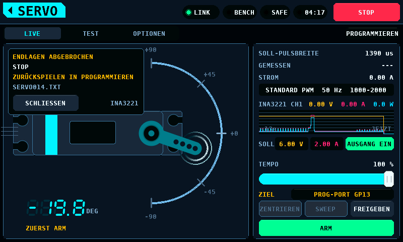
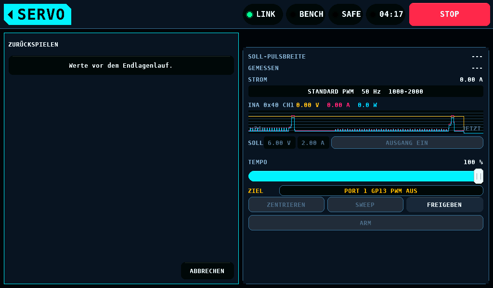
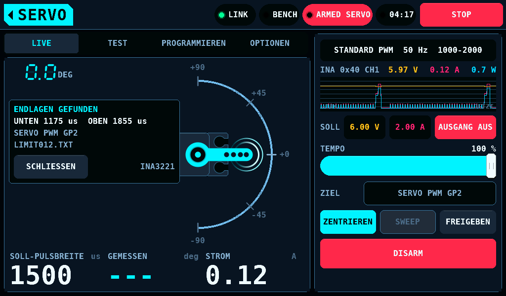

# Servoverfahren

<sub>[English](Servo.md) · **Deutsch**</sub>

Drei Verfahren am Servo. Das erste misst ein Servo im eingebauten Zustand:
die Endlagensuche läuft auf dem SERVO-Bildschirm und liest den INA3221-Kanal,
der das Ziel des Servotesters überwacht, und
bei einem KST- oder Chaservo-Servo am Programmierport kann sie die eigenen
Weggrenzen des Servos senken. Das zweite, der Abgleich, braucht einen
Stromsensor über ein Paar Ausgänge, der nicht bestückt ist, und läuft nur
gegen ein modelliertes Servo. Ihre Vorgabewerte stammen aus
`servo_limit_defaults()` und `servo_sync_defaults()` in `shared/servo/`. Das
dritte, der [automatische Test](#automatischer-test), liest den Strom des
Netzteils, das das Servo versorgt.

## Eingebaute mechanische Endlage

### Zweck

Im Sender gesetzte Endpunkte sind Schätzungen. Ein Servo, das gegen einen
mechanischen Anschlag gehalten wird, zieht Blockierstrom, solange es dorthin
befohlen wird, und der Einbau, nicht das Servo, bestimmt, wo der Anschlag
liegt. Die beiden Enden des Ruderwegs unterscheiden sich; beide messen.

### Verfahren

Die Suche schreitet von der Mitte nach außen, in Schritten von 10 µs Pulsweite
(etwa 0,9° bei einem Servo mit 11 µs je Grad Weg), bis 600 µs von der Mitte
und nie über 500 oder 2500 µs hinaus. Ein letzter Schritt unter 10 µs erreicht
dieses Ende, so wird das Ende selbst gemessen.
Nach jedem Schritt wartet sie 120 ms, bis das Servo steht, und mittelt den
Strom über 80 ms. Solange die Fläche frei läuft, ist der Strom flach und
niedrig. Das Gestänge gilt als angelaufen, wenn der Strom das 1,8-Fache des
Grundstroms im freien Lauf übersteigt und mindestens 0,15 A darüber liegt. Die
Suche hält beim ersten solchen Schritt an, nimmt 25 µs zurück und meldet diese
Pulsweite als Endpunkt.

Am Prüfstand sucht der Endlagenlauf (`shared/servo/servo_limrun.c`) zuerst
die untere Seite, dann die obere. Wo, hängt vom Ziel ab:

| ZIEL | Zuerst gelesen | Suche |
| --- | --- | --- |
| ein SERVO-PWM-Pin auf OUTPUTS | nichts | PULS MITTE bis PULS MIN und PULS MAX |
| PROG-PORT | eine Lesesitzung des [Programmierers](ServoProgrammer-de.md) | NEUTRAL des Servos bis zu seinem eigenen PULSE LOWER und PULSE UPPER, nie darüber hinaus |

Der Abstand zu diesem Ende ersetzt die 600 µs. Der Strom sind die
50-ms-Fenster des überwachenden INA3221-Kanals, jede Stellung dauert also 250 ms. Vor und
nach jeder Suche steht das Servo 1000 ms in der Mitte: der Rückweg von
einem Ende, 600 µs bei 0,67 µs/ms, dauert 900 ms, und der Grundstrom soll
ihn nicht sehen.

Dauer: der Host-Test begrenzt eine vollständige Suche gegen das modellierte
Servo auf unter 12 s. Ein Lauf am Prüfstand ist nicht gemessen.

### Starten

Die Karte ENDLAGENLAUF auf der Aufgabe TEST des SERVO-Bildschirms enthält
den Lauf; ihr **OPTIONEN** öffnet die Einstellungen des Laufs eine Ebene
tiefer. Dort wählt **ENDLAGENLAUF** mit einem Tippen NUR SUCHE oder SUCHEN +
PROGRAMMIEREN. **SERVOPULSE**, nur mit ZIEL auf PROG-PORT angezeigt, wählt
mit einem Tippen BEHALTEN oder 1000-2000; es beginnt bei BEHALTEN. Das
Home-Tag führt zurück zur Karte. **ENDLAGENLAUF STARTEN** auf der Karte
startet den Lauf nach 2 s Halten, wie TEST STARTEN; ein Tippen oder ein
kürzeres Halten startet nichts.


Die Zeile unter der Schaltfläche nennt die ganze Zeit, was der Lauf treibt
und liest: `AUSGANG PROG-PORT 1 GP13, STROM INA3221 0x41 CH2`, oder, solange der Tester die Standardausgänge treibt, `AUSGANG SERVO PWM GP2, STROM INA3221 0x40 CH1`. Der Kanal ist der, der in SETUP > SENSOREN das Ziel des Testers überwacht, der niedrigste mit Shunt auf einem bestückten Baustein; `STROM INA3221`, solange keiner es tut. Während der Lauf
geht, zeigt die linke Karte von LIVE sein Feld: die Phase, die Seite und den befohlenen
Puls, und in der dritten Zeile wieder den Ausgang. Die Zeile ZIEL der
Ausgangskarte bleibt ebenfalls sichtbar.


Der Lauf liest den INA3221 und sonst nichts. Die Messwerte des PD mini und
das Modell des Panels werden abgelehnt, bevor etwas angesteuert wird: die
Schaltfläche bleibt grau, und die Zeile darunter sagt warum.

| Zeile | Bedingung |
| --- | --- |
| `ZUERST ARM` | der Prüfstand ist SAFE |
| `LETZTER BERICHT SCHREIBT NOCH` | ein automatischer Test oder ein Endlagenlauf läuft, oder sein Bericht geht noch auf die Karte |
| `INA3221 NICHT ZUR SERVOSTROMMESSUNG EINGERICHTET` | kein Kanal eines bestückten INA3221 überwacht in SETUP > SENSOREN das Ziel des Testers, an einem IOmcu älter als 4.25 überwacht CH2 oder CH3 es, ein IOmcu älter als Protokoll 4.11, oder eine SENSE-Page, die die Einrichtung nicht hält |
| `INA3221 NICHT ERREICHBAR` | kein Link, das Bauteil antwortet nicht, oder sein Reset-Zähler hat sich bewegt |
| `NOCH KEINE INA3221-MESSFENSTER` | der INA3221 ist noch nicht das Messgerät der Servoschiene: seine Einrichtung ist kürzer als 1000 ms gehalten, oder kein Fenster mit Strom in den letzten 200 ms |
| `SERVOVERSORGUNG UNTER 3.0 V ODER NICHT AUSGELESEN` | das letzte INA3221-Fenster enthält keine Schienenspannung, oder ihr Mittel liegt unter 3,0 V (`SERVO_LIMRUN_RAIL_MIN_MV`). Ein ausgeschalteter Ausgang liest 0 V, und eine Suche dort fände zwei freie Enden an einem Servo, das sich nie bewegt hat. 3,0 V liegen unter den 4,8 V, für die Servos üblicherweise angegeben sind, so dass die Schiene einer einzelnen Lithiumzelle noch startet; die Spannung, bei der ein bestimmtes Servo stehen bleibt, ist nicht gemessen |
| `PORT-PWM AUS. KEINE PULSE AN DIESEM PORT.` | ZIEL auf PROG-PORT mit PORT-PWM aus |
| `KEIN SERVO-PWM-PIN`, `PINS NICHT AUSGELESEN` | ZIEL auf den Ausgängen des Prüfstands, ohne einen als SERVO PWM gebundenen Ausgang, oder die Bindung noch nicht gelesen: die Worte der Zeile ZIEL |
| `MITTE MUSS ZWISCHEN PULS MIN UND PULS MAX LIEGEN` | PULS MITTE liegt nicht zwischen PULS MIN und PULS MAX |

### Die Weggrenzen des Servos programmieren

SUCHEN + PROGRAMMIEREN wird für ein Servo am Programmierport angeboten: ZIEL auf
PROG-PORT, der Port in PWM und eine Versorgung von 4,8 V oder mehr. Mit
einem antwortenden PD mini muss dessen Ausgang eingeschaltet sein, und sein
Sollwert zählt; ohne ihn der Mittelwert
der Servoschiene im letzten Fenster des INA3221. An den Ausgängen des
Prüfstands sucht der Lauf nur, die Zeile lautet NUR SUCHE, und der Hinweis
darunter in den Einstellungen des Laufs lautet `PROGRAMMIEREN ERFORDERT EIN SERVO AM PROG-PORT`. Am PROG-PORT
beginnt jeder Lauf mit einer Lesesitzung, deshalb halten die übrigen
Bedingungen auch NUR SUCHE an: die Schaltfläche bleibt grau, und die
Zustandszeile der Karte nennt die Bedingung.

| Zeile | Bedingung |
| --- | --- |
| `PROGRAMMIEREN: PORT IST NICHT IM PWM-MODUS` | der Programmierer hält den Port, oder der Port ist nicht für einen Lauf bereit |
| `PROGRAMMIEREN: PD-MINI-AUSGANG AUS` | ein PD mini antwortet mit ausgeschaltetem Ausgang: die Lesesitzung schaltete ihn neben dem Netzteil ein, das die Schiene speist |
| `PROGRAMMIEREN: VERSORGUNG AUF UNTER 4.8 V EINGESTELLT` | ein PD mini antwortet, und sein Sollwert liegt unter 4,8 V |
| `PROGRAMMIEREN: SERVOVERSORGUNG UNTER 4.8 V` | kein PD mini antwortet, und die Servoschiene liegt im letzten Fenster des INA3221 unter 4,8 V oder ist nicht gelesen |

#### Zuerst lesen

Jeder Lauf auf PROG-PORT, auch NUR SUCHE, beginnt mit einer Lesesitzung.
Das Servo steht auf PULS MITTE, der Lauf schaltet den Prüfstand auf SAFE,
VERBINDEN liest alle Register, VERLASSEN gibt den Port zurück, und der Lauf
schaltet den Prüfstand auf ARMED. Vorher wird nichts angesteuert.

- Ein Lesen, das scheitert, beendet den Lauf vor jeder Suche: ABGEBROCHEN,
  `Programmierport ohne Abschluss`, wenn VERBINDEN oder sein Lesen nicht
  abschließt; NICHT BESTANDEN, `kein KST- oder Chaservo-Servo`, wenn das
  gelesene Servo Werte hält, die die harten Regeln nicht annehmen. Ein
  Servo, das kein KST oder Chaservo ist, wird mit ZIEL auf einem
  SERVO-PWM-Pin gesucht.
- NEUTRAL nicht zwischen PULSE LOWER und PULSE UPPER beendet ihn als NICHT
  BESTANDEN, `NEUTRAL außerhalb LOWER/UPPER`.
- PULSE LOWER bis PULSE UPPER nicht innerhalb von PULS MIN bis PULS MAX
  des Prüfstands beendet ihn als NICHT BESTANDEN, `Servopulse außerhalb
  MIN/MAX`. Der Prüfstand bleibt SAFE, nichts wird angesteuert, und Feld
  und Bericht nennen beide Bereiche, zum Beispiel `900-2100 NICHT IN
  1000-2000 us`.

Ein KST-Servo im Lieferzustand hält PULSE LOWER 900,0 µs und PULSE UPPER
2100,0 µs. PULS MIN und PULS MAX des PWM-Typs STANDARD sind 1000 µs und
2000 µs, also wird dieses Servo bei BEHALTEN abgelehnt. SERVOPULSE auf
1000-2000, oder ein PWM-Typ, dessen Bereich 900 bis 2100 µs enthält, lässt
es laufen.

SERVOPULSE auf 1000-2000 schreibt in der Lesesitzung PULSE LOWER 1000,0 µs
und PULSE UPPER 2000,0 µs, bevor etwas angesteuert wird, und liest sie
zurück. NEUTRAL wird nicht geschrieben. Ein Servo, das diese Werte schon
hält, bekommt kein Schreiben. NEUTRAL außerhalb des neuen Bereichs beendet
den Lauf als NICHT BESTANDEN, bevor etwas angesteuert wird, mit
ZURÜCKSPIELEN im Angebot. Die Einstellung wirkt mit NUR SUCHE und mit
SUCHEN + PROGRAMMIEREN; mit NUR SUCHE sind die Pulse das einzige Schreiben, und der
Hinweis in den Einstellungen des Laufs sagt `NUR SUCHE: SETZT NUR PULSE LOWER/UPPER`.

#### Die Register und das Modell

LEFT ANGLE und RIGHT ANGLE sind die eigenen Weggrenzen des Servos, je ein
8-Bit-Register, in einer unbekannten Einheit. Der kleinste Wert, den die
harten Regeln des Programmierers nehmen, ist bei einem KST 1: 0 wird
abgelehnt. Ein Wert unter 50 ist eine weiche Grenze; das Halten von 2 s
beim Start ist die Zustimmung dazu.

Der Lauf nimmt das Servo als linear. PULSE LOWER und PULSE UPPER sind die
Eingangspulse, bei denen das Servo den vollen Weg erreicht, den LEFT ANGLE
und RIGHT ANGLE setzen. Zwischen NEUTRAL und diesem Puls ist der Weg linear
im Puls; darüber hinaus hält das Servo den vollen Weg. Der Anteil einer
Seite beim Puls p ist

```text
f = (p - NEUTRAL) / (P_lim - NEUTRAL)
```

mit P_lim gleich PULSE LOWER auf der unteren und PULSE UPPER auf der oberen
Seite, so wie das Servo sie während der Suche hält. Die Einheit von LEFT
ANGLE und RIGHT ANGLE ist unbekannt, und der lineare Zusammenhang ist eine
Annahme, keine Messung. Eine angelaufene Seite, deren letzter freier Puls
nicht jenseits von NEUTRAL liegt, beendet den Lauf vor jedem Schreiben als
NICHT BESTANDEN, `freies Ende vor NEUTRAL`.

#### Zwei Schreibvorgänge je angelaufener Seite

v0 ist der Wert, den das Register der Seite beim Lesen hält.

1. Der Vorhalt: `v1 = ceil(v0 x fb x 1.03)`, fb der Anteil am ersten
   angelaufenen Puls der ersten Suche, höchstens v0 und mindestens der
   kleinste Wert. Der erste angelaufene Puls liegt am Anschlag oder
   dahinter, also bleibt der Anschlag bei v1 erreichbar und rückt nahe an
   die Pulsgrenze. Die Seite wird erneut gesucht. Ist sie dort frei, endet
   der Lauf als NICHT BESTANDEN, `kein Anschlag nach dem Vorhalt`, ohne
   zweites Schreiben und mit ZURÜCKSPIELEN im Angebot.
2. Der Endwert: `v2 = floor(v1 x f1)`, f1 der Anteil am letzten freien Puls
   der Vorhalt-Suche, mindestens der kleinste Wert. Kein Abstand kommt
   hinzu: der letzte freie Puls liegt einen Schritt von 10 µs vor dem
   angelaufenen. Eine Vorhalt-Suche, die weit innerhalb der Pulsgrenze
   anläuft, ergibt v2 ebenso; kein weiterer Vorhalt folgt.

Durchgerechnet am modellierten Servo des Hosts: NEUTRAL 1500,2 µs, PULSE
LOWER 900,0 µs, v0 150, der Anschlag bei 1000 µs. Die erste Suche ist frei
bei 1000 µs und läuft bei 990 µs an: fb = 510,2 / 600,2 = 0,850, v1 =
ceil(150 x 0,850 x 1,03) = 132. Bei 132 ist die Suche frei bis 930 µs:
f1 = 570,2 / 600,2 = 0,950, v2 = floor(132 x 0,950) = 125. Bei 125 endet
der volle Weg bei 1000,2 µs.

Der Vorhalt entfällt, wo v1 nicht unter v0 läge, oder wo das Modell den
Anschlag um weniger als 20 µs verschiebt: d0 x (v0 - v1) / v1 unter 20 µs,
d0 der Abstand des letzten freien Pulses der ersten Suche von NEUTRAL. Eine
Suche könnte diese Verschiebung nicht von keiner unterscheiden. Die erste
Suche zählt dann als die des Vorhalts, und `v2 = floor(v0 x f0)`, f0 der
Anteil an ihrem letzten freien Puls: ein Schreibvorgang für diese Seite.

#### Welches Register welche Seite begrenzt

Die Protokollnotizen sagen nicht, welche Pulsseite jedes Register begrenzt,
und nicht, wie REVERSION das ändert. Der Lauf findet es beim ersten
Schreiben der ersten angelaufenen Seite: dieser Wert geht nur an LEFT ANGLE
(an RIGHT ANGLE, wo LEFT ANGLE schon den kleinsten Wert hat), und die Seite
wird gesucht. Das Ende hat sich bewegt, wenn es jetzt frei ist oder sein
Endpunkt 20 µs weiter außen liegt. Ein Ende, das innerhalb von 20 µs blieb,
schickt LEFT ANGLE auf seinen Wert zurück und den aus dem v0 von RIGHT
ANGLE neu berechneten Wert an RIGHT ANGLE; bewegt es sich dann, begrenzt
RIGHT ANGLE diese Seite. Ein Ende, das mit beiden Registern versucht
bleibt, beendet den Lauf als NICHT BESTANDEN, `LEFT/RIGHT ANGLE: Seite
unklar`. Ein Ende, das sich um 20 µs oder mehr nach innen bewegt, ebenso.
Ein Ende, das mit seinem Register auf dem kleinsten Wert anläuft, beendet
ihn als NICHT BESTANDEN, `läuft beim kleinsten Winkel an`. Ein Register,
dessen Seite nie anlief, behält seinen Wert.

Zuletzt werden beide Enden noch einmal gesucht: BESTANDEN, wenn beide frei
sind, NICHT BESTANDEN `ein Ende läuft weiterhin an`, wenn eines anläuft.
Nach NICHT BESTANDEN folgt kein weiteres Schreiben; ZURÜCKSPIELEN bringt
die Werte vor dem Lauf zurück.

#### Sitzungen

Der Lauf schreibt in Sitzungen des [Programmierers](ServoProgrammer-de.md):

1. Das Servo geht in die Mitte zurück und wird dort 1000 ms gehalten.
2. Der Lauf schaltet den Prüfstand auf SAFE.
3. VERBINDEN nimmt den Port und liest alle Register.
4. Das Schreiben: SCHREIBEN INS SERVO FREIGEBEN an, die Felder des Laufs,
   der Schreibschalter wieder aus. Es ist das gewöhnliche Schreiben des
   Programmierers mit jeder Grenzprüfung, und es liest die Werte zurück.
5. VERLASSEN gibt den Port an PWM zurück.
6. Der Lauf schaltet den Prüfstand auf ARMED und sucht die Seite, für die
   geschrieben wurde.

Die Lesesitzung schreibt nichts außer den Pulsen von SERVOPULSE. Ein
VERLASSEN, das dieser Link oder diese Versorgung nicht abschließt, beendet
den Lauf, bevor sich ein Wert ändert. Das erste Schreiben des Laufs sichert
die Werte des Servos in eine Datei auf der Karte, wie das erste Schreiben
des Programmierers; die späteren Sitzungen sichern nicht. Jede spätere
Sitzung liest das Servo erneut. Ein anderer Typ, umgeschaltete REVERSION,
ein anderer Bereich der Werte, die die harten Regeln annehmen, andere
Pulse, oder LEFT ANGLE und RIGHT ANGLE anders, als der Lauf sie zuletzt
schrieb, beenden den Lauf als ABGEBROCHEN, `Servo hat andere Werte`, bevor
er wieder schreibt.

| Konstante | Wert | Zweck |
| --- | ---: | --- |
| `SERVO_LIMRUN_WRITES_MAX` | 8 | Registerwerte, die ein Lauf höchstens schreibt: PULSE LOWER und PULSE UPPER (2), Vorhalt und Endwert auf jeder Seite (4), und das erste Schreiben von LEFT ANGLE mit seinem Wert zurück, wenn RIGHT ANGLE diese Seite begrenzt (2). Eine Sitzung, deren Werte darüber gingen, wird nicht gesendet: NICHT BESTANDEN `Grenze von 8 Werten erreicht` |
| `SERVO_LIMRUN_OVERSET_PCT` | 3 % | der Vorhalt über dem Anteil am ersten angelaufenen Puls |
| `SERVO_LIMRUN_STD_LOWER_DUS`, `SERVO_LIMRUN_STD_UPPER_DUS` | 1000,0 µs, 2000,0 µs | was SERVOPULSE auf 1000-2000 schreibt |
| `SERVO_LIMRUN_MOVED_US` | 20 µs | ein Ende, das sich bewegt hat oder blieb; die kleinste Verschiebung des Anschlags, für die ein Vorhalt geschrieben wird |
| `SERVO_LIMRUN_RETURN_MS` | 1000 ms | in der Mitte vor jeder Suche und vor jedem SAFE |

Schreiben: kein Schritt des Protokolls ist bekannt, der einen Wert dauerhaft
macht, und kein Schreiben, das nur das RAM ändert. Jedes Schreiben ist das
Registerschreiben, das der Programmierer zurückliest. Ob ein KST-Servo den
Wert bei jedem Schreiben im EEPROM (elektrisch löschbarer programmierbarer
Nur-Lese-Speicher) ablegt und wie viele Schreibvorgänge dieser Speicher
verträgt, ist unbekannt; die Grenze hält einen Lauf bei 8 Werten. Ein Lauf
mit beiden Enden angelaufen und SERVOPULSE auf 1000-2000 schrieb am
modellierten Servo des Hosts 6 Werte in 4 Schreibvorgängen und 4
Sitzungen, 85,6 s, mit REVERSION AUS, und 8 Werte in 5 Schreibvorgängen
und 5 Sitzungen, 97,7 s, mit REVERSION EIN.

Die gefundenen Enden werden nicht auf PULS MIN und PULS MAX des
Prüfstands angewendet.

### Schutzmechanismen

| Schutz | Wert | Wirkung |
| --- | ---: | --- |
| Stromobergrenze | 3,0 A | Abbruch, bei jedem 1-ms-Messwert eines Fensters geprüft |
| Der INA3221 am Ende seines Bereichs | ein begrenzter Messwert | Abbruch |
| Stall-Timeout | Fenstermittel über 1,0 A für 400 ms | Abbruch |
| Kein Fenster | 200 ms, 4 Fenster zu 50 ms | Abbruch; `SERVO_TEST_WIN_STALE_MS`, der Wert des automatischen Tests. Ein Fenster ohne Strommesswert zählt nicht als Fenster |
| Eine Suche | 40 s | Abbruch: 1000 µs Weg sind 100 Stellungen zu 250 ms, 25 s |
| Ein Schritt des Programmierers | 150 s | Abbruch: VERBINDEN mit seinem Lesen, ein Schreiben oder VERLASSEN |
| Das Umschalten des Prüfstands | 3 s | Abbruch, wenn SAFE oder ARMED 3 s nach der Anforderung nicht steht |
| Das Netzteil | Sollwerte und Ausgang, ein oder aus, wie bei seiner ersten Messung, ob es antwortet oder nicht, in jeder Phase außer den Sitzungen des Programmierers (VERBINDEN bis VERLASSEN), denen das Netzteil gehört; ein Ausgang, der beim Start aus ist und eingeschaltet wird, oder ein Netzteil, das beim Start nicht antwortet und später antwortet, mit ein- oder ausgeschaltetem Ausgang, beendet den Lauf als `Netzteil oder Spannung geändert`, so wird neben einer Schiene, die anderswo gespeist wird, kein zweites Netzteil eingeschaltet; ein VERBINDEN wird nicht gesendet, solange ein PD mini antwortet, mit dem der Lauf nicht begonnen hat, oder dessen Ausgang aus ist: der Lauf endet, wie eine Messung außerhalb einer Sitzung ihn beendet, mit `Netzteil oder Spannung geändert` für einen PD mini, mit dem der Lauf nicht begonnen hat, und mit `Netzteilausgang ging aus` für seinen eigenen; während einer Suche zudem die Schienenspannung innerhalb 1,0 V des ersten Fensters | Abbruch |
| Die Schienenspannung im Fenster einer Suche | in jedem Fenster einer Suche vorhanden, ihr Mittel bei 3,0 V oder mehr (`SERVO_LIMRUN_RAIL_MIN_MV`), das erste Fenster eingeschlossen | Abbruch, bevor das Fenster die Suche bewegt: `kein Spannungswert im Fenster` ohne Wert, `Netzteil oder Spannung geändert` unter 3,0 V; Bezug des 1,0-V-Bands ist das erste Fenster des Laufs, das die Spannung enthält |
| Schrittweite | 10 µs | ein Schritt kann das Horn nicht von frei bis hart an den Anschlag bewegen |

Sie gelten in jeder Phase. Die Suche und die Schutzmechanismen lesen den
Betrag des Stroms: ein verkehrt herum eingebauter Shunt liest ein
anlaufendes Servo als stärker negativen Strom, und der Lauf findet es wie
mit richtig eingebautem Shunt. Ein Messwert von -32768 mA zählt als
32768 mA, über der Grenze von 3,0 A. Der Lauf folgt den Regeln für ARMED des
SERVO-Bildschirms und des Programmierports: sein ARM wird abgelehnt,
solange der Port gehalten wird, eine STOP-Sperre oder verlorene
Touch-Ereignisse halten den Prüfstand SAFE, und ein ARM, das nicht ankommt,
beendet den Lauf.

Der Abgleich ist ein Modul in `shared/servo`, auf dem Host gegen ein
modelliertes Servo getestet; keines der beiden Firmware-Images ruft es auf.

### Was einen Endlagenlauf beendet

STOP, LAUF BEENDEN im Feld auf LIVE oder auf der Karte ENDLAGENLAUF, ein Umschalten auf
SAFE durch den Bediener, Linkverlust, das Verlassen des Bildschirms, der
Bediener, der das Servo nimmt, eine Änderung an den Einstellungen des
Servos, verlorene Touch-Ereignisse, der INA3221 nicht mehr das Messgerät,
und ein Netzteil, das nicht mehr antwortet, auslöst, ausschaltet oder
dessen Sollwerte sich ändern: die Gründe des automatischen Tests, in
[Was einen Lauf beendet](#was-einen-lauf-beendet). SAFE und ARM des Laufs
selbst beenden nichts. Jeder Grund beendet den Lauf als ABGEBROCHEN, mit
ausgeschaltetem Ausgang und freigegebenem Servo. Ein Lauf, der endet,
während er auf ARMED wartet, fordert zudem SAFE an: ein ARM, das er
anforderte und das der Prüfstand noch nicht übernommen hat, schaltet den
Prüfstand nach dem Ende nicht auf ARMED. Ein Start des Panels löscht den
Lauf ohne Bericht.

Die zuletzt geschriebenen Werte bleiben im Servo. Ein Lauf, der schrieb und
nicht bestand, zeigt in seinem Feld `ZURÜCKSPIELEN IN PROGRAMMIEREN`. Ein
Schreiben, das nach dem Senden scheitert, ohne Antwort oder mit einer
Antwort, die der Programmierer nicht annimmt, gilt als geschrieben: ein Teil
davon kann angekommen sein. Ein Schreiben, das der Programmierer vor dem
Senden ablehnt, gilt als keines.
ZURÜCKSPIELEN im Programmierer bietet nach VERBINDEN und ALLES AUSLESEN `Werte vor dem Endlagenlauf.` an: das Servo, wie die erste Sitzung des Laufs es las,
zurückgeschrieben als gewöhnliches Schreiben von LEFT ANGLE, RIGHT ANGLE,
PULSE LOWER und PULSE UPPER. Das Angebot steht, solange das gelesene Servo
sich darin in diesen vier Feldern und in keinem anderen unterscheidet. Es liegt im Speicher des
Panels: ein Start des Panels vergisst es, die Sicherungsdatei auf der Karte
bleibt. Eine Sitzung nach dem Lauf gehört dem Bediener: ihr erstes
Schreiben sichert eine eigene Sicherungsdatei.




### Ergebnisse

- Ein Endpunkt wird bereits um 25 µs zurückgenommen gemeldet.
- „Keine Endlage gefunden“ (`FREI`) heißt: die Suche hat das Ende ihres
  Wegs gemessen, ohne dass das Gestänge angelaufen ist: PULS MIN oder PULS
  MAX an einem SERVO-PWM-Pin, PULSE LOWER oder PULSE UPPER des Servos am
  PROG-PORT.
- Eine Endlage nahe der Mitte kann eine Schwergängigkeit im Gestänge sein,
  etwa ein klemmender Umlenkhebel oder eine streifende Schubstange, statt des
  Endes des Ruderwegs.

| Urteil | Bedeutung |
| --- | --- |
| GEFUNDEN | nur Suche: ein Ende läuft an; die Endpunkte werden gemeldet |
| FREI | kein Ende läuft an; nichts wird geschrieben |
| BESTANDEN | programmiert, und beide Enden in der letzten Suche frei |
| NICHT BESTANDEN | der Lauf endete wie geplant und ein Ende läuft weiterhin an, oder das Servo lässt sich nicht programmieren |
| ABGEBROCHEN | ein Schutz, der Bediener, der Link, das Messgerät, das Netzteil oder der Programmierer hat ihn beendet |

Das Feld auf der linken Karte zeigt bis SCHLIESSEN das Urteil, den Grund
oder die Werte (`LINKS 150>87  RECHTS 150>95`), die Enden oder den Ausgang,
an dem der Lauf begann, und den Dateinamen des Berichts.





Der Bericht ist eine eigene `LIMITnnn.TXT` in `USER/LOGS` ohne CSV-Datei
daneben, unter der nächsten freien Nummer dieses Ordners, geschrieben
unabhängig davon, was BERICHT auf PRÜFLING sagt. Mit User-Logs AUS unter
SETUP > SD-KARTE wird kein Bericht geschrieben
([Setup](Screens-de.md#sd-karte-welche-logs-geschrieben-werden-und-wohin)). Während eines Laufs schreiben weder das
Prüfstandslog noch das Netzteillog eine Zeile; die Zeit des Netzteillogs
läuft durch den Lauf weiter, wie seine Summen. Vom Start des Laufs, bis die
Karte den Bericht geschlossen hat, gilt er als offener Log-Lauf: WLAN und ein Update warten
darauf, wie auf die CSV eines Laufs. Ein Lauf am modellierten
Servo des Hosts mit REVERSION AUS und SERVOPULSE auf 1000-2000; die
Anschläge bei 1150 µs und 1880 µs Hornweg liegen bei 1208 µs und 1817 µs
Eingangspuls, sobald PULSE LOWER und PULSE UPPER 1000,0 µs und 2000,0 µs
sind:

```text
RCBENCH SERVO-ENDLAGEN-BERICHT
Ergebnis:        BESTANDEN
Prüfling:        SERVO
Firmware:        rcbench 0.22.0
Modus:           Suche, dann LEFT ANGLE und RIGHT ANGLE programmiert
Ausgang:         PROG-PORT 1 GP13, 50 Hz
Pulsbereich:     Mitte 1500 us, 1000-2000 us
Gesucht:         von 1500 us bis 1000 us und 2000 us
Strom:           INA3221 0x40 CH1, Fenster zu 50 ms, Shunt 100.0 mOhm
Suchregel:       Schritte zu 10 us, 120 ms warten, Mittel über 80 ms; angelaufen über 1.8 x frei und +0.15 A
Schutz:          ein Messwert ab 3.0 A, über 1.0 A für 400 ms, 200 ms kein Fenster, 40 s je Suche
Dauer:           85.6 s
AS5600:          nicht eingebaut, keine Winkel

ENDEN (die Suche vor dem Programmieren)
Unteres Ende:    angelaufen bei 1200 us, Endpunkt 1235 us; frei 0.120 A, angelaufen 0.627 A
Oberes Ende:     angelaufen bei 1820 us, Endpunkt 1785 us; frei 0.120 A, angelaufen 0.322 A

PROGRAMMIEREN (LEFT ANGLE und RIGHT ANGLE, Einheit unbekannt)
Servo:           Typ 6, REVERSION AUS
Servopulse:      NEUTRAL 1500.2 us, PULSE LOWER 900.0 us, PULSE UPPER 2100.0 us
Pulse schreiben: PULSE LOWER 900.0 -> 1000.0 us, PULSE UPPER 2100.0 -> 2000.0 us
LEFT ANGLE:      150 vorher, 87 nachher; begrenzt das untere Ende
                 Anteil frei 0.580, angelaufen 0.600; Vorhalt 93, Anteil 0.940; Endwert 87
RIGHT ANGLE:     150 vorher, 95 nachher; begrenzt das obere Ende
                 Anteil frei 0.620, angelaufen 0.640; Vorhalt 99, Anteil 0.960; Endwert 95
Verfahren:       linear im Puls; Vorhalt +3 % auf den Anteil am ersten angelaufenen Puls, dann der Anteil, den seine Suche frei fand
Schreibvorgänge: Werte geschrieben 6, Schreibvorgänge gesendet 4, Grenze 8 Werte; Sitzungen 4
Sicherung:       KST001, die Werte vor dem Lauf

ENDEN NACH DEM PROGRAMMIEREN (beide neu gesucht)
Unteres Ende:    frei bis 1000 us; frei 0.120 A
Oberes Ende:     frei bis 2000 us; frei 0.120 A

Einheit: die Einheit von LEFT ANGLE und RIGHT ANGLE ist unbekannt; der Weg gilt als linear im Puls von NEUTRAL bis PULSE LOWER und PULSE UPPER, das ist nicht gemessen.
Prüfstand: die gefundenen Enden werden nicht auf PULS MIN und PULS MAX angewendet.
```

Mit eingebautem AS5600 hat jedes Ende eine Zeile mit dem Winkel des Horns
an seiner letzten freien Stellung, `AS5600 +38.5 Grad an der letzten freien
Stellung`. Ein Lauf, der schrieb und nicht bestand, hat eine Zeile
`Rückholen:`. Ein Lauf, der kein Schreiben sendete, hat keine Zeile
`Sicherung:`: die Werte vor dem Lauf liegen ab dem ersten Schreiben vor.
Die Zeile `Sicherung:` nennt die Datei, die das erste Schreiben dieses
Laufs sicherte, auch wenn dieses Schreiben gesendet wurde und verloren ging,
nie die Datei eines früheren Laufs. Die Zeile `Gesucht:` nennt Mitte und Enden der Suche; ein
Lauf, der vor seiner ersten Suche endete, hat keine. Ein Lauf an einem
SERVO-PWM-Pin hat keine Zeile `Servopulse:`.

Nicht gemessen: jede Zahl oben an einem echten Servo. Unbekannt sind die
Einheit von LEFT ANGLE und RIGHT ANGLE, welches Register an einem echten
KST- oder Chaservo-Servo welche Pulsseite begrenzt, ob ein geschriebener
Wert einen Neustart der Versorgung übersteht, ob sich das Servo bewegt,
wenn seine Grenze geschrieben wird, wie lange eine Sitzung an der Hardware
dauert, und die Zeit von VERLASSEN bis zu einem wirksamen ARM.

## Zwei Servos auf einer Ruderfläche abgleichen

### Zweck

Zwei Servos an einer Fläche (Doppelquerruder, geteiltes Höhenruder) arbeiten
gegeneinander, sobald ihr Weg oder ihre Mitte nicht übereinstimmen, und ziehen
dafür dauerhaft zusätzlichen Strom. Die Fläche zeigt kein sichtbares Zeichen.

### Verfahren

Die beiden hören am Punkt des kleinsten Gesamtstroms auf, gegeneinander zu
arbeiten. Die Suche hält Servo A fest und fährt eine Korrektur an Servo B
durch, in der Mitte und bei ±300 µs Ausschlag:

- ein Unterschied in der Mitte ist ein Offsetfehler (Trimmung);
- ein Unterschied an einem Ende ist ein Wegfehler für dieses Ende.

Jede Stufe führt 3 Suchläufe mit je 7 Punkten aus. Der erste Suchlauf deckt
±40 µs um den Startpunkt der Stufe ab: 0 µs bei der Mittenstufe, der Ausschlag
von ±300 µs bei den Endstufen. Jeder spätere Suchlauf ist auf den besten Punkt
des vorigen zentriert und deckt ±13 µs, dann ±4 µs ab. Jeder Punkt wartet 120 ms plus die Fahrzeit bei angenommenen
0,8 µs/ms und mittelt den Strom dann über 100 ms. Ein Minimum gilt, wenn der
Strom über den Suchlauf um mindestens 0,08 A schwankt. Die Stromobergrenze
für das Paar liegt bei 4,0 A.

Jedes Ende bekommt seine eigene Korrektur; ein Gestänge mit Horn und
Schubstange ist nicht symmetrisch zur Mitte. Ein Stromsensor über das Paar
genügt.

### Ergebnisse

- Ein Paar, das bereits abgeglichen ist, liefert ein Minimum bei Korrektur
  null.
- „Kein Minimum“ heißt: der Strom schwankt über den breitesten Suchlauf um
  weniger als 0,08 A.
- Zwei Servos, die sich einig sind und beide falsch stehen, erzeugen keinen
  Stromunterschied. Dieser Fall braucht den Beschleunigungssensor oder eine
  Sichtprüfung.

## Automatischer Test

### Zweck

Was ein Servo in Ruhe, in Bewegung und beim Halten eines Endes zieht und wie
lange es von Ende zu Ende braucht, bei den Versorgungsspannungen, für die es
ausgelegt ist; und die Spannung, unter der es sich nicht mehr bewegt
(Brown-out). Nichts am Prüfstand misst das Horn, solange der Ausgangsencoder
(siehe unten) nicht an ist, also wird jedes Ergebnis am Strom des Netzteils
abgelesen, das das Servo versorgt: am PD mini (WeAct PD
Power Mini V1), wenn SETUP ANSCHLÜSSE ihn freigibt, sonst am Netzteilmodell
des Panels. Ein Lauf am Modell sagt das in seinem Bericht, und seine Zahlen
sind simuliert. Ist der INA3221 bei TEST STARTEN das Messgerät der
Servo-Schiene und das Netzteil der PD mini, liest der Lauf stattdessen den
INA3221-Kanal, der das Ziel des Testers überwacht, in 50-ms-Fenstern: siehe
[Der Strommesser des Laufs](#der-strommesser-des-laufs).

TEST STARTEN auf der Karte AUTOMATISCHER TEST der Aufgabe TEST von SERVO startet ihn;
[Bildschirme](Screens-de.md#servo) beschreibt die Bedienung. Die Engine ist
`shared/servo/servo_test.c`; die Konstanten unten stehen in `servo_test.h`.

### Verfahren

Die Spannungsstufen sind STUFE 4.8 V und STUFE 6.0 V des Laufs (OPTIONEN der Karte), und mit HV-SERVO an STUFE 7.4 V und STUFE 8.4 V. HV-SERVO ist nach jedem Neustart aus. Ein
Lauf mit einer Stufe über 6,0 V startet nur über die Warnung NUR HV-SERVOS,
2 s gehalten. Die Strombegrenzung im Lauf ist die der Zeile SOLL.

Jede Stufe durchläuft diese Phasen:

| Phase | Das Servo | Endet |
| --- | --- | --- |
| SETZEN | auf PULS MITTE; die Spannung wird verlangt; die erste Stufe schaltet den Ausgang ein | wenn das Netzteil den Sollwert auf 0,05 V genau zurückliest, spätestens nach 3000 ms |
| EINSCHWINGZEIT | auf PULS MITTE | nach EINSCHWINGZEIT des Laufs |
| RUHE | auf PULS MITTE: der Ruhestrom ist der Mittelwert der Messwerte, das Ruherauschen ihre Standardabweichung | nach 1000 ms |
| BEWEGEN | ein Sprung auf ein Ende, ohne Rampe: TEMPO gilt nicht | bei der Ankunft oder nach 3000 ms plus der Verzögerung des Strommessers (3300 ms am PD mini): verspätet mit erkannter Bewegung, unerkannt ohne |
| HOLD | an diesem Ende: der Haltestrom ist der Mittelwert der Messwerte | nach HALTEZEIT, mindestens 600 ms |

Die beiden Enden sind die von SWEEP: BEREICH des Wegs zu beiden Seiten von
PULS MITTE, ohne Trim. Mit den Vorgaben (BEREICH 80 %, WEG +/-90 Grad,
PULS MIN 1000 us, MAX 2000 us) sind das 1100 und 1900 us. KURVE und TEMPO
gelten nur für SWEEP.

Auch ein Lauf, der zu Ende geht, schaltet den Ausgang aus und gibt das Servo
zur Mitte frei. Auf dem Prüfstand, den er in ARMED zurücklässt, ist der
gezeigte befohlene Wert dann die Ruhelage, wie nach FREIGEBEN: 1500 us bei
STANDARD PWM, gleich welcher TRIMMUNG, und der nächste Drag oder die nächste
Knopfdrehung beginnt dort. Die ersten beiden Bewegungen einer Stufe, von der Mitte zum
unteren Ende und weiter zum oberen, werden nicht gezählt: sie messen den Haltestrom an jedem
Ende. Danach gehen die gezählten Bewegungen von Ende zu Ende, BEWEGUNGEN viele
oder für TESTZEIT, wie TESTDAUER NACH sagt, höchstens 1000 je Stufe.

- **Schwelle:** je Stufe der größere Wert aus 0,020 A
  (`SERVO_TEST_MOVE_MIN_A`) und dem 3-fachen (`SERVO_TEST_NOISE_K`)
  Ruherauschen, der Standardabweichung der Messwerte in RUHE. Der Bericht
  nennt sie in der Spalte `Schw.`. Ein Servo, dessen Messwerte in Ruhe um
  0,010 A streuen, hat eine Schwelle von 0,030 A.
- **Bewegung:** ein Messwert, der mehr als die Schwelle vom Wert vor dem
  Befehl entfernt ist: darüber, oder darunter, wenn das Servo ein Ende
  verlässt, an dem es gegen einen Anschlag gedrückt hat.
- **Ankunft:** nach Bewegung ein Messwert mehr als die Schwelle über dem
  Haltestrom des Zielendes, dann der erste Messwert, der wieder auf 0,05 A
  (`SERVO_TEST_BAND_A`) daran liegt, auf jeder Seite. Ein Messwert, der die
  Schwelle über dem Wert liegt, ist nie eine Ankunft; das Band von 0,05 A
  beendet also keine Bewegung zu früh, wo die Schwelle kleiner ist. Ein
  Messwert, der
  stattdessen mehr als 0,05 A unter den Wert fällt, wie nach einem
  Stromstoß beim Beschleunigen, übergibt die Bewegung der Regel unten. Die
  Halteströme der beiden Enden können
  sich um mehr als 0,05 A unterscheiden; ein Messwert, der noch auf dem
  Wert des Startendes liegt, oder ein steigender Strom, der den Wert des
  Ziels durchläuft, ist keine Ankunft.
- **Ankunft an einem Ende, das härter gehalten wird, als das Servo sich
  bewegt**, einem Ende am Anschlag: dieser Wert wird nie überschritten,
  also ist die Bewegung beim ersten von zwei Messwerten in Folge angekommen,
  die nach Bewegung auf 0,05 A am Wert und aneinander liegen. Ein Strom, der
  den Wert des Ziels mit weniger als 0,05 A je Messwert durchsteigt, kann
  dort für eine Ankunft gehalten werden.
- **Nicht unterscheidbar:** ein Servo, dessen Strom in Bewegung auf 0,05 A
  am Haltestrom des Ziels liegt, ist von einem, das schon dort steht, nicht
  zu unterscheiden; eine Bewegung zu diesem Ende endet bei ihren ersten zwei
  Messwerten nach Bewegung.
- **Fenster:** eine Bewegung hat 3000 ms (`SERVO_TEST_TRAVEL_TIMEOUT_MS`)
  plus die Verzögerung des Strommessers, um anzukommen: 3300 ms am PD mini,
  dessen Messwerte eine Ankunft etwa 300 ms später zeigen. Die Verzögerung
  wird addiert, statt die letzten 300 ms des Fensters unbeurteilt zu
  lassen: ein Servo, das bei 2900 ms ankommt, zeigt das bei etwa 3200 ms
  und wird gemessen, und eine Bewegung, die nie ankommt, ist trotzdem
  verspätet, 300 ms später. Ein Messwert am Ende des Fensters oder danach,
  3300 ms am PD mini, ist nie eine Ankunft: die Bewegung ist verspätet.
- **Unerkannt:** eine gezählte Bewegung ohne Messwert jenseits der Schwelle
  binnen des Fensters. Der Strom unterscheidet sie nicht von einem stillstehenden
  Servo: sie wird weder gemessen noch als verspätet gezählt, und der Bericht
  zählt sie in der Spalte `Unerk.`. Eine Stufe, bei der keine Bewegung
  erkannt wurde, lautet `NICHT MESSBAR`.
- **Stellzeit:** vom Befehl bis zum Messwert der Ankunft.
- **Strom in Bewegung:** der Mittelwert der Messwerte zwischen Befehl und
  Ankunft; der Spitzenwert ist der höchste davon.

Warum das Band bei 0,05 A bleibt, während die Schwelle mitgeht: die
Wiedergaben der beiden Läufe am Prüfstand unten messen mit dem Band bei
0,05 A und mit dem Band gleich der Schwelle dieselben Bewegungen auf die
Millisekunde gleich, weil ein Messwert, der die Schwelle über dem Wert
liegt, nie eine Ankunft ist. Mitgehen musste die Schwelle. 0.13.0 nahm
0,10 A als Bewegung, und der MG90S bewegt sich mit 0,04 bis 0,077 A über
0,001 A Haltestrom: keine Bewegung wurde erkannt, jede lief nach 3000 ms aus
und zählte als verspätet, und der Lauf lautete NICHT BESTANDEN.

**Einschränkung: die Bewegung zur Mitte kann in RUHE reichen.** Mit
EINSCHWINGZEIT 500 ms tragen die Messwerte in RUHE noch das Ende der Bewegung
der Stufe zur Mitte: beim 1102HB bei 5,00 V 0,025 A, fallend auf 0,003 A,
aus der Verzögerung des PD mini von 0,3 s und der Bewegung selbst. Das hebt
den Ruhemittelwert und das Rauschen und damit die Schwelle: dort 0,026 A
statt 0,020 A. Ein längeres EINSCHWINGZEIT vermeidet das.

**Brown-out.** Nach den Stufen, mit BROWN-OUT an: ab 5,00 V
(`SERVO_TEST_BROWNOUT_START_V`) oder der geltenden Spannungsgrenze, wenn
die niedriger ist, in Schritten von 0,20 V (`SERVO_TEST_BROWNOUT_STEP_V`)
abwärts bis 3,00 V (`SERVO_TEST_BROWNOUT_FLOOR_V`) oder bis zum kleinsten
Sollwert des Netzteils, wenn der höher liegt. Die geltende Grenze ist die
niedrigste aus SPANNUNG MAX, dem Höchstwert des Netzteils und beim PD mini
seiner Eingangsspannung abzüglich 0,7 V. Eine Untergrenze neben dem
0,20-V-Raster ist die letzte Stufe: am Modell, dessen kleinster Sollwert
3,3 V ist, geht der Lauf 5,0, 4,8 ... 3,4, 3,3 V. Jede Spannung durchläuft SETZEN, EINSCHWINGZEIT
und RUHE, dann zwei Bewegungen (`SERVO_TEST_BROWNOUT_MOVES`), von der Mitte
zum oberen Ende und weiter zum unteren, jede 600 ms gehalten. Eine Spannung
zeigt **keine Bewegung**, wenn kein Messwert der beiden Bewegungen mehr als
die Schwelle dieser Spannung, aus ihren eigenen Messwerten in RUHE, vom Wert
vor ihrem Befehl entfernt liegt. Der Lauf abwärts endet bei der ersten
Spannung ohne Bewegung; der Bericht nennt sie, die niedrigste, bei der sich
das Servo noch bewegt hat, und die Schwelle der zuletzt gelaufenen
Spannung. Keine Bewegung schon bei der ersten Spannung, 5,00 V, lautet
`nicht messbar`: ein Servo, an dem nie Bewegung erkannt wurde, kann sich
unter der Schwelle bewegen.

| Konstante | Wert | Bedeutung |
| --- | ---: | --- |
| `SERVO_TEST_MOVE_MIN_A` | 0,020 A | die kleinste Schwelle: Bewegung; über dem Wert des Ziels, noch nicht angekommen |
| `SERVO_TEST_NOISE_K` | 3 | die Schwelle in Ruherauschen, wo das größer ist |
| `SERVO_TEST_BAND_A` | 0,05 A | am Haltestrom angekommen |
| `SERVO_TEST_PDMINI_LAG_MS` | 300 ms | die Verzögerung des PD mini, wie der Bericht sie nennt |
| `SERVO_TEST_IDLE_MS` | 1000 ms | die Ruhestrommessung |
| `SERVO_TEST_HOLD_MIN_MS` | 600 ms | das kürzeste gemessene Halten |
| `SERVO_TEST_TRAVEL_TIMEOUT_MS` | 3000 ms | eine Bewegung, die nicht angekommen ist, ist verspätet, nach diesem Wert plus der Verzögerung des Strommessers |
| `SERVO_TEST_SET_TOL_V` | 0,05 V | ein zurückgelesener Sollwert |
| `SERVO_TEST_SET_TIMEOUT_MS` | 3000 ms | für den Sollwert und für das Einschalten |
| `SERVO_TEST_STALE_MS` | 1500 ms | kein neuer Messwert beendet den Lauf |
| `SERVO_TEST_STALL_ABORT_MS` | 1000 ms | so lange über BLOCKIERT AB beendet den Lauf |
| `SERVO_TEST_CC_ABORT_MS` | 1000 ms | so lange Netzteil im Konstantstrom beendet den Lauf |
| `SERVO_TEST_WIN_STALE_MS` | 200 ms | ein Lauf am INA3221: so lange kein Fenster beendet ihn; 4 Fenster von 50 ms. Der Endlagenlauf teilt den Wert |
| `SERVO_TEST_WIN_MS` | 50 ms | ein Fenster des INA3221 |
| `SERVO_TEST_NEG_IDLE_A` | 0,020 A | ein Ruhestrom unter minus diesem Wert wird als Richtung des Shunts berichtet |
| `SERVO_TEST_BROWNOUT_START_V` | 5,00 V | wo der Brown-out-Lauf beginnt |
| `SERVO_TEST_BROWNOUT_STEP_V` | 0,20 V | jeder Schritt abwärts |
| `SERVO_TEST_BROWNOUT_FLOOR_V` | 3,00 V | die niedrigste verlangte Spannung |
| `SERVO_TEST_BROWNOUT_MOVES` | 2 | Bewegungen je Brown-out-Spannung |

### Zeitauflösung

Ein Messwert zählt einmal. Beim PD mini ist der Zähler das Register SAMPLES
der SUPPLY-Seite: die Zahl der beantworteten Ausgangsmessungen des Moduls,
vom IOmcu gezählt. Ein Lesen der Seite, bei dem SAMPLES stehen
geblieben ist, bringt keinen neuen Messwert, gleich welche Spannung und
welchen Strom es trägt -- ein Display-Lesen auf dem IOmcu, das langsam
war (bis 400 ms, `PDMINI_REPLY_MS`) oder fehlschlug, lässt die letzten stehen
--, und ein Lauf ohne neuen Messwert über 1,5 s endet. Ein Messwert trägt die
Panelzeit des ersten Lesens der Seite, das seinen Zählerstand zeigte; das
Modell zählt und stempelt seine eigenen Schritte. Der IOmcu liest den
Ausgang des PD mini alle 100 ms (`PDMINI_DISPLAY_MS`), das Panel die Seite
alle 100 ms (`SUPPLY_LINK_READ_MS`); ein neuer Messwert erreicht den Test
also bestenfalls alle 100 ms, beim Modell alle 50 ms. Springt SAMPLES
zwischen zwei Lesevorgängen um mehr als eins, erreichen die Messwerte
dazwischen den Test nie: der Bericht zählt sie in seiner Zeile `Skipped`, und
die Rate des Netzteils schließt sie ein. Der Bericht nennt beide Raten, im
Lauf gemessen, und den mittleren Abstand zweier Messwerte, die den Test
erreicht haben.

Eine Stellzeit endet am ersten Messwert, der wieder am Haltestrom liegt; sie
ist also um bis zu einen Abstand zu lang. Sie enthält auch den Weg des Befehls
vom Panel zum Pin: Render-Schleife, Control-Task, CAN-Link (Controller Area
Network) und den nächsten PWM-Frame (Pulsweitenmodulation). Diese
Verzögerung ist nicht gemessen. Wie der PD mini einen Messwert mittelt, ist
nicht bekannt.

**Die Messwerte des PD mini sind verzögert und wiederholen sich.** Zwei
Läufe am Prüfstand mit dem PD mini auf 0.13.0, ein MG90S und ein 1102HB,
lasen ihn alle 102 bis 106 ms. Vom Befehl bis zum ersten Messwert 0,02 A
über dem Wert davor vergehen im Median 0,31 s, und ein Strom wiederholt sich
oft über mehrere Messwerte. Jede am PD mini abgelesene Stellzeit ist darum
eine Obergrenze: beim MG90S 771 bis 989 ms für ein Servo mit etwa 0,1 s je
60 Grad. Der Bericht sagt das in seinen Zeilen `Verzögerung`,
`Wiederholung` und `Stellzeiten`, und STELLZEIT kann einen Lauf am PD mini
nicht scheitern lassen: ihre Zeile nennt die längste Stellzeit und lautet
`Obergrenze, nicht gegen die Grenze geprüft`. Was den Strom misst, wird dem
Lauf beschrieben (`servo_test_meter_t`: ein Name, die Verzögerung, ob sich
Messwerte wiederholen, ob Stellzeiten eine Obergrenze sind); ein schnellerer
Stromsensor setzt seine eigenen Werte und lässt STELLZEIT prüfen. Ein Lauf
am Netzteilmodell des Panels nennt keine eigene Verzögerung und prüft
STELLZEIT wie der PD mini: gar nicht.

Am INA3221 ist ein Messwert ein Fenster, gezählt an der Nummer des Fensters:
springt sie zwischen zwei Fenstern, die der Lauf bekam, um mehr als eins,
zählt die Zeile `Übersprungen` die fehlenden. Das Panel nimmt jedes Fenster
einmal und in Reihenfolge; die Queue zum Bildschirm fasst 8, ein Frame von
mehr als 400 ms verliert also die ältesten. Die Zeit eines Fensters ist der
späteste Zeitpunkt, zu dem es geschlossen haben kann: die Panelzeit des
Lesens, das es brachte, abzüglich 50 ms für jedes Fenster, das nach ihm
schloss und im selben Lesen kam. Fenster, die zusammen ankommen, liegen im
Lauf und in der CSV also 50 ms auseinander, wie die, die einzeln ankommen.

### Der Strommesser des Laufs

Ein Lauf liest von TEST STARTEN bis zu seinem Ende ein Messgerät: das
Messgerät der Servo-Schiene, wie das Panel es beim Start des Laufs nennt
([Link](Link-de.md#der-fenster-ring)).

| | PD mini | der INA3221-Kanal |
| --- | --- | --- |
| Der Lauf liest es, wenn | der INA3221 bei TEST STARTEN nicht das Messgerät der Schiene ist oder das Netzteil das Modell des Panels ist | der INA3221 bei TEST STARTEN das Messgerät der Schiene ist und das Netzteil der PD mini |
| Ein Messwert | ein Messwert des Netzteils, alle 102 bis 106 ms | ein 50-ms-Fenster des Kanals, der das Ziel des Testers überwacht, 20 je Sekunde |
| Strom | der Messwert | das Mittel des Fensters. Die Spitze ist der höchste oder der tiefste 1-ms-Messwert des Fensters, je nachdem, welcher weiter von null liegt |
| Spannung | der Messwert am Ausgang des Netzteils | die Busspannung des Kanals an der Lastseite des Shunts: das Mittel des Fensters in `Ist V`, sein tiefster Messwert in `V min` |
| RUHE und HOLD | die Messwerte, die in der Phase genommen wurden | die Fenster, die ganz in der Phase liegen; eines, das vor ihr begann, gehört zu keiner. Am modellierten Prüfstand der Host-Suite liegen in den 1000 ms von RUHE 19 bis 20 Fenster und in 600 ms Halten 11 bis 12 |
| BEWEGEN | die Messwerte ab dem Befehl | die Fenster ab dem, das beim Befehl offen ist |
| Stellzeit | bis zum Messwert, der die Ankunft zeigt: um bis zu einen Messwert und etwa 300 ms Verzögerung zu lang | bis zum Fenster, das die Ankunft zeigt: um bis zu zwei Fenster und den Poll, der sie liest, zu lang, 145 ms |
| STELLZEIT | berichtet, nicht geprüft | berichtet, nicht geprüft |
| Eine Bewegung ist verspätet nach | 3300 ms | 3050 ms |
| Spannung und Strom des Netzteils | jede Zahl und jede Zeile | nicht verwendet und nicht geloggt |
| Zustand des Netzteils: antwortet, Ausgang, Abschaltung, zurückgelesener Sollwert, Modus | gelesen | gelesen |

Am INA3221 misst das Panel eine Bewegung aus den Fenstern. Die
Bewegungsaufzeichnung des IOmcu, die eine Bewegung in 1 ms ab dem
PWM-Frame misst, verwendet der Lauf nicht.

- **Bis zum Ende gehalten.** Ein Lauf am INA3221 endet ABGEBROCHEN, wenn der
  INA3221 nicht mehr das Messgerät der Schiene ist, mit der Bedingung, die
  ausfiel, als Grund (siehe
  [Was einen Lauf beendet](#was-einen-lauf-beendet)), und wenn ihn 200 ms
  lang kein Fenster erreicht (`SERVO_TEST_WIN_STALE_MS`). Er läuft nie mit
  dem PD mini weiter: die beiden Messgeräte stimmen nicht überein. In einem
  aufgezeichneten Lauf eines MS24 war der höchste Messwert des PD mini
  0,390 A und der höchste 1-ms-Messwert des INA3221 1,637 A. Ein Lauf am PD
  mini läuft mit ihm weiter, wenn der INA3221 unter ihm zum Messgerät wird.
- **Warum nicht der INA3221.** Ein Lauf am PD mini, bei dem ein INA3221
  unter SETUP > SENSOREN bestückt ist, hat die Berichtszeile `INA3221: nicht verwendet: <Grund>`:
  `der IOmcu ist älter als Link-Protokoll 4.11`, `der IOmcu hält
  seine Einstellung nicht`, `er antwortet nicht`, `kein Fenster mit Strom in
  den letzten 200 ms`, `er hat sich zurückgesetzt`, `er arbeitet seit weniger
  als 1 s` oder `das Netzteil ist vom Panel simuliert`.
- **Strom mit Vorzeichen.** Ein negativer Strom ist ein Messwert.
  RUHESTROM, HALTESTROM, BLOCKIERT AB und die Spitze nehmen seinen Betrag,
  CSV und Bericht behalten das Vorzeichen. Ein Lauf, dessen Ruhestrom in
  einer Stufe unter -0,020 A liegt (`SERVO_TEST_NEG_IDLE_A`), hat die
  Berichtszeile `Strom in Ruhe negativ: Richtung des Shunts`.
- **Übersteuern.** Der INA3221 liest eine Shuntspannung bis 163,8 mV:
  1,638 A an einem Shunt von 0,1 Ω, 3,276 A an 0,05 Ω. Ein Messwert an einem
  Ende dieses Bereichs zählt in seinem Fenster mit dem Bereichsende, und das
  Fenster ist ein Messwert wie jeder andere: sein Mittel, seine Spitze und
  sein Platz im Urteil sind die Werte, die der Baustein lieferte. Die Spalte
  `clipped` der CSV nennt die Zahl solcher Messwerte im Fenster, die
  Berichtszeile `Übersteuert` die Zahl der Fenster mit einem; ihre Werte
  sind eine Untergrenze. Wie viele Messwerte eines Fensters übersteuert
  sind, entscheidet nichts. Ein Servo, das mehr zieht als der Bereich, liest
  sich als das Bereichsende. Welcher Shunt bestückt ist, entscheidet, was
  dieses Messgerät zeigen kann.
- **Der Spannungsabfall am Shunt.** `Ist V` und `V min` werden hinter dem
  Shunt gemessen. Der Sollwert wird für den Abfall nicht angehoben: am
  Bereichsende fallen am Shunt 0,164 V ab, bei jedem Shuntwert, und die
  Berichtszeile `Shunt` sagt das.

### Blockieren und Konstantstrom

| Regel | Bedingung | Wirkung |
| --- | --- | --- |
| BLOCKIERT AB | ein Messwert nach EINSCHWINGZEIT in einer Spannungsstufe, dessen Betrag über BLOCKIERT AB liegt | NICHT BESTANDEN |
| 1 s über BLOCKIERT AB | Messwerte über BLOCKIERT AB über 1000 ms (`SERVO_TEST_STALL_ABORT_MS`) ohne einen bei oder unter dem Wert, in jeder Phase und im Brown-out-Lauf | der Lauf endet, `1 s über BLOCKIERT AB` |
| 1 s Konstantstrom | das Netzteil meldet in jedem Messwert Konstantstrom (CC, constant current), 1000 ms (`SERVO_TEST_CC_ABORT_MS`) ab dem ersten | der Lauf endet, `1 s im Konstantstrom`, gleich wie BLOCKIERT AB steht |
| Konstantstrom unter 1 s | | nichts endet und nichts fällt durch; die Berichtszeile `Konstantstrom` nennt die Zahl solcher Messwerte und die längste Folge vom ersten bis zum letzten |
| BLOCKIERT AB bei oder über der Strombegrenzung | bei TEST STARTEN | der Lauf startet. Die Karte AUTOMATISCHER TEST und der Bericht sagen `BLOCKIERT AB 3.00 A unerreichbar: Strombegrenzung 2.00 A` |
| BLOCKIERT AB bei oder über dem Bereich des INA3221 | bei TEST STARTEN mit dem INA3221 als Messgerät | der Lauf startet. Die Karte AUTOMATISCHER TEST und der Bericht sagen `BLOCKIERT AB 2.00 A unerreichbar: INA3221-Bereich 1.638 A` |

- Jeder Vergleich eines Stroms mit RUHESTROM, HALTESTROM und BLOCKIERT AB
  geschieht in ganzen mA, im Urteil wie im Bericht: ein Messwert von 0,050 A
  gegen eine Grenze von 0,05 A besteht, 0,051 A nicht.
- Am PD mini zählen die 1000 ms ab dem ersten Messwert über BLOCKIERT AB:
  ein Messwert 999 ms später lässt den Lauf laufen, einer 1000 ms später
  beendet ihn.
- Am INA3221 ist der Messwert das Mittel des Fensters, gleich wie hoch sein
  höchster Messwert ist, und die 1000 ms zählen ab dem Beginn des ersten
  Fensters über BLOCKIERT AB: 20 Fenster in Folge beenden den Lauf.
- Ein Netzteil im Konstantstrom hält seine Strombegrenzung; kein Messwert
  liegt also über einem BLOCKIERT AB bei oder über dieser Grenze. BLOCKIERT
  AB und der Startstrom des Netzteils stehen beide ab Werk auf 2,00 A. Die
  Konstantstrom-Regel beendet einen solchen Lauf: ein Servo am Anschlag,
  das die Grenze zieht, beendet ihn 1,0 bis 1,1 s, nachdem das Netzteil
  Konstantstrom meldet.
- Mit dem INA3221 an seinem 0,1-Ω-Shunt und BLOCKIERT AB auf dem Werkswert
  2,00 A ist BLOCKIERT AB unerreichbar. Ein Servo am Anschlag, das weniger
  zieht als die Grenze des Netzteils und mehr als 1,638 A, liest sich den
  ganzen Lauf als 1,638 A; der Bericht hat dann die Zeile `Übersteuert` und
  die Zeile `unerreichbar`. BLOCKIERT AB auf 1,60 A oder tiefer oder ein
  Shunt von 0,05 Ω legt BLOCKIERT AB in den Bereich.

Nicht gemessen: was der PD mini mit einem Servo am Anschlag meldet
(Konstantstrom oder Überstrom, und ob er selbst abschaltet) und wie lange er
nach einem Einschaltstrom Konstantstrom hält. Im aufgezeichneten Lauf des
MS24 hielt er ihn zweimal 0,43 s lang während gesunder Bewegungen, bei 0,004
bis 0,342 A.

### Der Ausgangsencoder

Ein magnetischer Winkelsensor AS5600 auf der Ausgangswelle des Servos, in
SETUP, ANSCHLÜSSE unter AS5600 eingestellt (Standard AUS) und vom IOmcu
gelesen ([Link](Link-de.md), SENSE-Register 26 bis 31), fügt einem Lauf den
Winkel des Horns hinzu. Die Ergebnisse aus dem Strom bleiben, wie sie sind,
und der Winkel entscheidet nichts: er geht nicht ins Urteil ein und hat keine
Grenze. Ohne AS5600 sind der Lauf, seine CSV und sein Bericht wie ohne das
Bauteil. Der IOmcu übernimmt das SENSE-Setup nur bei einer Bank in SAFE. Ein Lauf nutzt den Winkel nur, wenn der IOmcu AS5600 als
eingeschaltet hält: wird AS5600 bei einer Bank in ARMED eingeschaltet, hat der Lauf
keine Winkelspalten, bis das Setup in SAFE übernommen ist.

Der Winkel ist der 12-Bit-Zählerstand des Sensors minus der Mitte (AS5600-Mitte
oder SENSOR-MITTE auf OPTIONEN > PRÜFLING, die den aktuellen Zählerstand nimmt,
wenn das Servo in Neutral steht), in Grad von -180 bis knapp unter 180. Der
Sensor zählt in der Richtung hoch, auf die sein DIR-Pin gelegt ist; der Test
nimmt an, dass der Winkel mit der Pulsbreite steigt, eine DIR-Beschaltung in
die andere Richtung zeigt sich also als Winkelfehler vom Doppelten des Wegs.
Die befohlenen Winkel sind die der Seite: -90 Grad bei PULS MIN, +90 bei
PULS MAX, mit UMKEHREN und TRIMMUNG. Bei UMKEHREN an wird der gemessene Winkel
genauso negiert, auf der Seite, im Bericht und in der CSV; ein Horn am
befohlenen Ende zeigt dann keinen Fehler. Ein Servo, das über diese Spanne weniger als
90 Grad dreht, zeigt den Unterschied als Winkelfehler.

Der Zählerstand springt von 4095 auf 0, jeder Winkel ist also eine Position
auf einer Umdrehung, und keine zwei werden als bloße Zahlen subtrahiert oder
gemittelt. Der Abstand einer Bewegung von ihrem Start wird auf dem kürzeren
Weg genommen, 0 bis 180 Grad: zwei Positionen 1 Schritt beiderseits der halben Umdrehung von
der Mitte liegen 0,18 Grad auseinander, nicht 359,8. Die Endwinkel einer Stufe
an einem Ende werden als Abstände vom ersten von ihnen gemittelt, und der
Mittelwert wird auf den Kreis zurückgelegt; Enden bei +179,9 und -179,9 Grad
ergeben also 180 (angezeigt als -180.00), nicht 0. Auch der Winkelfehler wird
auf -180 bis +180 Grad gefaltet.

Der Sensor unterscheidet nur eine Umdrehung, und das begrenzt, was für ein
Servo berichtet wird, das mehr als 180 Grad dreht:

| Fall | Berichtet |
| --- | --- |
| die Enden mehr als 180 Grad auseinander, jedes innerhalb von 180 Grad um die Mitte (-100 und +100) | beide Endwinkel und beide Fehler, wie sie sind; die beiden Enden werden nie voneinander subtrahiert |
| ein Ende mehr als 180 Grad von der Mitte (+200) | der Endwinkel um 360 Grad versetzt (-160); der Winkelfehler stimmt, solange der befohlene Winkel dieselbe Position nennt (+200), weil er gefaltet wird |
| eine Bewegung, die innerhalb von 2,0 Grad um eine ganze Umdrehung von ihrem Start endet | unbewegt |
| die Richtung einer Bewegung und die Umdrehungen eines Windenservos | nicht beurteilt, nicht gezählt |

Für jede Bewegung, vom Befehl bis zum nächsten Befehl (Konstanten in
`servo_test.h`):

| Begriff | Regel |
| --- | --- |
| bewegt | der Winkel verlässt `SERVO_TEST_ENC_MOVED_DEG`, 2,0 Grad, um den Winkel vor dem Befehl, auf dem kürzeren Weg; dieser Messwert muss jünger sein als `SERVO_TEST_ENC_STALE_MS`, 500 ms, sonst wird die Bewegung nicht beurteilt |
| beruhigt | nach der Bewegung ein Messwert, dessen Ruhezeit mindestens `SERVO_TEST_ENC_HOLD_MS`, 100 ms, beträgt und deren Ruhe nach dem Befehl begann. Der Winkel ist dann so lange innerhalb von `SERVO_TEST_ENC_TOL_COUNTS`, 12 Schritten oder 1,05 Grad, eines Ankers geblieben |
| Stellzeit (Winkel) | der Beginn dieser Ruhe minus der Befehl: der Moment, in dem der Winkel in die Toleranz um seinen Endwert kam |
| Endwinkel | der Winkel beim letzten Messwert vor dem nächsten Befehl, bei einer beruhigten Bewegung |
| Winkelfehler | der mittlere Endwinkel an einem Ende, auf dem Kreis ab dem ersten Endwinkel der Stufe dort gemittelt, minus der befohlene Winkel dieses Endes, auf -180 bis +180 Grad gefaltet |
| unbewegt | der Winkel verließ die 2,0 Grad nie |
| spät | er bewegte sich und war vor dem nächsten Befehl keine 100 ms ruhig |

Die Toleranz ist `SENSE_ENC_STILL_TOL` des IOmcu; `test_as5600` hält
beide gleich. Die Ruhezeit führt der IOmcu in seinem 2-ms-Messintervall,
die Stellzeit hängt also nicht davon ab, wie oft das Panel die Page liest (alle
40 ms). Sie beginnt beim Befehl, wie der Test ihn ausgibt, und enthält den
Weg des Befehls zum Pin: die Render-Schleife, den Control Task, den Link und
den nächsten PWM-Frame, bis zu einem Poll-Intervall und einem Frame, nicht
gemessen. Sie endet, wenn der Winkel innerhalb von 1,05 Grad seines Endwerts
ist, und das ist früher als die letzte Bewegung des Arms um die Zeit, die das
dauert: bei einem Servo mit 0,09 Grad je Mikrosekunde und 1,2 µs je
Millisekunde etwa 10 ms. Berichtet werden nur gezählte Bewegungen; die
Bewegungen, die das Horn zuerst an jedes Ende stellen, nicht. Eine Bewegung
fällt aus den Zählungen des Winkels heraus, weder unbewegt noch spät, wenn der
Winkel eine Lücke hat, während sie offen ist, und sie sich noch nicht beruhigt
hatte (ein als ungültig markierter Messwert oder einer, der auf Messwerte
folgt, die nach einem Stillstand der Anzeige von 320 ms oder mehr auf dem Weg
zum Bildschirm verloren gingen, löscht den Winkelverlauf), wenn
sie keinen Startwinkel hat und wenn der Lauf aus einem anderen Grund als dem
Abschluss endet (STOP, Wechsel auf SAFE, Linkverlust, Versorgungsfehler, Blockade),
bevor sie sich beruhigt hat: ihr Fenster wurde abgeschnitten, und die
Ergebnisse aus dem Strom zählen so eine Bewegung auch nicht. Eine Bewegung,
die sich vor der Lücke oder dem Abbruch beruhigt hatte, behält ihr Ergebnis.

Der Winkel ist nur ein Messwert, solange der Sensor seinen Magneten erkennt
(STATUS MD, [Link](Link-de.md)). Meldet er keinen, ist sein Zählerstand keine
Position: das Panel gibt ihn an nichts weiter, der Messwert erreicht den Lauf
als ungültig mit dem Grund, die Winkelspalte der CSV bleibt leer, und eine
offene, noch nicht beruhigte Bewegung fällt wie oben heraus. Der Bericht hat
dann die Zeile `Kein Magnet: AS5600 meldete N-mal keinen. ...`; N zählt, wie
oft der Sensor im Lauf aus einem anderen Zustand zu "kein Magnet" wechselte,
ein in diesem Zustand gestarteter Lauf eingeschlossen. Ein als zu schwach oder
zu stark gemeldeter Magnet (ML, MH) bei gesetztem MD lässt den Winkel in
Gebrauch: das Datenblatt nennt keine Wirkung auf den Winkel und spezifiziert
sein Rauschen nur für 30 bis 90 mT. Der Bericht zählt diese Messwerte: `Feld:
N Messwert(e) mit zu schwachem Magneten, M mit zu starkem. ...`. Keine der
beiden Zeilen steht im Bericht, wenn ihre Zahlen 0 sind.

Der Bericht bekommt eine Kopfzeile (`Encoder:`), eine Tabelle je Stufe -- den
mittleren Endwinkel und seinen Fehler an jedem Ende, die mittlere und die
längste Stellzeit, die gezählten, unbewegten und späten Bewegungen -- und die
befohlenen Winkel mit den Regeln oben. Die Tabelle des Stroms und seine Spalte
`Stell.` bleiben, die beiden Zeiten stehen also nebeneinander: am PD mini ist
die aus dem Strom eine Obergrenze und hinkt dem Horn um etwa 0,3 s nach, die aus dem Winkel
nicht. Die CSV bekommt zwei Spalten, `angle (deg)` in jeder Zeile, deren
Winkelmesswert jünger als 500 ms ist, und `travel angle (ms)` in der ersten
Zeile, die zur Zeit des Messwerts, der die Beruhigung fand, oder danach
genommen wurde. Jede Zeile nimmt den neuesten Winkelmesswert, der zur Zeit der
Zeile oder davor genommen wurde, aus den letzten 16 Messwerten (etwa 640 ms);
die Reihenfolge, in der das Panel Messwerte und Zeilen abarbeitet, schiebt
also keinen Winkel in die falsche Zeile. Der Bericht vermerkt, dass das Totband nicht
gemessen wird: es braucht Schritte, die kleiner sind als die Bewegungen von
Ende zu Ende, und der Test macht keine. Die Zeile GEMESSEN der Seite SERVO
zeigt den aktuellen Winkel, solange AS5600 an ist. Fällt der Link aus, wird
der Messwert gelöscht: die Zeile zeigt Striche, und SENSOR-MITTE setzt nichts,
bis mit dem Link wieder ein Messwert eintrifft. Dasselbe gilt, solange der
Sensor keinen Magneten meldet.

### Was einen Lauf beendet

Jedes Ende schaltet den Ausgang aus, gibt das Servo zur Mitte frei und
schreibt trotzdem den Bericht, als ABGEBROCHEN mit dem Grund markiert. Der
Prüfstand bleibt ARMED, außer das Ende war DISARM, STOP oder das
Verlassen der Seite, die auf SAFE schalten. Ein Schritt, den der Lauf gepostet und
das Panel noch nicht gesendet hat, wenn der Prüfstand auf SAFE schaltet oder
stoppt, wird nicht gesendet. Nach einem Lauf, den DISARM, STOP oder das
Verlassen der Seite beendet hat, bleiben Horn und SOLL-PULSBREITE auf der
Stellung, die der Lauf zuletzt gefahren hat; nach einem Ende, das den
Prüfstand in ARMED lässt, zeigen sie die Ruhelage, in die die Freigabe die Pins
stellt, 1500 us bei STANDARD PWM, gleich welcher TRIMMUNG, und der nächste Drag
oder die nächste Knopfdrehung beginnt dort. Ist ein Lauf vorbei, gehen die Sollwerte von SUPPLY auf ihre Werte vor dem
Lauf zurück, gleich welche Seite oben ist. Das wartet, bis das OFF des
Laufs gesendet ist, ein danach genommener Messwert zeigt, dass das Netzteil selbst den Ausgang
aus meldet,
kein ON unterwegs ist und AUSGANG EIN weder auf SERVO noch auf SUPPLY
gehalten wird. Sollwerte, die nach
dem Ende des Laufs geändert wurden, bleiben, wie sie sind.

| Grund im Bericht | Ursache |
| --- | --- |
| `STOP` | STOP in der Leiste |
| `Prüfstand SAFE` | DISARM oder alles andere, was den Prüfstand auf SAFE geschaltet hat |
| `Link verloren` | der Link zum IOmcu ging während des Laufs verloren |
| `Seite SERVO verlassen` | eine andere Seite wurde geöffnet |
| `vom Bediener gestoppt` | TEST BEENDEN, ein Finger auf der Skala, ZENTRIEREN, SWEEP, FREIGEBEN, ein Tippen auf einen Sollwert, ein Programmierer, geöffnet aus der Liste von PROGRAMMIEREN |
| `Servo-Optionen geändert` | Typ, Frame Rate, Impulse, Trim, Weg, Reverse oder TEMPO geändert |
| `Touch-Ereignisse verloren` | zwischen zwei Frames gingen Ereignisse verloren |
| `Netzteil antwortet nicht` | ein Messwert als nicht antwortend markiert |
| `Netzteil abgeschaltet` | der Ausgang ging durch eine Abschaltschwelle aus |
| `Netzteilausgang ging aus` | der Ausgang ging anders aus, AUSGANG AUS eingeschlossen |
| `seit 1.5 s kein Messwert` | `SERVO_TEST_STALE_MS` |
| `Netzteilausgang ging nicht an` | 3000 ms nach dem ON nicht an |
| `Sollwert 3 s nicht bestätigt` | das Netzteil hat die Spannung einer Stufe nicht übernommen |
| `Stufe über Spannungsobergrenze` | eine Stufe über der geltenden Grenze: SPANNUNG MAX oder die Eingangsspannung des PD mini abzüglich 0,7 V |
| `1 s über BLOCKIERT AB` | `SERVO_TEST_STALL_ABORT_MS` |
| `1 s im Konstantstrom` | das Netzteil meldete `SERVO_TEST_CC_ABORT_MS` lang Konstantstrom |
| `0.2 s kein INA3221-Fenster` | ein Lauf am INA3221: `SERVO_TEST_WIN_STALE_MS` ohne ein Fenster mit Strom und Spannung. Ein Durchlauf 199 ms nach dem letzten Fenster lässt den Lauf laufen, einer bei 200 ms beendet ihn |
| `INA3221 setzte sich zurück` | ein Lauf am INA3221: der Reset-Zähler des Bausteins hat sich bewegt |
| `INA3221 antwortet nicht` | ein Lauf am INA3221: kein Lesen von SENSE in 200 ms zeigt den Baustein online und erkannt an einem Bus, der nicht hängt |
| `INA3221-Fenster ohne Strom` | ein Lauf am INA3221: das neueste Fenster enthält keine Strommesswerte, oder seine Nummer steht seit 200 ms |
| `INA3221-Einstellung fehlt` | ein Lauf am INA3221: der IOmcu hält die Einstellung nicht mehr, oder SETUP hat den INA3221 aus |
| `INA3221 misst nicht mehr` | ein Lauf am INA3221: das Messgerät wechselte, und das Panel nannte die Bedingung nicht |

Die sechs Gründe eines Laufs am INA3221 sind die Bedingungen, unter denen der
INA3221 das Messgerät der Schiene ist. Die Gründe des Netzteils gelten an
beiden Messgeräten: sein Zustand wird in jedem Lauf gelesen.

Eine Stufe wird nie über der Grenze verlangt: ein Lauf, dessen Stufen
außerhalb des Bereichs des Netzteils liegen, wird bei START abgelehnt, und
eine Grenze, die während des Laufs sinkt, beendet ihn vor der Stufe darüber.

### Urteil

Über die Spannungsstufen (der Brown-out-Lauf wird berichtet, nicht
beurteilt) NICHT BESTANDEN, wenn eines davon zutrifft:

- der höchste Ruhestrom liegt über RUHESTROM;
- der höchste Haltestrom liegt über HALTESTROM;
- die längste Stellzeit liegt über STELLZEIT, wo der Strommesser
  Stellzeiten misst (nicht der PD mini und nicht die Fenster des INA3221);
- ein Messwert nach EINSCHWINGZEIT liegt über BLOCKIERT AB;
- eine gezählte Bewegung war verspätet: Bewegung erkannt, keine Ankunft
  binnen des Fensters, 3000 ms plus der Verzögerung des Strommessers.

Sonst NICHT MESSBAR, wenn eine gezählte Bewegung unerkannt blieb oder der
Brown-out-Lauf bei seiner ersten Spannung keine Bewegung erkannte, und
BESTANDEN, wenn keines davon zutrifft. Ein Lauf nur aus dem Brown-out, der
nichts erkennt, lautet NICHT MESSBAR, nicht BESTANDEN. Seine Zeile
`Ergebnis` lautet dann `keine Bewegung erkannt bei 5.00 V, der ersten
Spannung des Brown-out`, und `Brown-out-Start` unter den Grenzen nennt
dieselbe Spannung mit NICHT MESSBAR. NICHT MESSBAR sagt, dass der Strom nicht jede
Bewegung zeigen konnte: ein Servo, das sich unter der Schwelle bewegt, und
eines, das stillsteht, lesen sich gleich. Die Zeile `Ergebnis` nennt, bei
wie vielen der gezählten Bewegungen keine Bewegung erkannt wurde, und
`Unerkannt` deren Zahl. Ein Servo, das sich nicht bewegt, lautet NICHT
MESSBAR, nicht NICHT BESTANDEN. Kam keine Bewegung an, gibt es keine
längste Stellzeit, und die Zeile `Stellzeit` lautet `längste --` und
`nicht gemessen, keine Bewegung kam an`, an jedem Strommesser.

Eine Pass/Fail-Grenze von 0 wird nicht geprüft; BLOCKIERT AB immer. Ein
Strom wird mit seinem Betrag und in ganzen mA verglichen: siehe
[Blockieren und Konstantstrom](#blockieren-und-konstantstrom).

### Dateien

Ein Lauf nimmt die nächste Laufnummer des Ordners `USER/LOGS`, und die
eigene Task der SD-Karte schreibt seine Dateien dorthin: `ATESTnnn.CSV`, eine
Zeile je Messwert des Messgeräts des Laufs, und mit BERICHT an (OPTIONEN >
PRÜFLING) `ATESTnnn.TXT`. Die Nummer gehört zu einer Reihe mit den
`LIMITnnn.TXT` der Endlagenläufe in diesem Ordner
([Logs](Screens-de.md#logs)). Mit User-Logs AUS unter SETUP > SD-KARTE,
gelesen bei TEST STARTEN, schreibt der Lauf keine Datei, und das Ergebnis
nennt `USER-LOGS AUS`. Ein Lauf ist eine CSV: das eigene
Lauflog des Prüfstands in ARMED schreibt keine Zeile, solange ein Lauf
läuft. Seine Zeitspalte springt über den Lauf, und seine Zeilen beginnen
wieder, wenn der Lauf endet. Eine Nummer, die nur ein
`ATESTnnn.TXT` trägt, dessen CSV am Computer gelöscht wurde, ist trotzdem
vergeben, damit kein Bericht überschrieben wird, und LÖSCHEN in der
Log-Ansicht löscht mit einem Lauf seinen Bericht. Ein Lauf, den die Karte nicht
annimmt, sagt das in der Leiste und im Ergebnis, `NICHT AUFGEZEICHNET`. Zeilen, für
die die Warteschlange zur Karte keinen Platz hatte, zählt der Bericht. Vom
Start des Laufs, bis die Karte seine CSV und seinen Bericht geschlossen hat,
gilt der Lauf als offener Log-Lauf, die Zeit zwischen dem OPEN der Datei und
seiner Antwort eingeschlossen: WLAN und ein Update warten darauf, und die
Log-Ansicht listet und öffnet die Datei, die noch geschrieben wird, nicht.

Die CSV, mit Semikolon getrennt und Dezimalpunkt, wie jedes Log des
Prüfstands:

| Spalte | Einheit | Bedeutung |
| --- | --- | --- |
| `time (s)` | s | wann das Panel den Messwert hatte, ab Laufbeginn |
| `test` | | `STEP` oder `BROWN-OUT` |
| `step` | | die Stufe, 1 bis n in der Reihenfolge des Laufs |
| `phase` | | `SET`, `SETTLE`, `IDLE`, `MOVE` oder `HOLD` |
| `command (us)` | us | der befohlene Impuls |
| `position (us)` | us | die gemessene Stellung; leer, weil nichts sie misst |
| `set (V)` | V | die Spannung der Stufe |
| `voltage (V)` | V | die des Messgeräts: am Ausgang des Netzteils, oder die mittlere Busspannung des Kanals im Fenster |
| `limit (A)` | A | die Strombegrenzung |
| `current (A)` | A | der des Messgeräts, mit Vorzeichen: der Messwert des Netzteils, oder das Mittel des Fensters |
| `power (W)` | W | Spannung mal Strom |
| `mode` | | der des Netzteils: `CV`, `CC` oder `OFF`. Am INA3221 der Modus des letzten Messwerts des Netzteils, leer vor dem ersten |
| `travel (ms)` | ms | in der Zeile einer Ankunft: die Stellzeit dieser Bewegung |
| `angle (deg)` | deg | nur mit AS5600 an: der Winkel des Horns ab der Mitte, aus dem neuesten Messwert, der zur Zeit der Zeile oder davor genommen wurde; leer, wenn dieser älter als 500 ms ist oder fehlt |
| `travel angle (ms)` | ms | nur mit AS5600 an: in der Zeile nach einer beruhigten Bewegung ihre Stellzeit aus dem Winkel |
| `meter` | | `INA3221`, `PDMINI` oder `MODEL`, in jeder Zeile |
| `window` | | am INA3221: die Nummer des Fensters, modulo 65536; ein Schritt von mehr als 1 sind Fenster, die den Lauf nie erreichten |
| `current max (A)` | A | am INA3221: der höchste 1-ms-Messwert des Fensters |
| `current min (A)` | A | am INA3221: sein tiefster |
| `voltage min (V)` | V | am INA3221: der tiefste Messwert der Busspannung im Fenster |
| `clipped` | | am INA3221: Messwerte des Fensters an einem Bereichsende, bei 255 gehalten |

Die letzten sechs Spalten folgen auf alles davor: Spalten 14 bis 19 ohne
AS5600, 16 bis 21 mit. Am PD mini und am Modell sind die fünf nach `meter`
leer. Eine Datei aus der Zeit vor diesen Spalten, 13 breit oder 15 mit
AS5600, liest die Log-Ansicht wie zuvor: ihr Parser nimmt die Spalten aus
der Kopfzeile.

Der Bericht steht in der Sprache, die beim Start seines Laufs gilt; jedes
seiner Wörter ist ein Eintrag in `shared/text/include/ui_text.def`, mit
Englisch und Deutsch ([Sprache der Oberfläche](Language-de.md)).
Die CSV ist in jeder Sprache englisch. Ein englischer Bericht aus der
Wiedergabe eines Laufs eines MG90S am Prüfstand mit dem PD mini steht auf
der [englischen Seite](Servo.md#files); auf Deutsch lauten seine Stufen:

```
Ergebnis:        BESTANDEN
...
Soll V Ist V   V min  Ruhe   Schw.  Beweg. Spitze Halt mn Halt mx Stell. Längste Anz.  Spät Unerk.
 4.80    4.80  4.80   0.004  0.020  0.037  0.065  0.001   0.001   861    989        41    0      0
 6.00    6.00  5.99   0.001  0.020  0.040  0.077  0.001   0.001   892    978        41    0      0
```

Dieselbe Wiedergabe eines 1102HB, das 0,015 bis 0,029 A hält und in
Bewegung bis 0,039 bis 0,044 A zieht, lautet `NICHT MESSBAR - bei 25 von 46
gezählten Bewegungen keine Bewegung im Strom erkannt`: seine Bewegungen zum
oberen Ende verlassen die 0,028 A des unteren Endes und überschreiten sie
nie um 0,020 A. Auf 0.13.0 lautete dasselbe Servo NICHT BESTANDEN, alle 34
gezählten Bewegungen verspätet. Ein abgebrochener Lauf zeigt `Ergebnis: ABGEBROCHEN -
<Grund>`, eine abgeschnittene Stufe ist mit `(verkürzt)` markiert, eine nie
erreichte mit `nicht gelaufen`. `Kann zerstören` nennt das rote Schild, wenn
ein Heli-Typ oder eine Frame Rate über 60 Hz gilt.

Ein Lauf am INA3221 hat diese Zeilen anstelle derer des PD mini, hier vom
modellierten Prüfstand der Host-Suite:

```
Log:             die .CSV mit der Nummer dieser Datei, eine Zeile je Fenster des INA3221
Netzteil:        PD mini
Strom:           INA3221 0x40 CH1, Shunt 100.0 mOhm, Bereich 1.638 A
Spannung:        INA3221 0x40 CH1, Lastseite des Shunts
Shunt:           bis 0.164 V fallen am Bereichsende an ihm ab; der Sollwert wird dafür nicht angehoben
Messwerte:       20.0 /s Fenster vom INA3221 geschlossen, 20.0 /s erreichten den Test
Übersprungen:    0 Fenster des INA3221 erreichten den Test nie
Auflösung:       ein Fenster alle 50 ms: eine Stellzeit ist um bis zu zwei Fenster und den Poll, der sie liest, zu lang
Verzögerung:     etwa 50 ms von einer Stromänderung bis zum Messwert, der sie zeigt
Stellzeiten:     eine Obergrenze, nicht gegen die Grenze geprüft
...
Position: nichts misst das Ruderhorn; jedes Ergebnis ist der Strom des oben genannten INA3221-Kanals.
Strom zwischen zwei 1-ms-Messwerten dieses Kanals: ein Fenster enthält deren Mittel, Höchst- und Tiefstwert.
```

### Was nicht gemessen ist

Drei Läufe von 0.13.0 am Prüfstand mit dem PD mini, von einem Tester: ein MG90S-Mikroservo, ein Digitalservo 1102HB
und ein Digitalservo MS24. Das MS24, in Bewegung 0,16 bis 0,18 A, bestand. MG90S
und 1102HB lauteten NICHT BESTANDEN, jede Bewegung verspätet, weil 0.13.0
0,10 A als Bewegung nahm; beide Servos bewegten sich. Die Host-Suite gibt
die CSVs von MG90S und 1102HB (`test/host/fixtures/`, gekürzt) gegen die
Engine wieder, dazu einen MS24-ähnlichen Fall, die Ströme des MG90S mal 3.
Die Host-Suite prüft die Engine gegen `servo_sim` und
`supply_sim`, die Seite SERVO, die sie führt, und die CSV, vom Parser der
Log-Ansicht zurückgelesen. Nicht gemessen: die Mittelung des PD mini und die
Verzögerung des Befehls bis zum Pin.

`test_servo_test_win`, `test_servo_test_win_read` und `test_servo_test_win_chain` fahren den Test mit dem INA3221 als Messgerät auf dem Host: der modellierte INA3221 führt den Strom von `servo_sim`,
Zeitplan und Seiten des IOmcu machen daraus Fenster, `sense_link`
nimmt jedes einmal und `servo_source` nennt das Messgerät, neben einem
Modell des PD mini, das alle 104 ms gelesen wird. Zwei Aufzeichnungen von
einem Prüfstand auf 0.14.0 werden wiedergegeben: die ganze CSV eines MS24 am
PD mini (`servo-ms24-pdmini.csv`) mit ihren zwei Abschnitten im
Konstantstrom, und das daneben geschriebene Prüfstandslog
(`servo-ms24-windows.csv`), das 1309 der 3817 Fenster enthält, die der
INA3221 schloss, und einen Lauf am INA3221 an seiner ersten Lücke von mehr als
200 ms beendet: auf Fenster 19804 folgt 20409, 30,25 s später. Der Lauf liest
50 Fenster und zählt die 5 Fensternummern, die vor dieser Lücke fehlen, als
ausgelassen. Nicht am Prüfstand gemessen: wie weit ein Fenster hinter dem Horn
liegt, ob das 50-ms-Mittel die Bewegungen eines Servos zeigt, die der PD mini
nicht zeigt, was der Kanal mit einem Servo am Anschlag liest, und die
Konstantstrom-Regel an einem PD mini.

## Die befohlene Stellung folgt dem Zustand ARMED

Die befohlene Stellung des SERVO-Bildschirms ändert sich nur, solange der
Prüfstand ARMED ist, also solange ein Pin ihr folgt.

| Prüfstand | Befohlene Stellung |
| --- | --- |
| SAFE | die zuletzt gefahrene Stellung; Zifferblatt, Drehknopf, ZENTRIEREN und SWEEP werden abgelehnt, und nichts wird gesendet |
| beim ARM | die Ruhelage der Ruderfläche: die Mitte zwischen den Endpunkten des Kanals, ohne TRIMMUNG |
| ARMED | was Zifferblatt, Knopf, ZENTRIEREN, ein Sweep oder ein Lauf befehlen |

| TYP | Endpunkte | Wert beim ARM |
| --- | --- | ---: |
| STANDARD PWM | 1000 bis 2000 us | 1500 us |
| NARROW 760 | 660 bis 860 us | 760 us |
| WIDE | 800 bis 2200 us | 1500 us |
| HELI CYCLIC | 820 bis 2220 us | 1520 us |

Die Ruhelage ist `outputs_role_rest()` in `shared/outputs/outputs.c`, der
Wert, den der IOmcu auf einem Kanal in ARMED ausgibt, den niemand
kommandiert, umgerechnet über den Bereich, den die Kommandos des Bildschirms
tragen. Dieser Bereich ist auf PULS MITTE zentriert; ein PULS MITTE abseits
der Mitte zwischen PULS MIN und MAX ist also der Wert beim ARM. TRIMMUNG
verschiebt befohlene Stellungen und nicht die Ruhelage: Mit TRIMMUNG +20 zeigt
das ARM 1500 us, und eine Stellung bei 0 deg ist 1520 us.

Ein Sweep endet beim Wechsel auf SAFE, und seine zuletzt gezeichnete Stellung
bleibt auf dem Bildschirm; keine seiner Stellungen wird nach dem Wechsel auf SAFE
gesendet. Die Bedienelemente im Einzelnen:
[Bildschirme](Screens-de.md#servo).

Das Panel zentriert die Ruderflächen, bevor es
auf ARMED schaltet, und der Bildschirm zeigt die Ruhelage, wenn der Prüfstand
ARMED meldet; die Zeit zwischen beidem ist auf einem Prüfstand nicht
gemessen.

## Sweep und TEMPO

SWEEP auf der Seite SERVO fährt das Servo die Kurve von OPTIONEN > SWEEP ab.
TEMPO auf der rechten Karte begrenzt, wie schnell sich der Ausgang bewegen
darf. Ist TEMPO langsamer als die schnellste Änderung, die die Kurve
verlangt, bestimmt TEMPO die Bewegung statt der Kurve, und die Zeile von
TEMPO lautet in der Warnfarbe TEMPO BEGRENZT DEN SWEEP
([Bildschirme](Screens-de.md#servo)).

Die schnellste Änderung, mit f der Rate von SWEEP in Hz und A der
Amplitude in Grad (BEREICH des Wegs zu beiden Seiten von PULS MITTE):

| KURVE | Schnellste Änderung | Wo |
| --- | --- | --- |
| Rechteck | ein Sprung | bei jedem Wechsel des Endes |
| Sinus | 2 pi f A | durch die Mitte |
| Dreieck | 4 f A | überall |

TEMPO unter 100 % erlaubt 3,6 Grad/s je Prozent: 36 Grad/s bei 10 %,
356,4 Grad/s bei 99 %. Bei 100 % wird der Befehl nicht verlangsamt, und
nichts wird begrenzt. Ein Rechteck ist bei jedem TEMPO unter 100 %
begrenzt. HALTEZEIT zählt nicht: es fügt Zeit an den Enden hinzu, nicht zur
Bewegung. Die Zeile folgt den Einstellungen, vor dem Druck auf SWEEP und
während er läuft. `sweep_slew_limited()` in `shared/servo/servo_sweep.c`
entscheidet das, in den Befehlseinheiten, in denen der IOmcu die Rampe
fährt.

| Seite SWEEP | A | Schnellste Änderung | Verschwindet ab TEMPO |
| --- | ---: | ---: | ---: |
| Sinus, 0,5 Hz, BEREICH 80 %, WEG +/-90 Grad | 72 Grad | 226 Grad/s | 63 % |
| Dreieck, 0,5 Hz, BEREICH 80 %, WEG +/-90 Grad | 72 Grad | 144 Grad/s | 40 % |
| Rechteck, beliebig | beliebig | ein Sprung | 100 % |

Die Zeile verschwindet, wenn TEMPO steigt oder TEMPO (die Rate) oder
BEREICH auf der Seite SWEEP sinkt.

Die Zeile vergleicht die Kurve nur mit TEMPO. Ein Servo, das langsamer ist
als beide, begrenzt den Sweep ebenfalls; nichts auf dem Prüfstand misst das
Ruderhorn, daher wird das nicht angezeigt.

PAUSE, der Sweep-Knopf während ein Sweep läuft, hält den Ausgang dort, wo
er gerade steht, und der Knopf heißt PAUSIERT, gefüllt in der Warnfarbe.
Ein Tippen auf PAUSIERT setzt den Sweep ab der Phase fort, an der er
angehalten wurde, bei einem IOmcu mit Protokoll 4.6; ein älterer
startet die Kurve von vorn. Ein angehaltener Sweep ist der Moment, TEMPO zu
erhöhen: die Pause bleibt, und das Fortsetzen läuft mit der neuen Rate.

## Voraussetzungen

Die Strommessung an der Servoschiene. Die Endlagensuche liest den
INA3221-Kanal, der das Ziel des Testers überwacht, verdrahtet in SETUP
ANSCHLÜSSE und bestückt in SETUP > SENSOREN, und sonst nichts. Der
Abgleich braucht einen Sensor über das Paar der Ausgänge, der nicht bestückt
ist. Der automatische Test liest den INA3221 oder den PD mini, oder läuft am
Netzteilmodell des Panels. Das Programmieren von LEFT ANGLE und RIGHT ANGLE
braucht den Programmierport ([Servo-Programmierer](ServoProgrammer-de.md)).

Die Pulse selbst gibt es: der PWM-Treiber (Pulsweitenmodulation) des
IOmcu ist geschrieben, [DShot und die Output-Treiber](DShot-de.md)
beschreibt ihn. Die Reihenfolge der Arbeiten steht in
[STATUS.md](https://github.com/subtilitas/rcbench/blob/main/STATUS.md).
