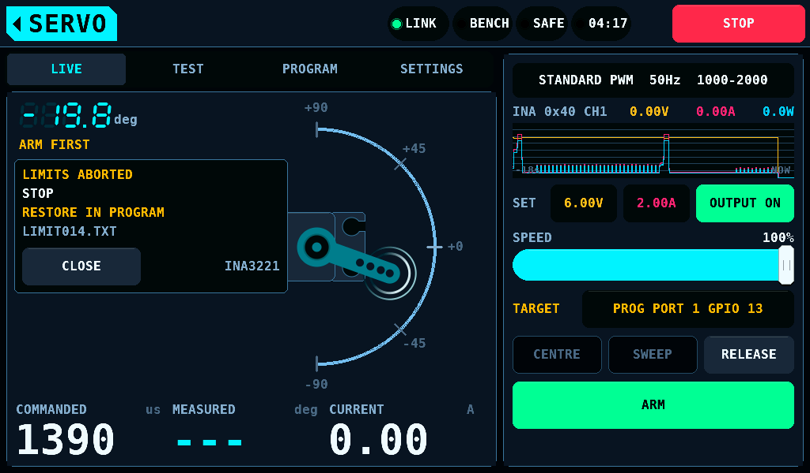
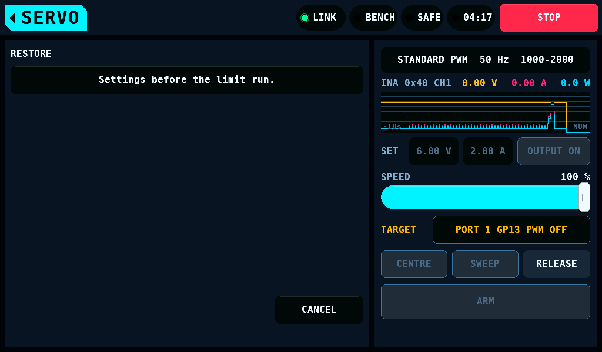
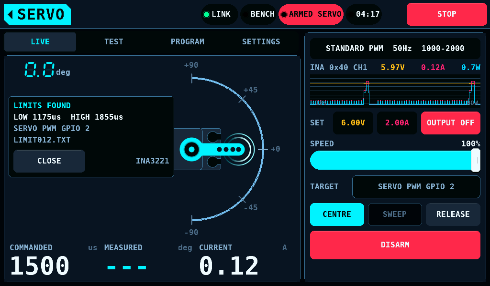

# Servo procedures

<sub>**English** · [Deutsch](Servo-de.md)</sub>

Three procedures on a servo. The first measures a servo as installed: the
limit search runs on the SERVO screen and reads the INA3221 channel that
watches the servo tester's target, and for a KST
or Chaservo servo on the programming port it can lower the servo's own
travel limits. The second, the synchroniser, needs a current sensor across a
pair of outputs, which is not fitted, and runs against a modelled servo only.
Their defaults are from `servo_limit_defaults()` and `servo_sync_defaults()`
in `shared/servo/`. The third, the [automatic test](#automatic-test), reads
the current of the supply that feeds the servo.

## Installed mechanical limit

### Purpose

Endpoints set in a transmitter are estimates. A servo held against a mechanical
stop draws stall current for as long as it is commanded there, and the
installation, not the servo, determines where the stop is. The two ends of a
surface's travel differ; measure both.

### Method

The search steps outward from centre in 10 µs of pulse width per step (about 0.9° on a servo with 11 µs per degree of travel), up to 600 µs from centre and never past 500 or 2500 µs. A last step shorter than 10 µs reaches that end, so the end itself is measured. After each step it waits
120 ms for the servo to settle and averages the current over 80 ms. While the
surface moves freely the current is flat and low. The linkage counts as bound
when the current exceeds 1.8 times the free-running baseline and exceeds it by
at least 0.15 A. The search stops at the first such step, backs off 25 µs, and
reports that pulse width as the endpoint.

On the bench the limit run (`shared/servo/servo_limrun.c`) searches the low
side first, then the high side. Where depends on the target:

| TARGET | Read first | Search |
| --- | --- | --- |
| a SERVO PWM pin on OUTPUTS | nothing | PULSE CENTRE out to PULSE MIN and PULSE MAX |
| PROG PORT | a read session of the [programmer](ServoProgrammer.md) | the servo's NEUTRAL out to its own PULSE LOWER and PULSE UPPER, never past them |

The distance to that end replaces the 600 µs. The current is the watching
INA3221 channel's 50 ms windows, so each position takes 250 ms. The servo is held at the
centre for 1000 ms before each search and after it: the return from an end,
600 µs at 0.67 µs/ms, takes 900 ms, and the baseline is not to see it.

Duration: the host test holds a full search against the modelled servo to under
12 s. A run on the bench is not measured.

### Running it

The LIMIT RUN card on the SERVO screen's TEST task holds the run; its
**SETTINGS** opens the run's settings one level down. There **LIMIT RUN**
chooses SEARCH ONLY or SEARCH + PROGRAM with a tap. **SERVO PULSES**, shown with
TARGET on PROG PORT only, chooses KEEP or 1000-2000 with a tap; it
starts at KEEP. The home tag goes back to the card. **START LIMIT RUN** on
the card starts the run with a 2 s hold, as START TEST does; a tap or a
shorter hold starts nothing.


The line under the button names what the run drives and reads, the whole
time: `OUTPUT PROG PORT 1 GP13, CURRENT INA3221 0x41 CH2`, or
`OUTPUT SERVO PWM GP2, CURRENT INA3221 0x40 CH1` while the tester drives the standard outputs.
The channel is the one watching the tester's target in SETUP > SENSORS,
the lowest with a shunt on a fitted part; `CURRENT INA3221` while none does. While
the run goes on, LIVE's left card shows its box: the phase, the side and the pulse commanded, and the output
again on its third line. The output card's TARGET row stays in sight as well.


The run reads the INA3221 and nothing else. The PD mini's readings and the
panel's model are refused before anything is driven: the button stays grey
and the line under it says why.

| Line | Condition |
| --- | --- |
| `ARM FIRST` | the bench is SAFE |
| `LAST REPORT STILL WRITING` | an automatic test or a limit run is under way, or its report is still going to the card |
| `INA3221 NOT SET UP TO MEASURE SERVO SUPPLY CURRENT` | no channel of a fitted INA3221 watches the tester's target in SETUP > SENSORS, CH2 or CH3 watches it on an IOmcu older than 4.25, an IOmcu older than protocol 4.11, or a SENSE page that does not hold the set-up |
| `INA3221 OFFLINE` | no link, the part not answering, or its reset count moved |
| `NO INA3221 MEASUREMENT WINDOWS YET` | the INA3221 is not the servo rail's meter yet: its set-up held for less than 1000 ms, or no window with current in the last 200 ms |
| `SERVO SUPPLY BELOW 3.0 V OR NOT READ` | the last INA3221 window holds no rail voltage, or its mean is under 3.0 V (`SERVO_LIMRUN_RAIL_MIN_MV`). An output that is off reads 0 V, and a search there would find two free ends on a servo that never moved. 3.0 V lies under the 4.8 V servos are commonly specified from, so a single lithium cell's rail still starts; the voltage a given servo stops moving at is not measured |
| `PORT PWM OFF. NO PULSES ON THIS PORT.` | TARGET on PROG PORT with PORT PWM off |
| `NO SERVO PWM PIN`, `PINS NOT READ` | TARGET on the bench's outputs with no output bound as SERVO PWM, or the binding not read yet: the TARGET row's own words |
| `CENTRE MUST BE BETWEEN PULSE MIN AND MAX` | PULSE CENTRE is not between PULSE MIN and PULSE MAX |

### Programming the servo's travel limits

SEARCH + PROGRAM is offered for a servo on the programming port: TARGET on
PROG PORT, the port in PWM, and a supply of 4.8 V or more. With a PD mini
answering, its output must be on and its set point counts; without one, the servo rail's mean in the
INA3221's last window. On the bench's outputs the run searches only, the
row reads SEARCH ONLY, and the note under it in the run's settings reads `PROGRAMMING REQUIRES A SERVO ON THE PROG PORT`. On PROG PORT every run starts with a read session, so
the other conditions stop SEARCH ONLY as well: the button stays grey and the
card's state line names the condition.

| Line | Condition |
| --- | --- |
| `PROGRAMMING: PORT IS NOT IN PWM MODE` | the programmer holds the port, or the port is not ready for a run |
| `PROGRAMMING: PD MINI OUTPUT OFF` | a PD mini answers with its output off: the read session would switch it on beside the supply that feeds the rail |
| `PROGRAMMING: SUPPLY SET BELOW 4.8 V` | a PD mini answers and its set point is under 4.8 V |
| `PROGRAMMING: SERVO RAIL BELOW 4.8 V` | no PD mini answers, and the servo rail in the INA3221's last window is under 4.8 V or not read |

#### The read first

Every run on PROG PORT, SEARCH ONLY as well, starts with a read session.
The servo is held at PULSE CENTRE, the run switches the bench to SAFE,
CONNECT reads every register, LEAVE gives the port back, and the run
switches the bench to ARMED. Nothing is driven before that.

- A read that fails ends the run before any search: FAIL, `no KST or
  Chaservo servo read`, where the first CONNECT finds no servo that answers
  (a servo that is no KST or Chaservo does not) or the servo read holds
  values the hard rules do not take; ABORTED, `programming port session
  failed`, where the first CONNECT fails for another reason or its read
  does not complete. A servo that is no KST or Chaservo is searched with
  TARGET on a SERVO PWM pin. Any later CONNECT, a LEAVE or a step that
  does not complete ends the run as ABORTED with the same reason.
- NEUTRAL not between PULSE LOWER and PULSE UPPER ends it as FAIL,
  `NEUTRAL outside LOWER/UPPER`.
- PULSE LOWER to PULSE UPPER not inside the bench's PULSE MIN to PULSE MAX
  ends it as FAIL, `servo pulses outside MIN/MAX`. The bench stays SAFE,
  nothing is driven, and the box and the report name both ranges, for
  example `900-2100 NOT IN 1000-2000 us`.

A KST servo as delivered holds PULSE LOWER 900.0 µs and PULSE UPPER
2100.0 µs. The STANDARD PWM type's PULSE MIN and PULSE MAX are 1000 µs and
2000 µs, so that servo is refused at KEEP. SERVO PULSES at 1000-2000, or a
PWM type with a range that holds 900 to 2100 µs, lets it run.

SERVO PULSES at 1000-2000 writes PULSE LOWER 1000.0 µs and PULSE UPPER
2000.0 µs in the read session, before anything is driven, and reads them
back. NEUTRAL is not written. A servo that holds those values already gets
no write. NEUTRAL outside the new range ends the run as FAIL before
anything is driven, with RESTORE offered. The setting works with SEARCH
ONLY and with SEARCH + PROGRAM; with SEARCH ONLY the pulses are the only write,
and the note in the run's settings says `SEARCH ONLY: SETS PULSE LOWER/UPPER ONLY`.

#### The registers and the model

LEFT ANGLE and RIGHT ANGLE are the servo's own travel limits, one 8-bit
register each, in a unit that is not known. The smallest value the
programmer's hard rules take is 1 on a KST: 0 is refused. A value under 50
is a soft limit; the run's 2 s hold is the consent to it.

The run takes the servo as linear. PULSE LOWER and PULSE UPPER are the
input pulses at which the servo reaches the full travel that LEFT ANGLE and
RIGHT ANGLE set. Between NEUTRAL and that pulse the travel is linear in the
pulse; past it the servo holds full travel. The share of a side at pulse p
is

```text
f = (p - NEUTRAL) / (P_lim - NEUTRAL)
```

with P_lim PULSE LOWER on the low side and PULSE UPPER on the high side, as
the servo holds them when the search runs. The unit of LEFT ANGLE and RIGHT
ANGLE is not known, and the linear relation is an assumption, not a
measurement. A bound side whose last free pulse is not past NEUTRAL ends
the run as FAIL, `free end not past NEUTRAL`, before any write.

#### Two writes a bound side

v0 is the value the side's register holds at the read.

1. The overset: `v1 = ceil(v0 x fb x 1.03)`, fb the share at the first
   search's first bound pulse, at most v0 and at least the smallest value.
   The first bound pulse lies at or past the stop, so at v1 the stop stays
   reachable and moves close to the pulse limit. The side is searched
   again. Free there, the run ends as FAIL, `no stop after the overset
   write`, with no second write and RESTORE offered.
2. The final value: `v2 = floor(v1 x f1)`, f1 the share at the overset
   search's last free pulse, at least the smallest value. No margin is
   added: the last free pulse lies one 10 µs step short of the bound one.
   An overset search that binds far inside the pulse limit still gives v2
   this way; no further overset follows.

Worked, on the host's modelled servo: NEUTRAL 1500.2 µs, PULSE LOWER
900.0 µs, v0 150, the stop at 1000 µs. The first search is free at 1000 µs
and bound at 990 µs: fb = 510.2 / 600.2 = 0.850, v1 = ceil(150 x 0.850 x
1.03) = 132. At 132 the search is free out to 930 µs: f1 = 570.2 / 600.2 =
0.950, v2 = floor(132 x 0.950) = 125. At 125 the full travel ends at
1000.2 µs.

The overset is left out where v1 would not lie below v0, or where the model
moves the stop less than 20 µs: d0 x (v0 - v1) / v1 under 20 µs, d0 the
first search's last free pulse's distance from NEUTRAL. A search could not
tell that move from none. The first search then counts as the overset's,
and `v2 = floor(v0 x f0)`, f0 the share at its last free pulse: one write
for that side.

#### Which register limits which side

The protocol notes do not say which pulse side each register limits, nor
how REVERSION changes that. The run finds it on the first bound side's
first write: that value goes to LEFT ANGLE alone (RIGHT ANGLE where LEFT
ANGLE holds the smallest value already), and the side is searched. The end
moved when it is free now or its endpoint lies 20 µs further out. An end
within 20 µs of where it was sends LEFT ANGLE back to its value and the
value, worked out again from RIGHT ANGLE's v0, to RIGHT ANGLE; moved then,
RIGHT ANGLE limits that side. An end that stays with both registers tried
ends the run as FAIL, `LEFT/RIGHT ANGLE side not found`. An end that moved
inward by 20 µs or more ends it as FAIL too. An end that binds with its
register at the smallest value ends it as FAIL, `binds at the smallest
angle`. A register whose side never bound keeps its value.

Last, both ends are searched again: PASS when both are free, FAIL `an end
binds after programming` when either binds. No further write follows a
FAIL; RESTORE gives the values before the run back.

#### Sessions

The run writes in sessions of the [programmer](ServoProgrammer.md):

1. The servo goes back to the centre and is held there for 1000 ms.
2. The run switches the bench to SAFE.
3. CONNECT takes the port and reads every register.
4. The write: ENABLE WRITE TO SERVO on, the run's fields, the write switch
   off again. The write is the programmer's ordinary write with every limit
   check, and reads the values back.
5. LEAVE gives the port back to PWM.
6. The run switches the bench to ARMED and searches the side the write
   was for.

The read session writes nothing but the pulses of SERVO PULSES. A LEAVE
this link or supply does not complete ends the run before any value
changes. The first write of the run saves the servo's values to a backup
file on the card, as the programmer's first write does; the later sessions
save none. Each later session reads the servo again. Another type,
REVERSION switched, another range of values the hard rules take, other
pulses, or LEFT ANGLE and RIGHT ANGLE other than the run last wrote end the
run as ABORTED, `servo holds other values`, before it writes again.

| Constant | Value | Purpose |
| --- | ---: | --- |
| `SERVO_LIMRUN_WRITES_MAX` | 8 | register values a run writes at most: PULSE LOWER and PULSE UPPER (2), the overset and the final value on each side (4), and LEFT ANGLE's first write with its value back when RIGHT ANGLE limits that side (2). A session whose values would pass it is not sent: FAIL `write cap of 8 values reached` |
| `SERVO_LIMRUN_OVERSET_PCT` | 3 % | the overset above the share at the first bound pulse |
| `SERVO_LIMRUN_STD_LOWER_DUS`, `SERVO_LIMRUN_STD_UPPER_DUS` | 1000.0 µs, 2000.0 µs | what SERVO PULSES at 1000-2000 writes |
| `SERVO_LIMRUN_MOVED_US` | 20 µs | an end that moved, or stayed; the smallest stop move an overset is written for |
| `SERVO_LIMRUN_RETURN_MS` | 1000 ms | at the centre before each search and before each SAFE |

Writes: no step of the protocol is known to make a value permanent, and no
write that changes RAM only is known. Every write is the register write the
programmer reads back. Whether a KST servo keeps the value in EEPROM
(electrically erasable programmable read-only memory) at every write, and
how many writes that memory takes, is not known; the cap keeps a run to 8
values. A run with both ends bound and SERVO PULSES at 1000-2000 on the
host's modelled servo wrote 6 values in 4 writes and 4 sessions, 85.6 s,
with REVERSION OFF, and 8 values in 5 writes and 5 sessions, 97.7 s, with
REVERSION ON.

The ends found are not applied to the bench's own PULSE MIN and PULSE MAX.

### Protections

| Protection | Value | Effect |
| --- | ---: | --- |
| Current ceiling | 3.0 A | abort, checked at every 1 ms sample of a window |
| The INA3221 at the end of its range | a clipped sample | abort |
| Stall timeout | window means above 1.0 A for 400 ms | abort |
| No window | 200 ms, 4 windows of 50 ms | abort; `SERVO_TEST_WIN_STALE_MS`, the automatic test's figure. A window without a current reading does not count as a window |
| One search | 40 s | abort: 1000 µs of travel is 100 positions of 250 ms, 25 s |
| One programmer step | 150 s | abort: CONNECT with its read, a write or LEAVE |
| The bench switching | 3 s | abort when SAFE or ARMED is not in place 3 s after the run asked |
| The supply | set points and output, on or off, as at its first reading, answering or not, in every phase but the programmer's sessions (CONNECT to LEAVE), which own the supply; an output off at the start and switched on, or a supply that did not answer at the start and answers later, its output on or off, ends the run as `supply or rail voltage changed`, so no second supply is switched on beside a rail fed from elsewhere; a CONNECT is not sent while a PD mini answers that the run did not start with, or one whose output is off: the run ends as a reading outside a session ends it, `supply or rail voltage changed` for a PD mini the run did not start with and `supply output went off` for its own; during a search also the rail within 1.0 V of the first window | abort |
| The rail voltage in a search's window | present in every window of a search, its mean at 3.0 V or more (`SERVO_LIMRUN_RAIL_MIN_MV`), the first window included | abort before the window moves the search: `no rail voltage in a window` without a reading, `supply or rail voltage changed` under 3.0 V; the 1.0 V band's reference is the run's first window, which holds the rail |
| Step size | 10 µs | one step cannot move the horn from free to hard against the stop |

These hold in every phase. The search and the protections read the
current's magnitude: a shunt fitted the other way round reads a bound servo
as a more negative current, and the run finds it as it does with the shunt
the right way round. A reading of -32768 mA counts as 32768 mA, past the
3.0 A ceiling. The run follows the arming rules of the SERVO
screen and the programming port: its ARM is refused while the port is
held, a STOP latch or lost touch events keep the bench SAFE, and an ARM
that does not land ends the run.

The synchroniser is a module in `shared/servo`, tested on the host against
a modelled servo; neither firmware image calls it.

### What ends a limit run

STOP, STOP RUN in LIVE's box or on the LIMIT RUN card, a switch to SAFE by the
operator, link loss, leaving the screen, the operator taking the servo, a
change to the servo's settings, lost touch events, the INA3221 no longer the
meter, and a supply that stops answering, trips, switches off or has its set
points changed: the reasons of the automatic test, in
[What ends a run](#what-ends-a-run). The run's own SAFE and ARM end
nothing. Each ends the run as ABORTED with the output off and the servo
released. A run that ends while it waits for ARMED also asks SAFE: an ARM
it asked that the bench has not taken yet does not arm the bench after the
end. A start of the panel clears the run without a report.

The values last written stay in the servo. A run that wrote and did not
pass says `RESTORE IN PROGRAM` on its box. A write that fails once sent,
with no answer or an answer the programmer does not take, counts as
written: part of it may have landed. A write the programmer refuses before
it is sent counts as none. RESTORE on the programmer, after
CONNECT and READ ALL, offers `Settings before the limit run.`: the servo as the
run's first session read it, written back as an ordinary write of LEFT
ANGLE, RIGHT ANGLE, PULSE LOWER and PULSE UPPER. It is offered while the
servo read differs from it in those four fields and in no other. The hold is in the panel's memory: a start of the
panel forgets it, and the backup file on the card remains. A session after
the run is the operator's: its first write saves its own backup file.




### Results

- An endpoint is reported already backed off by 25 µs.
- "No limit found" (`FREE`) means the search measured the end of its
  travel without binding: PULSE MIN or PULSE MAX on a SERVO PWM pin, the
  servo's PULSE LOWER or PULSE UPPER on PROG PORT.
- A limit close to centre may be a tight spot in the linkage, such as a binding
  bellcrank or a rubbing pushrod, rather than the end of travel.

| Verdict | Meaning |
| --- | --- |
| FOUND | search only: an end binds; the endpoints are reported |
| FREE | neither end binds; nothing is written |
| PASS | programmed, and both ends free in the last search |
| FAIL | the run ended as planned and an end still binds, or the servo cannot be programmed |
| ABORTED | a protection, the operator, the link, the meter, the supply or the programmer ended it |

The box on the left card shows the verdict, the reason or the values
(`LEFT 150>87  RIGHT 150>95`), the ends or the output the run started on,
and the report's file name until CLOSE.





The report is a `LIMITnnn.TXT` of its own in `USER/LOGS`, with no CSV file
beside it, under the next free number of that folder, written whatever DUT's
REPORT says. With User logs OFF on SETUP > SD CARD no report is written
([Setup](Screens.md#sd-card-which-logs-are-written-and-where)). During a
run neither the bench log nor the supply log writes a row; the supply
log's time runs on through the run, as its totals do. From the run's start
until the card has closed the report it counts as an open log run: Wi-Fi and
an update wait for it, as for a run's CSV. A run on the host's modelled servo with
REVERSION OFF and SERVO PULSES at 1000-2000; the stops at 1150 µs and
1880 µs of horn travel lie at 1208 µs and 1817 µs of input pulse once
PULSE LOWER and PULSE UPPER are 1000.0 µs and 2000.0 µs:

```text
RCBENCH SERVO LIMIT REPORT
Result:         PASS
Device:         SERVO
Firmware:       rcbench 0.22.1
Mode:           search, then LEFT ANGLE and RIGHT ANGLE programmed
Output:         PROG PORT 1 GP13, 50 Hz
Pulse range:    centre 1500 us, 1000-2000 us
Searched:       from 1500 us out to 1000 us and 2000 us
Current:        INA3221 0x40 CH1, 50 ms windows, shunt 100.0 mOhm
Search rule:    10 us steps, settle 120 ms, mean of 80 ms; bound above 1.8 x free and +0.15 A
Protections:    a sample at 3.0 A, above 1.0 A for 400 ms, no window for 200 ms, 40 s a search
Duration:       85.6 s
AS5600:         not fitted, no angles

ENDS (the search before programming)
Low end:        bound at 1200 us, endpoint 1235 us; free 0.120 A, bound 0.627 A
High end:       bound at 1820 us, endpoint 1785 us; free 0.120 A, bound 0.322 A

PROGRAMMING (LEFT ANGLE and RIGHT ANGLE, unit not known)
Servo:          type 6, REVERSION OFF
Servo pulses:   NEUTRAL 1500.2 us, PULSE LOWER 900.0 us, PULSE UPPER 2100.0 us
Pulse write:    PULSE LOWER 900.0 -> 1000.0 us, PULSE UPPER 2100.0 -> 2000.0 us
LEFT ANGLE:     150 before, 87 after; limits the low end
                share free 0.580, bound 0.600; overset 93, share 0.940; final 87
RIGHT ANGLE:    150 before, 95 after; limits the high end
                share free 0.620, bound 0.640; overset 99, share 0.960; final 95
Method:         linear in the pulse; overset +3 % on the share at the first bound pulse, then the share its search found free
Writes:         values written 6, writes sent 4, cap 8 values; sessions 4
Backup:         KST001, the values before the run

ENDS AFTER PROGRAMMING (both searched again)
Low end:        free to 1000 us; free 0.120 A
High end:       free to 2000 us; free 0.120 A

Unit: the unit of LEFT ANGLE and RIGHT ANGLE is not known; the travel is taken as linear in the pulse from NEUTRAL to PULSE LOWER and PULSE UPPER, which is not measured.
Bench: the ends found are not applied to PULSE MIN and PULSE MAX.
```

With the AS5600 fitted, each end has a line with the horn's angle at its
last free position, `AS5600 +38.5 deg at the last free position`. A run
that wrote and did not pass has a `Restore:` line. A run that sent no
write has no `Backup:` line: the values before the run are held from the
first write on. The `Backup:` line names the file this run's first write
saved, also when that write was sent and lost, never an earlier run's file.
The `Searched:` line
names the search's centre and ends; a run that ended before its first
search has none. A run on a SERVO PWM pin has no `Servo pulses:` line.

Not measured: every figure above on a real servo. The unit of LEFT ANGLE
and RIGHT ANGLE, which register limits which pulse side on a real KST or
Chaservo servo, whether a written value persists through a power cycle,
whether the servo moves when its limit is written, the time a session
takes on hardware, and the time from LEAVE to a working ARM are not known.

## Synchronising two servos on one surface

### Purpose

Two servos on one surface (dual ailerons, split elevator) work against each
other whenever their travel or their centre disagree, and draw extra current
continuously. The surface shows no visible sign.

### Method

The two stop working against each other at the point of minimum total current.
The search holds servo A and sweeps a correction on servo B, at centre and at
±300 µs deflection:

- a difference at centre is an offset error (trim);
- a difference at an end is a travel error for that end.

Each stage runs 3 scans of 7 points. The first scan covers ±40 µs around the
stage's start point: 0 µs for the centre stage, the ±300 µs deflection for the
end stages. Each later scan is centred on the best point of the scan before and
covers ±13 µs, then ±4 µs. Each point waits 120 ms plus the travel time at an assumed 0.8
µs/ms, then averages the current over 100 ms. A minimum is accepted when the
current varies by at least 0.08 A across the scan. The current ceiling is 4.0 A
for the pair.

Each end gets its own correction; a linkage with a horn and a pushrod is not
symmetric about centre. One current sensor across the pair is sufficient.

### Results

- A pair that is already synchronised produces a minimum at zero correction.
- "No minimum" means the current varied by less than 0.08 A across the widest
  scan.
- Two servos that agree with each other and are both wrong produce no
  difference in current. That case needs the accelerometer or inspection.

## Automatic test

### Purpose

What a servo draws at rest, moving and holding an end, and how long it takes
from end to end, at the supply voltages it is rated for; and the voltage
below which it no longer moves (brown-out). Nothing on the bench measures the
horn unless the output encoder is on (see below), so every result is read from
the current of the supply that feeds the servo: the PD mini (WeAct PD Power Mini V1) when SETUP INTERFACES enables it,
the panel's supply model otherwise. A run on the model says so in its report,
and its numbers are simulated. While the INA3221 is the servo rail's meter
at START TEST and the supply is the PD mini, the run reads the INA3221
channel that watches the tester's target instead, in 50 ms windows: see
[The meter](#the-meter).

START TEST on the AUTOMATIC TEST card of the SERVO screen's TEST task starts it:
[Screens](Screens.md#servo) describes the controls. The engine is
`shared/servo/servo_test.c`; the constants below are in `servo_test.h`.

### Method

The voltage steps are the run's STEP 4.8 V and STEP 6.0 V (the card's SETTINGS), and with HV
SERVO on, STEP 7.4 V and STEP 8.4 V. HV SERVO is off at every restart. A run
with a step above 6.0 V starts only through the HV SERVOS ONLY warning held for
2 s. The current limit through the run is the one on the SET line.

Each step runs these phases:

| Phase | The servo | Ends |
| --- | --- | --- |
| SET | at PULSE CENTRE; the voltage asked; the first step switches the output on | the supply reads the set point back within 0.05 V, at most 3000 ms |
| SETTLING TIME | at PULSE CENTRE | after the run's SETTLING TIME |
| IDLE | at PULSE CENTRE: the idle current is the mean of the readings, the idle noise their standard deviation | after 1000 ms |
| MOVE | a step command to one end, with no slew: SPEED does not apply | at the arrival, or after 3000 ms plus the meter's lag (3300 ms on the PD mini): late with movement seen, unseen without |
| HOLD | at that end: the holding current is the mean of the readings | after DWELL TIME, at least 600 ms |

The two ends are SWEEP's: RANGE of the travel either side of PULSE CENTRE,
trim not applied. With the defaults (RANGE 80 %, TRAVEL +/-90 deg, PULSE MIN
1000 us, MAX 2000 us) they are 1100 and 1900 us. CURVE and SPEED shape SWEEP
only.

A run that completes also switches the output off and releases the servo to
its centre. On a bench it leaves in ARMED, the commanded value shown is then
the rest, as after RELEASE: 1500 us for STANDARD PWM whatever the trim, and
the next drag or knob turn starts from it. A step's first two moves, centre to the low end and on to the
high end, are not counted: they measure each end's holding level. The counted moves then go
end to end, MOVEMENTS of them or for TEST TIME, as TEST LENGTH BY says, at most
1000 a step.

- **Threshold:** per step, the larger of 0.020 A (`SERVO_TEST_MOVE_MIN_A`)
  and 3 (`SERVO_TEST_NOISE_K`) times the idle noise, the standard deviation
  of the IDLE readings. The report gives it in the `Thresh` column. A
  servo whose readings at rest spread by 0.010 A has a threshold of
  0.030 A.
- **Movement:** a reading more than the threshold away from the level
  before the command: above it, or below it when the servo leaves an end
  it was pushing on.
- **Arrival:** after movement, a reading more than the threshold above the
  destination end's holding level, then the first reading back within
  0.05 A (`SERVO_TEST_BAND_A`) of it, on either side. A reading above the
  level by the threshold is never an arrival, so the 0.05 A band times no
  move early where the threshold is smaller. A reading that falls more
  than 0.05 A below the level instead, as after a burst of current while
  the servo accelerates, hands the move to the rule below. The two ends'
  holding levels can differ by more than 0.05 A, so a reading still at the
  start end's level, or a rising current passing the destination's level,
  is not an arrival.
- **Arrival at an end held harder than the servo moves**, an end pushing on
  a stop: that level is never passed, so the move has arrived at the first
  of two readings in a row, after movement, within 0.05 A of the level and
  of each other. A current that climbs through the destination's level by
  less than 0.05 A a reading can be taken for an arrival there.
- **Not told apart:** a servo whose moving current lies within 0.05 A of the
  destination's holding current cannot be told from one already there; a
  move to that end is timed at its first two readings after movement.
- **Window:** a move has 3000 ms (`SERVO_TEST_TRAVEL_TIMEOUT_MS`) plus
  the meter's lag to arrive: 3300 ms on the PD mini, whose readings show an
  arrival about 300 ms after it happens. The lag is added rather than the
  window's last 300 ms left unjudged: a servo arriving at 2900 ms shows it
  at about 3200 ms and is timed, and a move that never arrives is still
  late, 300 ms later. A reading at or past the window's end, 3300 ms on
  the PD mini, is never an arrival: the move is late.
- **Unseen:** a counted move with no reading past the threshold within
  the window. The current cannot tell it from a servo standing still: it is
  neither timed nor late, and the report counts it in the `Unseen` column.
  A step none of whose moves showed movement reads `NOT MEASURABLE`.
- **Travel time:** from the command to the arrival's reading.
- **Moving current:** the mean of the readings between the command and the
  arrival; the peak is the highest of them.

Why the band stays 0.05 A while the threshold scales: replays of the two
bench runs below with the band at 0.05 A and with the band equal to the
threshold time the same moves to the same millisecond, because a reading
above the level by the threshold is never an arrival. The threshold is what
had to scale. 0.13.0 took movement to be 0.10 A, and the MG90S moves at 0.04
to 0.077 A over a 0.001 A hold: no move was seen, each ran out at 3000 ms and
was counted late, and the run read FAIL.

**Limitation: the move to the centre can reach IDLE.** With SETTLING TIME at
500 ms the IDLE readings can still carry the end of the step's move to the
centre: 0.025 A falling to 0.003 A on the 1102HB at 5.00 V, from the PD
mini's 0.3 s lag and the move itself. That raises the idle mean and the
noise, and the threshold with it: 0.026 A there instead of 0.020 A. A
longer SETTLING TIME avoids it.

**Brown-out.** After the steps, with BROWN-OUT on: from 5.00 V
(`SERVO_TEST_BROWNOUT_START_V`), or the voltage cap in force if lower, down
in 0.20 V steps (`SERVO_TEST_BROWNOUT_STEP_V`) to 3.00 V
(`SERVO_TEST_BROWNOUT_FLOOR_V`), or the supply's lowest set point if higher.
The cap in force is the lowest of VOLTAGE MAX, the supply's own maximum, and
for the PD mini its input voltage less 0.7 V. A floor off the
0.20 V grid is the last step: on the model, whose lowest set point is
3.3 V, the walk goes 5.0, 4.8 ... 3.4, 3.3 V. Each voltage runs
SET, SETTLING TIME and IDLE, then two moves (`SERVO_TEST_BROWNOUT_MOVES`), centre to
the high end and on to the low end, each held 600 ms. A voltage shows **no
movement** when no reading of either move lies more than that voltage's
threshold, from its own IDLE readings, from the level before its command.
The walk stops at the first voltage with no movement; the report gives that
voltage, the lowest one the servo moved at, and the threshold at the last
voltage run. No movement at the first voltage, 5.00 V, reads `not
measurable`: a servo that never showed movement may move under the
threshold.

| Constant | Value | What it is |
| --- | ---: | --- |
| `SERVO_TEST_MOVE_MIN_A` | 0.020 A | the smallest threshold: movement; above the destination's level, not there yet |
| `SERVO_TEST_NOISE_K` | 3 | the threshold in idle noises, where that is larger |
| `SERVO_TEST_BAND_A` | 0.05 A | arrived at the holding level |
| `SERVO_TEST_PDMINI_LAG_MS` | 300 ms | the PD mini's lag, as the report states it |
| `SERVO_TEST_IDLE_MS` | 1000 ms | the idle measurement |
| `SERVO_TEST_HOLD_MIN_MS` | 600 ms | the shortest hold measured |
| `SERVO_TEST_TRAVEL_TIMEOUT_MS` | 3000 ms | a move that has not arrived is late, after this plus the meter's lag |
| `SERVO_TEST_SET_TOL_V` | 0.05 V | a set point read back |
| `SERVO_TEST_SET_TIMEOUT_MS` | 3000 ms | for the set point, and for the output to come on |
| `SERVO_TEST_STALE_MS` | 1500 ms | no new reading ends the run |
| `SERVO_TEST_STALL_ABORT_MS` | 1000 ms | above STALL AT this long ends the run |
| `SERVO_TEST_CC_ABORT_MS` | 1000 ms | the supply in constant current this long ends the run |
| `SERVO_TEST_WIN_STALE_MS` | 200 ms | a run on the INA3221: no window this long ends it; 4 windows of 50 ms. The limit run shares it |
| `SERVO_TEST_WIN_MS` | 50 ms | one window of the INA3221 |
| `SERVO_TEST_NEG_IDLE_A` | 0.020 A | an idle current below minus this is reported as the shunt's direction |
| `SERVO_TEST_BROWNOUT_START_V` | 5.00 V | where the brown-out walk starts |
| `SERVO_TEST_BROWNOUT_STEP_V` | 0.20 V | each step down |
| `SERVO_TEST_BROWNOUT_FLOOR_V` | 3.00 V | the lowest voltage asked |
| `SERVO_TEST_BROWNOUT_MOVES` | 2 | moves at each brown-out voltage |

### Time resolution

A reading counts once. For the PD mini the count is the SUPPLY page's
SAMPLES register: the IOmcu's count of the module's output readings
that answered. A page read whose SAMPLES has not moved brings no new reading,
whatever voltage and current it carries -- a display read on the IOmcu
that was slow (up to 400 ms, `PDMINI_REPLY_MS`) or failed leaves the last
ones standing -- and a run with no new reading for 1.5 s ends. A reading is
stamped with the panel's time of the first page read that showed its count;
the model counts and stamps its own steps. The IOmcu reads the PD
mini's output every 100 ms (`PDMINI_DISPLAY_MS`) and the panel reads the page
every 100 ms (`SUPPLY_LINK_READ_MS`), so a new reading reaches the test every
100 ms at best; the model gives one every 50 ms. When SAMPLES steps by more
than one between two page reads, the readings in between never reach the
test: the report counts them on its `Skipped` line, and the rate taken by the
supply includes them. The report states both rates as measured during the
run, and the mean interval between two readings that reached the test.

A travel time ends at the first reading back at the holding level, so it is
late by up to one interval. It also holds the command's way from the panel
to the pin: render loop, control task, CAN (Controller Area Network) link and
the next PWM (pulse-width modulation) frame. That delay is not measured. How
the PD mini averages a reading is not known.

**The PD mini's readings lag and repeat.** Two runs on the bench with the PD
mini on 0.13.0, an MG90S and a 1102HB, read it every 102 to 106 ms. The
median time from a command to the first reading 0.02 A above the level
before it is 0.31 s, and a current often repeats over several readings.
Every travel time read off the PD mini is therefore an upper bound: on the
MG90S 771 to 989 ms for a servo rated about 0.1 s per 60 deg. The report
says so on its `Lag`, `Repeats` and `Travel times` lines, and TRAVEL TIME
cannot fail a run on the PD mini: its line gives the longest travel time and
reads `upper bound, not checked against the limit`. What reads the current
is described to the run (`servo_test_meter_t`: a name, the lag, whether
readings repeat, whether travel times are an upper bound), so a faster
current sensor sets its own and has TRAVEL TIME checked. A run on the
panel's model states no lag of its own and checks TRAVEL TIME as the PD mini
would: not at all.

On the INA3221 a reading is a window, counted by the window's number: a
number that steps by more than one between two windows the run got is
counted on the `Skipped` line. The panel takes each window once and in
order; the queue to the screen holds 8, so a frame longer than 400 ms loses
the oldest. A window's time is the latest it can have closed: the panel's
time of the read that brought it, less 50 ms for each window that closed
after it and came in the same read. Windows that arrive together are
therefore 50 ms apart in the run and in the CSV, as the ones that arrive
one a read are.

### The meter

A run reads one meter from START TEST to its end: the servo rail's meter as
the panel names it when the run starts
([Link](Link.md#the-window-ring)).

| | PD mini | the INA3221 channel |
| --- | --- | --- |
| The run reads it when | the INA3221 is not the rail's meter at START TEST, or the supply is the panel's model | the INA3221 is the rail's meter at START TEST and the supply is the PD mini |
| A reading | one reading of the supply, every 102 to 106 ms | one 50 ms window of the channel watching the tester's target, 20 a second |
| Current | the reading | the window's mean. The peak is the window's highest or lowest 1 ms sample, whichever lies further from zero |
| Voltage | the reading at the supply's output | the channel's bus voltage at the load side of the shunt: the window's mean in `Meas V`, its lowest sample in `V min` |
| IDLE and HOLD | the readings taken in the phase | the windows that lie wholly in the phase; one that began before it is in neither. On the host suite's modelled bench IDLE's 1000 ms hold 19 to 20 windows and a hold of 600 ms 11 to 12 |
| MOVE | the readings from the command on | the windows from the one open at the command on |
| Travel time | to the reading that shows the arrival: late by up to one reading and about 300 ms of lag | to the window that shows the arrival: late by up to two windows and the poll that reads them, 145 ms |
| TRAVEL TIME | reported, not checked | reported, not checked |
| A move is late after | 3300 ms | 3050 ms |
| The supply's voltage and current | every figure and every row | not used and not logged |
| The supply's state: answering, output, trip, set point read back, mode | read | read |

On the INA3221 the panel times a move from the windows. The IOmcu's
move capture, which times a move at 1 ms from the PWM frame, is not used by
the run.

- **Held to the end.** A run on the INA3221 ends ABORTED when the INA3221
  stops being the rail's meter, with the condition that failed as its
  reason (see [What ends a run](#what-ends-a-run)), and when no window
  reaches it for 200 ms (`SERVO_TEST_WIN_STALE_MS`). It never goes on with
  the PD mini: the two meters do not agree. In one recorded run of an MS24
  the PD mini's highest reading was 0.390 A and the INA3221's highest 1 ms
  sample 1.637 A. A run on the PD mini goes on with it when the INA3221
  becomes the meter under it.
- **Why not the INA3221.** A run on the PD mini with an INA3221 fitted on
  SETUP > SENSORS has the report line `INA3221: not used: <reason>`: `the IOmcu
  is older than link protocol 4.11`, `the IOmcu does not hold its
  set-up`, `it does not answer`, `no window with current in the last 200
  ms`, `it reset itself`, `it has worked for less than 1 s`, or `the supply
  is the panel's model`.
- **Signed current.** A negative current is a reading. IDLE CURRENT, HOLD
  CURRENT, STALL AT and the peak take its magnitude, and the CSV and the
  report keep the sign. A run whose idle current at any step is below
  -0.020 A (`SERVO_TEST_NEG_IDLE_A`) has the report line `Current reads
  negative at rest: shunt direction`.
- **Clipping.** The INA3221 reads a shunt voltage up to 163.8 mV: 1.638 A on
  a 0.1 Ω shunt, 3.276 A on 0.05 Ω. A sample at an end of that range counts
  in its window at the end of the range, and the window is a reading like
  any other: its mean, its peak and its place in the verdict are the values
  the part gave. The CSV's `clipped` column holds the number of such samples
  in the window, and the report's `Clipped` line the number of windows with
  one; their figures are a lower bound. The number of clipped samples in a
  window decides nothing. A servo that draws more than the range reads the
  range. Which shunt is fitted decides what this meter can show.
- **The shunt's drop.** `Meas V` and `V min` are measured behind the shunt.
  The set point is not raised for the drop: at the end of the range the
  shunt takes 0.164 V, on any shunt value, and the report's `Shunt` line
  says so.

### Stall and constant current

| Rule | Condition | Effect |
| --- | --- | --- |
| STALL AT | a reading after SETTLING TIME on a voltage step whose magnitude is above STALL AT | FAIL |
| STALL AT for 1 s | readings above STALL AT for 1000 ms (`SERVO_TEST_STALL_ABORT_MS`) without one at or under it, in any phase and in the brown-out walk | the run ends, `above STALL AT for 1 s` |
| Constant current for 1 s | the supply reports constant current (CC) in every reading for 1000 ms (`SERVO_TEST_CC_ABORT_MS`) from the first | the run ends, `constant current for 1 s`, whatever STALL AT is |
| Constant current for less than 1 s | | nothing ends and nothing fails; the report's `Const. current` line gives the number of such readings and the longest stretch from a first to a last |
| STALL AT at or above the current limit | at START TEST | the run starts. The AUTOMATIC TEST card and the report say `STALL AT 3.00 A cannot be reached: current limit 2.00 A` |
| STALL AT at or above the INA3221's range | at START TEST with the INA3221 as the meter | the run starts. The AUTOMATIC TEST card and the report say `STALL AT 2.00 A cannot be reached: INA3221 range 1.638 A` |

- Every comparison of a current with IDLE CURRENT, HOLD CURRENT and STALL AT
  is made in whole mA, in the verdict and in the report alike: a reading of
  0.050 A against a limit of 0.05 A passes, and 0.051 A fails.
- On the PD mini the 1000 ms count from the first reading above STALL AT:
  a reading 999 ms later leaves the run running, one 1000 ms later ends it.
- On the INA3221 the reading is the window's mean, whatever its highest
  sample is, and the 1000 ms count from the start of the first window above
  STALL AT: 20 windows in a row end the run.
- A supply in constant current holds its current limit, so no reading lies
  above a STALL AT at or above that limit. STALL AT and the supply's start
  current both default to 2.00 A. The constant-current rule ends such a
  run: a servo on a stop that draws the limit ends it 1.0 to 1.1 s after
  the supply reports constant current.
- With the INA3221 on its 0.1 Ω shunt and STALL AT at its default 2.00 A,
  STALL AT cannot be reached. A servo on a stop that draws less than the
  supply's limit and more than 1.638 A reads 1.638 A for the whole run; the
  report then has the `Clipped` line and the `cannot be reached` line.
  STALL AT at 1.60 A or lower, or a shunt of 0.05 Ω, puts STALL AT inside
  the range.

Not measured: what the PD mini reports with a servo on a stop (constant
current or over-current, and whether it switches off by itself), and how
long it holds constant current after an inrush. In the recorded MS24 run it
held it for 0.43 s twice during healthy moves, at 0.004 to 0.342 A.

### The output encoder

An AS5600 magnetic angle sensor on the servo's output shaft, set up under
SETUP, INTERFACES, AS5600 (default OFF) and read by the IOmcu
([Link](Link.md), SENSE registers 26 to 31), adds the horn's angle to a run.
The current's results are unchanged and the angle decides nothing: it is not
part of the verdict and has no limit. Without AS5600 on, the run, its CSV and
its report are as without the part. The IOmcu takes the SENSE set-up
only while the bank is SAFE. A run uses the angle only when the
IOmcu holds AS5600 on: AS5600 switched on while ARMED gives a run
without angle columns until the set-up has been taken in a SAFE state.

The angle is the sensor's 12-bit count less the centre count (AS5600 centre,
or ENC CENTRE on SETTINGS > DUT, which takes the live count with the servo at
its neutral), in degrees from -180 to just under 180. The sensor counts up in
the direction its DIR pin is strapped for; the test assumes the angle rises
with the pulse width, so a DIR strap that runs the other way shows as an
angle error of twice the travel. Commanded angles are the screen's: -90
degrees at PULSE MIN, +90 at PULSE MAX, with REVERSE and TRIM applied. With
REVERSE on, the measured angle is negated the same way, on the screen, in the
report and in the CSV, so a horn at the commanded end shows no error. A
servo that turns less than 90 degrees over that span shows the difference as
angle error.

The count wraps from 4095 to 0, so every angle is a position on one turn and
no two are subtracted or averaged as plain numbers. A move's distance from
its start is taken the shortest way round, 0 to 180 degrees: two positions 1 count
either side of the half turn from the centre are 0.18 degrees apart, not 359.8. A
step's end angles at one end are averaged as offsets from the first of them
and the mean is put back on the circle, so ends read at +179.9 and -179.9
degrees average to 180 (shown as -180.00), not 0. The angle error is wrapped
to -180 to +180 degrees as well.

One turn is all the sensor tells apart, which limits what is reported for a
servo that travels more than 180 degrees:

| Case | Reported |
| --- | --- |
| the ends more than 180 degrees apart, each within 180 degrees of the centre (-100 and +100) | both end angles and both errors as they are; the two ends are never subtracted from each other |
| an end more than 180 degrees from the centre (+200) | the end angle 360 degrees off (-160); the angle error is right while the commanded angle names the same position (+200), since it is wrapped |
| a move that ends within 2.0 degrees of a whole turn from its start | unmoved |
| the direction of a move, and the turns of a winch servo | not judged, not counted |

For each move, from its command to the next command (constants in
`servo_test.h`):

| Term | Rule |
| --- | --- |
| moved | the angle leaves `SERVO_TEST_ENC_MOVED_DEG`, 2.0 degrees, of the angle read before the command, the shortest way round; that reading must be younger than `SERVO_TEST_ENC_STALE_MS`, 500 ms, or the move is not judged |
| settled | after it has moved, a reading whose still time is at least `SERVO_TEST_ENC_HOLD_MS`, 100 ms, and whose stillness began after the command. The angle has then stayed within `SERVO_TEST_ENC_TOL_COUNTS`, 12 counts or 1.05 degrees, of an anchor for that long |
| travel time (angle) | the start of that stillness minus the command: the moment the angle came within the tolerance of its final value |
| end angle | the angle at the last reading before the next command, for a settled move |
| angle error | the mean end angle at an end, taken on the circle from the step's first end angle there, minus that end's commanded angle, wrapped to -180 to +180 degrees |
| unmoved | the angle never left the 2.0 degrees |
| late | it moved and was not still for 100 ms before the next command |

The tolerance is the IOmcu's `SENSE_ENC_STILL_TOL`; `test_as5600` holds
the two equal. The still time is kept on the IOmcu at its 2 ms sample
interval, so the travel time does not depend on how often the panel reads the
page (every 40 ms). It starts at the command as the test issues it and so
includes the command's way to the pin: the render loop, the control task,
the link and the next PWM frame, up to one poll interval and one frame, not
measured. It ends when the angle comes within 1.05 degrees of its final
value, which is earlier than the servo arm's last movement by the time that takes:
on a 0.09 degrees a microsecond servo at 1.2 us a millisecond, about 10 ms.
Only counted moves are reported. The moves that place the horn at each end
first are not. A move is left out of the angle's counts, neither unmoved nor
late, when the angle has a gap while the move is open and the move has not
settled (a reading marked invalid, or one that follows readings lost on the
way to the screen after a stall of 320 ms or more, either of which drops the
angle history), when the
move has no start angle, and when the run ends for any reason other than
completion (STOP, switch to SAFE, link loss, supply fault, stall) before the move
settled: its window was cut short, and the current's results do not count
such a move either. A move that had settled before the gap or the abort
keeps its result.

The angle is a reading only while the sensor detects its magnet (STATUS MD,
[Link](Link.md)). While it reports none, its count is not a position: the
panel hands it to nothing, the reading reaches the run marked invalid with
the reason, the CSV's angle column is empty, and an open move that had not
settled is left out as above. The report then has the line `No magnet: the
AS5600 reported none N time(s). ...`, N being the times the sensor went from
any other state to "no magnet" during the run, a run started in that state
included. A magnet reported too weak or too strong (ML, MH) with MD set
leaves the angle in use: the datasheet states no effect on the angle and
specifies its noise for 30 to 90 mT only. The report counts those readings:
`Field: N reading(s) with the magnet too weak, M too strong. ...`. Neither
line is written when its counts are 0.

The report adds a header line (`Encoder:`), a table per step -- the mean end
angle and its error at each end, the mean and longest travel time, the moves
counted, unmoved and late -- and the commanded angles with the rules above.
The current's table and its `Travel` column stay, so the two times sit side
by side: on the PD mini the current's is an upper bound that lags the horn by
about 0.3 s, and the angle's is not. The CSV gains two columns, `angle (deg)`
on every row whose angle reading is younger than 500 ms, and `travel angle
(ms)` on the first row taken at or after the reading that found the settle.
Each row takes the newest angle reading taken at or before the row, from the
last 16 readings (about 640 ms), so the order in which the panel handles
readings and rows does not move an angle onto the wrong row. The report notes that the deadband is
not measured: it needs steps smaller than the end-to-end moves the test
makes, and the test makes none. The SERVO screen's MEASURED row shows the
live angle while AS5600 is on. A link that goes down clears the reading: the
row shows dashes and ENC CENTRE sets nothing until a reading arrives with the
link back. The same holds while the sensor reports no magnet.

### What ends a run

Every ending switches the output off, releases the servo to its centre, and
still writes the report, marked ABORTED with the reason. The bench stays ARMED
unless the ending was a switch to SAFE, STOP or leaving the screen, which switch the bench to SAFE.
A step the run has posted and the panel has not sent when the bench switches to SAFE
or stops is not sent. After a run ended by a switch to SAFE, STOP or leaving the
screen, the horn and COMMANDED stay at the position the run last drove;
after an ending that leaves the bench ARMED they show the rest the release
puts the pins at, 1500 us for STANDARD PWM whatever the trim, and the next
drag or knob turn starts from it.
Once a run is over, whichever screen is up, SUPPLY's set points go back to
what they were before it. That waits until the run's OFF has been sent, a
reading taken after that in which the supply itself reports the output off, no ON is on its way and
OUTPUT ON is not being held on SERVO or SUPPLY. Set points changed after
the run ended are
left as they are.

| Reason in the report | Cause |
| --- | --- |
| `STOP` | STOP on the band |
| `bench SAFE` | DISARM, or anything else that switched the bench to SAFE |
| `link lost` | the link to the IOmcu went down during the run |
| `SERVO screen left` | another screen opened |
| `stopped by the operator` | STOP TEST, a finger on the dial, CENTRE, SWEEP, RELEASE, a tap on a set point, a programmer opened from PROGRAM's list |
| `servo settings changed` | the type, frame rate, pulses, trim, travel, reverse or SPEED changed |
| `touch events lost` | events went missing between two frames |
| `supply not answering` | a reading marked not answering |
| `supply tripped` | the output went off on a trip |
| `supply output went off` | the output went off otherwise, OUTPUT OFF among them |
| `no new supply reading for 1.5 s` | `SERVO_TEST_STALE_MS` |
| `supply output did not come on` | not on 3000 ms after the ON |
| `set point not read back in 3 s` | the supply did not take a step's voltage |
| `step above the voltage cap` | a step above the cap in force: VOLTAGE MAX, or the input voltage of the PD mini less 0.7 V |
| `above STALL AT for 1 s` | `SERVO_TEST_STALL_ABORT_MS` |
| `constant current for 1 s` | the supply reported constant current for `SERVO_TEST_CC_ABORT_MS` |
| `no INA3221 window for 0.2 s` | a run on the INA3221: `SERVO_TEST_WIN_STALE_MS` without a window that holds current and voltage. A pass 199 ms after the last window leaves the run running, one at 200 ms ends it |
| `INA3221 reset itself` | a run on the INA3221: the part's reset count moved |
| `INA3221 not answering` | a run on the INA3221: no SENSE read in 200 ms shows the part online and identified on a bus that is not stuck |
| `INA3221 window without current` | a run on the INA3221: the newest window holds no current samples, or its number has stood for 200 ms |
| `INA3221 set-up not held` | a run on the INA3221: the IOmcu no longer holds the set-up, or SETUP has the INA3221 off |
| `INA3221 no longer the meter` | a run on the INA3221: the meter changed and the panel did not name the condition |

The six reasons of a run on the INA3221 are the conditions under which the
INA3221 is the rail's meter. The supply's reasons hold on either meter: its
state is read in every run.

A step is never asked above the cap: a run whose steps lie outside the
supply's range is refused at START, and a cap that comes down during a run
ends it before the step above it.

### Verdict

Over the voltage steps (the brown-out walk is reported, not judged), FAIL
when one of these holds:

- the highest idle current is above IDLE CURRENT;
- the highest holding current is above HOLD CURRENT;
- the longest travel time is above TRAVEL TIME, where the current's meter
  times travel (not the PD mini, and not the INA3221's windows);
- a reading after SETTLING TIME is above STALL AT;
- a counted move was late: movement seen, no arrival within the window,
  3000 ms plus the meter's lag.

Otherwise NOT MEASURABLE when a counted move was unseen, or when the
brown-out walk saw no movement at its first voltage, and PASS when neither
holds. A run of the brown-out walk alone that sees nothing reads NOT
MEASURABLE, not PASS. Its `Result` line then reads `no movement seen at
5.00 V, the brown-out walk's first voltage`, and `Brown-out start` under
the limits gives the same voltage with NOT MEASURABLE. NOT MEASURABLE says the current could not show every move: a servo
moving under the threshold and one standing still read alike. The report's
`Result` line gives how many of the counted moves showed no movement, and
`Moves seen` how many were unseen. A servo that does not move reads NOT
MEASURABLE, not FAIL. With no move arrived there is no longest travel time,
and the `Travel time` line reads `longest --` and `not measured, no move
arrived`, on any meter.

A pass/fail limit of 0 is not checked; STALL AT always is. A current is
compared by its magnitude and in whole mA: see
[Stall and constant current](#stall-and-constant-current).

### Files

A run takes the next run number of the folder `USER/LOGS`, and the SD card's
own task writes its files there: `ATESTnnn.CSV`, one row per reading of the
run's meter, and with DUT's REPORT on, `ATESTnnn.TXT`. The number belongs to
one series with the limit runs' `LIMITnnn.TXT` in that folder
([Logs](Screens.md#logs)). With User logs OFF on SETUP > SD CARD, read at
START TEST, the run writes no file and the result names `USER LOGS OFF`. A run is
one CSV: the run log of a bench in ARMED writes no row while a run is under
way. Its time column steps over the run and its rows start again when the
run ends. A number carried by a
`ATESTnnn.TXT` alone, its CSV deleted on a computer, is taken all the same,
so no report is overwritten, and the log viewer's DELETE on a run removes its
report with it. A run the card cannot
take says so on the band and on the result, `NOT RECORDED`. Rows the queue to
the card had no room for are counted in the report. From the run's start
until the card has closed its CSV and its report, the run counts as an open
log run, the time between the file's OPEN and its answer included: Wi-Fi
and an update wait for it, and the log viewer neither lists nor opens the
file still being written.

The CSV, semicolon-separated with a decimal point, as every log the bench
writes:

| Column | Unit | What it is |
| --- | --- | --- |
| `time (s)` | s | when the panel had the reading, from the run's start |
| `test` | | `STEP` or `BROWN-OUT` |
| `step` | | the step, 1 to n in the order run |
| `phase` | | `SET`, `SETTLING TIME`, `IDLE`, `MOVE` or `HOLD` |
| `command (us)` | us | the pulse commanded |
| `position (us)` | us | the measured position; empty, as nothing measures it |
| `set (V)` | V | the step's voltage |
| `voltage (V)` | V | the meter's: at the supply's output, or the channel's mean bus voltage in the window |
| `limit (A)` | A | the current limit |
| `current (A)` | A | the meter's, signed: the supply's reading, or the window's mean |
| `power (W)` | W | voltage times current |
| `mode` | | the supply's: `CV`, `CC` or `OFF`. On the INA3221 the mode of the supply's last reading, empty before the first |
| `travel (ms)` | ms | on an arrival's row: that move's travel time |
| `angle (deg)` | deg | with AS5600 on only: the horn's angle from the centre count, from the newest reading taken at or before the row; empty when that reading is older than 500 ms or there is none |
| `travel angle (ms)` | ms | with AS5600 on only: on the row after a move settled, its travel time from the angle |
| `meter` | | `INA3221`, `PDMINI` or `MODEL`, on every row |
| `window` | | on the INA3221: the window's number, modulo 65536; a step of more than 1 is windows that never reached the run |
| `current max (A)` | A | on the INA3221: the window's highest 1 ms sample |
| `current min (A)` | A | on the INA3221: its lowest |
| `voltage min (V)` | V | on the INA3221: the lowest bus voltage sample in the window |
| `clipped` | | on the INA3221: samples in the window at an end of the range, held at 255 |

The last six columns follow whatever is before them: columns 14 to 19
without AS5600, 16 to 21 with it. On the PD mini and the model the five
after `meter` are empty. A file written before these columns, 13 wide or 15
with AS5600, reads in the log viewer as before: its parser takes the columns
from the header row.

The report from the host suite's replay of an MG90S micro servo's run on
the bench with the PD mini (`test/host/fixtures/servo-mg90s.csv`), with
TRAVEL TIME set to 800 ms:

```
RCBENCH SERVO TEST REPORT
Result:         PASS
Device:         MG90S
Firmware:       rcbench 0.22.1
Log:            the .CSV with this file's number, one row per supply reading
Supply:         PD mini
Current:        PD mini
Voltage:        PD mini
Readings:       9.1 /s taken by the supply, 9.1 /s reached the test
Skipped:        0 readings the supply took never reached the test
Resolution:     one reading every 109 ms: a travel time is late by up to that
Lag:            about 300 ms from a change of current to the reading that shows it
Repeats:        a reading can repeat the last value for several readings
Travel times:   an upper bound, not checked against the limit
Const. current: 0 supply readings, longest stretch 0 ms
Duration:       184.0 s
Log rows:       1684 written, 0 lost to a full queue

SETTINGS IN FORCE
Type:           STANDARD PWM, centre 1500 us, 1000-2000 us, trim +0 us, reverse OFF
Frame rate:     50 Hz
Can destroy:    none in force
HV servo:       OFF, no step above 6.0 V
Ends:           1100 us and 1900 us (RANGE 80 % of TRAVEL +/-90 deg)
Steps:          4.80 V 6.00 V
Brown-out:      from 5.00 V down in 0.20 V steps to 3.00 V
Current limit:  2.00 A
Timing:         settle 500 ms, idle 1000 ms, dwell 200 ms (hold measured 600 ms)
Length:         60 s a step
Limits:         idle OFF, holding OFF, travel 800 ms, stall 2.00 A

RESULTS PER STEP (currents in A, times in ms)
Set V  Meas V  V min  Idle   Thresh Moving Peak   Hold lo Hold hi Travel Longest Moves Late Unseen
 4.80    4.80  4.80   0.004  0.020  0.037  0.065  0.001   0.001   861    989        41    0      0
 6.00    6.00  5.99   0.001  0.020  0.040  0.077  0.001   0.001   892    978        41    0      0
Thresh: movement is a reading max(0.020 A, 3 x idle noise) from the level before the command.
Arrival: after a reading Thresh above the end's holding level, the first back within 0.05 A of it.
Late: moves seen moving that did not arrive within 3300 ms.
Unseen: moves with no movement seen; not timed, not counted late.

BROWN-OUT
Moved at every step down to 3.00 V; lower not tested.
No movement: no reading of a move more than Thresh, 0.023 A at 3.00 V, from the level before it.

AGAINST THE PASS/FAIL LIMITS
Idle current     highest 0.004 A, limit OFF: not checked
Holding current  highest 0.001 A, limit OFF: not checked
Travel time      longest 989 ms, limit 800 ms: upper bound, not checked against the limit
Stall threshold  highest 0.077 A, STALL AT 2.00 A: PASS
STALL AT 2.00 A cannot be reached: current limit 2.00 A
Moves arrived    0 late: PASS
Moves seen       0 unseen: PASS
Brown-out start  movement seen at 5.00 V: PASS

NOT MEASURED
Position: nothing measures the horn; every result is the supply's current.
Current peaks between two readings: the supply reports one value a reading.
The command's way from the panel to the pin, inside every travel time.
```

Every move is seen at the 0.020 A threshold and arrives; the brown-out
walk replays the 5.00 V response at every voltage, so it says nothing about
this servo below 5.00 V. The same replay of a 1102HB digital servo, which
holds 0.015 to 0.029 A and peaks at 0.039 to 0.044 A, reads:

```
Result:         NOT MEASURABLE - 25 of 46 counted moves showed no movement in the current
...
Set V  Meas V  V min  Idle   Thresh Moving Peak   Hold lo Hold hi Travel Longest Moves Late Unseen
 4.80    4.80  4.79   0.015  0.020  0.025  0.037  0.028   0.015   687    772        22    0     13
 6.00    5.99  5.99   0.003  0.020  0.027  0.042  0.029   0.017   636    688        24    0     12
...
No movement seen at 5.00 V, the first step: not measurable.
```

Its moves to the high end leave the low end's 0.028 A and never pass it by
0.020 A: all of them are unseen. Its moves to the low end are seen and
arrive. On 0.13.0 the same servo read FAIL with all 34 counted moves late.

A run on the INA3221 has these lines in place of the PD mini's, here from
the host suite's modelled bench:

```
Log:            the .CSV with this file's number, one row per INA3221 window
Supply:         PD mini
Current:        INA3221 0x40 CH1, shunt 100.0 mOhm, range 1.638 A
Voltage:        INA3221 0x40 CH1, load side of the shunt
Shunt:          up to 0.164 V lost across it at the range; the set point is not raised for it
Readings:       20.0 /s windows closed by the INA3221, 20.0 /s reached the test
Skipped:        0 windows the INA3221 closed never reached the test
Resolution:     one window every 50 ms: a travel time is late by up to two windows and the poll that reads them
Lag:            about 50 ms from a change of current to the reading that shows it
Travel times:   an upper bound, not checked against the limit
...
Position: nothing measures the horn; every result is the current of the INA3221 channel named above.
Current between two 1 ms samples of that channel: a window holds their mean, highest and lowest.
```

An aborted run reads `Result:
ABORTED - <reason>`, and a step it cut short is marked `(cut short)`; one it
never reached reads `not run`. `Can destroy` names the red tag when a heli
type or a frame rate above 60 Hz is in force. Every word of the report is
an entry of `shared/text/include/ui_text.def`, with its English and its
German, and the report is written in the interface language showing when
its run starts ([Interface language](Language.md)). The CSV is English in
every language.

### What is not measured

Three runs of 0.13.0 on the bench with the PD mini, from a tester: an MG90S micro servo, a 1102HB digital and an MS24
digital. The MS24, moving at 0.16 to 0.18 A, passed. The MG90S and the
1102HB read FAIL, every move late, because 0.13.0 took movement to be
0.10 A; both servos moved. The host suite replays the MG90S's and the
1102HB's CSVs (`test/host/fixtures/`, trimmed) against the engine, and an
MS24-like case, the MG90S's currents times 3. The host suite
holds the engine to `servo_sim` and `supply_sim`, the SERVO screen driving
it, and the CSV read back by the log viewer's parser. Not measured: the PD
mini's averaging, and the command's delay to the pin.

`test_servo_test_win`, `test_servo_test_win_read` and `test_servo_test_win_chain` run the test on the INA3221 as meter on the host: the modelled INA3221 carries `servo_sim`'s current, the
IOmcu's schedule and pages turn it into windows, `sense_link` takes
each once and `servo_source` names the meter, beside a model of the PD mini
read every 104 ms. Two recordings from a bench on 0.14.0 are replayed: an
MS24's whole CSV on the PD mini (`servo-ms24-pdmini.csv`), with its two
spells of constant current, and the bench log written beside it
(`servo-ms24-windows.csv`), which holds 1309 of the 3817 windows the
INA3221 closed and ends a run on the INA3221 at its first gap of more than
200 ms: window 19804 is followed by 20409, 30.25 s later. The run reads 50
windows and counts the 5 window numbers missing before that gap as skipped.
Not measured on a bench: a window's lag behind the horn, whether the 50 ms
mean shows the moves of a servo that the PD mini does not, what the channel reads
with a servo on a stop, and the constant-current rule against a PD mini.

## The commanded position follows ARMED

The SERVO screen's commanded position changes only while the bench is ARMED,
which is while a pin follows it.

| Bench | Commanded position |
| --- | --- |
| SAFE | the position last driven; the dial, the rotary knob, CENTRE and SWEEP are refused and nothing is sent |
| at the switch to ARMED | the surface's rest: the midpoint of the channel's endpoints, without TRIM |
| ARMED | what the dial, the knob, CENTRE, a sweep or a run commands |

| TYPE | Endpoints | Value at the switch to ARMED |
| --- | --- | ---: |
| STANDARD PWM | 1000 to 2000 us | 1500 us |
| NARROW 760 | 660 to 860 us | 760 us |
| WIDE | 800 to 2200 us | 1500 us |
| HELI CYCLIC | 820 to 2220 us | 1520 us |

The rest is `outputs_role_rest()` in `shared/outputs/outputs.c`, the value
the IOmcu renders on a channel in ARMED that nobody commands, put through the
range the screen's commands carry. That range is centred on PULSE CENTRE, so
a PULSE CENTRE set off the middle of PULSE MIN and MAX is the value at the
switch to ARMED. TRIM moves commanded positions and not the rest: with TRIM +20 the switch to ARMED
shows 1500 us and a position at 0 deg is 1520 us.

A sweep ends at a switch to SAFE and its last drawn position stays on screen; no
position of it is sent after the switch to SAFE. The controls, one by one:
[Screens](Screens.md#servo).

The panel centres the surfaces before it switches to ARMED and the screen shows
the rest when the bench reports ARMED; the time between the two on a bench
is not measured.

## Sweep and SPEED

SWEEP on the SERVO screen drives the servo through SETTINGS > SWEEP's curve.
SPEED on the right card limits how fast the output may move. When SPEED is
slower than the fastest change the curve asks for, SPEED shapes the motion
instead of the curve, and SPEED's row reads SPEED LIMITS THE SWEEP in the
warning colour ([Screens](Screens.md#servo)).

The fastest change, with f SWEEP's rate in Hz and A the amplitude in
degrees (RANGE of the travel either side of PULSE CENTRE):

| CURVE | Fastest change | Where |
| --- | --- | --- |
| square | a jump | at each change of end |
| sine | 2 pi f A | through the centre |
| triangle | 4 f A | throughout |

SPEED below 100 % allows 3.6 deg/s per percent: 36 deg/s at 10 %, 356.4
deg/s at 99 %. At 100 % the command is not slewed and nothing is limited. A
square is limited at every SPEED below 100 %. The dwell does not enter: it
adds time at the ends, not to the motion. The line follows the settings,
before SWEEP is pressed and while it runs. `sweep_slew_limited()` in
`shared/servo/servo_sweep.c` decides it, in the command units the
IOmcu slews in.

| SWEEP page | A | Fastest change | Clears at SPEED |
| --- | ---: | ---: | ---: |
| sine, 0.5 Hz, RANGE 80 %, TRAVEL +/-90 deg | 72 deg | 226 deg/s | 63 % |
| triangle, 0.5 Hz, RANGE 80 %, TRAVEL +/-90 deg | 72 deg | 144 deg/s | 40 % |
| square, any | any | a jump | 100 % |

To clear the line, raise SPEED, or lower SWEEP's SPEED (the rate) or
RANGE.

The line compares the curve with SPEED only. A servo slower than both limits
the sweep as well; nothing on the bench measures the horn, so that is not
shown.

PAUSE, the sweep button while a sweep runs, holds the output where it has
got to, and the button reads PAUSED, filled in the warning colour. A tap on
PAUSED carries the sweep on from the phase it was paused at, on an
IOmcu speaking protocol 4.6; an older one starts the curve over. A
paused sweep is the moment to raise SPEED: the pause stays, and the resume
runs at the new rate.

## Prerequisites

Current sensing on the servo rail. The limit search reads the INA3221
channel that watches the tester's target, wired in SETUP INTERFACES and
fitted in SETUP > SENSORS, and nothing else. The synchroniser
needs a sensor across the pair of outputs, which is not fitted. The
automatic test reads the INA3221 or the PD mini, or runs on the panel's
supply model. Programming LEFT ANGLE and RIGHT ANGLE needs the programming
port ([Servo programmer](ServoProgrammer.md)).

The pulses themselves exist: the IOmcu's PWM (pulse-width modulation)
driver is written, and [DShot and the output drivers](DShot.md) describes it.
The order of work is in
[STATUS.md](https://github.com/subtilitas/rcbench/blob/main/STATUS.md).
