# Servo-Programmierer für KST- und Chaservo-Servos

<sub>[English](ServoProgrammer.md) · **Deutsch**</sub>

Der Programmierer liest die 32 Register eines KST- oder Chaservo-Servos über
dessen Signalleitung, zeigt sie als Einstellungen und schreibt geänderte
Einstellungen zurück. Die Servos der zwei Marken teilen ein Protokoll und
einen Registersatz. Er ist ein Overlay auf dem
[SERVO-Bildschirm](Screens-de.md#servo) und wird mit **PROGRAMM.** oben auf
der rechten Karte geöffnet. **PROGRAMM.** beendet einen laufenden
automatischen Test als `vom Bediener gestoppt`.

KST und Chaservo sind Namen oder Marken ihrer jeweiligen Inhaber. rcbench
ist unabhängig: es ist mit ihnen nicht verbunden und wird von ihnen weder
unterstützt noch gesponsert. Die Namen sagen, mit welchen Servos der
Programmierer arbeitet.
[Rechtliche Hinweise und Haftungsausschluss](../README-de.md#rechtliche-hinweise-und-haftungsausschluss)
enthält den Hinweis des Projekts.

**Kein Frame dieses Codes ist an ein Servo gesendet worden.** Der
Programmierer ist nur in der Host-Suite gegen ein Servo- und Leitungsmodell
gelaufen. Registerlayout und Timing stammen von 1 Tool Card #2, der
Programmierkarte von KST, und 1 KST-Servo unbekannten Typs. Kein
Chaservo-Servo ist gelesen worden. Die Wirkung eines Registers auf die
Bewegung des Servos ist nicht gemessen: Namen, Einheiten und Limits sind
die, die das Hersteller-Tool anzeigt und annimmt.
[Was offen ist](#offene-messungen) nennt, was ein Prüfstand messen muss,
bevor man sich auf ein Schreiben verlässt.

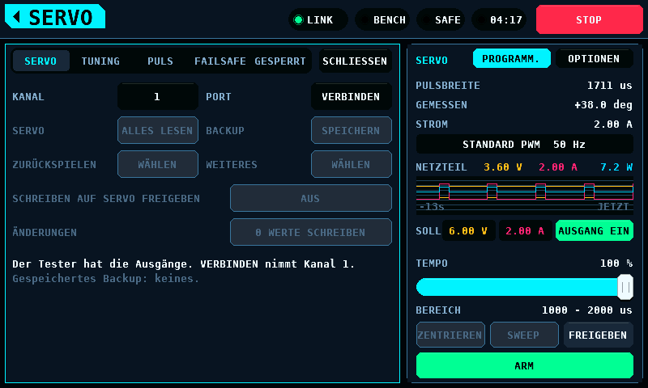

## Randbedingungen

- Der Koprozessor spricht Protokoll 4.13 oder neuer. Mit einem älteren sagt
  das Overlay `Nicht verfügbar: Koprozessor ohne Programmier-Port.` und
  `Koprozessor auf Version 4.13 oder neuer aktualisieren.`, und jedes
  Bedienelement außer **SCHLIESSEN** ist aus.
- **VERLASSEN** mit seinem Warten braucht Protokoll 4.15 auf dem
  Koprozessor. Ein älterer wird
  [benannt und ohne es behandelt](#ein-koprozessor-vor-link-version-415).

  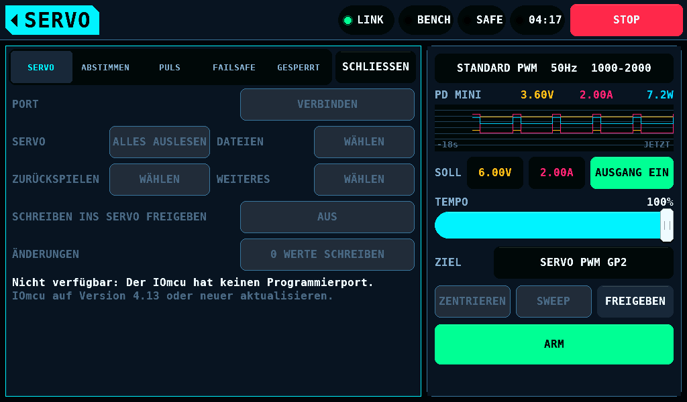

- Das Servo hängt am Programmierport des Koprozessors, Port 1: GP13, Pad 17
  des Bring-up-Moduls, solange kein anderer Pin dafür gespeichert ist. Der
  Port ist kein Ausgangskanal und kein Slot von OUTPUTS.
- **PWM-ZIEL** des SERVO-Bildschirms steht auf **PROG-PORT**
  ([das Ziel](#das-ziel)). Mit den Standardausgängen als Ziel ist der
  Programmierer gesperrt.
- Ein Servo zur Zeit.
- Der Port ist in PWM (Pulsweitenmodulation) oder im Programmieren, nie in
  beidem. Solange der Port im Programmieren ist, sendet der Tester keinen
  Puls darauf.
- Programmieren und ein Prüfstand unter ARM schließen sich aus.
  **VERBINDEN** wird abgelehnt mit
  `Erst DISARM: bei ARM wird der Port nicht übernommen.`, wenn ARM gilt,
  angefragt ist oder ein Finger auf **ARM** liegt. Solange der Port
  gehalten wird, von **VERBINDEN** bis er PWM meldet, setzt kein Bildschirm
  den Prüfstand unter ARM: **ARM** auf SERVO und auf MOTOR & ESC ist
  gesperrt gezeichnet und nimmt keinen Druck an, und ein Lauf des
  ESC-Stick-Programmierers startet nicht und meldet
  `Servo-Programmierer hält einen Port: erst VERLASSEN.` Ein ARM, das den
  Prüfstand auf anderem Weg erreicht, wird mit dem Hinweis
  `kein ARM: der Servo-Programmierer hält einen Port` abgelehnt. **DISARM**
  und **STOP** wirken in jedem Zustand. Unter ARM werden das Lesen, das
  Prüfen, das Schreiben, das Zurückspielen und das Lösen der Kopplung mit
  derselben Zeile wie **VERBINDEN** abgelehnt; **VERLASSEN** wird
  angenommen.
- Antwortet ein PD mini, stellt der Port die Versorgung des Servos bei
  **VERBINDEN** ([die Versorgung](#die-versorgung)). Ohne einen stellt der
  Prüfstand die Versorgung nicht, und der Programmierer nimmt sie, wie sie
  ist.
- Der Programmierer nimmt an, dass ein Servo kein Aus- und Einschalten
  braucht: weder, damit ein geschriebener Wert wirkt, noch, um nach dem
  Programmieren PWM zu folgen. Keines von beidem ist gemessen
  ([Einschränkungen](#einschränkungen)).
- Ob eine gegebene Hardware die Antwort des Servos zum Pin zurückführt,
  weiß der Koprozessor nicht. Ein Servo an einem Port, der es nicht tut,
  beendet **VERBINDEN** mit
  `Kein Servo antwortet. Stecker, Versorgung, Port prüfen.`

## Das Ziel

Der Tester des SERVO-Bildschirms treibt die Standard-Servoausgänge oder den
Programmierport. **OPTIONEN**, Reiter PRÜFLING, hält die zwei Zeilen:

| Zeile | Werte | Wirkung |
| --- | --- | --- |
| PWM-ZIEL | **AUSGÄNGE**, **PROG-PORT** | was der Sweep, **ZENTRIEREN**, **FREIGEBEN**, das Halten einer Stellung und der automatische Test treiben |
| PORT-PWM | **EIN**, **AUS** | ob der Programmierport den Puls des Testers ausgibt, solange er das Ziel ist |

Beide Zeilen werden mit den SERVO-Einstellungen gehalten. **PWM-ZIEL**
wechselt nur bei nicht scharf geschaltetem Prüfstand, ohne laufenden Sweep
und ohne laufenden Test, und wenn der Port nicht im Programmieren ist; das
Panel gibt eine gehaltene Stellung frei, bevor es den Koprozessor um das
andere Ziel bittet. **PORT-PWM** geht jederzeit aus und nach derselben
Regel ein. Mit **AUSGÄNGE** als Ziel ist **PORT-PWM** gesperrt.

Ein Port ohne Pin kann nicht das Ziel sein: ein Slot von OUTPUTS, der GP13
hält, lässt dem Port keinen. Der Tester behält dann die Standardausgänge,
was immer die Zeile sagt.

Mit den Standardausgängen als Ziel zeigt der Programmierer
`Programmieren braucht den Programmier-Port.` und
`SERVO, Reiter PRÜFLING: PWM-ZIEL auf PROG-PORT stellen.`, und jedes
Bedienelement außer **SCHLIESSEN** ist aus.

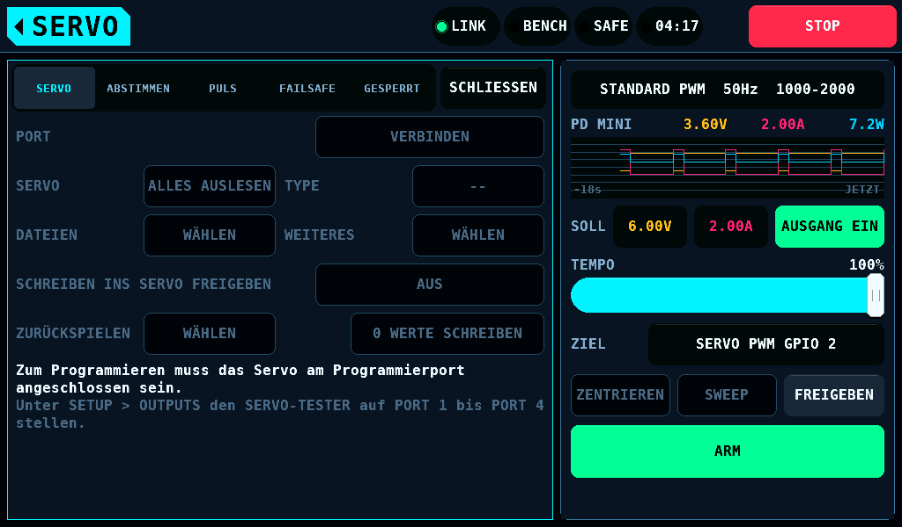

## Der Port

| Zustand | Zeile auf dem Reiter SERVO | Der Port führt |
| --- | --- | --- |
| PWM, ein PD mini antwortet | `Der Tester hat Port 1. VERBINDEN stellt 5,0 V, 1000 mA.` | die Pulse des Testers |
| PWM, kein PD mini | `Der Tester hat Port 1. Kein PD mini: Versorgung bleibt.` | die Pulse des Testers |
| Verbinden | `Verbinde auf Port 1: kein PWM darauf.` | 50 ms keinen Puls, dann 100 ms Low, dann die Einstiegssequenz |
| Programmieren | `Port 1 ist im Programmiermodus: kein PWM darauf.` | nur Frames |
| Programmieren, die Versorgung gelesen | `Port 1 im Programmiermodus, kein PWM: 5,00 V, 37 mA.` | nur Frames |
| Arbeiten | `Arbeite: 12 Frames.` | die Frames des laufenden Vorgangs |
| Arbeiten, der Koprozessor plant | `Plane die Schreibfolge. Noch kein Frame gesendet.` | nichts: ein Koprozessor der Link-Version 4.14 plant ein Schreiben oder ein Zurückspielen vor seinem ersten Frame |
| Verlassen | `Verlasse den Programmiermodus. PWM ist noch nicht an.` | die Leitung auf Low für **WARTEN VOR PWM**; kein Puls, bis der Port PWM meldet |

**VERBINDEN** nimmt den Port aus PWM, stellt die Versorgung, wo ein PD mini
antwortet, fährt die Einstiegssequenz und liest alle 32 Register. Die Taste
heißt **ABBRECHEN**, solange ein Vorgang läuft oder ein Verlassen wartet,
und **VERLASSEN** im Programmiermodus.

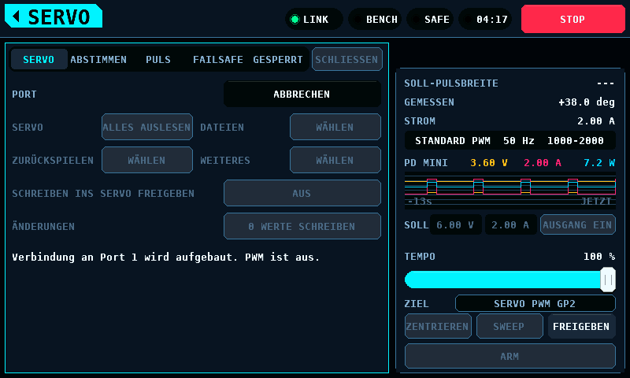

Solange der Port im Programmieren ist, bleibt das Overlay offen,
**OPTIONEN** ist aus, und die Bedienelemente des Testers senden nichts an
den Port. **STOP** auf der rechten Karte arbeitet. Das Verlassen des
SERVO-Bildschirms lässt den Port, wie er ist; beim nächsten Aufruf ist das
Overlay wieder offen.

| **VERBINDEN** endet mit | Bedeutung |
| --- | --- |
| `Der Programmier-Port hat keinen Pin. Nichts gesendet.` | ein Slot von OUTPUTS hält den Pin des Ports |
| `Der Koprozessor hat diesen Programmier-Port nicht.` | der Koprozessor hat weniger Ports als den angefragten |
| `Die Versorgung gibt diese Spannung oder Grenze nicht.` | die Spannung liegt außerhalb 1,0 bis 8,4 V, die Stromgrenze außerhalb 50 bis 3000 mA, oder die Spannung liegt weniger als 0,5 V unter dem Eingang des PD mini; die Versorgung wird nicht geändert |
| `Versorgung schaltete nicht in 3000 ms. Versorgung prüfen.` | der PD mini las nicht wie angefragt; der Port ist wieder in PWM, und ein Ausgang, den dieses **VERBINDEN** eingeschaltet hat, ist wieder aus |
| `Koprozessor vertraut dem Link noch nicht. Neu versuchen.` | der Koprozessor vertraut dem Heartbeat nicht, oder der Link war still |

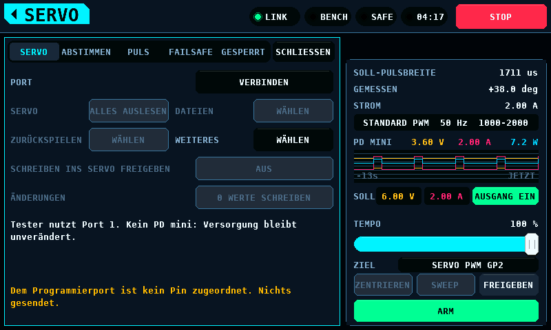

## Die Versorgung

Solange der Tester den Port hat, öffnet **WEITERES**, was **VERBINDEN**
stellt.

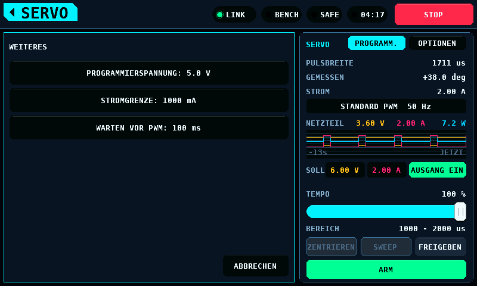

| Eintrag | Bereich | Vorgabe | Wirkung |
| --- | --- | --- | --- |
| PROGRAMMIERSPANNUNG | 1,0 bis 6,0 V in 0,1 V; bis 8,4 V mit HV SERVO ein | 5,0 V | die Versorgungsspannung des Servos im Programmiermodus |
| STROMGRENZE | 50 bis 3000 mA | 1000 mA | die Stromgrenze der Versorgung während des Programmierens |
| WARTEN VOR PWM | 0 bis 10 000 ms | 100 ms | die Zeit zwischen dem Ende des Programmierens und dem ersten Puls |

Jeder Eintrag öffnet die Zahlentastatur mit seinem Bereich. Ein Wert
außerhalb des Bereichs wird nicht übernommen. Alle drei werden mit den
SERVO-Einstellungen gehalten.

**VERBINDEN** schaltet einen Ausgang, der aus ist, mit den zwei Werten ein,
und die Sitzung beginnt 1000 ms, nachdem der PD mini ein liest. Ein
Ausgang, der über der Programmierspannung ein ist, wird auf sie gesenkt.
Ein Ausgang, der auf oder unter ihr ein ist, bleibt, wie er ist: der Port
hebt keine Spannung eines Ausgangs an, der ein ist. Das Verlassen des
Programmierens stellt eine Spannung, die **VERBINDEN** gesenkt hat, nicht
wieder her.

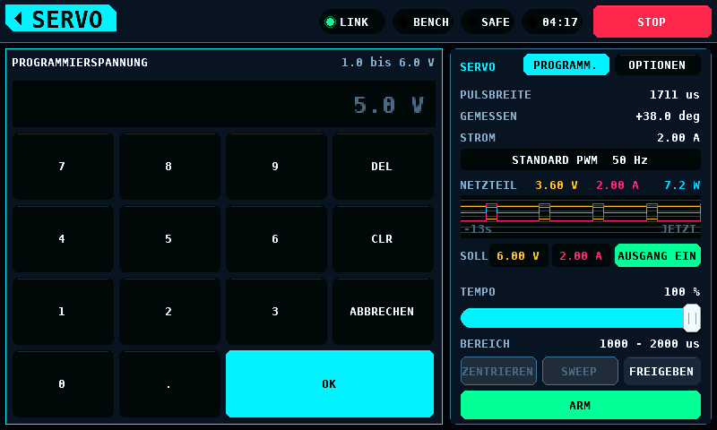
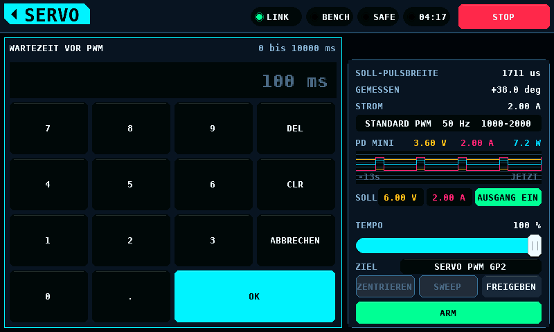

Eine Spannung über 6,0 V braucht **HV SERVO** auf dem Reiter TEST von
**OPTIONEN**; ohne es endet die Tastatur bei 6,0 V. Mit ihm öffnet ein Wert
über 6,0 V die Warnseite der Hochspannungs-Einstellung des
SERVO-Bildschirms, und **HALTEN ZUM ÜBERNEHMEN** übernimmt ihn nach 2 s.
Das Ausschalten von **HV SERVO** setzt eine Programmierspannung über 6,0 V
auf 5,0 V zurück.

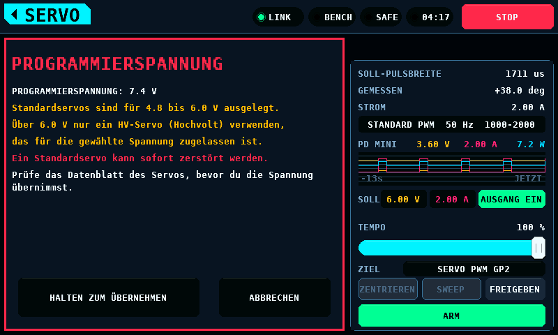

Antwortet ein PD mini, nennt die Zustandszeile vor **VERBINDEN** die Werte
und im Programmiermodus die gemessene Ausgangsspannung und den gemessenen
Strom. Der SUPPLY-Bildschirm und die Netzteil-Zeilen der rechten Karte
folgen dem, was der Port gestellt hat.


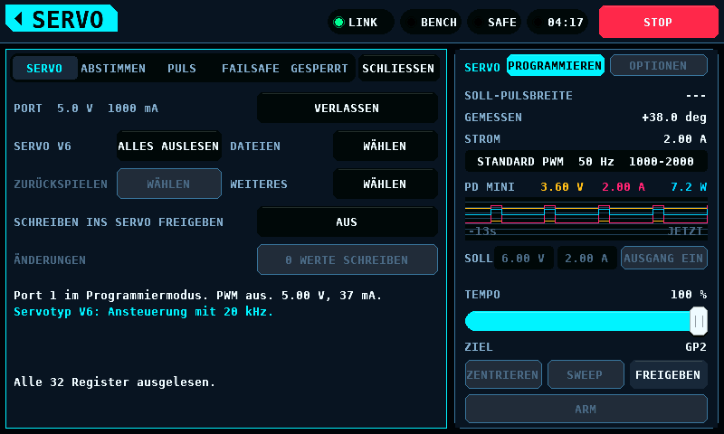

Ohne PD mini werden die Spannung und die Stromgrenze gespeichert und nicht
angewendet. **WARTEN VOR PWM** wendet ein Koprozessor ab Link-Version 4.15
beim [Verlassen](#verlassen) an, mit und ohne PD mini.

## Reiter SERVO

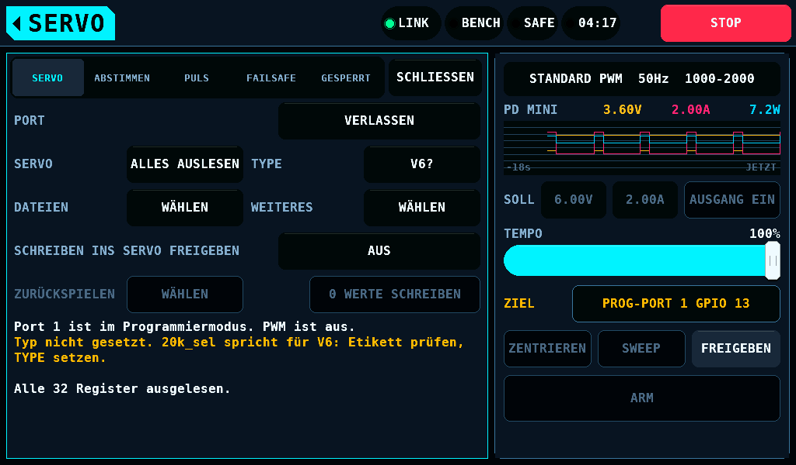

| Zeile | Taste | Wirkung |
| --- | --- | --- |
| PORT | **VERBINDEN**, **ABBRECHEN**, **VERLASSEN** | nimmt den Port, beendet den laufenden Vorgang, [gibt den Port zurück](#verlassen) |
| SERVO, dann SERVO V6 oder SERVO V8 | **ALLES LESEN** | liest die 32 Register, jedes, bis 3 von höchstens 5 Lesungen übereinstimmen; die Zeile nennt danach [den Servotyp](#der-servotyp) |
| DATEIEN | **WÄHLEN** | [speichert die Werte des Servos auf die Karte und lädt eine Datei](#servodateien) |
| ZURÜCKSPIELEN | **WÄHLEN** | [schreibt ein Backup zurück](#zurückspielen) |
| WEITERES | **WÄHLEN** | in PWM [was VERBINDEN stellt](#die-versorgung); im Programmiermodus [PRÜFEN, ÄNDERUNGEN VERWERFEN, PAIRING LÖSEN](#weiteres) |
| SCHREIBEN AUF SERVO FREIGEBEN | **AUS**, **EIN** | [der Schreibschalter](#der-schreibschalter) |
| ÄNDERUNGEN | **n WERTE SCHREIBEN**, **1 WERT SCHREIBEN** | [schreibt die geänderten Werte](#schreiben) |

Unter den Zeilen stehen der Zustand des Ports, der Servotyp, der Name der
Backup-Datei der Sitzung und die letzte Meldung. Eine Meldung in der
Warnfarbe ist eine Ablehnung oder ein Ergebnis, das einen zweiten Blick
braucht; eine in der Gefahrenfarbe sagt, dass der Inhalt des Servos unklar
ist.

### Ein Servo mit unbekanntem Layout

Der Koprozessor vergleicht das Abbild mit dem Layout des bekannten Servos,
seinem Fingerprint. Ein Abbild, das nicht passt, wird gezeigt und nie
geschrieben: die Zeilen zum Ändern sind aus, ein Tipp auf den
Schreibschalter lässt ihn aus und wiederholt die Meldung, und **PAIRING
LÖSEN** wird abgelehnt. **ALLES LESEN**, das Speichern in eine Datei und
**PRÜFEN** arbeiten. Eine Datei wird nicht geladen.

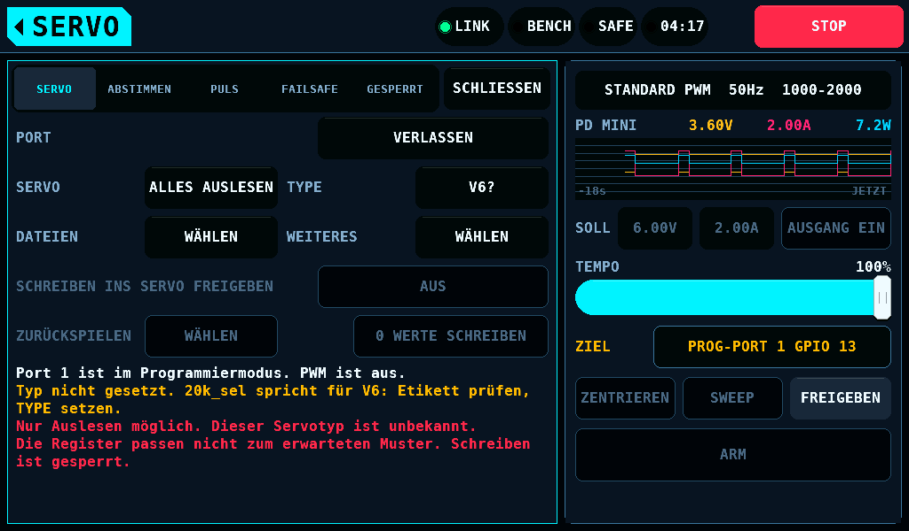

## Ändern

Ein Wert wird in einem Entwurf auf dem Panel geändert. Vor
[**n WERTE SCHREIBEN**](#schreiben) erreicht nichts das Servo. Ein Wert,
der von dem des Servos abweicht, ist doppelt markiert: durch `*` davor und
durch die Akzentfüllung.

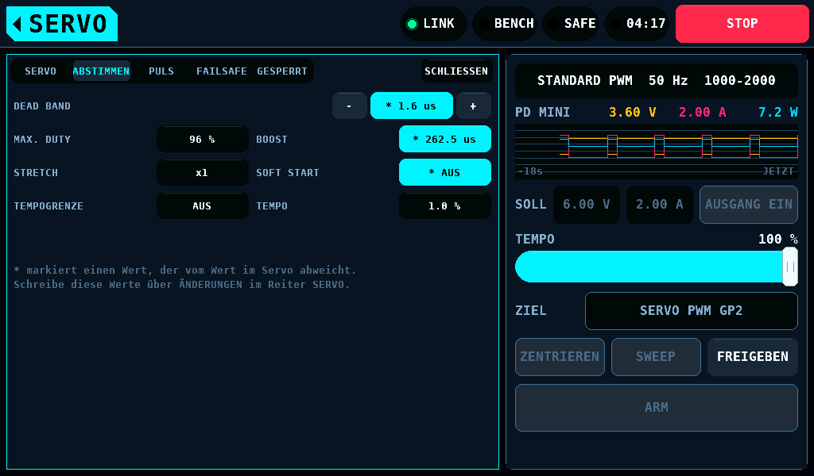

Ein Zahlenwert öffnet die Tastatur. Sein Bereich ist der, den die harten
Limits im Entwurf, wie er steht, annehmen; ein Wert außerhalb lässt sich
nicht eingeben. STRETCH öffnet eine Liste der 6 bestätigten Faktoren. Ein
EIN/AUS-Wert wechselt beim Tipp. DEAD BAND und NEUTRAL haben Minus- und
Plustasten: ein Rohzähler je Tipp, gehalten nach 0,45 s 8 Zähler je
Sekunde und nach weiteren 1,8 s 30 je Sekunde.

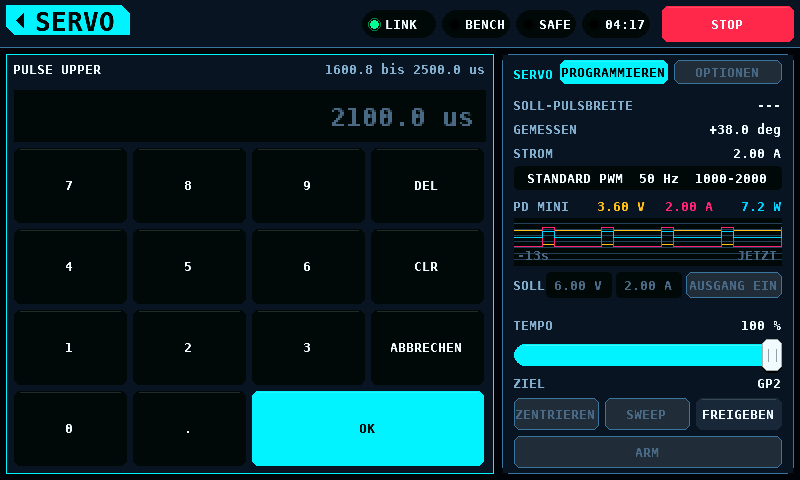
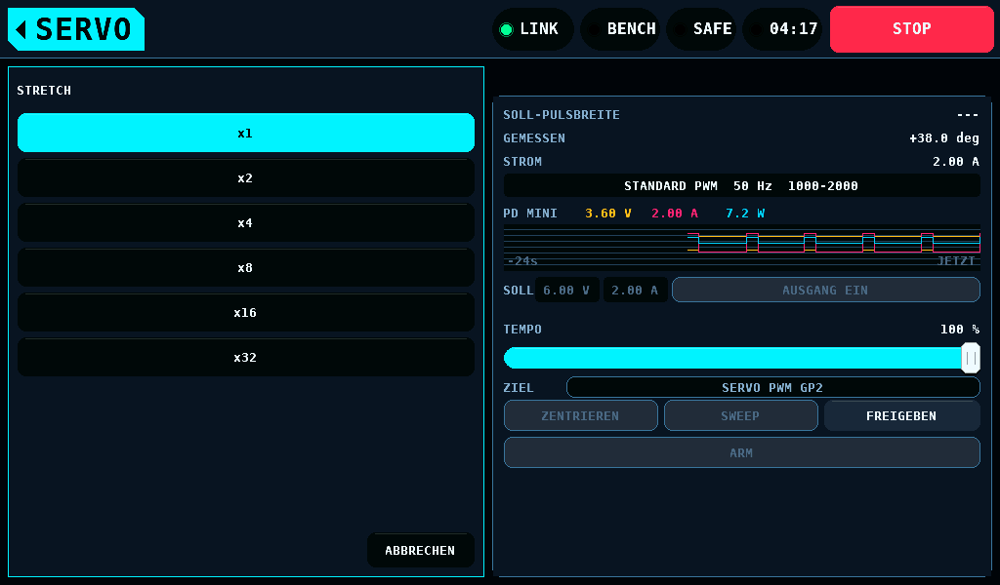

### TUNING

| Zeile | Registerfeld | Hartes Limit |
| --- | --- | --- |
| DEAD BAND | Dead Band, µs | der Bereich des Felds |
| MAX. DUTY | Max. Duty, % | 10 bis 98 % |
| BOOST | Boost, µs | höchstens 3000 µs |
| STRETCH | Stretch, Faktor | x1 bis x32; die 2 übrigen Codes werden nicht angeboten |
| SOFT START | Soft_Start, EIN oder AUS | keines |
| TEMPOLIMIT | spd_sel, EIN oder AUS | EIN braucht TEMPO ab 5 % |
| TEMPO | SPD, % | höchstens 100 %; mindestens 5 %, solange TEMPOLIMIT EIN ist |

### PULS

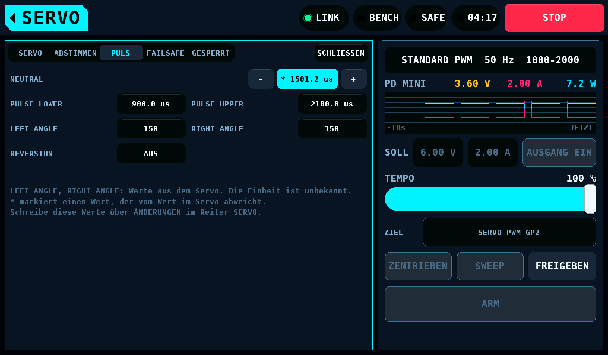

| Zeile | Registerfeld | Hartes Limit |
| --- | --- | --- |
| NEUTRAL | Neutral, µs | 1360 bis 1640 µs; 100 µs oder mehr von jedem Endpunkt |
| PULSE LOWER | Pulse Lower, µs | 500 µs oder mehr; 100 µs oder mehr unter NEUTRAL; 400 µs oder mehr unter PULSE UPPER |
| PULSE UPPER | Pulse Upper, µs | 2500 µs oder weniger; 100 µs oder mehr über NEUTRAL |
| LEFT ANGLE | Left Angle, die Zahl des Hersteller-Tools | nicht 0 |
| RIGHT ANGLE | Right Angle, die Zahl des Hersteller-Tools | nicht 0 |
| REVERSION | Reversion, EIN oder AUS | keines |

Die Umrechnung von NEUTRAL zwischen Register und µs ist eine Anpassung an
3 Werte und um etwa 1 µs unsicher.

### FAILSAFE

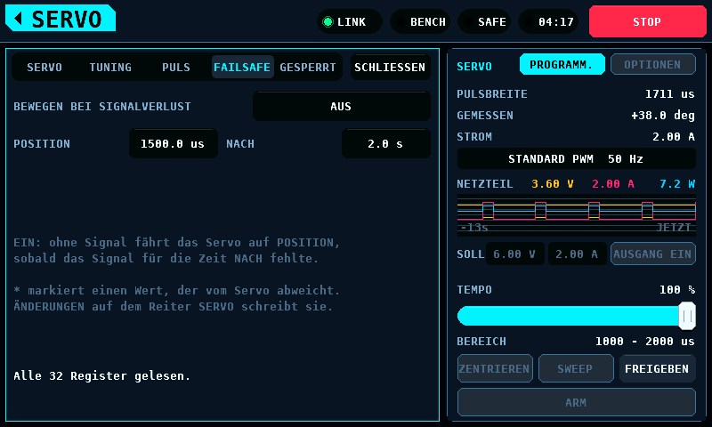

| Zeile | Registerfeld | Hartes Limit |
| --- | --- | --- |
| BEWEGEN BEI SIGNALVERLUST | Allow Uncont, EIN oder AUS | keines |
| POSITION | Uncontrolled Pos, µs | 500 bis 2500 µs und innerhalb PULSE LOWER bis PULSE UPPER |
| NACH | Uncontrolled Time, s | 0,4 bis 13,0 s |

Die Limits sind die aus `protocols/kst/kst_limits.c`; das Panel hält keine
eigenen. Das untere Limit von MAX. DUTY und die 5 % von TEMPO sind
Festlegungen, keine Messwerte eines Servos.

### Ein Wert, den ein hartes Limit ablehnt

Ein Tipp, der ein hartes Limit verletzen würde, ändert nichts und nennt das
Limit.

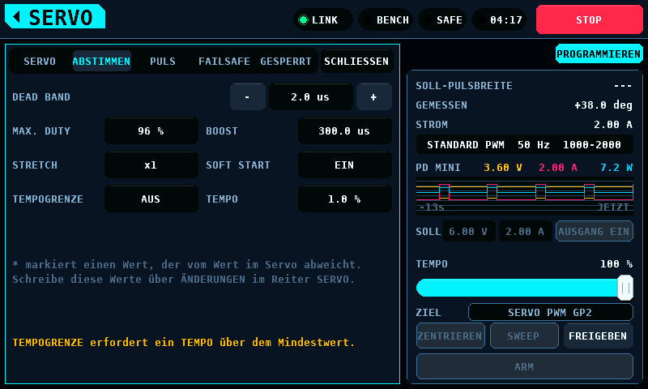

### Ein Wert, der einen zweiten Blick braucht

Ein Wert innerhalb der harten Limits, der ein weiches Limit verletzt, öffnet
ÄNDERUNG PRÜFEN mit dem alten und dem neuen Wert und einer Zeile je Limit.
**HALTEN ZUM ÜBERNEHMEN** übernimmt ihn nach 2 s Halten; **ABBRECHEN** oder
ein Finger, der von der Taste rutscht, lässt den Entwurf, wie er war.

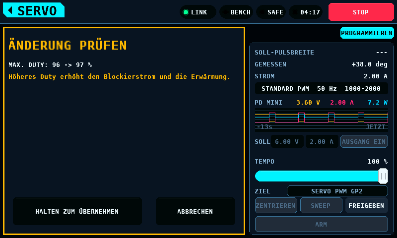

| Bedingung | Warnung |
| --- | --- |
| MAX. DUTY über dem des Servos | `Mehr Duty erhöht Blockierstrom und Wärme.` |
| MAX. DUTY unter 50 % | `Wenig Duty schwächt das Servo: Ruder evtl. nicht gehalten.` |
| BOOST über dem des Servos | `Mehr Boost kann das Servo brummen und heiß werden lassen.` |
| STRETCH über dem des Servos | `Mehr Stretch kann das Servo schwingen lassen.` |
| SOFT START ausgeschaltet | `Ohne Soft Start springt das Servo beim Einschalten.` |
| TEMPOLIMIT eingeschaltet | `Tempolimit aktiv: das Servo fährt mit dem gesetzten Tempo.` |
| TEMPO unter 30 % bei TEMPOLIMIT EIN | `Ein langsames Servo kann die Kontrolle am Modell kosten.` |
| DEAD BAND unter dem des Servos | `Ein schmales Dead Band kann Pendeln und Wärme verursachen.` |
| DEAD BAND unter 1,0 µs | `Sehr schmales Dead Band: Pendeln und Wärme wahrscheinlich.` |
| BEWEGEN BEI SIGNALVERLUST eingeschaltet | `Ohne Signal fährt das Servo auf die Failsafe-Position.` |
| POSITION mehr als 300 µs von NEUTRAL, BEWEGEN BEI SIGNALVERLUST EIN | `Die Failsafe-Position liegt weit von der Mitte.` |
| NACH unter 1,0 s | `Kurze Aussetzer lösen die Failsafe-Bewegung aus.` |
| ein Endpunkt weniger als 300 µs von NEUTRAL | `Endpunkt nah an Neutral: wenig Weg auf dieser Seite.` |
| ein Endpunkt mehr als 100 µs von dem des Servos | `Endpunkt geändert: der Weg je Knüppelweg ändert sich.` |
| NEUTRAL mehr als 20 µs von dem des Servos | `Die Mitte wandert; eine Seite rückt näher an den Anschlag.` |
| REVERSION geändert | `Richtung ist umgekehrt. Vor dem Flug jedes Ruder prüfen.` |
| ein Winkel über dem des Servos | `Mehr Weg kann das Servo in den Anschlag fahren: es brennt.` |
| ein Winkel unter 50 | `Kleiner Winkel: wenig Weg für den vollen Knüppelweg.` |
| DEAD BAND unter 1,0 µs bei STRETCH über x1 | `Schmales Dead Band mit mehr Gain: Schwingen droht.` |
| MAX. DUTY über 90 % bei einem Winkel über dem des Servos | `Viel Duty, mehr Weg: Blockieren kann das Servo zerstören.` |

"Der des Servos" ist der zuletzt aus dem Servo gelesene Wert.

### GESPERRT

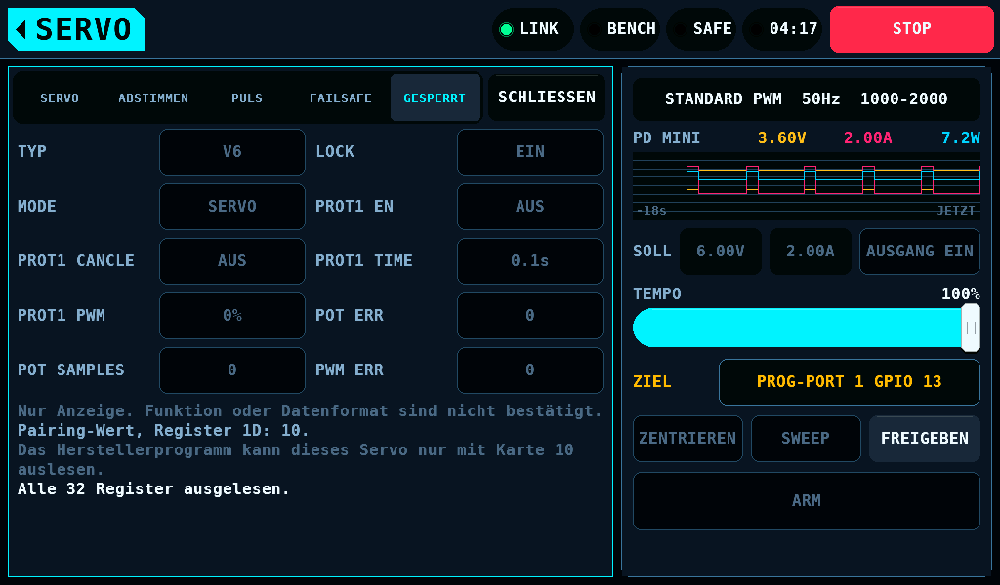

| Zeile | Feld |
| --- | --- |
| TYP | 20k_sel, gezeigt als [der Servotyp](#der-servotyp), V6 oder V8 |
| LOCK | Lock |
| MODE | Servo oder Gyro Servo |
| PROT1 EN, PROT1 CANCLE, PROT1 TIME, PROT1 PWM, POT ERR, POT SAMPLES, PWM ERR | der Schutzblock, den das Hersteller-Tool verbirgt; `PROT1 CANCLE` ist die Schreibweise des Herstellers |

Diese Werte werden gezeigt, und kein Ändern erreicht sie. Ihre Funktion
oder ihre Kodierung ist nicht bestätigt. Der Reiter zeigt außerdem den
Pairing-Wert, Register 1D, und die Kartennummer, die das Hersteller-Tool
für dieses Servo braucht. Ein Servo im Modus Gyro Servo wird gelesen und
nicht geschrieben: die Limits dieses Modus sind nicht bekannt.

## Der Schreibschalter

**SCHREIBEN AUF SERVO FREIGEBEN** ist in der Vorgabe aus. Ein Tipp auf
**AUS** öffnet eine Seite, die die Risiken nennt; **HALTEN ZUM FREIGEBEN**
schaltet ihn nach 2 s ein. Ein Tipp auf **EIN** schaltet ihn sofort aus.

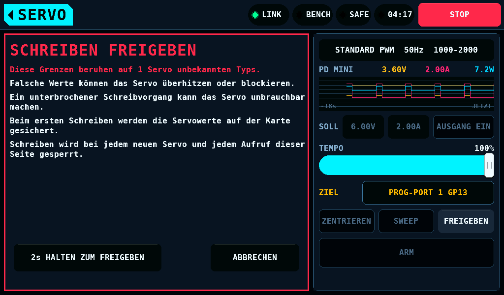

Der Schalter geht aus:

- bei jedem Aufruf des SERVO-Bildschirms,
- wenn der Link zum Koprozessor wegfällt oder der Koprozessor neu startet,
- bei **STOP** und bei jedem Stopp, den der Prüfstand hält,
- mit jedem **VERBINDEN** und jedem **VERLASSEN**,
- wenn ein Lesen ein anderes Abbild findet als das gehaltene,
- wenn ein Lesen nicht zum Fingerprint passt.

Bei ausgeschaltetem Schalter sendet das Panel kein Schreiben, kein
Zurückspielen und kein Lösen des Pairings, und der Koprozessor lehnt eines
ab, das ohne den Schlüssel des Schalters ankommt. Lesen, **PRÜFEN**, das
Speichern in eine Datei und das Laden einer Datei arbeiten bei
ausgeschaltetem Schalter.

## Schreiben

**n WERTE SCHREIBEN** zählt die Felder, in denen der Entwurf vom Servo
abweicht; bei einem solchen Feld heißt die Taste **1 WERT SCHREIBEN**. Sie
ist aus, wenn nichts geändert ist oder der Schalter aus ist.

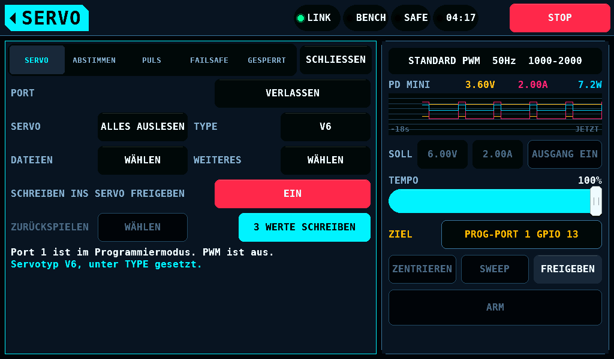

Ein Tipp öffnet die Schreibseite. **HALTEN ZUM SCHREIBEN** startet das
Schreiben nach 2 s. Das erste Schreiben nach einem **VERBINDEN** zeigt
`Ruderhorn frei, kein Gestänge angeschlossen.` als erste Zeile. Ein
Schreiben, dessen Start die Karte, ein Stopp oder der Link verhindert hat,
ist nicht dieses erste Schreiben: die Zeile bleibt für das nächste.

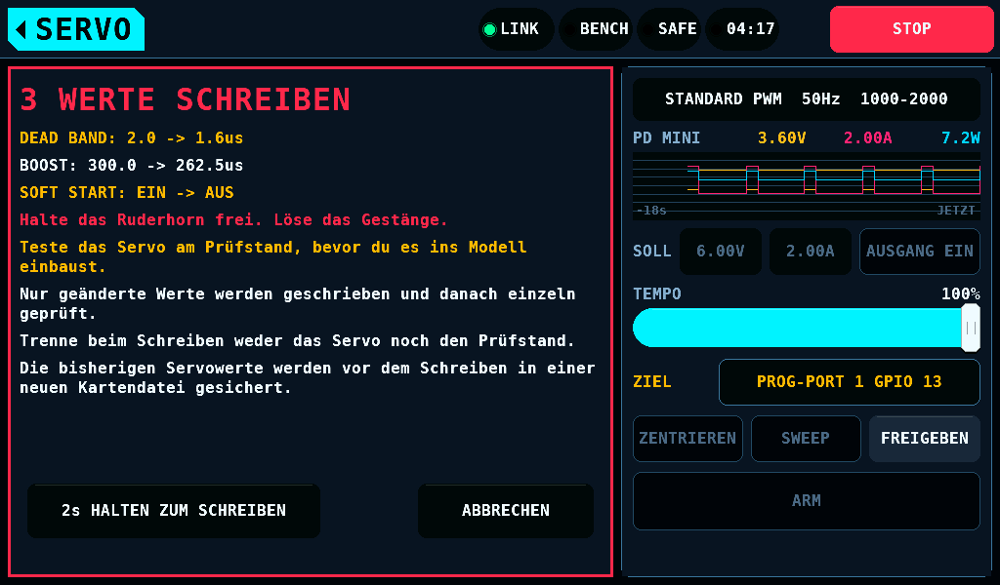

1. Das erste Schreiben einer Sitzung speichert die Werte des Servos in
   [eine neue Datei auf der Karte](#das-backup-vor-dem-ersten-schreiben).
   Eine eingehängte Karte, die die Datei nicht annimmt, beendet das
   Schreiben. Ohne eingehängte Karte sagt die Schreibseite, dass keine
   Datei gespeichert wird, und das Schreiben läuft ohne eine.
2. Das Panel vermerkt das Abbild, das das Servo hält, das Abbild, das das
   Schreiben hinterlassen soll, und den Port: mit Karte in `KST/KST.TXT`,
   ohne im RAM (Arbeitsspeicher). Die Seite sagt, welches. Mit einer Karte,
   die binnen 3 s keine Datei annimmt, wird das Schreiben nicht gesendet:
   `Die Karte nahm keine Datei. Nichts ging aufs Servo.`
3. Das Panel sendet das Zielabbild. Der Koprozessor prüft es gegen dieselben
   Limits, plant die Registerschreibvorgänge und führt sie aus.
4. Jedes geschriebene Register wird zurückgelesen. Ein Schreibvorgang, der
   nicht übernommen wird, wird rückgängig gemacht.
5. `3 Werte geschrieben und geprüft.` oder `1 Wert geschrieben und geprüft.`
   beendet es und löscht den Vermerk.

Ein geschriebener und zurückgelesener Wert gilt als wirksam. Der
Programmierer verlangt nach einem Schreiben kein Aus- und Einschalten, und
sein Prüfen ist das Rücklesen derselben Sitzung. Ob ein KST-Servo vor
seinem nächsten Einschalten nach einem geschriebenen Wert handelt, ist
nicht gemessen.

Nur Register, deren Wert sich ändert, werden geschrieben. Register 00 wird
nie geschrieben; Register 1D schreibt nur **PAIRING LÖSEN**.

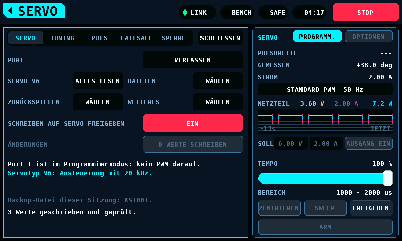

| Meldung | Das Servo |
| --- | --- |
| `Keine sichere Schreibfolge führt zu diesen Werten.` | hält, was es hielt; nichts wurde gesendet |
| `Zu viele Änderungen für einen Plan. Nichts geschrieben.` `Änderung teilen: weniger Werte auf einmal schreiben.` | hält, was es hielt; nichts wurde gesendet. Der Planer hört nach 216 000 Arbeitseinheiten ohne Ergebnis auf. Die Sitzung läuft weiter, und die offenen Werte bleiben |
| `Schreiben nicht übernommen. Nichts ist halb geschrieben.` | hält, was es hielt |
| `Schreiben nicht übernommen. Der Wert ist wieder wie zuvor.` | hält, was es hielt |
| `Schreiben nicht übernommen und nicht rückgängig zu machen.` | ist unklar: [zurückspielen](#ein-unterbrochenes-schreiben) |
| `Ein Register änderte sich, das nicht geschrieben wurde.` | ist unklar |
| `Das Servo hält nicht die erwarteten Werte.` | ist unklar |

Eine Meldung über ein fehlgeschlagenes Schreiben nennt das Register und die
Zahl der erfolgten Schreibvorgänge: `Register 03, 1 Schreibvorgang erfolgt.`

## Backups

| Backup | Gehalten von | Lebt bis |
| --- | --- | --- |
| Der Sitzung | dem Koprozessor: das erste nach **VERBINDEN** gelesene Abbild | **VERLASSEN**, ein Neustart des Koprozessors |
| Die Datei der Sitzung | der Karte: die 32 Register des Servos, wie sie vor dem ersten Schreiben der Sitzung stehen. Keine, solange keine Karte eingehängt ist | die Datei wird von der Karte entfernt |
| Vor einem Schreiben | dem Panel, in `KST/KST.TXT` oder im RAM | das Schreiben endet geprüft, oder der Vermerk wird verworfen |

`KST.TXT` ist der Vermerk eines laufenden Schreibens: Text von höchstens
400 Bytes im Ordner `KST` der Karte mit der Zeile `RCBENCH KST 1`, den
Zeilen `journal=`, `target=` und `port=` und `check=` mit der CRC-16
(zyklische Redundanzprüfung) der Bytes davor. Eine Datei, deren Prüfsumme
nicht stimmt, wird nicht benutzt:
`KST.TXT auf der Karte ist nicht lesbar, bleibt ungenutzt.` Der Name `KST`
gehört dem Vermerk: keine Servodatei bekommt ihn, und die Liste der Dateien
lässt ihn aus.

Das Panel schreibt den Text nach `KST.NEW`, und die Datei bekommt den Namen
`KST.TXT`, sobald die Karte sie vollständig hält. Ein Schreiben, das die
Karte oder die Versorgung beendet, hinterlässt `KST.TXT` wie zuvor oder
eine vollständige `KST.NEW`. Beim Einschalten wird eine `KST.NEW` mit
stimmender Prüfsumme benutzt und umbenannt; eine mit falscher Prüfsumme
wird entfernt und `KST.TXT` benutzt. Eine Datei, die die Karte nicht
annimmt, wird alle 5 s erneut geschrieben, bis die Karte sie annimmt, damit
ein auf dem Panel verworfener Vermerk nicht auf der Karte bleibt. Nicht auf
einer Karte gelaufen.

## Servodateien

Eine Servodatei ist eine Textdatei im Ordner `KST` der SD-Karte des Panels
mit den 32 Registern eines Servos, benannt `<name>.TXT`. Das Panel legt den
Ordner mit dem ersten Speichern an. **DATEIEN** öffnet die Liste. Die Zeile
ist im Programmiermodus aktiv, wenn ein Servo gelesen und nicht unklar ist;
sonst antwortet der Tipp mit `Zuerst das Servo lesen: ALLES LESEN.`
Speichern und Laden arbeiten bei ausgeschaltetem Schreibschalter: eine
Datei ändert den Entwurf auf dem Panel, nie das Servo.

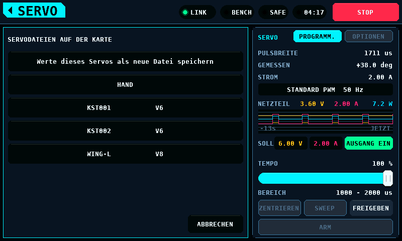

Der erste Eintrag speichert. Darunter stehen die Dateien nach Namen
sortiert, 5 je Seite, jede mit ihrem Servotyp; eine Datei ohne Typzeile
zeigt keinen. Die Liste reicht bis zu den ersten 64 Dateien nach Namen;
eine Karte mit mehr zeigt diese und zählt keine weiteren. Bei mehr als
5 Dateien zählt der Titel sie, `DATEIEN 1 BIS 5 VON 7`, und
`Weitere Dateien zeigen` blättert, nach der letzten Seite zurück zur
ersten. Das Panel fragt die Karte für jede Seite und wartet höchstens 5 s
darauf.

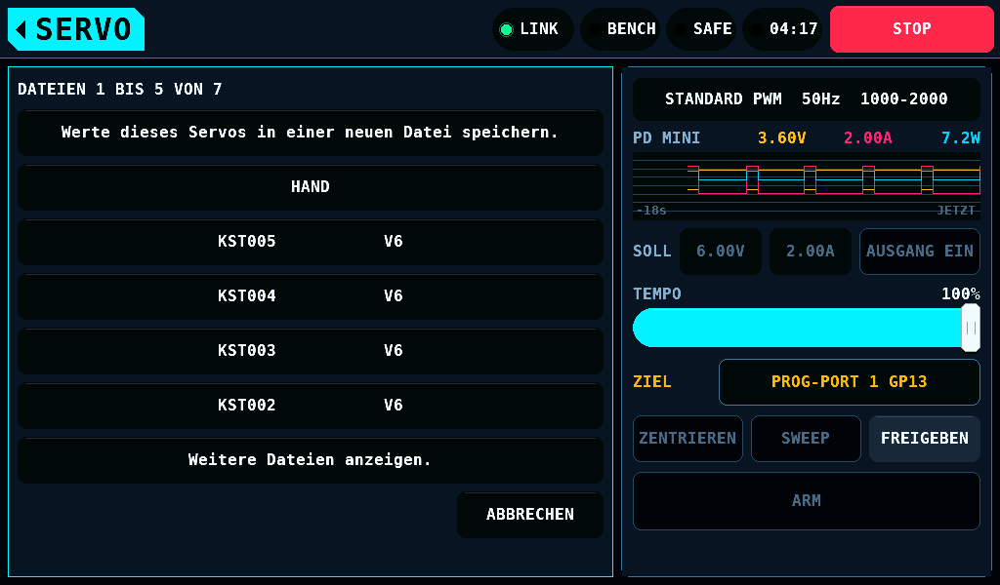
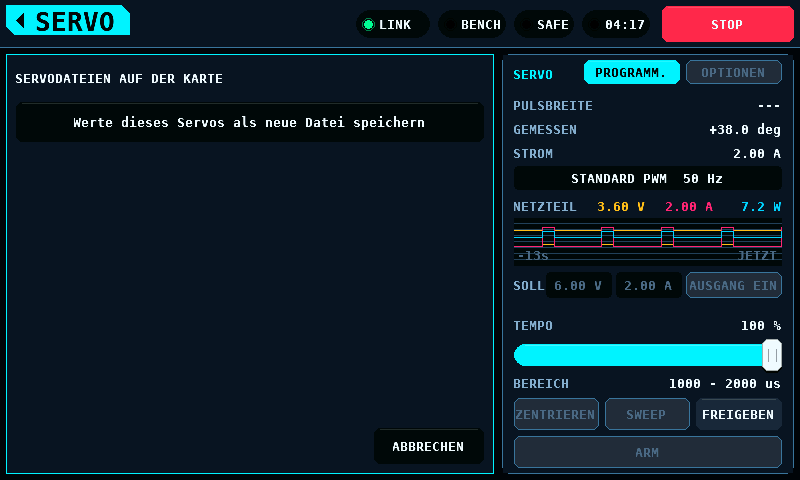

### Der Servotyp

Ein Servo und eine Datei sind V6 oder V8. Das Feld 20k_sel entscheidet:
1 ist V6, Ansteuerung mit 20 kHz; 0 ist V8, Ansteuerung mit 333 Hz. Kein
anderes Register geht in den Typ ein. Sobald ein Servo gelesen ist, heißt
die Zeile **SERVO** `SERVO V6` oder `SERVO V8`, und die Zeile unter den
Tasten sagt `Servotyp V6: Ansteuerung mit 20 kHz.` Der Typ wird nie
geändert und nie geschrieben.


### Speichern

`Werte dieses Servos als neue Datei speichern` öffnet die Texttastatur mit
dem nächsten freien Vorgabenamen, `KST001` bis `KST999`. Die Tastatur
nimmt bis zu 16 Zeichen: A bis Z, 0 bis 9, `-`, `_` und den Punkt. **OK**
speichert; die Kartenseite prüft den Namen und ersetzt nie eine Datei.
Namen werden ohne Rücksicht auf Groß- und Kleinschreibung verglichen. Eine
Datei mit einem längeren Namen, bis zu 32 Zeichen, wird gelistet und
geladen; eine Zeile, die sie nennt, zeigt ihre ersten 14 Zeichen und `..`.

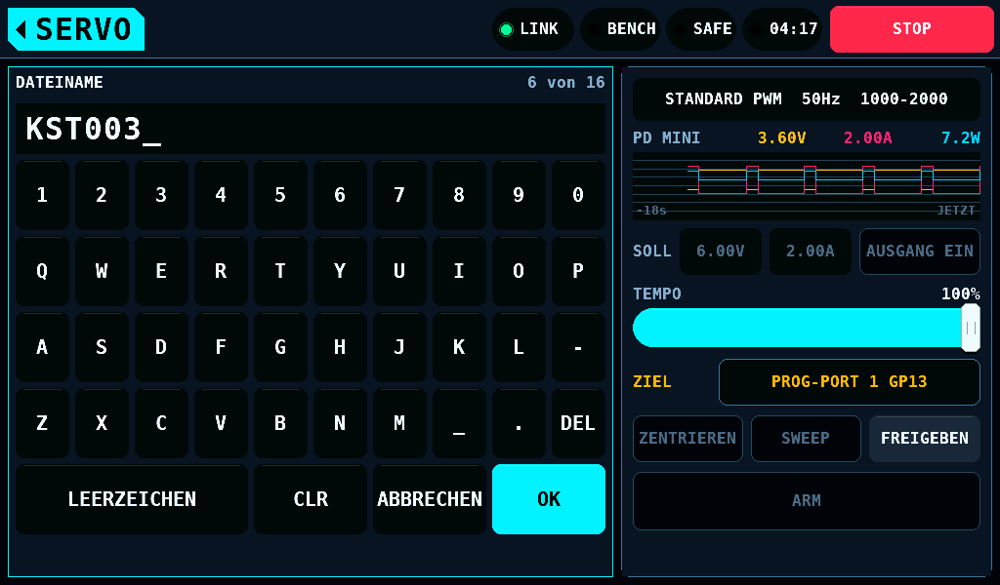

| Ergebnis | Gezeigt |
| --- | --- |
| Gespeichert | `Servowerte auf der Karte gespeichert: WING-R.` |
| Ein Punkt am Anfang oder am Ende, oder ein reservierter Name: `KST`, `CON`, `PRN`, `AUX`, `NUL`, `COM1` bis `COM9`, `LPT1` bis `LPT9`, allein oder vor einem Punkt | die Tastatur bleibt offen unter `NAME NICHT ERLAUBT`; `Name nicht erlaubt: reserviert oder Punkt am Rand.` |
| Eine Datei hat den Namen | die Tastatur bleibt offen unter `NAME VERGEBEN: ÄNDERN`; `Der Name ist vergeben. Keine Datei wird ersetzt.` |
| Keine Karte | `Keine Karte. Nichts gespeichert, nichts aufs Servo.` |
| Karte voll, oder `KST001` bis `KST999` sind beim Backup vor einem Schreiben alle vergeben | `Karte voll. Nichts gespeichert, nichts aufs Servo.` |
| Die Karte nimmt die Datei nicht an oder antwortet nicht binnen 5 s | `Schreibfehler der Karte. Nichts ging aufs Servo.` |

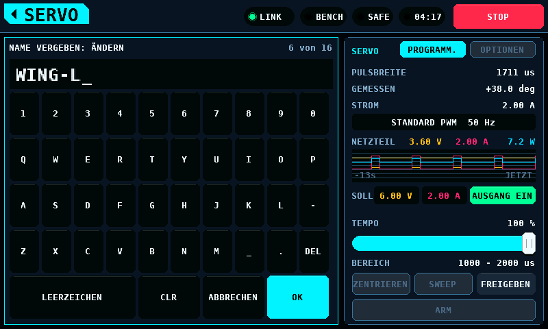
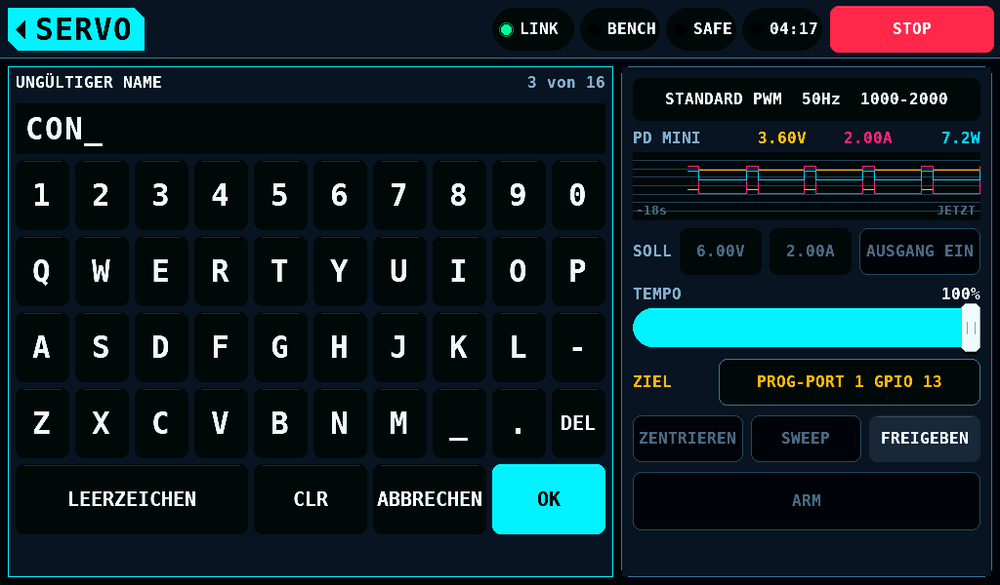
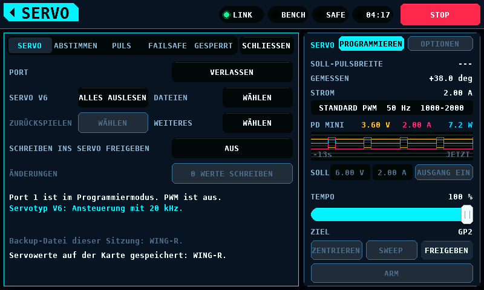
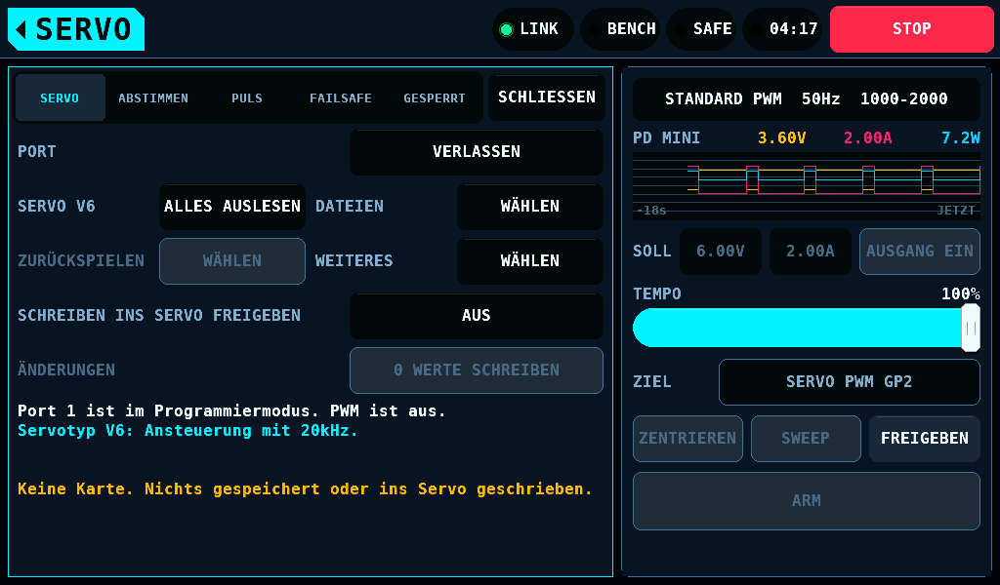
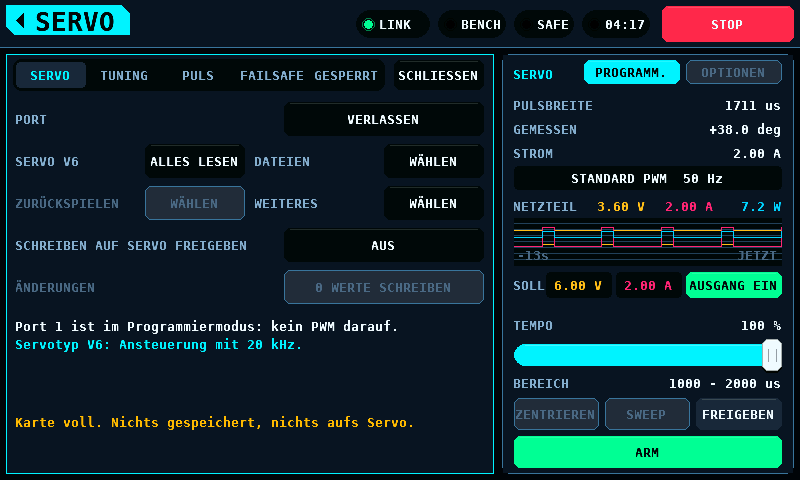

Ein Speichern schreibt das Abbild wie gelesen, die gesperrten Felder
eingeschlossen, auch das eines Servos, das nicht zum Fingerprint passt.

### Das Backup vor dem ersten Schreiben

Das erste Schreiben, Zurückspielen oder Lösen des Pairings einer Sitzung
speichert das Abbild des Servos ohne Nachfrage in eine neue Datei unter dem
nächsten freien Vorgabenamen. Die Schreibseite sagt
`Die Werte des Servos gehen zuerst in eine neue Datei.` Das Servo empfängt
nichts, bevor die Karte die Datei hält. Eine eingehängte Karte, die voll
ist, beim Schreiben einen Fehler meldet oder zwischen Anfrage und Datei
entnommen wird, beendet das Schreiben mit den Zeilen der Tabelle oben, und
nichts wird auf das Servo geschrieben. Platz auf der Karte schaffen oder
die Karte entnehmen lässt das Schreiben laufen. Der Reiter SERVO nennt die
Datei danach: `Backup-Datei dieser Sitzung: KST003.` Ein Speichern von Hand
vor dem ersten Schreiben der Sitzung zählt als diese Datei. Ein Speichern
von Hand nach einem Schreiben enthält die geschriebenen Werte und lässt die
Zeile unverändert. Ein Lesen, das andere Werte findet, lässt das nächste
Schreiben erneut speichern.

Ein unklares Servo ist die Ausnahme: sein Abbild ist keine Datei wert, und
das Zurückspielen des Backups der Sitzung läuft ohne eine.

#### Ohne Karte

Ohne eingehängte Karte sind das Schreiben, das Zurückspielen und das Lösen
des Pairings nicht gesperrt. Die Seite, deren Halten das Schreiben sendet,
trägt drei weitere Zeilen:

```
Keine Karte: es wird keine Backup-Datei gespeichert.
Das Backup dieser Sitzung liegt nur im Prüfstand.
Sitzungsende oder Stromausfall am Prüfstand löscht es.
```

Das eine Halten der Seite von 2 s bestätigt sie; ein zweites Halten wird
nicht verlangt. Ein vor 2 s losgelassenes Halten sendet nichts.

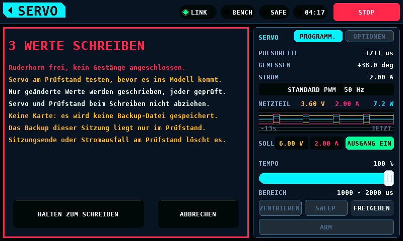

Nach einem solchen Schreiben zeigt der Reiter SERVO
`Keine Backup-Datei: keine Karte. Nur Backup der Sitzung.` anstelle des
Dateinamens. Die einzige Kopie des Servos, wie es vorgefunden wurde, ist
das Backup der Sitzung im Koprozessor: **VERLASSEN**, ein Neustart des
Koprozessors und ein Stromausfall des Prüfstands beenden es, und die Werte,
die das Servo vor dem Schreiben hielt, sind dann aus dem Prüfstand nicht
wiederherstellbar.

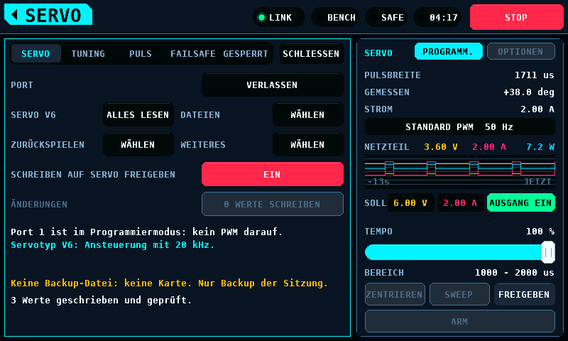

| Fall | Ergebnis |
| --- | --- |
| Eine Karte wird später in der Sitzung eingehängt | das nächste Schreiben, Zurückspielen oder Lösen des Pairings speichert zuerst die Backup-Datei. Die Datei hält das Backup der Sitzung, das vor dem ersten Schreiben gelesene Abbild, solange der Koprozessor es hält; ohne es hält die Datei das Servo, wie es zuletzt gelesen wurde. Die Zeile im Reiter SERVO wechselt zum Dateinamen |
| Ein Speichern über **DATEIEN** nach einem Schreiben ohne Karte | speichert das Servo, wie es steht; es zählt nicht als Backup-Datei |
| Die Karte wird entnommen, während eine Seite offen ist, die die Datei zusagt | das Halten sendet nichts, und die Seite kommt mit den drei Zeilen zurück; ihr eigenes Halten von 2 s sendet das Schreiben |
| Die Karte wird entnommen, nachdem die Backup-Datei gespeichert ist | spätere Schreiben der Sitzung werden gesendet; der Vermerk des Schreibens bleibt im RAM |
| **DATEIEN**, Speichern und Laden ohne Karte | abgelehnt: `Keine Karte. Nichts gespeichert, nichts aufs Servo.` |
| Eine Karte, die nach dem Start des Panels eingesteckt wird | das Panel versucht, eine Karte einzubinden, wenn der Programmierer öffnet und bei jedem Tippen auf **VERBINDEN**, **ALLES LESEN**, **DATEIEN**, **ZURÜCKSPIELEN**, **WEITERES**, **SCHREIBEN AUF SERVO FREIGEBEN** oder die Schreibzeile, solange keine eingebunden ist. Das Tippen, das die Karte findet, liest noch keine Karte; das nächste hat sie, und eine offene Schreibseite wechselt zur Seite mit der Datei |

### Laden

Ein Tipp auf eine Datei lädt sie. Ihre änderbaren Felder werden der
Entwurf, genau wie auf den Reitern eingegebene Änderungen: geänderte Werte
sind markiert, **n WERTE SCHREIBEN** zählt sie, und nichts erreicht das
Servo vor dem Schreibschalter, der Schreibseite und deren 2 s Halten.

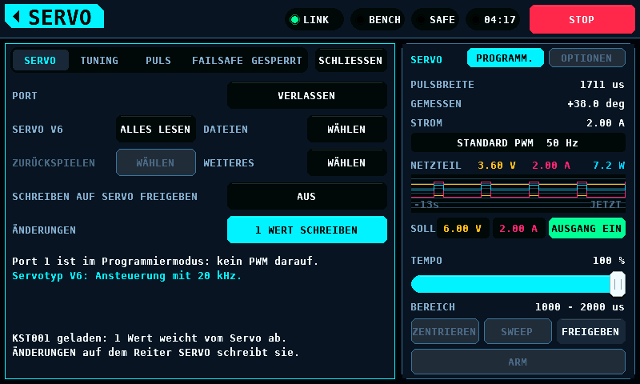

| Datei | Gezeigt |
| --- | --- |
| Vom Prüfstand gespeichert, Prüfsumme intakt | `KST001 geladen: 3 Werte weichen vom Servo ab.` oder `KST001 geladen: 1 Wert weicht vom Servo ab.` |
| Bearbeitet, mit Typzeile und ohne Prüfsummenzeile | dasselbe und `Bearbeitete Datei, Werte wie Handeingabe geprüft.` |
| Bearbeitet, ohne Typzeile | dasselbe und `Bearbeitete Datei ohne Servotyp, wie Handeingabe geprüft.` |
| Enthält die änderbaren Werte des Servos | `KST001 enthält die Werte des Servos: nichts zu schreiben.` |
| Vom anderen Servotyp | `Datei ist V8, Servo ist V6. Nicht geladen.` |
| Prüfsummenzeile vorhanden und falsch | `Datei beschädigt: Prüfsumme passt nicht. Nicht geladen.` `Ohne Prüfsummenzeile lädt sie als bearbeitete Datei.` |
| Keine Servodatei | `Keine Servodatei. Nicht geladen.` |
| Eine Zeile, die sich nicht lesen lässt | `Zeile 12 der Datei ist nicht lesbar. Nicht geladen.` |
| Von einer späteren Formatversion geschrieben | `Die Datei braucht eine neuere Version. Nicht geladen.` |
| Ein Wert außerhalb seines harten Limits | `Zeile 9: MAX. DUTY außer Grenze. Nicht geladen.` |
| Werte, die zusammen ein hartes Limit verletzen | `Die Datei verletzt eine Grenze, nicht geladen:` und die Zeile des Limits |
| Die Karte lässt sich nicht lesen oder antwortet nicht binnen 5 s | `Die Karte lässt sich nicht lesen.` |
| Keine Servodatei auf der Karte | `Keine Servodateien auf der Karte.` |

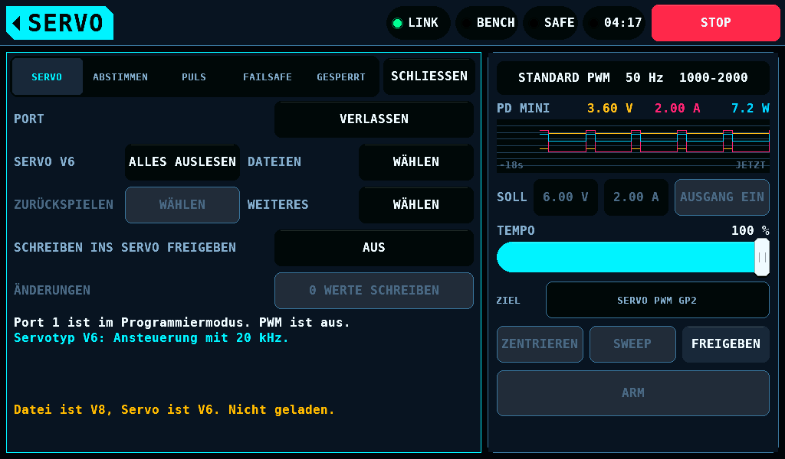
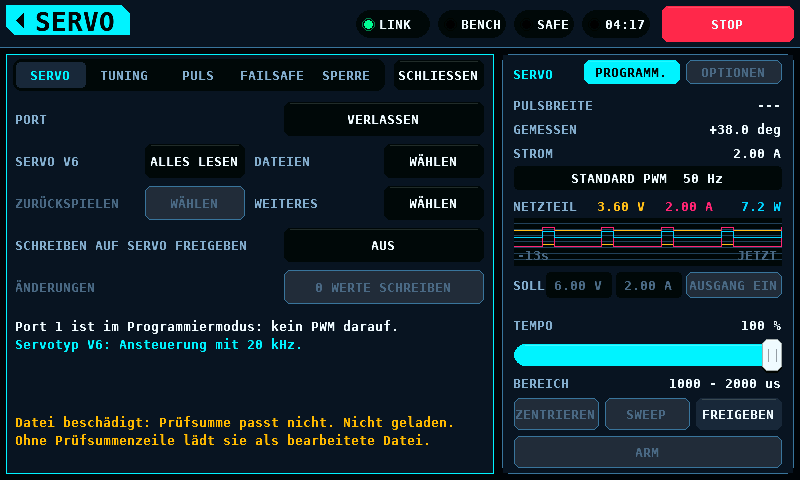
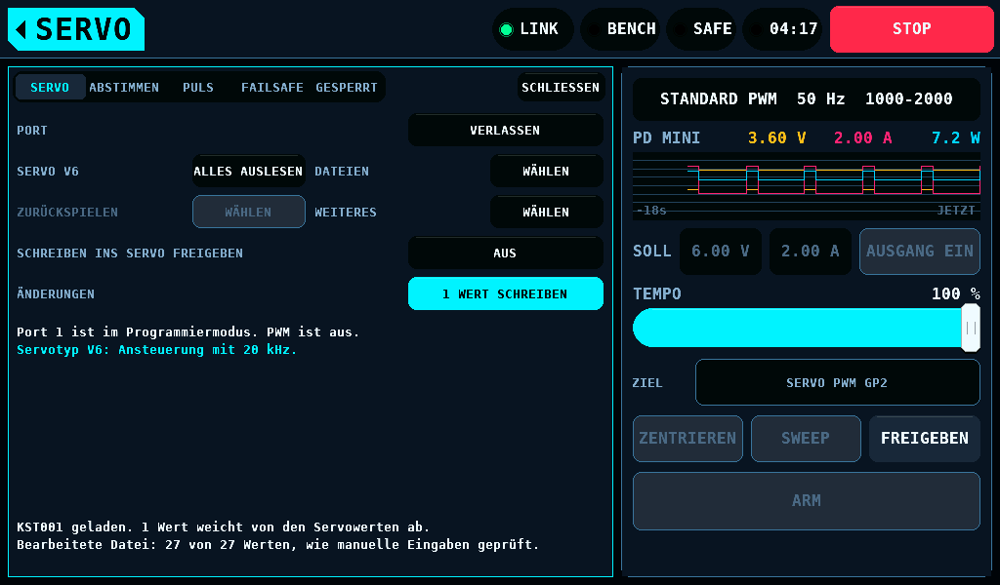
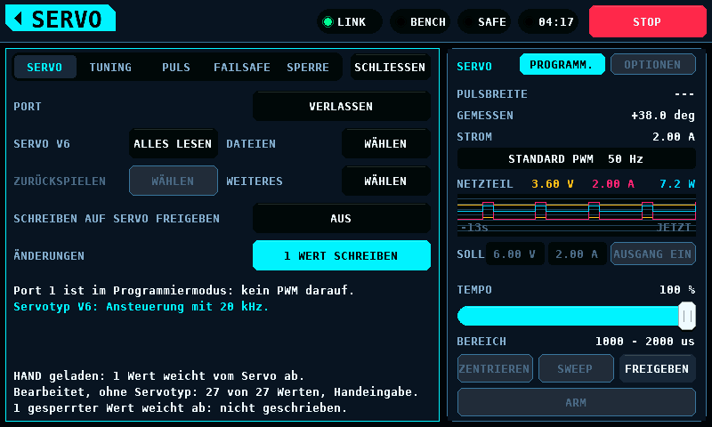
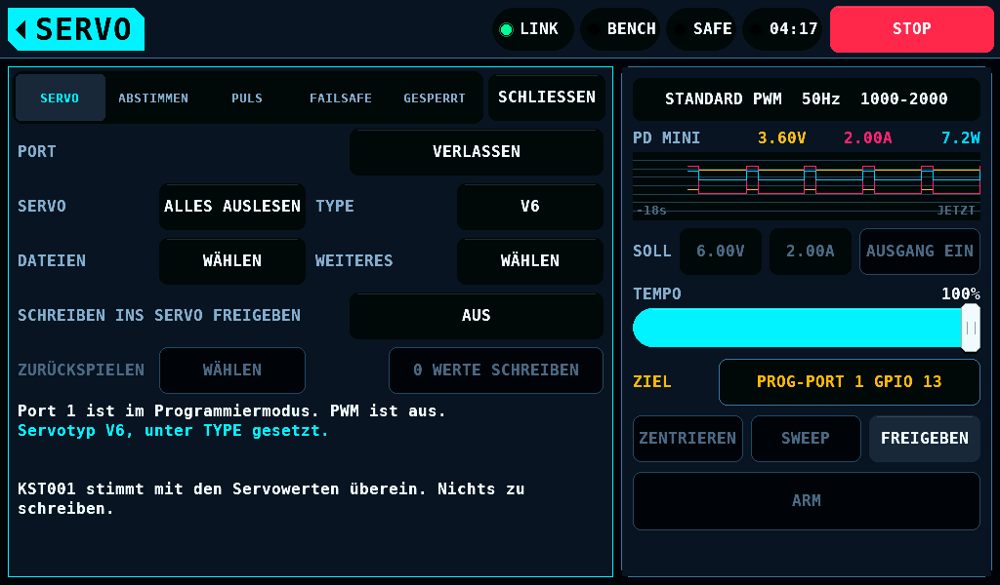
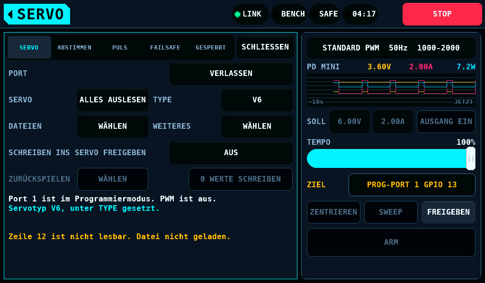
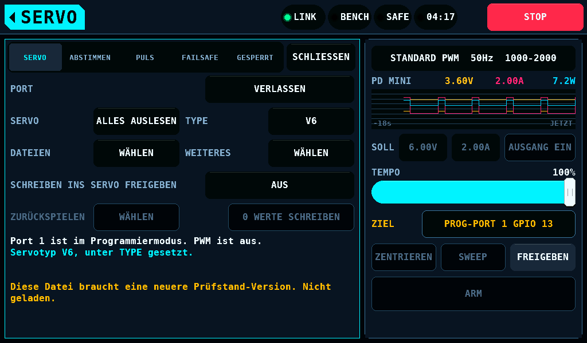
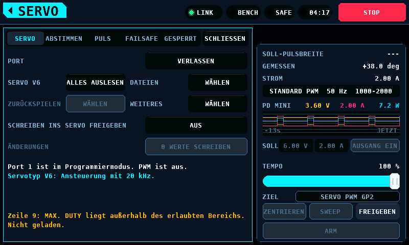

Eine Datei, deren Werte ein weiches Limit überschreiten, das die Werte des
Servos einhalten, öffnet DIESE DATEI PRÜFEN, bevor etwas zum Entwurf wird.
Die Seite listet dieselben Warnzeilen wie eine Änderung über diese Limits
hinaus, höchstens 5; bei mehr zählt die letzte Zeile den Rest. **HALTEN ZUM
LADEN** für 2 s übernimmt die Werte in den Entwurf. **ABBRECHEN** lässt den
Entwurf, wie er war.

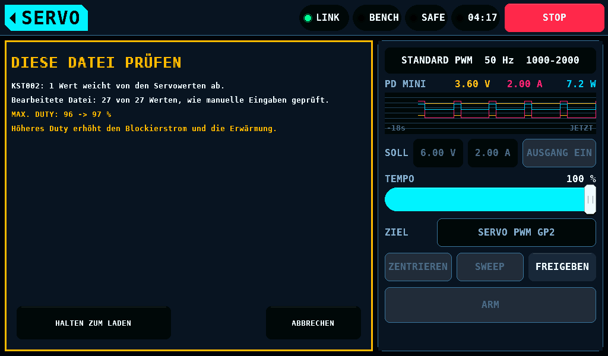

### Was eine Datei nicht zurückspielt

Ein Laden schreibt nur die änderbaren Felder. Diese bleiben, wie das Servo
sie hält, was immer die Datei sagt:

- der Servotyp, 20k_sel,
- Lock,
- der Modus, Servo oder Gyro Servo,
- der Schutzblock des Reiters GESPERRT,
- der Pairing-Wert, Register 1D,
- Register 00 und jedes Bit, das zu keinem benannten Feld gehört.

Eine Datei, die dort abweicht, wird geladen, und die Abweichung wird
gezählt: `2 gesperrte Werte weichen ab: nicht geschrieben.` oder
`1 gesperrter Wert weicht ab: nicht geschrieben.` Der Reiter GESPERRT
markiert jeden solchen Wert mit `!`. Eine Datei ohne Typzeile, die das
20k_sel des anderen Typs enthält, wird genauso geladen, denn nur die
Typzeile lehnt ein Laden ab.

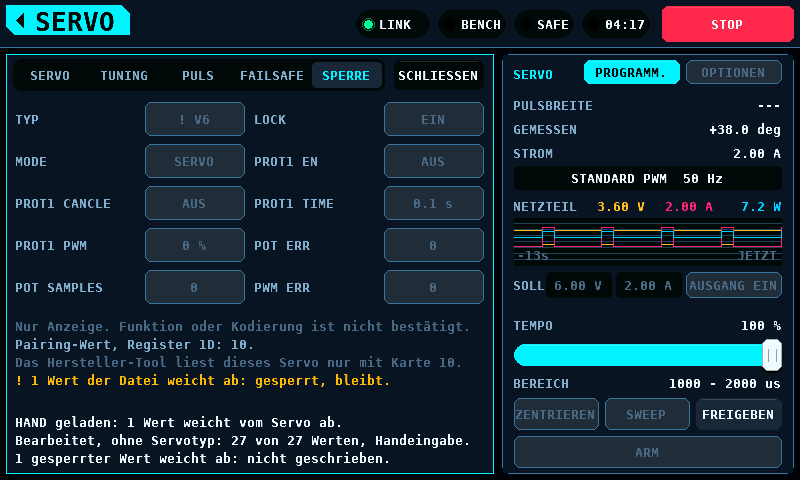

Das Zurückspielen des Backups der Sitzung ist der einzige Weg, ein
gesperrtes Register zu schreiben, und es endet mit der Sitzung.

## Zurückspielen

**ZURÜCKSPIELEN** öffnet die Liste dessen, was sich zurückspielen lässt.
Jedes Zurückspielen braucht den Schreibschalter und 2 s Halten.

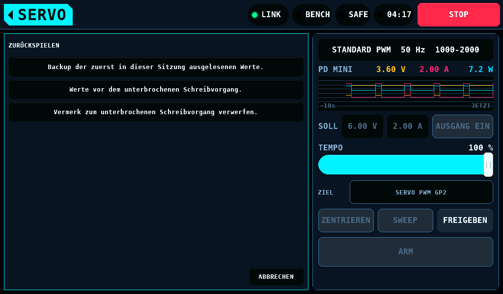
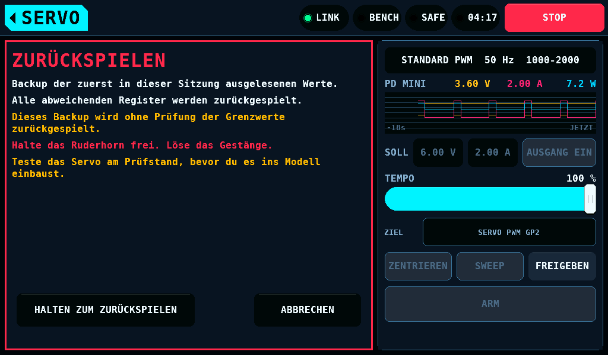

| Quelle | Zurückgeschrieben | Nicht zurückgespielt |
| --- | --- | --- |
| `Backup dieser Sitzung, wie zuerst gelesen` | jedes abweichende Register, vom Koprozessor aus dem Abbild, das er selbst hält; ohne die Limit-Prüfungen, und die Seite sagt es | nichts |
| `Werte vor dem unterbrochenen Schreiben` | die änderbaren Felder, als Schreiben mit jeder Limit-Prüfung | die gesperrten Felder, Register 00 und der Pairing-Wert |

Ein Zurückspielen aus dem Abbild des Panels ist ein gewöhnliches
Schreiben: der Koprozessor nimmt ein ungeprüftes Zurückspielen nur für das
Backup an, das er selbst hält, und diese Prüfung wird nicht abgeschwächt.
Die Seite zählt die gesperrten Werte, die abweichen und bleiben:
`2 gesperrte Werte weichen ab und bleiben.` oder
`1 gesperrter Wert weicht ab und bleibt.` Eine Servodatei steht nicht in
dieser Liste: [ein Laden](#laden) macht sie zum Entwurf, und das
gewöhnliche Schreiben sendet ihn.

Ein Backup, dessen Werte ein weiches Limit überschreiten, das die Werte des
Servos einhalten, öffnet zuerst BACKUP PRÜFEN. Die Seite listet die
Warnungen dieser Limits, dieselben Zeilen wie bei einer Änderung über sie
hinaus, höchstens 5; bei mehr als 5 zählt die fünfte Zeile den Rest.
**HALTEN ZUM FORTFAHREN** für 2 s öffnet die Seite des Zurückspielens, die
ein eigenes Drücken und 2 s Halten braucht. Das Zurückspielen des Backups
der Sitzung wird genauso geprüft, solange die Werte des Servos bekannt sind.

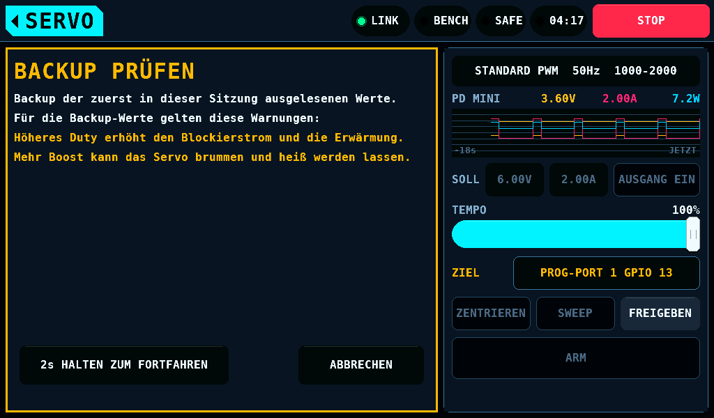

Das Backup der Sitzung gehört zu dem Servo, von dem es gelesen wurde. Eine
Lesung, die vom Backup in einem Feld abweicht, das kein Schreiben der
Sitzung ändern sollte, ist ein anderes Servo: `Anderes Servo: das Backup
der Sitzung gehört nicht dazu.` `VERLASSEN, dann VERBINDEN: Sitzung mit
eigenem Backup.` Der Schreibschalter geht aus, die Liste zum Zurückspielen
enthält das Backup der Sitzung nicht, und kein Zurückspielen davon wird
gesendet. **VERLASSEN** und **VERBINDEN** beginnen eine Sitzung, deren
Backup das dieses Servos ist. Eine Lesung des ersten Servos bringt sein
Backup zurück. Ein Schreiben, das die Karte, ein Stopp oder der Koprozessor
nicht starten lässt, zählt nicht als Schreiben: seine Felder unterscheiden
die Servos weiterhin. Zwei Servos, die in jedem Feld gleich sind, das die Sitzung
nicht geschrieben hat, werden nicht unterschieden. Nach einem
Verbindungsverlust oder einem Start des Panels unter einer Sitzung sind die
Schreibvorgänge der Sitzung nicht bekannt, und der Vergleich findet nicht
statt.

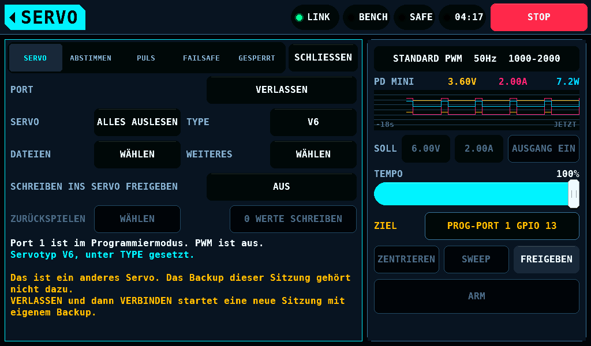

## Weiteres


- **PRÜFEN** liest alle Register und vergleicht sie mit dem gehaltenen
  Abbild: `Geprüft: das Servo hält, was gelesen wurde.` oder die Zahl der
  abweichenden Register.
- **ÄNDERUNGEN VERWERFEN** setzt den Entwurf auf die Werte des Servos
  zurück.
- **PAIRING LÖSEN** setzt Register 1D auf 00, nach dem Schreibschalter und
  2 s Halten. Was das Servo mit dem Wert tut, ist nicht bekannt. Das
  Zurückspielen des Backups der Sitzung setzt ihn zurück.


## Ein unterbrochenes Schreiben

Ein Schreiben gilt als unterbrochen, wenn der Link wegfällt, der
Koprozessor oder das Panel neu startet, **ABBRECHEN** oder ein Stopp es
beendet oder binnen 30 s kein Ergebnis kommt. Der Vermerk von vor dem
Schreiben bleibt dann stehen, auf der Karte auch über ein Aus- und
Einschalten des Prüfstands.


`Schreiben unterbrochen. Servo ist evtl. halb beschrieben.` bleibt stehen,
bis das Servo gelesen ist, darunter der Port des Schreibens: `Nicht
benutzen. An Port 1 verbinden und ALLES LESEN.` Jedes Bedienelement außer
**VERBINDEN**, **ALLES LESEN**, **ZURÜCKSPIELEN** und **VERLASSEN** ist
aus. Das Lesen vergleicht das Servo mit dem Vermerk:

| Das Servo hält | Meldung | Danach |
| --- | --- | --- |
| das Abbild vor dem Schreiben | `Das Servo hält, was es vor dem Schreiben hielt.` | der Vermerk ist gelöscht |
| das Abbild, das das Schreiben hinterlassen sollte | `Das Servo hält die Werte des unterbrochenen Schreibens.` | der Vermerk ist gelöscht |
| etwas anderes | `Das Servo hält eine Mischung alter und neuer Werte.` `Servo nicht benutzen. Backup zurück: ZURÜCKSPIELEN.` | **ZURÜCKSPIELEN** bietet das Backup der Sitzung an, solange die Sitzung lebt, und `Werte vor dem unterbrochenen Schreiben` |


`Vermerk des unterbrochenen Schreibens verwerfen` in der Liste entfernt den
Vermerk ohne ein Schreiben.

Der Vermerk gehört zu einem Servo. Ein Servo, das an einem anderen Port
gelesen wird oder vom Vermerk in einem Wert abweicht, den weder das
Schreiben noch eine Änderung verändert, ist nicht dieses Servo: `Das ist
nicht das Servo des unterbrochenen Schreibens.` `Es war an Port 2.
ZURÜCKSPIELEN: Vermerk verwerfen.` Solange das steht, wird nichts
zurückgespielt, geändert oder geschrieben, und **ZURÜCKSPIELEN** enthält
nur den Eintrag zum Verwerfen. **VERLASSEN** und ein **VERBINDEN** des
Servos des Schreibens bringen den Vergleich von oben. Zwei Servos am selben
Port mit gleichen gesperrten Werten werden nicht unterschieden.


Max. Duty liegt in den Registern 01 und 02. Ein Schreiben, das zwischen
diesen beiden abreißt, hinterlässt ein Abbild, das ein hartes Limit
verletzt, und das Zurückspielen des Panels, ein geprüftes Schreiben,
startet von einem solchen Abbild nicht. Das Zurückspielen des Backups der
Sitzung tut es. Nach einem Neustart des Koprozessors in diesem Zustand
liest der Programmierer das Servo und schreibt nichts darauf.

## Verlassen

**VERLASSEN**, oder **SCHLIESSEN** im Programmiermodus, verlangt, die
Sitzung zu beenden und den Port an Servo-PWM zurückzugeben. Der
Programmierer tut das ohne Aus- und Einschalten der Versorgung: das Servo
bleibt versorgt, der Ausgang eines PD mini bleibt mit seiner Spannung und
Stromgrenze an, und das Signal des Testers folgt auf demselben Port. Ob ein
KST-Servo, das einen Frame erhalten hat, PWM folgt, bevor seine Versorgung
aus war, ist nicht gemessen.

PROGRAMMIEREN VERLASSEN öffnet mit
`Der Port geht zurück auf Servo-PWM. Versorgung bleibt.` und
`Das Servo bekommt das Signal des Testers, es kann fahren.` Die Seite
warnt, bevor geänderte Werte verloren gehen und bevor eine Sitzung endet,
die ein unklares Servo noch zurückspielen könnte. **HALTEN ZUM VERLASSEN**
für 2 s sendet den Vorgang LEAVE des Ports aus der Link-Version 4.15. Kein
Frame geht an das Servo und kein Versorgungsbefehl an den PD mini. Der Port
hält seine Leitung für [**WARTEN VOR PWM**](#die-versorgung) auf Low und
gibt den Pin dann an den PWM-Generator.


Die Seite ist dieselbe, wenn ein PD mini antwortet.


Die Zustandszeile zeigt
`Verlasse den Programmiermodus. PWM ist noch nicht an.`, und die
Bedienelemente des Testers bleiben aus, bis der Port PWM meldet. Die Taste
heißt **ABBRECHEN**, solange das Warten läuft. Danach steht
`Der Tester hat den Port wieder.`, und der Tester treibt den Port sofort,
mit **PWM-ZIEL** auf **PROG-PORT** und **PORT-PWM** ein. Das nächste
**VERBINDEN** beginnt eine neue Sitzung mit eigenem Lesen.

### Das Warten vor PWM

**WARTEN VOR PWM** ist 0 bis 10 000 ms, ab Werk 100 ms. Der Ziffernblock
nimmt keinen Wert über 10 000 ms an, und mit einem solchen wird kein
Verlassen gesendet. Ein Warten von 0 ms endet beim nächsten Durchlauf des
Koprozessors. Die Restzeit eines laufenden Wartens wird nicht angezeigt.
Das Warten, das ein KST-Servo braucht, ist nicht gemessen.

| Während des Wartens | Wirkung |
| --- | --- |
| **ABBRECHEN** | der Port bleibt im Programmiermodus, die Sitzung wie zuvor; `Verlassen wurde vor Ende der Wartezeit unterbrochen.`; **VERLASSEN** wird sofort wieder angenommen |
| **STOP** oder ein Disarm des Prüfstands, kein PD mini antwortet | dieselbe Zeile; der Port bleibt im Programmiermodus und verlangt **ALLES LESEN** |
| Der Ausgang der Versorgung liest aus oder wird ausgeschaltet: **STOP** mit antwortendem PD mini, der eigene Schutz des PD mini | dieselbe Zeile; die Versorgung bleibt 2000 ms aus, dann ist der Port in PWM |
| Der Link fällt aus | wie [ein Ausfall des Links](#stopps-und-ausfälle) |

### Ein Port, der nicht verlassen wird

Der Port lehnt ein Verlassen ab, solange er ein Lesen verlangt oder ein
Servo hält, das ein Schreiben unklar hinterlassen hat.

| Der Port | Ein PD mini antwortet | Zeile | Ausweg |
| --- | --- | --- | --- |
| verlangt nach einem Stopp oder Abbruch ein Lesen | ja | `Der Port verlangt zuerst ein Lesen: ALLES LESEN.` | **ALLES LESEN**, dann **VERLASSEN**; oder **STOP**, das die Versorgung ausschaltet |
| hält ein unklares Servo | ja | `Servo unklar: Port hält die Sitzung. Erst ZURÜCKSPIELEN.` und `STOP beendet die Sitzung und schaltet die Versorgung aus.` | **ZURÜCKSPIELEN**, dann **VERLASSEN**; oder **STOP** |
| eines von beiden | nein | `Der Tester hat den Port wieder.` und `Die Sitzung war unklar: kein Warten vor PWM.` | keiner nötig: der Port ist in PWM |

Ohne PD mini schaltet **STOP** keine Versorgung und lässt den Port im
Programmiermodus, und ein Servo, das nicht mehr antwortet, nimmt kein Lesen
an. Das Panel sendet dann den Vorgang POWER_CYCLED des Ports statt LEAVE.
Ohne PD mini ändert er nur den Zustand des Ports: kein Frame, kein Warten,
und die Versorgung des Servos ist die, die es speist. Der Datensatz eines
unterbrochenen Schreibens bleibt für die nächste Sitzung.

### Ein Koprozessor vor Link-Version 4.15

Die Link-Versionen 4.13 und 4.14 haben kein LEAVE. Das Panel sendet ihnen
keines.

| Ein PD mini antwortet | Das Panel | Zeilen |
| --- | --- | --- |
| nein | sendet POWER_CYCLED, das nur den Zustand des Ports ändert; der Port ist ohne Warten in PWM | `Der Tester hat den Port wieder.` und `Koprozessor älter als 4.15: kein Warten vor PWM.` |
| ja | sendet nichts: beide Vorgänge dieser Versionen für den Schritt schalten die Versorgung aus und wieder ein. Die Sitzung bleibt | `Verlassen mit PD mini braucht den Koprozessor ab 4.15.` und `STOP beendet die Sitzung und schaltet die Versorgung aus.` |

Mit einem PD mini an einem solchen Koprozessor beendet **STOP** oder der
ausgeschaltete Ausgang der Versorgung die Sitzung: die Versorgung bleibt
2000 ms aus, und der Port ist wieder in PWM.

## Stopps und Ausfälle

| Ereignis | Wirkung |
| --- | --- |
| **STOP**, ein gehaltener Stopp des Prüfstands | der laufende Vorgang endet nach dem Frame auf der Leitung, höchstens 12 ms; der Schalter geht aus; `STOP: der Vorgang wurde abgebrochen.`; der Port verlangt **ALLES LESEN** vor allem anderen. Der Ausgang eines PD mini wird ausgeschaltet, und der Port ist 2000 ms, nachdem er aus liest, wieder in PWM |
| **ABBRECHEN** | dasselbe, ohne den gehaltenen Stopp |
| Der Link fällt weg | der Schalter geht aus, offene Seiten schließen; ein laufendes Schreiben ist [unterbrochen](#ein-unterbrochenes-schreiben) |
| Der Koprozessor startet neu | seine Sitzung und sein Backup sind weg; `Koprozessor neu gestartet. VERBINDEN und ALLES LESEN.` |
| Die Control-Task des Panels nimmt 2 s kein Kommando an | nichts wird gesendet; `Kein Ergebnis vom Koprozessor. ALLES LESEN.` |
| 3 Austausche mit dem Koprozessor in Folge bleiben unbeantwortet | `Keine Antwort vom Koprozessor. ALLES LESEN.`; nach einem Lesen oder Prüfen werden die Werte auf dem Panel vor einem **ALLES LESEN**, das endet, nicht geändert, gespeichert oder geschrieben |
| 30 s kein Ergebnis eines Vorgangs, gezählt ab der letzten Meldung des Ports, dass der Vorgang läuft oder plant | der Vorgang wird abgebrochen; `Kein Ergebnis vom Koprozessor. ALLES LESEN.`; die Werte auf dem Panel werden vor einem **ALLES LESEN**, das endet, nicht geändert, gespeichert oder geschrieben; ein Schreiben ist [unterbrochen](#ein-unterbrochenes-schreiben) |

Jede Ablehnung des Ports und jedes Ergebnis der Sitzung hat seine eigene
Zeile. [Die Link-Page](Link-de.md#der-programmierport-für-servos-von-kst-und-chaservo) listet die
Codes.

## Einschränkungen

- An keinem Servo getestet. Jede Aussage über das Verhalten eines Servos
  auf dieser Seite ist die des Modells.
- Kein Chaservo-Servo ist gelesen worden.
- Der Datensatz eines unterbrochenen Schreibens wird beim Start des Panels
  von der Karte gelesen, und von einer später eingesteckten Karte, wenn der
  Programmierer sie einbindet. Ein Datensatz, den das Panel schon hält,
  bleibt, vor und nach dem Zurücklesen des Servos: der Datensatz auf einer
  solchen Karte wird dann nicht gelesen, und der nächste geschriebene
  Datensatz ersetzt ihn.
- Eine Karte, die im Betrieb entnommen und wieder eingesteckt wird, wird
  nicht erneut eingebunden.
- Wie lange ein Einbindeversuch ohne Karte den Bildschirm anhält, ist nicht
  gemessen.
- Nicht auf Hardware gelaufen: kein Firmware-Image hat diesen Code mit
  einem Servo, einer Karte oder einem PD mini ausgeführt.
- Ob ein KST-Servo PWM folgt, während es im Programmiermodus ist, ist nicht
  gemessen. Der Programmierer verlässt das Programmieren ohne Aus- und
  Einschalten der Versorgung und treibt den Port danach mit PWM.
- Ob ein geschriebener Wert vor dem nächsten Einschalten des Servos wirkt,
  ist nicht gemessen. Der Programmierer behandelt einen Wert, der sich
  zurücklesen lässt, als wirksam.
- Antwortet ein PD mini an einem Koprozessor vor Link-Version 4.15, wird
  der Port nicht aus dem Programmierer verlassen: **STOP** oder der
  ausgeschaltete Ausgang der Versorgung beendet die Sitzung, mit
  ausgeschalteter Versorgung.
- Antwortet ein PD mini, wird ein Port mit einem unklaren Servo durch
  **ZURÜCKSPIELEN** und **VERLASSEN** verlassen, oder durch **STOP** mit
  ausgeschalteter Versorgung.
- **WARTEN VOR PWM** wird von einem Koprozessor vor Link-Version 4.15 nicht
  angewendet, und nicht beim Verlassen eines unklaren Ports ohne PD mini.
  Das Warten, das ein KST-Servo braucht, ist nicht gemessen. Die Restzeit
  eines laufenden Wartens wird nicht angezeigt.
- Ohne PD mini werden die Programmierspannung und die Stromgrenze nicht
  angewendet.
- Kein Speichern, Auflisten oder Laden einer Servodatei ist auf einer
  Karte gelaufen.
- Die Liste der Dateien reicht bis zu den ersten 64 Dateien nach Namen.
- Ein Schreiben ohne Karte hinterlässt keine Backup-Datei. Das Backup der
  Sitzung ist dann die einzige Kopie des Servos, wie es vorgefunden wurde,
  und endet mit **VERLASSEN**, einem Neustart des Koprozessors oder einem
  Stromausfall des Prüfstands.
- Das erste Schreiben einer Sitzung mit eingehängter Karte braucht freien
  Platz auf ihr.
- Eine Servodatei trägt den Servotyp, V6 oder V8, und keine weitere
  Identität. Die Datei eines V8-Servos lädt in jedes V8-Servo.
- Eine Servodatei spielt nur die änderbaren Felder zurück:
  [was sie nicht zurückspielt](#was-eine-datei-nicht-zurückspielt).
- Die Liste zeigt 5 Dateien je Seite, nach Namen sortiert, und hat keine
  Suche. Dateien werden auf dem Panel nicht entfernt oder umbenannt.
- Der Vermerk eines unterbrochenen Schreibens nennt seinen Port und hält
  die Werte des Servos. Ein zweites Servo an diesem Port mit denselben
  gesperrten Werten wird für das erste gehalten.
- Das Ersetzen von `KST.TXT` über `KST.NEW` ist nicht auf einer Karte
  gelaufen.
- Ohne Karte geht der Vermerk eines Schreibens beim Ausschalten verloren.
- Der beim Einschalten gefundene Vermerk eines unterbrochenen Schreibens
  wird nur im Programmierer gezeigt; kein anderer Bildschirm meldet ihn.
- Ein Servo, dessen gelesenes Abbild ein hartes Limit verletzt, lässt sich
  lesen und speichern. Ein Schreiben darauf wird abgelehnt.
- LEFT ANGLE und RIGHT ANGLE sind die Zahlen des Hersteller-Tools; ihre
  Einheit ist nicht bekannt.
- Die Versorgungsspannung, die ein Servo im Programmiermodus braucht, ist
  nicht bekannt.

## Offene Messungen

Keine davon ist erfolgt.

1. Die Elektrik der Leitung auf dem Pfad des Ports: Pegel von Prüfstand und
   Servo, welche Seite die Leitung in Ruhe auf Low hält, der Pull-down, die
   Ausgangsimpedanz des Servos und die Zeit, in der beide Seiten treiben.
2. Der Zustand des Motors im Programmiermodus und ob ein geschriebener Wert
   sofort wirkt.
3. Was das Servo im Programmiermodus mit einem PWM-Puls tut und außerhalb
   davon mit einem Frame.
4. Persistenz: ob ein geschriebener Wert ein Aus- und Einschalten
   übersteht und ob es einen Commit-Schritt gibt.
5. Zuverlässigkeit des Schreibens: 1000 Schreibvorgänge mit Rücklesen, die
   Zahl der nicht übernommenen, die Zahl der ungefragt geänderten Register,
   die Streuung der Antwortverzögerung.
6. Die Lesefehlerrate an 1 m Leitung, während andere Servos an
   benachbarten Ausgängen laufen: 100.000 Lesungen.
7. Das Timing von Einstieg und Ausstieg: wie lange stromlos den
   Programmiermodus beendet, ob ein Servo nach dem Programmieren ohne Aus-
   und Einschalten PWM folgt, und das Warten, das es vor dem ersten Puls
   braucht.
8. Die Funktion jeder änderbaren Einstellung an einem Servo, das verloren
   gehen darf: Position, Stellzeit, Blockierstrom, Ruhestrom und Schwingen
   über dem Wert.
9. Die Toleranz der Senderate um 25,40 µs je Halbzelle und die kürzeste
   Pause zwischen Frames, die das Servo annimmt.
10. Ein zweites Servo desselben Typs und andere Generationen: Fingerprint,
    Antworttiming, Halbzelle.
11. Offene Kodierungen: die Konstanten von NEUTRAL, die 2 unbestätigten
    STRETCH-Codes, die Winkelfelder im Modus Gyro Servo und ob das
    Hersteller-Tool die Bereiche erzwingt, die es beschriftet.
12. Ein hier geschriebenes Servo wird vom Hersteller-Tool mit dessen Karte
    gelesen.
13. Der Typ des Servos, von dem das Layout stammt.
14. Ob 20k_sel die Servogenerationen so trennt, wie die Typregel annimmt:
    1 Servo ist aufgezeichnet, und kein V8-Servo ist gelesen worden.
15. Ein Speichern, ein Auflisten und ein Laden auf einer Karte: die Dauer
    jedes Vorgangs gegen die Grenze von 5 s und eine Karte, die während
    eines Speicherns entfernt wird.

## Tests

`test_prog_link` fährt die Panelseite des Ziels und des Pulsschalters des
Ports: einen Port ohne Pin, ein Ziel, das auf einen Prüfstand in Ruhe
wartet, einen Koprozessor, der neu startet. `test_kst_card` fährt die
Kartenseite der Dateien auf einer Karte im Arbeitsspeicher. `test_kst_prog`
fährt das Modell und `test_kst_panel` das Overlay, beide gegen den Port des
Koprozessors, ein Versorgungsmodell und das Servomodell durch den
Dispatcher des Links: die Bereiche der Versorgung an ihren Enden und einen
Schritt außerhalb, das Warten bei 0 ms, 100 ms, 10 000 ms und 10 001 ms als
Warten des Verlassens, ein Abbruch, ein Disarm und eine Versorgung, die im
Warten ausgeht, ein Verlassen an den Link-Versionen 4.13 und 4.14 mit und
ohne PD mini, **STOP** während eines Verlassens, jedes Limit an seiner Kante, das Halten von 2 s
auf beiden
Seiten der Schwelle, jede Ablehnung und jedes Ergebnis mit seiner Zeile in
beiden Sprachen, ein Schreiben, das ein Link-Ausfall, ein Neustart,
**ABBRECHEN** und **STOP** abschneiden, eine Karte, die versagt, und die
Timeouts über den Überlauf der Uhr bei 2^32 ms. Die Servodateien laufen
gegen ein Kartenmodell: jedes Ergebnis eines Namens, jede Art von Datei,
beide Servotypen und ihre Abweichung in beiden Richtungen, jede
Ablehnung, die Grenze von 5 s, ein erstes Schreiben mit einer Karte, die
voll ist oder versagt, und die Schreiben ohne Karte: das erste Schreiben,
ein Zurückspielen und ein Lösen des Pairings, ein früh losgelassenes
Halten, eine zwischen zwei Schreiben eingehängte Karte und eine unter der
Schreibseite entnommene Karte.
