# Servo-Programmierer für KST- und Chaservo-Servos

<sub>[English](ServoProgrammer.md) · **Deutsch**</sub>

Der Programmierer liest die 32 Register eines KST- oder Chaservo-Servos über
dessen Signalleitung, zeigt sie als Einstellungen und schreibt geänderte
Einstellungen zurück. Die Servos der zwei Marken teilen ein Protokoll und
einen Registersatz. Er öffnet sich mit seiner Zeile `KST- und
Chaservo-Servos` auf **PROGRAMMIEREN** des
[SERVO-Bildschirms](Screens-de.md#servo), eine Ebene tiefer, und bedeckt die
linke Spalte samt den Reitern der Leiste. **SCHLIESSEN** oder das Home-Tag
führt zurück zur Liste von PROGRAMMIEREN. Das Öffnen beendet einen laufenden
automatischen Test als `vom Bediener gestoppt`. Die Zeile ist mit
`IOMCU OHNE SERVO PWM` gedimmt und öffnet nichts, solange der IOmcu, die
RP2350-Platine, kein Servo-PWM meldet, auch wenn kein IOmcu antwortet.
Servos von Hitec haben eine eigene Programmierung auf derselben Liste und
demselben Port ([Servoprogrammierung für Hitec-Servos](HitecProgrammer-de.md));
solange sie den Port hält, ist diese Zeile mit `PORT BELEGT` gedimmt, und
ARM und das Netzteil bleiben gesperrt wie unter diesem Programmierer.

KST und Chaservo sind Namen oder Marken ihrer jeweiligen Inhaber. rcbench
ist unabhängig: es ist mit ihnen nicht verbunden und wird von ihnen weder
unterstützt noch gesponsert. Die Namen sagen, mit welchen Servos der
Programmierer arbeitet.
[Rechtliche Hinweise und Haftungsausschluss](../README-de.md#rechtliche-hinweise-und-haftungsausschluss)
enthält den Hinweis des Projekts.

Registerlayout und Timing stammen von 1 Tool Card #2, der
Programmierkarte von KST, und 1 Chaservo-Servo unbekannten Typs. Die Wirkung eines Registers auf die
Bewegung des Servos ist nicht gemessen: Namen, Einheiten und Limits sind
die, die das Hersteller-Tool anzeigt und annimmt.
[Was offen ist](#offene-messungen) nennt, was ein Prüfstand messen muss,
bevor man sich auf ein Schreiben verlässt.


## Randbedingungen

- Der IOmcu spricht Protokoll 4.13 oder neuer. Mit einem älteren sagt
  das Overlay `Nicht verfügbar: Der IOmcu hat keinen Programmierport.` und
  `IOmcu auf Version 0.17.0 oder neuer aktualisieren.`, und jedes
  Bedienelement außer **SCHLIESSEN** ist aus.
- **VERLASSEN** mit seinem Warten braucht Protokoll 4.15 auf dem
  IOmcu. Ein älterer wird
  [benannt und ohne es behandelt](#ein-iomcu-vor-link-version-415).

  

- Das Servo hängt an einem Programmierport des IOmcu, PROG-PORT 1 bis 4,
  mit FUNKTION SERVO PWM und einem Pin: Port 1 ist GPIO 13, Pad 17 des
  Bring-up-Moduls, solange kein anderer Pin dafür gespeichert ist; die
  Ports 2 bis 4 haben den Pin, der auf ihrem Eintrag PROG-PORT gesetzt ist.
  Ein Port ist kein Ausgangskanal und kein Slot von OUTPUTS.
- **SERVO-TESTER** nennt diesen Port: PORT 1, PORT 2, PORT 3 oder PORT 4
  ([das Ziel](#das-ziel)). Mit OUTPUTS, den Standardausgängen als Ziel,
  ist der Programmierer gesperrt.
- Ein Servo zur Zeit.
- Der Port ist in PWM (Pulsweitenmodulation) oder im Programmieren, nie in
  beidem. Solange der Port im Programmieren ist, sendet der Tester keinen
  Puls darauf, und seine Zeile **SOLL-PULSBREITE** zeigt `---`.
- Programmieren und ein Prüfstand in ARMED schließen sich aus.
  **VERBINDEN** wird abgelehnt mit
  `Zuerst DISARM tippen. Bei ARMED kann der Port nicht übernommen werden.`, wenn ARMED für
  irgendeine Rolle gilt, angefragt ist oder ein Finger auf **ARM** liegt. Solange der Port
  gehalten wird, von **VERBINDEN** bis er PWM meldet, setzt kein Bildschirm
  den Prüfstand auf ARMED: **ARM** auf SERVO und auf MOTOR & ESC ist
  gesperrt gezeichnet; ein Druck darauf schaltet nichts und zeigt den
  Hinweis `ARMED gesperrt: Die Servoprogrammierung belegt einen Port.` Ein
  Lauf des ESC-Stick-Programmierers startet nicht und meldet
  `Servoprogrammierung belegt einen Port. Zuerst auf SERVO auf VERLASSEN tippen.` Ein ARM, das den
  Prüfstand auf anderem Weg erreicht, wird mit demselben Hinweis
  abgelehnt. **DISARM**
  und **STOP** wirken in jedem Zustand. In ARMED werden das Lesen, das
  Prüfen, das Schreiben, das Zurückspielen und das Lösen der Kopplung mit
  derselben Zeile wie **VERBINDEN** abgelehnt; **VERLASSEN** wird
  angenommen.
- Antwortet ein PD mini, stellt der Port die Versorgung des Servos bei
  **VERBINDEN** ([die Versorgung](#die-versorgung)). Ohne einen stellt der
  Prüfstand die Versorgung nicht, und der Programmierer nimmt sie, wie sie
  ist.
- Ein Servo tritt nur aus einem Einschalten in den Programmiermodus ein
  und handelt nach einem geschriebenen Wert erst ab seinem nächsten
  Einschalten. Ein Chaservo am Prüfstand (2026-10-16) überging die
  Einstiegssequenz bei eingeschalteter Versorgung und folgte nach einem
  Schreiben keinem PWM, bis seine Versorgung 4s aus und wieder an war. Mit
  einem antwortenden PD mini schaltet der Programmierer die Versorgung bei
  **VERBINDEN** mit eingeschaltetem Ausgang und bei **VERLASSEN** nach
  einem Schreiben 1s aus und wieder ein; ohne ihn tut es der Bediener
  ([der Versorgungszyklus](#der-versorgungszyklus)).
- Der Bediener setzt den Servotyp, V6 oder V8, in der Zeile **TYPE**
  ([der Servotyp](#der-servotyp)). Der Vorschlag des Panels aus 20k_sel ist
  eine Vermutung und als solche markiert.
- Ob eine gegebene Hardware die Antwort des Servos zum Pin zurückführt,
  weiß der IOmcu nicht. Ein Servo an einem Port, der es nicht tut,
  beendet **VERBINDEN** mit
  `Kein Servo antwortet. Stecker, Versorgung und Port prüfen.`

## Das Ziel

Der Tester des SERVO-Bildschirms treibt die Standard-Servoausgänge oder
einen Programmierport: **SERVO-TESTER** hält OUTPUTS, PORT 1, PORT 2,
PORT 3 oder PORT 4. Zwei Bedienelemente stellen es,
auf jedem Eintrag PROG-PORT von **SETUP** > **OUTPUTS**:

| Bedienelement | Werte | Wirkung |
| --- | --- | --- |
| SERVO-TESTER | **OUTPUTS**, **PORT n** (der Port des Eintrags) | was der Sweep, **ZENTRIEREN**, **FREIGEBEN**, das Halten einer Stellung und der automatische Test treiben |
| PORT-PWM | **EIN**, **AUS** | ob der Programmierport den Puls des Testers ausgibt, solange er das Ziel ist |

Ein Tippen auf die Zeile ZIEL der rechten Karte öffnet **OUTPUTS** auf dem
Eintrag PROG-PORT, solange der IOmcu den Port treibt, auf SERVO PWM, solange
er die Ausgänge treibt, und auf der Übersicht, solange das Ziel nicht
bekannt ist. Die
Home-Tag dort führt zurück zu SERVO, auf die Aufgabe, auf der die Zeile
angetippt wurde. Das Verlassen von SERVO schaltet den Prüfstand auf SAFE
und beendet einen Sweep oder einen Test, wie jeder Weg aus dem Bildschirm.


Beide werden mit den SERVO-Einstellungen gehalten, SERVO-TESTER als
OUTPUTS, PORT 1, PORT 2, PORT 3 oder PORT 4. Die Zeile ZIEL nennt das
aktive Ziel mit Protokoll und Pins: `PROG-PORT 1 GPIO 13` in der Warnfarbe
oder `SERVO PWM GPIO 4` für die als SERVO PWM gebundenen Pins. Ein Port mit
FUNKTION KEINE ist kein Ziel: sein Eintrag sperrt **PORT n** und sagt
`DER SERVO-TESTER BRAUCHT FUNKTION SERVO PWM`. Ein gespeicherter Wert
1, der PROG-PORT eines Panels mit einem Port, gilt als PORT 1. **SERVO-TESTER**
wechselt nur bei einem Prüfstand in SAFE, ohne laufenden Sweep
und ohne laufenden Test, und wenn der Port nicht im Programmieren ist; das
Panel gibt eine gehaltene Stellung frei, bevor es den IOmcu um das
andere Ziel bittet. **PORT-PWM** geht nach derselben Regel ein. Es geht
aus, wenn der Port nicht im Programmieren ist und weder Sweep noch Test
läuft, in ARMED wie in SAFE. Mit **OUTPUTS** als Ziel ist **PORT-PWM**
gesperrt. Ein gesperrtes Segment ist umrandet und ohne Akzentfarbe
gezeichnet, und die Zeile darunter nennt den Grund:

| Zeile | Bedingung |
| --- | --- |
| `GESPERRT: DER SERVO-PROGRAMMIERER BELEGT DEN PORT` | der Programmierer hat den Port |
| `GESPERRT, SOLANGE ARMED ODER EIN TEST ODER SWEEP LÄUFT` | der Prüfstand ist ARMED oder soll es werden, oder ein Sweep oder ein Test läuft |
| `SERVO-TESTER STEUERT PROG-PORT 3` | der Eintrag eines anderen Ports: der Tester steuert Port 3 |
| `PORT-PWM BRAUCHT PROG-PORT ALS ZIEL DES TESTERS` | **PORT-PWM** auf einem Eintrag, dessen Port nicht das Ziel ist |

Die Zeile ZIEL auf der rechten Karte nimmt kein Tippen an, solange der
Prüfstand ARMED ist, ein Sweep oder ein Test läuft oder der Programmierer
den Port hat.

Solange der Programmierer den Port hat, ändert sich keine der beiden
Zeilen: von **VERBINDEN** bis der Port nach **VERLASSEN** wieder in PWM
ist, während jedes Vorgangs und solange der IOmcu den Port außerhalb
von PWM meldet. Die Zeile ZIEL und beide Segmente sind gesperrt gezeichnet, ein Zurücksetzen der
Einstellungen lässt die zwei Werte stehen, das Panel schreibt nichts in die
Seite des Ports im IOmcu, und der Tester sendet dem Port kein
Kommando und keine Freigabe. Eine dem Port geschuldete Freigabe geht
hinaus, sobald der Port wieder in PWM ist.

Ein Port ohne Pin kann nicht das Ziel sein: ein Slot von OUTPUTS, der GPIO 13
hält, lässt dem Port keinen. Der Tester behält dann die Standardausgänge,
was immer die Zeile sagt.

Mit den Standardausgängen als Ziel, SERVO-TESTER auf OUTPUTS, zeigt der
Programmierer
`Zum Programmieren muss das Servo am Programmierport angeschlossen sein.` und
`Unter SETUP > OUTPUTS den SERVO-TESTER auf PORT 1 bis PORT 4 stellen.`, und jedes
Bedienelement außer **SCHLIESSEN** ist aus. Er verbindet auf PORT 1, PORT 2,
PORT 3 oder PORT 4, dem Port, den SERVO-TESTER nennt, mit dessen Pin.


## Der Port

| Zustand | Zeile auf dem Reiter SERVO | Der Port führt |
| --- | --- | --- |
| PWM, ein PD mini antwortet, sein Ausgang aus | `Tester nutzt Port 1. VERBINDEN stellt 5.0V und 1000mA ein.` | die Pulse des Testers |
| PWM, ein PD mini antwortet, sein Ausgang ein | dasselbe und `VERBINDEN schaltet den Ausgang 1s aus und wieder ein: das Servo startet in den Programmiermodus.` | die Pulse des Testers |
| PWM, kein PD mini | `Tester nutzt Port 1. Kein PD mini: Versorgung bleibt unverändert.` und in der Warnfarbe `Servoversorgung aus- und einschalten, 1s später VERBINDEN tippen. Der Sync folgt 250ms danach.` | die Pulse des Testers |
| Verbinden | `Verbindung an Port 1 wird aufgebaut. PWM ist aus.` | 50ms keinen Puls, dann 100ms Low, dann die Einstiegssequenz |
| Die Versorgung aus, bei **VERBINDEN** mit eingeschaltetem Ausgang oder bei **VERLASSEN** nach einem Schreiben | `Port 1: Versorgung 1s aus. PWM ist aus.` | keinen Puls; die Leitung auf Low |
| Die Versorgung wieder an | `Port 1: Versorgung an, das Servo startet 1s lang. PWM ist aus.` | die Leitung 1000ms auf Low, dann die Einstiegssequenz, oder PWM nach **VERLASSEN** |
| Programmieren | `Port 1 ist im Programmiermodus. PWM ist aus.` | nur Frames |
| Programmieren, die Versorgung gelesen | `Port 1 im Programmiermodus. PWM aus. 5.00V, 37mA.` | nur Frames |
| Arbeiten | `Vorgang läuft: 12 Frames.` | die Frames des laufenden Vorgangs |
| Arbeiten, ein Schreiben von Werten | `3 Register werden geschrieben. Gesendete Frames: 94.` oder `1 Register wird geschrieben. Gesendete Frames: 31.` | die Frames des Schreibens; die Zahl nennt die Register, die das Schreiben setzt |
| Arbeiten, ein Zurückspielen des Backups der Sitzung oder ein Lösen des Pairings | `Schreibvorgang läuft. Gesendete Frames: 12.` | die Frames des Schreibens; der IOmcu plant es allein, und das Panel hat keine Zahl |
| Arbeiten, der IOmcu plant | `Schreibreihenfolge wird vorbereitet. Noch kein Frame gesendet.` | nichts: ein IOmcu der Link-Version 4.14 plant ein Schreiben oder ein Zurückspielen vor seinem ersten Frame |
| Verlassen | `Programmiermodus wird verlassen. PWM ist noch aus.` | die Leitung auf Low für **WARTEZEIT VOR PWM**; kein Puls, bis der Port PWM meldet |

**VERBINDEN** nimmt den Port aus PWM, stellt die Versorgung, wo ein PD mini
antwortet, fährt die Einstiegssequenz und liest alle 32 Register. Die Taste
heißt **ABBRECHEN**, solange ein Vorgang läuft oder ein Verlassen wartet,
und **VERLASSEN** im Programmiermodus.


Solange ein Schreiben, ein Zurückspielen oder ein Lösen des Pairings läuft,
zeigt der Reiter SERVO `Schreibvorgang läuft. Nicht trennen.` in der Warnfarbe, und
**ZURÜCKSPIELEN** nimmt keinen Tipp an. Der Vermerk dieses Schreibens liegt
auf der Karte oder im Speicher und wird nicht als
[unterbrochenes Schreiben](#ein-unterbrochenes-schreiben) gezeigt, bevor
das Schreiben ohne Ergebnis endet.

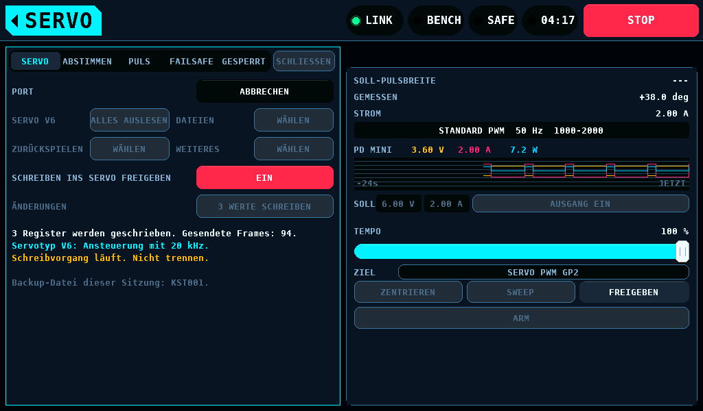

Solange der Port im Programmieren ist, bleibt das Overlay offen, die
Reiter der Leiste darunter nehmen keinen Druck, und die Bedienelemente des Testers senden nichts an
den Port. **SCHLIESSEN** und das Home-Tag öffnen PROGRAMMIERMODUS
VERLASSEN; über einem offenen Tastenfeld, einer Liste, einer Warnung oder
der Buchstabentastatur schließt das Home-Tag zuerst dieses Feld. **STOP**
auf der rechten Karte arbeitet. Das Verlassen des SERVO-Bildschirms lässt
den Port, wie er ist; beim nächsten Aufruf ist das Overlay auf
PROGRAMMIEREN wieder offen.

| **VERBINDEN** endet mit | Bedeutung |
| --- | --- |
| `Dem Programmierport ist kein Pin zugeordnet. Nichts gesendet.` | ein Slot von OUTPUTS hält den Pin des Ports |
| `Diesen Programmierport gibt es auf dem IOmcu nicht.` | der IOmcu hat weniger Ports als den angefragten |
| `Programmierspannung oder -strom überschreitet die SUPPLY-Grenzen.` und `Wert unter WEITERES senken oder Grenze erhöhen. Nichts übernommen.` | PROGRAMMIERSPANNUNG liegt über der Spannungsgrenze des SUPPLY-Bildschirms oder STROMBEGRENZUNG über seiner Stromgrenze; nichts wird gesendet |
| `Zuerst DISARM tippen. Bei ARMED kann der Port nicht übernommen werden.` | ARMED gilt oder ist angefragt; der IOmcu lehnt dasselbe von sich aus mit `Port belegt. Erneut versuchen.` ab |
| `Das Netzteil unterstützt diese Spannung oder Strombegrenzung nicht.` | die Spannung liegt über 8,4V, die Stromgrenze außerhalb 50 bis 3000mA, oder die Spannung, mit der die Session läuft, liegt weniger als 0,7V unter der Eingangsspannung des PD mini; die Versorgung wird nicht geändert |
| `Versorgung unter 4.8V. Programmieren benötigt mindestens 4.8V.` | die Programmierspannung oder die Spannung eines Ausgangs, der ein ist, liegt unter 4,8V; die Versorgung wird nicht geändert. Bei einem Ausgang, der ein ist und unter 4,8V gesetzt ist, sendet das Panel nichts an den IOmcu |
| `Versorgung hat nicht innerhalb von 3000ms geschaltet. Versorgung prüfen.` | der PD mini las nicht wie angefragt; der Port ist wieder in PWM, und ein Ausgang, den dieses **VERBINDEN** eingeschaltet hat, ist wieder aus |
| `IOmcu hat die Verbindung noch nicht freigegeben. Erneut versuchen.` | der IOmcu vertraut dem Heartbeat nicht, oder der Link war still |


### Der Versorgungszyklus

Ein KST- oder Chaservo-Servo tritt nur in den Programmiermodus ein, wenn
der Sync der Einstiegssequenz nach einem Einschalten kommt, und es handelt
nach einem geschriebenen Wert erst ab seinem nächsten Einschalten. Ein
Chaservo, als V6 gelesen, zeigte beides am Prüfstand (2026-10-16):

| Ausgangslage | Ergebnis |
| --- | --- |
| Das Servo im Leerlauf, der Ausgang des PD mini an mit 5,00V | **VERBINDEN** nahm den Port; **ALLES AUSLESEN** las nichts: `Servo nicht im Programmiermodus.` |
| Der Ausgang aus, **VERBINDEN** schaltet ihn ein | das Servo trat in den Programmiermodus ein; alle 32 Register gelesen |
| LEFT ANGLE und RIGHT ANGLE geschrieben und geprüft, **VERLASSEN** | das Servo folgte keinem PWM: das Ruderhorn blieb bei Pulsen von 1000us und 2000us innerhalb von 0,6deg |
| Der Ausgang 4s oder länger aus, dann an | das Servo folgte PWM mit den geschriebenen Werten: etwa 52deg Weg; der Weg vor dem Schreiben ist nicht gemessen |
| Die alten Werte zurückgeschrieben, der Ausgang aus und an | etwa 149deg Weg |

Das Panel schaltet die Versorgung deshalb aus und ein, wo es kann:

| Schritt | Ein PD mini antwortet, sein Ausgang an | Ein PD mini antwortet, sein Ausgang aus | Kein PD mini |
| --- | --- | --- | --- |
| **VERBINDEN** | der Ausgang 1000ms aus, an mit der niedrigeren der zwei Spannungen und der niedrigeren der zwei Stromgrenzen, die Leitung 1000ms auf Low, dann die Einstiegssequenz | der Ausgang an, die Leitung 1000ms auf Low, dann die Einstiegssequenz | die Einstiegssequenz 250ms nach dem Tippen: 50ms ohne Puls, 100ms Low, 100ms der Low-Leitung des Einstiegs. Der Bediener schaltet das Servo kurz davor ein |
| **VERLASSEN** nach einem Schreiben, Zurückspielen oder Lösen des Pairings | der Ausgang 1000ms aus, an, die Leitung 1000ms und dann für **WARTEZEIT VOR PWM** auf Low, dann PWM | kommt nicht vor: **VERBINDEN** schaltet den Ausgang ein | der Port kehrt zu PWM zurück; die Werte wirken, nachdem der Bediener die Servoversorgung aus- und wieder eingeschaltet hat |
| **VERLASSEN** ohne Geschriebenes | der Port kehrt nach **WARTEZEIT VOR PWM** zu PWM zurück; die Versorgung bleibt, wie sie ist | dasselbe | dasselbe |
| Ein Schreiben | kein Zyklus: das Rücklesen läuft im Programmiermodus | dasselbe | dasselbe |

Ohne PD mini nennt die Zeile unter dem Zustand den Schritt:
`Servoversorgung aus- und einschalten, 1s später VERBINDEN tippen. Der Sync folgt 250ms danach.` Der Port macht einen Versuch des Einstiegs und
wiederholt ihn nicht. Der Sync geht 250ms nach dem Tippen, ein Tippen 1s
nach dem Einschalten legt ihn also 1250ms nach das Einschalten, nahe an die
1000ms, die der Port einem selbst eingeschalteten Servo lässt. Wie lange
nach einem Einschalten ein Servo den Sync noch annimmt, ist nicht gemessen:
das Chaservo des Prüfstands nahm ihn 1000ms danach, ein KST-Servo an der
Karte des Herstellers etwa 3s danach.

Nach einem Schreiben trägt die Meldung eine zweite Zeile: mit PD mini
`Die Werte wirken nach VERLASSEN: es schaltet die Versorgung 1s aus und wieder ein.`,
ohne ihn `Die geschriebenen Werte wirken erst nach Aus- und Einschalten der Servoversorgung.`
PROGRAMMIERMODUS VERLASSEN nennt dasselbe, und die Meldung danach sagt,
was geschah: `Der Port ist wieder im Testermodus.` und
`Versorgung 1s aus und wieder ein: die geschriebenen Werte wirken.`, oder
ohne PD mini noch einmal den Hinweis.

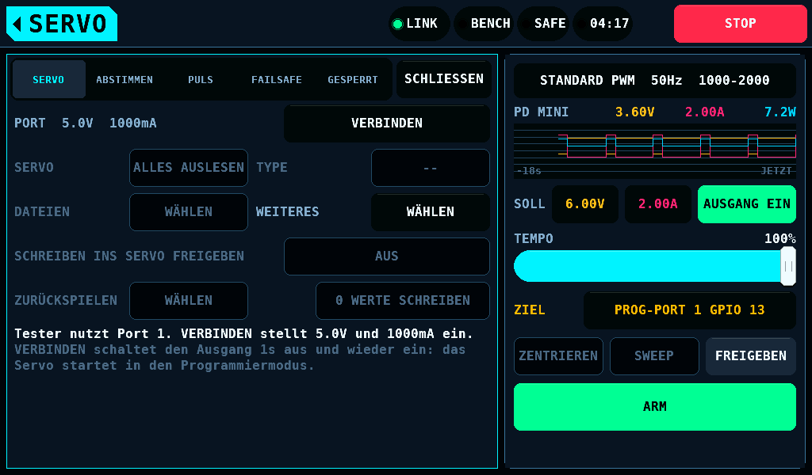
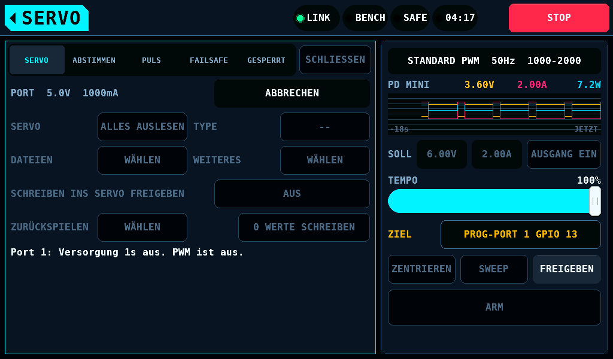
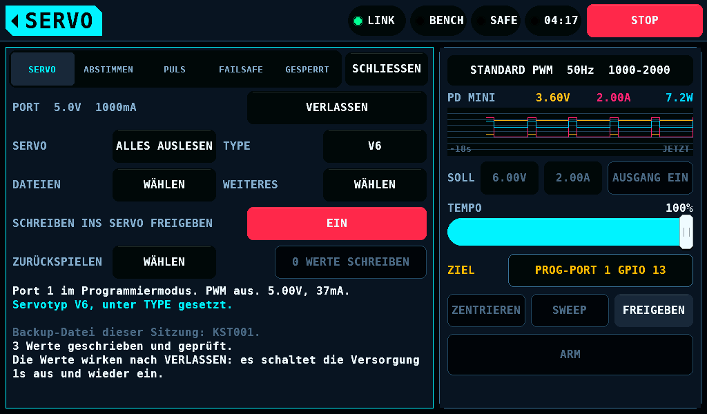
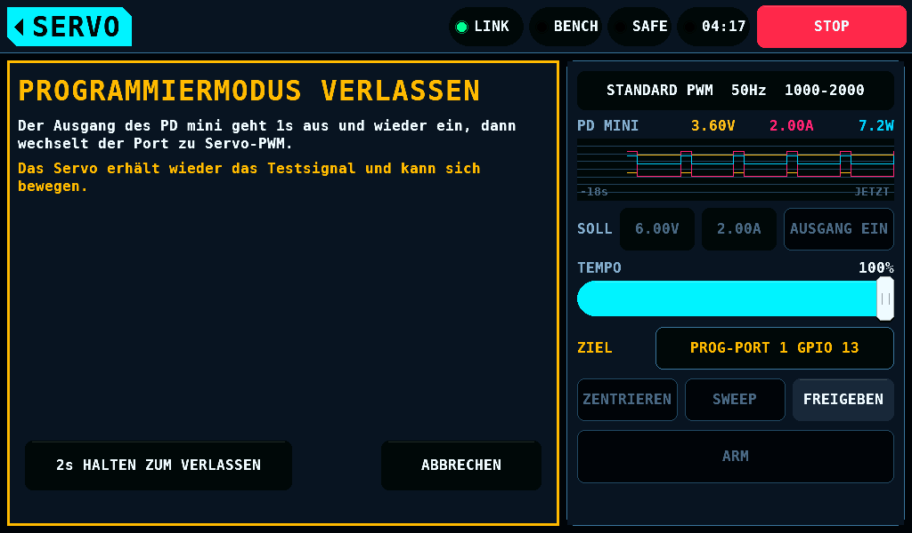
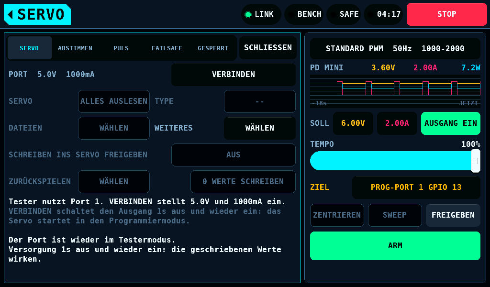
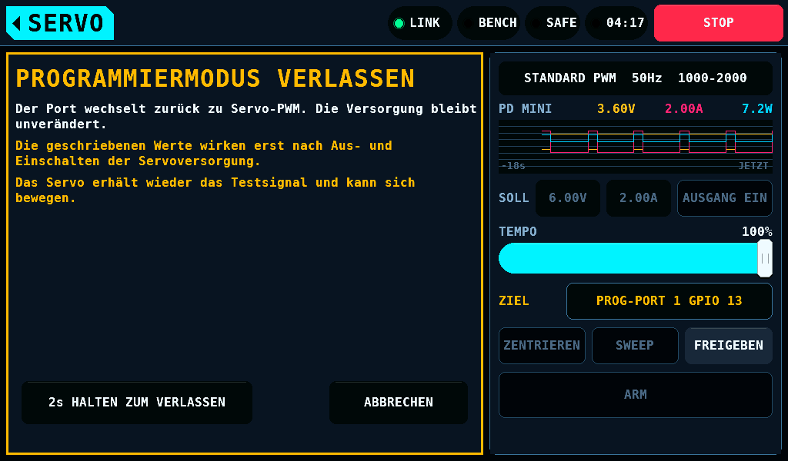
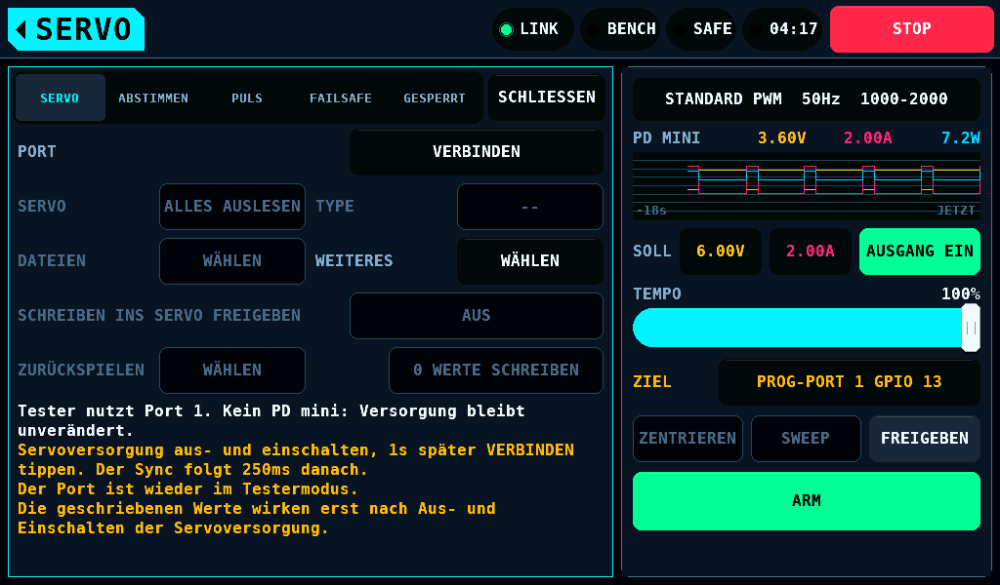

**ABBRECHEN**, **STOP**, ein ARM oder ein Wechsel von **SERVO-TESTER** in
den 1000ms aus beendet **VERBINDEN** dort: kein Einstieg folgt, und der
Ausgang bleibt aus. **ABBRECHEN** sagt
`Der Versorgungszyklus wurde abgebrochen. Der Ausgang des PD mini bleibt aus.`;
**STOP** sagt seine eigene Zeile. Ein Link, der in den 1000ms aus
verloren geht, sendet danach nichts, und der Ausgang bleibt aus.
**ABBRECHEN** oder **STOP** im Zyklus von **VERLASSEN** beendet die Sitzung
mit ausgeschaltetem Ausgang.

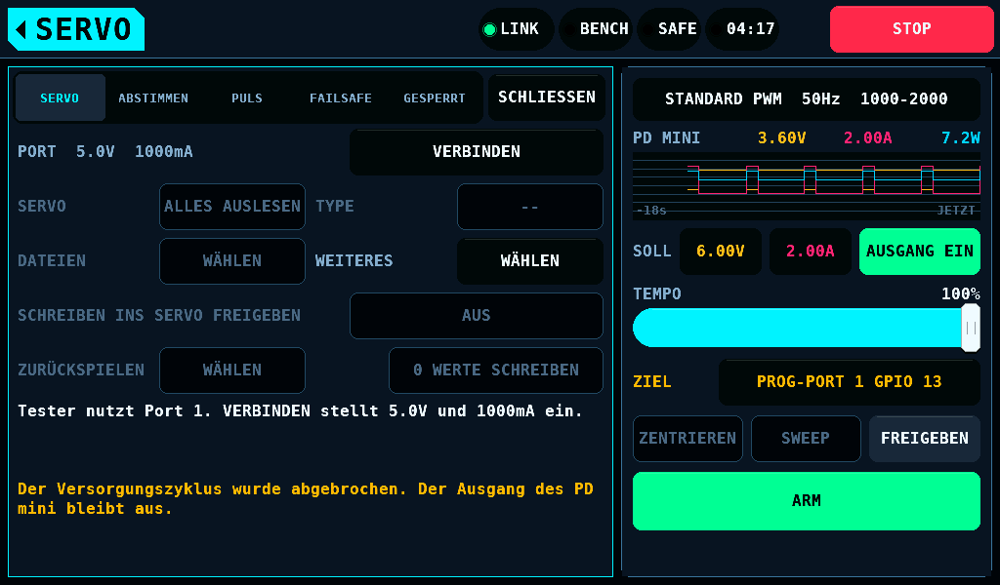

1000ms aus ist der Wert des Eigentümers, das obere Ende seiner Schätzung
von 500ms bis 1000ms; 4s und mehr ist die einzige gemessene Zeit.

### Der Signalpegel

Der Signalpin des Servos ist ein GPIO (General-Purpose Input/Output) eines
Mikrocontrollers. Der High-Pegel seiner Antwort ist höchstens 5V und
typisch 3,3V. Der Pegel ist nicht gemessen. GPIO 13 ist für 5,5V
spezifiziert, solange IOVDD (die Ein-/Ausgangsversorgung) des IOmcu
auf 3,3V liegt (`hardware/docs/IOBoard.md`, Pin ratings); der Port hat
deshalb keinen Pegelwandler und keine Klemmung.

Ohne Versorgung des IOmcu ist GPIO 13 für 3,63V spezifiziert. Ein
Servo, das die Leitung mit 5V treibt, während der IOmcu aus ist,
überschreitet diesen Wert. Was der Pin des Servos im Leerlauf bei
ausgeschaltetem Prüfstand tut, ist nicht gemessen.

Den IOmcu vor der Versorgung des Servos einschalten, oder das Servo
nicht aus einer externen Versorgung speisen, während der Prüfstand aus
ist.

## Die Versorgung

Solange der Tester den Port hat, öffnet **WEITERES**, was **VERBINDEN**
stellt.


| Eintrag | Bereich | Vorgabe | Wirkung |
| --- | --- | --- | --- |
| PROGRAMMIERSPANNUNG | 4,8 bis 6,0V in 0,1V; bis 8,4V mit HV-SERVO ein | 5,0V | die Versorgungsspannung des Servos im Programmiermodus |
| STROMBEGRENZUNG | 50 bis 3000mA | 1000mA | die Stromgrenze der Versorgung während des Programmierens |
| WARTEZEIT VOR PWM | 0 bis 10 000ms | 100ms | die Zeit, die der Port seine Leitung zwischen **VERLASSEN** und dem ersten Puls auf Low hält |

Jeder Eintrag öffnet die Zahlentastatur mit seinem Bereich. Ein Wert
außerhalb des Bereichs wird nicht übernommen. Alle drei werden mit den
SERVO-Einstellungen gehalten.

**VERBINDEN** schaltet einen Ausgang, der aus ist, mit den zwei Werten ein,
und die Sitzung beginnt 1000ms, nachdem der PD mini ein liest. Bei einem
Ausgang, der ein ist, läuft die Sitzung mit der niedrigeren der zwei
Spannungen und der niedrigeren der zwei Stromgrenzen: eine Spannung über
der Programmierspannung wird auf sie gesenkt, eine Stromgrenze über
STROMBEGRENZUNG auf diese, und keine wird angehoben. Das Verlassen des
Programmierens stellt einen Wert, den **VERBINDEN** gesenkt hat, nicht
wieder her.

Der Port programmiert bei 4,8V oder mehr. Die Versorgungsspannung, die
ein Servo zum Speichern eines Registers braucht, ist nicht gemessen. An einem Ausgang, der unter 4,8V ein
ist, wird nicht programmiert, und er bleibt, wie er ist; der Bediener hebt
ihn zuerst an. Ein PD mini, dessen Eingangsspannung unter 5,5V liegt, gibt keine
4,8V, und an ihm beginnt keine Sitzung.

Solange der Port nicht in PWM ist, gehören die Sollwerte der Versorgung dem
Port. Der IOmcu lehnt jede Änderung der Spannung und der Stromgrenze
und jedes Einschalten ab; ein Ausschalten nimmt er an. Der
SUPPLY-Bildschirm und die Zeile SOLL der rechten Karte zeigen dasselbe: die
Sollwerte, die Schieber, die Schritte und **AUSGANG EIN** sind gedimmt und
nehmen keinen Druck, **AUSGANG AUS** und **SPITZENWERTE ZURÜCKSETZEN** arbeiten,
und die Karte MODUS des SUPPLY-Bildschirms zeigt `Servoprogrammierung.`. Die
Grenzen in den Einstellungen des SUPPLY-Bildschirms bleiben editierbar;
eine Grenze, die unter einen Sollwert gesenkt wird, erreicht den Sollwert,
wenn der Port wieder in PWM ist.

Ein Ausschalten, das eintrifft, während ein Frame auf der Leitung ist, von
**AUSGANG AUS**, **STOP** oder einem verlorenen Heartbeat, liest sofort aus
und erreicht den PD mini, wenn der Port den Frame abgebrochen hat,
spätestens 12ms später. Der eigene Schutz des PD mini wird nicht
verzögert. Wie lange der Ausgang des PD mini nach seinem Aus-Befehl zum
Abfallen braucht, ist nicht gemessen.


Eine Spannung über 6,0V braucht **HV-SERVO** in den Optionen der Karte
AUTOMATISCHER TEST auf TEST; ohne es endet die Tastatur bei 6,0V. Mit ihm öffnet ein Wert
über 6,0V die Warnseite der Hochspannungs-Einstellung des
SERVO-Bildschirms, und **2s HALTEN ZUM ÜBERNEHMEN** übernimmt ihn.
Das Ausschalten von **HV-SERVO** setzt eine Programmierspannung über 6,0V
auf 5,0V zurück.

Eine Spannung über 6,0V wird nicht gespeichert. Die SERVO-Einstellungen
halten für sie 6,0V, und ein gespeicherter Wert über 6,0V, von der
Einstellungsseite oder aus einer Einstellungsdatei, wird als 6,0V geladen
und so gespeichert, mit **HV-SERVO** ein oder aus. Der Programmierer liest
die Einstellungen beim Öffnen und bei jedem Betreten des SERVO-Bildschirms,
solange kein Port gehalten wird, und wenn das Panel unter einem gehaltenen
Port startet: jedes davon beginnt bei 6,0V oder darunter, und eine Spannung
darüber braucht erneut die Warnseite und ihr Halten von 2s. Eine Sitzung,
die ihren Port hält, behält die Spannung, mit der sie begonnen hat.


Antwortet ein PD mini, nennt die Zustandszeile vor **VERBINDEN** die Werte
und im Programmiermodus die gemessene Ausgangsspannung und den gemessenen
Strom. Der SUPPLY-Bildschirm und die Netzteil-Zeilen der rechten Karte
folgen dem, was der Port gestellt hat.


Ohne PD mini werden die Spannung und die Stromgrenze gespeichert und nicht
angewendet. **WARTEZEIT VOR PWM** wendet ein IOmcu ab Link-Version 4.15
beim [Verlassen](#verlassen) an, mit und ohne PD mini, und nach dem
Versorgungszyklus eines **VERLASSEN** einer ab 4.30.

## Reiter SERVO


| Zeile | Taste | Wirkung |
| --- | --- | --- |
| PORT | **VERBINDEN**, **ABBRECHEN**, **VERLASSEN** | nimmt den Port, beendet den laufenden Vorgang, [gibt den Port zurück](#verlassen) |
| SERVO | **ALLES AUSLESEN** | liest die 32 Register, jedes, bis 3 von höchstens 5 Lesungen übereinstimmen |
| TYPE | `--`, `V6?`, `V8?`, **V6**, **V8** | [der Servotyp](#der-servotyp), den der Bediener setzt; `V6?` ist die Vermutung aus 20k_sel |
| DATEIEN | **WÄHLEN** | [speichert die Werte des Servos auf die Karte und lädt eine Datei](#servodateien) |
| WEITERES | **WÄHLEN** | in PWM [was VERBINDEN stellt](#die-versorgung); im Programmiermodus [PRÜFEN, ÄNDERUNGEN VERWERFEN, PAIRING LÖSEN](#weiteres) |
| SCHREIBEN INS SERVO FREIGEBEN | **AUS**, **EIN** | [der Schreibschalter](#der-schreibschalter) |
| ZURÜCKSPIELEN | **WÄHLEN** | [schreibt ein Backup zurück](#zurückspielen) |
| (keine Beschriftung) | **n WERTE SCHREIBEN**, **1 WERT SCHREIBEN** | [schreibt die geänderten Werte](#schreiben) |

In PWM mit einem antwortenden PD mini lautet die Zeile PORT
`PORT  5.0V  1000mA`: die Spannung und die Stromgrenze, die **VERBINDEN**
stellt. Eine Zeile, deren Taste abgedunkelt ist, nimmt keinen Tipp an:
**DATEIEN** außerhalb des Programmiermodus und solange das Servo unklar
ist, **ZURÜCKSPIELEN**, solange ein Vorgang läuft, der Schreibschalter, wo
[er abgelehnt wird](#der-schreibschalter).

Die Zahlen auf dem Bildschirm haben in beiden Sprachen einen Dezimalpunkt:
`5.0V`. Diese Seite schreibt Zahlen im Text mit Komma.

Unter den Zeilen stehen der Zustand des Ports, der Servotyp oder was der
Zustand verlangt, der Name der
Backup-Datei der Sitzung und die letzte Meldung. Eine Meldung in der
Warnfarbe ist eine Ablehnung oder ein Ergebnis, das einen zweiten Blick
braucht; eine in der Gefahrenfarbe sagt, dass der Inhalt des Servos unklar
ist.

### Ein Servo mit unbekanntem Layout

Der IOmcu vergleicht das Abbild mit dem Layout des bekannten Servos,
seinem Fingerprint. Ein Abbild, das nicht passt, wird gezeigt und nie
geschrieben: die Zeilen zum Ändern und der Schreibschalter sind aus und
nehmen keinen Tipp an, der Reiter behält `Nur Auslesen möglich. Dieser Servotyp ist unbekannt.`, und **PAIRING LÖSEN** wird abgelehnt. **ALLES AUSLESEN**, das Speichern in eine Datei und
**PRÜFEN** arbeiten. Eine Datei wird nicht geladen.


## Ändern

Ein Wert wird in einem Entwurf auf dem Panel geändert. Vor
[**n WERTE SCHREIBEN**](#schreiben) erreicht nichts das Servo. Ein Wert,
der von dem des Servos abweicht, ist doppelt markiert: durch `*` davor und
durch die Akzentfüllung.


Ein Zahlenwert öffnet die Tastatur. Sein Bereich ist der, den die harten
Limits im Entwurf, wie er steht, annehmen; ein Wert außerhalb lässt sich
nicht eingeben. STRETCH öffnet eine Liste der 6 bestätigten Faktoren. Ein
EIN/AUS-Wert wechselt beim Tipp. DEAD BAND und NEUTRAL haben Minus- und
Plustasten: ein Rohzähler je Tipp, gehalten nach 0,45s 8 Zähler je
Sekunde und nach weiteren 1,8s 30 je Sekunde.


### ABSTIMMEN

| Zeile | Registerfeld | Hartes Limit |
| --- | --- | --- |
| DEAD BAND | Dead Band, µs | der Bereich des Felds |
| MAX. DUTY | Max. Duty, % | 10 bis 98% |
| BOOST | Boost, µs | höchstens 3000µs |
| STRETCH | Stretch, Faktor | x1 bis x32; die 2 übrigen Codes werden nicht angeboten |
| SOFT START | Soft_Start, EIN oder AUS | keines |
| TEMPOGRENZE | spd_sel, EIN oder AUS | EIN braucht TEMPO ab 5% |
| TEMPO | SPD, % | höchstens 100%; mindestens 5%, solange TEMPOGRENZE EIN ist |

### PULS


| Zeile | Registerfeld | Hartes Limit |
| --- | --- | --- |
| NEUTRAL | Neutral, µs | 1360 bis 1640µs; 100µs oder mehr von jedem Endpunkt |
| PULSE LOWER | Pulse Lower, µs | 500µs oder mehr; 100µs oder mehr unter NEUTRAL; 400µs oder mehr unter PULSE UPPER |
| PULSE UPPER | Pulse Upper, µs | 2500µs oder weniger; 100µs oder mehr über NEUTRAL |
| LEFT ANGLE | Left Angle, die Zahl des Hersteller-Tools | nicht 0 |
| RIGHT ANGLE | Right Angle, die Zahl des Hersteller-Tools | nicht 0 |
| REVERSION | Reversion, EIN oder AUS | keines |

Die Umrechnung von NEUTRAL zwischen Register und µs ist eine Anpassung an
3 Werte und um etwa 1µs unsicher. Der Reiter sagt zu den beiden Winkeln
`LEFT ANGLE, RIGHT ANGLE: Werte aus dem Servo. Die Einheit ist unbekannt.` Die Bildschirme
schreiben `us` für µs: ihre Schrift hat kein Mikro-Zeichen.

### FAILSAFE


| Zeile | Registerfeld | Hartes Limit |
| --- | --- | --- |
| BEWEGEN BEI SIGNALVERLUST | Allow Uncont, EIN oder AUS | keines |
| POSITION | Uncontrolled Pos, µs | 500 bis 2500µs und innerhalb PULSE LOWER bis PULSE UPPER |
| NACH | Uncontrolled Time, s | 0,4 bis 13,0s |

Die Limits sind die aus `protocols/kst/kst_limits.c`; das Panel hält keine
eigenen. Das untere Limit von MAX. DUTY und die 5% von TEMPO sind
Festlegungen, keine Messwerte eines Servos.

### Ein Wert, den ein hartes Limit ablehnt

Ein Tipp, der ein hartes Limit verletzen würde, ändert nichts und nennt das
Limit.


### Ein Wert, der einen zweiten Blick braucht

Ein Wert innerhalb der harten Limits, der ein weiches Limit verletzt, öffnet
ÄNDERUNG PRÜFEN mit der Zeile des Felds und einer Zeile je Limit. Die Zeile
des Felds zählt vom Wert des Servos, nicht von einer Änderung davor: `MAX.
DUTY: 96 -> 97%` ist der Wert, den das Servo hält, der neue Wert und die
Einheit. **2s HALTEN ZUM ÜBERNEHMEN** übernimmt ihn;
**ABBRECHEN** oder ein Finger, der von der Taste rutscht, lässt den
Entwurf, wie er war.

Ein Limit, das für einen Wert bestätigt ist, ist für diesen Wert bestätigt.
Eine spätere Änderung des Felds öffnet die Seite erneut, wenn sie den Wert
weiter vom Wert des Servos entfernt als den bestätigten oder auf dessen
andere Seite legt: 97% bestätigt, 98% fragt erneut und zeigt `MAX. DUTY:
96 -> 98%`, und 97% danach nicht. Ein Schreiben, ein Lesen und
**ÄNDERUNGEN VERWERFEN** beenden jede Bestätigung.


| Bedingung | Warnung |
| --- | --- |
| MAX. DUTY über dem des Servos | `Höheres Duty erhöht den Blockierstrom und die Erwärmung.` |
| MAX. DUTY unter 50% | `Niedriges Duty schwächt das Servo. Es hält das Ruder möglicherweise nicht.` |
| BOOST über dem des Servos | `Mehr Boost kann das Servo brummen und heiß werden lassen.` |
| STRETCH über dem des Servos | `Mehr Stretch kann das Servo zum Schwingen bringen.` |
| SOFT START ausgeschaltet | `Ohne Soft Start bewegt sich das Servo beim Einschalten ruckartig.` |
| TEMPOGRENZE eingeschaltet | `Tempogrenze aktiv. Das Servo bewegt sich mit dem eingestellten Tempo.` |
| TEMPO unter 30% bei TEMPOGRENZE EIN | `Ein zu langsames Servo kann zum Kontrollverlust über das Modell führen.` |
| DEAD BAND unter dem des Servos | `Ein schmales Dead Band kann Pendeln und Erwärmung verursachen.` |
| DEAD BAND unter 1,0µs | `Sehr schmales Dead Band. Pendeln und Erwärmung sind wahrscheinlich.` |
| BEWEGEN BEI SIGNALVERLUST eingeschaltet | `Ohne Signal fährt das Servo auf die Failsafe-Position.` |
| POSITION mehr als 300µs von NEUTRAL, BEWEGEN BEI SIGNALVERLUST EIN | `Die Failsafe-Position liegt weit von der Mitte entfernt.` |
| NACH unter 1,0s | `Kurze Aussetzer lösen die Failsafe-Bewegung aus.` |
| ein Endpunkt weniger als 300µs von NEUTRAL | `Endpunkt nah an Neutral. Auf dieser Seite bleibt wenig Weg.` |
| ein Endpunkt mehr als 100µs von dem des Servos | `Endpunkt geändert. Dadurch ändert sich auch der Servoweg je Knüppelbewegung.` |
| NEUTRAL mehr als 20µs von dem des Servos | `Die Mitte verschiebt sich. Eine Seite kommt näher an den mechanischen Anschlag.` |
| REVERSION geändert | `Drehrichtung umgekehrt. Prüfe vor dem Flug alle Ruder.` |
| ein Winkel über dem des Servos | `Mehr Weg kann das Servo gegen den Anschlag fahren und durchbrennen lassen.` |
| ein Winkel unter 50 | `Kleiner Winkel. Voller Knüppelweg ergibt nur wenig Servoweg.` |
| DEAD BAND unter 1,0µs bei STRETCH über x1 | `Schmales Dead Band und mehr Gain können Schwingungen verursachen.` |
| MAX. DUTY über 90% bei einem Winkel über dem des Servos | `Hohes Duty und mehr Weg: Blockieren kann das Servo zerstören.` |

"Der des Servos" ist in dieser Tabelle der Wert des Backups der Sitzung,
das Servo, wie die Sitzung es zuerst gelesen hat. Ein Schreiben der Sitzung
verschiebt ihn nicht: ein in zwei Schreiben erhöhter Wert wird mit dem Wert
verglichen, mit dem das Servo kam. Wo das Panel dieses Backup nicht hält
oder das Backup zu einem anderen Servo gehört, ist es der zuletzt gelesene
Wert. Die Warnungen [eines Zurückspielens](#zurückspielen) vergleichen mit
dem Servo, wie es zuletzt gelesen wurde.

### GESPERRT


| Zeile | Feld |
| --- | --- |
| 20K SEL | 20k_sel, EIN oder AUS: eine Einstellung der Ansteuerung, nicht [der Servotyp](#der-servotyp) |
| LOCK | Lock |
| MODE | Servo oder Gyro Servo |
| PROT1 EN, PROT1 CANCLE, PROT1 TIME, PROT1 PWM, POT ERR, POT SAMPLES, PWM ERR | der Schutzblock, den das Hersteller-Tool verbirgt; `PROT1 CANCLE` ist die Schreibweise des Herstellers |

Diese Werte werden gezeigt, und kein Ändern erreicht sie. Ihre Funktion
oder ihre Kodierung ist nicht bestätigt. Der Reiter zeigt außerdem den
Pairing-Wert, Register 1D, und die Kartennummer, die das Hersteller-Tool
für dieses Servo braucht. Ein Servo im Modus Gyro Servo wird gelesen und
nicht geschrieben: die Limits dieses Modus sind nicht bekannt.

## Der Schreibschalter

**SCHREIBEN INS SERVO FREIGEBEN** ist in der Vorgabe aus. Ein Tipp auf
**AUS** öffnet eine Seite, die die Risiken nennt; **2s HALTEN ZUM FREIGEBEN**
schaltet ihn nach 2s ein. Ein Tipp auf **EIN** schaltet ihn sofort aus.


Der Schalter geht aus:

- bei jedem Aufruf des SERVO-Bildschirms,
- wenn der Link zum IOmcu wegfällt oder der IOmcu neu startet,
- bei **STOP** und bei jedem Stopp, den der Prüfstand hält,
- mit jedem **VERBINDEN** und jedem **VERLASSEN**,
- wenn ein Lesen ein anderes Abbild findet als das gehaltene,
- wenn ein Lesen nicht zum Fingerprint passt,
- wenn ein Schreiben, ein Zurückspielen, ein Lesen oder **PRÜFEN** mit
  einem unklaren Servo endet: das Lesen danach schaltet ihn nicht wieder
  ein,
- wenn ein Lesen ein Servo findet, das zum Vermerk eines unterbrochenen
  Schreibens passt.

Bei ausgeschaltetem Schalter sendet das Panel kein Schreiben, kein
Zurückspielen und kein Lösen des Pairings, und der IOmcu lehnt eines
ab, das ohne den Schlüssel des Schalters ankommt. Lesen, **PRÜFEN**, das
Speichern in eine Datei und das Laden einer Datei arbeiten bei
ausgeschaltetem Schalter.

Der Schalter nimmt seinen Tipp mit einem gelesenen Servo an. Wo er ihn
nicht annimmt, ist **AUS** abgedunkelt: ohne gelesenes Servo, mit einem
Servo, das nicht zum Fingerprint passt, solange ein Vorgang läuft und
solange das Panel fragt, ob das Servo das eines unterbrochenen Schreibens
ist. Eine Sitzung,
die der IOmcu nach einem unterbrochenen Schreiben gesperrt hat, nimmt
ihn auch ohne gelesenes Servo an, sobald das Panel das Backup der Sitzung
hält: das ist der Zustand eines Panels, das unter einer solchen Sitzung
startet. Der Schalter öffnet dann ein Schreiben, das Zurückspielen des
Backups der Sitzung. Ein Ändern, ein Schreiben von Werten, ein Lösen des
Pairings und das Laden einer Datei bleiben abgelehnt bis zu einem Lesen und
dem Ende der Sperre. **ALLES AUSLESEN** liest in diesem Zustand das Servo und
zeigt seine Werte; die Sperre bleibt, und kein Wert wird geändert.

## Schreiben

**n WERTE SCHREIBEN** zählt die Felder, in denen der Entwurf vom Servo
abweicht; bei einem solchen Feld heißt die Taste **1 WERT SCHREIBEN**. Sie
ist aus, wenn nichts geändert ist. Bei ausgeschaltetem Schalter öffnet ihr
Tipp [die Seite des Schalters](#der-schreibschalter).


Ein Tipp öffnet die Schreibseite. **2s HALTEN ZUM SCHREIBEN** startet das
Schreiben. Die Seite hat 12 Zeilen.

Zuerst stehen die geänderten Werte in der Reihenfolge der Reiter, je eine
Zeile: `DEAD BAND: 2.0 -> 1.6us` ist der Wert des Servos, der neue Wert
und die Einheit. Ein Wert, der
[ein weiches Limit](#ein-wert-der-einen-zweiten-blick-braucht) verletzt,
steht in der Warnfarbe. Bei mehr Werten als Zeilen zählt die letzte dieser
Zeilen den Rest: `und 4 weitere`. Ein erstes Schreiben mit Karte zeigt 7
Werte oder 6 und die Zahl; eines ohne Karte 6 oder 5 und die Zahl.

`Halte das Ruderhorn frei. Löse das Gestänge.` und `Teste das Servo am Prüfstand, bevor du es ins Modell einbaust.` folgen beim ersten Schreiben nach einem
**VERBINDEN** und bei jedem Schreiben, das REVERSION, NEUTRAL, PULSE LOWER,
PULSE UPPER, LEFT ANGLE oder RIGHT ANGLE ändert. Ein Schreiben, dessen
Start die Karte, ein Stopp oder der Link verhindert hat, ist nicht dieses
erste Schreiben: die Zeilen bleiben für das nächste.


1. Das erste Schreiben einer Sitzung speichert die Werte des Servos in
   [eine neue Datei auf der Karte](#das-backup-vor-dem-ersten-schreiben).
   Eine eingehängte Karte, die die Datei nicht annimmt, beendet das
   Schreiben. Ohne eingehängte Karte sagt die Schreibseite, dass keine
   Datei gespeichert wird, und das Schreiben läuft ohne eine. Solange der
   Vermerk eines unterbrochenen Schreibens gehalten wird, wird keine Datei
   gespeichert: das Servo kann halb geschrieben sein, und der Vermerk hält
   seine Werte, wie sie vorgefunden wurden.
2. Das Panel vermerkt das Abbild, das das Servo hält, das Abbild, das das
   Schreiben hinterlassen soll, und den Port: mit Karte in
   `BENCH/KST/CONF/KST.TXT`, ohne im RAM (Arbeitsspeicher). Die Seite sagt, welches. Mit einer Karte,
   die binnen 3s keine Datei annimmt, wird das Schreiben nicht gesendet:
   `Datei nicht auf Karte gespeichert. Keine Werte ins Servo geschrieben.`
3. Das Panel sendet das Zielabbild. Der IOmcu prüft es gegen dieselben
   Limits, plant die Registerschreibvorgänge und führt sie aus.
4. Jedes geschriebene Register wird zurückgelesen. Ein Schreibvorgang, der
   nicht übernommen wird, wird rückgängig gemacht.
5. `3 Werte geschrieben und geprüft.` oder `1 Wert geschrieben und geprüft.`
   beendet es und löscht den Vermerk.

Die Sperre des Schreibens wird erneut geprüft, wenn die Karte die Datei des
Servos angenommen hat, und noch einmal, wenn sie den Vermerk angenommen
hat, bevor ein Frame zum Servo geht: der Port im Programmiermodus auf dem
Port des Schreibens ohne laufenden Vorgang, kein STOP, der Prüfstand nicht
ARMED und der Schalter ein. Ein Tipp auf **EIN**, während die Karte
schreibt, schaltet den Schalter aus; **AUS** nimmt bis zum Ende des
Schreibens keinen Tipp an. Eine Ablehnung beendet das Schreiben, ohne
etwas zu senden, löscht seinen Vermerk, auch auf der Karte, und lässt die
geänderten Werte stehen. Die Zeile nennt die Ablehnung:

| Bei der Antwort der Karte | Zeile |
| --- | --- |
| der Schalter ist aus | `SCHREIBEN INS SERVO FREIGEBEN ist aus.` |
| der Port meldet PWM, oder ein anderer Port ist belegt | `Kein Servo verbunden. Tippe auf VERBINDEN.` |
| der Port meldet einen laufenden Vorgang, oder sein Status ist noch nicht gelesen | `Ein anderer Vorgang läuft.` |
| der Prüfstand ist ARMED | `Zuerst DISARM tippen. Bei ARMED kann der Port nicht übernommen werden.` |

Ein **STOP** beendet das Schreiben sofort, wie unter
[Stopps und Ausfälle](#stopps-und-ausfälle). Der Prüfstand nimmt kein ARM an,
solange der Port belegt ist; die Prüfung hält trotzdem gegen ein ARMED, das
der IOmcu meldet. Eine Karte, die nicht antwortet, beendet das Schreiben:
nach 5s bei der Datei des Servos, nach 3s beim Vermerk.

Ein geschriebener und zurückgelesener Wert steht im Servo; er wirkt ab
dem nächsten Einschalten des Servos
([der Versorgungszyklus](#der-versorgungszyklus)). Ein Schreiben schaltet
die Versorgung nicht: sein Prüfen ist das Rücklesen derselben Sitzung, im
Programmiermodus. **VERLASSEN** nach dem Schreiben schaltet die Versorgung
mit PD mini aus und ein, und die Meldung nach dem Schreiben sagt es.

Nur Register, deren Wert sich ändert, werden geschrieben. Register 00 wird
nie geschrieben; Register 1D schreibt nur **PAIRING LÖSEN**.


| Meldung | Das Servo |
| --- | --- |
| `Für diese Werte gibt es keine sichere Schreibreihenfolge.` | hält, was es hielt; nichts wurde gesendet |
| `Zu viele Änderungen für einen gemeinsamen Plan. Nichts geschrieben.` `Teile die Änderungen auf. Schreibe weniger Werte auf einmal.` | hält, was es hielt; nichts wurde gesendet. Der Planer hört nach 216 000 Arbeitseinheiten ohne Ergebnis auf. Die Sitzung läuft weiter, und die offenen Werte bleiben |
| `Schreiben fehlgeschlagen. Keine Werte sind unvollständig geschrieben.` | hält, was es hielt |
| `Schreiben fehlgeschlagen. Der vorherige Wert wurde wiederhergestellt.` | hält, was es hielt |
| `Schreiben fehlgeschlagen. Zuvor geschriebene Werte bleiben. ALLES AUSLESEN tippen.` | hält die Register, die vor dem fehlgeschlagenen geschrieben wurden, und in den übrigen den alten Wert. Die zweite Zeile nennt das Register und die Zahl der erledigten Schreibvorgänge. Der Schreibschalter geht aus, und **ALLES AUSLESEN** kommt vor dem nächsten Schreiben |
| `Schreiben fehlgeschlagen. Rückgängig machen war nicht möglich.` | ist unklar: [zurückspielen](#ein-unterbrochenes-schreiben) |
| `Ein Register hat sich ohne Schreibzugriff geändert.` | ist unklar |
| `Das Servo enthält nicht die erwarteten Werte.` | ist unklar |

Eine Meldung über ein fehlgeschlagenes Schreiben nennt das Register und die
Zahl der erfolgten Schreibvorgänge: `Register 03. 1 Schreibvorgang abgeschlossen.`

## Backups

| Backup | Gehalten von | Lebt bis |
| --- | --- | --- |
| Der Sitzung | dem IOmcu: das erste nach **VERBINDEN** gelesene Abbild | **VERLASSEN**, ein Aus- und Einschalten des Servos, ein Neustart des IOmcu |
| Die Datei der Sitzung | der Karte: die 32 Register des Servos, wie sie vor dem ersten Schreiben der Sitzung stehen. Keine, solange keine Karte eingehängt ist | die Datei wird von der Karte entfernt |
| Vor einem Schreiben | dem Panel, in `BENCH/KST/CONF/KST.TXT` oder im RAM | das Schreiben endet geprüft, oder der Vermerk wird verworfen |

`KST.TXT` ist der Vermerk eines laufenden Schreibens: Text von höchstens
400 Bytes im Ordner `BENCH/KST/CONF` der Karte mit der Zeile `RCBENCH KST 2`, den
Zeilen `journal=`, `target=`, `port=` und `pin=` und `check=` mit der
CRC-16 (zyklische Redundanzprüfung) der Bytes davor. `pin=` hält den GPIO
(General-Purpose Input/Output), den der Port beim Schreiben trieb, in zwei
Hexadezimalziffern: `0D` für GPIO 13, `FF`, wenn das Panel für den Port keinen
Pin kannte. Ein Vermerk der Version 1 (`RCBENCH KST 1`, keine Zeile
`pin=`) wird gelesen und nennt nur den Port. Ein Pin über GPIO 47 wird ebenso
gelesen: der Vermerk bleibt, und seine Zeilen nennen den Port. Eine Datei, deren Prüfsumme
nicht stimmt, wird nicht benutzt:
`KST.TXT auf der Karte ist nicht lesbar. Die Datei wird nicht verwendet.` Der Name `KST`
gehört dem Vermerk: keine Servodatei bekommt ihn, und die Liste der Dateien
lässt ihn aus.

Das Panel schreibt den Text nach `KST.NEW`, und die Datei bekommt den Namen
`KST.TXT`, sobald die Karte sie vollständig hält. Ein Schreiben, das die
Karte oder die Versorgung beendet, hinterlässt `KST.TXT` wie zuvor oder
eine vollständige `KST.NEW`. Beim Einschalten wird eine `KST.NEW` mit
stimmender Prüfsumme benutzt und umbenannt; eine mit falscher Prüfsumme
wird entfernt und `KST.TXT` benutzt. Eine Datei, die die Karte nicht
annimmt, wird alle 5s erneut geschrieben, bis die Karte sie annimmt, damit
ein auf dem Panel verworfener Vermerk nicht auf der Karte bleibt.

## Servodateien

Eine Servodatei ist eine Textdatei im Ordner `BENCH/KST/CONF` der SD-Karte
des Panels mit den 32 Registern eines Servos, benannt `<name>.TXT`. Das Panel
legt den Ordner mit dem ersten Speichern an, jede fehlende Ebene davon:
`BENCH`, `BENCH/KST`, dann `BENCH/KST/CONF`. Firmware 0.21.0 und älter hält
ihre Dateien und ihren Vermerk in `KST`. Das Panel liest diesen Ordner nicht:
Seine Dateien werden am Computer nach `BENCH/KST/CONF` verschoben. **DATEIEN** öffnet die Liste. Die Zeile
ist im Programmiermodus aktiv, wenn ein Servo gelesen und nicht unklar ist;
sonst antwortet der Tipp mit `Lies zuerst das Servo aus. Tippe auf ALLES AUSLESEN.`
Speichern und Laden arbeiten bei ausgeschaltetem Schreibschalter: eine
Datei ändert den Entwurf auf dem Panel, nie das Servo.


Der erste Eintrag speichert. Darunter stehen die Dateien nach Namen
sortiert, 5 je Seite, jede mit ihrem Servotyp; eine Datei ohne Typzeile
zeigt keinen. Die Dateien mit einem vorgeschlagenen Namen, `KST` und
3 Ziffern, stehen zusammen an der Stelle von `KST000`, die höchste Nummer
zuerst. Die Liste erreicht jede Servodatei der Karte. Bei mehr als
5 Dateien zählt der Titel sie, `DATEIEN 1 BIS 5 VON 7`, und
`Weitere Dateien anzeigen.` blättert, nach der letzten Seite zurück zur
ersten. Das Panel fragt die Karte für jede Seite und wartet höchstens 5s
darauf.


### Der Servotyp

Ein Servo und eine Datei sind V6 oder V8. Kein Register hält die Serie:
der Hersteller gibt 20k_sel, Register 04 Bit 6, ab Werk als gesetzt für V6
(Ansteuerung mit 20kHz) und gelöscht für V8 (Ansteuerung mit 333Hz) an,
und das Bit ist eine Einstellung der Ansteuerung. Am Prüfstand lasen
V8-Flächenservos mit gesetztem 20k_sel und ein V8-Servo, das kein
Flächenservo ist, mit gelöschtem; die Modelle wurden nicht aufgezeichnet.
Deshalb setzt der Bediener den Typ:

- Sobald ein Servo gelesen ist, zeigt **TYPE** den Typ, den 20k_sel nahelegt,
  mit Fragezeichen, `V6?` oder `V8?`, und die Zeile unter dem Zustand lautet
  in der Warnfarbe
  `Typ nicht gesetzt. 20k_sel spricht für V6: Etikett prüfen, TYPE setzen.`
- Ein Tippen auf **TYPE** öffnet `SERVO-TYPE LAUT ETIKETT DES SERVOS` mit
  **V6** und **V8**. Die Wahl steht ohne Zeichen da, und die Zeile lautet
  `Servotyp V6, unter TYPE gesetzt.`
- Der Typ gehört der Sitzung: **VERLASSEN**, eine verlorene Sitzung und ein
  Neustart des IOmcu löschen ihn. Ein zweites **ALLES AUSLESEN** behält
  ihn. Er wird nie ins Servo geschrieben; 20k_sel bleibt wie gelesen, auf
  dem Reiter GESPERRT als **20K SEL**.
- Ein Speichern schreibt den gesetzten Typ in die Typzeile der Datei; ohne
  gesetzten Typ hat die Datei keine Typzeile.
- Ein Laden vergleicht die Typzeile der Datei mit dem gesetzten Typ. Ein
  Tippen auf eine Datei ohne gesetzten Typ öffnet zuerst
  `SERVO-TYPE VOR DEM LADEN`; die Wahl setzt den Typ, und das Laden folgt,
  **ABBRECHEN** lädt nichts.

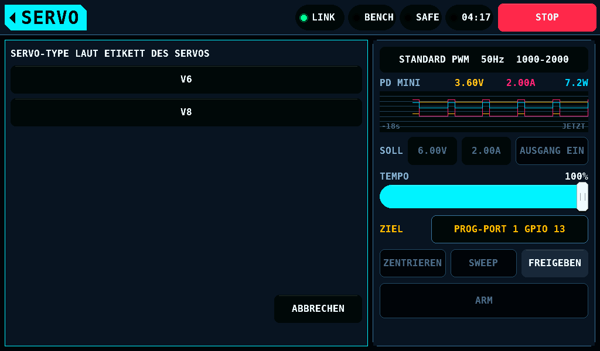
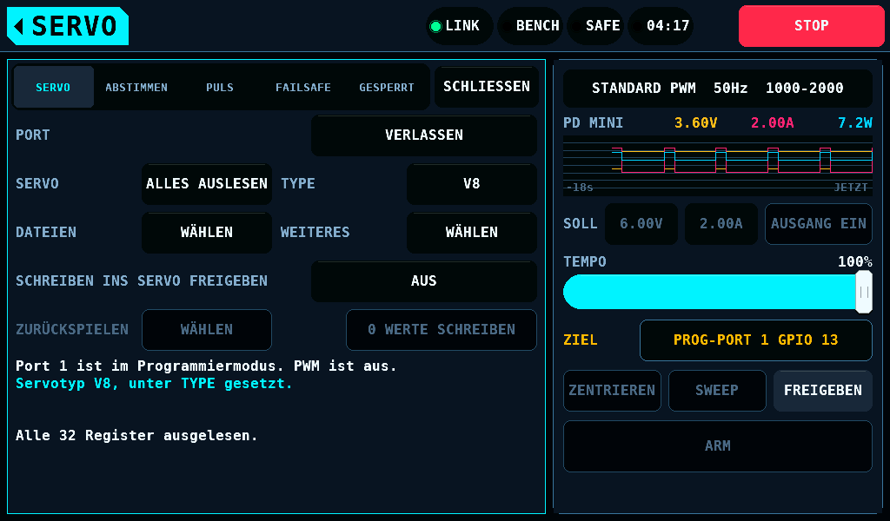
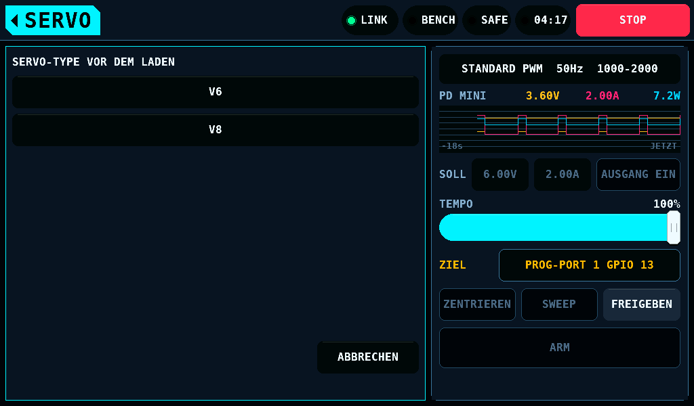


Eine Datei im Format 1, geschrieben von Firmware 0.23.0 und älter, nennt
den Typ, den 20k_sel ergab. Diese Zeile ist keine Angabe des Bedieners:
die Liste zeigt für die Datei keinen Typ, und sie lädt in ein Servo
jedes gesetzten Typs. Ihre Typzeile muss weiter zu ihrem eigenen 20k_sel
passen, sonst wird die Datei abgelehnt. Eine bearbeitete Datei
im Format 1 lädt als bearbeitete Datei ohne Typzeile.

### Speichern

`Werte dieses Servos in einer neuen Datei speichern.` öffnet die Texttastatur mit
dem nächsten freien Vorgabenamen, `KST001` bis `KST999`. Die Tastatur
nimmt bis zu 16 Zeichen: A bis Z, 0 bis 9, `-`, `_` und den Punkt. **OK**
speichert; die Kartenseite prüft den Namen und ersetzt nie eine Datei.
Namen werden ohne Rücksicht auf Groß- und Kleinschreibung verglichen. Eine
Datei mit einem längeren Namen, bis zu 32 Zeichen, wird gelistet und
geladen; eine Zeile, die sie nennt, zeigt ihre ersten 14 Zeichen und `..`.


| Ergebnis | Gezeigt |
| --- | --- |
| Gespeichert | `Servowerte auf der Karte gespeichert: WING-R.` |
| Ein Punkt am Anfang oder am Ende, oder ein reservierter Name: `KST`, `CON`, `PRN`, `AUX`, `NUL`, `COM1` bis `COM9`, `LPT1` bis `LPT9`, allein oder vor einem Punkt | die Tastatur bleibt offen unter `UNGÜLTIGER NAME`; `Ungültiger Name: reserviert oder mit einem Punkt am Anfang oder Ende.` |
| Eine Datei hat den Namen | die Tastatur bleibt offen unter `NAME VERGEBEN. ANDEREN WÄHLEN.`; `Dieser Dateiname ist bereits vergeben. Keine Datei wurde ersetzt.` |
| Keine Karte | `Keine Karte. Nichts gespeichert oder ins Servo geschrieben.` |
| Karte voll, oder `KST001` bis `KST999` sind beim Backup vor einem Schreiben alle vergeben | `Karte voll. Nichts gespeichert oder ins Servo geschrieben.` |
| Die Karte ist schreibgeschützt, oder `BENCH`, `BENCH/KST` oder `BENCH/KST/CONF` auf der Karte ist eine Datei und kein Ordner | `Speichern nicht möglich: Karte schreibgeschützt oder BENCH/KST/CONF kein Ordner.` |
| Die Karte bricht das Schreiben der Datei ab oder antwortet nicht binnen 5s | `Schreibfehler auf der Karte. Keine Werte ins Servo geschrieben.` |


Ein Speichern, das die Karte nach den 5s beendet, ist die Datei, die es
angelegt hat. Läuft kein anderer Dateivorgang, wechselt die Zeile zu
`Servowerte auf der Karte gespeichert:` und dem Namen. Sie ist die
Backup-Datei der Sitzung, wenn das Servo die gespeicherten Werte noch hält
und kein Schreiben folgte.

Ein Speichern schreibt das Abbild wie gelesen, die gesperrten Felder
eingeschlossen, auch das eines Servos, das nicht zum Fingerprint passt.

### Das Backup vor dem ersten Schreiben

Das erste Schreiben, Zurückspielen oder Lösen des Pairings einer Sitzung
speichert das Abbild des Servos ohne Nachfrage in eine neue Datei unter dem
nächsten freien Vorgabenamen. Die Schreibseite sagt
`Die bisherigen Servowerte werden vor dem Schreiben in einer neuen Kartendatei gesichert.` Das Servo empfängt
nichts, bevor die Karte die Datei hält. Eine eingehängte Karte, die voll
ist, beim Schreiben einen Fehler meldet oder zwischen Anfrage und Datei
entnommen wird, beendet das Schreiben mit den Zeilen der Tabelle oben, und
nichts wird auf das Servo geschrieben. Platz auf der Karte schaffen oder
die Karte entnehmen lässt das Schreiben laufen. Der Reiter SERVO nennt die
Datei danach: `Backup-Datei dieser Sitzung: KST003.` Ein Speichern von Hand
vor dem ersten Schreiben der Sitzung zählt als diese Datei. Ein Speichern
von Hand nach einem Schreiben enthält die geschriebenen Werte und lässt die
Zeile unverändert. Ein Lesen, das andere Werte findet, lässt das nächste
Schreiben erneut speichern.

Ein unklares Servo ist die Ausnahme: sein Abbild ist keine Datei wert, und
das Zurückspielen des Backups der Sitzung läuft ohne eine.

#### Ohne Karte

Ohne eingehängte Karte sind das Schreiben, das Zurückspielen und das Lösen
des Pairings nicht gesperrt. Die Seite, deren Halten das Schreiben sendet,
trägt drei weitere Zeilen:

```
Keine Karte. Es wird keine Backup-Datei gespeichert.
Das Backup dieser Sitzung liegt nur im Speicher des Prüfstands. Es geht beim Sitzungsende oder bei Stromausfall am Prüfstand verloren.
```

Das eine Halten der Seite von 2s bestätigt sie; ein zweites Halten wird
nicht verlangt. Ein vor 2s losgelassenes Halten sendet nichts.


Nach einem solchen Schreiben zeigt der Reiter SERVO
`Keine Karte, keine Backup-Datei. Zurückspielen nur innerhalb dieser Sitzung möglich.` anstelle des
Dateinamens. Die einzige Kopie des Servos, wie es vorgefunden wurde, ist
das Backup der Sitzung im IOmcu: **VERLASSEN**, ein Neustart des
IOmcu und ein Stromausfall des Prüfstands beenden es, und die Werte,
die das Servo vor dem Schreiben hielt, sind dann aus dem Prüfstand nicht
wiederherstellbar.


| Fall | Ergebnis |
| --- | --- |
| Eine Karte wird später in der Sitzung eingehängt | das nächste Schreiben, Zurückspielen oder Lösen des Pairings speichert zuerst die Backup-Datei. Die Datei hält das Backup der Sitzung, das vor dem ersten Schreiben gelesene Abbild. Die Zeile im Reiter SERVO wechselt zum Dateinamen |
| Der Link fällt weg und kommt wieder, oder das Panel startet, unter einer Sitzung, die der IOmcu hält | die Schreiben der Sitzung sind dem Panel nicht bekannt. Das nächste Schreiben, Zurückspielen oder Lösen des Pairings speichert zuerst die Backup-Datei, und die Datei hält das Backup der Sitzung, nicht das Servo, wie es zuletzt gelesen wurde. Ein Speichern über **DATEIEN** zählt nur als Backup-Datei, solange das Servo dem Backup der Sitzung gleicht |
| Das Servo kann geschriebene Werte halten, und das Panel hält das Backup der Sitzung nicht | das Schreiben geht ohne Datei, und seine Seite trägt die drei Zeilen oben: das Servo, wie es zuletzt gelesen wurde, wird nicht als Backup-Datei gespeichert |
| Der IOmcu startet neu | seine Sitzung und das Backup der Sitzung sind weg. **VERBINDEN** beginnt eine Sitzung, und ihr erstes Schreiben speichert das Servo, wie diese Sitzung es vorfindet |
| Ein Speichern über **DATEIEN** nach einem Schreiben ohne Karte | speichert das Servo, wie es steht; es zählt nicht als Backup-Datei |
| Die Karte wird entnommen, während eine Seite offen ist, die die Datei zusagt | das Halten sendet nichts, und die Seite kommt mit den drei Zeilen zurück; ihr eigenes Halten von 2s sendet das Schreiben |
| Die Karte wird entnommen, nachdem die Backup-Datei gespeichert ist | spätere Schreiben der Sitzung werden gesendet; der Vermerk des Schreibens bleibt im RAM |
| **DATEIEN**, Speichern und Laden ohne Karte | abgelehnt: `Keine Karte. Nichts gespeichert oder ins Servo geschrieben.` |
| Eine Karte, die nach dem Start des Panels eingesteckt, entnommen oder getauscht wird | das Panel sieht in den Steckplatz, wenn der Programmierer öffnet und bei jedem Tippen auf **VERBINDEN**, **ALLES AUSLESEN**, **DATEIEN**, **ZURÜCKSPIELEN**, **WEITERES**, **SCHREIBEN INS SERVO FREIGEBEN** oder die Schreibzeile: Eine eingesteckte oder getauschte Karte wird eingebunden, eine entnommene freigegeben. Der Blick auf eine eingebundene Karte ist ein Befehl SEND_STATUS (CMD13). Eine Dateianfrage (Liste, Laden, Speichern) läuft auf der Karte, für die sie gestellt wurde; ist bis dahin eine andere an ihrer Stelle eingebunden, findet sie keine Karte. Das Protokoll eines Schreibvorgangs geht auf die Karte, deren Protokoll der Programmierer zuletzt gelesen hat, nie auf eine an ihrer Stelle eingebundene, bevor der nächste Blick deren Protokoll liest. Das Tippen, das eine neue Karte findet, liest noch den Kartenzustand von vorher; das nächste hat ihn, und eine offene Schreibseite wechselt zur Seite mit der Datei |

Eine Karte im Steckplatz, die sich nicht mounten lässt, zählt als keine
Karte: Das Schreiben, das Zurückspielen und das Lösen der Paarung laufen wie
oben, und **FILES** wird abgewiesen. Ihre Zeilen nennen an Stelle von
`Keine Karte`, was das Panel gefunden hat
([Das Format der SD-Karte](Screens-de.md#das-format-der-sd-karte)):

| Wo | Karte ist weder FAT32 noch exFAT (FAT: File Allocation Table; exFAT: extended FAT): NTFS (New Technology File System), eine GPT (GUID-Partitionstabelle) oder nicht formatiert | Karte nicht lesbar |
| --- | --- | --- |
| Die Schreibseite | `Karte ist weder FAT32 noch exFAT. Es wird keine Backup-Datei gespeichert.` | `Karte nicht lesbar. Es wird keine Backup-Datei gespeichert.` |
| Die Schreibseite, Backup-Datei gespeichert | `Karte ist weder FAT32 noch exFAT. Die bisherigen Werte bleiben nur im Arbeitsspeicher.` | `Karte nicht lesbar. Die bisherigen Werte bleiben nur im Arbeitsspeicher.` |
| Der Tab SERVO | `Karte ist weder FAT32 noch exFAT, keine Backup-Datei. Zurückspielen nur innerhalb dieser Sitzung möglich.` | `Karte nicht lesbar, keine Backup-Datei. Zurückspielen nur innerhalb dieser Sitzung möglich.` |
| **FILES** | `Karte ist weder FAT32 noch exFAT. Nichts gespeichert oder ins Servo geschrieben.` | `Karte nicht lesbar. Nichts gespeichert oder ins Servo geschrieben.` |

### Laden

Ein Tipp auf eine Datei lädt sie. Ihre änderbaren Felder werden der
Entwurf, genau wie auf den Reitern eingegebene Änderungen: geänderte Werte
sind markiert, **n WERTE SCHREIBEN** zählt sie, und nichts erreicht das
Servo vor dem Schreibschalter, der Schreibseite und deren 2s Halten.


| Datei | Gezeigt |
| --- | --- |
| Vom Prüfstand gespeichert, Prüfsumme intakt | `KST001 geladen. 3 Werte weichen von den Servowerten ab.` oder `KST001 geladen. 1 Wert weicht von den Servowerten ab.` |
| Bearbeitet, mit Typzeile und ohne Prüfsummenzeile | dasselbe und `Bearbeitete Datei: 27 von 27 Werten, wie manuelle Eingaben geprüft.` |
| Bearbeitet, ohne Typzeile | dasselbe und `Bearbeitete Datei ohne Servotyp: 27 von 27 Werten, wie manuelle Eingaben geprüft.` |
| Enthält die änderbaren Werte des Servos | `KST001 stimmt mit den Servowerten überein. Nichts zu schreiben.` |
| Von einem anderen Typ als dem unter **TYPE** gesetzten | `Datei ist V8, TYPE ist V6. Nicht geladen.` |
| Angetippt ohne gesetzten Typ | die Liste `SERVO-TYPE VOR DEM LADEN`; das Laden folgt der Wahl. Die eigene Ablehnung des Modells lautet `Erst den Servo-TYPE setzen: V6 oder V8, wie auf dem Etikett des Servos.` |
| Prüfsummenzeile vorhanden und falsch | `Datei beschädigt: Prüfsumme stimmt nicht. Nicht geladen.` `Ohne Prüfsummenzeile wird sie als bearbeitete Datei geladen.` |
| Keine Servodatei | `Keine Servodatei. Nicht geladen.` |
| Eine Zeile, die sich nicht lesen lässt | `Zeile 12 ist nicht lesbar. Datei nicht geladen.` |
| Von einer späteren Formatversion geschrieben | `Diese Datei braucht eine neuere Prüfstand-Version. Nicht geladen.` |
| Ein Wert außerhalb seines harten Limits | `Zeile 9: MAX. DUTY liegt außerhalb des erlaubten Bereichs. Nicht geladen.` |
| Werte, die zusammen ein hartes Limit verletzen | `Datei nicht geladen. Grenzwertprüfung fehlgeschlagen:` und die Zeile des Limits |
| Die Karte lässt sich nicht lesen oder antwortet nicht binnen 5s | `Die Karte lässt sich nicht lesen.` |
| Keine Servodatei auf der Karte | `Keine Servodateien auf der Karte.` |


Die Zeile einer bearbeiteten Datei zählt die Werte, die ihre Zeilen
angeben, von den 27 einer Servodatei. Ein Wert, den die Datei nicht
angibt, bleibt, wie ihn das Servo hat.

Eine Datei, deren Werte ein weiches Limit überschreiten, das die Werte des
Servos einhalten, öffnet DIESE DATEI PRÜFEN, bevor etwas zum Entwurf wird.
Die Seite hat 12 Zeilen: die Zeile der Datei, die Zeile einer bearbeiteten
Datei, die abweichenden Werte, wie [die Schreibseite](#schreiben) sie
listet, 4 oder 3 und `und 2 weitere`, und dieselben Warnzeilen wie eine
Änderung über diese Limits hinaus; bei mehr Warnungen als Zeilen zählt die
letzte Zeile den Rest. **2s HALTEN ZUM
LADEN** für 2s übernimmt die Werte in den Entwurf. **ABBRECHEN** lässt den
Entwurf, wie er war.


### Was eine Datei nicht zurückspielt

Ein Laden schreibt nur die änderbaren Felder. Diese bleiben, wie das Servo
sie hält, was immer die Datei sagt:

- 20k_sel,
- Lock,
- der Modus, Servo oder Gyro Servo,
- der Schutzblock des Reiters GESPERRT,
- der Pairing-Wert, Register 1D,
- Register 00 und jedes Bit, das zu keinem benannten Feld gehört.

Eine Datei, die dort abweicht, wird geladen, und die Abweichung wird
gezählt: `2 gesperrte Werte weichen ab. Sie werden nicht geschrieben.` oder
`1 gesperrter Wert weicht ab. Er wird nicht geschrieben.` Der Reiter GESPERRT
markiert jeden solchen Wert mit `!`. Eine Datei, deren
20k_sel von dem des Servos abweicht, wird genauso geladen: die Typzeile,
gegen den unter **TYPE** gesetzten Typ gehalten, ist die einzige Prüfung
des Typs.


Das Zurückspielen des Backups der Sitzung ist der einzige Weg, ein
gesperrtes Register zu schreiben, und es endet mit der Sitzung.

## Zurückspielen

**ZURÜCKSPIELEN** öffnet die Liste dessen, was sich zurückspielen lässt.
Jedes Zurückspielen braucht den Schreibschalter und 2s Halten.


| Quelle | Zurückgeschrieben | Nicht zurückgespielt |
| --- | --- | --- |
| `Backup der zuerst in dieser Sitzung ausgelesenen Werte.` | jedes abweichende Register, vom IOmcu aus dem Abbild, das er selbst hält; ohne die Limit-Prüfungen, und die Seite sagt es. Ein abweichendes Register, das kein Schreiben der Sitzung geändert hat, beendet das Zurückspielen vor seinem ersten Schreiben | nichts |
| `Werte vor dem unterbrochenen Schreibvorgang.` | die änderbaren Felder, als Schreiben mit jeder Limit-Prüfung | die gesperrten Felder, Register 00 und der Pairing-Wert |
| `Werte vor dem Endlagenlauf.` | LEFT ANGLE, RIGHT ANGLE, PULSE LOWER und PULSE UPPER, wie die erste Sitzung des [Endlagenlaufs](#der-endlagenlauf) sie las, als Schreiben mit jeder Limit-Prüfung. Angeboten, solange das gelesene Servo sich in diesen vier Feldern und in keinem anderen davon unterscheidet | jedes andere Feld: es ist so, wie der Lauf es vorfand |

Ein Zurückspielen aus dem Abbild des Panels ist ein gewöhnliches
Schreiben: der IOmcu nimmt ein ungeprüftes Zurückspielen nur für das
Backup an, das er selbst hält, und diese Prüfung wird nicht abgeschwächt.
Die Seite zählt die gesperrten Werte, die abweichen und bleiben:
`2 gesperrte Werte weichen ab. Sie bleiben unverändert.` oder
`1 gesperrter Wert weicht ab. Er bleibt unverändert.` Eine Servodatei steht nicht in
dieser Liste: [ein Laden](#laden) macht sie zum Entwurf, und das
gewöhnliche Schreiben sendet ihn.

Ein Backup, dessen Werte ein weiches Limit überschreiten, das die Werte des
Servos einhalten, öffnet zuerst BACKUP PRÜFEN. Die Seite listet die
Warnungen dieser Limits, dieselben Zeilen wie bei einer Änderung über sie
hinaus, höchstens 5; bei mehr als 5 zählt die fünfte Zeile den Rest.
**2s HALTEN ZUM FORTFAHREN** öffnet die Seite des Zurückspielens, die
ein eigenes Drücken und 2s Halten braucht. Das Zurückspielen des Backups
der Sitzung wird genauso geprüft, solange die Werte des Servos bekannt sind.


Das Backup der Sitzung gehört zu dem Servo, von dem es gelesen wurde. Eine
Lesung, die vom Backup in einem Feld abweicht, das kein Schreiben der
Sitzung ändern sollte, ist ein anderes Servo: `Das ist ein anderes Servo. Das Backup dieser Sitzung gehört nicht dazu.` `VERLASSEN und dann VERBINDEN startet eine neue Sitzung mit eigenem Backup.` Der Schreibschalter geht aus, die Liste zum Zurückspielen
enthält das Backup der Sitzung nicht, und kein Zurückspielen davon wird
gesendet. **VERLASSEN** und **VERBINDEN** beginnen eine Sitzung, deren
Backup das dieses Servos ist. Eine Lesung des ersten Servos bringt sein
Backup zurück. Ein Schreiben, das die Karte, ein Stopp oder der IOmcu
nicht starten lässt oder das der IOmcu beendet, ohne dass ein Register
geschrieben ist, zählt nicht als Schreiben: seine Felder unterscheiden
die Servos weiterhin. Dasselbe gilt für ein Schreiben, das rückgängig
gemacht und zurückgelesen ist, ohne dass ein Schreiben als erledigt
gezählt ist.

Der IOmcu vergleicht noch einmal, Register für Register, bei der
Lesung vor dem ersten Schreiben eines Zurückspielens des Backups der
Sitzung. Er hält die Menge der Register, die die Schreibvorgänge der
Sitzung geändert haben. Ein Servo, das in einem anderen Register vom Backup
abweicht, ist nicht das Servo des Backups: das Zurückspielen endet mit
`Servowerte weichen von den ausgelesenen Werten ab. ALLES AUSLESEN tippen.`, kein Register wird
geschrieben, der Schreibschalter geht aus, und der Port nimmt nur
**ALLES AUSLESEN** an, bis das Servo gelesen ist. Das Zurückspielen repariert
deshalb kein Register, das etwas anderes als ein Schreiben der Sitzung
geändert hat. Nach einem Schreiben, das ohne vollständige Lesung des Servos
endete, zählen die Register, die bei der nächsten vollständigen Lesung
abweichen, als von diesem Schreiben geändert.

Solange nach einem unklaren Schreiben eine Lesung aussteht und die Sitzung
nicht gesperrt ist, enthält die Liste zum Zurückspielen das Backup der
Sitzung nicht: `Lies zuerst das Servo aus. Tippe auf ALLES AUSLESEN.`

Ein Zurückspielen, ein Lösen des Pairings oder ein Schreiben, das die Karte
oder die Control-Task des Panels nicht starten lässt, lässt die offenen
Werte, den Schreibschalter und den Vermerk eines unterbrochenen Schreibens
so, wie sie vor dem Halten waren.

Zwei Servos, die in jedem Feld gleich sind, das die Sitzung
nicht geschrieben hat, werden nicht unterschieden. Nach einem
Verbindungsverlust oder einem Start des Panels unter einer Sitzung sind die
Schreibvorgänge der Sitzung nicht bekannt, und der Vergleich findet nicht
statt.

Ein Aus- und Einschalten des Servos beendet das Backup der Sitzung und den
Vermerk ihrer Schreibvorgänge. Danach kann ein anderes Servo am Port
stecken. Ein solches Aus- und Einschalten ist die Versorgung eines PD mini,
die unter der Sitzung ausgeschaltet wird, ein Versorgungszyklus, den der
Port ausführt, oder der Vorgang POWER_CYCLED, den das Panel statt LEAVE
sendet. Der Port ist dann in PWM, und die Liste zum Zurückspielen enthält
kein Backup der Sitzung. **VERBINDEN** beginnt eine Sitzung, deren Backup
das Servo ist, wie die erste **ALLES AUSLESEN** es vorfindet. Eine
Backup-Datei auf der Karte bleibt dort.


## Der Endlagenlauf

Der Endlagenlauf des SERVO-Bildschirms führt den Programmierer selbst,
sobald SERVO-TESTER auf einem Port steht
([Servoverfahren](Servo-de.md#die-weggrenzen-des-servos-programmieren)).
Seine erste Sitzung liest das Servo, auch bei NUR SUCHE: VERBINDEN mit
seinem Lesen, VERLASSEN. Mit SERVOPULSE auf 1000-2000 schreibt diese
Sitzung zudem PULSE LOWER 1000,0µs und PULSE UPPER 2000,0µs. Mit
SUCHEN + PROGRAMMIEREN ist jedes weitere Schreiben eine Sitzung: VERBINDEN mit seinem
Lesen, SCHREIBEN INS SERVO FREIGEBEN an, LEFT ANGLE und RIGHT ANGLE
geschrieben und zurückgelesen, der Schreibschalter aus, VERLASSEN. Was das Overlay offen
hat, schließt sich bei jedem Schritt. Ein Wert unter 50 passiert seine
weiche Grenze ohne die Seite: das Halten von 2s beim Start des Laufs ist
die Zustimmung. Eine harte Grenze lehnt einen Wert ab wie eine Änderung,
und der Lauf endet. Ein Schreiben, das vor dem Senden abgelehnt wird,
schaltet SCHREIBEN INS SERVO FREIGEBEN wieder aus, wie das Ende eines
gesendeten Schreibens.

Das erste Schreiben des Laufs sichert die Backup-Datei, wie jedes erste
Schreiben. Eine spätere Sitzung des Laufs, deren Servo sich vom ersten Lesen
des Laufs höchstens in LEFT ANGLE, RIGHT ANGLE, PULSE LOWER und PULSE
UPPER unterscheidet, sichert
keine Datei: die erste Datei hält das Servo, wie der Lauf es vorfand. Eine
Sitzung nach dem Ende des Laufs gehört dem Bediener: ihr erstes Schreiben
sichert eine eigene Backup-Datei, wie das erste Schreiben jeder Sitzung. Der
Lauf hält dieses Lesen im Speicher des Panels bis zum ersten Schreiben des nächsten Laufs oder
einem Start des Panels, und ZURÜCKSPIELEN bietet es als `Werte vor dem Endlagenlauf.` an. Solange der Lauf den Port hält, nennen die Zeile ZIEL
und das Feld des Laufs ihn: `PROG-PORT 1 GPIO 13`.

Jede Sitzung des Laufs ist eine Sitzung des Programmierers, und
[der Versorgungszyklus](#der-versorgungszyklus) gilt für sie: mit
eingeschaltetem Ausgang des PD mini schaltet jedes **VERBINDEN** ihn 1s aus
und wieder ein, und das **VERLASSEN** nach dem Schreiben ebenso, sodass
die Prüfung nach dem Schreiben das Servo mit den neuen Werten sucht. Ohne
PD mini kann der Lauf das Servo nicht aus- und einschalten: SUCHEN +
PROGRAMMIEREN und SERVOPULSE auf 1000-2000 werden nicht angeboten, die
Karte ENDLAGENLAUF sagt
`PROGRAMMIEREN: KEIN PD MINI ZUM AUS- UND EINSCHALTEN`, und der Lauf liest
das Servo und sucht nur. Der Bericht nennt 20k_sel wie gelesen, keinen Typ.

Ein Lauf, der in einer Sitzung abgebrochen wird, lässt den Port im
Programmiermodus mit den zuletzt geschriebenen Werten. VERLASSEN gibt ihn
an PWM zurück; VERBINDEN und ALLES AUSLESEN bieten das Zurückspielen an. Ein
Lauf, der in einer Sitzung nicht besteht, gibt den Port selbst mit
VERLASSEN zurück, und sein Feld bleibt auf der linken Karte. Der Teil des
Laufs im Programmierer, mit den Netzteilwerten, die er hält, endet, sobald
dieses VERLASSEN vorbei ist. Ein VERLASSEN, das scheitert, lässt den Port
im Programmiermodus, und der Programmierer öffnet sich auf der linken
Karte.

## Weiteres


- **PRÜFEN** liest alle Register und vergleicht sie mit dem gehaltenen
  Abbild: `Prüfung erfolgreich. Das Servo enthält die ausgelesenen Werte.` oder die Zahl der
  abweichenden Register.
- **ÄNDERUNGEN VERWERFEN** setzt den Entwurf auf die Werte des Servos
  zurück.
- **PAIRING LÖSEN** setzt Register 1D auf 00, nach dem Schreibschalter und
  2s Halten. Was das Servo mit dem Wert tut, ist nicht bekannt. Das
  Zurückspielen des Backups der Sitzung setzt ihn zurück.


## Ein unterbrochenes Schreiben

Ein Schreiben gilt als unterbrochen, wenn der Link wegfällt, der
IOmcu oder das Panel neu startet, **ABBRECHEN** oder ein Stopp es
beendet oder kein Ergebnis [rechtzeitig](#stopps-und-ausfälle) kommt. Der
Vermerk von vor dem
Schreiben bleibt dann stehen, auf der Karte auch über ein Aus- und
Einschalten des Prüfstands.


`Schreiben wurde unterbrochen. Die Einstellungen sind vielleicht unvollständig.` bleibt stehen,
bis das Servo gelesen ist, darunter der Pin des Schreibens: `Benutze das Servo nicht. An GPIO 13 anschließen und ALLES AUSLESEN tippen.` Ein Vermerk ohne Pin nennt
stattdessen den Port: `Benutze das Servo nicht. An Port 1 anschließen und ALLES AUSLESEN tippen.` Jedes Bedienelement außer
**VERBINDEN**, **ALLES AUSLESEN**, **ZURÜCKSPIELEN**, **VERLASSEN** und, wo
das Zurückspielen der Sitzung ihn braucht, dem Schreibschalter ist aus. Das Lesen vergleicht das Servo mit dem Vermerk:

| Das Servo hält | Meldung | Danach |
| --- | --- | --- |
| das Abbild vor dem Schreiben | `Ist dies das Servo, dessen Schreibvorgang an GPIO 13 unterbrochen wurde?` `Es enthält die alten Werte. Ist es dasselbe Servo, den Vermerk unter ZURÜCKSPIELEN verwerfen.` | der Vermerk bleibt, bis er verworfen wird |
| das Abbild, das das Schreiben hinterlassen sollte | `Ist dies das Servo, dessen Schreibvorgang an GPIO 13 unterbrochen wurde?` `Es enthält die neuen Werte. Ist es dasselbe Servo, den Vermerk unter ZURÜCKSPIELEN verwerfen.` | der Vermerk bleibt, bis er verworfen wird |
| etwas anderes | `Das Servo enthält alte und neue Werte gemischt.` `Benutze dieses Servo nicht. Stelle das Backup mit ZURÜCKSPIELEN wieder her.` | **ZURÜCKSPIELEN** bietet das Backup der Sitzung an, solange die Sitzung lebt, und `Werte vor dem unterbrochenen Schreibvorgang.` |


`Vermerk zum unterbrochenen Schreibvorgang verwerfen.` in der Liste entfernt den
Vermerk ohne ein Schreiben.

Ein Servo, das Register für Register das Abbild vor dem Schreiben oder das
Abbild hält, das das Schreiben hinterlassen sollte, ist entweder das Servo
des Schreibens oder ein zweites Servo mit denselben Einstellungen. Das
Panel kann die beiden nicht unterscheiden und fragt. Die zwei Zeilen
bleiben auf dem Tab SERVO stehen, der Schreibschalter geht nicht an, und
kein Schreiben, kein Zurückspielen und keine Pairing-Freigabe wird
gesendet. Ist es das Servo des Schreibens, beendet `Vermerk zum unterbrochenen Schreibvorgang verwerfen.` in der Liste die Frage. Ist es das
nicht, behält **VERLASSEN** den Vermerk für das Servo des Schreibens.

Der Vermerk gehört zu einem Servo. Ein Servo, das an einem anderen Port
gelesen wird, ist nicht dieses Servo, und ebenso wenig eines mit einem
Register, das weder den Wert des Abbilds vor dem Schreiben noch den Wert
hält, den das Schreiben hinterlassen sollte: `Der unterbrochene Schreibvorgang betraf ein anderes Servo.` `Es war an GPIO 13 angeschlossen. Vermerk unter ZURÜCKSPIELEN verwerfen.` Bei einem Vermerk ohne Pin nennt die Zeile den Port: `Es war an
Port 1.` Solange das steht, wird nichts zurückgespielt, geändert oder
geschrieben, und **ZURÜCKSPIELEN** enthält nur den Eintrag zum Verwerfen.
**VERLASSEN** und ein **VERBINDEN** des Servos des Schreibens bringen den
Vergleich von oben. Ein Register ist ausgenommen: das niedrige Register
eines Felds, das in zwei Registern liegt und das das Schreiben ändert, weil
der Plan eines Schreibens es unterwegs auf einen dritten Wert setzen kann.

Der Vergleich findet statt, wenn das Servo gelesen wird und wenn der
Vermerk geladen wird: ein Vermerk von einer Karte, die mit einem schon
gelesenen Servo eingebunden wird, wird sofort mit diesem Servo verglichen.
Ein Zurückspielen des Backups der Sitzung ohne gelesenes Servo gehört nicht
zu einem gehaltenen Vermerk: der Vermerk bleibt, wie er ist, auf dem Panel
und auf der Karte. Ohne gehaltenen Vermerk legt ein solches Zurückspielen
seinen eigenen an, mit dem Backup als dem Abbild, das das Servo halten
soll. Ein Vermerk, der ohne eingehängte Karte entsteht, wird auf eine
später eingehängte Karte geschrieben.


Max. Duty liegt in den Registern 01 und 02. Ein Schreiben, das zwischen
diesen beiden abreißt, hinterlässt ein Abbild, das ein hartes Limit
verletzt, und das Zurückspielen des Panels, ein geprüftes Schreiben,
startet von einem solchen Abbild nicht. Das Zurückspielen des Backups der
Sitzung tut es. Nach einem Neustart des IOmcu in diesem Zustand
liest der Programmierer das Servo und schreibt nichts darauf.

## Verlassen

**VERLASSEN**, oder **SCHLIESSEN** im Programmiermodus, verlangt, die
Sitzung zu beenden und den Port an Servo-PWM zurückzugeben. Nach einem
Schreiben, einem Zurückspielen oder einem Lösen des Pairings läuft der Weg
zurück mit antwortendem PD mini durch
[den Versorgungszyklus](#der-versorgungszyklus): der Ausgang 1000ms aus,
an, die Leitung 1000ms und dann für **WARTEZEIT VOR PWM** auf Low, dann
PWM. In jedem anderen Fall verlässt
der Programmierer ohne Aus- und Einschalten der Versorgung: das Servo
bleibt versorgt, der Ausgang eines PD mini bleibt mit seiner Spannung und
Stromgrenze an, und das Signal des Testers folgt auf demselben Port. Ob ein
Servo, das Frames und kein Schreiben erhalten hat, PWM folgt, bevor seine
Versorgung aus war, ist nicht gemessen.

Das Verlassen des Bildschirms SERVO ist kein VERLASSEN: Sitzung und Port
bleiben. Ein Ausgang des PD mini, den SERVO eingeschaltet hat (mit
AUSGANG EIN, mit einem Test oder mit **VERBINDEN**), gehört dem
Bildschirm SERVO, und solange der Port ihn hält, bleibt der Ausgang nach
dem Verlassen von SERVO an: ein OFF würde die Sitzung beenden und ein
Schreiben auf der Leitung abschneiden. Ein ON, das SERVO verlangt hat und
das auf dem Weg ist, wenn der Port das Netzteil übernimmt, zählt als
eingeschaltet, auch wenn es erst nach dem Verlassen als an gemeldet wird.
Der Ausgang geht aus, wenn der Port loslässt (ein **VERBINDEN**, das nach
dem Verlassen von SERVO ohne Sitzung endet, ein STOP, der das Netzteil
ausschaltet), außer SERVO wird vorher wieder gezeigt. Nach
**VERLASSEN** auf SERVO bleibt der Ausgang an, bis SERVO verlassen wird.

PROGRAMMIERMODUS VERLASSEN öffnet mit
`Der Port wechselt zurück zu Servo-PWM. Die Versorgung bleibt unverändert.` und
`Das Servo erhält wieder das Testsignal und kann sich bewegen.`
Nach einem Schreiben mit PD mini lautet die erste Zeile
`Der Ausgang des PD mini geht 1s aus und wieder ein, dann wechselt der Port zu Servo-PWM.`,
und **2s HALTEN ZUM VERLASSEN** sendet den Vorgang REBOOT des Ports statt
LEAVE. Nach einem Schreiben ohne PD mini fügt die Seite
`Die geschriebenen Werte wirken erst nach Aus- und Einschalten der Servoversorgung.`
hinzu. Die Seite
warnt, bevor geänderte Werte verloren gehen und bevor eine Sitzung endet,
die ein unklares Servo noch zurückspielen könnte. **2s HALTEN ZUM VERLASSEN**
für 2s sendet den Vorgang LEAVE des Ports aus der Link-Version 4.15. Kein
Frame geht an das Servo und kein Versorgungsbefehl an den PD mini. Der Port
hält seine Leitung für [**WARTEZEIT VOR PWM**](#die-versorgung) auf Low und
gibt den Pin dann an den PWM-Generator.


Die Seite ist dieselbe, wenn ein PD mini antwortet.


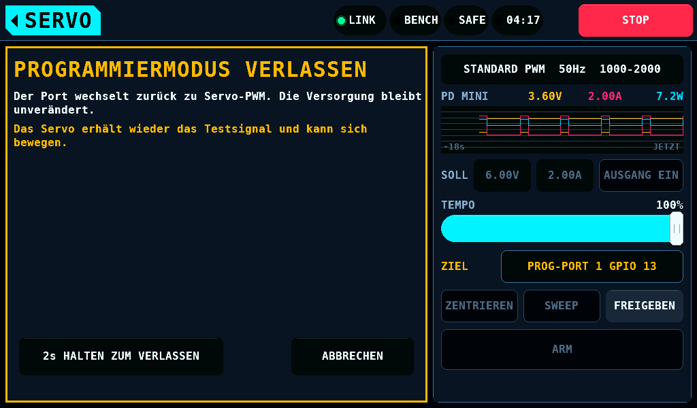

Die Zustandszeile zeigt
`Programmiermodus wird verlassen. PWM ist noch aus.`, und die
Bedienelemente des Testers bleiben aus, bis der Port PWM meldet. Die Taste
heißt **ABBRECHEN**, solange das Warten läuft. Danach steht
`Der Port ist wieder im Testermodus.`, und der Tester treibt den Port sofort,
mit **SERVO-TESTER** auf diesem Port und **PORT-PWM** ein. Das nächste
**VERBINDEN** beginnt eine neue Sitzung mit eigenem Lesen.

### Das Warten vor PWM

**WARTEZEIT VOR PWM** ist 0 bis 10 000ms, ab Werk 100ms. Ein
**VERLASSEN** durch den Versorgungszyklus wendet sie nach dem Zyklus an:
der Port hält die Leitung 1000ms auf Low, nachdem die Versorgung an liest,
und dann für **WARTEZEIT VOR PWM** (IOmcu ab Link-Version 4.30). Der Ziffernblock
nimmt keinen Wert über 10 000ms an, und mit einem solchen wird kein
Verlassen gesendet. Ein Warten von 0ms endet beim nächsten Durchlauf des
IOmcu. Die Restzeit eines laufenden Wartens wird nicht angezeigt.
Das Warten, das ein Servo braucht, ist nicht gemessen.

| Während des Wartens | Wirkung |
| --- | --- |
| **ABBRECHEN** | der Port bleibt im Programmiermodus, die Sitzung wie zuvor; `Verlassen wurde vor dem Ende der Wartezeit unterbrochen.`; **VERLASSEN** wird sofort wieder angenommen |
| **STOP** oder ein Wechsel des Prüfstands auf SAFE, kein PD mini antwortet | dieselbe Zeile; der Port bleibt im Programmiermodus und verlangt **ALLES AUSLESEN** |
| Der Ausgang der Versorgung liest aus oder wird ausgeschaltet: **STOP** mit antwortendem PD mini, der eigene Schutz des PD mini | dieselbe Zeile; die Versorgung bleibt 1000ms aus, dann ist der Port in PWM |
| Der Link fällt aus | wie [ein Ausfall des Links](#stopps-und-ausfälle) |

Während des Wartens nach dem Versorgungszyklus lautet die Zustandszeile
ebenso `Programmiermodus wird verlassen. PWM ist noch aus.` Der Zyklus ist
gelaufen: die geschriebenen Werte wirken ab diesem Einschalten.

| Während des Wartens nach dem Versorgungszyklus | Wirkung |
| --- | --- |
| **ABBRECHEN** | der Port bleibt im Programmiermodus, die Leitung auf Low und der Ausgang an; `Verlassen wurde vor dem Ende der Wartezeit unterbrochen.` Das Servo ist außerhalb des Programmiermodus, und die Sitzung hält kein Servo; **VERLASSEN** wird sofort wieder angenommen und verlässt ohne zweiten Zyklus, nach **WARTEZEIT VOR PWM** |
| **STOP** | der Port gibt den Pin frei und ist in PWM; der Ausgang ist aus; die Zeile von STOP |
| Der Ausgang der Versorgung liest aus oder wird ausgeschaltet | der Port ist sofort in PWM; `Der Versorgungszyklus wurde abgebrochen. Der Ausgang des PD mini bleibt aus.` |
| Der Link fällt aus | der Port ist in PWM, der Ausgang aus |

### Ein Port, der nicht verlassen wird

Der Port lehnt ein Verlassen ab, solange er ein Lesen verlangt oder ein
Servo hält, das ein Schreiben unklar hinterlassen hat.

| Der Port | Ein PD mini antwortet | Zeile | Ausweg |
| --- | --- | --- | --- |
| verlangt nach einem Stopp oder Abbruch ein Lesen | ja | `Zuerst das Servo auslesen. ALLES AUSLESEN tippen.` | **ALLES AUSLESEN**, dann **VERLASSEN**; oder **STOP**, das die Versorgung ausschaltet |
| hält ein unklares Servo | ja | `Servozustand unklar. Sitzung bleibt offen. Zuerst ZURÜCKSPIELEN.` und `STOP beendet die Sitzung und schaltet die Versorgung aus.` | **ZURÜCKSPIELEN**, dann **VERLASSEN**; oder **STOP** |
| eines von beiden | nein | `Der Port ist wieder im Testermodus.` und `Sitzungszustand war unklar. PWM startet ohne Wartezeit.` | keiner nötig: der Port ist in PWM |

Ohne PD mini schaltet **STOP** keine Versorgung und lässt den Port im
Programmiermodus, und ein Servo, das nicht antwortet, nimmt kein Lesen
an. Das Panel sendet dann den Vorgang POWER_CYCLED des Ports statt LEAVE.
Ohne PD mini ändert er nur den Zustand des Ports: kein Frame, kein Warten,
und die Versorgung des Servos ist die, die es speist. Der Datensatz eines
unterbrochenen Schreibens bleibt für die nächste Sitzung.

### Ein IOmcu vor Link-Version 4.15

Die Link-Versionen 4.13 und 4.14 haben kein LEAVE. Das Panel sendet ihnen
keines.

| Ein PD mini antwortet | Das Panel | Zeilen |
| --- | --- | --- |
| nein | sendet POWER_CYCLED, das nur den Zustand des Ports ändert; der Port ist ohne Warten in PWM | `Der Port ist wieder im Testermodus.` und `IOmcu-Firmware älter als 0.17.0. PWM startet ohne Wartezeit.` |
| ja | sendet nichts: beide Vorgänge dieser Versionen für den Schritt schalten die Versorgung aus und wieder ein. Die Sitzung bleibt | `Verlassen mit PD mini erfordert IOmcu-Firmware ab 0.17.0.` und `STOP beendet die Sitzung und schaltet die Versorgung aus.` |

Mit einem PD mini an einem solchen IOmcu beendet **STOP** oder der
ausgeschaltete Ausgang der Versorgung die Sitzung: die Versorgung bleibt
1000ms aus, und der Port ist wieder in PWM.

### Ein IOmcu vor Link-Version 4.30

Die Link-Versionen 4.15 bis 4.29 haben kein Warten nach dem
Versorgungszyklus. Das Panel sendet einem solchen IOmcu den Zyklus ohne
es: der Port ist 1000ms, nachdem die Versorgung an liest, in PWM, was auch
immer in **WARTEZEIT VOR PWM** steht. Steht **WARTEZEIT VOR PWM** über 0,
lautet die Meldung danach
`Versorgung 1s aus und wieder ein: die geschriebenen Werte wirken.` und
`Diese IOmcu-Firmware wendet nach dem Zyklus keine WARTEZEIT VOR PWM an.`
Bei 0ms ist es die Meldung eines IOmcu mit 4.30.

## Stopps und Ausfälle

| Ereignis | Wirkung |
| --- | --- |
| **STOP**, ein gehaltener Stopp des Prüfstands | der laufende Vorgang endet nach dem Frame auf der Leitung, höchstens 12ms; der Schalter geht aus; `STOP: der Vorgang wurde abgebrochen.`; der Port verlangt **ALLES AUSLESEN** vor allem anderen. Der Ausgang eines PD mini wird ausgeschaltet, und der Port ist 1000ms, nachdem er aus liest, wieder in PWM |
| **ABBRECHEN** | dasselbe, ohne den gehaltenen Stopp |
| Der Link fällt weg | der Schalter geht aus, offene Seiten schließen; ein laufendes Schreiben ist [unterbrochen](#ein-unterbrochenes-schreiben) |
| Ein Fehler des Prüfstands ([Sicherheit, Fehler](Safety-de.md#fehler)) oder ein Vorgang, der in einer Störung des Servos oder der Leitung endet: kein Servo, ein gescheitertes Lesen, ein geändertes Servo, ein Schreiben, das scheiterte, zurückgerollt wurde oder zerrissen ist, eine Prüfung mit Abweichung, ein Fehler des Treibers | ein laufendes Schreiben endet zuerst mit seinen Rücklesungen: der IOmcu hält die Versorgung bis dahin an, höchstens 10000ms. Dann geht der Ausgang des PD mini aus; der Port findet ihn aus, hält ihn 1000ms aus und ist wieder in PWM: `Der Port hat die Sitzung beendet: Versorgung aus oder Neustart.` Ein IOmcu älter als Link 4.31 lässt die Versorgung an ([Die Versorgung eines Programmierports](Safety-de.md#die-versorgung-eines-programmierports)) |
| Der IOmcu startet neu | seine Sitzung und sein Backup sind weg; `IOmcu neu gestartet. VERBINDEN, dann ALLES AUSLESEN tippen.` und `Schalte zuerst die Servoversorgung aus und wieder ein.`: der Port ist in PWM, und das Servo wurde nicht aus dem Programmiermodus geführt |
| Der Port liest PWM bei gelesenem Servo, eingeschaltetem Schalter, erfolgtem Schreiben oder verlangtem Lesen, und kein Kommando des Programmierers hat ihn dorthin gebracht | die Werte des Servos, das Backup und der Schalter sind auf dem Panel weg; `Der Port hat die Sitzung beendet: Versorgung aus oder Neustart.` und `Servoversorgung aus- und einschalten, dann VERBINDEN tippen.` Ein Vorgang, der in derselben Ablesung endete, behält seine eigene Zeile |
| Die Control-Task des Panels nimmt 2s kein Kommando an | nichts wird gesendet; `Kein Ergebnis vom IOmcu. ALLES AUSLESEN tippen.` Das Kommando ist zurückgezogen: die Control-Task verwirft es, wenn es die Warteschlange verlässt, wie spät auch immer |
| Der IOmcu lehnt einen Austausch eines Vorgangs ab, den er angenommen hat | die Zeile der Ablehnung; die Werte auf dem Panel werden vor einem **ALLES AUSLESEN**, das endet, nicht geändert, gespeichert oder geschrieben |
| 3 Austausche mit dem IOmcu in Folge bleiben unbeantwortet | `Keine Antwort vom IOmcu. ALLES AUSLESEN tippen.`; nach einem Lesen oder Prüfen werden die Werte auf dem Panel vor einem **ALLES AUSLESEN**, das endet, nicht geändert, gespeichert oder geschrieben |
| 30s kein Ergebnis eines Vorgangs, gezählt ab der letzten Meldung des Ports, dass der Vorgang läuft oder plant, oder 120s ab seinem Start, wie lange der Port ihn auch als laufend meldet | der Vorgang wird abgebrochen; `Kein Ergebnis vom IOmcu. ALLES AUSLESEN tippen.`; die Werte auf dem Panel werden vor einem **ALLES AUSLESEN**, das endet, nicht geändert, gespeichert oder geschrieben; ein Schreiben ist [unterbrochen](#ein-unterbrochenes-schreiben) |
| Das Ergebnis eines Vorgangs kommt, auf den der Programmierer aufgehört hat zu warten | es beendet keinen anderen Vorgang: ein Ergebnis zählt für die Anfrage, deren Nummer es trägt. **ABBRECHEN** erreicht einen Vorgang, den der Port noch als laufend meldet |
| Der IOmcu meldet ein Ergebnis, eine Ablehnung oder einen Ausgang, für den dieses Panel keine Zeile hat | `IOmcu meldet Code 255. Dieses Panel kennt ihn nicht.`, mit der Nummer des Codes; ein Ergebnis wird als fehlgeschlagener Vorgang behandelt |

Jede Ablehnung des Ports und jedes Ergebnis der Sitzung hat seine eigene
Zeile. [Die Link-Page](LinkKST-de.md) listet die
Codes.

## Einschränkungen

- Ein laufendes Schreiben zeigt die Zahl der Register, die es setzt, und
  die gesendeten Frames. Das Register, das gerade geschrieben wird, steht
  nicht auf der Link-Page und wird nicht gezeigt. Ein Zurückspielen des
  Backups der Sitzung und ein Lösen des Pairings zeigen nur die Frames.
- Die Bildschirme schreiben `us` für µs: die Schrift hat kein
  Mikro-Zeichen.
- Die Zeile BEWEGEN BEI SIGNALVERLUST ist übersetzt; die anderen Felder
  tragen die Namen des Hersteller-Tools.
- Der Datensatz eines unterbrochenen Schreibens wird beim Start des Panels
  von der Karte gelesen, und von einer später eingesteckten Karte, wenn der
  Programmierer sie einbindet. Ein Datensatz, den das Panel schon hält,
  bleibt, vor und nach dem Zurücklesen des Servos: der Datensatz auf einer
  solchen Karte wird dann nicht gelesen, und der nächste geschriebene
  Datensatz ersetzt ihn.
- Eine Karte, die im Betrieb entnommen und wieder eingesteckt wird, wird
  nicht erneut eingebunden.
- Ist der IOmcu ohne Versorgung und das Servo aus einer anderen
  Versorgung gespeist, überschreitet ein Servo, das die Signalleitung über
  3,63V treibt, den für GPIO 13 spezifizierten Wert
  ([der Signalpegel](#der-signalpegel)).
- Wie lange ein Einbindeversuch ohne Karte den Bildschirm anhält, ist nicht
  gemessen.
- Die Grenzen und Abschalt-Einstellungen des SUPPLY-Bildschirms sind nicht
  gehalten, solange der Programmierer den Port hat; die Sollwerte und
  **AUSGANG EIN** sind es.
- Mit dem simulierten Netzteil (kein PD mini verdrahtet) dimmt das Panel
  dieselben Bedienelemente, und die Versorgung des Servos ist, was es
  speist.
- Die Zeile ZIEL und die Segmente **SERVO-TESTER** und **PORT-PWM** folgen dem Zustand des Ports
  einen Frame des Bildschirms nach der Control-Task. Die Control-Task hält
  die Seite des Ports und die Kommandos des Testers nach ihrer eigenen
  Lesung des Ports.
- Der Code des Panels in `firmware/panel/main/` ist nicht in der Host-Suite: die Warteschlange der Kommandos zwischen Bildschirm und
  Control-Task, die Stelle, an der die Control-Task ein zurückgezogenes
  Kommando verwirft, die Übergabe des Portzustands an die Seite und den
  Tester, und die Dateiaufrufe der Karte.
- Ob ein Servo nach einer Sitzung ohne Schreiben PWM folgt, bevor seine
  Versorgung aus war, ist nicht gemessen. Der Programmierer verlässt eine
  solche Sitzung ohne Versorgungszyklus.
- **PRÜFEN** nach einem Schreiben liest die Register im Programmiermodus,
  vor dem Einschalten, ab dem die Werte wirken. Es zeigt nicht, wonach das
  Servo handelt; ein **VERBINDEN** nach **VERLASSEN** liest das.
- Ein **VERLASSEN** durch den Versorgungszyklus an einem IOmcu vor
  Link-Version 4.30 hält die Leitung 1000ms auf Low, nachdem die
  Versorgung an liest, und wendet **WARTEZEIT VOR PWM** nicht an.
- 1000ms aus ist der Wert des Eigentümers. Die kürzeste Zeit ohne
  Spannung, die den Programmiermodus beendet oder einen geschriebenen Wert
  wirken lässt, ist nicht gemessen; 4s und mehr wirkten an einem Chaservo.
  Ob KST-Servos den Zyklus brauchen wie das Chaservo, ist nicht gemessen.
- Ohne PD mini schaltet der Bediener das Servo 1s vor dem Sync ein. Die
  längste Zeit nach einem Einschalten, in der ein Servo den Sync noch
  annimmt, ist nicht gemessen.
- Der unter **TYPE** gesetzte Typ ist die Angabe des Bedieners. Das Panel
  kann ihn nicht prüfen: kein Register hält die Serie.
- Antwortet ein PD mini an einem IOmcu vor Link-Version 4.15, wird
  der Port nicht aus dem Programmierer verlassen: **STOP** oder der
  ausgeschaltete Ausgang der Versorgung beendet die Sitzung, mit
  ausgeschalteter Versorgung.
- Antwortet ein PD mini, wird ein Port mit einem unklaren Servo durch
  **ZURÜCKSPIELEN** und **VERLASSEN** verlassen, oder durch **STOP** mit
  ausgeschalteter Versorgung.
- **WARTEZEIT VOR PWM** wird von einem IOmcu vor Link-Version 4.15 nicht
  angewendet, nach dem Versorgungszyklus nicht von einem vor 4.30, und
  nicht beim Verlassen eines unklaren Ports ohne PD mini.
  Das Warten, das ein Servo braucht, ist nicht gemessen. Die Restzeit
  eines laufenden Wartens wird nicht angezeigt.
- Ohne PD mini werden die Programmierspannung und die Stromgrenze nicht
  angewendet.
- Der Fehlercode, den das Dateisystem der Karte bei einer
  schreibgeschützten Karte liefert, ist nicht bekannt. Ein anderer Code
  als schreibgeschütztes Dateisystem, Zugriff verweigert und Operation
  nicht erlaubt zeigt `Schreibfehler auf der Karte.` statt
  `Speichern nicht möglich: Karte schreibgeschützt oder BENCH/KST/CONF kein Ordner.`
- Die Vorgabenamen enden bei `KST999`. Ist dieser Name vergeben, wird die
  nächste freie Nummer vorgeschlagen, und die höchste Nummer ist dann nicht
  die neueste Datei.
- Eine Seite hinter den ersten 64 Dateien liest das Verzeichnis je
  64 Dateien davor ein weiteres Mal. Die Zeit dafür ist nicht gemessen;
  das Panel wartet 5s auf eine Seite.
- Ein Schreiben ohne Karte hinterlässt keine Backup-Datei. Das Backup der
  Sitzung ist dann die einzige Kopie des Servos, wie es vorgefunden wurde,
  und endet mit **VERLASSEN**, einem Neustart des IOmcu oder einem
  Stromausfall des Prüfstands.
- Das erste Schreiben einer Sitzung mit eingehängter Karte braucht freien
  Platz auf ihr.
- Eine Servodatei trägt den Servotyp, den der Bediener gesetzt hat, V6
  oder V8, und keine weitere Identität. Die Datei eines V8-Servos lädt in
  jedes als V8 gesetzte Servo.
- Eine Servodatei spielt nur die änderbaren Felder zurück:
  [was sie nicht zurückspielt](#was-eine-datei-nicht-zurückspielt).
- Die Liste zeigt 5 Dateien je Seite, nach Namen sortiert, und hat keine
  Suche. Dateien werden auf dem Panel nicht entfernt oder umbenannt.
- Der Vermerk eines unterbrochenen Schreibens nennt seinen Port und hält
  die Werte des Servos. Ein zweites Servo an diesem Port, dessen 32 Register
  dem Abbild vor dem Schreiben oder dem Abbild gleichen, das das Schreiben
  hinterlassen sollte, wird vom ersten nicht unterschieden: das Panel
  fragt, und die Antwort gibt der Bediener.
- Ohne Karte geht der Vermerk eines Schreibens beim Ausschalten verloren.
- Eine eingehängte Karte, die den Vermerk nicht annimmt, verhindert jedes
  Schreiben: eine nach dem Einhängen gezogene Karte, eine schreibgeschützte
  Karte oder eine Karte, auf der `BENCH/KST/CONF/KST.TXT` oder
  `BENCH/KST/CONF/KST.NEW` ein Ordner ist oder eine Ebene von
  `BENCH/KST/CONF` eine Datei. Jeder Versuch endet mit `Datei nicht auf Karte gespeichert. Keine Werte ins Servo geschrieben.` Das Panel hält eine solche Karte eingehängt, außer einer entnommenen, die der nächste Blick auf den Steckplatz freigibt ([Bildschirme](Screens-de.md#das-format-der-sd-karte)). Ein ohne
  Karte gestartetes Panel hält den Vermerk im Speicher und schreibt.
- Der Vermerk eines beendeten Schreibens wird auf der Karte nach dem
  Schreiben gelöscht, durch ein eigenes Schreiben der Datei, das alle 5s
  wiederholt wird, bis die Karte es annimmt. Ein Stromausfall davor lässt
  den Vermerk eines beendeten Schreibens stehen: beim nächsten Lesen fragt
  das Panel, ob das Servo das des Vermerks ist.
- Der beim Einschalten gefundene Vermerk eines unterbrochenen Schreibens
  wird nur im Programmierer gezeigt; kein anderer Bildschirm meldet ihn.
- Ein Servo, dessen gelesenes Abbild ein hartes Limit verletzt, lässt sich
  lesen und speichern. Ein Schreiben darauf wird abgelehnt.
- LEFT ANGLE und RIGHT ANGLE sind die Zahlen des Hersteller-Tools; ihre
  Einheit ist nicht bekannt.
- Die Versorgungsspannung, die ein Servo im Programmiermodus braucht, ist
  nicht gemessen. Die Untergrenze ist 4,8V.
- Eine Sitzung hat kein Zeitlimit im Leerlauf. Von **VERBINDEN** bis
  **VERLASSEN** ist der Port gehalten, das Servo im Programmiermodus und
  der Ausgang eines PD mini ein, auf jedem Bildschirm und solange der
  Prüfstand versorgt ist. **STOP**, ein Link-Ausfall und das Ausschalten
  des Versorgungsausgangs beenden sie.
- Eine Karte, die im Betrieb eingesteckt wird, liest die Task, die den
  Bildschirm zeichnet. Der Bildschirm ändert sich für die Dauer dieses
  Lesens nicht und nimmt keine Berührung an. Die Dauer ist nicht gemessen.
- Die 120s, die ein Vorgang ab seinem Start hat, sind gewählt. Wie lange
  das längste Schreiben an einem Servo dauert, ist nicht gemessen.

## Offene Messungen

Die Punkte 2, 4, 7 und 14 halten fest, was eine Sitzung am Prüfstand mit
einem Chaservo zeigte (2026-10-16); der Rest ist nicht erfolgt.

1. Die Elektrik der Leitung auf dem Pfad des Ports: Pegel von Prüfstand und
   Servo, welche Seite die Leitung in Ruhe auf Low hält, der Pull-down, die
   Ausgangsimpedanz des Servos und die Zeit, in der beide Seiten treiben.
2. Der Zustand des Motors im Programmiermodus. Ein geschriebener Wert
   wirkt nicht sofort: ein Chaservo handelte nach LEFT ANGLE und RIGHT
   ANGLE erst, nachdem seine Versorgung aus und wieder an war. Andere
   Register sind nicht gemessen.
3. Was das Servo im Programmiermodus mit einem PWM-Puls tut und außerhalb
   davon mit einem Frame.
4. Persistenz: ein geschriebener Wert überstand an einem Chaservo ein Aus-
   und Einschalten. Mehr als ein Zyklus und ein Commit-Schritt sind nicht
   gemessen.
5. Zuverlässigkeit des Schreibens: 1000 Schreibvorgänge mit Rücklesen, die
   Zahl der nicht übernommenen, die Zahl der ungefragt geänderten Register,
   die Streuung der Antwortverzögerung.
6. Die Lesefehlerrate an 1m Leitung, während andere Servos an
   benachbarten Ausgängen laufen: 100.000 Lesungen.
7. Das Timing von Einstieg und Ausstieg. Ein Chaservo trat nur aus einem
   Einschalten in den Programmiermodus ein, mit dem Sync 1000ms danach, und
   folgte nach einem Schreiben keinem PWM, bis seine Versorgung 4s oder
   länger aus war. Offen: die kürzeste Zeit ohne Spannung, die längste Zeit
   nach einem Einschalten, in der ein Servo den Sync annimmt, ob ein Servo
   nach einer Sitzung ohne Schreiben PWM folgt, das Warten, das es vor dem
   ersten Puls braucht, und KST-Servos.
8. Die Funktion jeder änderbaren Einstellung an einem Servo, das verloren
   gehen darf: Position, Stellzeit, Blockierstrom, Ruhestrom und Schwingen
   über dem Wert.
9. Die Toleranz der Senderate um 25,40µs je Halbzelle und die kürzeste
   Pause zwischen Frames, die das Servo annimmt.
10. Ein zweites Servo desselben Typs und andere Generationen: Fingerprint,
    Antworttiming, Halbzelle.
11. Offene Kodierungen: die Konstanten von NEUTRAL, die 2 unbestätigten
    STRETCH-Codes, die Winkelfelder im Modus Gyro Servo und ob das
    Hersteller-Tool die Bereiche erzwingt, die es beschriftet.
12. Ein hier geschriebenes Servo wird vom Hersteller-Tool mit dessen Karte
    gelesen.
13. Der Typ des Servos, von dem das Layout stammt.
14. 20k_sel trennt die Generationen nicht: V8-Servos waren angeschlossen,
    die Flächenservos lasen mit gesetztem 20k_sel, wie V6, und ein Servo,
    das kein Flächenservo ist, mit gelöschtem. Die Modelle wurden nicht
    aufgezeichnet. Der Bediener setzt den Typ.
15. Ein Speichern, ein Auflisten und ein Laden auf einer Karte: die Dauer
    jedes Vorgangs gegen die Grenze von 5s und eine Karte, die während
    eines Speicherns entfernt wird.

## Tests

`test_prog_link` fährt die Panelseite des Ziels und des Pulsschalters des
Ports: einen Port ohne Pin, ein Ziel, das auf einen Prüfstand in Ruhe
wartet, einen IOmcu, der neu startet, und einen Programmierer, der
den Port hat, für jedes der 16 Paare aus Seite und gewünschten Werten.
`test_settings_screen` fährt eine gehaltene Einstellung gegen jeden Aufruf, der
eine ändert, und `test_servo_target` die zwei Zeilen des Reiters PRÜFLING.
`test_kst_card` fährt die Kartenseite der Dateien auf einer Karte im Arbeitsspeicher. `test_kst_prog` und `test_kst_prog_card`
fahren das Modell und `test_kst_panel` mit seinen Geschwistern das Overlay, beide gegen den Port des
IOmcu, ein Versorgungsmodell und das Servomodell durch den
Dispatcher des Links: die Bereiche der Versorgung an ihren Enden und einen
Schritt außerhalb, das Warten bei 0ms, 100ms, 10 000ms und 10 001ms als
Warten des Verlassens, ein Abbruch, ein Wechsel auf SAFE und eine Versorgung, die im
Warten ausgeht, ein Verlassen an den Link-Versionen 4.13 und 4.14 mit und
ohne PD mini, **STOP** während eines Verlassens, jedes Limit an seiner Kante, das Halten von 2s
auf beiden
Seiten der Schwelle, jede Ablehnung und jedes Ergebnis mit seiner Zeile in
beiden Sprachen, die Zeilen der Schreibseite für 1 Wert, für mehr Werte als
Zeilen und für einen Wert über einem weichen Limit, ein weiches Limit, das
für einen Wert weiter vom Wert des Servos erneut gefragt wird, die Zeilen
zum Ruderhorn bei einem späteren Schreiben, das das Horn bewegt, die
Zustandszeile und die Zeile des Reiters bei einem laufenden Schreiben, eine
Meldung, die geht, wenn ihre Bedingung endet, die Zeilen, die keinen Tipp
annehmen, die Beschriftung der Zeile PORT, kein Komma in einer Zahl der
deutschen Tabelle, ein Schreiben, das ein Link-Ausfall, ein Neustart,
**ABBRECHEN** und **STOP** abschneiden, eine Karte, die versagt, und die
Timeouts über den Überlauf der Uhr bei 2^32ms. `test_kst_panel_files` fährt die
Servodateien gegen ein Kartenmodell: jedes Ergebnis eines Namens, jede Art von Datei,
beide Servotypen und ihre Abweichung in beiden Richtungen, jede
Ablehnung, die Grenze von 5s, ein erstes Schreiben mit einer Karte, die
voll ist oder versagt.
`test_kst_prog_cycle` fährt den Versorgungszyklus gegen den Port des
IOmcu, ein PD-mini-Modell, dessen Ausgang das Servomodell versorgt, und
ein Servo, das nur aus einem Einschalten in den Programmiermodus eintritt
und nach einem geschriebenen Wert ab dem nächsten handelt: **VERBINDEN**
mit eingeschaltetem Ausgang (aus, bei 999ms noch aus und kein Sync, an bei
1000ms, der Sync 1000ms nach dem Einschalten), mit ausgeschaltetem Ausgang
und ohne PD mini; **ABBRECHEN**, **STOP**, ein ARM, ein Wechsel des Ziels
und ein Link-Ausfall in der Zeit aus; den Zyklus über den Überlauf der Uhr
bei 2^32ms; **VERLASSEN** nach einem Schreiben mit und ohne PD mini, ohne
Schreiben, mit **ABBRECHEN**, **STOP** und einem Link-Ausfall im Zyklus,
an einem IOmcu ohne LEAVE und für eine Sitzung, deren Beginn das Panel
nicht sah; das Warten nach diesem Zyklus bei 0, 1, 3000 und 10 000ms, mit
**ABBRECHEN**, **STOP** vor und nach einem **ABBRECHEN**, einem
Link-Ausfall und dem ausgeschalteten Ausgang darin, über den Überlauf bei
2^32ms und an einem IOmcu vor Link-Version 4.30 mit und ohne Warten.
`test_kst_panel_type` fährt die Zeile TYPE, den Typ vor einem
Laden, eine abgebrochene Liste, ein Speichern des gesetzten Typs, die
Zeilen nach einem Schreiben und auf der Seite von VERLASSEN mit und ohne
PD mini. `test_kst_panel_limrun` fährt den Endlagenlauf mit dem Servo
hinter dem Ausgang des PD mini und ohne PD mini, wo er nichts schreibt.
`test_kst_file` fährt Dateien im Format 1 und 2: die Typzeile, ihr Fehlen,
eine Zeile im Format 1 gegen 20k_sel.
`test_kst_panel_nocard` fährt die Schreiben ohne Karte: das erste Schreiben,
ein Zurückspielen und ein Lösen des Pairings, ein früh losgelassenes
Halten, eine zwischen zwei Schreiben eingehängte Karte und eine unter der
Schreibseite entnommene Karte. Ein Kommando, das die Control-Task nach
Ablauf seiner 2s annimmt, erreicht keine Leitung, für jede Art von
Vorgang; eine Ablehnung bei jedem späteren Austausch jeder Art von Vorgang
verlangt **ALLES AUSLESEN**; jeder Ergebniscode der Sitzung hat eine Klasse,
und ein Code ohne Klasse lässt den Test fehlschlagen; ein Zurückspielen,
das die Karte bei jedem Dateischritt nicht starten lässt, lässt die offenen
Werte stehen; die Sperre bei der Antwort auf die Datei des Servos und auf
den Vermerk, mit ausgeschaltetem Schalter, dem Port in PWM, einem anderen
belegten Port, einem laufenden Vorgang am Port, einem noch nicht gelesenen
Status, ARMED vom IOmcu und vom Bildschirm, STOP und ohne Änderung; ein
ARMED, das vor der Antwort endet, lässt das Schreiben gehen; ein Vermerk
von einer Karte, die vor und nach dem Lesen eingebunden wird, desselben
und eines anderen Servos.
