# Servo programmer for KST and Chaservo servos

<sub>**English** · [Deutsch](ServoProgrammer-de.md)</sub>

The programmer reads the 32 registers of a KST or Chaservo servo over its
signal wire, shows them as settings, and writes changed settings back. The
servos of the two brands share one protocol and one register set. It opens
from its row `KST and Chaservo servos` on **PROGRAM** of the
[SERVO screen](Screens.md#servo), one level down, and covers the left
column, the strip's tabs with it. **CLOSE** or the home tag returns to
PROGRAM's list. Opening it ends a running automatic test as
`stopped by the operator`. The row is dimmed with `IOMCU HAS NO SERVO PWM`
and opens nothing while the IOmcu, the RP2350 board, reports no servo PWM,
which includes no IOmcu answering.

KST and Chaservo are names or trademarks of their respective owners. rcbench
is independent: it is not affiliated with, endorsed by or sponsored by them.
The names say which servos the programmer works with.
[Legal notice and disclaimer](../README.md#legal-notice-and-disclaimer) holds
the project's notice.

The register layout and the timing come from 1 Tool Card #2, KST's
programming card, and 1 Chaservo servo of unidentified model. The effect of
a register on the servo's motion is not measured: the names, units and
limits are those the vendor tool displays and accepts.
[What is open](#measurements-still-open) lists what a bench has to measure
before a write is relied on.

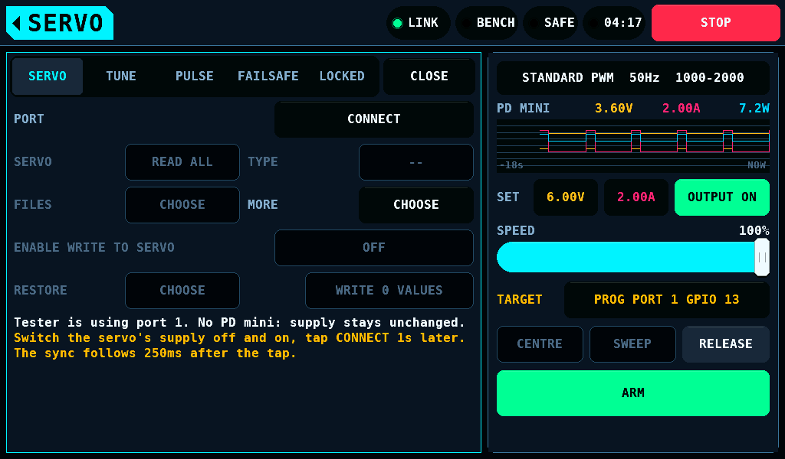

## Constraints

- The IOmcu runs protocol 4.13 or later. With an older one the overlay
  says `Unavailable: the IOmcu has no programming port.` and
  `Update the IOmcu to version 0.17.0 or later.`, and every control but
  **CLOSE** is off.
- **LEAVE** with its wait needs protocol 4.15 on the IOmcu. An older
  one is [named and handled without it](#an-iomcu-older-than-link-version-415).

  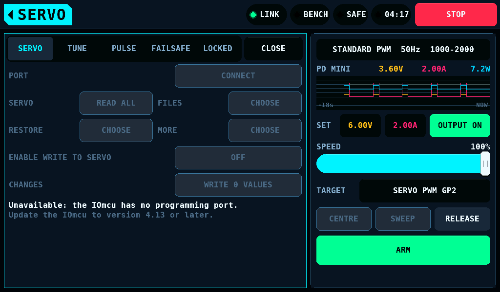

- The servo is on one of the IOmcu's programming ports, PROG PORT 1 to 4,
  with FUNCTION SERVO PWM and a pin: port 1 is GPIO 13, pad 17 of the
  bring-up module, unless another pin is stored for it; ports 2 to 4 have
  the pin set on their PROG PORT entry. A port is no output channel and no
  slot of OUTPUTS.
- **SERVO TESTER** names that port: PORT 1, PORT 2, PORT 3 or PORT 4
  ([the target](#the-target)). With OUTPUTS, the standard outputs as
  target, the programmer is locked.
- One servo at a time.
- The port is in PWM (pulse-width modulation) or in programming, never both.
  While the port is in programming, the tester sends no pulse to it, and
  its **COMMANDED** row reads `---`.
- Programming and the ARMED state are exclusive. **CONNECT** on a bench that
  is ARMED for any role, asked to arm or has a finger on **ARM** is refused with
  `Tap DISARM first. The port cannot be taken over while ARMED.` While the port
  is held, from **CONNECT** until it reports PWM, no screen switches the bench to ARMED:
  **ARM** on SERVO and on MOTOR & ESC is drawn disabled and takes no press,
  and a run of the ESC stick programmer does not start and says
  `Servo programmer is using a port. Tap LEAVE on SERVO first.` An arm that
  reaches the bench another way is refused with the alert
  `Cannot switch to ARMED: a port is in use by the servo programmer.`. **DISARM** and **STOP**
  work in every state. While the bench is ARMED the read, the verify, the write,
  the restore and the pairing release are refused with the same line as
  **CONNECT**; **LEAVE** is taken.
- With a PD mini answering, the port sets the servo's supply at **CONNECT**
  ([the supply](#the-supply)). Without one the supply is not the bench's to
  set, and the programmer takes it as it is.
- The programmer assumes that a servo needs no power cycle: neither to take
  a written value into effect nor to follow PWM after programming. Neither
  is measured ([limitations](#limitations)).
- Whether a given hardware carries the servo's reply back to the pin is not
  known to the IOmcu. A servo on a port that does not ends **CONNECT**
  with `No servo responds. Check the plug, supply and port.`

## The target

The tester of the SERVO screen drives the standard servo outputs or one
programming port: **SERVO TESTER** holds OUTPUTS, PORT 1, PORT 2, PORT 3
or PORT 4. Two controls set it, on each PROG
PORT entry of **SETUP** > **OUTPUTS**:

| Control | Values | Does |
| --- | --- | --- |
| SERVO TESTER | **OUTPUTS**, **PORT n** (the entry's port) | what the sweep, **CENTRE**, **RELEASE**, the hold of a position and the automatic test drive |
| PORT PWM | **ON**, **OFF** | whether the programming port renders the tester's pulse while it is the target |

A tap on the TARGET row of the right card opens **OUTPUTS** on the PROG
PORT entry while the IOmcu drives the port, on SERVO PWM while it drives
the outputs, and on the overview while the target is not known. The
home tag there goes back to SERVO on the task the row was tapped on.
Leaving SERVO switches the bench to SAFE and ends a sweep or a test, as
every way out of the screen does.


Both are kept with the SERVO settings, SERVO TESTER as OUTPUTS, PORT 1,
PORT 2, PORT 3 or PORT 4. The TARGET row names the active
target with its protocol and pins: `PROG PORT 1 GPIO 13` in the warning
colour, or `SERVO PWM GPIO 4` for the pins bound as SERVO PWM. A port whose
FUNCTION is NONE is no target: its entry locks **PORT n** and says
`THE SERVO TESTER NEEDS FUNCTION SERVO PWM`. A stored value 1, the
PROG PORT of a single-port panel, reads as PORT 1.
**SERVO TESTER** changes only
with the bench SAFE, no sweep and no test running, and the port not in
programming; the panel releases a held position before it asks the
IOmcu for the other target. **PORT PWM** goes on under the same
rule. It goes off with the port not in programming, no sweep and no test
running, with the bench ARMED as with the bench SAFE. With **OUTPUTS** as
target **PORT PWM** is locked. A locked segment is drawn outlined, without
the accent, and the line under the two names the reason:

| Line | Condition |
| --- | --- |
| `LOCKED: THE SERVO PROGRAMMER HOLDS THE PORT` | the programmer has the port |
| `LOCKED WHILE ARMED OR A TEST OR SWEEP RUNS` | the bench is ARMED or asked to arm, or a sweep or a test runs |
| `SERVO TESTER DRIVES PROG PORT 3` | another port's entry: the tester drives port 3 |
| `PORT PWM NEEDS PROG PORT AS THE TESTER'S TARGET` | **PORT PWM** on an entry whose port is not the target |

The TARGET row on the right card takes no tap while the bench is ARMED, a
sweep or a test runs, or the programmer has the port.

While the programmer has the port neither row changes: from **CONNECT** to
the port back in PWM after **LEAVE**, during every operation, and for as
long as the IOmcu reports the port out of PWM. The TARGET row and both
segments are drawn locked, a reset of the settings leaves the two values, the panel writes
nothing to the IOmcu's page of the port, and the tester sends the
port no command and no release. A release owed to the port goes out once
the port is back in PWM.

A port without a pin cannot be the target: a slot of OUTPUTS that holds
GPIO 13 leaves the port none. The tester then keeps the standard outputs,
whatever the row says.

With the standard outputs as target, SERVO TESTER on OUTPUTS, the programmer shows `Use the programming port to program a servo.` and `Set SERVO TESTER to PORT 1 to PORT 4 on SETUP > OUTPUTS.`, and every control but **CLOSE** is off. It connects on PORT 1, PORT 2, PORT 3 or PORT 4, the port SERVO TESTER names, with that port's pin.

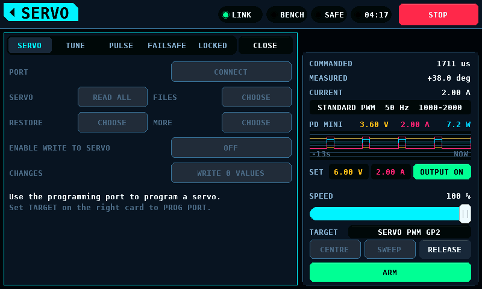

## The port

| State | Line on the SERVO tab | The port carries |
| --- | --- | --- |
| PWM, a PD mini answers | `Tester is using port 1. CONNECT sets 5.0V and 1000mA.` | the tester's pulses |
| PWM, no PD mini | `Tester is using port 1. No PD mini: supply stays unchanged.` | the tester's pulses |
| Connecting | `Connecting on port 1. PWM is off.` | no pulse for 50ms, then low for 100ms, then the entry sequence |
| Programming | `Port 1 is in programming mode. PWM is off.` | frames only |
| Programming, the supply read | `Port 1 in programming mode. PWM off. 5.00V, 37mA.` | frames only |
| Working | `Operation in progress: 12 frames.` | frames of the running operation |
| Working, a write of values | `Writing 3 registers. Frames sent: 94.`, or `Writing 1 register. Frames sent: 31.` | frames of the write; the count is the registers the write sets |
| Working, a restore of the session's backup or a pairing release | `Writing. Frames sent: 12.` | frames of the write; the IOmcu plans it alone, and the panel has no count |
| Working, the IOmcu plans | `Preparing the write order. No frames sent yet.` | nothing: an IOmcu of link version 4.14 plans a write or a restore before its first frame |
| Leaving | `Leaving programming mode. PWM is still off.` | the line low for **WAIT BEFORE PWM**; no pulse until the port reports PWM |

**CONNECT** takes the port out of PWM, sets the supply where a PD mini
answers, runs the entry sequence and reads all 32 registers. The button
reads **ABORT** while an operation runs or a leave waits, and **LEAVE** in
programming mode.

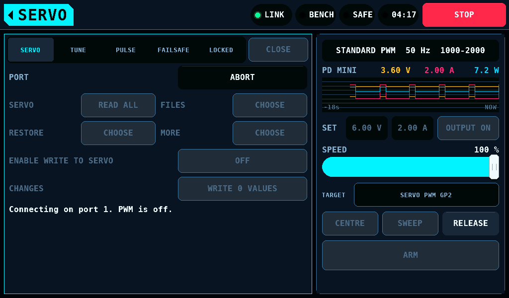

While a write, a restore or a pairing release runs, the SERVO tab shows
`Writing. Do not disconnect.` in the warning colour, and **RESTORE** takes no
tap. The record of that write is on the card or in memory and is not shown
as [an interrupted write](#an-interrupted-write) before the write ends
without a result.

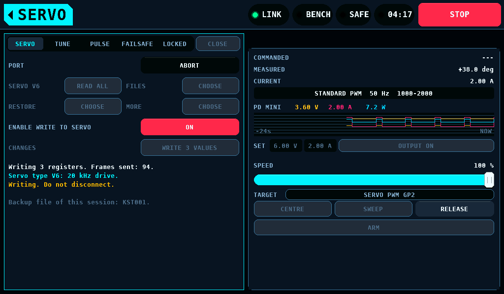

While the port is in programming the overlay stays open, the strip's tabs
under it take no press, and the tester's controls send nothing to the port.
**CLOSE** and the home tag open LEAVE PROGRAMMING; over an open keypad,
list, warning or keyboard the home tag closes that one first. **STOP** on
the right card works. Leaving the SERVO screen leaves the port as it is;
the overlay is open again on PROGRAM at the next entry.

| **CONNECT** ends with | Meaning |
| --- | --- |
| `No pin assigned to the programming port. Nothing sent.` | a slot of OUTPUTS holds the port's pin |
| `This programming port does not exist on the IOmcu.` | the IOmcu has fewer ports than the one asked for |
| `Programming voltage or current exceeds the SUPPLY limits.` and `Lower the value under MORE, or raise the limit. Nothing was applied.` | PROGRAMMING VOLTAGE is above the SUPPLY screen's voltage limit, or CURRENT LIMIT above its current limit; nothing is sent |
| `Tap DISARM first. The port cannot be taken over while ARMED.` | the bench is ARMED or asked to arm; the IOmcu refuses the same on its own with `Port busy. Try again.` |
| `The supply cannot provide this voltage or current limit.` | the voltage is above 8.4V, the current limit outside 50 to 3000mA, or the voltage the session runs at less than 0.7V under the input voltage of the PD mini; the supply is not changed |
| `Supply below 4.8V. Programming requires at least 4.8V.` | the programming voltage, or the voltage of an output that is on, is under 4.8V; the supply is not changed. With an output that is on and set under 4.8V the panel sends nothing to the IOmcu |
| `The supply did not switch within 3000ms. Check the supply.` | the PD mini did not read as asked; the port is back in PWM, and an output this **CONNECT** switched on is off again |
| `The IOmcu has not yet accepted the link. Try again.` | the IOmcu does not trust the heartbeat, or the link was silent |

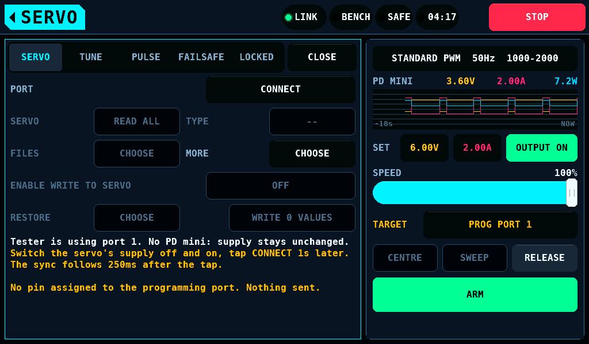

### The signal level

The servo's signal pin is a microcontroller GPIO (general-purpose
input/output). The high level of its reply is at most 5V and typically
3.3V. The level is not measured. GPIO 13 is rated 5.5V while the
IOmcu's IOVDD (input/output supply) is at 3.3V
(`hardware/docs/IOBoard.md`, pin ratings), so the port has no level shifter
and no clamp.

With the IOmcu unpowered GPIO 13 is rated 3.63V. A servo that drives
the wire at 5V while the IOmcu is off exceeds that rating. What the
servo's pin does at idle with the bench off is not measured.

Power the IOmcu before the servo's supply, or do not feed the servo
from an external supply while the bench is off.

## The supply

With the port in the tester's hands, **MORE** opens what **CONNECT** sets.

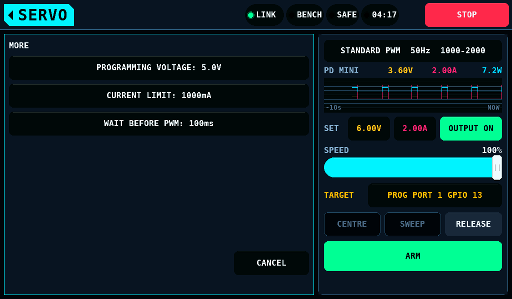

| Entry | Range | Default | Does |
| --- | --- | --- | --- |
| PROGRAMMING VOLTAGE | 4.8 to 6.0V in 0.1V; up to 8.4V with HV SERVO on | 5.0V | the supply voltage of the servo in programming mode |
| CURRENT LIMIT | 50 to 3000mA | 1000mA | the supply's current limit during programming |
| WAIT BEFORE PWM | 0 to 10 000ms | 100ms | the time the port holds its line low between **LEAVE** and the first pulse |

Each entry opens the number keypad with its range. A value outside the range
is not taken. All three are kept with the SERVO settings.

**CONNECT** switches an output that is off on at the two values, and the
session starts 1000ms after the PD mini reads on. For an output that is
on, the session runs at the lower of the two voltages and the lower of the
two current limits: a voltage above the programming voltage is lowered to
it, a current limit above CURRENT LIMIT is lowered to it, and neither is
raised. Leaving programming does not restore a value **CONNECT** lowered.

The port programs at 4.8V or more. The supply voltage a servo needs to
store a register is not measured. An
output that is on under 4.8V is not programmed at and stays as it is; the
operator raises it first. A PD mini whose input voltage is under 5.5V cannot give
4.8V, and no session starts on it.

While the port is out of PWM the supply's set points are the port's. The
IOmcu refuses every change of the voltage and of the current limit
and every ON; it takes an OFF. The SUPPLY screen and the SET row of the
right card show the same: the set points, the sliders, the steps and
**OUTPUT ON** are dimmed and take no press, **OUTPUT OFF** and
**RESET PEAKS** work, and the MODE card of the SUPPLY screen reads
`Servo programmer.`. The limits of the SUPPLY screen's settings stay
editable; a limit lowered under a set point reaches the set point when the
port is back in PWM.

An OFF that arrives while a frame is on the wire, from **OUTPUT OFF**,
**STOP** or a lost heartbeat, reads off at once and reaches the PD mini
when the port has cut the frame, 12ms later at most. The PD mini's own
protection is not delayed. How long the PD mini's output takes to fall
after its off command is not measured.

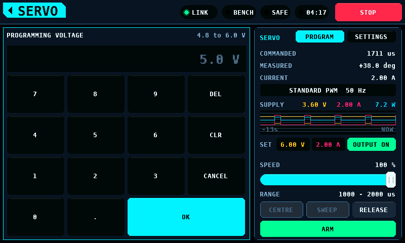
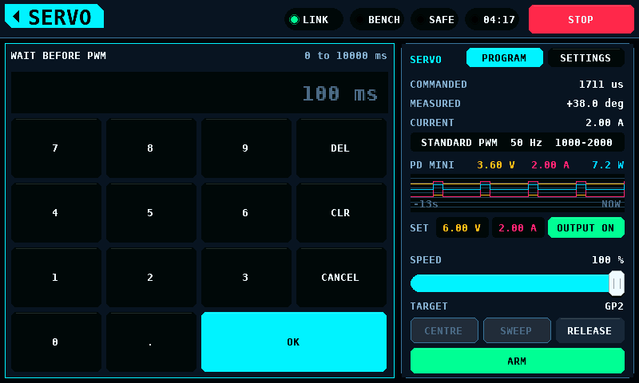

A voltage above 6.0V needs **HV SERVO** in the AUTOMATIC TEST card's settings on TEST;
without it the keypad ends at 6.0V. With it, a value above 6.0V opens the
warning page of the SERVO screen's high-voltage setting, and **HOLD 2s TO
APPLY** takes it after 2s. Switching **HV SERVO** off sets a programming
voltage above 6.0V back to 5.0V.

A voltage above 6.0V is not stored. The SERVO settings keep 6.0V for it,
and a stored value above 6.0V, from the settings page or a settings file,
is loaded as 6.0V and stored as that, with **HV SERVO** on or off. The
programmer reads the settings when it opens and at every entry of the SERVO
screen while no port is held, and when the panel starts under a held port:
each of these begins at 6.0V or below, and a voltage above it takes the
warning page and its hold of 2s again. A session that holds its port keeps
the voltage it began with.

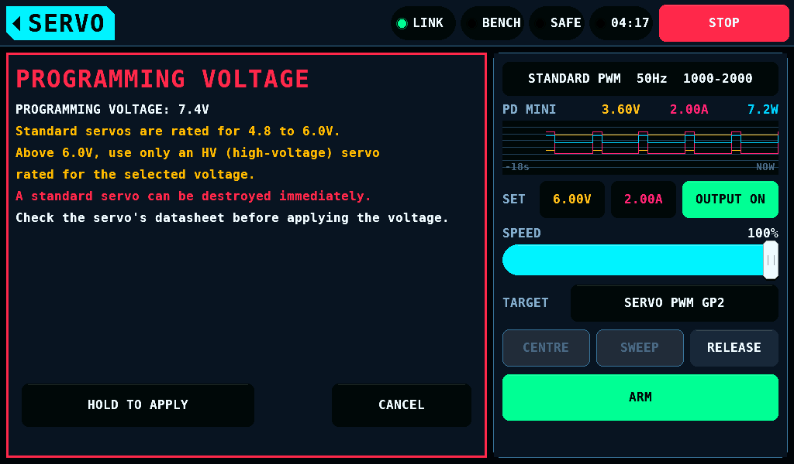

With a PD mini answering, the state line names the values before
**CONNECT** and the measured output voltage and current in programming
mode. The SUPPLY screen and the supply rows of the right card follow what
the port set.

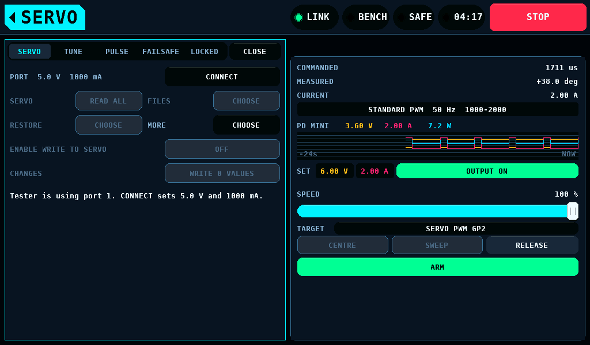
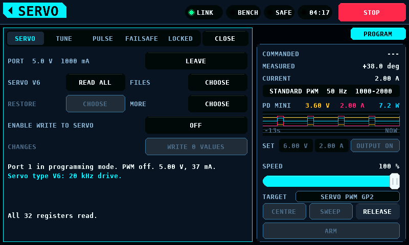

Without a PD mini the voltage and the current limit are stored and not
applied. **WAIT BEFORE PWM** is applied at [leaving](#leaving) with and
without a PD mini by an IOmcu of link version 4.15 or later.

## SERVO tab

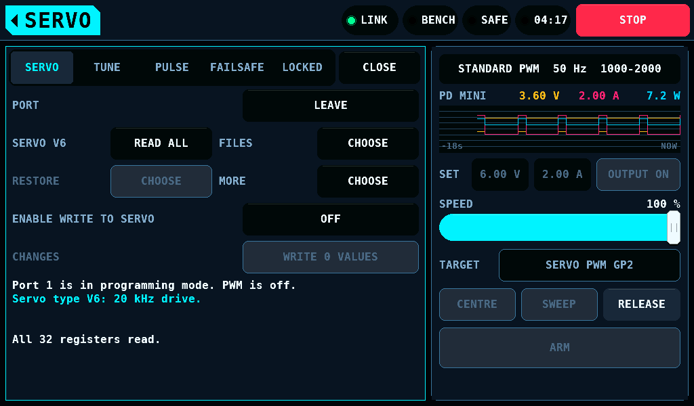

| Row | Button | Does |
| --- | --- | --- |
| PORT | **CONNECT**, **ABORT**, **LEAVE** | takes the port, ends the running operation, [gives the port back](#leaving) |
| SERVO, then SERVO V6 or SERVO V8 | **READ ALL** | reads the 32 registers, each until 3 of at most 5 reads agree; the row then names [the servo type](#the-servo-type) |
| FILES | **CHOOSE** | [saves the servo's values to the card and loads a file](#servo-files) |
| RESTORE | **CHOOSE** | [writes a backup back](#restore) |
| MORE | **CHOOSE** | in PWM [what CONNECT sets](#the-supply); in programming mode [VERIFY, DISCARD EDITS, RELEASE PAIRING](#more) |
| ENABLE WRITE TO SERVO | **OFF**, **ON** | [the write switch](#the-write-switch) |
| CHANGES | **WRITE n VALUES**, **WRITE 1 VALUE** | [writes the changed values](#writing) |

In PWM with a PD mini answering the PORT row reads `PORT  5.0V  1000mA`:
the voltage and the current limit that **CONNECT** sets. A row whose button
is drawn off takes no tap: **FILES** outside programming mode and while the
servo is in doubt, **RESTORE** while an operation runs, the write switch
where [it is refused](#the-write-switch).

Below the rows stand the port's state, the servo type, the name of the
session's backup file and the last message. A message in the warning colour is a refusal or a result
that needs a second look; one in the danger colour says the servo's content
is in doubt.

### A servo of unknown layout

The IOmcu compares the image with the layout of the known servo, its
fingerprint. An image that fails is shown and never written: the edit rows
and the write switch are off and take no tap, the tab keeps `Read only. This servo type is unknown.`, and **RELEASE PAIRING** is refused. **READ ALL**, a save to a file and
**VERIFY** work. A file is not loaded.

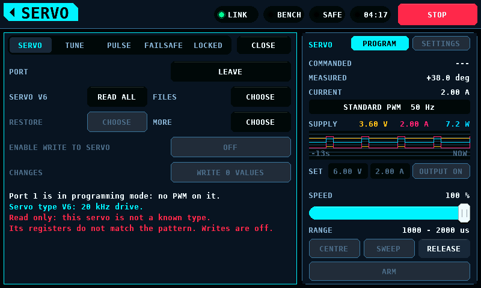

## Editing

A value is edited in a draft on the panel. Nothing reaches the servo before
[**WRITE n VALUES**](#writing). A value that differs from the servo's is
marked twice: by `*` before it and by the accent fill.

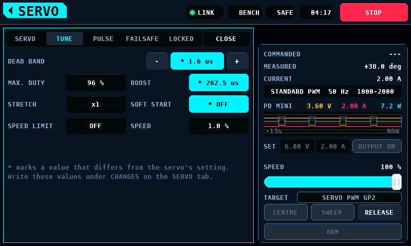

A numeric value opens the keypad. Its range is the range the hard limits
accept in the draft as it stands, so a value outside cannot be entered.
STRETCH opens a list of the 6 confirmed factors. An ON/OFF value flips on
the tap. DEAD BAND and NEUTRAL have minus and plus keys: one raw count a
tap, and while held 8 counts a second after 0.45s and 30 a second after a
further 1.8s.

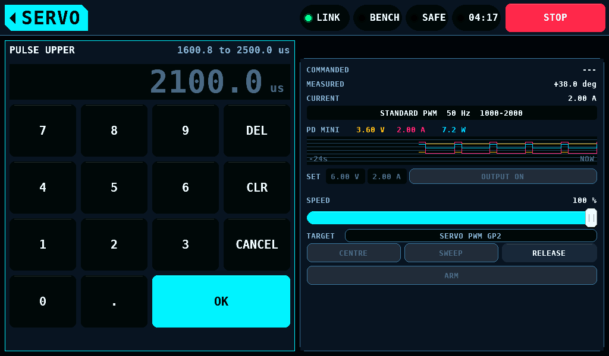
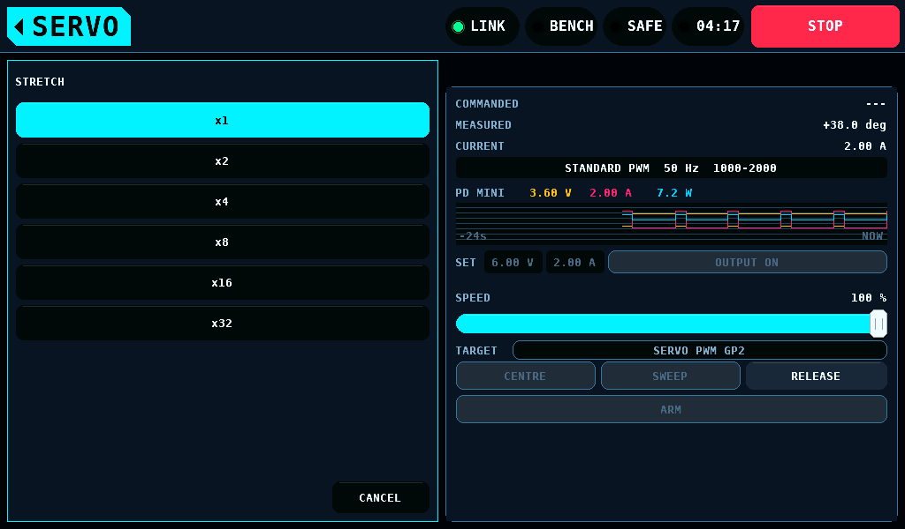

### TUNE

| Row | Register field | Hard limit |
| --- | --- | --- |
| DEAD BAND | Dead Band, µs | the field's range |
| MAX. DUTY | Max. Duty, % | 10 to 98% |
| BOOST | Boost, µs | at most 3000µs |
| STRETCH | Stretch, factor | x1 to x32; the 2 remaining codes are not offered |
| SOFT START | Soft_Start, ON or OFF | none |
| SPEED LIMIT | spd_sel, ON or OFF | ON needs SPEED at 5% or above |
| SPEED | SPD, % | at most 100%; at least 5% while SPEED LIMIT is ON |

### PULSE

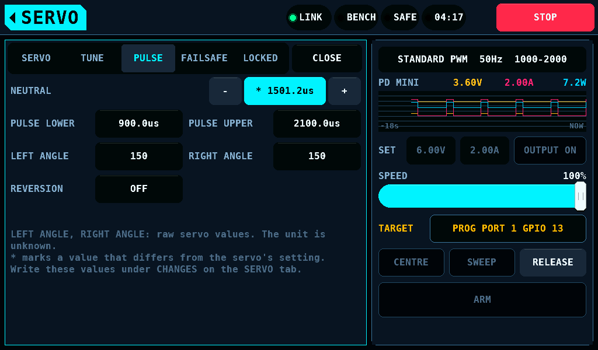

| Row | Register field | Hard limit |
| --- | --- | --- |
| NEUTRAL | Neutral, µs | 1360 to 1640µs; 100µs or more from either end point |
| PULSE LOWER | Pulse Lower, µs | 500µs or more; 100µs or more below NEUTRAL; 400µs or more below PULSE UPPER |
| PULSE UPPER | Pulse Upper, µs | 2500µs or less; 100µs or more above NEUTRAL |
| LEFT ANGLE | Left Angle, the vendor tool's number | not 0 |
| RIGHT ANGLE | Right Angle, the vendor tool's number | not 0 |
| REVERSION | Reversion, ON or OFF | none |

The NEUTRAL conversion between register and µs is a fit to 3 values and
uncertain by about 1µs. The tab says of the two angles `LEFT ANGLE, RIGHT ANGLE: raw servo values. The unit is unknown.` The screens write `us` for µs:
their font has no micro sign.

### FAILSAFE

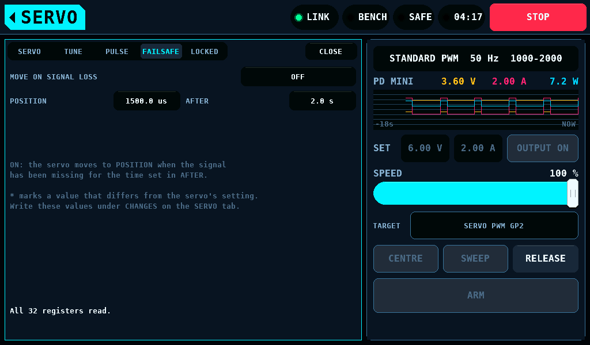

| Row | Register field | Hard limit |
| --- | --- | --- |
| MOVE ON SIGNAL LOSS | Allow Uncont, ON or OFF | none |
| POSITION | Uncontrolled Pos, µs | 500 to 2500µs and within PULSE LOWER to PULSE UPPER |
| AFTER | Uncontrolled Time, s | 0.4 to 13.0s |

The limits are those of `protocols/kst/kst_limits.c`; the panel holds none
of its own. The lower limit of MAX. DUTY and the 5% of SPEED are choices,
not readings of a servo.

### A value a hard limit refuses

A tap that would break a hard limit changes nothing and says which limit.

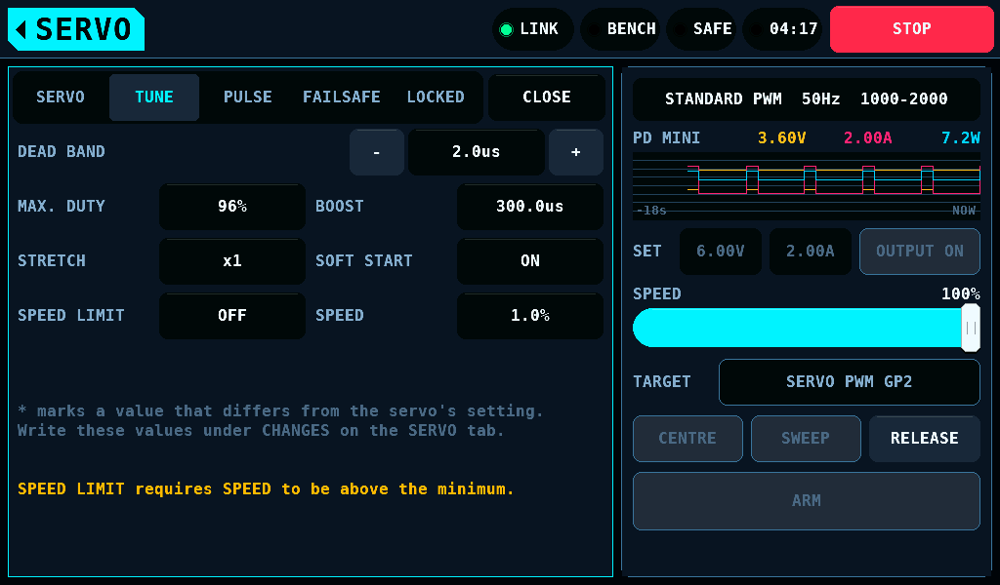

### A value that needs a second look

A value inside the hard limits that breaks a soft limit opens CHECK THIS
CHANGE with the field's line and one line per limit. The field's line
counts from the servo's value, not from an edit before this one: `MAX.
DUTY: 96 -> 97%` is the value the servo holds, the new value and the unit.
**HOLD 2s TO APPLY** takes it after 2s of holding; **CANCEL**, or a finger
that slides off, leaves the draft as it was.

A limit confirmed for a value is confirmed for that value. A later edit of
the field opens the page again when it moves the value further from the
servo's than the value confirmed, or to its other side: 97% confirmed, 98%
asks again and shows `MAX. DUTY: 96 -> 98%`, and 97% after that does not.
A write, a read and **DISCARD EDITS** end every confirmation.

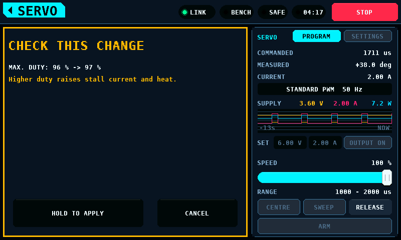

| Condition | Warning |
| --- | --- |
| MAX. DUTY above the servo's | `Higher duty increases stall current and heat.` |
| MAX. DUTY below 50% | `Low duty weakens the servo. It may not hold the control surface.` |
| BOOST above the servo's | `Higher boost can cause buzzing and heat.` |
| STRETCH above the servo's | `Higher stretch can cause servo oscillation.` |
| SOFT START switched off | `Without soft start, the servo moves abruptly at power-on.` |
| SPEED LIMIT switched on | `Speed limit active. The servo moves at the set speed.` |
| SPEED below 30% with SPEED LIMIT on | `A slow servo can cause loss of control of the model.` |
| DEAD BAND below the servo's | `A narrow dead band can cause back-and-forth movement and heat.` |
| DEAD BAND below 1.0µs | `Very narrow dead band. Back-and-forth movement and heat are likely.` |
| MOVE ON SIGNAL LOSS switched on | `On signal loss the servo moves to the failsafe position.` |
| POSITION more than 300µs from NEUTRAL, MOVE ON SIGNAL LOSS on | `Failsafe position is far from the centre.` |
| AFTER below 1.0s | `Short dropouts will trigger the failsafe move.` |
| an end point less than 300µs from NEUTRAL | `End point close to Neutral. Little travel remains on this side.` |
| an end point more than 100µs from the servo's | `End point changed. The servo travel per stick movement changes too.` |
| NEUTRAL more than 20µs from the servo's | `The centre shifts. One side moves closer to the mechanical stop.` |
| REVERSION changed | `Direction reversed. Check all control surfaces before flight.` |
| an angle above the servo's | `More travel can push the servo against its stop and burn it out.` |
| an angle below 50 | `Small angle. Full stick movement gives little servo travel.` |
| DEAD BAND below 1.0µs with STRETCH above x1 | `Narrow dead band and higher gain can cause oscillation.` |
| MAX. DUTY above 90% with an angle above the servo's | `High duty and more travel: a stall can destroy the servo.` |

"The servo's" in this table is the value of the session's backup, the
servo as the session first read it. A write of the session does not move
it: a value raised in two writes is compared with the value the servo came
with. Where the panel does not hold that backup, or the backup is another
servo's, it is the value last read. The warnings of
[a restore](#restore) compare with the servo as last read.

### LOCKED

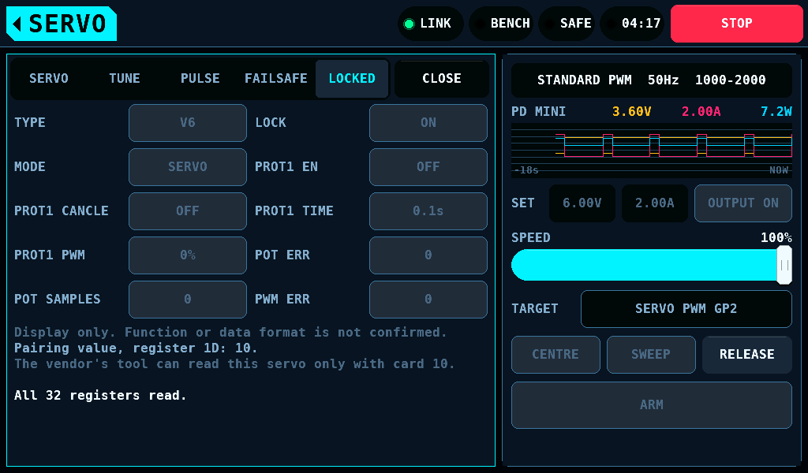

| Row | Field |
| --- | --- |
| TYPE | 20k_sel, shown as [the servo type](#the-servo-type), V6 or V8 |
| LOCK | Lock |
| MODE | Servo or Gyro Servo |
| PROT1 EN, PROT1 CANCLE, PROT1 TIME, PROT1 PWM, POT ERR, POT SAMPLES, PWM ERR | the protection block the vendor tool hides; `PROT1 CANCLE` is the vendor's spelling |

These values are shown and no edit changes them. Their function or their
encoding is not confirmed. The tab also shows the pairing value, register
1D, and the card number the vendor tool needs for this servo. A servo in
Gyro Servo mode is read and not written: the limits of that mode are not
known.

## The write switch

**ENABLE WRITE TO SERVO** is off by default. A tap on **OFF** opens a page
that names the risks; **HOLD 2s TO ENABLE** switches it on after 2s. A tap on
**ON** switches it off at once. A tap on **WRITE n VALUES** with the switch
off opens the same page: its hold switches the switch on and writes
nothing, and the next tap on **WRITE n VALUES** opens the write page.

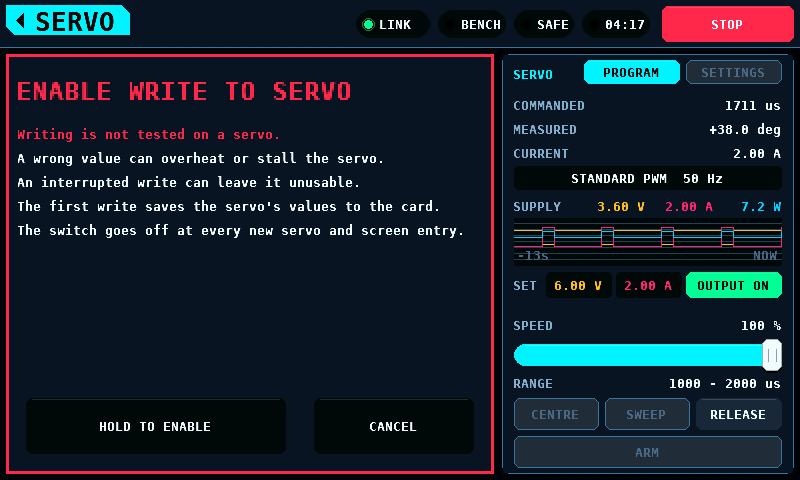

The switch goes off:

- at every entry of the SERVO screen,
- when the link to the IOmcu goes or the IOmcu starts again,
- at **STOP** and at every stop the bench latches,
- with every **CONNECT** and every **LEAVE**,
- when a read finds another image than the one held,
- when a read fails the fingerprint,
- when a write, a restore, a read or **VERIFY** ends with the servo in
  doubt: the read that follows does not switch it on again,
- when a read finds a servo that fits the record of an interrupted write.

With the switch off the panel sends no write, no restore and no pairing
release, and the IOmcu refuses one that arrives without the switch's
key. Reading, **VERIFY**, saving to a file and loading a file work with
the switch off.

The switch takes its tap with a servo read. Where it does not, **OFF** is
drawn off: without a servo read, with a servo that fails the fingerprint,
while an operation runs and while the panel asks whether the servo is the
one of an interrupted write. A session the IOmcu has
locked after an interrupted write takes it with no servo read as well, once
the panel holds the session's backup: this is the state of a panel that
starts under such a session. The switch then opens one write, the restore
of the session's backup. An edit, a write of values, a pairing release and
a load of a file stay refused until a read and the end of the lock.
**READ ALL** in that state reads the servo and shows its values; the lock
stays, and no value is edited.

## Writing

**WRITE n VALUES** counts the fields in which the draft differs from the
servo; with one such field it reads **WRITE 1 VALUE**. It is off without a
change. With the switch off its tap opens
[the switch's page](#the-write-switch).

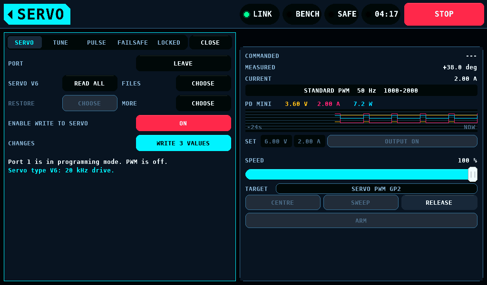

A tap opens the write page. **HOLD 2s TO WRITE** starts the write after 2s.
The page has 12 lines.

The changed values come first, in the order of the tabs, one line each:
`DEAD BAND: 2.0 -> 1.6us` is the servo's value, the new value and the
unit. A value at fault for [a soft limit](#a-value-that-needs-a-second-look)
is in the warning colour. With more values than lines the last of these
lines counts the rest: `and 4 more`. A first write with a card shows 7
values, or 6 and the count; one without a card 6, or 5 and the count.

`Keep the servo horn clear. Disconnect the linkage.` and `Test the servo on the bench before fitting it to a model.` follow on the first write after a **CONNECT** and on
every write that changes REVERSION, NEUTRAL, PULSE LOWER, PULSE UPPER, LEFT
ANGLE or RIGHT ANGLE. A write that the card, a stop or the link kept from
starting is not that first write: the lines stay for the next one.

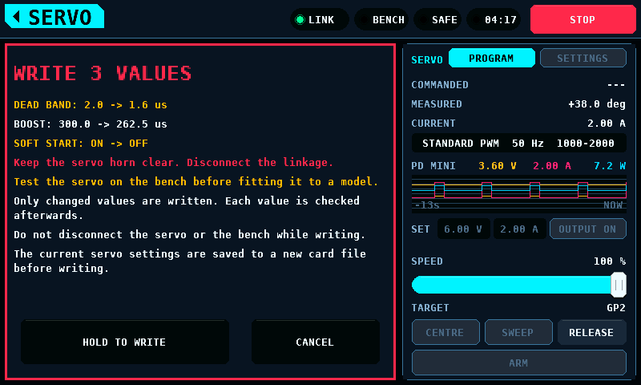

1. The first write of a session saves the servo's values to
   [a new file on the card](#the-backup-before-the-first-write). A card
   that is mounted and does not take the file ends the write. With no card
   mounted the write page says that no file is saved, and the write goes
   without one. While the record of an interrupted write is held no file is
   saved: the servo may be half written, and the record holds its values as
   found.
2. The panel records the image the servo holds, the image the write is to
   leave and the port: with a card in `BENCH/KST/CONF/KST.TXT`, without one in
   memory.
   The page says which. With a card that takes no file within 3s the write
   is not sent: `Could not save the file to the card. Nothing was written to the servo.`
3. The panel sends the target image. The IOmcu checks it against the
   same limits, plans the register writes and runs them.
4. Every register written is read back. A write that does not take is
   undone.
5. `3 values written and verified.`, or `1 value written and verified.`,
   ends it and clears the record.

A value written and read back is taken as in effect. The programmer asks
for no power cycle after a write, and its verify is the read-back of the
same session. Whether a servo acts on a written value before its next
power-up is not measured.

Only registers whose value changes are written. Register 00 is never
written; register 1D is written by **RELEASE PAIRING** only.

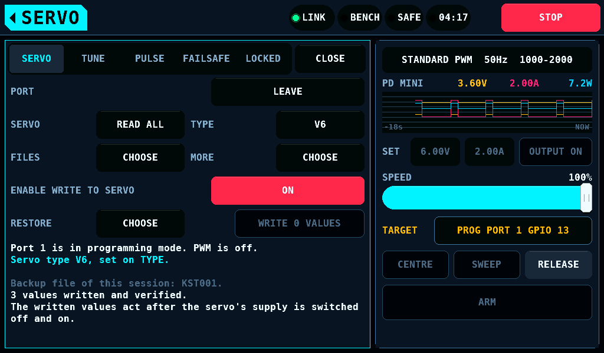

| Message | The servo |
| --- | --- |
| `These values cannot be written in a safe order.` | holds what it held; nothing was sent |
| `Too many changes to plan at once. Nothing written.` `Split the changes. Write fewer values at a time.` | holds what it held; nothing was sent. The planner stops after 216,000 units of work without a verdict. The session goes on and the pending values stay |
| `Write failed. No values were left partly written.` | holds what it held |
| `Write failed. The previous value was restored.` | holds what it held |
| `Write failed. Earlier writes remain. Tap READ ALL.` | holds the registers written before the one that failed, and the old value in the others. The second line names the register and the count of writes done. The write switch goes off, and **READ ALL** comes before the next write |
| `Write failed and could not be undone.` | is in doubt: [restore](#an-interrupted-write) |
| `A register changed without being written.` | is in doubt |
| `Servo settings do not match the expected values.` | is in doubt |

A message about a failed write names the register and the count of writes
done: `Register 03. 1 write completed.`

## Backups

| Backup | Held by | Lives until |
| --- | --- | --- |
| Of the session | the IOmcu: the first image read after **CONNECT** | **LEAVE**, a power cycle of the servo, a restart of the IOmcu |
| The session's file | the card: the servo's 32 registers as they stand before the session's first write. None while no card is mounted | the file is removed from the card |
| Before a write | the panel, in `BENCH/KST/CONF/KST.TXT` or in memory | the write ends verified, or the record is discarded |

`KST.TXT` is the record of a write under way: text of at most 400 bytes in
the card's folder `BENCH/KST/CONF` with the line `RCBENCH KST 2`, the lines
`journal=`, `target=`, `port=` and `pin=`, and `check=` with the CRC-16
(cyclic redundancy check) of the bytes before it. `pin=` holds the GPIO
(general-purpose input/output) the port drove at the write, in two
hexadecimal digits: `0D` for GPIO 13, `FF` when the panel knew no pin for the
port. A record of version 1 (`RCBENCH KST 1`, no `pin=` line) is read and
names the port only. A pin above GPIO 47 reads the same way: the record
stands and its lines name the port. A file whose check fails is not
used: `Cannot read KST.TXT on the card. The file will not be used.` The name `KST`
is the record's: no servo file takes it, and the list of files leaves it
out.

The panel writes the text to `KST.NEW`, and the file takes the name
`KST.TXT` once the card holds it whole. A write that the card or the supply
ends leaves `KST.TXT` as it was or a whole `KST.NEW`. At power-on a
`KST.NEW` whose check holds is used and renamed; one whose check fails is
removed and `KST.TXT` is used. A file the card does not take is written
again every 5s until the card takes it, so that a record discarded on the
panel does not stay on the card.

## Servo files

A servo file is a text file in the folder `BENCH/KST/CONF` of the panel's
SD card with the 32 registers of one servo, named `<name>.TXT`. The panel
creates the folder with the first save, each missing level of it: `BENCH`,
`BENCH/KST`, then `BENCH/KST/CONF`. Firmware 0.21.0 and older keeps its
files and its record in `KST`. The panel does not read that folder: its
files are moved to `BENCH/KST/CONF` on a computer. **FILES** opens the list. It is active in programming mode with
a servo read and not in doubt; otherwise the tap answers `Read the servo settings first. Tap READ ALL.` Saving and loading work with the write switch off: a file
changes the draft on the panel, never the servo.

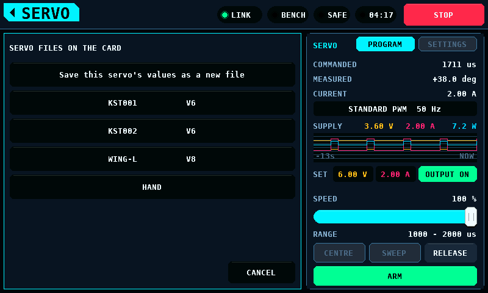

The first entry saves. Below it stand the files sorted by name, 5 a page,
each with its servo type; a file without a type line shows none. The files
with a proposed name, `KST` and 3 digits, stand together at the place of
`KST000`, the highest number first. The list reaches every servo file of
the card. With more than 5 files
the title counts them, `FILES 1 TO 5 OF 7`, and `Show more files.` turns
the page, back to the first after the last. The panel asks the card for
each page and waits at most 5s for it.

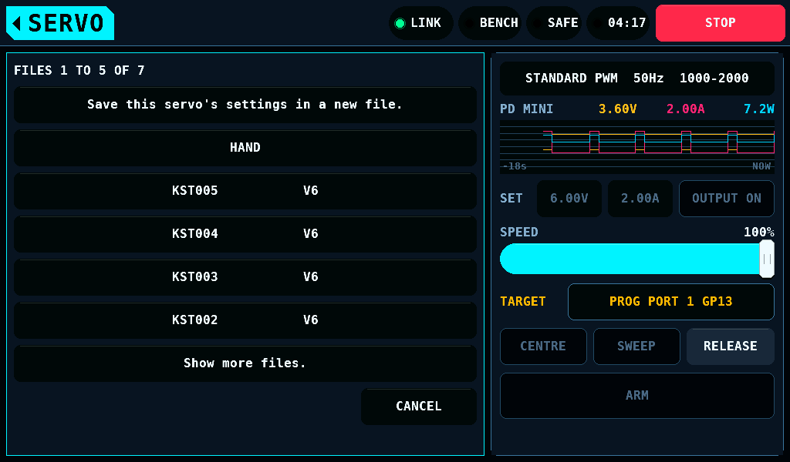
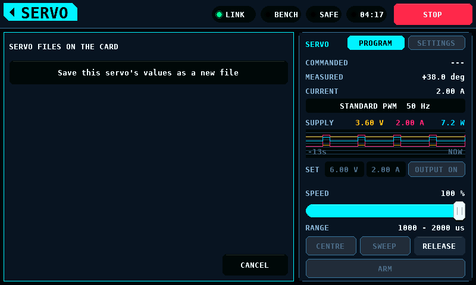

### The servo type

A servo and a file are V6 or V8. The 20k_sel field decides: 1 is V6, a
20kHz drive; 0 is V8, a 333Hz drive. No other register enters the type.
Once a servo is read, the **SERVO** row reads `SERVO V6` or `SERVO V8` and
the line below the rows says `Servo type V6: 20kHz drive.` The type is
never edited and never written.


### Saving

`Save this servo's settings in a new file.` opens the text keyboard with the
next free preset name, `KST001` to `KST999`. The keyboard takes up to 16
characters: A to Z, 0 to 9, `-`, `_` and the full stop. **OK** saves; the
card's side checks the name and never replaces a file. Names compare
without case. A file with a longer name, up to 32 characters, is listed and
loaded; a line that names it shows its first 14 characters and `..`.

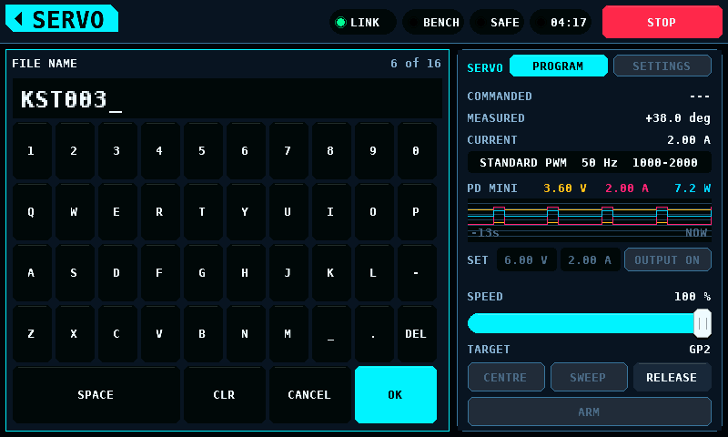

| Result | Shown |
| --- | --- |
| Saved | `Servo settings saved to the card: WING-R.` |
| A full stop at the start or the end, or a reserved name: `KST`, `CON`, `PRN`, `AUX`, `NUL`, `COM1` to `COM9`, `LPT1` to `LPT9`, alone or in front of a full stop | the keyboard stays open under `INVALID NAME`; `Invalid name: reserved name, or a dot at the start or end.` |
| A file has the name | the keyboard stays open under `NAME IN USE. CHOOSE ANOTHER.`; `This file name is already in use. No file was replaced.` |
| No card | `No card. Nothing saved or written to the servo.` |
| Card full, or `KST001` to `KST999` all taken at the backup before a write | `Card full. Nothing saved or written to the servo.` |
| The card is write protected, or `BENCH`, `BENCH/KST` or `BENCH/KST/CONF` on the card is a file and no folder | `Cannot save: card write-protected, or BENCH/KST/CONF is not a folder.` |
| The card fails the write of the file, or does not answer within 5s | `Card write error. Nothing was written to the servo.` |

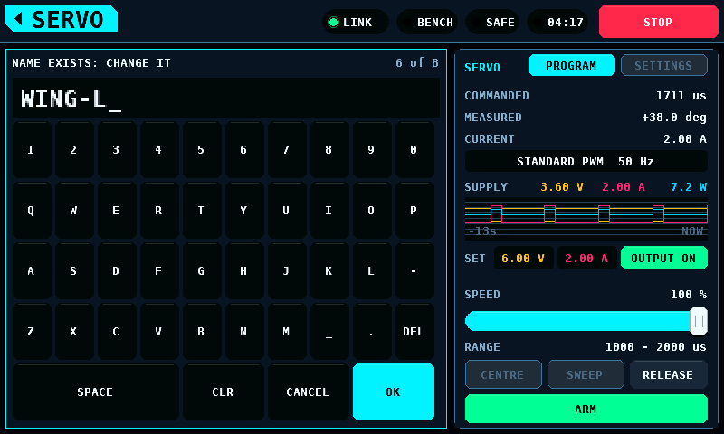
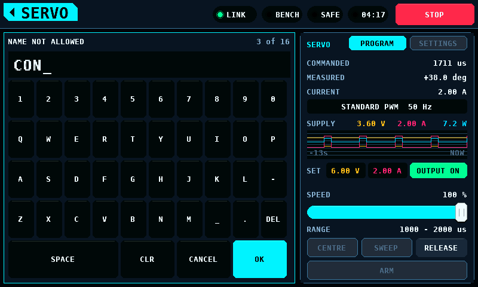
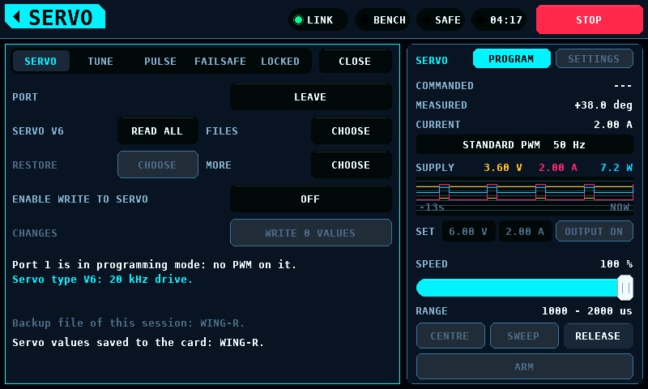
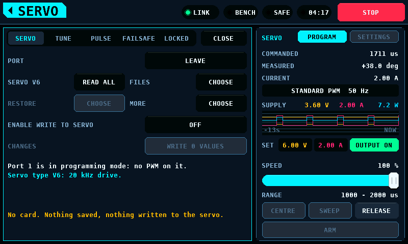
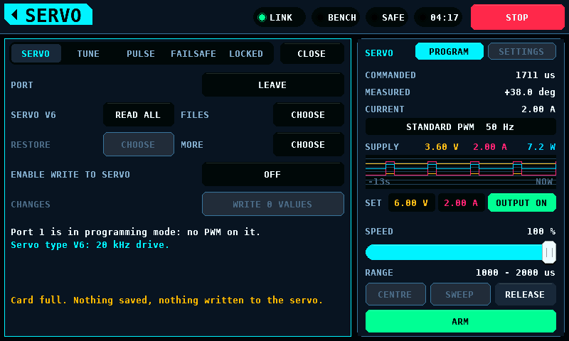

A save the card ends after the 5s is the file it made. With no other file
operation running the line changes to `Servo settings saved to the card:` and
the name. It is the session's backup file if the servo still holds the
saved values and no write followed.

A save writes the image as read, the locked fields included, also of a
servo that fails the fingerprint.

### The backup before the first write

The first write, restore or pairing release of a session saves the servo's
image to a new file under the next free preset name, without asking. The
write page says `The current servo settings are saved to a new card file before writing.`
The servo receives nothing before the card holds the file. A mounted card
that is full, that fails the write or that leaves the slot between the
request and the file ends the write with the lines of the table above, and
nothing is written to the servo. Freeing space on the card or removing the
card lets the write go. The SERVO tab then names the file: `Backup file of
this session: KST003.` A save by hand before the first write of the
session counts as that file. A save by hand after a write holds the written
values and leaves the line as it is. A read that finds other values makes
the next write save again.

A servo in doubt is the exception: its image is not worth a file, and the
restore of the session's backup runs without one.

#### Without a card

With no card mounted the write, the restore and the pairing release are
not blocked. The page whose hold sends the write carries three more lines:

```
No card. No backup file will be saved.
This session's backup is kept only in the bench's memory. It is lost when the session ends or the bench loses power.
```

The page's one hold of 2s confirms them; no second hold is asked for. A
hold released before 2s sends nothing.

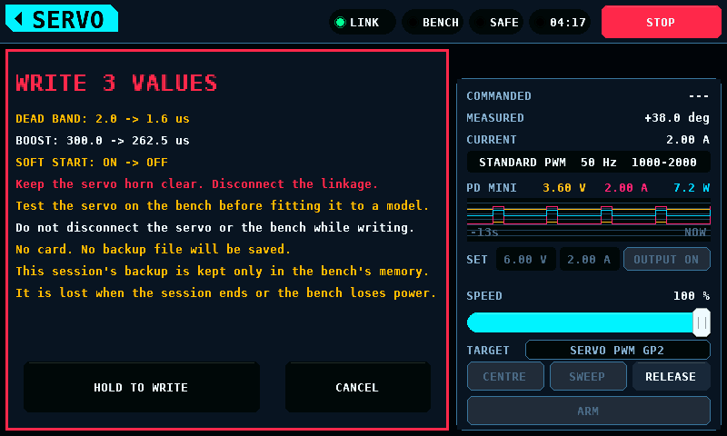

After such a write the SERVO tab shows `No card, no backup file. Restore is available only within this session.` in place of the file's name. The only copy of the servo as
found is the session's backup in the IOmcu: **LEAVE**, a restart of
the IOmcu and a power loss of the bench end it, and the values the
servo held before the write are then not recoverable from the bench.

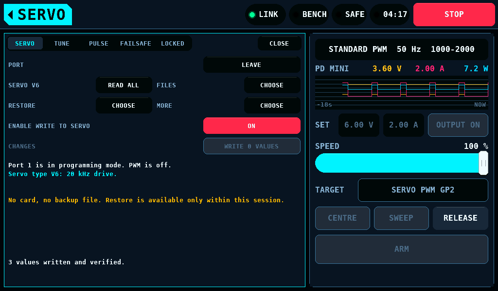

| Case | Result |
| --- | --- |
| A card is mounted later in the session | the next write, restore or pairing release saves the backup file first. The file holds the session's backup, the image read before the first write. The line on the SERVO tab changes to the file's name |
| The link goes and comes back, or the panel starts, under a session the IOmcu keeps | the writes of the session are not known to the panel. The next write, restore or pairing release saves the backup file first, and the file holds the session's backup, not the servo as last read. A save through **FILES** counts as the backup file only while the servo equals the session's backup |
| The servo may hold written values and the panel does not hold the session's backup | the write goes without a file, and its page carries the three lines above: the servo as last read is not saved as the backup file |
| The IOmcu starts again | its session and the session's backup are gone. **CONNECT** begins a session, and its first write saves the servo as that session finds it |
| A save through **FILES** after a write without a card | saves the servo as it stands; it does not count as the backup file |
| The card leaves the slot while a page that promises the file is open | the hold sends nothing and the page comes back with the three lines; its own hold of 2s sends the write |
| The card leaves the slot after the backup file is saved | later writes of the session are sent; the record of the write is kept in memory |
| **FILES**, save and load without a card | refused: `No card. Nothing saved or written to the servo.` |
| A card put in, taken out or swapped after the panel started | the panel looks at the slot when the programmer opens and at each tap on **CONNECT**, **READ ALL**, **FILES**, **RESTORE**, **MORE**, **ENABLE WRITE TO SERVO** or the write row: a card put in or swapped is mounted, and one taken out is let go. The look at a mounted card is one SEND_STATUS (CMD13) command. A file request (list, load, save) runs on the card it was asked of; with another card mounted in its place by then, it finds no card. The record of a write goes to the card whose record the programmer read last, never to one mounted in its place before the next look reads that card's record. The tap that finds a new card still reads the card state from before; the next one has it, and an open write page changes to the page with the file |

A card in the slot that does not mount counts as no card: the write, the
restore and the pairing release go as above, and **FILES** is refused. Its
lines name what the panel found in place of `No card`
([The SD card's format](Screens.md#the-sd-cards-format)):

| Where | Card is neither FAT32 nor exFAT (FAT: file allocation table; exFAT: extended FAT): NTFS (New Technology File System), a GPT (GUID partition table) or not formatted | Card that cannot be read |
| --- | --- | --- |
| The write page | `Card is neither FAT32 nor exFAT. No backup file will be saved.` | `Cannot read the card. No backup file will be saved.` |
| The write page, backup file saved | `Card is neither FAT32 nor exFAT. The previous settings are kept in RAM only.` | `Cannot read the card. The previous settings are kept in RAM only.` |
| The SERVO tab | `Card is neither FAT32 nor exFAT, no backup file. Restore is available only within this session.` | `Cannot read the card, no backup file. Restore is available only within this session.` |
| **FILES** | `Card is neither FAT32 nor exFAT. Nothing saved or written to the servo.` | `Cannot read the card. Nothing saved or written to the servo.` |

### Loading

A tap on a file loads it. Its editable fields become the draft, exactly as
edits typed on the tabs: changed values are marked, **WRITE n VALUES**
counts them, and nothing reaches the servo before the write switch, the
write page and its 2s hold.

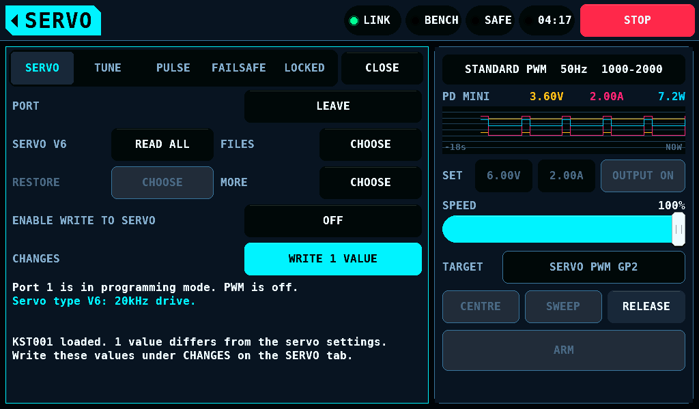

| File | Shown |
| --- | --- |
| Saved by the bench, checksum intact | `KST001 loaded. 3 values differ from the servo settings.`, or `KST001 loaded. 1 value differs from the servo settings.` |
| Edited, with a type line and no checksum line | the same, and `Edited file: 27 of 27 values, checked as manual entries.` |
| Edited, without a type line | the same, and `Edited file, no servo type: 27 of 27 values, checked as manual entries.` |
| Holds the servo's editable values | `KST001 matches the servo settings. Nothing to write.` |
| Of the other servo type | `File is V8, servo is V6. Not loaded.` |
| Checksum line present and wrong | `File damaged: checksum mismatch. Not loaded.` `Without the checksum line, it is treated as an edited file.` |
| Not a servo file | `Not a servo settings file. Not loaded.` |
| A line that does not read | `Cannot read line 12. File not loaded.` |
| Written by a later format version | `This file needs a newer bench version. Not loaded.` |
| A value outside its hard limit | `Line 9: MAX. DUTY is outside its allowed range. Not loaded.` |
| Values that break a hard limit together | `File not loaded. It fails a limit check:` and the limit's line |
| The card does not read, or does not answer within 5s | `Cannot read the card.` |
| No servo file on the card | `No servo files on the card.` |

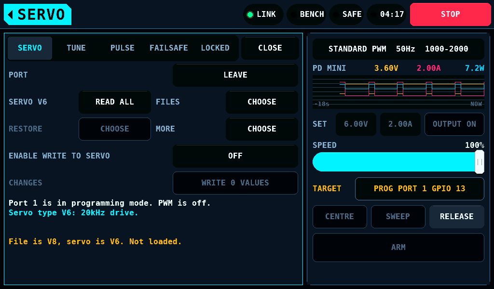
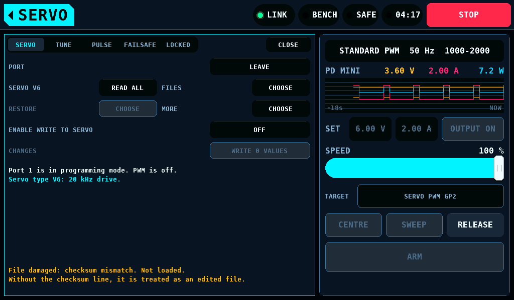
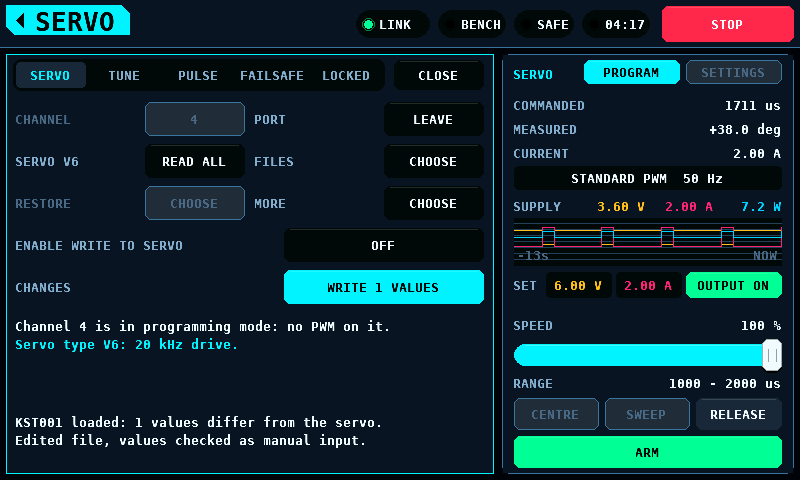
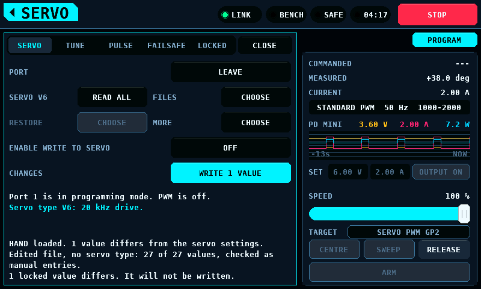
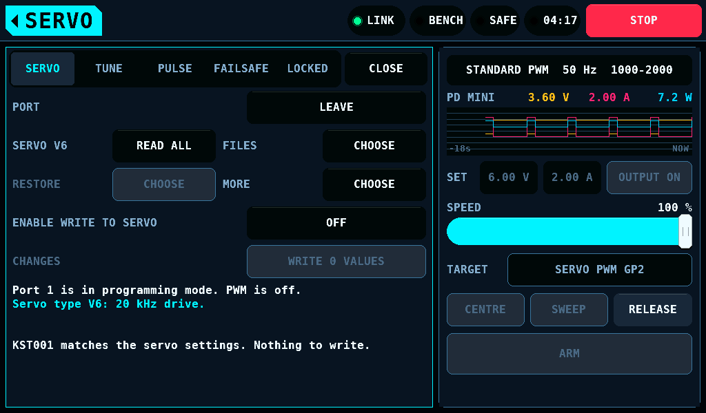
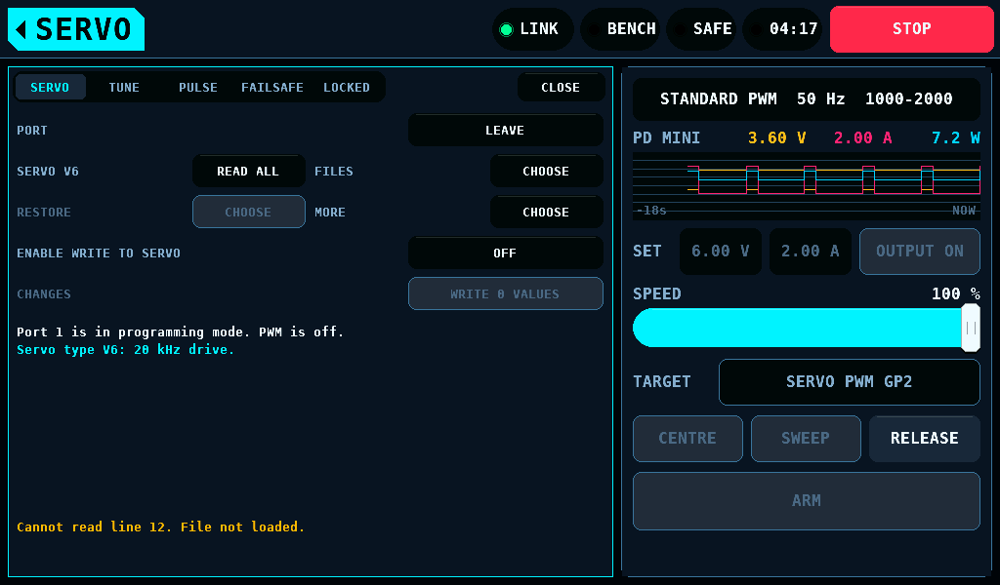
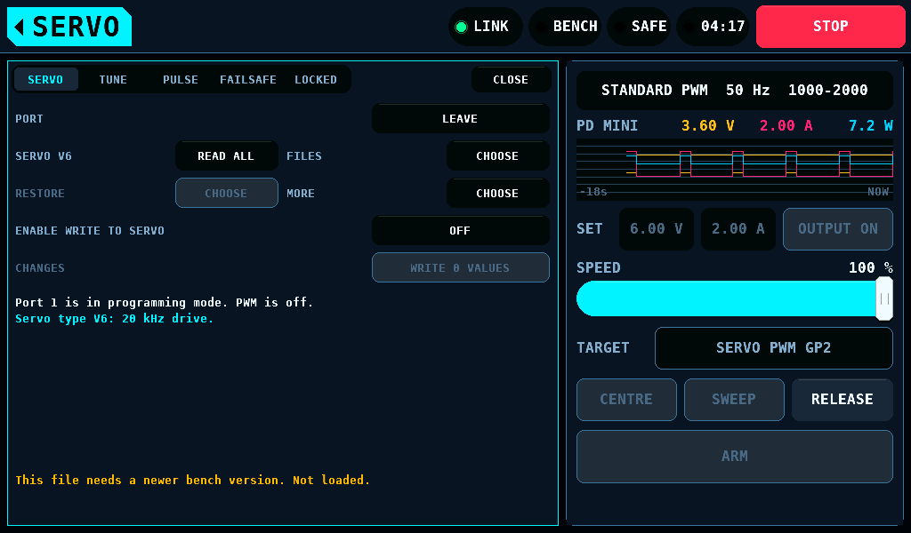


The line of an edited file counts the values its lines give, of the 27 a
servo file has. A value the file does not give stays as the servo has it.

A file whose values pass a soft limit that the servo's own values keep
opens CHECK THIS FILE before anything becomes the draft. The page has 12
lines: the file's line, the line of an edited file, the values that differ
as [the write page](#writing) lists them, 4 or 3 and `and 2 more`, and the
same warning lines an edit past those limits shows; with more warnings than
lines the last line counts the rest. **HOLD 2s TO LOAD** takes the
values into the draft. **CANCEL** leaves the draft as it was.

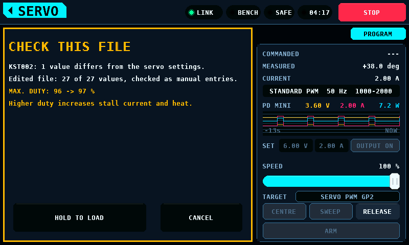

### What a file does not restore

A load writes the editable fields only. These stay as the servo holds
them, whatever the file says:

- the servo type, 20k_sel,
- Lock,
- the mode, Servo or Gyro Servo,
- the protection block of the LOCKED tab,
- the pairing value, register 1D,
- register 00 and every bit that belongs to no named field.

A file that differs there is loaded, and the difference is counted: `2 locked values differ. They will not be written.`, or `1 locked value differs. It will not be written.` The LOCKED tab marks each such value with `!`. A file without a type line that holds the other type's
20k_sel is loaded the same way, since nothing but the type line denies a
load.

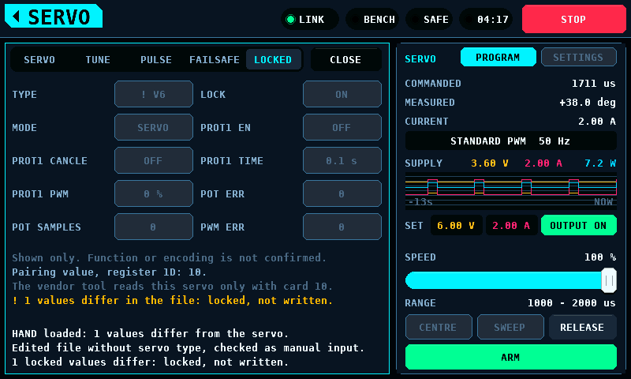

The restore of the session's backup is the one way to write a locked
register, and it ends with the session.

## Restore

**RESTORE** opens the list of what there is to restore. Every restore needs
the write switch and a 2s hold.

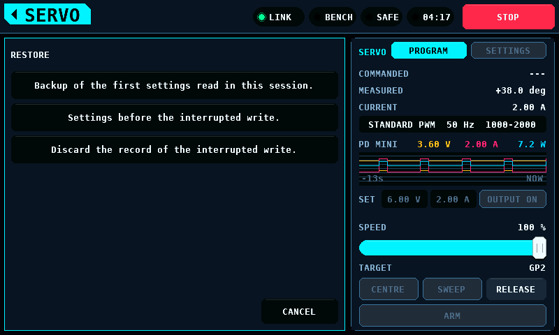
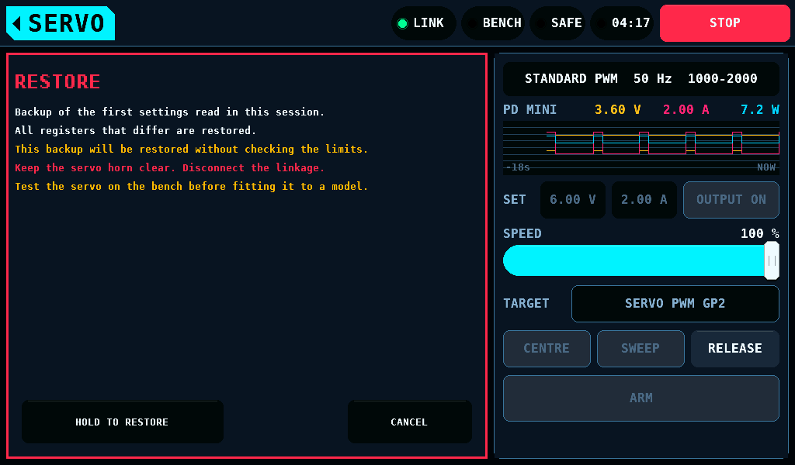

| Source | Written back | Not restored |
| --- | --- | --- |
| `Backup of the first settings read in this session.` | every register that differs, by the IOmcu from the image it holds itself; without the limit checks, and the page says so. A register that differs and that no write of the session changed ends the restore before its first write | nothing |
| `Settings before the interrupted write.` | the editable fields, as a write with every limit check | the locked fields, register 00 and the pairing value |
| `Settings before the limit run.` | LEFT ANGLE, RIGHT ANGLE, PULSE LOWER and PULSE UPPER as the [limit run](#the-limit-run)'s first session read them, as a write with every limit check. Offered while the servo read differs from them in those four fields and in no other | every other field: it is the same as the run found it |

A restore from the panel's image is an ordinary write: the IOmcu
accepts an unchecked restore only of the backup it holds itself, and that
check is not weakened. The page counts the locked values that differ and
stay: `2 locked values differ. They will not be changed.`, or `1 locked value differs. It will not be changed.` A servo file is not
in this list: [a load](#loading) makes it the draft, and the ordinary
write sends it.

A backup whose values pass a soft limit that the servo's own values keep
opens CHECK THIS BACKUP first. The page lists the warnings of those limits,
the same lines an edit past them shows, at most 5; with more than 5 the
fifth line counts the rest. **HOLD 2s TO CONTINUE** opens the restore
page, which needs a press and a 2s hold of its own. The restore of the
session's backup is checked the same way while the servo's values are known.

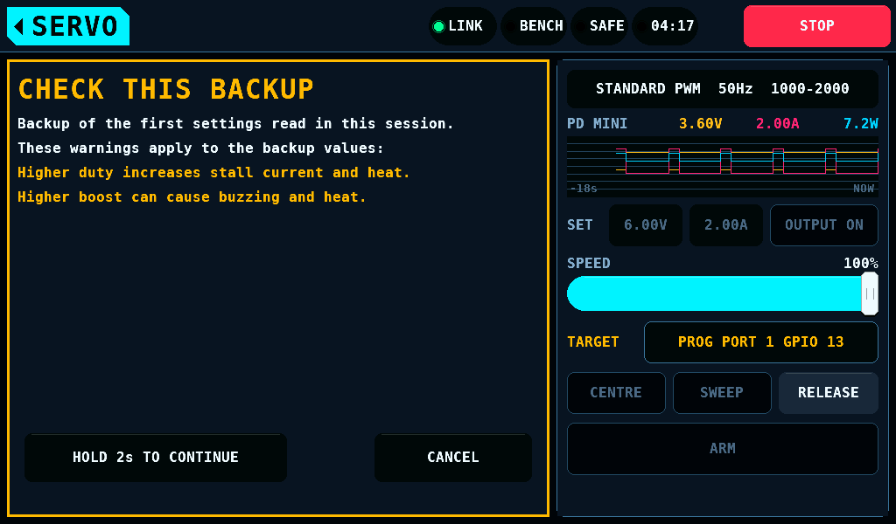

The session's backup belongs to the servo it was read from. A read that
differs from the backup in a field no write of the session set out to
change is another servo: `This is a different servo. The session backup does not belong to it.` `Tap LEAVE, then CONNECT to start a new session with its own backup.` The write
switch goes off, the restore list does not hold the session's backup, and
no restore of it is sent. **LEAVE** and **CONNECT** begin a session whose
backup is this servo's. A read of the first servo brings its backup back.
A write that the card, a stop or the IOmcu keeps from starting, or
that the IOmcu ends with no register written, counts as no write: its
fields still tell the servos apart. So does a write that is undone and
read back with no write counted done.

The IOmcu makes the comparison again, register by register, on the
read that precedes the first write of a restore of the session's backup.
It holds the set of registers that the writes of the session changed. A
servo that differs from the backup in any other register is not the
backup's servo: the restore ends with `Servo settings differ from the values read earlier. Tap READ ALL.`, no register is written, the write switch goes off and the port
takes **READ ALL** and nothing else until the servo is read. The restore
therefore does not repair a register that something other than a write of
the session changed. After a write that ended without a full read of the
servo, the registers that differ at the next full read count as changed by
that write.

While a read is owed after a write in doubt and the session is not locked,
the restore list does not hold the session's backup: `Read the servo settings first. Tap READ ALL.`

A restore, a pairing release or a write that the card or the panel's
control task keeps from starting leaves the pending values, the write
switch and the record of an interrupted write as they were before the
hold.
Two servos equal in every field the session did not write are not told
apart. After a link loss or a start of the panel under a session the
session's writes are not known, and the comparison is not made.

A power cycle of the servo ends the session's backup and the record of the
session's writes. The servo on the port may be another one after it. Such
a power cycle is a PD mini's supply switched off under the session, a
supply cycle the port runs, or the POWER_CYCLED operation the panel sends
in place of LEAVE. The port is then in PWM, and the restore list holds no
session backup. **CONNECT** begins a session whose backup is the servo as
its first **READ ALL** finds it. A backup file on the card stays there.


## The limit run

The SERVO screen's limit run drives the programmer itself whenever SERVO
TESTER is a port
([Servo procedures](Servo.md#programming-the-servos-travel-limits)). Its
first session reads the servo, with SEARCH ONLY as well: CONNECT with its
read, LEAVE. With SERVO PULSES at 1000-2000 that session also writes PULSE
LOWER 1000.0µs and PULSE UPPER 2000.0µs. With SEARCH + PROGRAM each later
write is a session: CONNECT with its read, ENABLE WRITE TO SERVO on, LEFT
ANGLE and RIGHT ANGLE written and read back, the write switch off, LEAVE. Whatever the overlay has open closes at each step. A
value under 50 passes its soft limit without the page: the run's 2s start
hold is the consent. A hard limit refuses a value as it refuses an edit,
and the run ends. A write refused before it is sent switches ENABLE WRITE
TO SERVO off again, as the end of a sent write does.

The run's first write saves the backup file, as any first write does. A
later session of the run whose servo differs from the run's first read in
LEFT ANGLE, RIGHT ANGLE, PULSE LOWER and PULSE UPPER at most saves no file: the first file holds the
servo as the run found it. A session after the run has ended is the
operator's: its first write saves its own backup file, as every session's
first write does. The run holds that read in the panel's memory
until the next run's first write or a start of the panel, and RESTORE offers it as
`Settings before the limit run.`. While the run holds the port, the screen's
TARGET row and the run's box name it: `PROG PORT 1 GPIO 13`.

A run aborted inside a session leaves the port in programming mode with
the values last written. LEAVE gives it back to PWM; CONNECT and READ ALL
offer the restore. A run that fails inside a session gives the port back
with LEAVE itself, and the run's box stays on the left card. The
programmer's part of the run, with the supply values it keeps, ends once
that LEAVE is over. A LEAVE that fails leaves the port in programming mode,
and the programmer opens on the left card.

## More


- **VERIFY** reads all registers and compares them with the image held:
  `Check passed. The servo matches the values already read.` or the count of registers that
  differ.
- **DISCARD EDITS** sets the draft back to the servo's values.
- **RELEASE PAIRING** sets register 1D to 00 after the write switch and a
  2s hold. What the servo does with the value is not known. A restore of
  the session's backup sets it back.


## An interrupted write

A write counts as interrupted when the link goes, the IOmcu or the
panel starts again, **ABORT** or a stop ends it, or no result arrives
[in time](#stops-and-losses). The record made before the write then stands, on the card
across a power cycle of the bench.


`Writing was interrupted. The settings may be incomplete.` stays until the
servo is read, with the pin of the write below it: `Do not use the servo. Connect it to GPIO 13 and tap READ ALL.` A record that holds no pin names the
port instead: `Do not use the servo. Connect it to port 1 and tap READ ALL.` Every control but **CONNECT**, **READ
ALL**, **RESTORE**, **LEAVE** and, where the session's restore needs it,
the write switch is off. The read compares the servo with the
record:

| The servo holds | Message | Then |
| --- | --- | --- |
| the image before the write | `Is this the servo whose write was interrupted on GPIO 13?` `It has the old values. If this is the same servo, discard the record under RESTORE.` | the record stays until it is discarded |
| the image the write was to leave | `Is this the servo whose write was interrupted on GPIO 13?` `It has the new values. If this is the same servo, discard the record under RESTORE.` | the record stays until it is discarded |
| anything else | `The servo contains both old and new settings.` `Do not use this servo. Recover the backup with RESTORE.` | **RESTORE** offers the session's backup while the session lives, and `Settings before the interrupted write.` |


`Discard the record of the interrupted write.` in the restore list removes
the record without a write.

A servo that holds, register for register, the image before the write or
the image the write was to leave is either the servo of the write or a
second servo with the same settings. The panel cannot tell the two apart
and asks. The two lines stay on the SERVO tab, the write switch does not go
on, and no write, restore or pairing release is sent. If it is the servo of
the write, `Discard the record of the interrupted write.` in the restore
list ends the question. If it is not, **LEAVE** keeps the record for the
servo of the write.

The record belongs to one servo. A servo read on another port is not that
servo, and neither is one with a register that holds neither the value of
the image before the write nor the value the write was to leave: `The interrupted write affected a different servo.` `It was connected to GPIO 13. Discard the record under RESTORE.` For a record that holds no pin the line names the
port: `It was connected to port 1. Discard the record under RESTORE.` Nothing is restored, edited or written while that
stands, and **RESTORE** holds the discard entry only. **LEAVE** and a
**CONNECT** of the write's servo bring the comparison above. One register
is exempt: the low register of a field that lies in two registers and that
the write changes, because the plan of a write may set it to a third value
on its way.

The comparison is made when the servo is read and when the record is
loaded: a record from a card mounted with a servo already read is compared
with that servo at once. A restore of the session's backup with no servo
read does not belong to a record that is held: the record stays as it is,
on the panel and on the card. With no record held such a restore makes its
own, with the backup as the image the servo is to hold. A record made
while no card is mounted is written to a card that is mounted later.


Max. Duty lies in registers 01 and 02. A write cut between those two
leaves an image that breaks a hard limit, and the panel's restore, which is
a checked write, does not start from such an image. The restore of the
session's backup does. After a restart of the IOmcu in that state the
programmer reads the servo and writes nothing to it.

## Leaving

**LEAVE**, or **CLOSE** in programming mode, asks to end the session and
to return the port to servo PWM. The programmer does this without a supply
cycle: the servo stays powered, a PD mini's output stays on at its voltage
and current limit, and the tester's signal follows on the same port.
Whether a servo that received a frame follows PWM before its supply was
off is not measured.

Leaving the SERVO screen is no LEAVE: the session and the port stay. A PD
mini output SERVO switched on -- by OUTPUT ON, by a test or by
**CONNECT** -- is the SERVO screen's, and while the port holds it the
output stays on after SERVO is left: an OFF would end the session and cut
a write on the wire. An ON SERVO asked for that is on its way when the port
takes the supply counts as switched on, also when it is reported on only
after the leave. The output goes off when the port lets go -- a
**CONNECT** that ends without a session after SERVO was left, a STOP that
switches the supply off -- unless SERVO is shown again first. After
**LEAVE** on SERVO the output stays on until SERVO is left.

LEAVE PROGRAMMING opens with `The port returns to servo PWM. The supply stays unchanged.` and `The servo will receive the tester's signal and may move.` The
page warns before changed values are lost and before a session ends that
could still restore a servo in doubt. **HOLD 2s TO LEAVE** sends the
port's LEAVE operation of link version 4.15. No frame goes to the servo and
no supply command to the PD mini. The port holds its line low for
[**WAIT BEFORE PWM**](#the-supply) and then gives the pin to the PWM
generator.


The page is the same with a PD mini answering.


The state line reads `Leaving programming mode. PWM is still off.` and the
tester's controls stay off until the port reports PWM. The button reads
**ABORT** while the wait runs. Then `The port is back in tester mode.` and
the tester drives the port at once, with **SERVO TESTER** on that port
and **PORT PWM** on. The next **CONNECT** starts a new session with its own
read.

### The wait before PWM

**WAIT BEFORE PWM** is 0 to 10 000ms, 100ms by default. The keypad takes
no value above 10 000ms, and no leave is sent with one. A wait of 0ms
ends at the IOmcu's next pass. The time left of a running wait is not
shown. The wait a servo needs is not measured.

| During the wait | Effect |
| --- | --- |
| **ABORT** | the port stays in programming mode with the session as it was; `Leaving was interrupted before the waiting time ended.`; **LEAVE** is taken again at once |
| **STOP** or a switch to SAFE of the bench, no PD mini answering | the same line; the port stays in programming mode and asks for **READ ALL** |
| The supply's output reads off or is switched off: **STOP** with a PD mini answering, the PD mini's own protection | the same line; the supply stays off for 2000ms, then the port is in PWM |
| The link goes | as [a loss of the link](#stops-and-losses) |

### A port that is not left

The port refuses a leave while it asks for a read or holds a servo that a
write left in doubt.

| The port | A PD mini answers | Line | Way out |
| --- | --- | --- | --- |
| asks for a read after a stop or an abort | yes | `Read the servo settings first. Tap READ ALL.` | **READ ALL**, then **LEAVE**; or **STOP**, which switches the supply off |
| holds a servo in doubt | yes | `Servo state uncertain. The session stays open. Use RESTORE first.` and `STOP ends the session and switches the supply off.` | **RESTORE**, then **LEAVE**; or **STOP** |
| either | no | `The port is back in tester mode.` and `The session state was uncertain. PWM starts without a delay.` | none needed: the port is in PWM |

Without a PD mini **STOP** switches no supply and leaves the port in
programming mode, and a servo that no longer answers takes no read. The
panel then sends the port's POWER_CYCLED operation in place of LEAVE.
Without a PD mini it changes the port's state only: no frame, no wait, and
the servo's supply is whatever feeds it. The record of an interrupted write
stays for the next session.

### An IOmcu older than link version 4.15

Link versions 4.13 and 4.14 have no LEAVE. The panel sends none to them.

| A PD mini answers | The panel | Lines |
| --- | --- | --- |
| no | sends POWER_CYCLED, which changes the port's state only; the port is in PWM without a wait | `The port is back in tester mode.` and `IOmcu firmware older than 0.17.0. PWM starts without a delay.` |
| yes | sends nothing: both operations these versions have for the step cycle the supply. The session stays | `Leaving with a PD mini requires IOmcu firmware 0.17.0 or later.` and `STOP ends the session and switches the supply off.` |

With a PD mini on such an IOmcu, **STOP** or the supply's output
switched off ends the session: the supply stays off for 2000ms and the
port is in PWM again.

## Stops and losses

| Event | Effect |
| --- | --- |
| **STOP**, a latched stop of the bench | the running operation ends after the frame on the wire, at most 12ms; the switch goes off; `STOP: the operation was aborted.`; the port asks for **READ ALL** before anything else. A PD mini's output is switched off, and the port is in PWM again 2000ms after it reads off |
| **ABORT** | the same, without the latch |
| The link goes | the switch goes off, open pages close; a write under way is [interrupted](#an-interrupted-write) |
| The IOmcu starts again | its session and backup are gone; `IOmcu restarted. Tap CONNECT, then READ ALL.` and `Switch the servo supply off and on first.`: the port is in PWM, and the servo was not led out of programming mode |
| The port reads PWM with a servo read, the switch on, a write done or a read asked for, and no command of the programmer put it there | the servo's values, the backup and the switch are gone on the panel; `The port ended the session: power off or restart.` and `Switch the servo supply off and on, then tap CONNECT.` An operation that ended in the same reading keeps its own line |
| The panel's control task takes no command for 2s | nothing is sent; `No result from the IOmcu. Tap READ ALL.` The command is withdrawn: the control task drops it when it leaves the queue, however late |
| The IOmcu refuses an exchange of an operation it has taken | the line of the refusal; the values on the panel are not edited, saved or written before a **READ ALL** that ends |
| 3 exchanges with the IOmcu in a row stay unanswered | `No response from the IOmcu. Tap READ ALL.`; after a read or a verify the values on the panel are not edited, saved or written before a **READ ALL** that ends |
| No result of an operation for 30s, counted from the last time the port reported the operation running or planning, or for 120s from its start however long the port reports it running | the operation is aborted; `No result from the IOmcu. Tap READ ALL.`; the values on the panel are not edited, saved or written before a **READ ALL** that ends; a write is [interrupted](#an-interrupted-write) |
| The result of an operation the programmer no longer waits for arrives | it ends no other operation: an outcome counts for the request whose number it carries. **ABORT** reaches an operation the port still reports running |
| The IOmcu reports a result, a refusal or an outcome this panel has no line for | `The IOmcu reports code 255. This panel does not recognise it.`, with the code's number; a result is handled as a failed operation |

Every refusal of the port and every result of the session has its own
line. [The link page](LinkKST.md) lists the codes.

## Limitations

- A running write shows the count of registers it sets and the frames
  sent. The register under way is not on the link page and is not shown. A
  restore of the session's backup and a pairing release show the frames
  only.
- The screens write `us` for µs: the font has no micro sign.
- The record of an interrupted write is read from the card when the panel
  starts, and from a card put in later when the programmer mounts it. A
  record the panel already holds stands, before and after the servo is
  read back: the record on such a card is not read then, and the next
  record written replaces it.
- A card taken out and put back while the panel runs is not mounted again.
- The time a mount attempt without a card holds the screen is not measured.
- The limits and trip settings of the SUPPLY screen are not held while the
  programmer has the port; the set points and **OUTPUT ON** are.
- With the IOmcu unpowered and the servo fed from another supply, a
  servo that drives the signal wire above 3.63V exceeds the rating of
  GPIO 13 ([the signal level](#the-signal-level)).
- With the simulated supply selected (no PD mini wired) the panel dims the
  same controls, and the servo's supply is whatever feeds it.
- The TARGET row and the segments **SERVO TESTER** and **PORT PWM** follow the port's state one
  frame of the screen after the control task does. The control task holds
  the page of the port and the tester's commands from its own reading of
  the port.
- The panel's glue in `firmware/panel/main/` is not in the host suite: the command queue between the screen and the control task, the
  point where the control task drops a withdrawn command, the hand-over
  of the port's state to the page and the tester, and the card's file
  calls.
- Whether a servo follows PWM while it is in programming mode is not
  measured. The programmer leaves programming without a supply cycle and
  drives the port with PWM afterwards.
- Whether a written value acts before the servo's next power-up is not
  measured. The programmer treats a value that reads back as in effect.
- With a PD mini answering and an IOmcu older than link version 4.15,
  the port is not left from the programmer: **STOP** or the supply's output
  switched off ends the session, with the supply off.
- With a PD mini answering, a port that holds a servo in doubt is left by
  **RESTORE** and **LEAVE**, or by **STOP** with the supply off.
- **WAIT BEFORE PWM** is not applied by an IOmcu older than link
  version 4.15, and not on the leave of a port in doubt without a PD mini.
  The wait a servo needs is not measured. The time left of a running
  wait is not shown.
- Without a PD mini the programming voltage and the current limit are not
  applied.
- The error code the card's file system gives for a write-protected card
  is not known. A code other than read-only file system, access denied
  and operation not permitted shows `Card write error.` in place of
  `Cannot save: card write-protected, or BENCH/KST/CONF is not a folder.`
- The proposed names end at `KST999`. With that name taken the next free
  number is proposed, and the highest number is then not the latest file.
- A page behind the first 64 files reads the directory once more per 64
  files in front of it. The time this takes is not measured; the panel
  waits 5s for a page.
- A write without a card leaves no backup file. The session's backup is
  then the only copy of the servo as found and ends with **LEAVE**, an
  IOmcu restart or a power loss of the bench.
- A session's first write with a mounted card needs free space on it.
- A servo file carries the servo type, V6 or V8, and no other identity.
  A file of one V8 servo loads into any V8 servo.
- A servo file restores the editable fields only:
  [what it does not restore](#what-a-file-does-not-restore).
- The list shows 5 files a page, sorted by name, and has no search. Files
  are not removed or renamed on the panel.
- The record of an interrupted write names its port and holds the servo's
  values. A second servo on that port whose 32 registers equal the image
  before the write or the image the write was to leave is not told apart
  from the first: the panel asks, and the answer is the operator's.
- Without a card the record of a write is lost at power off.
- A mounted card that does not take the record stops every write: a card
  taken out after the mount, a write-protected card, or a card on which
  `BENCH/KST/CONF/KST.TXT` or `BENCH/KST/CONF/KST.NEW` is a folder, or a
  level of `BENCH/KST/CONF` is a file. Each attempt ends with `Could not save the file to the card. Nothing was written to the servo.` The panel keeps such a
  card mounted, except a card taken out, which the next look at the slot
  lets go ([Screens](Screens.md#the-sd-cards-format)). A panel started without a card holds the record in
  memory and writes.
- The record of a write that ended is cleared on the card after the write,
  by a file write of its own that is repeated every 5s until the card
  takes it. A power loss before it leaves the record of a finished write:
  at the next read the panel asks whether the servo is the record's.
- The record of an interrupted write found at power-on is shown in the
  programmer only; no other screen announces it.
- A servo whose image breaks a hard limit as read can be read and saved.
  A write to it is refused.
- LEFT ANGLE and RIGHT ANGLE are the vendor tool's numbers; their unit is
  not known.
- The supply voltage a servo needs in programming mode is not measured.
  The floor is 4.8V.
- A session has no idle timeout. From **CONNECT** to **LEAVE** the port is
  held, the servo is in programming mode and a PD mini's output is on, on
  every screen and for as long as the bench is powered. **STOP**, a link
  loss and the supply's output switched off end it.
- A card put in while the panel runs is read by the task that draws the
  screen. The screen does not change and takes no touch for the time of
  that read. The time is not measured.
- The 120s an operation is given from its start are chosen. The time the
  longest write takes on a servo is not measured.

## Measurements still open

None of these is done.

1. The line's electricals on the port's path: levels of bench and servo,
   which side holds the line low at idle, the pull-down, the servo's output
   impedance, and the time both sides drive.
2. The motor's state in programming mode, and whether a written value acts
   at once.
3. What the servo does with a PWM pulse in programming mode, and with a
   frame outside it.
4. Persistence: whether a written value survives a power cycle, and
   whether a commit step exists.
5. Write reliability: 1000 writes with read-back, the count that do not
   take, the count of registers that change unasked, the spread of the
   reply delay.
6. The read error rate on a 1m lead with other servos moving on
   neighbouring outputs: 100,000 reads.
7. The timing of entry and of exit: how long without power ends
   programming mode, whether a servo follows PWM after programming without
   a power cycle, and the wait it needs before the first pulse.
8. The function of each editable setting on a servo that may be lost:
   position, travel time, stall current, standing current and oscillation
   against the value.
9. The tolerance of the transmit rate around 25.40µs a half-cell, and the
   shortest gap between frames the servo accepts.
10. A second servo of the same type, and other generations: fingerprint,
    reply timing, half-cell.
11. Open encodings: the NEUTRAL constants, the 2 unconfirmed STRETCH
    codes, the angle fields in Gyro Servo mode, and whether the vendor tool
    enforces the ranges it labels.
12. A servo written here is read by the vendor tool with its card.
13. The model of the servo the layout was taken from.
14. Whether 20k_sel separates the servo generations as the type rule
    assumes: 1 servo is recorded, and no V8 servo has been read.
15. A save, a list and a load on a card: the time each takes against the
    5s limit, and a card removed during a save.

## Tests

`test_prog_link` runs the panel's side of the target and of the port's
pulse switch: a port without a pin, a target that waits for a bench at
rest, an IOmcu that starts again, and a programmer that has the port
for each of the 16 pairs of page and wanted values. `test_settings_screen`
runs a held setting against every call that changes one, and `test_servo_target` the
two rows of the DUT tab. `test_kst_card` runs the card's side
of the files on a card held in memory. `test_kst_prog` and `test_kst_prog_card` run the model and
`test_kst_panel` and its siblings the overlay, both against the IOmcu's port, a supply
model and the servo model through the link's dispatcher: the supply's
ranges at their ends and one step outside, the wait at 0ms, 10 000ms and
10 001ms as the leave's wait, an abort, a switch to SAFE and a supply that goes
off in the wait, a leave on link versions 4.13 and 4.14 with and without a
PD mini, **STOP** during a leave, every limit at its edge, the 2s holds on both sides of the
threshold, every refusal and result with its line in both languages, the
lines of the write page for 1 value, for more values than lines and for a
value past a soft limit, a soft limit asked again for a value further from
the servo's, the horn lines on a later write that moves the horn, the
state line and the tab's line of a running write, a message that goes when
its condition ends, the rows that take no tap, the PORT row's label, no
comma in a number of the German table, a
write cut by a link loss, a restart, **ABORT** and **STOP**, a card that
fails, and the timeouts across the 2^32ms wrap of the clock. `test_kst_panel_files` runs the
servo files against a card model: every name result, every kind of file,
both servo types and their mismatch in both directions, every refusal,
the 5s limit, a first write with a card that is full or failing.
`test_kst_panel_nocard` runs the writes without a card: the first write, a restore and a pairing release,
a hold released early, a card mounted between two writes and a card
removed under the write page. A command the control task takes after
its 2s have passed reaches no wire, for every kind of operation; a
refusal at each later exchange of each kind of operation asks for
**READ ALL**; every result code of the session has a class, and a code
without one fails the test; a restore that the card keeps from starting
at each file step leaves the pending values; a record from a card mounted
before and after the read, of the same and of another servo.
