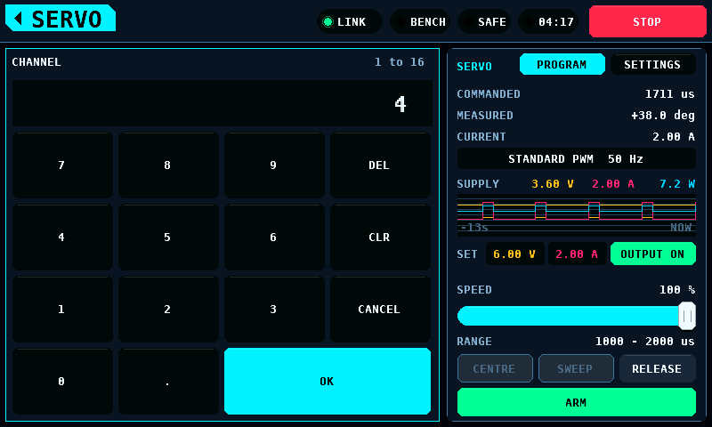
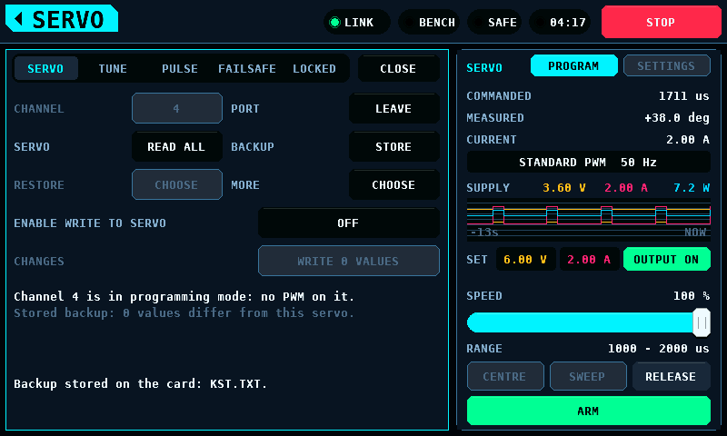

# KST and Chaservo servo programmer

**English** · [Deutsch](ServoProgrammer-de.md)

The programmer reads the 32 registers of a KST or Chaservo servo over its
signal wire, shows them as settings, and writes changed settings back. The
two brands share one protocol and one register set. It is an overlay on the
[SERVO screen](Screens.md#servo), opened with **PROGRAM** at the top of the
right card.

**No frame of this code has been sent to a servo.** The programmer has run
against a servo and line model in the host suite only. The register layout
and the timing come from 1 programming card and 1 servo of unidentified
model. The effect of a register on the servo's motion is not measured: the
names, units and limits are those the vendor tool displays and accepts.
[What is open](#measurements-still-open) lists what a bench has to measure
before a write is relied on.

## Constraints

- The coprocessor runs protocol 4.12 or later. With an older one the overlay
  says `Not available: the coprocessor firmware has no KST port.` and every
  control but **CLOSE** is off.

  

- The channel is bound as SERVO PWM (pulse-width modulation) on OUTPUTS. A
  throttle channel is refused.
- One servo at a time, on one channel.
- A channel is in PWM or in programming, never both. While the port holds a
  channel, the tester sends no pulse to it.
- The bring-up hardware does not switch a servo's supply. The way back to
  PWM is to unplug the servo.
- Whether an output of a given hardware carries the servo's reply back to
  the pin is not known to the coprocessor. A servo on an output that does not
  ends **CONNECT** with `No servo answers. Check plug, supply and channel.`

## The port

| State | Line on the SERVO tab | The channel carries |
| --- | --- | --- |
| PWM | `The tester has the outputs. CONNECT takes channel 1.` | the tester's pulses |
| Connecting | `Connecting on channel 1: no PWM on it.` | no pulse for 50 ms, then low for 100 ms, then the entry sequence |
| Programming | `Channel 1 is in programming mode: no PWM on it.` | frames only |
| Working | `Working: 12 frames.` | frames of the running operation |
| Leaving | `Leaving programming mode.` | nothing until the port has handed the channel back |

**CHANNEL** opens the keypad for 1 to 16 and is off while the port holds a
channel.

**CONNECT** takes the channel out of PWM, runs the entry sequence and reads
all 32 registers. The button reads **ABORT** while an operation runs and
**LEAVE** in programming mode.

While the port holds a channel the overlay stays open and **SETTINGS** is
off. **ARM**, **CENTRE**, **RELEASE**, the supply's controls and **STOP**
on the right card work. Leaving the SERVO screen leaves the port as it is;
the overlay is open again at the next entry.

## SERVO tab

| Row | Button | Does |
| --- | --- | --- |
| CHANNEL | the number | the output channel, 1 to 16 |
| PORT | **CONNECT**, **ABORT**, **LEAVE** | takes the channel, ends the running operation, [gives the channel back](#leaving) |
| SERVO | **READ ALL** | reads the 32 registers, each until 3 of at most 5 reads agree |
| BACKUP | **STORE** | [keeps the image last read on the panel](#backups) |
| RESTORE | **CHOOSE** | [writes a backup back](#restore) |
| MORE | **CHOOSE** | [VERIFY, DISCARD EDITS, RELEASE PAIRING](#more) |
| ENABLE WRITE TO SERVO | **OFF**, **ON** | [the write switch](#the-write-switch) |
| CHANGES | **WRITE n VALUES** | [writes the changed values](#writing) |

Below the rows stand the port's state, the state of the stored backup and
the last message. A message in the warning colour is a refusal or a result
that needs a second look; one in the danger colour says the servo's content
is in doubt.

### A servo of unknown layout

The coprocessor compares the image with the layout of the known servo, its
fingerprint. An image that fails is shown and never written: the edit rows
are off, a tap on the write switch leaves it off and repeats the message,
and **RELEASE PAIRING** is refused. **READ ALL**, **STORE** and **VERIFY**
work.

## Editing

A value is edited in a draft on the panel. Nothing reaches the servo before
[**WRITE n VALUES**](#writing). A value that differs from the servo's is
marked twice: by `*` before it and by the accent fill.

A numeric value opens the keypad. Its range is the range the hard limits
accept in the draft as it stands, so a value outside cannot be entered.
STRETCH opens a list of the 6 confirmed factors. An ON/OFF value flips on
the tap. DEAD BAND and NEUTRAL have minus and plus keys: one raw count a
tap, and while held 8 counts a second after 0.45 s and 30 a second after a
further 1.8 s.

### TUNE

| Row | Register field | Hard limit |
| --- | --- | --- |
| DEAD BAND | Dead Band, µs | the field's range |
| MAX. DUTY | Max. Duty, % | 10 to 98 % |
| BOOST | Boost, µs | at most 3000 µs |
| STRETCH | Stretch, factor | x1 to x32; the 2 remaining codes are not offered |
| SOFT START | Soft_Start, ON or OFF | none |
| SPEED LIMIT | spd_sel, ON or OFF | ON needs SPEED at 5 % or above |
| SPEED | SPD, % | at most 100 %; at least 5 % while SPEED LIMIT is ON |

### PULSE

| Row | Register field | Hard limit |
| --- | --- | --- |
| NEUTRAL | Neutral, µs | 1360 to 1640 µs; 100 µs or more from either end point |
| PULSE LOWER | Pulse Lower, µs | 500 µs or more; 100 µs or more below NEUTRAL; 400 µs or more below PULSE UPPER |
| PULSE UPPER | Pulse Upper, µs | 2500 µs or less; 100 µs or more above NEUTRAL |
| LEFT ANGLE | Left Angle, the vendor tool's number | not 0 |
| RIGHT ANGLE | Right Angle, the vendor tool's number | not 0 |
| REVERSION | Reversion, ON or OFF | none |

The NEUTRAL conversion between register and µs is a fit to 3 values and
uncertain by about 1 µs.

### FAILSAFE

| Row | Register field | Hard limit |
| --- | --- | --- |
| MOVE ON SIGNAL LOSS | Allow Uncont, ON or OFF | none |
| POSITION | Uncontrolled Pos, µs | 500 to 2500 µs and within PULSE LOWER to PULSE UPPER |
| AFTER | Uncontrolled Time, s | 0.4 to 13.0 s |

The limits are those of `protocols/kst/kst_limits.c`; the panel holds none
of its own. The lower limit of MAX. DUTY and the 5 % of SPEED are choices,
not readings of a servo.

### A value a hard limit refuses

A tap that would break a hard limit changes nothing and says which limit.

### A value that needs a second look

A value inside the hard limits that breaks a soft limit opens CHECK THIS
CHANGE with the old and the new value and one line per limit. **HOLD TO
APPLY** takes it after 2 s of holding; **CANCEL**, or a finger that slides
off, leaves the draft as it was.

| Condition | Warning |
| --- | --- |
| MAX. DUTY above the servo's | `Higher duty raises stall current and heat.` |
| MAX. DUTY below 50 % | `Low duty weakens the servo; it may not hold the surface.` |
| BOOST above the servo's | `Higher boost can make the servo buzz and run hot.` |
| STRETCH above the servo's | `Higher stretch can make the servo oscillate.` |
| SOFT START switched off | `Without soft start the servo jumps at power-on.` |
| SPEED LIMIT switched on | `Speed limit active: the servo moves at the set speed.` |
| SPEED below 30 % with SPEED LIMIT on | `A slow servo can lose control of the model.` |
| DEAD BAND below the servo's | `A narrow dead band can cause hunting and heat.` |
| DEAD BAND below 1.0 µs | `A very narrow dead band: hunting and heat are likely.` |
| MOVE ON SIGNAL LOSS switched on | `On signal loss the servo moves to the failsafe position.` |
| POSITION more than 300 µs from NEUTRAL, MOVE ON SIGNAL LOSS on | `Failsafe position is far from centre.` |
| AFTER below 1.0 s | `Short dropouts will trigger the failsafe move.` |
| an end point less than 300 µs from NEUTRAL | `End point close to neutral: little travel on that side.` |
| an end point more than 100 µs from the servo's | `End point changed: travel per stick movement changes.` |
| NEUTRAL more than 20 µs from the servo's | `Centre moves; one side comes closer to the stop.` |
| REVERSION changed | `Direction is reversed. Check every surface before flight.` |
| an angle above the servo's | `More travel can drive the servo into its stop and burn it.` |
| an angle below 50 | `Small angle: little travel for the full stick.` |
| DEAD BAND below 1.0 µs with STRETCH above x1 | `Narrow dead band with raised gain: risk of oscillation.` |
| MAX. DUTY above 90 % with an angle above the servo's | `High duty with more travel: a stall can destroy the servo.` |

"The servo's" is the value last read from the servo.

### LOCKED

| Row | Field |
| --- | --- |
| 20K SEL | 20k_sel |
| LOCK | Lock |
| MODE | Servo or Gyro Servo |
| PROT1 EN, PROT1 CANCLE, PROT1 TIME, PROT1 PWM, POT ERR, POT SAMPLES, PWM ERR | the protection block the vendor tool hides; `PROT1 CANCLE` is the vendor's spelling |

These values are shown and no edit changes them. Their function or their
encoding is not confirmed. The tab also shows the pairing value, register
1D, and the card number the vendor tool needs for this servo. A servo in
Gyro Servo mode is read and not written: the limits of that mode are not
known.

## The write switch

**ENABLE WRITE TO SERVO** is off by default. A tap on **OFF** opens a page
that names the risks; **HOLD TO ENABLE** switches it on after 2 s. A tap on
**ON** switches it off at once.

The switch goes off:

- at every entry of the SERVO screen,
- when the link to the coprocessor goes or the coprocessor starts again,
- at **STOP** and at every stop the bench latches,
- with every **CONNECT** and every **LEAVE**,
- when a read finds another image than the one held,
- when a read fails the fingerprint.

With the switch off the panel sends no write, no restore and no pairing
release, and the coprocessor refuses one that arrives without the switch's
key. Reading, **STORE**, **VERIFY** and the comparison with the stored
backup work with the switch off.

## Writing

**WRITE n VALUES** counts the fields in which the draft differs from the
servo. It is off without a change or with the switch off.

A tap opens the write page. **HOLD TO WRITE** starts the write after 2 s.
The first write after a **CONNECT** shows `Horn free, no linkage attached.`
as its first line.

1. The panel records the image the servo holds, the image the write is to
   leave and the channel: with a card in `KST.TXT`, without one in memory.
   The page says which. With a card that takes no file within 3 s the write
   is not sent: `The card took no file. Nothing was written to the servo.`
2. The panel sends the target image. The coprocessor checks it against the
   same limits, plans the register writes and runs them.
3. Every register written is read back. A write that does not take is
   undone.
4. `3 values written and verified.` ends it and clears the record.

Only registers whose value changes are written. Register 00 is never
written; register 1D is written by **RELEASE PAIRING** only.

| Message | The servo |
| --- | --- |
| `A write did not take. Nothing is half written.` | holds what it held |
| `A write did not take. The value is back as it was.` | holds what it held |
| `A write did not take and could not be undone.` | is in doubt: [restore](#an-interrupted-write) |
| `A register changed that was not written.` | is in doubt |
| `The servo does not hold the expected values.` | is in doubt |

A message about a failed write names the register and the count of writes
done: `Register 03, 1 writes done.`

## Backups

| Backup | Held by | Lives until |
| --- | --- | --- |
| Of the session | the coprocessor: the first image read after **CONNECT** | **LEAVE**, a restart of the coprocessor |
| Stored | the panel, in `KST.TXT` on the card; in memory without a card | the next **STORE**; without a card, power off |
| Before a write | the panel, in `KST.TXT` or in memory | the write ends verified, or the record is discarded |

**STORE** keeps the image last read. The panel holds 1 stored backup; a
second **STORE** replaces it. The line below the rows compares it with the
servo: `Stored backup: 2 values differ from this servo.`

`KST.TXT` is text of at most 400 bytes in the card's root folder: the
line `RCBENCH KST 1`, one line `rr=vv` per register of the stored backup in
hexadecimal, the lines `journal=`, `target=` and `channel=` of a write
under way, and `check=` with the CRC-16 (cyclic redundancy check) of the
bytes before it. A file whose check fails is not used: `KST.TXT on the card
is not readable. It is not used.` The file carries no servo's identity: the
stored backup is the backup of the servo it was read from, and the panel
does not know which servo is connected.

The panel writes the text to `KST.NEW`, and the file takes the name
`KST.TXT` once the card holds it whole. A write that the card or the supply
ends leaves `KST.TXT` as it was or a whole `KST.NEW`. At power-on a
`KST.NEW` whose check holds is used and renamed; one whose check fails is
removed and `KST.TXT` is used. Not run on a card.

### Restore

**RESTORE** opens the list of what there is to restore. Every restore needs
the write switch and a 2 s hold.

| Source | Written back | Not restored |
| --- | --- | --- |
| `Backup of this session, as first read` | every register that differs, by the coprocessor from the image it holds itself; without the limit checks, and the page says so | nothing |
| `Values before the interrupted write` | the editable fields, as a write with every limit check | the locked fields, register 00 and the pairing value |
| `Stored backup` | the editable fields, as a write with every limit check | the locked fields, register 00 and the pairing value |

A restore from the panel's images is an ordinary write: the coprocessor
accepts an unchecked restore only of the backup it holds itself, and that
check is not weakened. The page counts the locked values that differ and
stay: `2 locked values differ and stay as they are.` A stored backup that
breaks a hard limit is not written, and the message names the limit.

A backup whose values pass a soft limit that the servo's own values keep
opens CHECK THIS BACKUP first. The page lists the warnings of those limits,
the same lines an edit past them shows, at most 5; with more than 5 the
fifth line counts the rest. **HOLD TO GO ON** for 2 s opens the restore
page, which needs a press and a 2 s hold of its own. The restore of the
session's backup is checked the same way while the servo's values are known.

### More

- **VERIFY** reads all registers and compares them with the image held:
  `Verified: the servo holds what was read.` or the count of registers that
  differ.
- **DISCARD EDITS** sets the draft back to the servo's values.
- **RELEASE PAIRING** sets register 1D to 00 after the write switch and a
  2 s hold. What the servo does with the value is not known. A restore of
  the session's backup sets it back.

## An interrupted write

A write counts as interrupted when the link goes, the coprocessor or the
panel starts again, **ABORT** or a stop ends it, or no result arrives
within 30 s. The record made before the write then stands, on the card
across a power cycle of the bench.

`A write was interrupted. The servo may be half written.` stays until the
servo is read, with the channel of the write below it: `Do not use it.
Connect it on channel 4 and READ ALL.` A record found at power-on sets
**CHANNEL** to that channel. Every control but **CONNECT**, **READ ALL**,
**RESTORE** and **LEAVE** is off. The read compares the servo with the
record:

| The servo holds | Message | Then |
| --- | --- | --- |
| the image before the write | `The servo holds what it held before the write.` | the record is cleared |
| the image the write was to leave | `The servo holds the values of the interrupted write.` | the record is cleared |
| anything else | `The servo holds a mix of old and new values.` `Do not use this servo. Restore the backup: RESTORE.` | **RESTORE** offers the session's backup while the session lives, and `Values before the interrupted write` |

`Discard the record of the interrupted write` in the restore list removes
the record without a write.

The record belongs to one servo. A servo read on another channel, or one
that differs from the record in a value that neither the write nor an edit
changes, is not that servo: `This is not the servo of the interrupted
write.` `It was on channel 4. RESTORE: discard the record.` Nothing is
restored, edited or written while that stands, and **RESTORE** holds the
discard entry only. **LEAVE** and a **CONNECT** of the write's servo bring
the comparison above. Two servos on the same channel whose locked values
are equal are not told apart.

Max. Duty lies in registers 01 and 02. A write cut between those two
leaves an image that breaks a hard limit, and the panel's restore, which is
a checked write, does not start from such an image. The restore of the
session's backup does. After a restart of the coprocessor in that state the
programmer reads the servo and writes nothing to it.

## Leaving

**LEAVE**, or **CLOSE** in programming mode, opens LEAVE PROGRAMMING. A
servo that received a frame stays in programming mode until its supply was
off, and the port does not give the channel back to PWM before it is told
so.

On hardware that does not switch the servo's supply, the bring-up hardware
included: unplug the servo for 10 s, then hold **HOLD: SERVO WAS
UNPLUGGED** for 2 s. The hold is the operator's statement; the bench does
not measure that the servo was without power. On hardware whose port
reports a switched supply the button reads **HOLD TO SWITCH THE SUPPLY**:
the port switches it off for 6 s and waits 3 s. No such hardware has run
this code.

The page warns before changed values are lost and before a session ends
that could still restore a servo in doubt. Afterwards `The tester has the
output again.` and the tester's controls drive the channel as before.

## Stops and losses

| Event | Effect |
| --- | --- |
| **STOP**, a latched stop of the bench | the running operation ends after the frame on the wire, at most 12 ms; the switch goes off; `STOP: the operation was aborted.`; the port asks for **READ ALL** before anything else |
| **ABORT** | the same, without the latch |
| The link goes | the switch goes off, open pages close; a write under way is [interrupted](#an-interrupted-write) |
| The coprocessor starts again | its session and backup are gone; `The coprocessor restarted. CONNECT and READ ALL.` |
| The panel's control task takes no command for 2 s | nothing is sent; `No result from the coprocessor. READ ALL.` |
| 3 exchanges with the coprocessor in a row stay unanswered | `No answer from the coprocessor. READ ALL.` |
| No result of an operation for 30 s | the operation is aborted; `No result from the coprocessor. READ ALL.`; the values on the panel are not edited, stored or written before a **READ ALL** that ends; a write is [interrupted](#an-interrupted-write) |

Every refusal of the port and every result of the session has its own
line. [The link page](Link.md#the-kst-programming-port) lists the codes.

## Limitations

- Untested on a servo. Every statement about a servo's behaviour on this
  page is the model's.
- 1 stored backup, with no servo identity.
- The record of an interrupted write names its channel and holds the
  servo's values. A second servo on that channel with the same locked
  values is taken for the first.
- The replacement of `KST.TXT` through `KST.NEW` is not run on a card.
- A stored backup restores the editable fields only.
- Without a card the stored backup and the record of a write are lost at
  power off.
- The record of an interrupted write found at power-on is shown in the
  programmer only; no other screen announces it.
- A servo whose image breaks a hard limit as read can be read and stored.
  A write to it is refused.
- LEFT ANGLE and RIGHT ANGLE are the vendor tool's numbers; their unit is
  not known.
- The supply voltage a servo needs in programming mode is not known.

## Measurements still open

None of these is done.

1. The line's electricals on the port's path: levels of bench and servo,
   which side holds the line low at idle, the pull-down, the servo's output
   impedance, and the time both sides drive.
2. The motor's state in programming mode, and whether a written value acts
   at once.
3. What the servo does with a PWM pulse in programming mode, and with a
   frame outside it.
4. Persistence: whether a written value survives a power cycle, and
   whether a commit step exists.
5. Write reliability: 1000 writes with read-back, the count that do not
   take, the count of registers that change unasked, the spread of the
   reply delay.
6. The read error rate on a 1 m lead with other servos moving on
   neighbouring outputs: 100,000 reads.
7. The timing of entry and of exit: how long without power ends
   programming mode.
8. The function of each editable setting on a servo that may be lost:
   position, travel time, stall current, standing current and oscillation
   against the value.
9. The tolerance of the transmit rate around 25.40 µs a half-cell, and the
   shortest gap between frames the servo accepts.
10. A second servo of the same type, and other generations: fingerprint,
    reply timing, half-cell.
11. Open encodings: the NEUTRAL constants, the 2 unconfirmed STRETCH
    codes, the angle fields in Gyro Servo mode, and whether the vendor tool
    enforces the ranges it labels.
12. A servo written here is read by the vendor tool with its card.
13. The model of the servo the layout was taken from.

## Tests

`test_kst_prog` runs the model and `test_kst_panel` the overlay, both
against the coprocessor's port and the servo model through the link's
dispatcher: every limit at its edge, the 2 s holds on both sides of the
threshold, every refusal and result with its line in both languages, a
write cut by a link loss, a restart, **ABORT** and **STOP**, a card that
fails, and the timeouts across the 2^32 ms wrap of the clock.
