# YGE-ESC-Programmierung

[English](YgeProgramming.md) · **Deutsch**

Unter MOTOR & ESC > PROGRAMMIEREN trägt die Zeile `YGE-ESCs` rechts `OPENYGE` und steht in der Gruppe `TELEMETRIEKABEL`. Sie öffnet eine Sitzung, die die Parametertabelle eines YGE-ESC (Electronic Speed Controller, Motorsteller) über sein Telemetriekabel liest und schreibt, auf dem Pin eines Programmier-Ports. Die Zeile bleibt gedimmt, bis der IOmcu `LINK_CAP_YGE` (Bit 9) meldet. Die Link-Seiten beschreibt [Programmierung für YGE-ESCs](LinkYge-de.md), Leitung und Tabelle [OpenYGE](OpenYGE-de.md).

YGE ist ein Name oder eine Marke seines Inhabers. Er steht hier nur, um zu sagen, mit welchen ESCs dies arbeitet.

## Aktuelle Einschränkungen

- VERSORGUNG wird nur im RAM gehalten. Nach einem Neustart des Panels steht sie auf SWITCHED.
- Ein Stopp, ein Fehler oder ein Linkverlust zwischen dem ersten Frame eines Schreibvorgangs und dem Ende seines Nachlesens lässt die Tabelle des ESC bis zum nächsten Lesen unbekannt.
- Die Bedeutung der Indizes 16, 19 und 28 bis 31 ist nicht bekannt. RAW zeigt sie als Zahlen; sie werden nie geschrieben.
- POLE PAIRS (Index 20) ist nur lesbar: Ob der ESC Paare oder Pole zählt, ist nicht bekannt.

## Was es braucht

| Punkt | Wert |
|---|---|
| Leitung | Telemetriesignal und Masse des ESC am Pin eines Programmier-Ports; das Gaskabel abgezogen |
| Firmware schreibbar | ab V1.03547, eine Tabelle mit 32 Parametern, Protokoll-Header ab Version 3 |
| Firmware lesbar | jede, die antwortet; eine nicht schreibbare Tabelle zeigt `NUR LESEN` mit dem Grund |
| Versorgung | SWITCHED: der PD mini mit SPANNUNG und STROMBEGRENZUNG. BY HAND: der eigene Akku des ESC |
| Karte | FAT32 oder exFAT für das Backup und DATEIEN; ein Schreiben ohne Karte hält die alten Werte nur im RAM |

Führe vor der ersten Sitzung die Mode-Einstellung aus (MOTOR & ESC > PROGRAMMIEREN > `ESCs per Gasknüppel`). Sie setzt alle Werte; diese Sitzung ändert danach einzelne Werte.

## Verbinden

Der Streifen auf jeder Seite nennt das Ziel, zum Beispiel `ZIEL PORT 1 GPIO 13`, danach das Netzteil und SAFE oder ARMED. Mit `BY HAND` zeigt das Netzteil `BY HAND`. Ein Port mit unbekanntem Pin zeigt `PORT 1` in der Warnfarbe.

| Zeile | Bereich | Vorgabe |
|---|---|---|
| PORT | Programmier-Ports 1 bis 4 | der erste |
| VERSORGUNG | SWITCHED, BY HAND | SWITCHED |
| SPANNUNG | 3.00V, oder die untere Grenze von SUPPLY, wenn höher, bis zur oberen Grenze von SUPPLY für dieses Board, höchstens 20.00V | Sollwert von SUPPLY |
| STROMBEGRENZUNG | 0.05A, oder die untere Grenze von SUPPLY, wenn höher, bis zur oberen Grenze von SUPPLY, höchstens 3.00A | Sollwert von SUPPLY |
| BOOT-WARTEZEIT | 1.0s bis 20.0s | 5.0s |

SPANNUNG und STROMBEGRENZUNG folgen SUPPLY, bis ein Wert eingetippt wird. Mit `BY HAND` gilt keiner von beiden; beide sind gedimmt. Ändert sich ein Wert, während VERBINDEN gehalten wird, endet das Halten.

Nimm den Propeller ab. Schließe nur Telemetriesignal und Masse an. Die mittlere Ader des Gaskabels (BEC, Battery Eliminator Circuit) bleibt vom Prüfstand getrennt. YGE erlaubt nur Akkus als Versorgung des ESC; `BY HAND` nutzt den eigenen Akku des ESC.

`2s HALTEN ZUM VERBINDEN` ist ein rotes 2s-Halten. Loslassen bei 1999ms sendet nichts. Bei 2000ms sendet das Panel OPEN, dann ENTER mit dem Schlüssel, dann READ. `BY HAND` hält bei `WARTE AUF VERSORGUNG`: Schließe den Akku an und tippe innerhalb von 60s `VERSORGUNG EIN`.

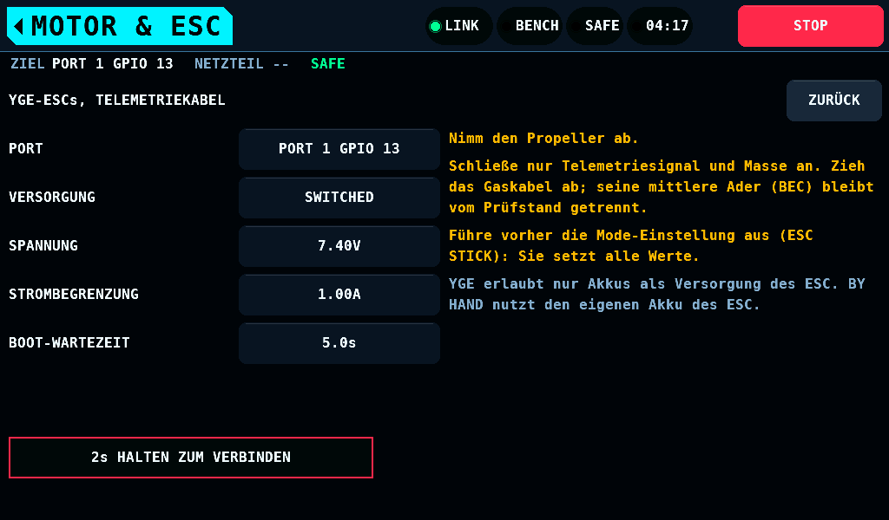

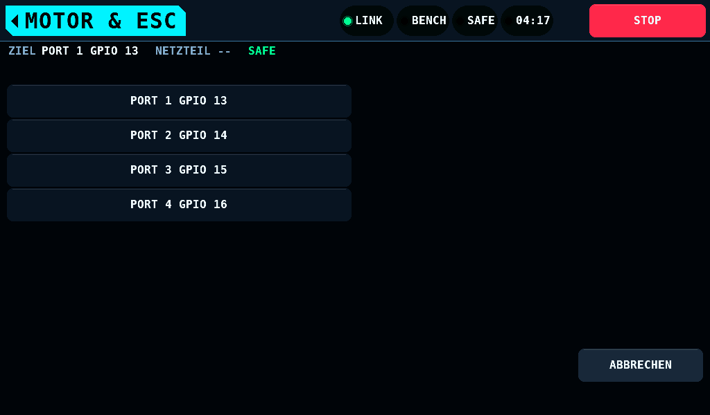

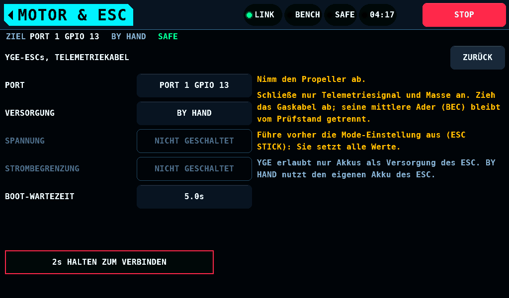

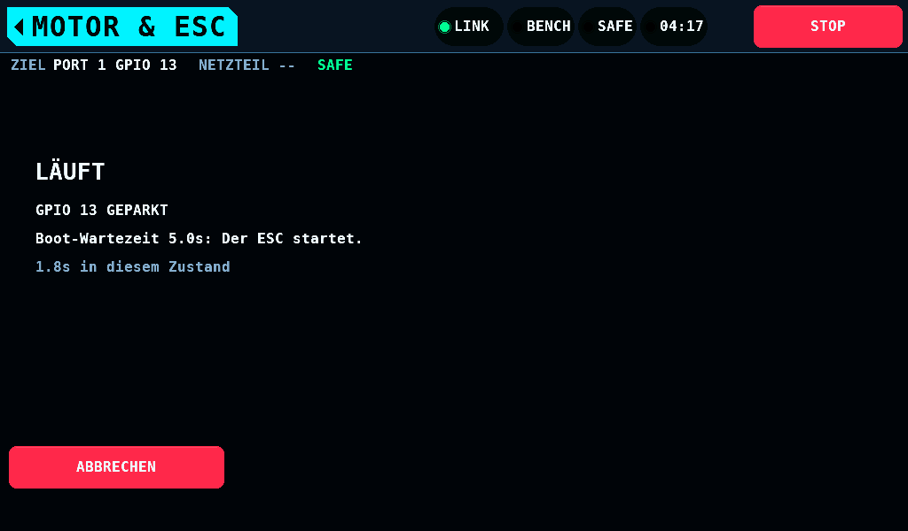

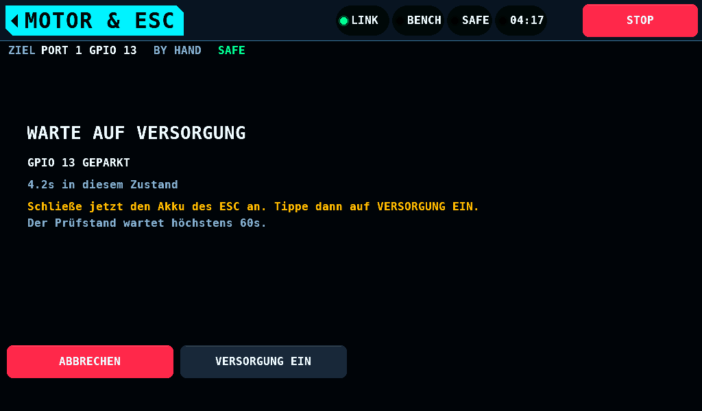

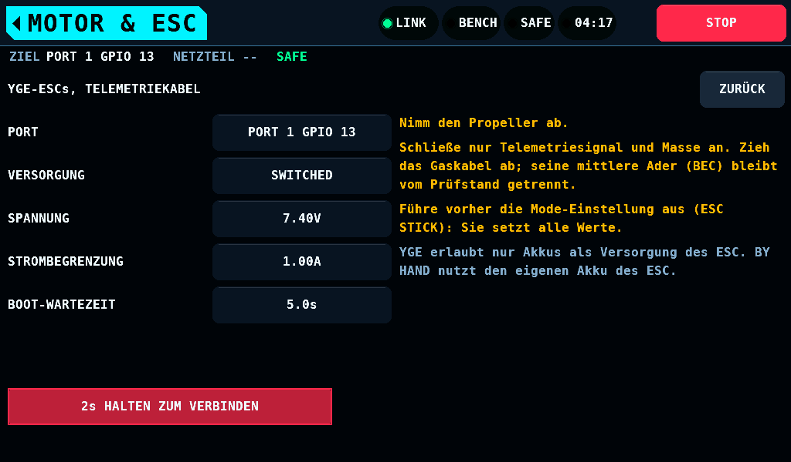

## Die Tabs

| Tab | Zeilen |
|---|---|
| IDENTITÄT | ESC-Typ mit Namen, Firmware, Seriennummer, Parameterzahl, `SCHREIBBAR` oder `NUR LESEN` mit dem Grund |
| MODE & BEC | ESC MODE, BEC VOLTAGE, BEC UP TO 12V, DIRECTION, F3C AUTOROTATION, KEEP MAH |
| SCHUTZ | CUT-OFF HANDLING, CUT-OFF VOLTAGE, CURRENT LIMIT |
| START | START POWER MIN, START POWER MAX, MOTOR TIMING, THROTTLE RESPONSE, ACTIVE FREEWHEEL, STARTUP RESPONSE |
| GOVERNOR & RPM | GOV P GAIN, GOV I GAIN, PINION TEETH, MAIN GEAR TEETH, POLE PAIRS |
| STICK | STICK ZERO, STICK RANGE |
| RAW | Indizes 16 und 19, TELEMETRY TYPE, FLAGS als `0x0000`, Indizes 28 bis 31 |

DIRECTION, F3C AUTOROTATION, KEEP MAH und BEC UP TO 12V sind Bits von Index 26 (FLAGS) und haben eigene Zeilen. Eine Zeile, deren Index die Parameterzahl der Tabelle erreicht oder übersteigt, entfällt.

Ein CHECK-Feld (ESC MODE, BEC VOLTAGE, CUT-OFF HANDLING, DIRECTION, CURRENT LIMIT) hat seinen Namen in der Warnfarbe. Eine nur lesbare Zeile ist gedimmt und öffnet nichts. Mikrosekunden erscheinen als `us`: Die Schrift des Panels hat kein µ.

Ein Tipp auf eine Auswahl öffnet eine Liste der Werte, mit denen das Feld geschrieben werden darf. Ein Tipp auf eine Zahl öffnet das Tastenfeld; ein Wert außerhalb der schreibbaren Menge wird abgelehnt, und das Tastenfeld bleibt offen. BEC VOLTAGE nimmt 5.5V bis 8.4V, solange BEC UP TO 12V aus ist. Eine Änderung ändert einen Entwurf auf dem Panel und markiert die Zeile mit `*`. Bis WRITE geht nichts zum ESC. Ein Wert, der auf den gelesenen zurückgesetzt wird, ist keine Änderung.

Ein geändertes CHECK-Feld steht über der Fußleiste mit seinem neuen Wert, zum Beispiel `PRÜFE BEC VOLTAGE 8.0V`; mehr als eines ergänzt `+1 WEITERE`.

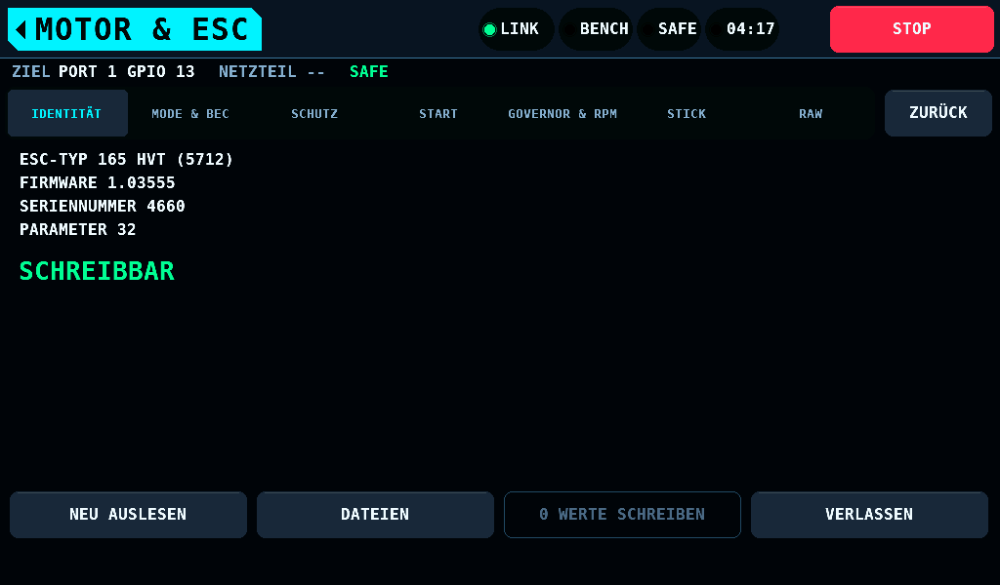

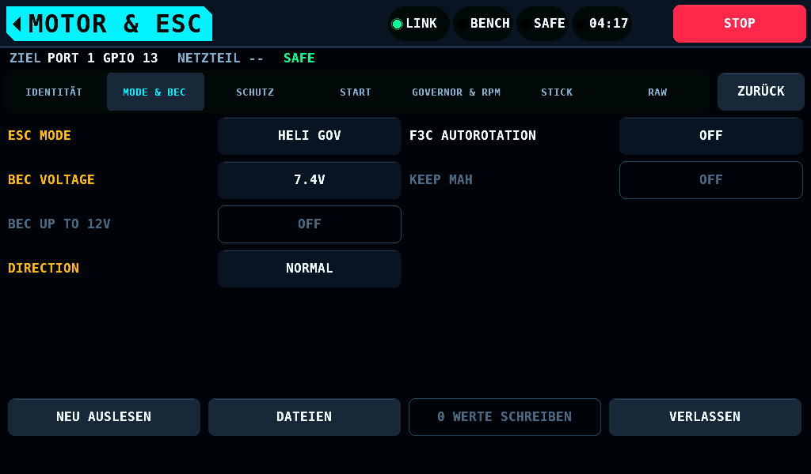

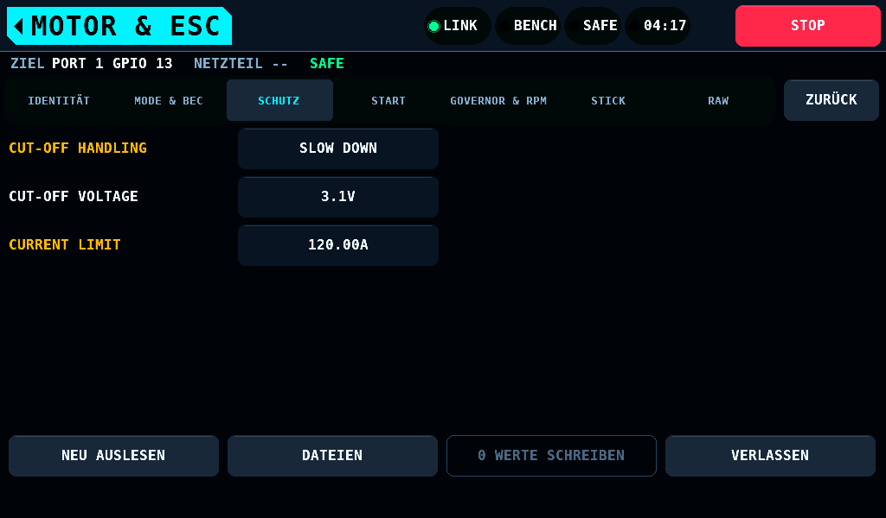

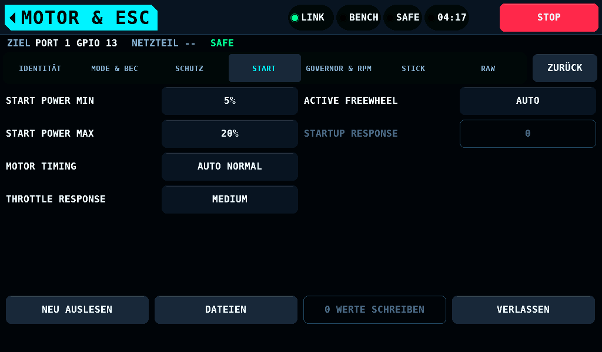

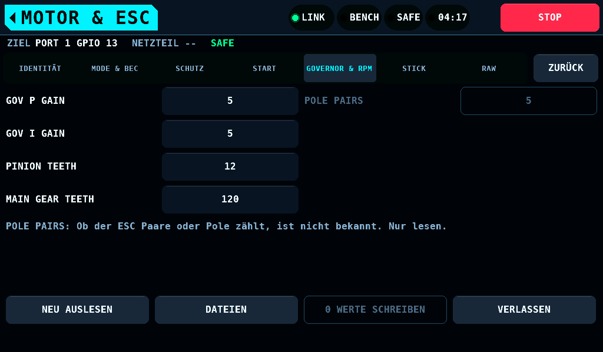

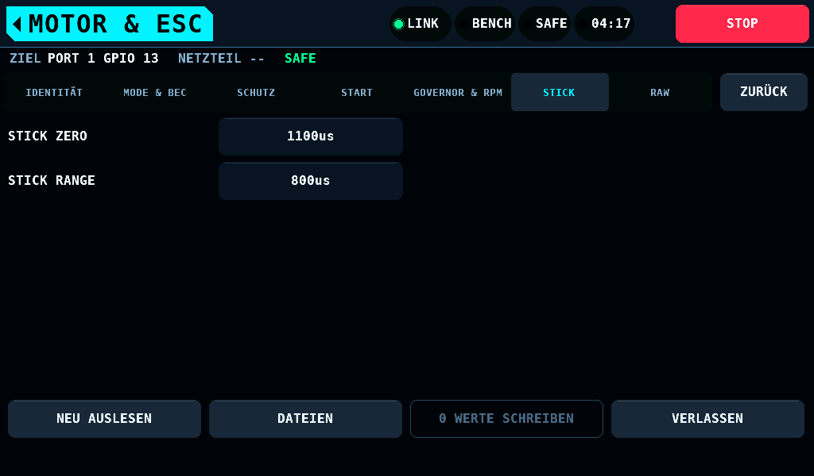

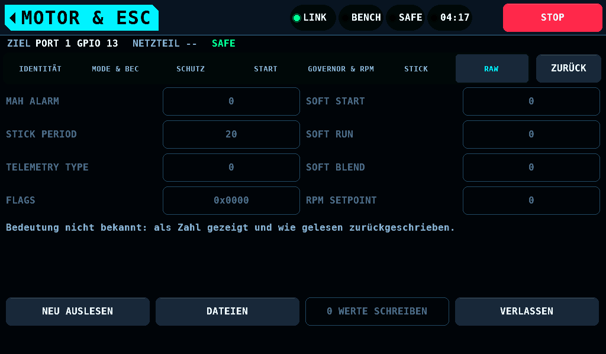

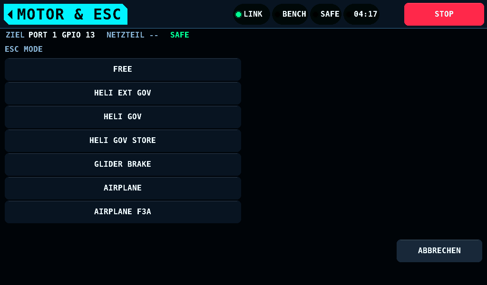

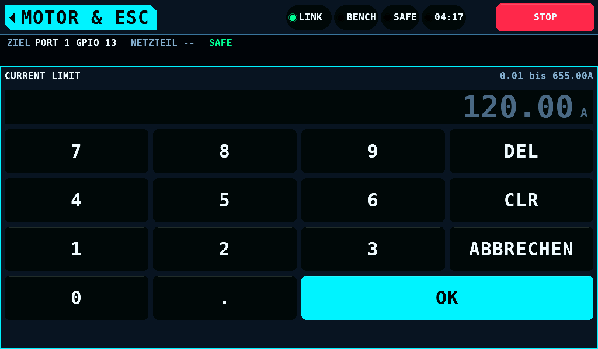

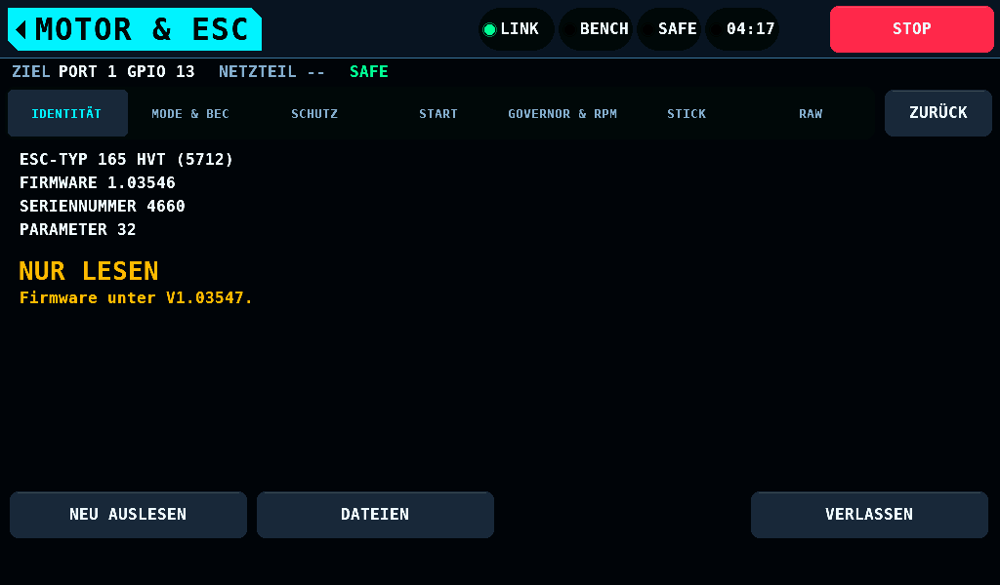

## Schreiben

Die Fußleiste trägt `NEU AUSLESEN`, `DATEIEN`, `n WERTE SCHREIBEN` und `VERLASSEN`. `n WERTE SCHREIBEN` zählt die geänderten Indizes; die vier Bits von Index 26 zählen als 1. Ohne Änderung oder während eine Anfrage läuft ist es grau, und ein Druck darauf tut nichts. Eine nicht schreibbare Tabelle hat kein WRITE.

`n WERTE SCHREIBEN` ist ein rotes 2s-Halten ohne Bestätigungsseite. Loslassen bei 1999ms sendet nichts. Bei 2000ms speichert das erste Schreiben der Sitzung zuerst das Backup `BENCH/YGE/CONF/YGE001-<Typ>.TXT`, zum Beispiel `YGE001-5712` für Typcode 5712, und sendet das WRITE, wenn die Karte geantwortet hat. Ohne Karte, mit einer Karte, die weder FAT32 noch exFAT ist, oder wenn das Speichern scheitert, geht das WRITE, und die alten Werte bleiben nur im RAM; die Meldung sagt es. Antwortet die Karte 10s nicht, geht kein WRITE. Spätere Schreibvorgänge derselben Sitzung speichern kein Backup.

Der IOmcu liest die Tabelle vor dem Schreiben erneut und lehnt es ohne gesendeten Frame ab, wenn sie von dem Lesen abweicht, aus dem der Entwurf stammt. Nach dem Schreiben liest er die ganze Tabelle zurück und vergleicht sie mit dem Entwurf.

`NEU AUSLESEN` liest ohne Änderungen sofort. Mit ungeschriebenen Änderungen öffnet es eine Seite, die sie auflistet; `2s HALTEN ZUM AUSLESEN` liest, `ZURÜCK` behält den Entwurf.

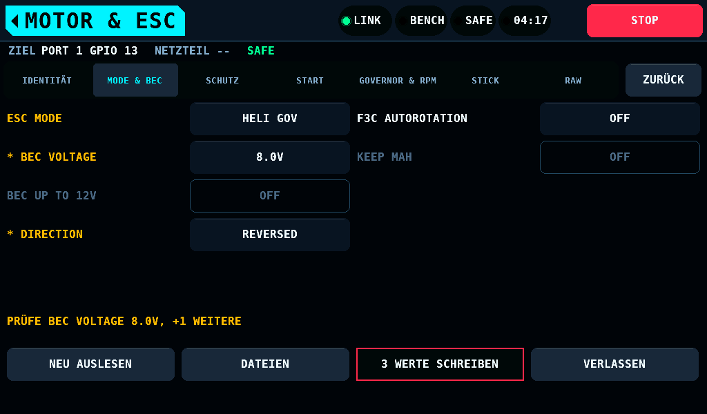

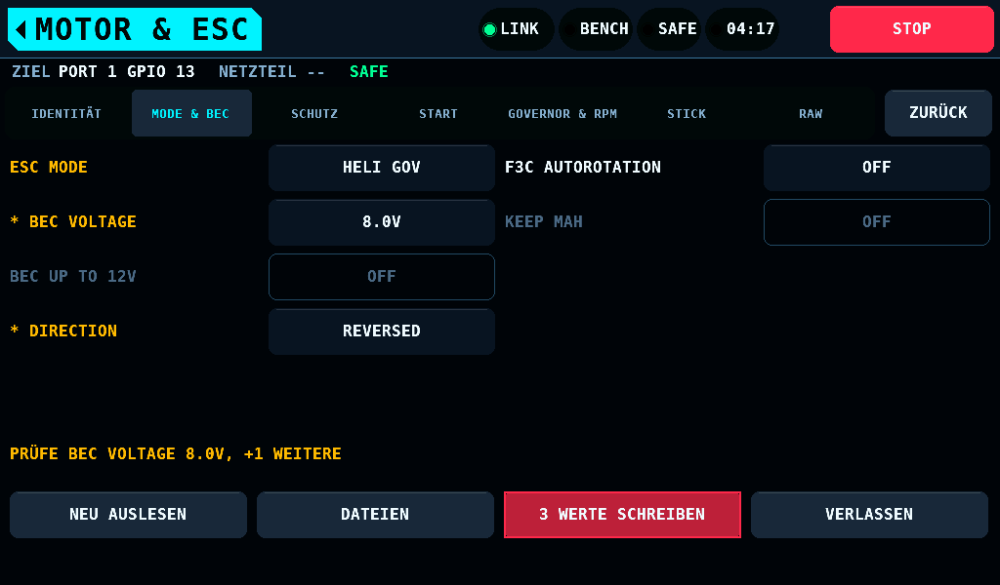

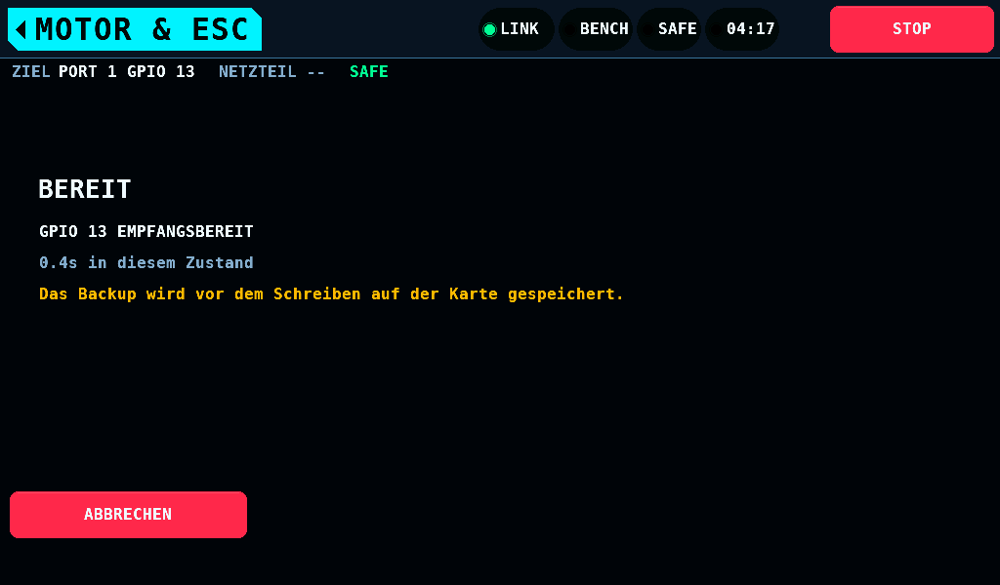

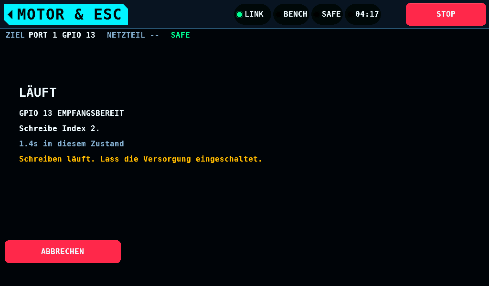

## Dateien

`DATEIEN` listet `YGE001` bis `YGE999` aus `BENCH/YGE/CONF`, die neueste zuerst. Ein Tipp auf eine Datei lädt ihre Werte in den Entwurf und nennt ihre Zahl. Eine Datei eines anderen ESC-Typs oder mit einem Wert außerhalb der schreibbaren Menge wird mit dem Grund abgelehnt; der Entwurf bleibt. Ein Ordner ohne Datei meldet `Keine YGE-Dateien in BENCH/YGE/CONF.`

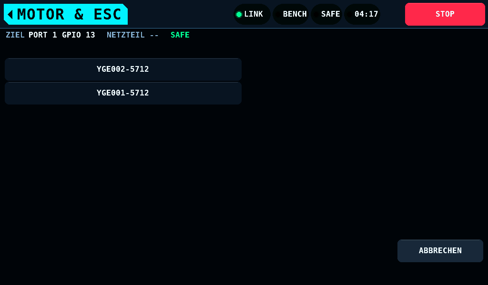

## Verlassen

`VERLASSEN` ohne Änderungen ist ein Tipp: LEAVE, wenn der ESC antwortet, dann CLOSE. Der Pin geht an seinen Port zurück, und der PD mini geht aus. Mit ungeschriebenen Änderungen öffnen `VERLASSEN` und `ZURÜCK` eine Seite, die jede Änderung als `BEC VOLTAGE: 7.4V -> 8.0V` auflistet. `2s HALTEN: OHNE SCHREIBEN VERLASSEN` verlässt, `ZURÜCK` behält den Entwurf. Mit `BY HAND` trennst du den Akku des ESC selbst.

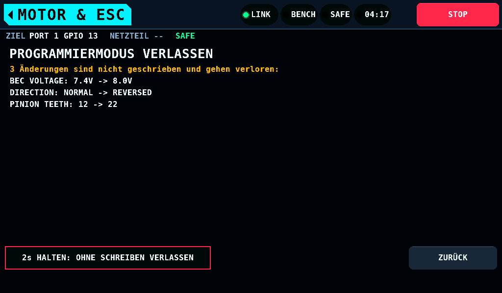

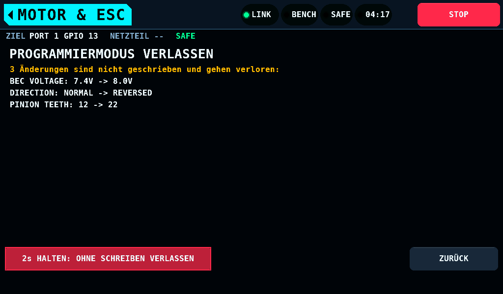

## Stopps und andere Schreiber

`ABBRECHEN` wirkt beim Drücken, auch mit einem anderen Finger auf dem Display. STOP, eine Stoppflanke, ein Fehler, ein verlorener Heartbeat oder ein 200ms stiller Link parken die Leitung und schalten den PD mini und PROG_SUPPLY sofort ab, auch während eines Schreibvorgangs; jeder Ausgang geht aus. Ein von der Seite gehaltener Stopp bietet `STOP LÖSCHEN` und `PIN ZURÜCK`; der eigene Stopp des Panels bietet nur `PIN ZURÜCK`. Nach `STOP LÖSCHEN` bleibt der Pin ohne Sitzung gehalten: `PIN ZURÜCK` gibt ihn zurück. Ein verlorener Link schließt jede Liste, jedes Tastenfeld und jede Seite.

Ein Pin, den ein anderer Schreiber hält, etwa `yge` der Prüfstandskonsole, zeigt seinen Port; `PIN FREIGEBEN` öffnet eine Seite, und `2s HALTEN ZUM FREIGEBEN` schließt diese Sitzung. Ein Port, der seinen Pin nicht zurückgenommen hat, zeigt `PIN NICHT ZURÜCK`: Die Bank schaltet nicht scharf, bis ein CLOSE ihn zurückgibt. `PIN NOCHMALS` sendet dieses CLOSE.

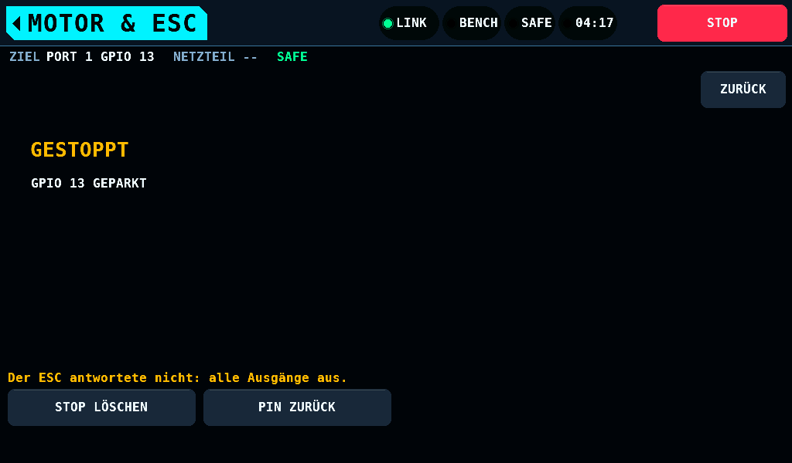

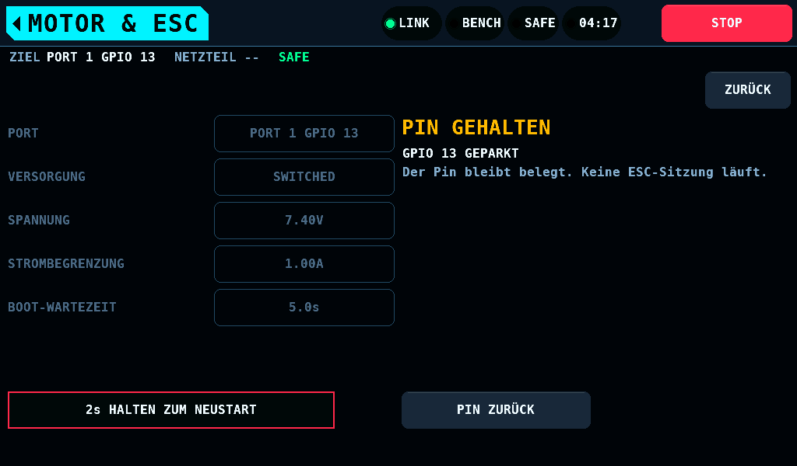

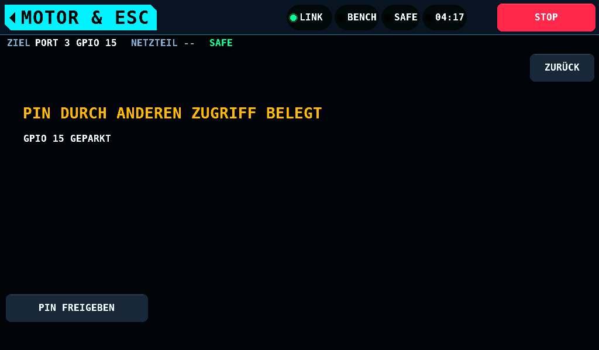

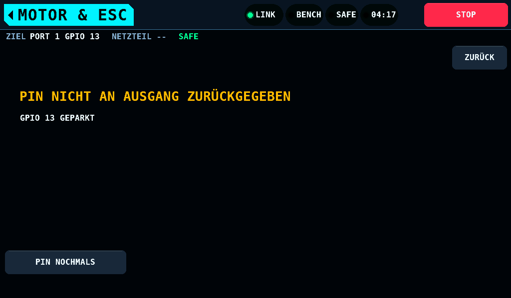
