# KiCad library of the rcbench modules

Footprints and symbols for the modules the bench is built from, for a carrier
PCB (printed circuit board) that takes them. KiCad 10 format: footprint
version 20260206, symbol library version 20251024. KiCad 10.0.7 or newer
loads both files. KiCad 9 and older refuse both files.

| Path | Content |
| --- | --- |
| `rcbench_modules.pretty/` | 12 footprints, one `.kicad_mod` each |
| `rcbench_modules.kicad_sym` | 12 symbols; each Footprint field names `rcbench_modules:<footprint>` |
| `rcbench_modules.3dshapes/` | 12 STEP (AP214) models, one per footprint; each footprint names `${RCBENCH_MODULES_3D}/<footprint>.step` |
| `modules/*.py` | one spec per module: geometry, pads, drawings, symbol, and in its docstring the source, scale, accuracy and unknowns |
| `tools/kicad_gen.py` | writes footprints and symbols from a spec |
| `tools/step_gen.py` | writes a STEP model from a spec's `MODEL` |
| `tools/step_check.py` | reads every STEP model with OpenCASCADE and checks it; `--png DIR` draws each with matplotlib |
| `tools/step_render.py` | renders every STEP model with OpenCASCADE to `renders/` |
| `renders/` | one PNG per model and the contact sheet `all.png`, from `step_render.py` |
| `tools/gen_all.py` | writes the library from all specs; `--check` fails on drift |
| `tools/render.py` | PNG preview of a spec, or the footprint drawn over a photo |
| `tools/kicad_render.py` | loads the library with kicad-cli and renders every footprint and symbol to PNG |

The `.kicad_mod`, `.kicad_sym` and `.step` files are generated. Edit the spec, then
run the generator:

```sh
python3 hardware/kicad/tools/gen_all.py          # write
python3 hardware/kicad/tools/gen_all.py --check  # CI: exit 1 on drift
KICAD_CLI=kicad-cli python3 hardware/kicad/tools/kicad_render.py /tmp/renders
pip install cadquery-ocp==8.0.1.1.0                 # for step_check.py only
python3 hardware/kicad/tools/step_check.py       # CI: exit 1 on a bad model
```

## Use in KiCad

1. Preferences > Manage Symbol Libraries: add `rcbench_modules.kicad_sym`
   with the nickname `rcbench_modules`.
2. Preferences > Manage Footprint Libraries: add `rcbench_modules.pretty`
   with the nickname `rcbench_modules`.
3. Preferences > Configure Paths: add `RCBENCH_MODULES_3D` with the full
   path of `hardware/kicad/rcbench_modules.3dshapes`. Without it the 3D
   viewer shows the footprints without models.

Footprint origin is pad 1. Every footprint draws the board outline and its
main parts in top view on F.SilkS and F.Fab; the courtyard is the outline of
everything drawn plus 0.25mm.

## Modules

Positions come from maker drawings or 3D models where these exist, and from
photos scaled by a known pitch otherwise. No geometry is taken from another
KiCad library. The photos and drawings used for measuring stay outside the
repository; each spec names them.

| Footprint | Module | Pads | Dimension source | Accuracy |
| --- | --- | --- | --- | --- |
| `RP2350-CAN` | Waveshare RP2350-CAN, 21.00 x 51.00mm | 40, Pico order, 2.54mm | maker drawing | pad grid exact; parts about 0.3mm |
| `INA3221_Module` | INA3221 board, 3 channels, 38.0 x 31.8mm | 15 (header 1-8, channels 9-14, VPU 15; GND holes on 2) | owner photos, front and back | about 0.3mm |
| `INA228_Matek_I2C-INA-BM_27x20mm` | MATEK I2C-INA-BM | 10 (2 x JST-GH, BAT+, ESC+) | maker 3D model and product image | 0.05mm to the model; pads about 0.3mm |
| `INA228_BIFRC_XT90_80x48mm` | INA228 board with 2 XT90, print "BIFRC V1.1" | 10 (header L A V G 5, solder bars, test pads) | owner photo, rectified | header 0.2mm; outline 0.6mm; XT90 1.5mm |
| `AS5600_Encoder_22.5x22.5mm` | AS5600 angle encoder board | 7 (VCC OUT GND, DIR SCL SDA GPO) | owner photo, rectified | about 0.3mm |
| `PD_Buck_WeAct_PDPowerMiniV1_61x40mm` | WeAct PD Power Mini V1 Buck | 12 (terminal 1-4, header 5-12) | maker vector drawing | outline and pads 0.02mm; parts 0.2mm |
| `USBC_T-plug_17x30mm` | USB-C tap board with plug board | 4 (G D+ D- V) | owner photo, scaled by USB-C sizes | about 0.5mm |
| `ADS1115_Module_28x17mm` | ADS1115 16-bit ADC board | 10 | vendor photo and dimension drawing | about 0.2mm |
| `ADXL345_GY-291_14.8x20.6mm` | ADXL345 board GY-291 | 8 | one oblique vendor photo, fitted | about 0.3mm |
| `INA219_MCU-219_25.4x21.5mm` | INA219 board with screw terminal | 8 (header 1-6, terminal 7-8) | vendor photo, rectified | about 0.2mm |
| `USBC_PD_Trigger_DIP3_30x20mm` | USB-C PD trigger, 3-way DIP switch | 2 (+, -) | vendor photo | about 0.2mm |
| `DCDC_Buck_Mini_30x18mm_EN` | mini buck DC-DC, 4R7, input 6-20V | 5 (IN+ IN- EN OUT+ OUT-) | dimensions printed on the vendor photo | grid exact; EN pad 0.5mm |

The accuracy figures are estimates from the measuring, not checked against
boards with a caliper. Check a module against its footprint before ordering
a PCB; the ADXL345 board rests on a single photo, and listings of it give
four different sizes.

## 3D models

`rcbench_modules.3dshapes/` holds one STEP model per footprint, AP214
(ISO 10303-21, automotive design schema), units mm. Each spec's `MODEL`
gives the board thickness, the mount and one box, cylinder or prism per
part with its height. The generator writes one solid per part with
planar faces only; circles are polygons of 16 to 32 sides. Each drilled
pad is a hole through the module board. The model frame is the
footprint's: origin at pad 1, z = 0 on the carrier's top side, so the
footprint places it with no offset, scale or rotation.

| Mount | Modules | Position |
| --- | --- | --- |
| header | RP2350-CAN, INA3221, INA219, ADS1115, ADXL345, mini buck | on 2.54mm male headers: 2.5mm plastic on the carrier, pins 6.0mm below the plastic and 3.0mm above it, module underside 2.5mm above the carrier |
| angled | AS5600 | right-angle 2.54mm headers under the board: 2.54mm plastic on the carrier, pins out horizontally 1.27mm above the carrier, 9.5mm from the hole, over the nearest board edge |
| flat | MATEK INA228, XT90 INA228, PD Power Mini, PD trigger, T-plug | wired; the module's underside rests on the carrier |

Sources of the heights, as each spec lists them:

| Source | Modules |
| --- | --- |
| maker 3D model | PD Power Mini (WeAct `WeAct-PDPowerMiniV1-Buck_3D.step`: every part), MATEK INA228 (`I2C-INA-BM.step`: JST-GH 4.35mm, shunt 1.85mm) |
| part datasheet or catalogue | XT90 plugs 10.2mm (AMASS XT90PW-M), INA219 terminal 8.8mm (KF350-3.5-2P), ADS1115 1.1mm (TI VSSOP-10), ADXL345 1.0mm (ADI LGA-14) |
| part class figure, not measured | everything else, for example USB-C receptacle 3.2mm, QFN 0.9mm, SOIC-8 1.75mm, 0805 0.6mm |

No source gives a board thickness; boards are drawn 1.6mm (the WeAct
model measures 1.69mm over copper). The part on a board is not always
identified: the XT90 variant and the INA219 terminal are the closest
catalogue parts. No source was found for the RP2350-CAN heights, the PD
trigger, the mini buck or the T-plug. All boards are drawn green (owner,
2026-10-28), whatever the colour of the real board. Parts a spec does not
draw are not in its model: bottom-side parts, the RP2350-CAN
castellations, the XT90 board's milled slots and the AS5600 magnet.

### Renders

`tools/step_render.py` reads each STEP file back with OpenCASCADE, the
geometry kernel KiCad reads STEP with, and draws it shaded with face edges
from above the front left. The images below are its output, 640 x 480px:

```sh
pip install cadquery-ocp==8.0.1.1.0 pillow
xvfb-run -a python3 hardware/kicad/tools/step_render.py \
    hardware/kicad/renders --size 640 480
```

The renders are not checked by CI; run the command after changing a
`MODEL`.

| | | |
| --- | --- | --- |
| 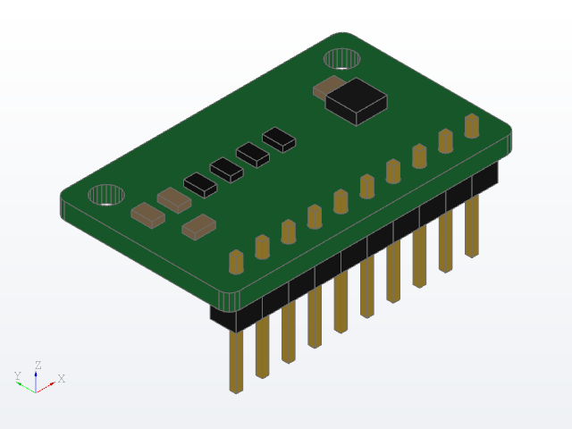 | 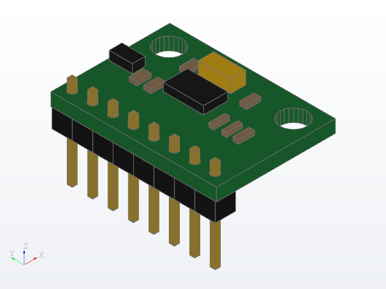 | 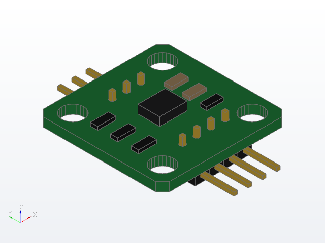 |
| `ADS1115_Module_28x17mm` | `ADXL345_GY-291_14.8x20.6mm` | `AS5600_Encoder_22.5x22.5mm` |
| 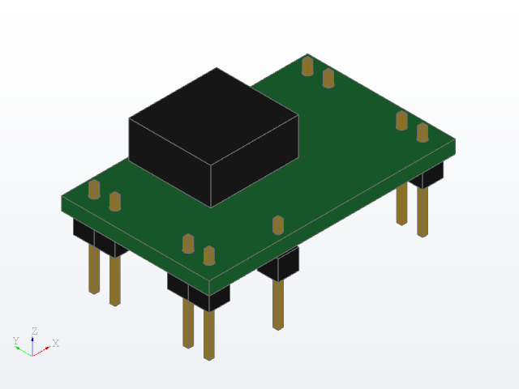 | 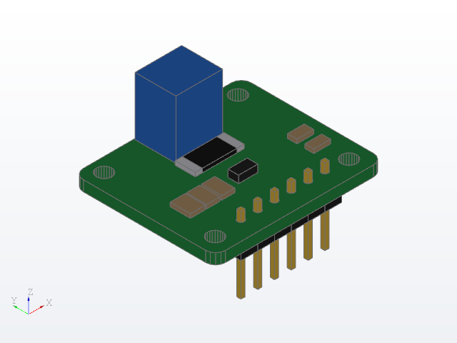 | 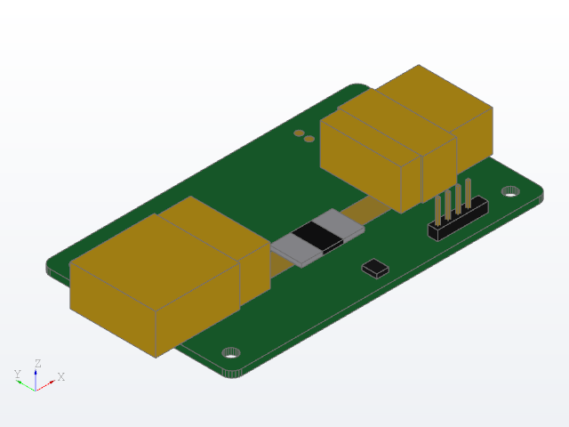 |
| `DCDC_Buck_Mini_30x18mm_EN` | `INA219_MCU-219_25.4x21.5mm` | `INA228_BIFRC_XT90_80x48mm` |
| 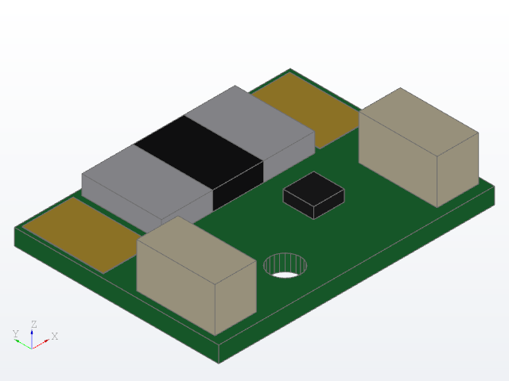 | 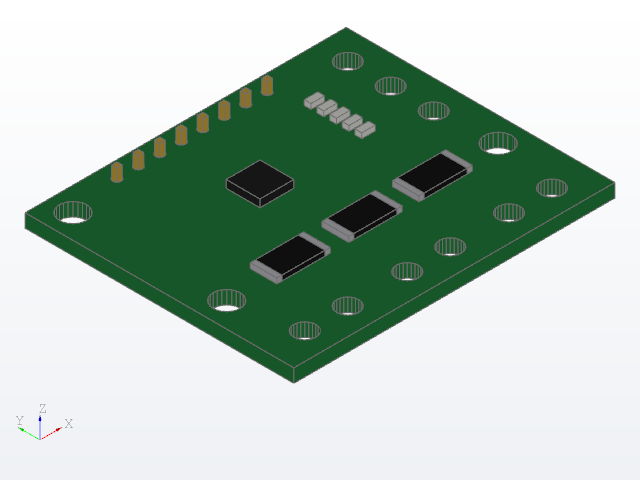 | 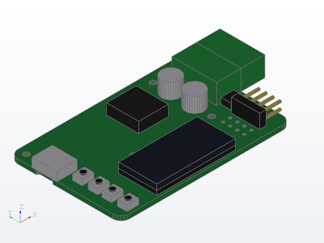 |
| `INA228_Matek_I2C-INA-BM_27x20mm` | `INA3221_Module` | `PD_Buck_WeAct_PDPowerMiniV1_61x40mm` |
| 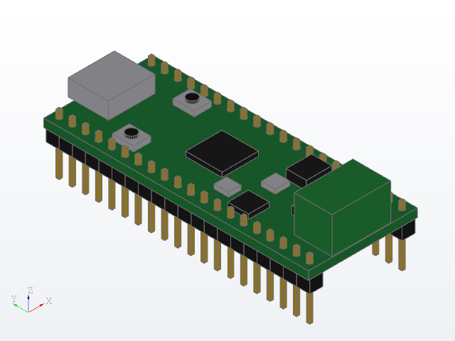 | 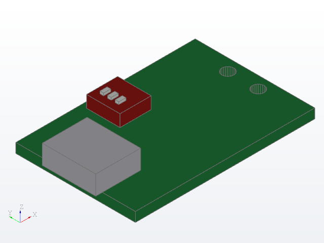 | 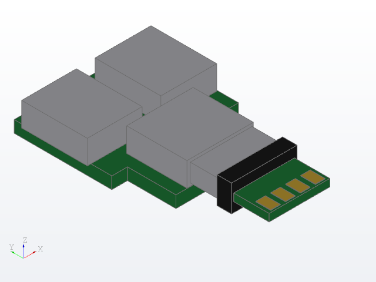 |
| `RP2350-CAN` | `USBC_PD_Trigger_DIP3_30x20mm` | `USBC_T-plug_17x30mm` |

## Limitations

- The AS5600 footprint has THT pads under both rows. With the model's
  right-angle headers the pins do not reach them; the board is wired.
- The MATEK and XT90 INA228 boards are wired, not soldered to a carrier;
  their power and connector pads are SMD (surface-mount) copper at the
  module's contact positions, for reference.
- The PD Power Mini has no UART pads. Its UART runs on the USB-C data lines
  (DP = TX, DM = RX, 3.3V); the symbol notes it and has no pins for it.
- The XT90 board's print says its screw holes carry circuitry: the holes are
  non-plated in the footprint and must not be joined to anything.
- Pin 1 of the JST-GH connectors on the MATEK board follows the board print;
  which lead JST calls pin 1 is not checked.
- KiCad 10.0.3 shows the symbol library empty, without an error message;
  10.0.7 loads it. Versions between are not tested. Whether 10.0.3 loads the
  footprint library is not tested.

## Licence

MIT (Massachusetts Institute of Technology), as the rest of the tree:
[LICENSE](../../LICENSE).
