# KiCad library of the rcbench modules

Footprints and symbols for mounting the bench's modules on a carrier
PCB (printed circuit board). KiCad 10 format: footprint
version 20260206, symbol library version 20251024. KiCad 10.0.7 or newer
loads both files. KiCad 9 and older refuse both files.

| Path | Content |
| --- | --- |
| `rcbench_modules.pretty/` | 21 footprints, one `.kicad_mod` each |
| `rcbench_modules.kicad_sym` | 21 symbols; each Footprint field names `rcbench_modules:<footprint>` |
| `rcbench_modules.3dshapes/` | 21 STEP (AP214) models, one per footprint; each footprint names `${RCBENCH_MODULES_3D}/<footprint>.step` |
| `modules/*.py` | one spec per module or socket: geometry, pads, drawings, symbol, and in its docstring the source, scale, accuracy and unknowns |
| `modules/_jst_ph.py` | footprint, symbol and 3D model of a JST PH top-entry header, shared by the 4 ES3C28P socket specs |
| `tools/kicad_gen.py` | writes footprints and symbols from a spec |
| `tools/step_gen.py` | writes a STEP model from a spec's `MODEL` |
| `tools/step_check.py` | reads every STEP model with OpenCASCADE and checks it; `--png DIR` draws each with matplotlib |
| `tools/step_render.py` | renders every STEP model with OpenCASCADE to `renders/` |
| `renders/` | one PNG per model and the contact sheet `all.png`, from `step_render.py` |
| `tools/gen_all.py` | writes the library from all specs; `--check` fails on drift |
| `tools/render.py` | PNG preview of a spec, or the footprint drawn over a photo |
| `tools/kicad_render.py` | loads the library with kicad-cli and renders every footprint and symbol to PNG |

The `.kicad_mod`, `.kicad_sym` and `.step` files are generated. Edit the spec, then
run the generator:

```sh
python3 hardware/kicad/tools/gen_all.py          # write
python3 hardware/kicad/tools/gen_all.py --check  # CI: exit 1 on drift
KICAD_CLI=kicad-cli python3 hardware/kicad/tools/kicad_render.py /tmp/renders
pip install cadquery-ocp==8.0.1.1.0                 # for step_check.py only
python3 hardware/kicad/tools/step_check.py       # CI: exit 1 on a bad model
```

## Use in KiCad

1. Preferences > Manage Symbol Libraries: add `rcbench_modules.kicad_sym`
   with the nickname `rcbench_modules`.
2. Preferences > Manage Footprint Libraries: add `rcbench_modules.pretty`
   with the nickname `rcbench_modules`.
3. Preferences > Configure Paths: add `RCBENCH_MODULES_3D` with the full
   path of `hardware/kicad/rcbench_modules.3dshapes`. Without it the 3D
   viewer shows the footprints without models.

Each footprint's origin is pad 1. Every footprint draws the board outline and its
main parts in top view on F.SilkS and F.Fab; the courtyard is the outline of
everything drawn plus 0.25mm.

## Modules

Positions come from maker drawings or 3D models where these exist, and from
photos scaled by a known pitch otherwise. No geometry is taken from another
KiCad library. The photos and drawings used for measuring stay outside the
repository; each spec names them.

| Footprint | Module | Pads | Dimension source | Accuracy |
| --- | --- | --- | --- | --- |
| `RP2350-CAN` | Waveshare RP2350-CAN, 21.00 x 51.00mm | 40, Pico order, 2.54mm | maker drawing | pad grid exact; parts about 0.3mm |
| `INA3221_Module` | INA3221 board, 3 channels, 38.0 x 31.8mm | 15 (header 1-8, channels 9-14, VPU 15; GND holes on 2) | owner photos, front and back | about 0.3mm |
| `INA228_Matek_I2C-INA-BM_27x20mm` | MATEK I2C-INA-BM | 10 (2 x JST-GH, BAT+, ESC+) | maker 3D model and product image | 0.05mm to the model; pads about 0.3mm |
| `INA228_BIFRC_XT90_80x48mm` | INA228 board with 2 XT90PW, print "BIFRC V1.1", 80.1mm x 48.6mm | 10 (header L A V G 5, solder bars, test pads) | owner photos on 5mm squared paper | positions 0.2mm; outline and holes 0.3mm; XT90PW 0.5mm |
| `AS5600_Encoder_22.5x22.5mm` | AS5600 angle encoder board | 7 (VCC OUT GND, DIR SCL SDA GPO) | owner photo, rectified | about 0.3mm |
| `PD_Buck_WeAct_PDPowerMiniV1_61x40mm` | WeAct PD Power Mini V1 Buck | 12 (terminal 1-4, header 5-12) | maker vector drawing | outline and pads 0.02mm; parts 0.2mm |
| `USBC_T-plug_17x30mm` | USB-C tap board with plug board | 4 (G D+ D- V) | owner photo, scaled by USB-C sizes | about 0.5mm |
| `ADS1115_Module_28x17mm` | ADS1115 16-bit ADC board | 10 | vendor photo and dimension drawing | about 0.2mm |
| `ADXL345_GY-291_14.8x20.6mm` | ADXL345 board GY-291 | 8 | one oblique vendor photo, fitted | about 0.3mm |
| `INA219_MCU-219_25.4x21.5mm` | INA219 board with screw terminal | 8 (header 1-6, terminal 7-8) | vendor photo, rectified | about 0.2mm |
| `INA219_CJMCU-219_24.2x21.9mm` | INA219 board, print CJMCU, terminal not fitted | 8 (header 1-6, terminal holes 7-8) | owner photos on 5mm squared paper | about 0.2mm |
| `LiPo_Charger_Boost5V_15.2x24mm` | lithium polymer charger with 5V boost output, print "Charge & DisCharge" | 6 (OUT 5V, GND, BAT, GND, GND, VIN) | owner photos on 5mm squared paper | about 0.2mm |
| `Boost_5V_EN_13.7x21.7mm` | 5V boost converter, 2R2 | 5 (IN+ IN- OUT+ OUT- EN) | owner photos on 5mm squared paper | about 0.2mm; the EN pad is not named on the board (owner: it is the enable input) |
| `ESP32-C6-Zero_Waveshare_18x23.5mm` | Waveshare ESP32-C6-Zero, 18.00 x 23.50mm | 25 (18 edge pads at 2.54mm, 7 underside pads at 1.6mm) | maker drawing; owner photos | pad grid exact; parts about 0.3mm |
| `USBC_PD_Trigger_DIP3_30x20mm` | USB-C PD trigger, 3-way DIP switch | 2 (+, -) | vendor photo | about 0.2mm |
| `DCDC_Buck_Mini_30x18mm_EN` | mini buck DC-DC, 4R7, input 6-20V | 5 (IN+ IN- EN OUT+ OUT-) | dimensions printed on the vendor photo | grid exact; EN pad 0.5mm |
| `Core2350B_Waveshare_25.4x25.4mm` | Waveshare Core2350B (RP2350B), 25.40 x 25.40mm | 64 plated holes, 10 x 10 grid at 2.54mm without its middle 6 x 6 | maker drawing and schematic; maker photos | hole grid exact; parts about 0.2mm |
| `ES3C28P_PWR_JST_PH_B2B-PH-K-S` | 5V supply of the LCDWIKI ES3C28P, JST PH 2-pin header | 2 (5V GND) | maker schematic; JST catalogue | header exact to the catalogue |
| `ES3C28P_UART_JST_PH_B4B-PH-K-S` | ES3C28P UART socket P2, JST PH 4-pin header | 4 (5V GND TXD RXD) | maker schematic and print; JST catalogue | header exact to the catalogue |
| `ES3C28P_I2C_JST_PH_B4B-PH-K-S` | ES3C28P I2C socket P4, JST PH 4-pin header | 4 (3V3 GND SCL SDA) | maker schematic and print; tester photo; JST catalogue | header exact to the catalogue |
| `ES3C28P_GPIO_JST_PH_B4B-PH-K-S` | ES3C28P 4-GPIO socket P3, JST PH 4-pin header | 4 (IO2 IO3 IO14 IO21) | maker schematic and print; JST catalogue | header exact to the catalogue |

The accuracy figures are estimates from those measurements; they have not been
checked against physical boards with a caliper. Check a module against its footprint before ordering
a PCB; the ADXL345 dimensions rely on a single photo, and its listings give
four different sizes.

## 3D models

`rcbench_modules.3dshapes/` holds one STEP model per footprint, AP214
(ISO 10303-21, automotive design schema), units mm. Each spec's `MODEL`
gives the board thickness, the mount and one box, cylinder or prism per
part with its height. The generator writes one solid per part with
planar faces only; circles are polygons of 16 to 32 sides. Each drilled
pad is a hole through the module board. The model uses the
footprint's coordinate system: origin at pad 1, z = 0 on the carrier's top side, so the
footprint places it with no offset, scale or rotation.

Five modules have a `MODEL` of the one key `detail`: the INA219 board with
the print CJMCU, the charger board, the boost board, the ESP32-C6-Zero
and the Core2350B. Their models come from the specs of the same name in
[hardware/mechanical](../mechanical/README.md#module-boards-and-cells),
which draw each board part by part with its print, in the board's own
colour, with round holes and arcs as cylinders. The INA219 board stands
on a 6-pin header, the Core2350B on four 2 x 8 headers, the other three
lie flat.

The 4 ES3C28P socket headers share one model builder in
`modules/_jst_ph.py`: a floor 0.6mm thick with the pin holes, four walls
0.6mm thick to 6.0mm, and 0.5mm square pins from 3.4mm under the
carrier's top side to 4.6mm over it.

| Mount | Modules | Position |
| --- | --- | --- |
| header | RP2350-CAN, INA3221, INA219, ADS1115, ADXL345, mini buck, Core2350B | on 2.54mm male headers: 2.5mm plastic on the carrier, pins 6.0mm below the plastic and 3.0mm above it, module underside 2.5mm above the carrier |
| angled | AS5600 | right-angle 2.54mm headers under the board: 2.54mm plastic on the carrier, pins out horizontally 1.27mm above the carrier, 9.5mm from the hole, over the nearest board edge |
| flat | MATEK INA228, XT90 INA228, PD Power Mini, PD trigger, T-plug | wired; the module's underside rests on the carrier |
| flat | the 4 ES3C28P socket headers | the header's floor rests on the carrier, its pins through it |

Sources of the heights, as each spec lists them:

| Source | Modules |
| --- | --- |
| maker 3D model | PD Power Mini (WeAct `WeAct-PDPowerMiniV1-Buck_3D.step`: every part), MATEK INA228 (`I2C-INA-BM.step`: JST-GH 4.35mm, shunt 1.85mm) |
| part datasheet or catalogue | XT90 plugs 10.2mm (AMASS XT90PW-M), INA219 terminal 8.8mm (KF350-3.5-2P), ADS1115 1.1mm (TI VSSOP-10), ADXL345 1.0mm (ADI LGA-14), JST PH header 6.0mm and pins 3.4mm under the carrier (JST `ePH.pdf`) |
| part class figure, not measured | everything else, for example USB-C receptacle 3.2mm, QFN 0.9mm, SOIC-8 1.75mm, 0805 0.6mm |

No source gives a board thickness; boards are drawn 1.6mm (the WeAct
model measures 1.69mm over copper). The exact part fitted to a board is not always
identified: the XT90 variant and the INA219 terminal are the closest
catalogue parts. No source was found for the RP2350-CAN heights, the PD
trigger, the mini buck or the T-plug. All boards are drawn green (owner,
2026-10-28), whatever the colour of the real board. Parts omitted from a spec
are also absent from its model: bottom-side parts (the detail models
draw them), the RP2350-CAN
castellations, the XT90 board's milled slots and the AS5600 magnet.

### Renders

`tools/step_render.py` reads each STEP file with OpenCASCADE, the
geometry kernel KiCad uses to read STEP. It renders a shaded view with face edges
from above and to the front left. The images below are its output, 640 x 480px:

```sh
pip install cadquery-ocp==8.0.1.1.0 pillow
xvfb-run -a python3 hardware/kicad/tools/step_render.py \
    hardware/kicad/renders --size 640 480
```

The renders are not checked by CI; run the command after changing a
`MODEL`.

| | | |
| --- | --- | --- |
| 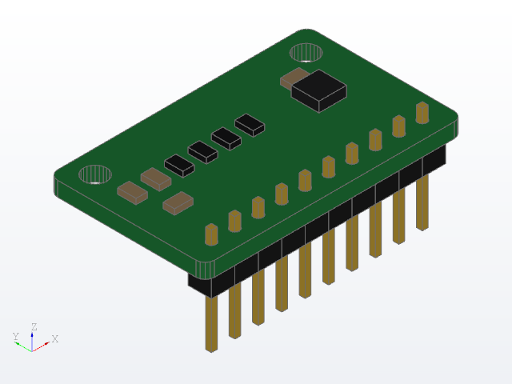 | 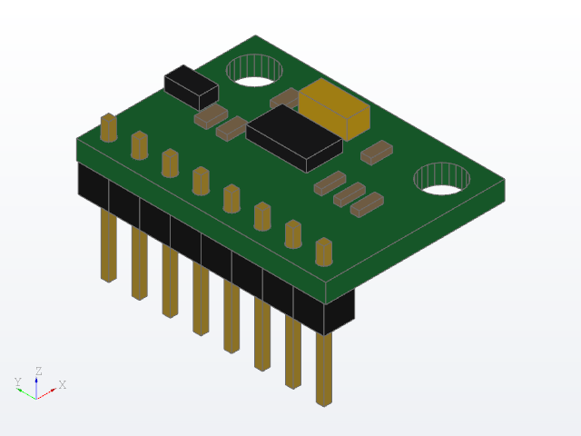 | 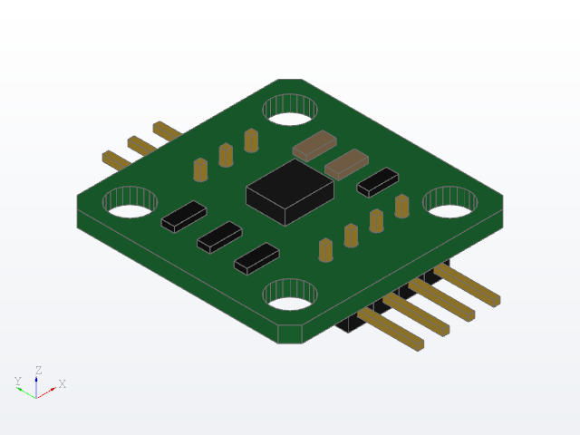 |
| `ADS1115_Module_28x17mm` | `ADXL345_GY-291_14.8x20.6mm` | `AS5600_Encoder_22.5x22.5mm` |
|  |  |  |
| `DCDC_Buck_Mini_30x18mm_EN` | `INA219_MCU-219_25.4x21.5mm` | `INA228_BIFRC_XT90_80x48mm` |
|  |  | 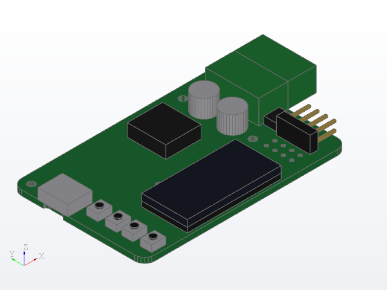 |
| `INA228_Matek_I2C-INA-BM_27x20mm` | `INA3221_Module` | `PD_Buck_WeAct_PDPowerMiniV1_61x40mm` |
| 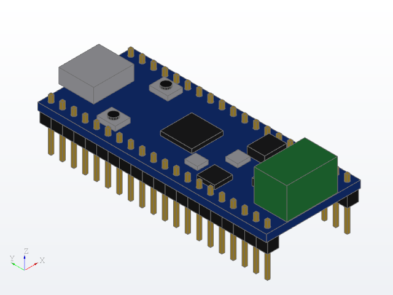 | 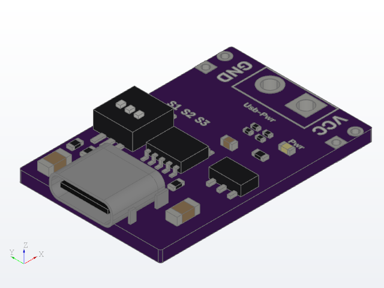 |  |
| `RP2350-CAN` | `USBC_PD_Trigger_DIP3_30x20mm` | `USBC_T-plug_17x30mm` |
| 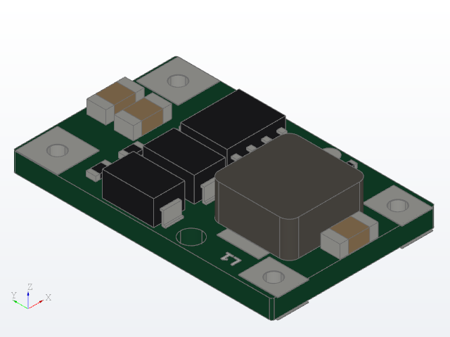 | 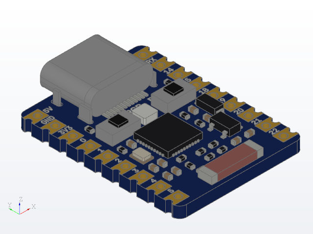 | 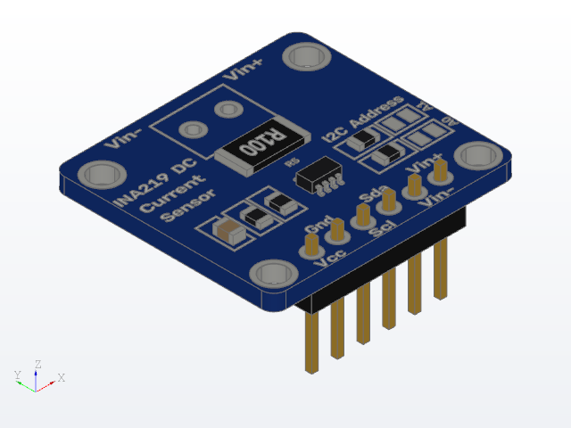 |
| `Boost_5V_EN_13.7x21.7mm` | `ESP32-C6-Zero_Waveshare_18x23.5mm` | `INA219_CJMCU-219_24.2x21.9mm` |
| 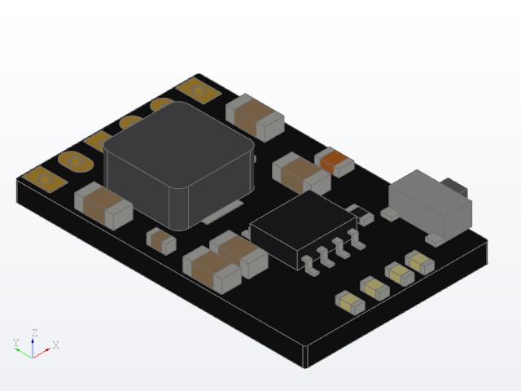 | 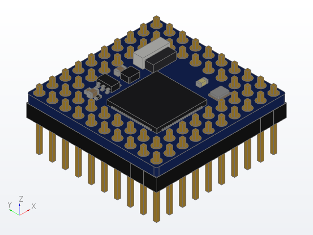 | 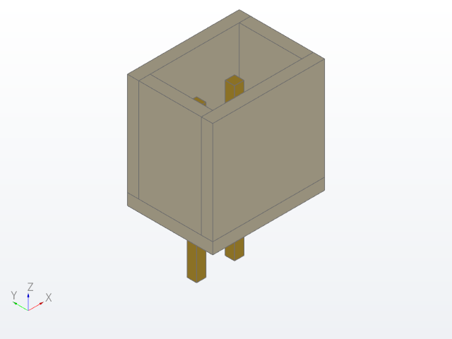 |
| `LiPo_Charger_Boost5V_15.2x24mm` | `Core2350B_Waveshare_25.4x25.4mm` | `ES3C28P_PWR_JST_PH_B2B-PH-K-S` |
| 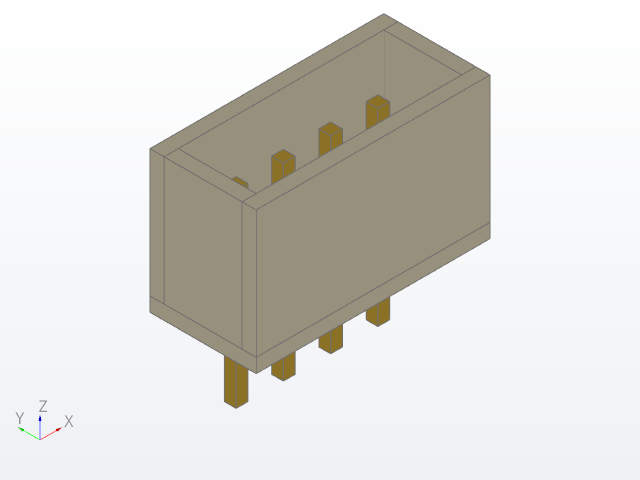 |  |  |
| `ES3C28P_UART_JST_PH_B4B-PH-K-S` | `ES3C28P_I2C_JST_PH_B4B-PH-K-S` | `ES3C28P_GPIO_JST_PH_B4B-PH-K-S` |

## Core2350B

The Waveshare Core2350B carries the RP2350B, 16MB flash, an optional
PSRAM (pseudo-static RAM), 2MB on the B1 variant and 8MB on the B2, and
a 6-pin flat cable socket for its USB adapter board. Its 64 plated holes form a 10 x 10 grid at 2.54mm
without the middle 6 x 6; it has no castellations. Pad numbers are
Waveshare's header pins: P1 pins 1-16 are pads 1-16 (left edge), P2
pads 17-32 (top edge, at the flat cable socket), P3 pads 33-48 (bottom
edge), P4 pads 49-64 (right edge). Pad 1 is GND in the corner. The
symbol groups the pins: system pins (RUN, BOOTSEL, SWCLK, SWDIO,
USB_DP, USB_DM) and GP0-GP20 on the left, GP21-GP39 and the ADC
inputs GP40-GP47 on the right, VBUS, 3V3, 3V3_EN and ADC_VREF at the
top, the 6 GND pads at the bottom.

The footprint takes 2.54mm headers: 1.0mm holes for a 0.64mm square pin
(0.91mm across its corners), 1.7mm pads, 0.84mm of board between pads.
The flash on the underside, about 1.9mm high, keeps the board off a
carrier; on headers its underside stands 2.5mm over the carrier. F.Fab
shows the flash (5.3 x 5.3mm) and the PSRAM (3.9 x 4.9mm).

The USB adapter board (USB-C, BOOT, RESET, 4 holes of 2.0mm) is not in
the library. It plugs into the Core2350B through the 6-way flat cable
and is not soldered to a carrier; the Core2350B's pads carry USB_DP,
USB_DM, VBUS, RUN and BOOTSEL, so a carrier reaches USB without it. Its
3D model is in [hardware/mechanical](../mechanical/README.md#module-boards-and-cells).

## ES3C28P sockets

The LCDWIKI ES3C28P, the display node's ESP32-S3 board
([docs/Nodes.md](../../docs/Nodes.md#the-display-node)), has 1.25mm
4-pin sockets. Each socket a carrier connects to has its own symbol and
footprint, so a header that is not needed is left unfitted:

| Symbol | ES3C28P socket | Pins | Footprint |
| --- | --- | --- | --- |
| `ES3C28P_PWR` | USB-C (VBUS, GND), through a USB-C plug | 1 5V, 2 GND | `ES3C28P_PWR_JST_PH_B2B-PH-K-S` |
| `ES3C28P_UART` | P2 | 1 5V, 2 GND, 3 TXD (GPIO43, out), 4 RXD (GPIO44, in) | `ES3C28P_UART_JST_PH_B4B-PH-K-S` |
| `ES3C28P_I2C` | P4 | 1 3V3 (out), 2 GND, 3 SCL (GPIO15), 4 SDA (GPIO16) | `ES3C28P_I2C_JST_PH_B4B-PH-K-S` |
| `ES3C28P_GPIO` | P3 | 1 IO2, 2 IO3, 3 IO14, 4 IO21 | `ES3C28P_GPIO_JST_PH_B4B-PH-K-S` |

Directions are as the ES3C28P sees them; each symbol's description
gives them per pin. The pin order is the socket's (LCDWIKI schematic
and the print in LCDWIKI's outline drawing; I2C also a tester's photo,
2026-11-20), so a 1:1 cable from the 1.25mm socket to the 2.0mm header
keeps every wire on its pin.

The headers are JST PH top entry, B2B-PH-K-S and B4B-PH-K-S, from JST's
catalogue `ePH.pdf`: 4.5mm deep against 7.6mm for the side-entry
S4B-PH-K-S, and the cable leaves upward to any side, so a header needs
no place at the carrier's edge. Each socket has its own footprint, also
the three 4-pin ones: the same geometry from `_jst_ph.py`, with the
socket's pin names on F.SilkS under the pads.

Power: the ES3C28P's +5 rail has three feeds (schematic). USB-C VBUS
feeds it through a Schottky diode, D8. The battery socket feeds it
through Q3, a P-channel MOSFET that conducts while VBUS is absent. The
UART socket's pin 1 feeds it through Q5, a P-channel MOSFET with its
gate on GND that conducts both ways. `ES3C28P_PWR` feeds VBUS: with
VBUS up, Q3 keeps a cell on the battery socket off the rail and the
charger alone charges it. 5V on the UART socket's pin 1 instead would
reach such a cell through Q3, past the charger. The carrier leaves
`ES3C28P_UART` pin 1 open.

No 3D model of the ES3C28P exists in the repository; it is to come from
the tester's photos.

## Limitations

- The Core2350B footprint is for 2.54mm headers. Soldered flat, the
  board needs a cut-out of about 15.0 x 15.0mm in the carrier under its
  middle for the flash and the PSRAM; the footprint has none. Its
  thickness (drawn 1.6mm) and the flash's height are not measured.
- The Core2350B's PSRAM is drawn as an SOIC-8 of 5.3mm in its place;
  the photos show the place empty on a board without PSRAM.
- The ES3C28P headers' pin 1 follows the ES3C28P socket's pin 1. A
  ready-made 1.25mm to 2.0mm cable may cross its wires; compare pin 1
  at both ends before fitting it.
- The ESP32-C6-Zero footprint is for the board soldered flat. Its 7
  underside pads are pads on the carrier's top side; with the board on
  headers they are not connected.
- The boost board's pad 5 is the enable input (owner, 2026-11-19). The
  board does not name it, and the level that enables the output is not
  known.
- The AS5600 footprint has THT pads under both rows. With the model's
  right-angle headers the pins do not reach them; the board is wired.
- The MATEK and XT90 INA228 boards are wired, not soldered to a carrier;
  their power and connector pads are SMD (surface-mount) copper at the
  module's contact positions, for reference.
- The PD Power Mini has no UART pads. Its UART runs on the USB-C data lines
  (DP = TX, DM = RX, 3.3V); the symbol notes it and has no pins for it.
- The XT90 board's markings indicate that its screw holes carry circuitry: the holes are
  non-plated in the footprint and must not be joined to anything.
- Pin 1 of the JST-GH connectors on the MATEK board follows the board print;
  which contact JST designates pin 1 has not been checked.
- KiCad 10.0.3 shows the symbol library empty, without an error message;
  10.0.7 loads it. Versions between are not tested. Whether 10.0.3 loads the
  footprint library is not tested.

## Licence

CC BY-NC-SA 4.0 (Creative Commons Attribution-NonCommercial-ShareAlike 4.0
International): the symbols, footprints and 3D shapes, the module specs, the
renders and the scripts in `tools/`. They may be used, changed and shared for
non-commercial purposes, with credit and under the same licence. Commercial
use needs a separate licence from the copyright holder. Terms:
[LICENSE](LICENSE), as for all of `hardware/` ([../LICENSE](../LICENSE)). The
software of rcbench is MIT (Massachusetts Institute of Technology) licensed:
[LICENSE](../../LICENSE).
