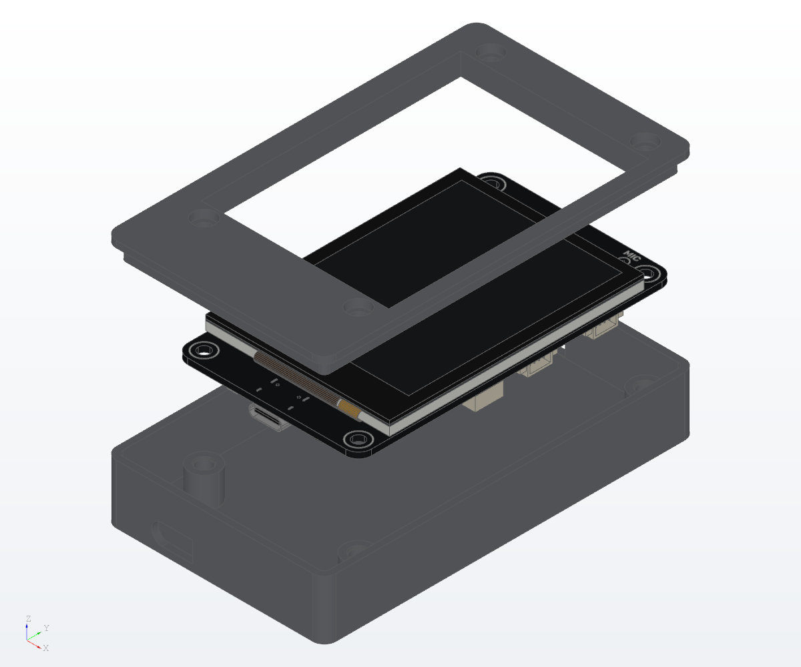
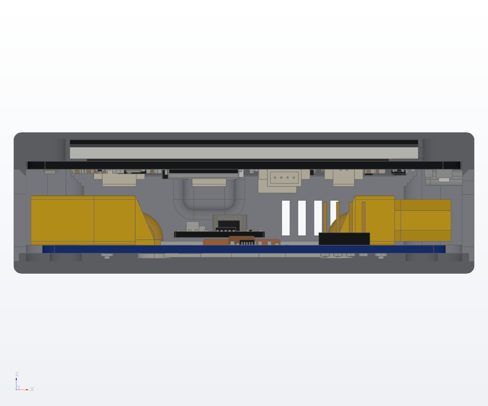
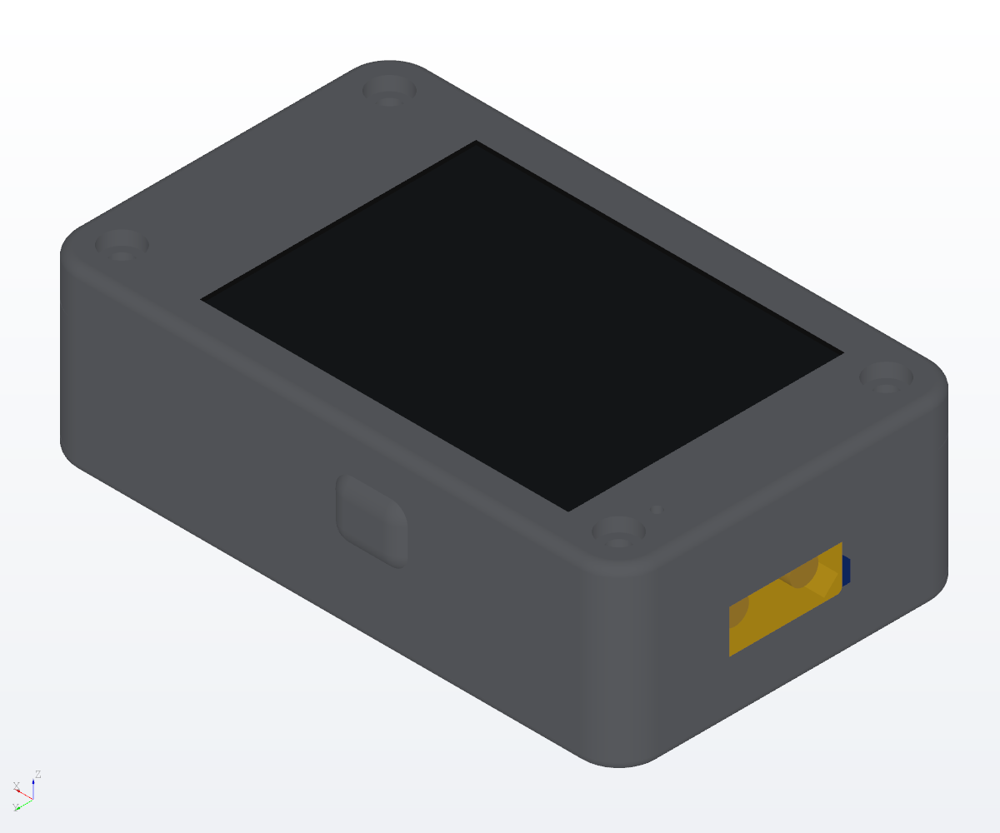

# Printed cases of the nodes

Two cases for nodes of [Nodes](../../docs/Nodes.md), built with OpenCASCADE
by the generators of [Mechanical parts](README.md). The STEP and STL files
are in `models/casing/`, the pictures in `renders/casing/`. All parts are
under the licence of [Mechanical parts](README.md#licence).

## Case of the display node, XT30

A printed case of 2 parts for the display node of
[Nodes](../../docs/Nodes.md#the-display-node), 59.8mm x 101.2mm x 17.8mm:
the display board lies on 4 bosses of the box, its display in the lid's
window. A current sensor board (MATEK I2C-INA-BM) and a 5V buck converter
lie on the floor under it. Each short wall has an opening for a
panel-mount XT30; a bay of 11.4mm beyond the board's end at the USB socket
holds an inline pair of XT30.


| | | |
| --- | --- | --- |
|  |  |  |

| File | Content | Print |
| --- | --- | --- |
| `display_node_box.step`, `.stl` | floor of 1.7mm, wall of 1.8mm, 16.0mm high; 4 bosses of 8.0mm with their tops 10.0mm over the underside, each with a blind hole of 4.0mm x 6.0mm and a relief of 4.6mm x 0.5mm; 2 XT30 openings of 11.2mm x 5.6mm with one round end; 2 recesses in the wall's inner face; a hole of 3.5mm in the floor; 19.1cm3 | underside down, no support |
| `display_node_lid.step`, `.stl` | front plate of 1.8mm with a window of 51.0mm x 70.6mm, a plug of 4.2mm into the box with 0.4mm of room all round, a recess over the flat cables' folds and the bay, 4 holes of 3.4mm with recesses of 6.0mm x 2.2mm for the heads; 9.4cm3 | front down, no support |

Assembly: 4 threaded inserts ruthex RX-M3Sx4.0 melted into the bosses, 4
screws M3 x 10 with pan heads through the lid and the board's holes. A
screw reaches 4.4mm into its boss.

The case follows a tester's printed case of the same node, measured from
its STL file, which is not in the repository: outline, heights, the
bosses' places, the window's ends, the recesses and the XT30 openings are
that case's, within 0.1mm. The tester reports a gap of about 1mm between
lid and box. In nominal sizes the measured case closes: its plug ends
0.18mm over the board, the display's parts clear the lid by 0.8mm or more
and the plug clears the box by 0.33mm. 3 things differ here, at the 2
places where real parts take more room than nominal ones:

| | Measured case | This case | Effect on the gap |
| --- | --- | --- | --- |
| Insert holes | 3.5mm, straight through boss and floor, no relief | 4.0mm, blind, 6.0mm deep, relief of 4.6mm x 0.5mm at the mouth | an insert or a burr standing 1.0mm out of a boss lifts board and lid by 0.8mm; the relief takes the plastic the insert pushes up |
| Window | 50.5mm wide, 0.08mm off the board's axis: 0.17mm at one side of a touch panel of 50.0mm +- 0.2mm | 51.0mm wide, centred on the board: 0.5mm at each side | the panel enters the window by 3.9mm; where it binds, the lid stops short |
| Head recesses | 4.5mm wide | 6.0mm wide, 2.2mm deep | a pan head M3 of 5.6mm sinks into the lid |

Which of the first 2 held the tester's lid up is not known, and neither
are the inserts and screws the tester used. `stack()` gives the closed
case in numbers and `--check` fails when one falls under its limit:

| | Value, mm | Limit, mm |
| --- | --- | --- |
| plug's end over the board's front | 0.18 | 0.1 |
| room at each long side of the touch panel | 0.5 | 0.4 |
| touch panel's front under the lid's front | 1.88 | 0.5 |
| room over the flat cables' folds | 0.66 | 0.5 |
| free under the board's highest part, its speaker socket | 3.62 | 3.0 |

Limits:

- No part is printed. The fits are drawn, not tried.
- The 2 boards on the floor, the XT30 connectors and the wires are not
  drawn and their height is not measured. 3.6mm is free under the
  display board's speaker socket and 8.3mm under its flat parts; parts
  higher than that lift the board and open the lid.
- The USB socket, the microSD slot and the 2 buttons are not reachable
  with the lid on: the box has no opening for them, as the measured
  case has none.
- The floor's hole of 3.5mm at x 5.6mm, y -37.5mm is the measured
  case's; what it is for is not stated.

```sh
python3 hardware/mechanical/_gen_display_case.py            # write STEP and STL
python3 hardware/mechanical/_gen_display_case.py --check    # CI
xvfb-run -a python3 hardware/mechanical/_gen_display_case.py \
    --render hardware/mechanical/renders
```

## Case of the sensor node

A printed case of 3 parts round the
[layout](README.md#remote-ina228-sensor-node-layout) of the remote INA228
sensor node, 91.4mm x 55.4mm x 28.0mm. It
has no ears; the node hangs in its cable.


| | | |
| --- | --- | --- |
|  |  |  |

| File | Content | Print |
| --- | --- | --- |
| `ina228_node_plate.step`, `.stl` | bottom plate, 2.4mm thick, with 4 stands of 6.4mm under the INA228 board's holes, each with a hole of 3.4mm and a recess of 6.0mm x 2.2mm for a screw's head; 12.0cm3 | underside down, no support |
| `ina228_node_frame.step`, `.stl` | wall of 2.4mm from the plate to the display board's back, 18.3mm high, with 4 columns that stand on the INA228 board and carry the display board; 15.1cm3 | upper face down, no support; the 2 XT90 openings are bridges of 21.4mm |
| `ina228_node_bezel.step`, `.stl` | rim round the display board, 7.3mm high, a plate of 1.2mm over the touch panel with the window, 4 posts on the display board's holes; 7.5cm3 | front down, no support |

Assembly, 8 screws M3 and 8 threaded inserts ruthex RX-M3Sx4.0:

1. Melt 2 inserts into each column of the frame, one from each end. The
   holes are 4.0mm wide and 6.0mm deep.
2. Put the INA228 module on the plate's stands, the frame over it. 4
   screws M3 x 8 with pan heads go from below through the plate and the
   board's holes into the columns' feet. The board is clamped between
   stands and columns.
3. Lay the display board on the columns, the bezel over it. 4 screws
   M3 x 10 go from above through the bezel's posts and the board's holes
   into the columns' tops.

Each column joins a hole of the INA228 board to a hole of the display
board; the two lie 4.2mm apart. Under the display board the column's
lobe at the INA228 hole steps back in 4 steps of 0.65mm, clear of chip
parts that hang 0.9mm down from that board.

| Opening | Where | Size, mm |
| --- | --- | --- |
| XT90, 2 | each end wall, round the housing | 21.4 x 10.5 |
| USB Type-C | end wall over the socket half's opening, through frame and bezel | 13.0 x 4.4 |
| RESET, BOOT | a slot under the USB notch | 26.6 x 2.6 |
| microSD | long wall at the header's side | 16.0 x 2.8 |
| Speaker | 4 slots in the other long wall | 1.6 x 7.0 each, 3.2 apart |
| Microphone | bezel, over the board's microphone hole | 1.6 round |
| Display | bezel, 0.5 round the view area | 59.1 x 44.6 |

Limits:

- RESET and BOOT are pressed from the display board's back, towards the
  display. They have no push rod: a tool of 2mm at most goes through the
  slot, 5.9mm in from the wall's outer face, and levers the plunger up.
- The USB socket's axis is 3.6mm over the top of the XT90 housing under
  it. A USB plug thicker than 7.0mm meets the plug in that housing.
- The speaker is not chosen and not drawn. The room behind its slots is
  18mm x 14mm x 10mm, beside the speaker socket.
- The converter has no seat in the case. A foam pad of 1.5mm on the
  INA228 board carries it; pad and wires are not drawn.
- The touch panel lies 0.2mm under the bezel's plate, which is 1.2mm
  thick: the panel's face is 1.4mm under the case's front.
- No part is printed. The fits are drawn, not tried: 0.3mm round the
  display board, 1.0mm at the INA228 board's long sides.

`_gen_node_case.py` builds the parts from boxes and upright cylinders
and checks them: each part is one valid solid, no two parts share
volume, and no part shares volume with one of the 1139 solids of
`ina228_node_layout.step`. The parts seat on the copper rings (0.05mm)
and the print (0.02mm) that the board models draw round their holes.

```sh
pip install cadquery-ocp==8.0.1.1.0
python3 hardware/mechanical/_gen_node_case.py            # write STEP and STL
python3 hardware/mechanical/_gen_node_case.py --check    # CI
xvfb-run -a python3 hardware/mechanical/_gen_node_case.py \
    --render hardware/mechanical/renders
```

