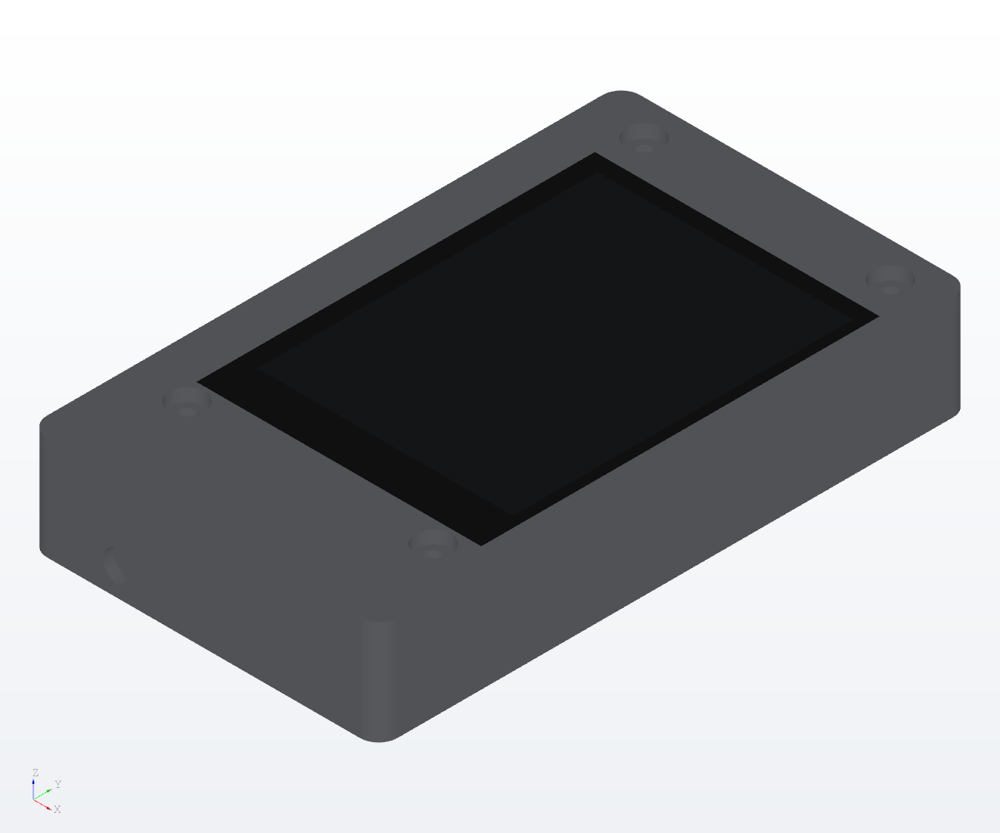
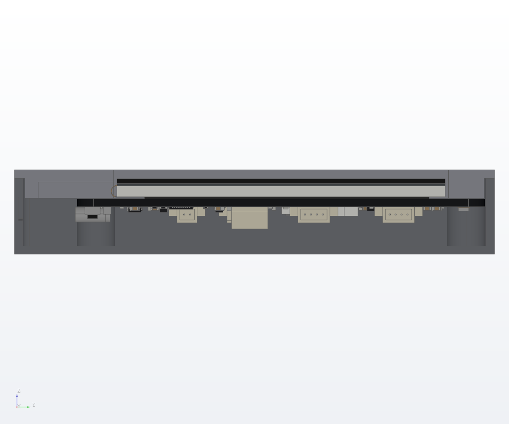
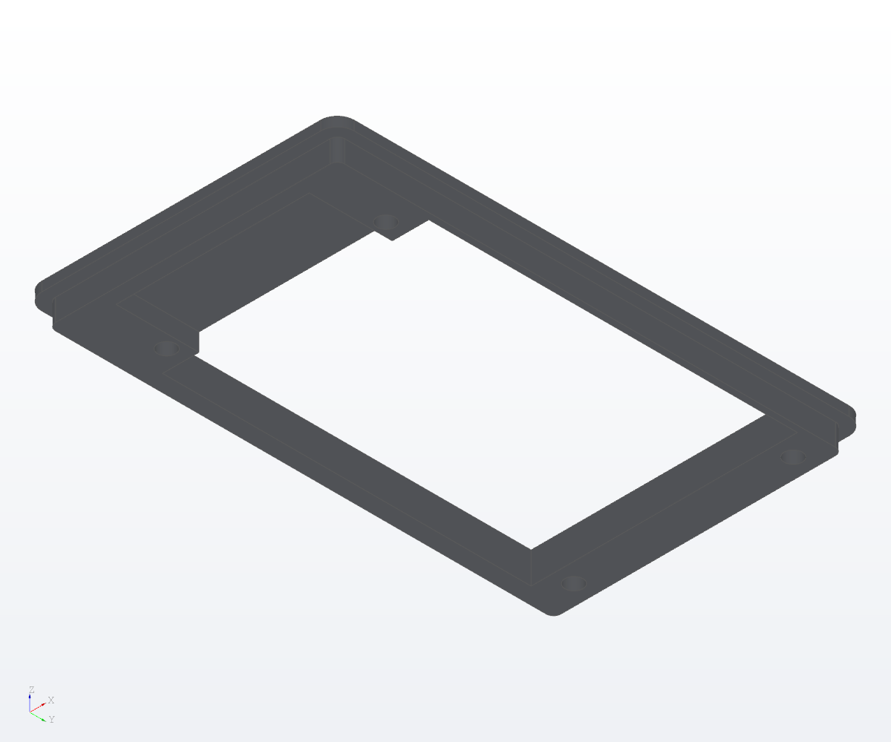
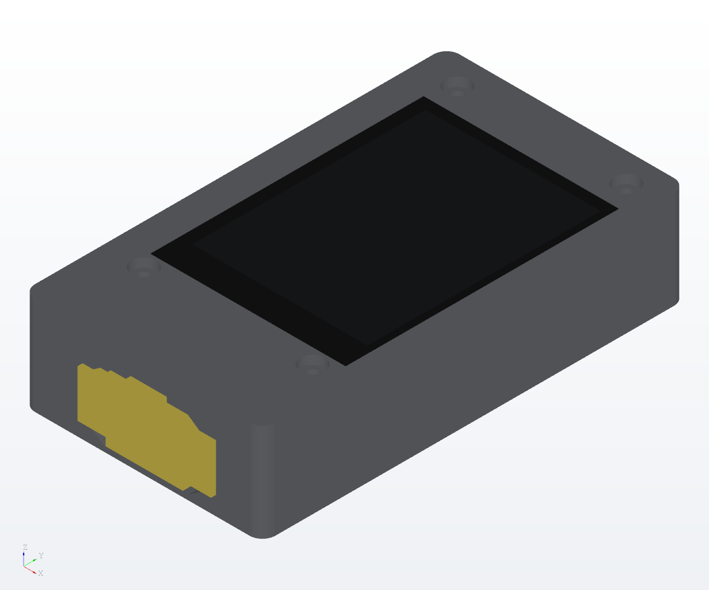
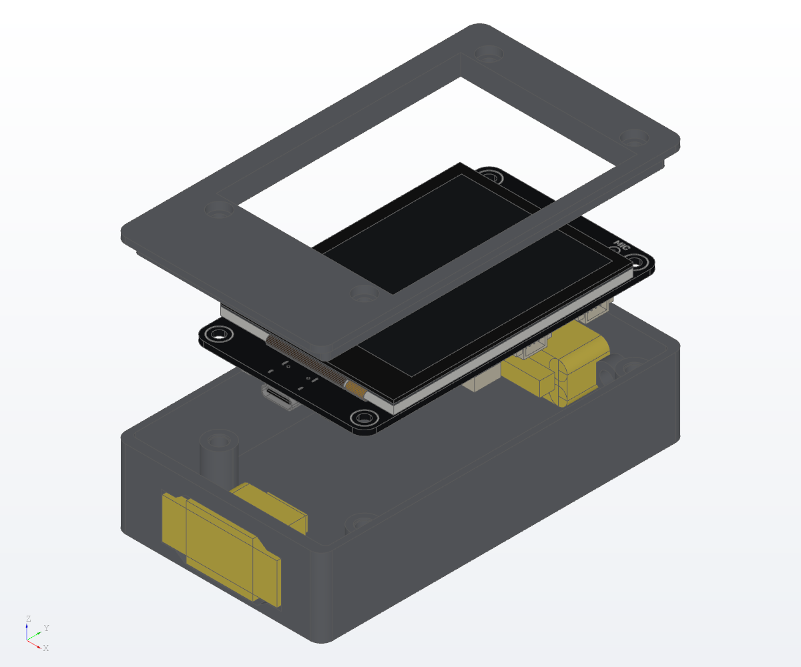
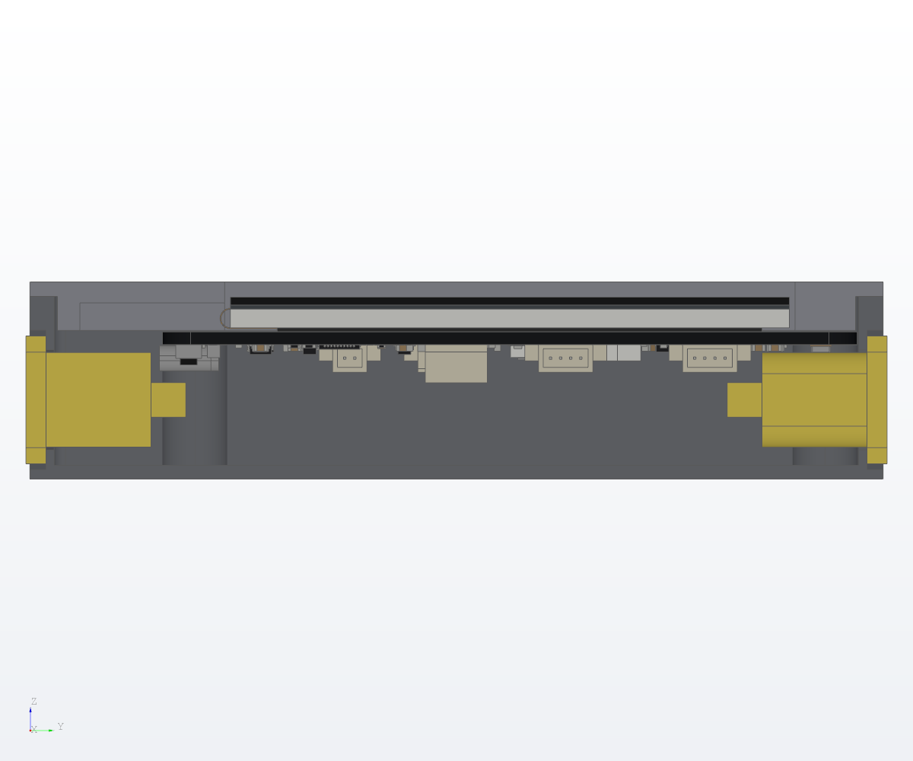
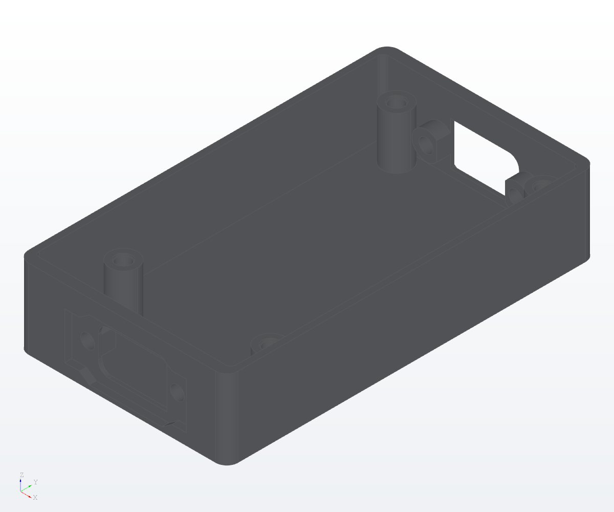
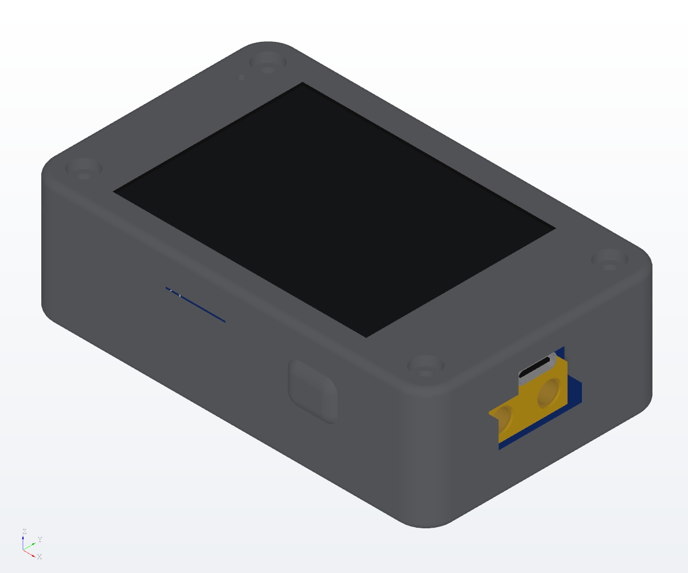
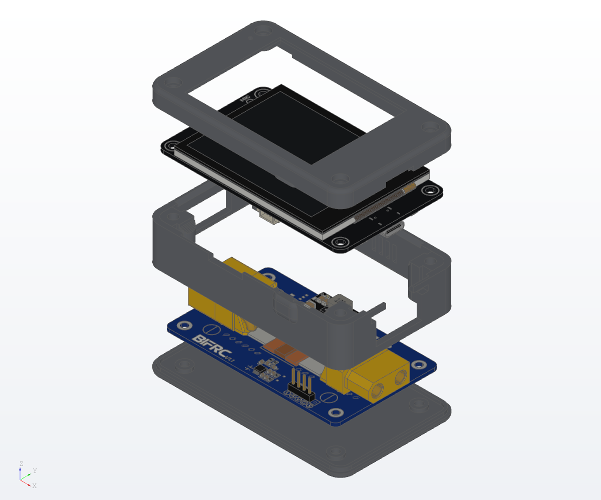
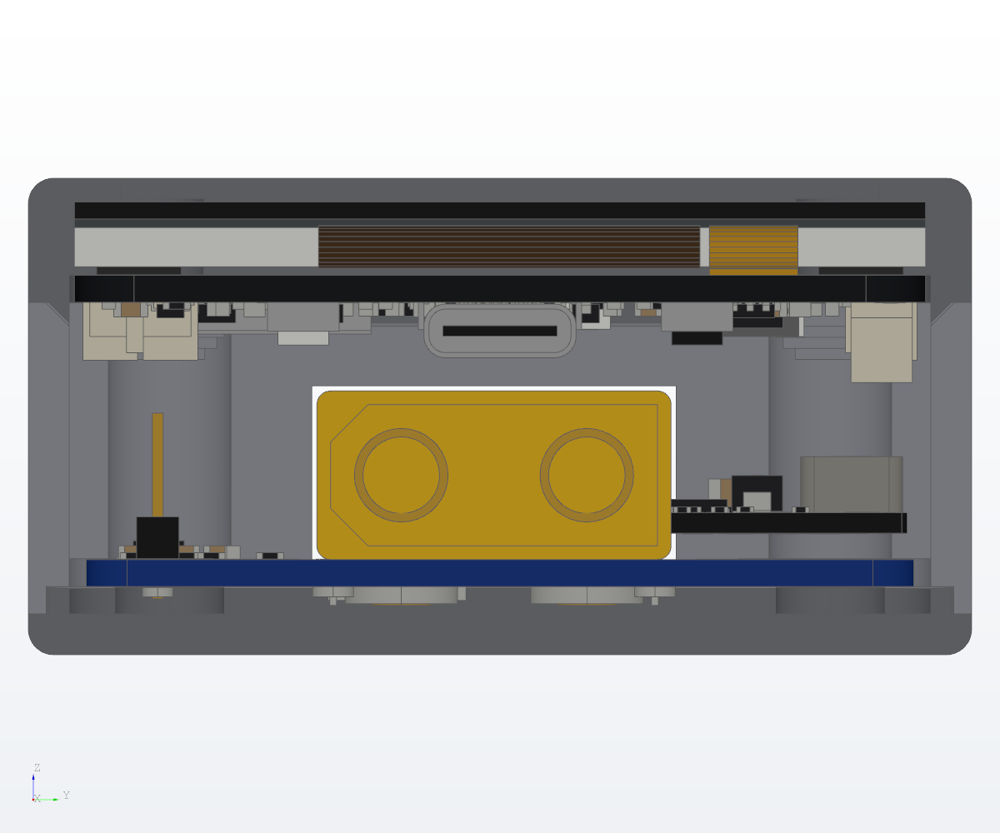

# Printed cases of the nodes

Three cases for nodes of [Nodes](../../docs/Nodes.md), built with OpenCASCADE
by the generators of [Mechanical parts](README.md). The STEP and STL files
are in `models/casing/`, the pictures in `renders/casing/`. All parts are
under the licence of [Mechanical parts](README.md#licence).

## Case of the display node, XT30

A printed case of 2 parts for the display node of
[Nodes](../../docs/Nodes.md#the-display-node), 59.8mm x 101.2mm x 17.8mm:
the display board lies on 4 bosses of the box, its display in the lid's
window. A current sensor board (MATEK I2C-INA-BM) and a 5V buck converter
lie on the floor under it. Each short wall has an opening for a
panel-mount XT30; a bay of 11.4mm beyond the board's end at the USB socket
holds an inline pair of XT30.



| | | |
| --- | --- | --- |
|  |  |  |

| File | Content | Print |
| --- | --- | --- |
| `display_node_box.step`, `.stl` | floor of 1.7mm, wall of 1.8mm, 16.0mm high; 4 bosses of 8.0mm with their tops 10.0mm over the underside, each with a blind hole of 4.0mm x 6.0mm and a relief of 4.6mm x 0.5mm; 2 XT30 openings of 11.2mm x 5.6mm with one round end; 2 recesses in the wall's inner face; a hole of 3.5mm in the floor; 19.1cm3 | underside down, no support |
| `display_node_lid.step`, `.stl` | front plate of 1.8mm with a window of 51.0mm x 70.6mm, a plug of 4.2mm into the box with 0.4mm of room all round, a recess over the flat cables' folds and the bay, 4 holes of 3.4mm with recesses of 6.0mm x 2.2mm for the heads; 9.4cm3 | front down, no support |

Assembly: 4 threaded inserts ruthex RX-M3Sx4.0 melted into the bosses, 4
screws M3 x 10 with pan heads through the lid and the board's holes. A
screw reaches 4.4mm into its boss.

The case follows a tester's printed case of the same node, measured from
its STL file, which is not in the repository: outline, heights, the
bosses' places, the window's ends, the recesses and the XT30 openings are
that case's, within 0.1mm. In nominal sizes the measured case closes: its
plug ends 0.18mm over the board, the display's parts clear the lid by
0.8mm or more and the plug clears the box by 0.33mm. A gap of about 1mm
between lid and box that the tester saw belongs to an earlier print, not
to the measured file (tester, 2026-11-22). 3 things differ here. Each
gives real parts room where the measured case has little, so that the lid
still closes on the rim:

| | Measured case | This case | What the room is for |
| --- | --- | --- | --- |
| Insert holes | 3.5mm, straight through boss and floor, no relief | 4.0mm, blind, 6.0mm deep, relief of 4.6mm x 0.5mm at the mouth | an insert or a burr standing 1.0mm out of a boss lifts board and lid by 0.8mm; the relief takes the plastic the insert pushes up |
| Window | 50.5mm wide, 0.08mm off the board's axis: 0.17mm at one side of a touch panel of 50.0mm +- 0.2mm | 51.0mm wide, centred on the board: 0.5mm at each side | the panel enters the window by 3.9mm; where it binds, the lid stops short |
| Head recesses | 4.5mm wide | 6.0mm wide, 2.2mm deep | a pan head M3 of 5.6mm sinks into the lid |

The inserts and screws the tester uses are not known. `stack()` gives the closed
case in numbers and `--check` fails when one falls under its limit:

| | Value, mm | Limit, mm |
| --- | --- | --- |
| plug's end over the board's front | 0.18 | 0.1 |
| room at each long side of the touch panel | 0.5 | 0.4 |
| touch panel's front under the lid's front | 1.88 | 0.5 |
| room over the flat cables' folds | 0.66 | 0.5 |
| free under the board's highest part, its speaker socket | 3.62 | 3.0 |

Limits:

- Printed once, by a tester, 2026-11-22: box and lid fit the node and go
  together without binding. The tester holds the buck converter with
  double-sided tape. No fit is measured.
- The 2 boards on the floor, the XT30 connectors and the wires are not
  drawn and their height is not measured. 3.6mm is free under the
  display board's speaker socket and 8.3mm under its flat parts; parts
  higher than that lift the board and open the lid.
- The USB socket, the microSD slot and the 2 buttons are not reachable
  with the lid on: the box has no opening for them, as the measured
  case has none.
- The floor's hole of 3.5mm at x 5.6mm, y -37.5mm holds the current
  sensor board: a screw goes through it and through the board's hole of
  3.0mm. In the tester's node one XT30 is soldered straight to that
  board, so the screw holds that connector too (tester, 2026-11-22). The
  hole lies 17.1mm beside the middle of the XT30 opening in the wall at
  -y. The board's hole lies 8.2mm to 16.2mm across from its wire pad
  ([KiCad library](../kicad/README.md), `ina228_matek.py`); with the
  XT30's plus contact 2.5mm off the connector's middle that is 14.6mm,
  inside that range. How far the XT30 reaches into the box is not
  measured: the hole's place along the box, 11.3mm inside the wall, is
  not checked.

```sh
python3 hardware/mechanical/_gen_display_case.py            # write STEP and STL
python3 hardware/mechanical/_gen_display_case.py --check    # CI
xvfb-run -a python3 hardware/mechanical/_gen_display_case.py \
    --render hardware/mechanical/renders
```

## Case of the display node, XT60

The same case with a seat for a panel-mount XT60 with a flange and 2
screws (XT60E) in each short wall, 59.8mm x 105.6mm x 24.4mm.



| | | |
| --- | --- | --- |
|  |  |  |

| File | Content | Print |
| --- | --- | --- |
| `display_node_xt60_box.step`, `.stl` | as `display_node_box`, 22.6mm high, bosses 16.6mm high, short walls of 3.0mm with one XT60 seat each; 25.8cm3 | underside down; the body's opening is a bridge of 19.6mm, and the 2 bosses behind each short wall hang 4.0mm out of it: support, or a slow bridge |
| `display_node_xt60_lid.step`, `.stl` | as `display_node_lid`, 105.6mm long; 10.1cm3 | front down, no support |

The connector, from its model in the owner's hardware repository
(`cad/XT60`), which is not in this repository: flange 33.2mm x 15.8mm x
2.5mm with ears 11.8mm high, body 18.8mm x 11.7mm ending 15.5mm behind the
flange's front, contacts to 19.8mm, 2 screw holes 25.6mm apart.

The seat is the one of the bench's front case in the same repository
(`cad/case_front`), measured from that part's mesh:

| | Size, mm |
| --- | --- |
| Wall at the seat | 3.0 |
| Recess from outside, in the flange's outline | 2.0 deep; 34.7 x 13.3 at the ears, 20.7 x 17.3 in the middle, slanted between; 0.75 of room round the flange |
| Flange over the wall's outer face | 0.5 |
| Opening for the body, through the 1.0 that is left | 19.6 x 12.4, 2 corners rounded with 3.0 |
| Insert holes | 4.0 wide, 25.6 apart, 5.0 deep: through the wall into bosses of 8.0 that stand 4.0 behind it |
| Notch for the strap of the plug's rubber lid | 10.2 wide, 2.5 past the recess, 2.0 deep |

Each connector takes 2 threaded inserts ruthex RX-M3Sx4.0, melted in from
outside, and 2 screws M3 x 6. The 2 seats are one turned by half a turn:
the body's rounded corners lie at -x in the wall at +y.

The front case has the notch under the recess. Here it is over it, towards
the lid, and the connector is turned by half a turn about its axis, so the
notch and the body's rounded corners lie to each other as in the front
case. Under the recess the notch would end 1.35mm below the box's
underside; over it, 1.65mm of wall is left up to the rim.

What differs from the XT30 case, and why:

- 24.4mm high in place of 17.8mm. The flange is 15.8mm high and its
  recess 17.3mm, more than the XT30 box's 16.0mm. The connectors' axis is
  9.8mm over the underside, the bodies lie under the display board, and
  the board's bosses are 16.6mm high: 0.97mm between a body and the
  board's back.
- 105.6mm long in place of 101.2mm: 1.2mm for each thicker short wall and
  2.0mm more at the USB socket's end, where the body ends 1.4mm before the
  board and the contacts reach 2.9mm under it, about 1.5mm under the
  USB socket.
- 10.2mm is free under the board's speaker socket in place of 3.6mm.
- The wall at the USB socket's end has no recess in its inner face.

Limits:

- No part is printed, and no XT60 is tried in the seat. The connector's
  sizes are a model's, not a caliper's.
- The floor has the hole for the current sensor board at the same place
  as the XT30 case. Here the connectors are screwed to the walls and the
  board hangs on its wires; the hole's place is not checked against them.
- The limits of the XT30 case hold here too: the boards on the floor are
  not drawn, USB socket, microSD slot and buttons are not reachable with
  the lid on.

## Case of the sensor node

A printed case of 3 parts round the
[layout](README.md#remote-ina228-sensor-node-layout) of the remote INA228
sensor node, 91.4mm x 55.4mm x 28.0mm, 56.7mm across the bulge behind
the I2C pocket. It
has no ears; the node hangs in its cable.
The bezel's top edge and the plate's bottom edge are rounded 1.5mm
all round.



| | | |
| --- | --- | --- |
|  |  |  |



| File | Content | Print |
| --- | --- | --- |
| `ina228_node_plate.step`, `.stl` | bottom plate, 2.4mm thick, with 4 stands of 6.4mm under the INA228 board's holes, each with a hole of 3.4mm and a recess of 6.0mm x 2.2mm for a screw's head; a lip of 1.2mm x 1.5mm all round inside the wall; 12.4cm3 | underside down, no support |
| `ina228_node_frame.step`, `.stl` | wall of 2.4mm from the plate to the display board's back, 18.3mm high, with 4 columns that stand on the INA228 board and carry the display board; its lower inner half cut away for the plate's lip, its upper inner edge cut off at 45 degrees between the columns; 14.4cm3 | upper face down, no support; the 2 XT90 openings are bridges of 21.4mm |
| `ina228_node_bezel.step`, `.stl` | rim round the display board, 7.3mm high, a plate of 1.2mm over the touch panel with the window, 4 posts on the display board's holes, 4 wedges of 1.2mm under the rim; 7.6cm3 | front down, no support |

Assembly, 8 screws M3 and 8 threaded inserts ruthex RX-M3Sx4.0:

1. Melt 2 inserts into each column of the frame, one from each end. The
   holes are 4.0mm wide and 6.0mm deep.
2. Put the INA228 module on the plate's stands, the frame over it. 4
   screws M3 x 8 with pan heads go from below through the plate and the
   board's holes into the columns' feet. The board is clamped between
   stands and columns.
3. Lay the display board on the columns, the bezel over it. 4 screws
   M3 x 10 go from above through the bezel's posts and the board's holes
   into the columns' tops.

The screws clamp the frame at its 4 columns only. Between the columns 2
joints hold its wall from moving inwards:

| Joint | Shape | Size, mm |
| --- | --- | --- |
| Plate to frame | a lip all round on the plate, inside the wall's lower edge; the wall's inner half is cut away for it | lip 1.2 thick, 1.5 high; 0.15 beside it, 0.1 over it; 1.05 of wall outside it |
| Frame to bezel | the wall's upper inner edge is cut off at 45 degrees; a wedge under the bezel's rim lies in the cut | wedge 1.2, cut 1.4: 0.14 between the faces; along the long walls for 60.0, along the short ones for 29.2 |

The wedges leave out the columns, the card's notch and the USB notch. A
wall pressed inwards at its upper edge bears on the wedge's slanted face;
the bezel's 4 screws hold against it. With the frame's upper face on the
bed the slanted cut prints without support; a step like the plate's lip
would hang there. Neither joint holds the wall from moving outwards.

Each column joins a hole of the INA228 board to a hole of the display
board; the two lie 4.2mm apart. Under the display board the column's
lobe at the INA228 hole steps back in 4 steps of 0.65mm, clear of chip
parts that hang 0.9mm down from that board.

| Opening | Where | Size, mm |
| --- | --- | --- |
| XT90, 2 | each end wall, round the housing | 21.4 x 10.5 |
| USB Type-C | end wall over the socket half's opening, through frame and bezel | 13.0 x 4.4 |
| RESET, BOOT | a slot under the USB notch | 26.6 x 2.6 |
| microSD | long wall at the header's side | 16.0 x 2.8 |
| I2C plug | pocket in the same long wall over the INA228 board's I2C header, under the display board; every inside edge and its edge in the wall's inner face rounded 2.0; the wall bulges out 1.3 behind it and keeps 1.2 | 10.16 wide, 2.5 deep, 8.0 high |
| Speaker | 4 slots in the other long wall | 1.6 x 7.0 each, 3.2 apart |
| Microphone | bezel, over the board's microphone hole | 1.6 round |
| Display | bezel, 0.5 round the view area | 59.1 x 44.6 |

Limits:

- RESET and BOOT are pressed from the display board's back, towards the
  display. They have no push rod: a tool of 2mm at most goes through the
  slot, 5.9mm in from the wall's outer face, and levers the plunger up.
- The USB socket's axis is 3.6mm over the top of the XT90 housing under
  it. A USB plug thicker than 7.0mm meets the plug in that housing.
- The speaker is not chosen and not drawn. The room behind its slots is
  18mm x 14mm x 10mm, beside the speaker socket.
- The converter has no seat in the case. A foam pad of 1.5mm on the
  INA228 board carries it; pad and wires are not drawn.
- The touch panel lies 0.2mm under the bezel's plate, which is 1.2mm
  thick: the panel's face is 1.4mm under the case's front.
- The case is printed once, without the 2 joints: its walls shift
  sideways (owner, 2026-11-22). The parts with the joints are not printed.
  The fits are drawn: 0.3mm round the
  display board, 1.0mm at the INA228 board's long sides.

`_gen_node_case.py` builds the parts from boxes, upright cylinders and
prisms over triangles
and checks them: each part is one valid solid, no two parts share
volume, and no part shares volume with one of the 1139 solids of
`ina228_node_layout.step`. The parts seat on the copper rings (0.05mm)
and the print (0.02mm) that the board models draw round their holes.

```sh
pip install cadquery-ocp==8.0.1.1.0
python3 hardware/mechanical/_gen_node_case.py            # write STEP and STL
python3 hardware/mechanical/_gen_node_case.py --check    # CI
xvfb-run -a python3 hardware/mechanical/_gen_node_case.py \
    --render hardware/mechanical/renders
```

