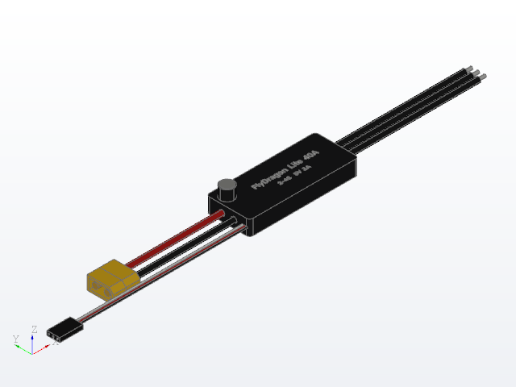
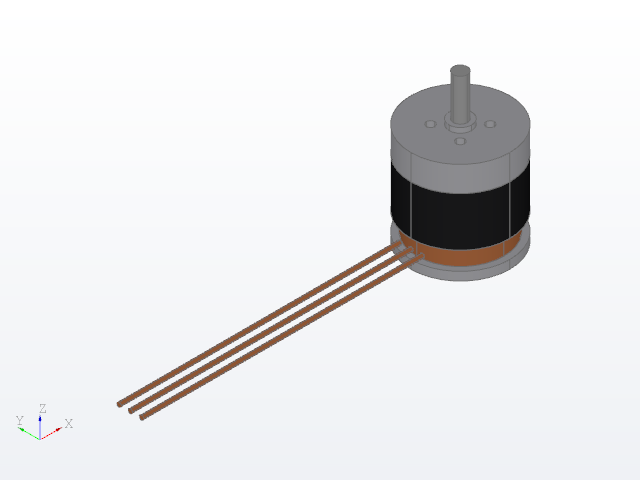
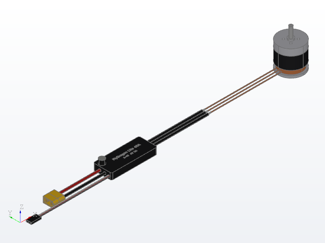
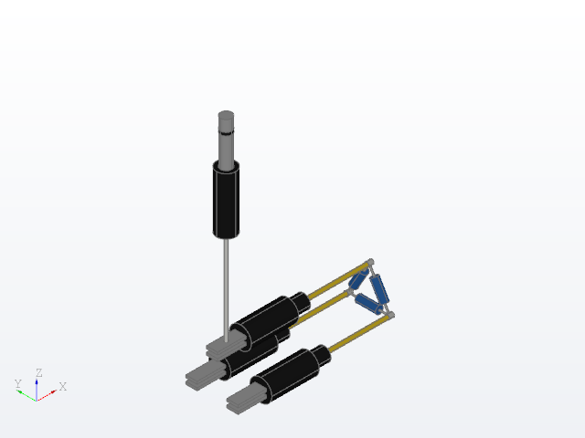

# ESC, motor and motor simulator

Models of the parts the phase tap works on
([Stick programming](../../docs/StickProgramming.md)), drawn by the specs
of [Mechanical parts](README.md). The STEP files are in `models/parts/`,
the pictures in `renders/parts/`. All are under the licence of
[Mechanical parts](README.md#licence).

## Flycolor FlyDragon Lite 40A and T-Motor AT2814

An electronic speed controller (ESC) and a brushless outrunner, each as a
part of its own, and the two joined lead to lead. The ESC is the one the
phase tap has counted beeps on
([Stick programming](../../docs/StickProgramming.md)). The motor stands
for the one such an ESC drives (owner, 2026-11-22); the repository names
no motor for those measurements.

| | | |
| --- | --- | --- |
|  |  |  |
| `flycolor_flydragon_lite_40a.step` | `tmotor_at2814.step` | `esc_motor_set.step` |

| File | Content | Over all, mm | Origin |
| --- | --- | --- | --- |
| `flycolor_flydragon_lite_40a.step` | black heat-shrink with white print, capacitor, 2 power leads (red, black) with a yellow XT60 plug (keyed housing, shroud, 2 gold pins), 3 black motor leads with tinned ends, signal lead (white, red, black) with a 3 pin plug; 44 solids | 263.0 x 26.85 x 15.5; the ESC alone 65.0 x 26.0 x 15.5 | the middle of the ESC's underside; x along it, power and signal leads leave at -x, motor leads at +x; red power lead at +y; z up |
| `tmotor_at2814.step` | bright base plate with 4 threads, copper windings, black can, bright front cap with 4 threads, collar, shaft, 3 copper leads, print "AT2814" on the mounting face; 15 solids | 135.2 x 35.2 x 54.5; the motor alone 35.2 across, 54.5 over the shaft | on the shaft's axis, on the base's mounting face; z along the shaft towards the propeller; leads leave towards -x |
| `esc_motor_set.step` | both, the motor moved by 234.1, 0.0, -1.75; 59 solids | 398.2 x 35.2 x 54.5 | the ESC's |

| Point | Frame | x, mm | y, mm | z, mm |
| --- | --- | --- | --- | --- |
| XT60's mating face, middle | ESC | -108.5 | 0.0 | 4.5 |
| Power leads | ESC | -92.5 to -32.5 | minus -3.6, plus +3.6 | 4.5 |
| Signal plug's contacts, end face | ESC | -146.5 | minus -12.54, plus -10.0, signal -7.46 | 4.5 |
| ESC motor leads: leave the ESC, middle, end | ESC | 32.5, 72.5, 116.5 | A -4.0, B 0.0, C +4.0 | 4.5 |
| Motor leads: leave the base, middle, end | motor | -17.6, -67.6, -117.6 | A -4.0, B 0.0, C +4.0 | 6.25 |
| Joints of the 3 leads in the set | ESC | 116.5 | A -4.0, B 0.0, C +4.0 | 4.5 |
| Phase tap, as a picture tags it: the joint of lead C | ESC | 116.5 | 4.0 | 4.5 |
| Motor's shaft end in the set | ESC | 234.1 | 0.0 | 50.75 |

| Dimension | Value | Source |
| --- | --- | --- |
| ESC over heat-shrink and capacitor | 65mm x 26mm x 15.5mm, 51g | the maker's user manual 251400-1100 V1.0, section 02 |
| ESC lead colours, capacitor, print | red and black power leads, 3 black motor leads with bare ends, white, red and black signal wires, black plug | a seller's product picture of the 40A |
| XT60 on the power leads | fitted | owner, 2026-11-22: the bench powers the ESC through an XT60; contacts 7.2mm apart from the owner's XT60 model |
| Motor | 35.2mm across, body 36mm, 54.5mm over the shaft, shaft 5.0mm with 15.5mm in front and 2mm behind, collar 1.75mm; 4 x M3 on a circle of 15mm in the cap; 4 x M3 at 19mm x 25mm in the base | the maker's 2D drawing "AT2814 V2.0" |
| Motor leads | enamelled wire, 100mm | the maker's page "AT2814 Long Shaft" |
| Motor colours | bright cap and base, black can, copper windings | the maker's product picture |

Limits:

- The ESC's leads have no maker's length, gauge or colour. 60mm of the
  power leads, 80mm of the motor leads and 100mm of the signal lead are
  drawn, straight; diameters are estimated from the picture.
- Signal lead: red is the middle wire. White as signal and black as minus
  follow the common use of such a lead; the maker's manual does not state
  them.
- How the ESC's 15.5mm splits between heat-shrink (9.0mm) and capacitor is
  read from a picture taken at an angle.
- The XT60 is the plug with pins: a housing of 15.7mm x 8.1mm x 16.0mm
  with 2 corners cut off by 2.5mm at the minus contact, a shroud 7.5mm
  deep with a wall of 1.2mm, and 2 pins of 3.5mm, 7.2mm apart. The pins'
  distance is the owner's XT60 model's; the other sizes are common values
  for this plug, not a maker's drawing. The pins have no slots.
- The motor's base cage and front cap are drawn without their openings.
  The base is its end plate alone, so the windings show as a copper ring.
  How the body's 36mm splits (base 9.5mm, can 17.5mm, cap 9.0mm) is read
  from the drawing within 0.5mm.
- In the set the leads meet end to end; the joint, solder or plugs, is not
  drawn. Which lead the bench taps is free; lead C is the one named.
- Not drawn: makers' signs, the ESC's "Lite" tag and board, bullet plugs,
  the motor's magnets, bearings, shaft flats, propeller adapter and cross
  mount. The prints are plain text.
- No dimension is verified on a part.

## Motor simulator

A stand-in for a brushless motor on the 3 motor leads of an ESC: 3
resistors of 600 ohm joined corner to corner, a yellow wire from each
corner to a black crocodile clip. The resistors form a delta, so any 2
clips see 600 ohm in parallel with 1200 ohm: 400 ohm. With it the ESC and
the phase tap are tried with no motor on the bench (owner, 2026-11-22).
The phase tap's lead is connected to one of the 3 clips and ends in a
3.5mm mono headphone plug; the model draws it as a white wire standing on
the clip of corner C, with the plug on its end.

| File | Content | Over all, mm | Origin |
| --- | --- | --- | --- |
| `motor_simulator.step` | 3 blue resistors with their leads, solder at the 3 corners, 3 yellow wires, 3 clips with black boots and steel jaws, the phase tap's lead on one clip with its 3.5mm mono plug; 32 solids | 51.05 x 20.0 x 78.06; 18.26 high without the tap's lead | the middle of the triangle's lower side; the triangle stands in the y-z plane, corner A at -y, B at +y, C on top; the wires run towards -x |

| Point | x, mm | y, mm | z, mm |
| --- | --- | --- | --- |
| Corners A, B, C | 0.0 | -6.5, +6.5, 0.0 | 0.0, 0.0, 11.26 |
| Wires: start, middle, end | -0.8, -10.8, -20.8 | as the corners | as the corners |
| Clips' tips | -49.8 | as the corners | as the corners |
| Phase tap's lead on the clip of C: meets the clip, middle, end | -45.3 | 0.0 | 12.56, 27.56, 42.56 |
| Mono plug: handle, shaft, end of the tip | -45.3 | 0.0 | 42.56 to 60.56, 60.56 to 74.56, 74.56 |

Limits:

- The only sources are the owner's word (motor stand-in, 600 ohm each, the
  build with black clips) and one owner photo taken at an angle with no
  scale, which is not in the repository. Every size is estimated by eye
  from the size of a common 0.6W resistor body, 6.5mm x 2.5mm.
- The built part's wires are bent together; the model draws the triangle
  standing across 3 straight wires, 13.0mm apart.
- The resistors' rating and the voltage the simulator bears are not
  stated. At 16.8V, 4 cells full, 400 ohm draw 42mA and each resistor
  across 2 driven leads dissipates 0.47W.
- The phase tap's lead is on one clip and ends in a 3.5mm mono headphone
  plug (owner, 2026-11-22). Which clip is free: the 3 carry the same
  beeps. How the lead is fastened, its colour, diameter and length, and
  which of the plug's 2 contacts carries the tap are not stated; drawn
  white, 1.2mm across, 30mm, straight up from the upper jaw.
- The plug's shaft is 3.5mm across and 14.0mm long, as such plugs are; its
  tip, the ring between tip and sleeve and its handle of 6.0mm x 18.0mm
  are estimated. The tip is a plain cylinder.
- A second build with orange clips and 6 resistors exists; it is not
  drawn.
- Not drawn: the resistors' colour bands, the clips' teeth, spring and
  hinge.

