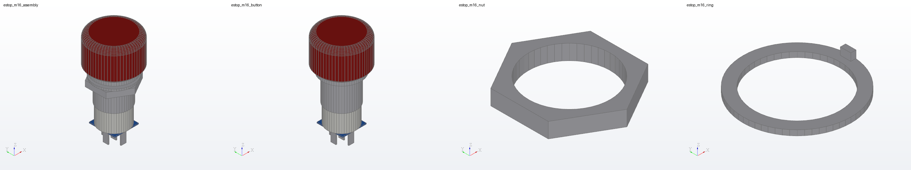

# Mechanical parts

STEP (ISO 10303-21, AP214 automotive design schema) models of the bought
mechanical parts of the bench, for the enclosure and panel design. Units
are mm. Each part has a spec in this directory; `gen_models.py` writes the
models from the specs with `hardware/kicad/tools/step_gen.py`.

| Path | Content |
| --- | --- |
| `estop_m16.py` | spec of the M16 emergency stop button: dimensions, sources, estimates |
| `gen_models.py` | writes `models/` from the specs; `--check` fails on drift |
| `models/` | the generated STEP files |
| `renders/` | OpenCASCADE renders of the models and the contact sheet `all.png` |

```sh
python3 hardware/mechanical/gen_models.py          # write
python3 hardware/mechanical/gen_models.py --check  # CI: exit 1 on drift
pip install cadquery-ocp==8.0.1.1.0 pillow
python3 hardware/kicad/tools/step_check.py         # also checks models/
xvfb-run -a python3 hardware/kicad/tools/step_render.py \
    hardware/mechanical/renders --size 640 480 \
    --step hardware/mechanical/models/*.step
```

## Emergency stop button, M16

A latching mushroom button released by turning: red head 24.9mm across,
M16 x 1 thread, hex nut, anti-rotation ring with a tab, 5 tabs 2.8 x 0.5mm
(C, NO, NC, lamp + and -). Overall length 50.1mm.

| File | Content | Origin |
| --- | --- | --- |
| `estop_m16_button.step` | button without nut and ring | z = 0 on the panel's front face, where the bezel seats; head to +z |
| `estop_m16_nut.step` | hex nut, 19.6mm across flats, 3.0mm | z = 0 on the face towards the panel |
| `estop_m16_ring.step` | anti-rotation ring, 20.4mm across, bore 16.2mm, 1.0mm, tab 1.4mm tall | z = 0 on the face towards the panel; the tab stands towards it |
| `estop_m16_assembly.step` | all three for a 1.4mm panel | as the button |

Dimensions from the seller's drawing: head 24.9mm with a 19.6mm front face
and 15.7mm long, bezel 2.7mm long, nut front face 29.3mm from the tab
ends, 12mm of thread behind the nut, tabs 7mm long, a square shim 12.8mm
wide in front of the tabs, M16 x 1, overall 50.1mm. The 20.4mm and 19.6mm
figures of the side view are read as the bezel diameter and the nut across
flats.

Estimated, not on the drawing: the head's front edge radius (2.65mm), the
shim thickness (0.5mm), the bezel chamfer, nut and ring thickness, ring
bore and tab, switch body diameter (15.0mm) and the tab positions. The
spec lists each. The thread is a plain 16.0mm cylinder; the tab holes and
the head print are not modelled. The maker and part number are not known.


