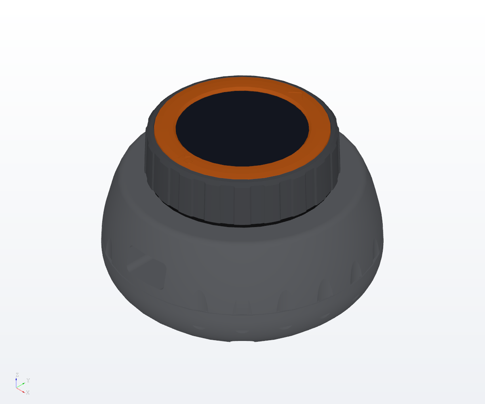
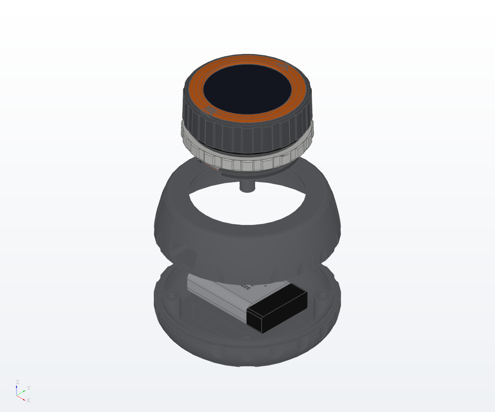
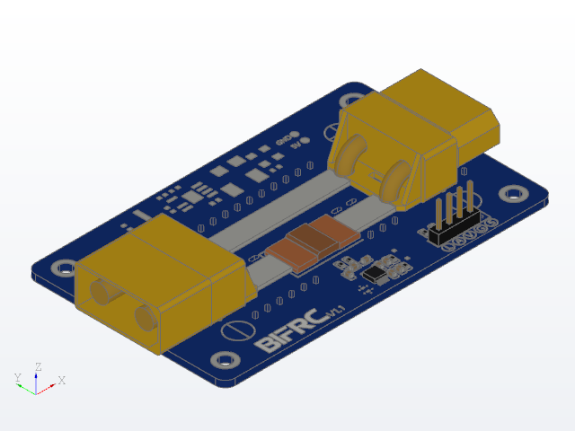
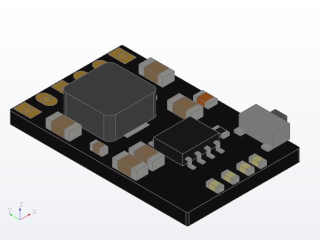
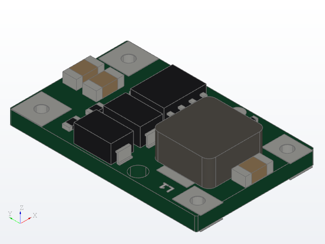
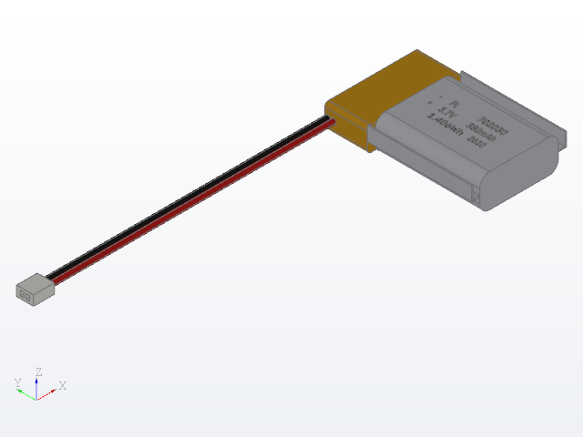
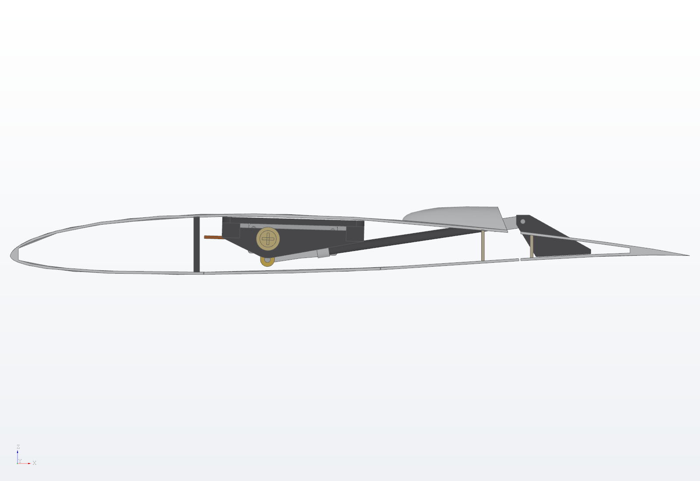
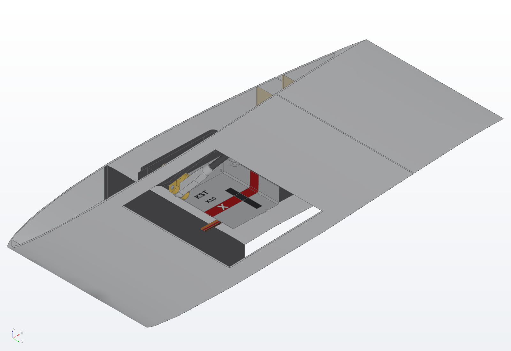
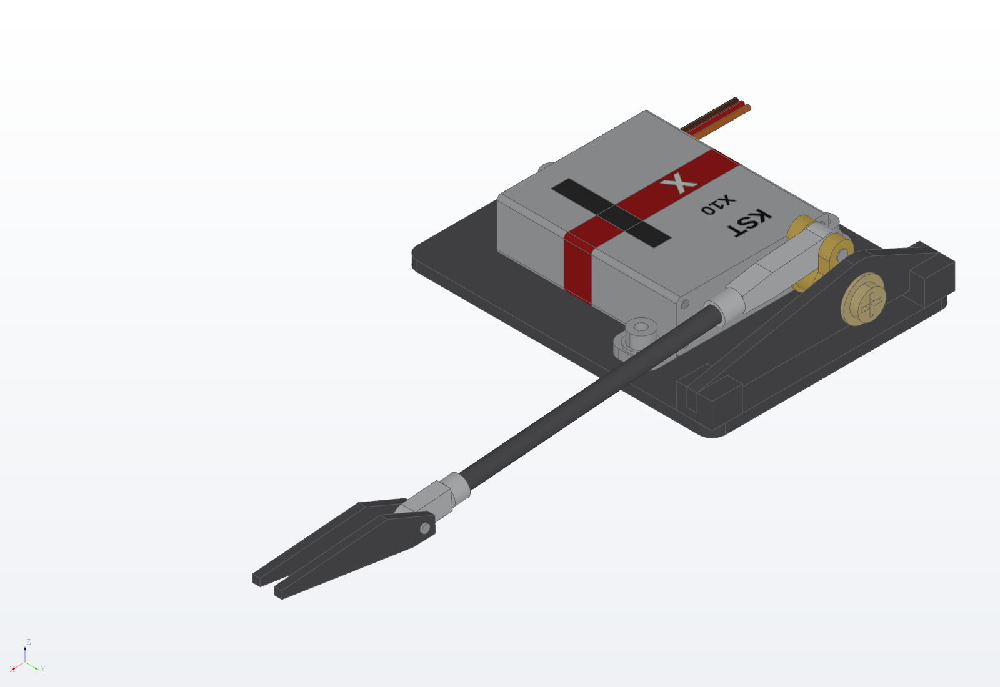

# Mechanical parts

STEP (ISO 10303-21, AP214 automotive design schema) models of the bench's
purchased mechanical parts, for designing the enclosure and panel. Units
are mm. Each part has a spec in this directory; `gen_models.py` writes the
models from the specs with `hardware/kicad/tools/step_gen.py`.

| Path | Content |
| --- | --- |
| `estop_m16.py` | spec of the M16 emergency stop button: dimensions, sources, estimates |
| `m5dial.py` | spec of the M5Stack Dial: dimensions, sources, estimates |
| `_gen_dial_base.py` | builds the two parts of a hand-held base for the M5Stack Dial with OpenCASCADE, checks their fit round dial, nut and cell, writes STEP and STL |
| `panel_7b.py` | spec of the panel board, the Waveshare ESP32-P4-WIFI6-Touch-LCD-7B: dimensions, sources, estimates |
| `ina228_xt90.py` | spec of the INA228 current sensor module with 2 XT90PW connectors and of its case: dimensions, sources, estimates |
| `ina219_cjmcu219.py` | spec of the INA219 current sensor board, print CJMCU |
| `lipo_charger_boost_5v.py` | spec of the lithium polymer charger board with 5V boost output |
| `boost_5v_en.py` | spec of the 5V boost converter board with enable pad |
| `esp32_c6_zero.py` | spec of the Waveshare ESP32-C6-Zero |
| `lipo_cells.py` | spec of two lithium polymer cells, 702030 and 102540, with wires and plug |
| `kst_x10.py` | spec of the KST X10 wing servo, from a dimension drawing and photos |
| `_gen_flap_drive.py` | builds a frame with counter bearing for the KST X10, its linkage and a slice of wing with a flap with OpenCASCADE, checks that no two solids share volume |
| `_rg15.py` | coordinates of the RG-15 airfoil |
| `servo_standard.py` | spec of a standard size servo with a round horn, from a dimensioned sketch |
| `_board.py` | a module's board for the specs: the plate, and parts placed by their position from the board's center |
| `_font.py` | outlines of the letters of board print, written by `_gen_font.py` from OpenCV's single-stroke font |
| `_photo_grid.py` | measures a board from a photo on squared paper: grid fit, camera height, the INA228 module's photos laid onto the board frame |
| `_trace_ina228_print.py` | traces the INA228 module's printed legends from the top photo into `_ina228_print.py` |
| `_panel_7b_data.py` | the place and size of the panel board's parts, written by `_measure_step.py` |
| `_measure_step.py` | measures Waveshare's STEP file of the panel board with OpenCASCADE |
| `_solid.py` | profiles of straight sides and arcs pushed along an axis, and round rods along a path of lines and arcs, turned and moved, as solids with flat, cylindrical and toroidal faces |
| `_parts.py` | shapes of electronic parts: chip parts, leaded packages, wire sockets, USB sockets, card slot, buttons, pin header, shunt, both halves of the XT90PW |
| `check_overlap.py` | fails when two solids share volume in the panel board's model, in the INA228 module with its case, in one of the 4 module boards, in a cell, in the standard servo or in the KST X10 |
| `check_panel_7b.py` | holds the panel board's model against Waveshare's STEP file |
| `gen_models.py` | writes `models/` from the specs; `--check` fails on drift |
| `_stl.py` | reads a binary STL and splits it into its closed parts |
| `_refit.py` | fits planes, cylinders, cones, tori and a thread's surfaces to a mesh part |
| `_surface.py`, `_segment.py` | the surfaces and their fits, and the faces grown on them, for `_refit.py` |
| `check_refit.py` | holds the dial's solids, read back with OpenCASCADE, against the mesh |
| `models/` | the generated STEP files |
| `renders/` | OpenCASCADE renders of the models and the contact sheet `all.png` |
| `vendor/` | third-party meshes, unchanged, each with its licence |

```sh
python3 hardware/mechanical/gen_models.py          # write
python3 hardware/mechanical/gen_models.py --check  # CI: exit 1 on drift
pip install cadquery-ocp==8.0.1.1.0 pillow
python3 hardware/kicad/tools/step_check.py         # also checks models/
python3 hardware/mechanical/check_refit.py         # needs numpy; 2 minutes
python3 hardware/mechanical/check_overlap.py       # 1 minute
python3 hardware/mechanical/_gen_dial_base.py --check   # 1 minute
python3 hardware/mechanical/_gen_flap_drive.py --check  # 10 seconds
xvfb-run -a python3 hardware/kicad/tools/step_render.py \
    hardware/mechanical/renders --size 640 480 \
    --step hardware/mechanical/models/*.step
```

## Emergency stop button, M16

A latching mushroom button with a twist release: red head 24.9mm across,
M16 x 1 thread, hex nut, square anti-rotation shim with a bent tab, 5 tabs
2.8 x 0.5mm (C, NO, NC, lamp + and -). Overall length 50.1mm.

| File | Content | Origin |
| --- | --- | --- |
| `estop_m16_button.step` | button without nut and shim | z = 0 on the panel's front face, where the bezel seats; head to +z |
| `estop_m16_nut.step` | hex nut, 19.0mm across flats, 3.0mm | z = 0 on the face towards the panel |
| `estop_m16_shim.step` | square anti-rotation shim, 20.4mm side, bore 16.2mm, 0.8mm, tab 1.4mm tall | z = 0 on the face towards the panel; the tab stands towards it |
| `estop_m16_assembly.step` | all three on a 1.6mm panel | as the button |

Dimensions from the seller's drawing: head 24.9mm with a 19.6mm front face
and 15.7mm long, bezel 2.7mm long, nut front face 29.3mm from the tab
ends, 12mm of thread behind the nut, tabs 7mm long, M16 x 1, overall
50.1mm. The side view's 20.4mm dimension is interpreted as the side of the shim, shown in the rear
view as the square around the nut. Its 19.6mm dimension is interpreted as the bezel
diameter. The rear view's 12.8mm and 13.8mm are not assigned to a part.

The following dimensions are estimated because they are absent from the drawing: the head's front edge radius (2.65mm), the
bezel chamfer, nut across flats and thickness, shim thickness, bore and
tab, switch body diameter (15.0mm) and the tab positions. The spec identifies
each estimate. The thread is represented by a plain 16.0mm cylinder; the tab holes and the head
print are not modelled. The maker and part number are not known.

## M5Stack Dial

A panel-mount rotary encoder with a round 1.28in display, M5Stack SKU
(stock keeping unit) K130: 51.0mm across, 32.3mm long, 46.3g. It mounts in
a 45mm +/- 0.2mm hole in a panel 0 to 6mm thick and is held by a ring nut on
a thread 44.0mm across with a 2.6mm pitch.

| File | Content | Origin |
| --- | --- | --- |
| `m5dial.step` | dial without the nut, 37 solids, 4.4MB | z = 0 on the panel's front face, where the ring on the body's flange seats; knob to +z; the `^` mark at +y |
| `m5dial_nut.step` | ring nut, 50.82mm across, 5.0mm, 20 notches, 0.6MB | z = 0 on the face towards the panel |
| `vendor/m5stack_dial/Dial.stl` | M5Stack's mesh of the plastic parts, 2.9MB | M5Stack's; the bezel's front face at z = -17.32mm, the knob to -z |

No assembly file is written. The nut's place on a panel of thickness t is
its file moved to z = -t.

The 9 plastic parts are M5Stack's geometry: bezel with the `^` and `M5`
marks, knob with 20 grooves, carrier, ring under the bezel's clips, body
with the thread and the `A`, `B`, `+` and `-` marks, ring on the body's
flange, nut, Stamp-S3 and its cover. `Dial.stl` holds them as 29240
triangles, chords of the surfaces M5Stack designed. `m5dial.py` fits the
surfaces again with `_refit.py` and writes 3929 faces on them:

| Part | Triangles | Faces | Planes | of them one triangle | Cylinders | Cones | Tori | Thread surfaces |
| --- | ---: | ---: | ---: | ---: | ---: | ---: | ---: | ---: |
| bezel | 3016 | 650 | 588 | 412 | 9 | 47 | 6 | 0 |
| knob | 5256 | 478 | 333 | 120 | 4 | 120 | 21 | 0 |
| carrier | 2592 | 261 | 178 | 23 | 9 | 74 | 0 | 0 |
| ring under the bezel | 1456 | 97 | 69 | 4 | 5 | 21 | 2 | 0 |
| body | 9970 | 1257 | 1043 | 503 | 59 | 88 | 2 | 65 |
| ring on the flange | 328 | 4 | 2 | 0 | 2 | 0 | 0 | 0 |
| nut | 2690 | 545 | 466 | 354 | 0 | 72 | 0 | 7 |
| Stamp-S3 | 3176 | 456 | 395 | 90 | 56 | 5 | 0 | 0 |
| cover | 756 | 181 | 163 | 80 | 0 | 18 | 0 | 0 |

Cylinders, cones and tori are STEP's own surfaces with an axis and radii;
most walls are cones because the parts have draft. The thread's flanks and
its rounded corners (radius 0.2mm) are B-spline surfaces along the helix,
cut every 120 degrees; a helix follows its curve within 0.02um. Edges are
lines, circles, helices and, for 80 edges, polylines through the mesh's
vertices. By area 51.4% of the 29310mm2 is on curved surfaces and 48.6% on
planes.

A face of one triangle is a triangle no surface took with its neighbours:
the `^` and `M5` marks, the thread's two ends, blends between rounded
corners, the knob's groove walls. These 1586 faces are flat as in the mesh.

The fit works within these limits, and the models have them:

- The mesh's vertices lie within 0.0006mm of the fitted surfaces. The
  mesh's triangles do not: a chord is up to 0.085mm inside its arc, 0.13mm
  in the thread. The models follow the surfaces, so a model is up to
  0.124mm from the mesh.
- A flat face whose corners lie on a round surface cannot be told from one
  chord of it. A face with a single flat step stays a plane, as the floors
  of the knob's 20 grooves do.
- An axis is found along x, y or z of the part. A cylinder or cone about
  another direction stays flat faces.
- OpenCASCADE reads every solid as valid and closed. Its volume from the
  surfaces (`BRepGProp`) is 6.2% high for the bezel and 1.5% for the nut;
  its volume from the mesh it makes of the same solid is within 0.7% of
  `Dial.stl` for every part. Which faces cause this is not known.
- The mesh's axis is 0.0019mm off its own z axis; the models have the axis
  on z.

`check_refit.py` measures the first and the last point for every part and
fails beyond 0.15mm or 1% of volume.

Positions in the model frame, seen from the front:

| Part | Position |
| --- | --- |
| Bezel front face | z = 14.62mm |
| Body rear face | z = -14.2mm |
| Cover over the Stamp-S3 | z = -15.7mm |
| Heads of the 2 M2 cover screws | z = -17.7mm, x = -12mm and 12mm |
| Power terminal, 2 pins, 2.54mm | +y; cut-out 7.8 x 9.03mm, 10.15 to 19.18mm from the axis |
| PORT.A (HY2.0-4P, red) | -x; cut-out 5.2 x 10.2mm, 14.5 to 19.7mm from the axis |
| PORT.B (HY2.0-4P, black) | +x; the mirror of PORT.A |
| USB-C | -y; the shell's opening 18.45mm from the axis, its center at z = -12.13mm |
| Notch of the body around USB-C | from z = -7.2mm to the rear face |

The mesh agrees with M5Stack's drawing: 14.62mm against 14.6mm from the
front face to the panel seat, 28.82mm against 28.8mm to the body's rear
face, 50.82mm against 51mm across, 24.0mm between the cover screws, and
32.32mm against 32.3mm overall with screw heads 2.0mm tall.

`Dial.stl` lacks the display, the boards, the connectors and the screws.
`m5dial.py` adds them from these sources:

| Part | Source | Estimated |
| --- | --- | --- |
| Power terminal header, KF2EDGV-2.54-2P, 6.88 x 8.1 x 10.1mm | Cixi Kefa's drawing | sockets 2.2mm across and 7.0mm deep, pins 1.0mm square |
| PORT.A and PORT.B, HY2.0-4P vertical, 10.0 x 5.1mm, pins 0.5mm square at 2.0mm | Xunpu's drawing of WAFER-HY2.0-4PZZ | height (top 0.3mm below the rear face; the drawing's part is 8.0mm tall and would end 2.5mm below it), cavity depth 5.0mm; key slots not modelled |
| USB-C receptacle, shell 8.94 x 3.25 x 7.3mm, 1.95mm past the Stamp-S3's edge | M5Stack's `Stamp-S3.step` | shell walls 0.3mm; contacts not modelled |
| 2 M2 socket head screws, heads 3.8 x 2.0mm, hex socket 1.5mm | ISO 4762; the M2 hex key in the box; the drawing's 32.3mm | the screw type; heads only |
| Display lens, 38.0 x 0.68mm | the bezel's pocket in the mesh | the lens's own size is not known |
| Display module, 35.6mm across, 3.02mm | outline of a generic 1.28in GC9A01 module; the carrier's floor in the mesh | M5Stack's module is not published |
| Main board, 40.8mm across, 1.0mm, rear side at z = -3.7mm | the body's ledge with 3 screw bosses and the posts of the ring under the bezel, in the mesh | outline, holes and parts are not known |

The encoder, the springs, the battery connector, the buzzer, the headers
between the Stamp-S3 and the main board and the print on the Stamp-S3 are
not modelled: no geometry of them is published. The colours come from
M5Stack's product photos; the colours of the carrier and of the 2 rings are
assumed. The photos show the `^` and `M5` marks on the orange bezel and the
grey shoulder of the knob outside it, as the mesh has them. No dimension is
verified with a caliper on a part.

The nut covers the front of the body's USB-C notch on a panel thicker than
2.2mm, by the mesh's dimensions (notch 7.2mm behind the panel's front face,
nut 5.0mm). This is not checked on a part.

`Dial.stl` is a copy of `Products/K130_Dial/Structures/Dial.stl` from
[m5stack/M5_Hardware](https://github.com/m5stack/M5_Hardware), commit
`f66b64a1ee5502887d28921f654b24b3b36e9721`, MIT licence
(`vendor/m5stack_dial/LICENSE`), SHA-256
`8032668cd4d31b9dc5b7ce7f900eb0cb0cc96863ff32fe4ddfeb36761db44fcc`. It is a
binary STL of 58480 triangles in mm. It holds each part twice: assembled
about the z axis, and set apart at x from -568mm to -37mm. A viewer that
fits the whole file shows the assembled dial small. The 2 STEP files hold
M5Stack's geometry and are under the same licence.


## Hand-held base for the M5Stack Dial

A printed base in two parts that turns the dial into a hand-held
controller. The dial sits flat on top, face up; the 1000mAh lithium
polymer cell 102540 lies in the bottom part. One hand holds the base
while the other turns the knob.



| | |
| --- | --- |
|  |  |

| File | Content | Print |
| --- | --- | --- |
| `dial_base_top.step`, `.stl` | the dial's seat: top plate with the 45.2mm hole, wall, 4 screw bosses, USB opening with its guide tube; 13.9cm3 | top face down, no support |
| `dial_base_bottom.step`, `.stl` | floor with the cell's pocket, centring rim, 4 screw columns; 15.6cm3 | foot down, no support |

Both files are in the dial's frame: z = 0 is the top plate's upper face,
where the dial's flange seats, the knob points to +z, the `^` mark is at
+y and the USB socket at -y. Loaded with `m5dial.step` they give the
assembly; the nut's file moves to z = -2.0mm.

The shape is a body of revolution about the dial's axis:

| | mm |
| --- | --- |
| Overall | 72.0 across, 32.5 high; with the dial 47.1 high |
| Top | flat, 60 across, its edge rounded 2.0 into the side |
| Side | one arc of radius 49.5 from the top to the belly, 72.0 across, 21.0 below the top |
| Underside | rounded on a radius of 11.5 for 50 degrees, then a cone of that slope to a flat foot 57 across |
| Flutes | 18, each 5.6 wide and 0.7 deep at the belly, 18 degrees apart, fading out 8.3 above and 4.0 below it; none within 14 degrees of the USB opening |
| Wall | 2.4; 1.7 under a flute |
| Joint | level, 19.0 below the top, with a shadow gap 0.4 wide and deep; the bottom part's rim, 2.0 high and 1.0 thick, stands 0.2 inside the top part's wall, on a ledge that fills the wall in below the joint for 1.5 and ends in a 45 degree slope |

The underside is the part the palm holds. The flutes keep the base from
turning in the hand while the knob turns; the knob has 20 grooves at the
same pitch of 18 degrees.

For scale, two things made to be held or turned in one hand: Microsoft's
Surface Dial is 59mm across and 30mm high (Microsoft's specification), an
ice hockey puck 76.2mm across and 25.4mm high. The base lies between them
in width, 72.0mm, and is 32.5mm high. The dial weighs 46.3g and the two
parts, printed solid in PLA at 1.24g/cm3, 37g; the cell's weight is not
measured.

| Feature | mm |
| --- | --- |
| Dial's hole | 45.2 in a plate 2.0 thick; the dial takes 45.0 +/- 0.2 and a panel of 0 to 6 |
| Room for the ring nut | 4.2 between the nut, 50.82 across, and the wall; 0.6 to each boss |
| Room under the dial | the dial's screw heads end 17.7 below the top; the cell's top is 20.1 below it |
| USB opening | 13.4 x 7.6 with corners rounded 1.5 at -y, center 12.13 below the top, on the dial's USB socket, whose opening lies 18.45 from the axis |
| Guide tube | the opening runs on as a tube with a wall of 1.0 from the outer wall in to 24.5 from the axis, 10.7 long and 6.05 short of the socket, 2.5 off the dial's thread; beyond 26.5 from the axis a block ties it to the top plate; its top is 0.33 under the ring nut |
| Cell pocket | 42.9 x 26.0 between 4 rails 1.4 thick and 6.0 high, open at the 4 corners: 1.2 free at each end of the cell and 0.5 at each side; the cell's length lies across the `^` mark, its wires towards +y, the side away from the USB opening |
| Foam pad | 2 thick, about 20 x 30, between the cell and the dial, in the 2.4 between them; it holds the cell and leaves it room to swell |
| Screws | 4 x M3 x 12, pan head, on a circle of 58.0 at 45 degrees to the axes; clearance holes 3.4, heads sunk 8.0 into the foot in recesses of 6.2; pilot holes 2.6 in bosses of 6.0, 6.5 of thread |

The dial's battery socket, 1.25mm pitch with 2 pins, is on its main board
under the Stamp-S3, at the USB end (M5Stack's picture "Dial Lithium
Battery Expansion Interface"). The cell's plug has that size in the
photo. The wires run under the Stamp-S3 and leave the dial at its +y
end, the end away from the USB socket, so a USB plug cannot pinch them;
from there they drop to the cell.

Assembly: take the Stamp-S3 off the dial (2 M2 screws), plug the cell in,
lead the wires out at the end away from the USB socket and put the
Stamp-S3 back. Put
the dial through the top part and turn the ring nut on from below with
the USB socket in line with the opening. Lay the cell in its pocket with
the foam pad on it, close the base and drive the 4 screws.

`_gen_dial_base.py` builds both parts with OpenCASCADE: every face is a
plane, a cylinder, a cone or a piece of a torus. Its `--check` runs in CI
and fails when a file differs from the script, when a part is not a valid
solid, or when a part shares volume with the dial, the nut or the cell.

Limits:

- No part is printed yet, so no fit is tried and the base has not been
  held in a hand: the 0.2mm gap of the rim and the 2.6mm pilot holes are
  design values for a 0.4mm nozzle.
- The battery socket's place is read from M5Stack's picture, not
  measured, and the socket is not in the dial's model. The passage for
  the wires under the Stamp-S3 and out at its +y end is not in the model
  either and is not tried on a dial. Which of its pins
  is plus is not checked against the cell's plug: check it before
  plugging in.
- The dial's dimensions come from M5Stack's mesh and the cell's from
  photos; neither is verified with a caliper. The cell is drawn 40.5mm
  long, within about 1mm; the pocket takes a cell up to 42.9mm.
- The ring nut is turned with a fingertip or a pin in its notches, in the
  4.2mm round it.
- A plug's body wider than 13.4mm or higher than 7.6mm does not enter the
  USB opening; the wall's outer face is 16.8mm from the socket's opening.
  The tube guides the plug's body, not its metal tip, over the last 6.05mm.

```sh
python3 hardware/mechanical/_gen_dial_base.py            # write STEP and STL
xvfb-run -a python3 hardware/mechanical/_gen_dial_base.py \
    --render hardware/mechanical/renders
```

## Panel board

The Waveshare ESP32-P4-WIFI6-Touch-LCD-7B: a 7-inch touch display of 1024 x
600 pixels on a board with the ESP32-P4. `panel_7b.step` is a facsimile for
designing the enclosure, drawn here from measurements. It is not Waveshare's
file.

| File | Content | Origin |
| --- | --- | --- |
| `panel_7b.step` | glass, display, board, 4 standoffs, 2 flat cables and every part on the board; 1497 solids, 7.5MB | the center of the view area on the glass's front face; +z to the viewer; seen from the front, x to the right and y up with the USB sockets on the left |

| Part | Size, mm | From |
| --- | --- | --- |
| Cover glass | 164.28 x 99.18 x 1.90 | D, E |
| View area | 154.58 x 86.41, 6.64 and 3.06 from the glass's short edges, 8.74 and 4.03 from its long edges | D, E |
| Display | 164.0 x 97.1 x 3.60, its front 2.10 behind the glass's front | D, E |
| Board | 164.0 x 97.0 x 1.60, its rear 8.80 behind the glass's front | D, E |
| Cut-out at the antenna | 14.25 x 5.15, in a long edge | E |
| Step at the 2 buttons | 1.5 deep, 17.87 long | E |
| 2 slots for the flat cables | 8.0 x 3.0 and 22.0 x 3.0 | E |
| 4 standoffs, M2.5 thread | 5.5 across, 6.0 tall, 156 x 89 apart, 4.0 from the board's edges | D, E |
| 4 wire sockets at the short edge, 4 pins, 2.0 pitch, top entry | 11.9 x 5.8 x 5.5, 14.9 apart | P, Q, D |
| 2 wire sockets at the long edge, 12 pins, 2.0 pitch, top entry | 27.9 x 5.8 x 5.5, 76.75 apart | P, Q |
| Speaker socket, 2 pins, 2.0 pitch, top entry | 7.9 x 5.8 x 5.5 | P, Q |
| Battery socket, 2 pins, 1.25 pitch, side entry, the plug entering from inboard | 7.65 x 5.2 x 3.3 | E, P |
| Socket of the radio's serial port, 4 pins, 1.0 pitch, top entry | 6.35 x 3.05 x 4.5 | E, P |
| USB Type-A socket | 12.2 x 10.0 x 5.7, 0.6 above the board | E, P |
| 2 USB Type-C sockets | 8.94 x 7.35 x 3.16 | E |
| Shield can over the ESP32-P4 | 21.3 x 17.0 x 1.9 | P, Q |
| Coin-cell holder | 15.4 across, 3.8 tall | P, Q |
| microSD card slot | 16.1 x 15.0 x 1.85 | E |
| 326 chip parts, 33 leaded packages, 89 further solids | as measured | E |

The model is 15.1mm thick, from the glass's front to the top of the USB
Type-A socket, and 166.04mm long with the switch's lever, which stands
1.76mm past the glass.

Sources:

- **D**: Waveshare's outline drawing of the board, a PDF (Portable Document
  Format) file of 2025-11-08 in `ESP32-P4-WIFI6-Touch-LCD-7B-3D.zip` on
  [the board's wiki page](https://www.waveshare.com/wiki/ESP32-P4-WIFI6-Touch-LCD-7B).
- **E**: Waveshare's STEP file of the board in the same archive, 1337 solids.
  `_measure_step.py` reads it with OpenCASCADE and writes
  `_panel_7b_data.py`.
- **P**: Waveshare's photo of the board's rear, 1600 x 1200 pixels,
  `esp32-p4-wifi6-touch-lcd-7b-3.jpg` on the product page. It is fitted to
  the holes of the 4 standoffs at 7.35 pixels per mm, with 1.1 pixels left at
  each. A position read from it is good to 0.3mm.
- **Q**: Waveshare's angled photo of the rear,
  `esp32-p4-wifi6-touch-lcd-7b-5.jpg`, for heights against the 6.0mm
  standoffs, each +- 0.5mm: the wire sockets 5.5mm, the coin-cell holder
  3.8mm, the shield can 1.9mm.
- **N**: the nominal height of the ESP32-P4's package, 0.9mm. E draws it
  2.0mm high, which the shield can does not clear.
- **S**: Waveshare's schematic of the board, a PDF file of 2025-09-25, for
  the parts' names.

Waveshare states no licence for E and the photos, so they are not in this
repository; only dimensions measured in them are.

E and D differ from the board in its wire sockets. They draw 4 side-entry
shrouds 6.5mm high at the short edge, where the board has top-entry sockets,
and sockets of 1.0mm pitch, 14.35mm long, where the board has the two 12-pin
sockets of 2.0mm pitch, 27.9mm long. All 7 wire sockets of the board are
top-entry: the plug goes in from above the board, and P shows the pins end
on. E has neither the shield can nor
the coin-cell holder. Where P and E differ, the model follows P. D's 15.3mm
over all is the height of E's shrouds.

Each part of E is drawn again from its measured box: a chip part with its end
caps, a leaded package as a body and one lead a foot, a connector as its
shape of `_parts.py`, every other solid as its box. `check_panel_7b.py`
compares the result with E, component by component: no side of a chip part
is off by more than 0.04mm, of a leaded package by more than 0.01mm, of a
box by more than 0.00mm, and of a named part by more than 1.10mm: a
connector, where a shape of `_parts.py` has its own nominal size, by 0.90mm,
and the ESP32-P4, drawn 0.9mm high where E draws 2.0mm, by 1.10mm. It needs E and is not run in
CI (continuous integration). `check_overlap.py` runs in CI: no two of the
1497 solids share more than 1e-6mm3.

Limits:

- No dimension is verified with a caliper on a board.
- Estimated, in no source: the wall thickness of the connectors, the plungers of the
  2 buttons, the flat cables' paths through the board's slots, the display as
  a steel back 0.3mm thick with a black panel in it.
- The row of pins of the two 12-pin sockets lies 0.5mm off the housing's
  center in P; the model draws it so.
- E has two spacers 20mm x 96mm between display and board. The one under the
  touch panel's cable is drawn cut back to clear the cable.
- Not modelled: the print on the board, tracks, vias, solder, pads, the
  battery and the speaker.

```sh
pip install cadquery-ocp==8.0.1.1.0
python3 hardware/mechanical/_measure_step.py FILE.stp   # rewrite _panel_7b_data.py
python3 hardware/mechanical/check_panel_7b.py FILE.stp  # compare the model with E
```

## INA228 module with XT90 connectors

The current sensor module of the power path: a board of 80.1mm x 48.6mm,
print "BIFRC V1.1", with an INA228 current and voltage monitor, a shunt in
the minus line and one XT90PW connector at each end. XT90PW is the
right-angle board version of the XT90: the housing lies on the board and
two round tails bend down through it. The KiCad module
`INA228_BIFRC_XT90_80x48mm` ([KiCad library](../kicad/README.md)) is the
same board as boxes; these two models draw it part by part, in the same
frame.



| File | Content | Origin |
| --- | --- | --- |
| `ina228_xt90.step` | board with 59 holes, XT90PW-M, XT90PW-F, solder on the bars of both sides and round the tails, shunt, INA228, 13 chip parts, 4-pin header, bare pads, print; 225 solids, 1.7MB | header pin 1 (L) on the board's underside; x along the header to pin 5, y towards the plus bar, +z up |
| `ina228_xt90_case.step` | printed shell with 4 standoffs, 4 M3 screws; 17 solids | the same frame: both files loaded together give the module in its case |

| Part | Size, mm | From |
| --- | --- | --- |
| Board | 80.1 x 48.6 x 1.6, corners 2.4; 4 screw holes of 3.05 in tinned rings of 5.1, 70.15 x 38.8 apart | P; thickness O |
| Slots through the board | 42 of 2.2 x 0.9: rows of 12, 6 and 3 slanted 45 degrees at 2.95 pitch, 5 along the board, 8 under each connector | P |
| XT90PW-M, pin half | housing 20.8 x 9.9, 20.7 long, 25.7 with the rear plate; 2.25 past the board's edge | W, P |
| XT90PW-F, socket half | collar 20.8 x 9.9 and 7.8 long, nose 19.2 x 8.3 and 11.2 long, 24.0 with the rear plate; 1.05 past the board's edge | W, P |
| Contacts | 2 at 10.9 pitch; pins 4.5 | W |
| Tails | round, 3.5, bent down on a radius of 3.8, 3.8 behind the housing, through the board | W scaled, P |
| Pegs | 2 per half, 18.9 apart, 9.4 (pin half) and 8.9 (socket half) from the tails, through the board | W, P |
| Solder on the bars, top side | plus 33.7 x 5.1, minus 8.5 and 9.9 x 5.5, 0.8 high | P; height estimated |
| Solder on the underside | plus 36.1 x 4.9; minus strips 9.2 and 10.05 long with blocks 6.15 x 8.0 and 5.3 x 8.0 under the shunt's ends; 6.6 across round each tail | P; heights estimated |
| Shunt, print 0m50 1% | 15.3 x 7.9; ends 1.2 high; the middle 5.3 long, its top at 1.8, 0.2 off the board; upper edges across the shunt rounded 0.5 | P, O |
| INA228 | VSSOP-10: 3.0 x 3.0 x 1.1, 4.9 over the leads | package |
| Header | 4 pins of 2.54 pitch, 6.1 over the 2.5 plastic; hole 5 is empty | P, standard part |
| Print | BIFRC V1.1, GND, 5V and L A V G 5 traced from the photo; 4 round marks of 5.9, rings round the header's labels at 2.6 pitch, frames round chip parts and header, lines round the shunt and the underside's diode; 0.02 thick | P |
| Overall, module | 83.95 x 48.6 x 12.6: 1.1 of tail under the board, 9.9 of connector over it | |
| Case | 85.1 x 53.6 x 10.1: wall 2.25, floor 1.6, standoffs 9.2 across and 7.9 high from the case's underside, rim 0.6 over the board with an opening of 21.4 for each connector | P; see the limits |

Sources: P, three owner photos on 5mm squared paper, of the top side, the
underside and the case, which are not in the repository; W, a dealer's
dimension drawing of XT90PW Male/Female; O, the owner's measurements of the
board's thickness and the shunt's heights.

`_photo_grid.py` reads the photos. It finds the crossings of the paper's
grid lines, 125 to 159 per photo, and fits the projection from pixels to mm;
the crossings lie within 0.10 to 0.12mm of the grid. The camera stands
196mm over the paper, which follows from the 64mm focal length (35mm
equivalent) of two of the photos. A thing h over the paper looks larger by
196 / (196 - h): the board's underside, 11.65mm up on its connectors,
measures 85.15 x 51.70 on the paper and is 80.07 x 48.62. The top and the
underside photo are laid onto each other by the 4 screw holes. The
header's pitch reads 2.52mm on the underside and 2.56mm on the top side.

Limits:

- Positions on the board are within about 0.2mm, the board's size and the
  hole spacing within about 0.3mm. No dimension is verified with a caliper
  but the board's thickness and the shunt's heights.
- The two housings are placed from their upper faces in the top photo,
  corrected for their height, and from the pegs' solder joints on the
  underside; the two agree within 0.05mm.
- Not measured: the solder's heights, how
  far tails, pegs and header pins stand out of the underside, the tails'
  diameter and bend radius, the shroud's depth (12.5mm drawn), the pegs'
  section. Which end of the XT90's mating outline has the two cut corners
  on this board is not seen; the model draws them at the minus contact.
- The shunt's 1.8mm is drawn as the height of the middle's top over the
  board.
- Case: the standoffs' height follows from the spacing of the case's 4
  holes on the paper, 73.3 x 40.3 against 70.15 x 38.8, and is within
  about 0.6mm. The floor's thickness, the rim's height over the board and
  the split of the 2.5mm between gap and wall are estimated. The chamfer
  between the pocket's wall and its floor is not drawn. The screws are
  plain cylinders, 2.2mm thick where they cut their thread.
- Not modelled: the Chinese warning line between the bars, the print's
  frames round bare pads and bars, part values, tracks, vias, pads under
  parts, the housings' latch windows and logo, the slits of the contact
  pins.

```sh
pip install opencv-python-headless
python3 hardware/mechanical/_photo_grid.py PHOTOS DIR      # the photos, flattened
python3 hardware/mechanical/_trace_ina228_print.py PHOTOS  # rewrite _ina228_print.py
```

## Module boards and cells

Four module boards and two lithium polymer cells, drawn part by part
with the print of both sides. Each board's model is also the 3D model of
its footprint in the [KiCad library](../kicad/README.md), in the same
frame; the INA219 board stands on a 6-pin header there and is bare here.

| | | |
| --- | --- | --- |
|  |  |  |
| `ina219_cjmcu219.step` | `lipo_charger_boost_5v.step` | `boost_5v_en.step` |
|  |  |  |
| `esp32_c6_zero.step` | `lipo_702030_380mah.step` | `lipo_102540_1000mah.step` |

| File | Content | Size, mm | Origin |
| --- | --- | --- | --- |
| `ina219_cjmcu219.step` | INA219 board, print CJMCU: 12 plated holes, shunt R100 (2512), INA219 (SOT-23-8), 5 chip parts (0805), 4 bridge pads, print of both sides; 225 solids, 3.5MB | 24.2 x 21.9 x 1.6, parts to 1.1 over the board | header hole 1 (Vcc) on the underside; x along the header, y towards the terminal holes |
| `lipo_charger_boost_5v.step` | charger board: 6 plated holes, chip (SOIC-8), inductor, 6 capacitors, 4 resistors, 4 LEDs, side push button, underside's white field with black names; 121 solids, 1.3MB | 15.2 x 24.0 x 1.6, inductor 3.0 over the board, button plunger 1.5 past the edge | hole 1 (OUT 5V) on the underside; x along the row, y from the LEDs to the row |
| `boost_5v_en.step` | boost board: 4 plated corner holes, enable pad, chip (SOIC-8), inductor, 2 diodes (SMA), 3 capacitors, 3 resistors, print, underside's white field; 69 solids, 0.6MB | 13.7 x 21.7 x 1.6, inductor 3.0 over the board | IN+ hole on the underside; x towards IN-, y towards the outputs |
| `esp32_c6_zero.step` | Waveshare ESP32-C6-Zero: 18 edge pads with holes and half holes, 7 underside pads, USB Type-C socket, chip (QFN, 40 leads), antenna, 2 buttons, LED, regulator, diode, crystal, 21 chip parts, print; 263 solids, 2.6MB | 18.0 x 23.5 x 1.6, socket 3.25 over the board and 1.21 past the edge | 5V pad's hole on the underside; x towards the TX pad, y towards the socket |
| `lipo_702030_380mah.step` | cell, print 702030 3.7V 380mAh 1.406Wh: pouch with folded side seams, head under amber tape, print, 2 wires, plug; 40 solids | 20.0 x 31.0 x 7.0; wires 60 | middle of the width at the end away from the head, on the lower face; y towards the head, wires to -x |
| `lipo_102540_1000mah.step` | cell, print 102540 3.7V 1000mAh: pouch, head under black tape, print, 2 wires, plug; 28 solids | 25.0 x 40.5 x 10.0; wires 60 | as the other cell |

Sources: three owner photos on 5mm squared paper, of the top sides, the
undersides and the cells on edge, which are not in the repository; for the
ESP32-C6-Zero also Waveshare's dimension drawing and STEP file, which are
not in the repository either. `_photo_grid.py`'s grid fit lies within
0.20mm of the paper's grid in these photos. The camera stands 171mm over
the paper. The 2.54mm rows of the INA219 board and the charger board read
1.005 times their size, and sizes read off a board's top are divided by
that. A part's top lies further from the point under the camera than its
foot, by 0.155mm to 0.37mm per mm of height on these boards; tall parts
are set back by that.

The print is not traced. `_font.py` holds the outlines of OpenCV's
single-stroke font, strokes 0.11 of the letter height wide; each printed
line is set to the height and width it has in the photo. Print is 0.02mm
thick, copper 0.035mm.

Limits:

- Positions on the boards are within about 0.2mm, the ESP32-C6-Zero's
  chip parts within about 0.3mm, the cells' lengths within about 1mm. No
  dimension is verified with a caliper.
- Not measured: every board's thickness (drawn 1.6mm), the inductors'
  height (3.0mm), the charger's button height (1.8mm), the cells' head
  thickness, the wires' length (about 60mm, drawn straight) and the plug's
  height. The cells' thickness and width are the type numbers' 7.0 x 20
  and 10 x 25; the photos give 6.7 x 20 and 9.7 x 24.8.
- The cells' plug is 3.6 x 4.4mm in the photo. Its type and pitch are not
  identified; the model draws 1.25mm between the wires.
- Part sizes and heights are the packages' nominal ones, by the look of
  each part in the photo. The chips of the charger and the boost board are
  not identified.
- The boost board's round pad is drawn as the enable input because it is
  the only pad besides the 4 corner pads; the board does not name it.
- Not modelled: tracks, vias, pads under parts, the frames printed round
  parts (bar those of the INA219 board), solder, the prints 1R0 and 2R2 on
  the inductors, 4 labels left of the charger's LEDs, the maker's name and
  the pad names on the ESP32-C6-Zero's underside, and about 6 of its chip
  parts beside the USB socket, which the photo does not resolve.

```sh
python3 hardware/mechanical/_gen_font.py     # rewrite _font.py; needs OpenCV
```

## Standard servo

A standard size servo with a round horn: black case of three shells, two
ears with two open mounting holes each, white print "Standard Servo" on
both long sides, white horn.


| File | Content | Size, mm | Origin |
| --- | --- | --- | --- |
| `servo_standard.step` | case of 3 shells, 2 ears, boss, shaft hub, horn with 13 holes, print on 2 sides; 34 solids, 0.7MB | case 40.5 x 20.0 x 36.3; 54.9 over the ears; 44.1 over the horn; horn 21.0 across | on the shaft's axis, on the case's underside; x along the case, the long end to -x; z up |

| Dimension | Value | Source |
| --- | --- | --- |
| Mounting holes | 5.0mm across, 49.5mm apart along the case, 10.0mm across it | sketch |
| Ears | 7.2mm long, 2.5mm thick, underside 26.3mm over the case's underside | sketch |
| Shaft axis | 30.4mm from the case's long end, 10.1mm from the short end | sketch |
| Horn | 2.0mm thick, underside 5.8mm over the case | sketch |
| Horn diameter, boss, hub, seams, slots of the holes, corner radius, horn holes | see `servo_standard.py` | scaled from the sketch, not dimensioned |

Source: an owner sketch with three dimensioned views, which is not in the
repository and names neither maker nor type. The sketch gives 55mm over the
ears and 7.2mm + 40.5mm + 7.2mm for its parts; the model is 54.9mm long. The
cable, its plug, the horn's screw and the shaft's splines are not in the
sketch and not drawn. No dimension is verified on a servo.

## KST X10 with frame and flap drive

A KST X10 wing servo on a frame with counter bearing, driving a flap
through a pushrod, in a slice of wing. The servo follows a dimension
drawing. The frame, the linkage and the wing are a reference layout:
their kinds of parts and their look follow photos of such a frame, and
every size is chosen in `_gen_flap_drive.py`. No part is measured, made
or tried.


| | |
| --- | --- |
|  |  |
|  |  |

| File | Content | Frame |
| --- | --- | --- |
| `kst_x10.step` | the servo: case with red band, 2 ears, tab, shaft, print, 3 wires 15mm long; 25 solids | origin on the shaft's axis at the case's output end, z = 0 on the face the ears lie on; shaft to +y |
| `flap_drive.step` | plate, 3 inserts, 3 washers, 3 screws, 2 blocks, strut, bush and its screw, double arm, pin, rod end, rod, fork, 2 horn plates, horn pin; 23 solids | the wing's: origin at the nose on the chord line, x to the trailing edge, y along the span, z up |
| `flap_drive_wing.step` | wing shell, flap shell, cover of the servo's opening, spar web, rear web, the flap's nose wall; 6 solids | the wing's |
| `flap_drive_assembly.step` | the two files above and the servo in its place; 54 solids, 3.5MB | the wing's |

The layout:

- The wing is a slice of 88mm span with the RG-15 airfoil on a chord of
  230mm and skins of 0.8mm. The flap is hinged in the lower skin at 75%
  of the chord.
- The servo lies flat under the upper skin, its shaft along the span at
  38% of the chord. A carbon plate of 2.0mm is bonded to the skin, turned
  1.6 degrees to the skin's slope and 0.25mm under it at the nearest
  point. The servo's 2 ears and its tab are screwed to brass inserts in
  the plate with 3 M2.5 screws.
- 2 blocks on the plate hold an arched strut of 2.0mm, 11mm in front of
  the servo's output end. A brass bush in the strut, on the shaft's axis,
  carries the outer end of the double arm.
- The arm is 5.5mm from shaft to pin and points to the lower skin. With
  the plate on the upper skin the shaft lies 7.0mm under the plate's
  bonded face, which leaves an arm no room towards that skin.
- The rod is 81.5mm from pin to eye and 3.0mm across. It runs through a
  slot in the rear web to a fork between 2 horn plates of 1.5mm. The
  plates are bonded into the flap's nose and reach forward into the wing;
  their eye lies 6.0mm over the hinge and 4.0mm before it.
- The servo comes out through an opening of 60mm x 69mm in the lower
  skin, which a cover closes.

Flap angle for an angle of the arm, from `travel()`:

| Arm, degrees | -30 | -15 | 15 | 30 | 45 | 60 |
| --- | --- | --- | --- | --- | --- | --- |
| Flap, degrees, positive down | -32.7 | -14.2 | 12.5 | 23.7 | 33.3 | 40.9 |

At -45 degrees of the arm the rod does not reach: the flap's upward
travel ends between -30 and -45 degrees of the arm.

Dimensions of the servo, mm:

| Dimension | Value | Source |
| --- | --- | --- |
| Case | 30.0 x 10.0 x 35.5 | drawing |
| Over the ears | 42.0; ears 8.0 high, 1.8 thick | drawing |
| Mounting holes | 3.0 across, 36.0 apart; a third in the tab | drawing; the tab's hole is estimated |
| Shaft | 6.6 from the nearer side of the case, 3.3 out of the case | drawing |
| Tab | 10.1 wide, 6.4 long, hole 3.7 past the case | width from the drawing; the rest is the drawing's 39.2 and 41.9 read against its lines, which the drawing does not state |
| Band, slot, corner radii, shaft diameter, cable | see `kst_x10.py` | scaled from the drawing or estimated from photos |

Sources: a dimension drawing of the KST X10, five photos of an X10 on a
frame with counter bearing and one shop photo of such a frame's parts,
none of which is in the repository; the RG-15 coordinates of the airfoil
database of the University of Illinois at Urbana-Champaign.

Limits:

- The parts stand at neutral. The collision check covers that position
  only; no deflected position is checked.
- Threads, the servo's splines, the hinge's tape, the adhesive under the
  plate, spar caps and ribs are not drawn.
- The cable ends 15mm from the servo and has no plug.
- Loads, stiffness and the bush's play are not calculated.

## Licence

CC BY-NC-SA 4.0 (Creative Commons Attribution-NonCommercial-ShareAlike 4.0
International): the STEP and STL models, the renders and the Python scripts
that draw, check and render them. They may be used, changed and shared for
non-commercial purposes, with credit and under the same licence. Commercial
use needs a separate licence from the copyright holder. Terms:
[LICENSE](LICENSE).

Under the MIT (Massachusetts Institute of Technology) licence instead:

- `vendor/m5stack_dial/Dial.stl`, M5Stack's mesh
  ([vendor/m5stack_dial/LICENSE](vendor/m5stack_dial/LICENSE));
- `models/m5dial.step` and `models/m5dial_nut.step`, M5Stack's geometry
  fitted to that mesh ([M5Stack Dial](#m5stack-dial));
- `_font.py`, letter outlines traced from OpenCV's single-stroke Hershey
  font ([LICENSE](../../LICENSE)).
