# Mechanical parts

STEP (ISO 10303-21, AP214 automotive design schema) models of the bench's
purchased mechanical parts, for designing the enclosure and panel. Units
are mm. Each part has a spec in this directory; `gen_models.py` writes the
models from the specs with `hardware/kicad/tools/step_gen.py`.

| Path | Content |
| --- | --- |
| `estop_m16.py` | spec of the M16 emergency stop button: dimensions, sources, estimates |
| `m5dial.py` | spec of the M5Stack Dial: dimensions, sources, estimates |
| `_gen_dial_base.py` | builds the two parts of a hand-held base for the M5Stack Dial with OpenCASCADE, checks their fit round dial, nut and cell, writes STEP and STL |
| `_gen_bench.py` | builds the hardware test bench from the owner's photos as a GLB with named nodes for the video, `tools/video/cad/bench.glb` |
| `_gen_knob.py` | builds a rotary knob round a fixed round display on the dial base's bottom part with OpenCASCADE, checks the fit of all its parts, writes STEP and STL |
| `panel_7b.py` | spec of the panel board, the Waveshare ESP32-P4-WIFI6-Touch-LCD-7B: dimensions, sources, estimates |
| `ina228_xt90.py` | spec of the INA228 current sensor module with 2 XT90PW connectors and of its case: dimensions, sources, estimates |
| `ina219_cjmcu219.py` | spec of the INA219 current sensor board, print CJMCU |
| `lipo_charger_boost_5v.py` | spec of the lithium polymer charger board with 5V boost output |
| `boost_5v_en.py` | spec of the 5V boost converter board with enable pad |
| `esp32_c6_zero.py` | spec of the Waveshare ESP32-C6-Zero |
| `core2350b.py` | spec of the Waveshare Core2350B and its USB adapter board |
| `es3c28p.py` | spec of the LCDWIKI ES3C28P, the display node's board: 2.8" display, ESP32-S3, sockets |
| `esp32_s3_lcd_185.py` | spec of the Waveshare ESP32-S3-Touch-LCD-1.85: round 1.85" display, ESP32-S3, sockets |
| `_measure_esp32_s3_lcd_185.py` | measures Waveshare's STEP file of the ESP32-S3-Touch-LCD-1.85 with OpenCASCADE |
| `_esp32_s3_lcd_185_data.py` | outlines, holes and the place and size of the parts of the ESP32-S3-Touch-LCD-1.85, written by `_measure_esp32_s3_lcd_185.py` |
| `bearing_6704_2rs.py` | spec of the ball bearing 6704-2RS, 20 x 27 x 4mm |
| `acrylic_disc.py` | spec of a clear acrylic disc, 49.5mm across and 2mm thick |
| `rp2350_can.py`, `ina3221_module.py`, `dcdc_buck_mini.py`, `usbc_pd_trigger.py` | specs of 4 module boards, part by part: Waveshare RP2350-CAN, INA3221 board, Mini560 buck converter, USB-C PD trigger board |
| `matek_mbec12s.py` | spec of the Matek mBEC12S buck converter, 6V to 60V in |
| `ina228_node.py` | layout of the remote INA228 sensor node: INA228 module, buck converter and display in place |
| `ESC_MOTOR.md` | the models of the ESC, the motor, the set of both and the motor simulator: parts, frames, points, sources, limits |
| `CASES.md` | the printed cases of the display node, with XT30 and with XT60, and of the sensor node: parts, assembly, openings, limits |
| `_gen_display_case.py` | builds the display node's case in 2 variants of 2 parts each, with XT30 openings and with seats for screwed panel-mount XT60, with OpenCASCADE; checks their fit round the display board and the connectors and that the lid closes on the rim; writes STEP and STL |
| `_gen_node_case.py` | builds the 3 parts of the sensor node's case with OpenCASCADE, checks their fit round the layout's solids, writes STEP and STL |
| `rbmod_v2.py` | spec of the rbmod carrier board, version 2: with its SMD parts, and with its connectors and modules |
| `_read_kicad_pcb.py` | reads a KiCad board file's outline, holes, footprints, and the pads, tracks and vias of its 2 outer layers into a data file; the copper needs shapely |
| `_rbmod_v2_data.py` | outline, holes, footprints and outer copper of the rbmod board, version 2, written by `_read_kicad_pcb.py` |
| `lipo_cells.py` | spec of two lithium polymer cells, 702030 and 102540, with wires and plug |
| `kst_x10.py` | spec of the KST X10 wing servo, from a dimension drawing and photos |
| `_gen_flap_drive.py` | builds a frame with counter bearing for the KST X10, its linkage and a slice of wing with a flap with OpenCASCADE, checks that no two solids share volume |
| `_rg15.py` | coordinates of the RG-15 airfoil |
| `wit_imu.py` | spec of a WitMotion inertial sensor in its case, from a product picture with dimensions |
| `servo_standard.py` | spec of a standard size servo with a round horn, from a dimensioned sketch |
| `hitec_d485hw.py` | spec of the Hitec D485HW servo with the horn HD-X25 and its lead, from the maker's drawing, model and data sheets |
| `flycolor_flydragon_lite_40a.py` | spec of the Flycolor FlyDragon Lite 40A ESC with its power, motor and signal leads, from the maker's manual and a product picture |
| `tmotor_at2814.py` | spec of the T-Motor AT2814 outrunner with its 3 leads, from the maker's drawing |
| `esc_motor_set.py` | the ESC and the motor joined lead to lead, for pictures of the phase tap |
| `motor_simulator.py` | spec of the motor simulator: 3 resistors of 600Ω in a triangle with 3 crocodile clips, from an owner photo |
| `_board.py` | a module's board for the specs: the plate, and parts placed by their position from the board's center |
| `_font.py` | outlines of the letters of board print, written by `_gen_font.py` from OpenCV's single-stroke font |
| `_photo_grid.py` | measures a board from a photo on squared paper: grid fit, camera height, the INA228 module's photos laid onto the board frame |
| `_trace_ina228_print.py` | traces the INA228 module's printed legends from the top photo into `_ina228_print.py` |
| `_panel_7b_data.py` | the place and size of the panel board's parts, written by `_measure_step.py` |
| `_measure_step.py` | measures Waveshare's STEP file of the panel board with OpenCASCADE |
| `_solid.py` | profiles of straight sides and arcs pushed along an axis, and round rods along a path of lines and arcs, turned and moved, as solids with flat, cylindrical and toroidal faces |
| `_parts.py` | shapes of electronic parts: chip parts, leaded packages, wire sockets, USB sockets, card slot, buttons, pin header, shunt, both halves of the XT90PW |
| `check_overlap.py` | fails when two solids share volume in the panel board's model, in the INA228 module with its case, in one of the 5 module boards, in the Core2350B's USB adapter board, in the ES3C28P, in the ESP32-S3-Touch-LCD-1.85, in the 6704-2RS bearing, in a cell, in the standard servo, in the KST X10, in the WitMotion sensor, in one of the 2 models of the rbmod carrier or in one of its 4 module boards |
| `check_panel_7b.py` | holds the panel board's model against Waveshare's STEP file |
| `gen_models.py` | writes `models/` from the specs; `--check` fails on drift and on a file under `models/` or `renders/` that `_models.py` does not account for |
| `_models.py` | names the folder of each model under `models/` and of each picture under `renders/`: `pcb`, `casing` or `parts` |
| `_stl.py` | reads a binary STL and splits it into its closed parts |
| `_refit.py` | fits planes, cylinders, cones, tori and a thread's surfaces to a mesh part |
| `_surface.py`, `_segment.py` | the surfaces and their fits, and the faces grown on them, for `_refit.py` |
| `check_refit.py` | holds the dial's solids, read back with OpenCASCADE, against the mesh |
| `models/pcb/` | 18 models: 17 boards with their parts and the sensor node's layout; STEP |
| `models/casing/` | 11 printed parts: the Dial's base, the display node's case in 2 variants, the sensor node's case, the INA228 module's case, the flap drive's frame; STEP, and STL for 9 of them |
| `models/parts/` | 20 models of bought parts and of assemblies: acrylic disc, 6704-2RS ball bearing, emergency stop button, M5Stack Dial and its nut, 3 servos, an ESC, a motor, the set of both and a motor simulator, 2 cells, inertial sensor, the flap drive's assembly and wing; STEP |
| `renders/` | OpenCASCADE renders in the folders of `models/`: `pcb/`, `casing/`, `parts/`; a view of several models lies in the folder `_models.py` names for it. The contact sheet `all.png` lies beside the folders |
| `vendor/` | third-party meshes, unchanged, each with its licence |

```sh
python3 hardware/mechanical/gen_models.py          # write
python3 hardware/mechanical/gen_models.py --check  # CI: exit 1 on drift
pip install cadquery-ocp==8.0.1.1.0 pillow
python3 hardware/kicad/tools/step_check.py         # also checks models/
python3 hardware/mechanical/check_refit.py         # needs numpy; 2 minutes
python3 hardware/mechanical/check_overlap.py       # 2 minutes
python3 hardware/mechanical/_gen_dial_base.py --check   # 1 minute
python3 hardware/mechanical/_gen_knob.py --check        # 1 minute
python3 hardware/mechanical/_gen_flap_drive.py --check  # 10 seconds
python3 hardware/mechanical/_gen_node_case.py --check   # 20 seconds
python3 hardware/mechanical/_gen_display_case.py --check  # 10 seconds
xvfb-run -a python3 hardware/kicad/tools/step_render.py \
    hardware/mechanical/renders --size 640 480 --folders \
    --step hardware/mechanical/models/*/*.step
xvfb-run -a python3 hardware/kicad/tools/step_render.py \
    hardware/mechanical/renders --size 640 480 --from XposYnegZneg \
    --suffix _back --folders \
    --step hardware/mechanical/models/pcb/es3c28p.step \
    hardware/mechanical/models/pcb/esp32_s3_lcd_185.step
```

## Emergency stop button, M16

A latching mushroom button with a twist release: red head 24.9mm across,
M16 x 1 thread, hex nut, square anti-rotation shim with a bent tab, 5 tabs
2.8 x 0.5mm (C, NO, NC, lamp + and -). Overall length 50.1mm.

| File | Content | Origin |
| --- | --- | --- |
| `estop_m16_button.step` | button without nut and shim | z = 0 on the panel's front face, where the bezel seats; head to +z |
| `estop_m16_nut.step` | hex nut, 19.0mm across flats, 3.0mm | z = 0 on the face towards the panel |
| `estop_m16_shim.step` | square anti-rotation shim, 20.4mm side, bore 16.2mm, 0.8mm, tab 1.4mm tall | z = 0 on the face towards the panel; the tab stands towards it |
| `estop_m16_assembly.step` | all three on a 1.6mm panel | as the button |

Dimensions from the seller's drawing: head 24.9mm with a 19.6mm front face
and 15.7mm long, bezel 2.7mm long, nut front face 29.3mm from the tab
ends, 12mm of thread behind the nut, tabs 7mm long, M16 x 1, overall
50.1mm. The side view's 20.4mm dimension is interpreted as the side of the shim, shown in the rear
view as the square around the nut. Its 19.6mm dimension is interpreted as the bezel
diameter. The rear view's 12.8mm and 13.8mm are not assigned to a part.

The following dimensions are estimated because they are absent from the drawing: the head's front edge radius (2.65mm), the
bezel chamfer, nut across flats and thickness, shim thickness, bore and
tab, switch body diameter (15.0mm) and the tab positions. The spec identifies
each estimate. The thread is represented by a plain 16.0mm cylinder; the tab holes and the head
print are not modelled. The maker and part number are not known.

## M5Stack Dial

A panel-mount rotary encoder with a round 1.28in display, M5Stack SKU
(stock keeping unit) K130: 51.0mm across, 32.3mm long, 46.3g. It mounts in
a 45mm +/- 0.2mm hole in a panel 0 to 6mm thick and is held by a ring nut on
a thread 44.0mm across with a 2.6mm pitch.

| File | Content | Origin |
| --- | --- | --- |
| `m5dial.step` | dial without the nut, 37 solids, 4.4MB | z = 0 on the panel's front face, where the ring on the body's flange seats; knob to +z; the `^` mark at +y |
| `m5dial_nut.step` | ring nut, 50.82mm across, 5.0mm, 20 notches, 0.6MB | z = 0 on the face towards the panel |
| `vendor/m5stack_dial/Dial.stl` | M5Stack's mesh of the plastic parts, 2.9MB | M5Stack's; the bezel's front face at z = -17.32mm, the knob to -z |

No assembly file is written. The nut's place on a panel of thickness t is
its file moved to z = -t.

The 9 plastic parts are M5Stack's geometry: bezel with the `^` and `M5`
marks, knob with 20 grooves, carrier, ring under the bezel's clips, body
with the thread and the `A`, `B`, `+` and `-` marks, ring on the body's
flange, nut, Stamp-S3 and its cover. `Dial.stl` holds them as 29240
triangles, chords of the surfaces M5Stack designed. `m5dial.py` fits the
surfaces again with `_refit.py` and writes 3929 faces on them:

| Part | Triangles | Faces | Planes | of them one triangle | Cylinders | Cones | Tori | Thread surfaces |
| --- | ---: | ---: | ---: | ---: | ---: | ---: | ---: | ---: |
| bezel | 3016 | 650 | 588 | 412 | 9 | 47 | 6 | 0 |
| knob | 5256 | 478 | 333 | 120 | 4 | 120 | 21 | 0 |
| carrier | 2592 | 261 | 178 | 23 | 9 | 74 | 0 | 0 |
| ring under the bezel | 1456 | 97 | 69 | 4 | 5 | 21 | 2 | 0 |
| body | 9970 | 1257 | 1043 | 503 | 59 | 88 | 2 | 65 |
| ring on the flange | 328 | 4 | 2 | 0 | 2 | 0 | 0 | 0 |
| nut | 2690 | 545 | 466 | 354 | 0 | 72 | 0 | 7 |
| Stamp-S3 | 3176 | 456 | 395 | 90 | 56 | 5 | 0 | 0 |
| cover | 756 | 181 | 163 | 80 | 0 | 18 | 0 | 0 |

Cylinders, cones and tori are STEP's own surfaces with an axis and radii;
most walls are cones because the parts have draft. The thread's flanks and
its rounded corners (radius 0.2mm) are B-spline surfaces along the helix,
cut every 120 degrees; a helix follows its curve within 0.02um. Edges are
lines, circles, helices and, for 80 edges, polylines through the mesh's
vertices. By area 51.4% of the 29310mm2 is on curved surfaces and 48.6% on
planes.

A face of one triangle is a triangle no surface took with its neighbours:
the `^` and `M5` marks, the thread's two ends, blends between rounded
corners, the knob's groove walls. These 1586 faces are flat as in the mesh.

The fit works within these limits, and the models have them:

- The mesh's vertices lie within 0.0006mm of the fitted surfaces. The
  mesh's triangles do not: a chord is up to 0.085mm inside its arc, 0.13mm
  in the thread. The models follow the surfaces, so a model is up to
  0.124mm from the mesh.
- A flat face whose corners lie on a round surface cannot be told from one
  chord of it. A face with a single flat step stays a plane, as the floors
  of the knob's 20 grooves do.
- An axis is found along x, y or z of the part. A cylinder or cone about
  another direction stays flat faces.
- OpenCASCADE reads every solid as valid and closed. Its volume from the
  surfaces (`BRepGProp`) is 6.2% high for the bezel and 1.5% for the nut;
  its volume from the mesh it makes of the same solid is within 0.7% of
  `Dial.stl` for every part. Which faces cause this is not known.
- The mesh's axis is 0.0019mm off its own z axis; the models have the axis
  on z.

`check_refit.py` measures the first and the last point for every part and
fails beyond 0.15mm or 1% of volume.

Positions in the model frame, seen from the front:

| Part | Position |
| --- | --- |
| Bezel front face | z = 14.62mm |
| Body rear face | z = -14.2mm |
| Cover over the Stamp-S3 | z = -15.7mm |
| Heads of the 2 M2 cover screws | z = -17.7mm, x = -12mm and 12mm |
| Power terminal, 2 pins, 2.54mm | +y; cut-out 7.8 x 9.03mm, 10.15 to 19.18mm from the axis |
| PORT.A (HY2.0-4P, red) | -x; cut-out 5.2 x 10.2mm, 14.5 to 19.7mm from the axis |
| PORT.B (HY2.0-4P, black) | +x; the mirror of PORT.A |
| USB-C | -y; the shell's opening 18.45mm from the axis, its center at z = -12.13mm |
| Notch of the body around USB-C | from z = -7.2mm to the rear face |

The mesh agrees with M5Stack's drawing: 14.62mm against 14.6mm from the
front face to the panel seat, 28.82mm against 28.8mm to the body's rear
face, 50.82mm against 51mm across, 24.0mm between the cover screws, and
32.32mm against 32.3mm overall with screw heads 2.0mm tall.

`Dial.stl` lacks the display, the boards, the connectors and the screws.
`m5dial.py` adds them from these sources:

| Part | Source | Estimated |
| --- | --- | --- |
| Power terminal header, KF2EDGV-2.54-2P, 6.88 x 8.1 x 10.1mm | Cixi Kefa's drawing | sockets 2.2mm across and 7.0mm deep, pins 1.0mm square |
| PORT.A and PORT.B, HY2.0-4P vertical, 10.0 x 5.1mm, pins 0.5mm square at 2.0mm | Xunpu's drawing of WAFER-HY2.0-4PZZ | height (top 0.3mm below the rear face; the drawing's part is 8.0mm tall and would end 2.5mm below it), cavity depth 5.0mm; key slots not modelled |
| USB-C receptacle, shell 8.94 x 3.25 x 7.3mm, 1.95mm past the Stamp-S3's edge | M5Stack's `Stamp-S3.step` | shell walls 0.3mm; contacts not modelled |
| 2 M2 socket head screws, heads 3.8 x 2.0mm, hex socket 1.5mm | ISO 4762; the M2 hex key in the box; the drawing's 32.3mm | the screw type; heads only |
| Display lens, 38.0 x 0.68mm | the bezel's pocket in the mesh | the lens's own size is not known |
| Display module, 35.6mm across, 3.02mm | outline of a generic 1.28in GC9A01 module; the carrier's floor in the mesh | M5Stack's module is not published |
| Main board, 40.8mm across, 1.0mm, rear side at z = -3.7mm | the body's ledge with 3 screw bosses and the posts of the ring under the bezel, in the mesh | outline, holes and parts are not known |

The encoder, the springs, the battery connector, the buzzer, the headers
between the Stamp-S3 and the main board and the print on the Stamp-S3 are
not modelled: no geometry of them is published. The colours come from
M5Stack's product photos; the colours of the carrier and of the 2 rings are
assumed. The photos show the `^` and `M5` marks on the orange bezel and the
grey shoulder of the knob outside it, as the mesh has them. No dimension is
verified with a caliper on a part.

The nut covers the front of the body's USB-C notch on a panel thicker than
2.2mm, by the mesh's dimensions (notch 7.2mm behind the panel's front face,
nut 5.0mm). This is not checked on a part.

`Dial.stl` is a copy of `Products/K130_Dial/Structures/Dial.stl` from
[m5stack/M5_Hardware](https://github.com/m5stack/M5_Hardware), commit
`f66b64a1ee5502887d28921f654b24b3b36e9721`, MIT licence
(`vendor/m5stack_dial/LICENSE`), SHA-256
`8032668cd4d31b9dc5b7ce7f900eb0cb0cc96863ff32fe4ddfeb36761db44fcc`. It is a
binary STL of 58480 triangles in mm. It holds each part twice: assembled
about the z axis, and set apart at x from -568mm to -37mm. A viewer that
fits the whole file shows the assembled dial small. The 2 STEP files hold
M5Stack's geometry and are under the same licence.

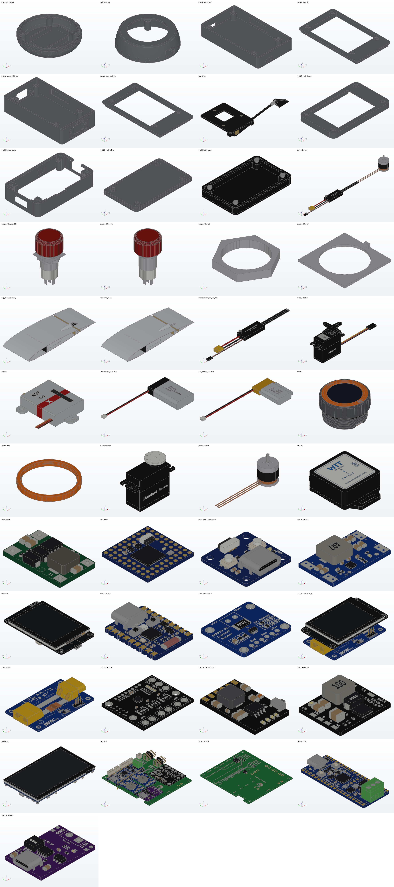

## Hand-held base for the M5Stack Dial

A printed base in two parts that turns the dial into a hand-held
controller. The dial sits flat on top, face up; the 1000mAh lithium
polymer cell 102540 lies in the bottom part. One hand holds the base
while the other turns the knob.

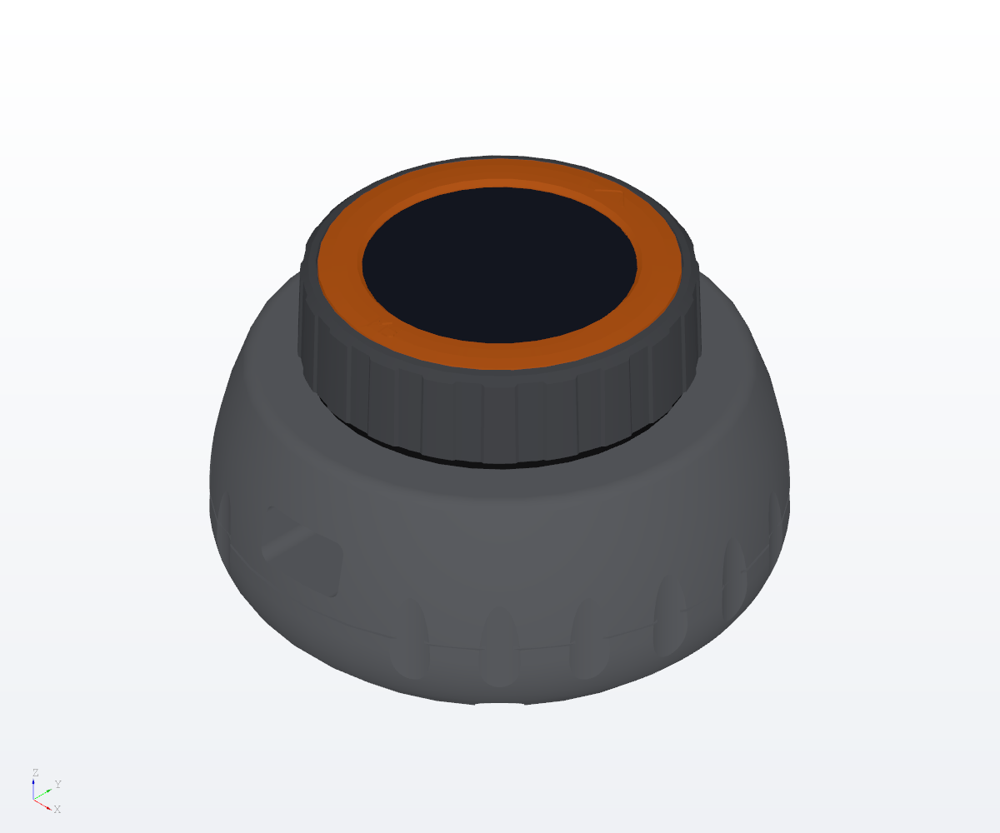

| | |
| --- | --- |
| 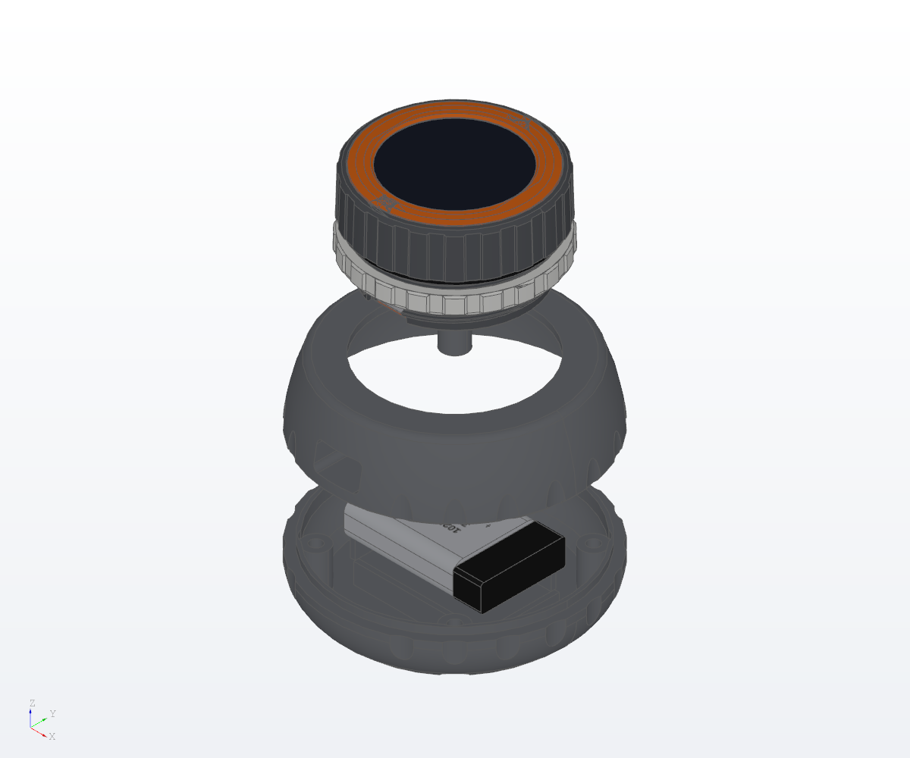 | 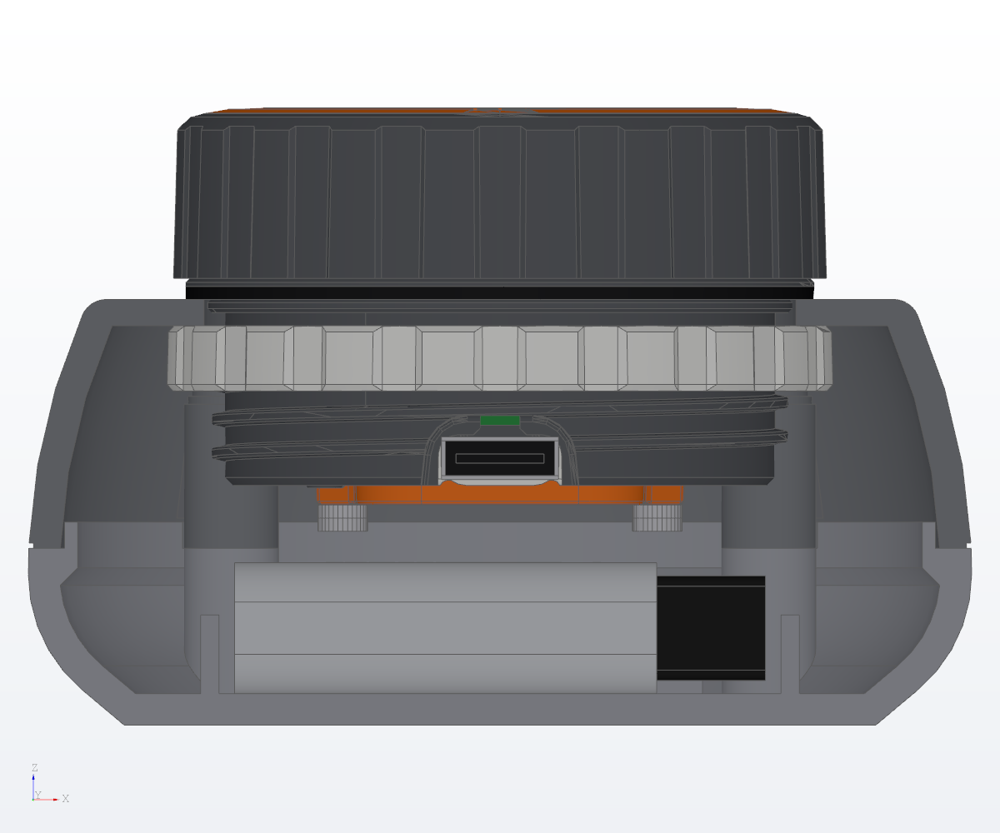 |

| File | Content | Print |
| --- | --- | --- |
| `dial_base_top.step`, `.stl` | the dial's seat: top plate with the 45.2mm hole, wall, 4 bosses for threaded inserts, USB opening with its guide tube; 14.2cm3 | top face down, no support |
| `dial_base_bottom.step`, `.stl` | floor with the cell's pocket, centring rim with a notch at each boss, 4 screw columns; 15.4cm3 | foot down, no support |

Both files are in the dial's frame: z = 0 is the top plate's upper face,
where the dial's flange seats, the knob points to +z, the `^` mark is at
+y and the USB socket at -y. Loaded with `m5dial.step` they give the
assembly; the nut's file moves to z = -2.0mm.

The shape is a body of revolution about the dial's axis:

| | mm |
| --- | --- |
| Overall | 72.0 across, 32.5 high; with the dial 47.1 high |
| Top | flat, 60 across, its edge rounded 2.0 into the side |
| Side | one arc of radius 49.5 from the top to the belly, 72.0 across, 21.0 below the top |
| Underside | rounded on a radius of 11.5 for 50 degrees, then a cone of that slope to a flat foot 57 across |
| Flutes | 18, each 5.6 wide and 0.7 deep at the belly, 18 degrees apart, fading out 8.3 above and 4.0 below it; none within 14 degrees of the USB opening |
| Wall | 2.4; 1.7 under a flute |
| Joint | level, 19.0 below the top, with a shadow gap 0.4 wide and deep; the bottom part's rim, 2.0 high and 1.0 thick, stands 0.2 inside the top part's wall, on a ledge that fills the wall in below the joint for 1.5 and ends in a 45 degree slope |

The underside is the part the palm holds. The flutes keep the base from
turning in the hand while the knob turns; the knob has 20 grooves at the
same pitch of 18 degrees.

For scale, two things made to be held or turned in one hand: Microsoft's
Surface Dial is 59mm across and 30mm high (Microsoft's specification), an
ice hockey puck 76.2mm across and 25.4mm high. The base lies between them
in width, 72.0mm, and is 32.5mm high. The dial weighs 46.3g and the two
parts, printed solid in PLA at 1.24g/cm3, 37g; the cell's weight is not
measured.

| Feature | mm |
| --- | --- |
| Dial's hole | 45.2 in a plate 2.0 thick; the dial takes 45.0 +/- 0.2 and a panel of 0 to 6 |
| Room for the ring nut | 4.2 between the nut, 50.82 across, and the wall; 0.6 to each boss, which is 6.0 across beside the nut |
| Room under the dial | the dial's screw heads end 17.7 below the top; the cell's top is 20.1 below it |
| USB opening | 13.4 x 7.6 with corners rounded 1.5 at -y, center 12.13 below the top, on the dial's USB socket, whose opening lies 18.45 from the axis |
| Guide tube | the opening runs on as a tube with a wall of 1.0 from the outer wall in to 24.5 from the axis, 10.7 long and 6.05 short of the socket, 2.5 off the dial's thread; beyond 26.5 from the axis a block ties it to the top plate; its top is 0.33 under the ring nut |
| Cell pocket | 42.9 x 26.0 between 4 rails 1.4 thick and 6.0 high, open at the 4 corners: 1.2 free at each end of the cell and 0.5 at each side; the cell's length lies across the `^` mark, its wires towards +y, the side away from the USB opening |
| Foam pad | 2 thick, about 20 x 30, between the cell and the dial, in the 2.4 between them; it holds the cell and leaves it room to swell |
| Screws | 4 x M3 x 12, pan head, on a circle of 58.0 at 45 degrees to the axes; clearance holes 3.4, heads sunk 8.0 into the foot in recesses of 6.2; each turns into a brass threaded insert in a boss of the top part and ends 2.5 above it |
| Threaded inserts | 4 x ruthex RX-M3Sx4.0 (M3, 4.0 long, 4.6 over the knurl), melted in from the joint; hole 4.0, 5.0 deep, wall 1.6, as the maker's label asks; the boss is 7.2 across up to 1.0 under the ring nut, narrows in 2 steps of 0.3, and is 6.0 beside the nut; a bore of 3.2 above the hole takes the screw's end |

The dial's battery socket, 1.25mm pitch with 2 pins, is on its main board
under the Stamp-S3, at the USB end (M5Stack's picture "Dial Lithium
Battery Expansion Interface"). The cell's plug has that size in the
photo. The wires run under the Stamp-S3 and leave the dial at its +y
end, the end away from the USB socket, so a USB plug cannot pinch them;
from there they drop to the cell.

Assembly: take the Stamp-S3 off the dial (2 M2 screws), plug the cell in,
lead the wires out at the end away from the USB socket and put the
Stamp-S3 back. Put
the dial through the top part and turn the ring nut on from below with
the USB socket in line with the opening. Lay the cell in its pocket with
the foam pad on it, close the base and drive the 4 screws.

`_gen_dial_base.py` builds both parts with OpenCASCADE: every face is a
plane, a cylinder, a cone or a piece of a torus. Its `--check` runs in CI
and fails when a file differs from the script, when a part is not a valid
solid, or when a part shares volume with the dial, the nut or the cell.

Limits:

- One base is printed and works (owner, 2026-11-21). Its flutes are
  partly filled: in its files the bosses' webs, the ledge under the rim
  and the screw columns reach the unfluted surface. Its screws cut their
  thread in pilot holes of 2.6mm. The files here are cut to the fluted
  surface, `--check` fails on material in a flute, and the bosses take
  threaded inserts. No base is printed from these files. No fit is measured: the 0.2mm gap
  of the rim and the 4.0mm holes for the inserts are design values for a
  0.4mm nozzle.
- The battery socket's place is read from M5Stack's picture, not
  measured, and the socket is not in the dial's model. The passage for
  the wires under the Stamp-S3 and out at its +y end is not in the model
  either and is not tried on a dial. Which of its pins
  is plus is not checked against the cell's plug: check it before
  plugging in.
- The dial's dimensions come from M5Stack's mesh and the cell's from
  photos; neither is verified with a caliper. The cell is drawn 40.5mm
  long, within about 1mm; the pocket takes a cell up to 42.9mm.
- The ring nut is turned with a fingertip or a pin in its notches, in the
  4.2mm round it.
- A plug's body wider than 13.4mm or higher than 7.6mm does not enter the
  USB opening; the wall's outer face is 16.8mm from the socket's opening.
  The tube guides the plug's body, not its metal tip, over the last 6.05mm.

```sh
python3 hardware/mechanical/_gen_dial_base.py            # write STEP and STL
xvfb-run -a python3 hardware/mechanical/_gen_dial_base.py \
    --render hardware/mechanical/renders
```

## Rotary knob with a round display

A knob 64mm across that turns round a fixed display, on the bottom part
of the dial base. The Waveshare ESP32-S3-Touch-LCD-1.85 stands still on
a shaft. A rotor turns round it on 2 ball bearings 6704-2RS and carries
the clear acrylic disc 49.5 x 2mm as its window: the glass turns with
the knob. 22 magnets in the rotor's hub and an AS5600 angle sensor
beside them read the turn. The base's top part gives way to a new case,
so the knob stands 56.2mm high with the bottom part.

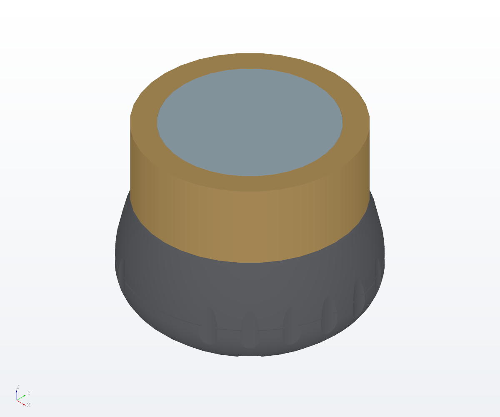

| | |
| --- | --- |
| 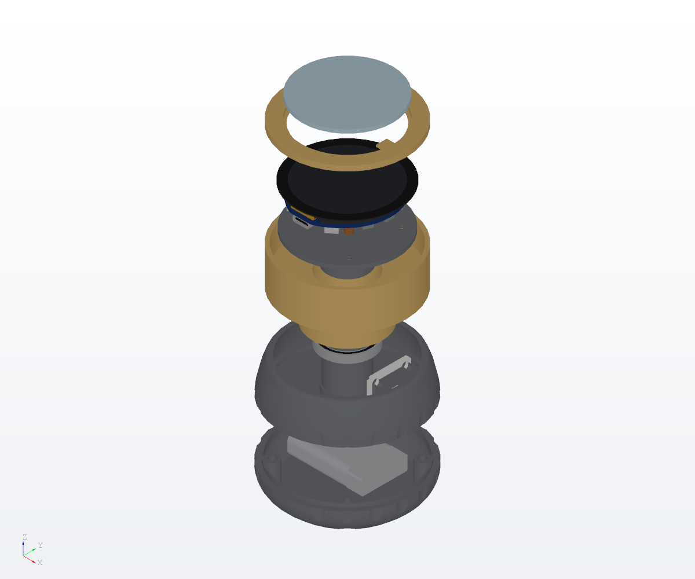 | 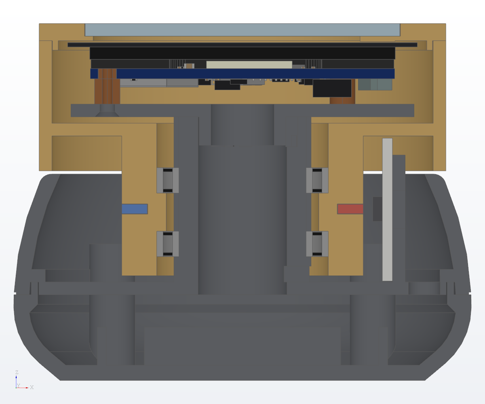 |

| File | Content | Print |
| --- | --- | --- |
| `knob_case.step`, `.stl` | the base's wall from the joint to the case's rim, open at the top; floor with a ring over the bottom part's rim, 4 bosses for threaded inserts, a cable hole of 14 and a wire hole of 5; the shaft, a tube 20 / 14 with a collar 21.6 under the lower bearing, up to 9.0 over the rim, with the bayonet's 3 L-shaped slots in its bore at the top; the wall the AS5600 module is screwed to; 22.1cm3 | floor down, no support |
| `knob_spacer.step`, `.stl` | sleeve 21.6 / 20, 6.0 long, between the bearings' inner rings; 0.3cm3 | on end |
| `knob_clamp.step`, `.stl` | sleeve 21.6 / 20, 8.0 long, from the upper bearing to the carrier; 0.4cm3 | on end |
| `knob_rotor.step`, `.stl` | hub 38 / 27 with a shoulder of 24 between the bearings' outer rings and 22 magnet pockets; a web over the sensor; a skirt 64 / 60 up to the bezel; 25.0cm3 | skirt's top down; the web and the hub's top need support |
| `knob_bezel.step`, `.stl` | the skirt's top, 2.7 high: a lip with an opening of 47 under the window, the window's seat 49.7 across, a spigot inside the skirt with 0.1 play; the finger, a tab under the lip 6 wide from r 18.5, its underside 0.15 over the display's glass; 3.9cm3 | top down; the finger reaches 5.5 into the open seat and needs support |
| `knob_carrier.step`, `.stl` | plate 54 across, 2.0 thick, with 3 countersunk holes for M2 into the display's inserts; a spigot 13.6 / 10.0 under it, 4.5 long, with the bayonet's 3 lugs; 4.7cm3 | plate down, no support |
| `knob_magnets.step` | the 22 magnets where they sit, N red and S blue | bought |
| `knob_as5600.step` | the AS5600 module where it stands | bought |

The files are in the dial base's frame: z = 0 is the case's rim, where
the base's top plate was; the joint is at z = -19.0; the display's USB
socket is at -y; the AS5600 module stands at +x. No assembly file is
written. These files, `dial_base_bottom.step` as it is and these models
moved along z make the knob:

| Model | z, mm |
| --- | --- |
| `bearing_6704_2rs.step` | -13.0 and -3.0 |
| `esp32_s3_lcd_185.step` | +20.7 |
| `acrylic_disc_49_5.step` | +21.7 |

| Stack | z, mm |
| --- | --- |
| Case floor | -19.0 to -17.0; its outer ring to -15.0 |
| Shaft's collar | -17.0 to -13.0 |
| Bearings | -13.0 to -9.0 and -3.0 to 1.0 |
| Rotor | hub -16.0 to 8.0, web 6.0 to 8.0, skirt 0.5 to 21.0 |
| Bezel | 21.0 to 23.7, its lip 21.0 to 21.7, its spigot down to 19.5 |
| Magnets | -6.25 to -4.75, on a circle of 34.0 |
| AS5600 chip | its face 20.5 from the axis, 1.5 off the hub, centred at -5.5 |
| Carrier | 9.0 to 11.0 |
| Display | 11.0, the ends of its inserts, to 20.7, its glass's front |
| Window | 21.7 to 23.7, 0.3 over the display's glass |
| Top | 23.7; the base's foot at -32.5 |

Encoder: the 22 magnets, Ø4 x 1.5mm, magnetised through their thickness,
stand with N and S up in turn. The AS5600 stands upright beside the hub,
its chip's plane holding the direction of travel and the knob's axis. The
field at the chip turns 360 degrees for each N-S pair, 11 times a knob
turn: 11 x 4096 = 45056 counts a turn, 45 counts for each of 1000 steps.
The method follows 0x23's MicroManipulatorStepper (MIT licence). The
firmware counts the sensor's wraps to keep the knob's turn.

Touch finger, a second encoder to try on the same build: a patch of
copper tape, 6 x 4.5mm and 0.06mm thick, on the underside of the
bezel's finger hovers 0.09mm over the display's glass at r 18.5 to 23.0,
inside the view area, which ends at r 23.04. The touch controller, a
CST816, reports it as a touch; its angle is the knob's angle, about
1030 pixels a turn at r 21. The patch is tied to the display's ground:
copper tape from the patch over the lip, down the skirt's inside, over
the web and down the hub's bore to the upper bearing's outer ring;
through the bearing; from its inner ring copper tape on the shaft
under the clamp, over the shaft's top into its bore, and a wire up to
the display's GND. The tape adds 0.06 to each side of both bearing
fits.

Assembly: melt the 4 inserts into the case from below. Screw the AS5600
module to the case's wall with 4 M3, its chip towards the axis, and lead
its wires through the wall's window and the floor's wire hole. Glue the
magnets into their pockets from the hub's side with cyanoacrylate, N and
S up in turn: each pocket is 0.1mm larger than the magnet all round and
open to the side, so it does not hold a magnet by itself. Slide the
lower bearing onto the shaft, the rotor over it, the spacer and the
upper bearing, then the clamp. Screw the display to the carrier on the
bench with 3 countersunk M2 x 4 from below; their heads lie flush, 1.0
over the rotor's web. Lead the display's wires down the spigot and the
shaft's bore. Lower the display into the skirt, set the spigot's lugs in
the slots with the display's USB socket 30 degrees anticlockwise of -y
seen from the top, press down and turn the display 30 degrees
clockwise. Each lug's nub passes over a ridge 0.1 high over the last 10
degrees, which holds the lock. Glue the acrylic disc into the bezel's
seat with a thin ring of clear 2-component epoxy round its edge; the lip
carries it from below only, and the seat is open above. Glue the bezel
onto the skirt with the same epoxy, not with cyanoacrylate, whose vapour
fogs acrylic. The bezel is a
part of its own because the display, 55.0 across, does not pass its
lip's opening of 47.0. Lay the cell in the bottom part and close the
base with the 4 M3 x 12 of the dial base.

`_gen_knob.py` builds the printed parts with OpenCASCADE. Its `--check`
runs in CI and fails when a file differs from the script, when a part is
not one valid solid, when the case fills a flute, when two solids of
the knob share volume, or when the carrier's lugs do not travel the
shaft's slots. That check moves the carrier down at its entry angle and
turns it to the lock in steps of 1 degree; the nubs may meet the ridges
in one stretch of the turn, 0.1 deep at most.

Limits:

- Nothing is printed or tried. No fit is measured.
- The bayonet holds the display by the 0.1mm of its ridges alone; how
  much torque on the glass turns it out of the lock is not measured.
  The lugs leave the carrier 0.1mm of axial play. The window turns 0.3mm
  over the display's glass. The display's USB-C socket is enclosed:
  how the board is programmed and charged in the knob is open.
- The magnets' field at 1.5mm from the chip is not measured. The AS5600
  takes 30 to 90mT; whether 22 magnets of this size give it, and how
  even the 11 turns of the field are, is unknown.
- The wires from the display down the shaft's bore and from the module
  through the floor to the cell are not drawn, nor the module's pin
  headers, nor a switch or charger for the cell.
- The rotor's web and the hub's top overhang and need support when
  printed.
- The touch finger is not tried. Unknown: whether the CST816 sees the
  patch at 0.09mm; how much its reported place jitters; what it reports
  when the patch lies on the glass at power-on, which it takes into its
  baseline; whether its AutoReset and LongPressTime, which drop a touch
  held for seconds, can be turned off; how well a ball bearing, whose
  balls run on a film of grease, carries the ground while it turns. A
  bronze spring wiping a copper band on the hub would replace the
  bearing in that path. The CST816 reports 1 touch: with the patch on
  the glass, touches by hand are not read reliably.
- The window and the bezel are glued: to take the display out, the
  bezel's glue is cut.

```sh
python3 hardware/mechanical/_gen_knob.py                 # write STEP and STL
xvfb-run -a python3 hardware/mechanical/_gen_knob.py \
    --render hardware/mechanical/renders
```

## Hardware test bench, for the video

`_gen_bench.py` writes a 3D model of the hardware test bench, the rig the
hwbench tooling drives, as one GLB with a named node per part. The video
loads it from `tools/video/cad/bench.glb`. That folder is not in git,
because the video tools write their GLB files there from their sources.
The model is drawn from the owner's 8 photos of 2026-11-25.

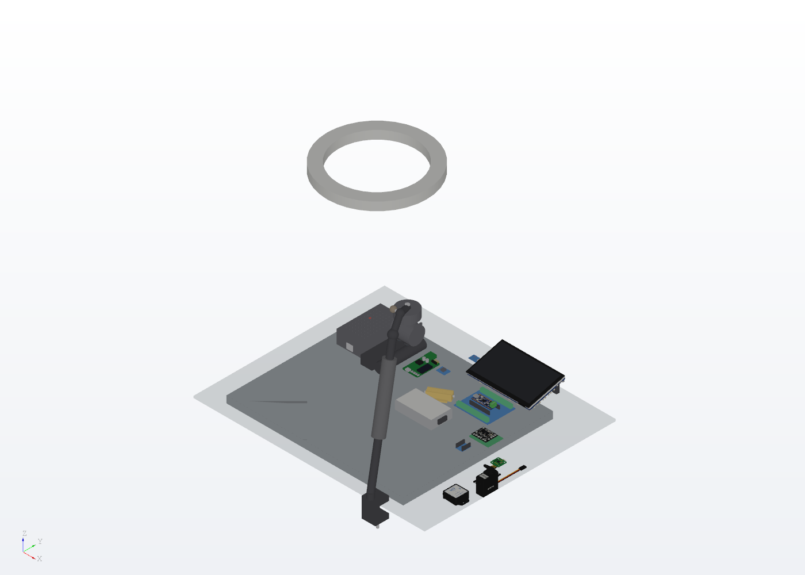

| | |
| --- | --- |
| 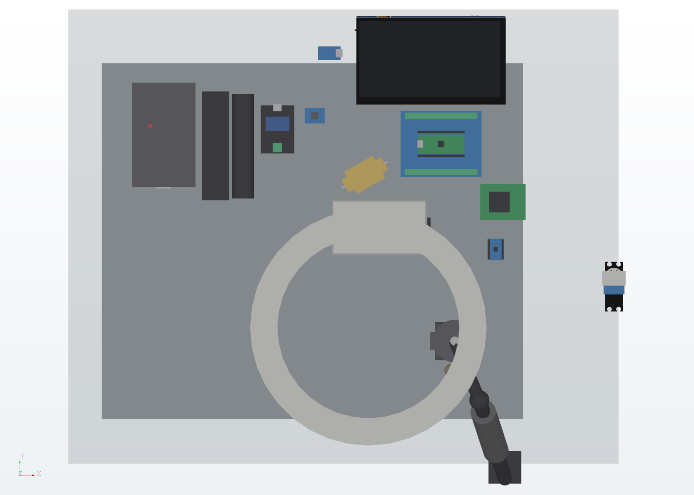 | 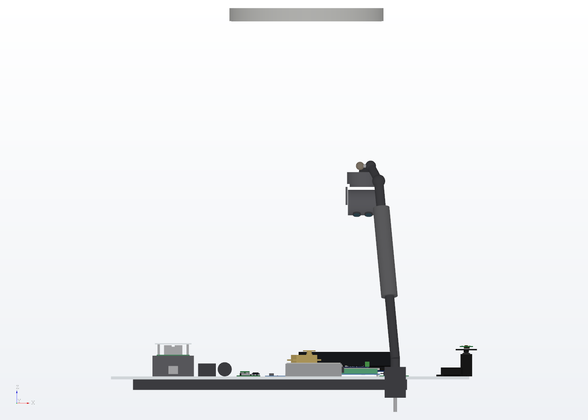 |

| Property | Value |
| --- | --- |
| Format | glTF 2.0 binary, 3.9MB |
| Units | metres |
| Up axis | +y, as glTF defines it |
| Origin | the acrylic sheet's front left corner, on its top face |
| Axes | +x to the right, -z away from the viewer, towards the panel and the wall |
| Script's frame | mm, z up: GLB (x, y, z) = (x, z, -y) / 1000 |

```sh
pip install cadquery-ocp==8.0.1.1.0 trimesh numpy
xvfb-run -a python3 hardware/mechanical/_gen_bench.py \
    tools/video/cad/bench.glb --render hardware/mechanical/renders
```

Each node holds one mesh per colour, named `<node>_mesh<k>`. A node's
origin is the pivot below, in the script's frame (mm, z up). The parts
are the ones hwbench lists on the bench. "Model" means one of this
repository's STEP models, at its documented size.

| Node | Parent | Content | Size from | Pivot |
| --- | --- | --- | --- | --- |
| `bench` | | everything | | origin |
| `sheet` | bench | clear acrylic sheet, 605 x 500 x 5 | photo estimate | origin |
| `base_board` | bench | black board under the sheet, 463 x 392 x 18 | photo estimate | origin |
| `panel` | bench | Waveshare ESP32-P4 7 inch, tilted 15 degrees on 2 legs | model `panel_7b.step`; tilt and legs estimated | (398, 447, 0) |
| `iomcu` | bench | Waveshare RP2350-CAN on a blue screw-terminal carrier, 73 x 89, its long side towards the panel | model `rp2350_can.step`; carrier from the photo | (410, 352, 0) |
| `injector` | bench | Waveshare RP2350-Zero touch injector, 23.5 x 18, pin headers | datasheet outline; parts drawn as boxes | (470, 236, 0) |
| `ina3221` | bench | INA3221 module on a green perfboard, 50 x 40, in front of the carrier | model `ina3221_module.step`; perfboard estimated | (415, 280, 0) |
| `servo` | bench | Hitec D485HW at the sheet's right edge | model `hitec_d485hw.step` | (600, 205, 0) |
| `as5600` | servo | AS5600 encoder module over the servo's output | model `AS5600_Encoder_22.5x22.5mm.step` | (600, 198, 47) |
| `imu` | servo | WIT BWT901CL beside the servo | model `wit_imu.step` | (575, 112, 0) |
| `servo_gold` | bench | gold-coloured servo held down with tesa tape; its type is not known | drawn as `servo_standard.step` in gold | (326, 318, 0) |
| `instruments` | bench | group | | origin |
| `logic_analyzer` | instruments | Kingst LA2016, 95 x 55 x 23 | datasheet | (342, 260, 0) |
| `supplies` | bench | group | | origin |
| `supply_pd_mini` | supplies | WeAct PD Power Mini, 61 x 40 | model `PD_Buck_WeAct_PDPowerMiniV1_61x40mm.step` | origin |
| `supply_buck` | supplies | blue buck module, 22 x 17 | photo estimate | origin |
| `supply_usbc_board` | supplies | USB-C board with a red LED, 25 x 15 | photo estimate | origin |
| `unknown_box` | bench | black vented box with red LEDs, 70 x 115 x 35; what it is is not known | photo estimate | (105, 362, 0) |
| `host_pi5` | unknown_box | Raspberry Pi 5, 85 x 56, under a clear cover, lying on the box | board from Raspberry Pi's drawing; cover estimated | (105, 362, 35) |
| `usb_hub_1` | bench | black USB hub, 30 x 120 x 22 | photo estimate | (162, 350, 0) |
| `usb_hub_2` | bench | black cylindrical USB hub, 24 across, 115 long | photo estimate | (192, 350, 12) |
| `ring_lamp` | bench | ring lamp facing down, 260 across, opening 200, 22 thick | estimate from its reflection | (330, 150, 600) |
| `camera` | bench | group: the camera rig | | origin |
| `camera_clamp` | camera | clamp on the sheet's front edge | photo estimate | (480, 0, 0) |
| `camera_pole` | camera | pole with a foam grip, leaning back | photo estimate | (480, -16, 30) |
| `camera_arm` | camera | ball arm with its knob | photo estimate | (452, 70, 330) |
| `camera_base` | camera | EMEET PIXY's base, 53 across, hanging under its mount | 53 x 53 x 73 over all, maker's listing; the split into base, yoke and head estimated | (425, 135, 345) |
| `camera_pan` | camera_base | the yoke | as above | (425, 135, 325) |
| `camera_tilt` | camera_pan | the head, 43 across and 50 wide, 2 lenses, 30 degrees off the vertical | as above | (425, 135, 293.5) |

To turn the camera, rotate `camera_pan` about the GLB's y axis and
`camera_tilt` about its x axis. Both turn about their own origins.

Scale: the panel and the Pico-sized RP2350-CAN set it. The panel's glass
is 164.3 x 99.2mm (`panel_7b.step`), and the RP2350-CAN is 51 x 21mm. In
the near top-down photo, the panel's long side is 415 of 2000 pixels:
2.53 pixels per mm. At that scale the carrier under the RP2350-CAN
measures 89 x 73mm in the side photo.

Limits:

- Every place on the sheet is read from the photos at that scale and is
  an estimate. Perspective is not corrected, so places are within about
  ±20mm. Neither the sheet's far edge nor the black board's is fully in
  a photo.
- hwbench reports the gold block taped down with tesa strips as a
  servo of unknown type, and the black box under the Pi 5 as unknown.
  The purple USB-C board's role is not known.
- The camera pans -150 to +150 degrees and tilts -90 to +90 degrees
  (hwbench's records). Its mount and height are not measured.
- hwbench records no measured size or place on the rig.
- The EMEET PIXY's listed size is 53 x 53 x 73mm; another listing gives
  56 x 43 x 22mm, probably for the camera head alone. The model takes
  the first.
- The ring lamp's reflection is the white ring in the photos. Its size,
  height and place are estimates, and its mount is not drawn.
- Not drawn: cables, the cabinet, the monitor, the soldering station, the
  light tent, the grey box with a diamond pattern on the desk beside the
  sheet.

Sources: Kingst LA2016, 95 x 55 x 23mm (Core Electronics, CNX Software);
EMEET PIXY, 53 x 53 x 73mm (Mighty Gadget); Waveshare RP2350-Zero,
23.5 x 18mm (Waveshare).

## Panel board

The Waveshare ESP32-P4-WIFI6-Touch-LCD-7B: a 7-inch touch display of 1024 x
600 pixels on a board with the ESP32-P4. `panel_7b.step` is a facsimile for
designing the enclosure, drawn here from measurements. It is not Waveshare's
file.

| File | Content | Origin |
| --- | --- | --- |
| `panel_7b.step` | glass, display, board, 4 standoffs, 2 flat cables and every part on the board; 1497 solids, 7.5MB | the center of the view area on the glass's front face; +z to the viewer; seen from the front, x to the right and y up with the USB sockets on the left |

| Part | Size, mm | From |
| --- | --- | --- |
| Cover glass | 164.28 x 99.18 x 1.90 | D, E |
| View area | 154.58 x 86.41, 6.64 and 3.06 from the glass's short edges, 8.74 and 4.03 from its long edges | D, E |
| Display | 164.0 x 97.1 x 3.60, its front 2.10 behind the glass's front | D, E |
| Board | 164.0 x 97.0 x 1.60, its rear 8.80 behind the glass's front | D, E |
| Cut-out at the antenna | 14.25 x 5.15, in a long edge | E |
| Step at the 2 buttons | 1.5 deep, 17.87 long | E |
| 2 slots for the flat cables | 8.0 x 3.0 and 22.0 x 3.0 | E |
| 4 standoffs, M2.5 thread | 5.5 across, 6.0 tall, 156 x 89 apart, 4.0 from the board's edges | D, E |
| 4 wire sockets at the short edge, 4 pins, 2.0 pitch, top entry | 11.9 x 5.8 x 5.5, 14.9 apart | P, Q, D |
| 2 wire sockets at the long edge, 12 pins, 2.0 pitch, top entry | 27.9 x 5.8 x 5.5, 76.75 apart | P, Q |
| Speaker socket, 2 pins, 2.0 pitch, top entry | 7.9 x 5.8 x 5.5 | P, Q |
| Battery socket, 2 pins, 1.25 pitch, side entry, the plug entering from inboard | 7.65 x 5.2 x 3.3 | E, P |
| Socket of the radio's serial port, 4 pins, 1.0 pitch, top entry | 6.35 x 3.05 x 4.5 | E, P |
| USB Type-A socket | 12.2 x 10.0 x 5.7, 0.6 above the board | E, P |
| 2 USB Type-C sockets | 8.94 x 7.35 x 3.16 | E |
| Shield can over the ESP32-P4 | 21.3 x 17.0 x 1.9 | P, Q |
| Coin-cell holder | 15.4 across, 3.8 tall | P, Q |
| microSD card slot | 16.1 x 15.0 x 1.85 | E |
| 326 chip parts, 33 leaded packages, 89 further solids | as measured | E |

The model is 15.1mm thick, from the glass's front to the top of the USB
Type-A socket, and 166.04mm long with the switch's lever, which stands
1.76mm past the glass.

Sources:

- **D**: Waveshare's outline drawing of the board, a PDF (Portable Document
  Format) file of 2025-11-08 in `ESP32-P4-WIFI6-Touch-LCD-7B-3D.zip` on
  [the board's wiki page](https://www.waveshare.com/wiki/ESP32-P4-WIFI6-Touch-LCD-7B).
- **E**: Waveshare's STEP file of the board in the same archive, 1337 solids.
  `_measure_step.py` reads it with OpenCASCADE and writes
  `_panel_7b_data.py`.
- **P**: Waveshare's photo of the board's rear, 1600 x 1200 pixels,
  `esp32-p4-wifi6-touch-lcd-7b-3.jpg` on the product page. It is fitted to
  the holes of the 4 standoffs at 7.35 pixels per mm, with 1.1 pixels left at
  each. A position read from it is good to 0.3mm.
- **Q**: Waveshare's angled photo of the rear,
  `esp32-p4-wifi6-touch-lcd-7b-5.jpg`, for heights against the 6.0mm
  standoffs, each +- 0.5mm: the wire sockets 5.5mm, the coin-cell holder
  3.8mm, the shield can 1.9mm.
- **N**: the nominal height of the ESP32-P4's package, 0.9mm. E draws it
  2.0mm high, which the shield can does not clear.
- **S**: Waveshare's schematic of the board, a PDF file of 2025-09-25, for
  the parts' names.

Waveshare states no licence for E and the photos, so they are not in this
repository; only dimensions measured in them are.

E and D differ from the board in its wire sockets. They draw 4 side-entry
shrouds 6.5mm high at the short edge, where the board has top-entry sockets,
and sockets of 1.0mm pitch, 14.35mm long, where the board has the two 12-pin
sockets of 2.0mm pitch, 27.9mm long. All 7 wire sockets of the board are
top-entry: the plug goes in from above the board, and P shows the pins end
on. E has neither the shield can nor
the coin-cell holder. Where P and E differ, the model follows P. D's 15.3mm
over all is the height of E's shrouds.

Each part of E is drawn again from its measured box: a chip part with its end
caps, a leaded package as a body and one lead a foot, a connector as its
shape of `_parts.py`, every other solid as its box. `check_panel_7b.py`
compares the result with E, component by component: no side of a chip part
is off by more than 0.04mm, of a leaded package by more than 0.01mm, of a
box by more than 0.00mm, and of a named part by more than 1.10mm: a
connector, where a shape of `_parts.py` has its own nominal size, by 0.90mm,
and the ESP32-P4, drawn 0.9mm high where E draws 2.0mm, by 1.10mm. It needs E and is not run in
CI (continuous integration). `check_overlap.py` runs in CI: no two of the
1497 solids share more than 1e-6mm3.

Limits:

- No dimension is verified with a caliper on a board.
- Estimated, in no source: the wall thickness of the connectors, the plungers of the
  2 buttons, the flat cables' paths through the board's slots, the display as
  a steel back 0.3mm thick with a black panel in it.
- The row of pins of the two 12-pin sockets lies 0.5mm off the housing's
  center in P; the model draws it so.
- E has two spacers 20mm x 96mm between display and board. The one under the
  touch panel's cable is drawn cut back to clear the cable.
- Not modelled: the print on the board, tracks, vias, solder, pads, the
  battery and the speaker.

```sh
pip install cadquery-ocp==8.0.1.1.0
python3 hardware/mechanical/_measure_step.py FILE.stp   # rewrite _panel_7b_data.py
python3 hardware/mechanical/check_panel_7b.py FILE.stp  # compare the model with E
```

## INA228 module with XT90 connectors

The current sensor module of the power path: a board of 80.1mm x 48.6mm,
print "BIFRC V1.1", with an INA228 current and voltage monitor, a shunt in
the minus line and one XT90PW connector at each end. XT90PW is the
right-angle board version of the XT90: the housing lies on the board and
two round tails bend down through it. The KiCad module
`INA228_BIFRC_XT90_80x48mm` ([KiCad library](../kicad/README.md)) is the
same board as boxes; these two models draw it part by part, in the same
frame.


| File | Content | Origin |
| --- | --- | --- |
| `ina228_xt90.step` | board with 59 holes, XT90PW-M, XT90PW-F, solder on the bars of both sides and round the tails, shunt, INA228, 13 chip parts, 4-pin header, bare pads, print; 225 solids, 1.7MB | header pin 1 (L) on the board's underside; x along the header to pin 5, y towards the plus bar, +z up |
| `ina228_xt90_case.step` | printed shell with 4 standoffs, 4 M3 screws; 17 solids | the same frame: both files loaded together give the module in its case |

| Part | Size, mm | From |
| --- | --- | --- |
| Board | 80.1 x 48.6 x 1.6, corners 2.4; 4 screw holes of 3.05 in tinned rings of 5.1, 70.65 x 38.8 apart | P; the 70.65 the owner's correction after a printed case (P gave 70.15); thickness O |
| Slots through the board | 42 of 2.2 x 0.9: rows of 12, 6 and 3 slanted 45 degrees at 2.95 pitch, 5 along the board, 8 under each connector | P |
| XT90PW-M, pin half | housing 20.8 x 9.9, 20.7 long, 25.7 with the rear plate; 2.25 past the board's edge | W, P |
| XT90PW-F, socket half | collar 20.8 x 9.9 and 7.8 long, nose 19.2 x 8.3 and 11.2 long, 24.0 with the rear plate; 1.05 past the board's edge | W, P |
| Contacts | 2 at 10.9 pitch; pins 4.5 | W |
| Tails | round, 3.5, bent down on a radius of 3.8, 3.8 behind the housing, through the board | W scaled, P |
| Pegs | 2 per half, 18.9 apart, 9.4 (pin half) and 8.9 (socket half) from the tails, through the board | W, P |
| Solder on the bars, top side | plus 33.7 x 5.1, minus 8.5 and 9.9 x 5.5, 0.8 high | P; height estimated |
| Solder on the underside | plus 36.1 x 4.9; minus strips 9.2 and 10.05 long with blocks 6.15 x 8.0 and 5.3 x 8.0 under the shunt's ends; 6.6 across round each tail | P; heights estimated |
| Shunt, print 0m50 1% | 15.3 x 7.9; ends 1.2 high; the middle 5.3 long, its top at 1.8, 0.2 off the board; upper edges across the shunt rounded 0.5 | P, O |
| INA228 | VSSOP-10: 3.0 x 3.0 x 1.1, 4.9 over the leads | package |
| Header | 4 pins of 2.54 pitch, 6.1 over the 2.5 plastic; hole 5 is empty | P, standard part |
| Print | BIFRC V1.1, GND, 5V and L A V G 5 traced from the photo; 4 round marks of 5.9, rings round the header's labels at 2.6 pitch, frames round chip parts and header, lines round the shunt and the underside's diode; 0.02 thick | P |
| Overall, module | 83.95 x 48.6 x 12.6: 1.1 of tail under the board, 9.9 of connector over it | |
| Case | 85.1 x 53.6 x 10.1: wall 2.25, floor 1.6, standoffs 9.2 across and 7.9 high from the case's underside, rim 0.6 over the board with an opening of 21.4 for each connector | P; see the limits |

Sources: P, three owner photos on 5mm squared paper, of the top side, the
underside and the case, which are not in the repository; W, a dealer's
dimension drawing of XT90PW Male/Female; O, the owner's measurements of the
board's thickness and the shunt's heights.

`_photo_grid.py` reads the photos. It finds the crossings of the paper's
grid lines, 125 to 159 per photo, and fits the projection from pixels to mm;
the crossings lie within 0.10 to 0.12mm of the grid. The camera stands
196mm over the paper, which follows from the 64mm focal length (35mm
equivalent) of two of the photos. A thing h over the paper looks larger by
196 / (196 - h): the board's underside, 11.65mm up on its connectors,
measures 85.15 x 51.70 on the paper and is 80.07 x 48.62. The top and the
underside photo are laid onto each other by the 4 screw holes. The
header's pitch reads 2.52mm on the underside and 2.56mm on the top side.

Limits:

- Positions on the board are within about 0.2mm, the board's size and the
  hole spacing within about 0.3mm. No dimension is verified with a caliper
  but the board's thickness and the shunt's heights.
- The two housings are placed from their upper faces in the top photo,
  corrected for their height, and from the pegs' solder joints on the
  underside; the two agree within 0.05mm.
- Not measured: the solder's heights, how
  far tails, pegs and header pins stand out of the underside, the tails'
  diameter and bend radius, the shroud's depth (12.5mm drawn), the pegs'
  section. Which end of the XT90's mating outline has the two cut corners
  on this board is not seen; the model draws them at the minus contact.
- The shunt's 1.8mm is drawn as the height of the middle's top over the
  board.
- Case: the standoffs' height follows from the spacing of the case's 4
  holes on the paper, 73.3 x 40.3 against 70.15 x 38.8, and is within
  about 0.6mm. The floor's thickness, the rim's height over the board and
  the split of the 2.5mm between gap and wall are estimated. The chamfer
  between the pocket's wall and its floor is not drawn. The screws are
  plain cylinders, 2.2mm thick where they cut their thread.
- Not modelled: the Chinese warning line between the bars, the print's
  frames round bare pads and bars, part values, tracks, vias, pads under
  parts, the housings' latch windows and logo, the slits of the contact
  pins.

```sh
pip install opencv-python-headless
python3 hardware/mechanical/_photo_grid.py PHOTOS DIR      # the photos, flattened
python3 hardware/mechanical/_trace_ina228_print.py PHOTOS  # rewrite _ina228_print.py
```

## Module boards and cells

Five module boards, the Core2350B's USB adapter board and two lithium
polymer cells, drawn part by part with the print of both sides. Each
module board's model is also the 3D model of its footprint in the
[KiCad library](../kicad/README.md), in the same frame; the INA219 board
stands on a 6-pin header there and the Core2350B on four 2 x 8 headers,
and both are bare here.

| | | |
| --- | --- | --- |
| 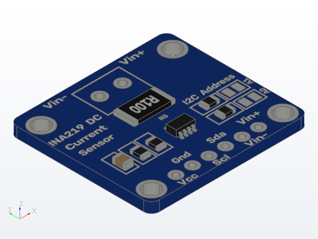 |  | 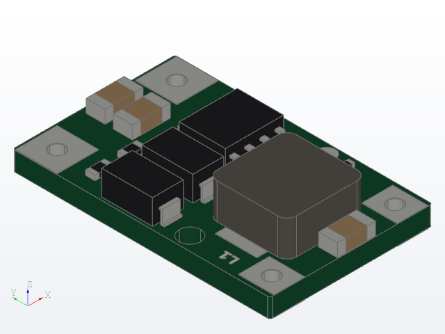 |
| `ina219_cjmcu219.step` | `lipo_charger_boost_5v.step` | `boost_5v_en.step` |
| 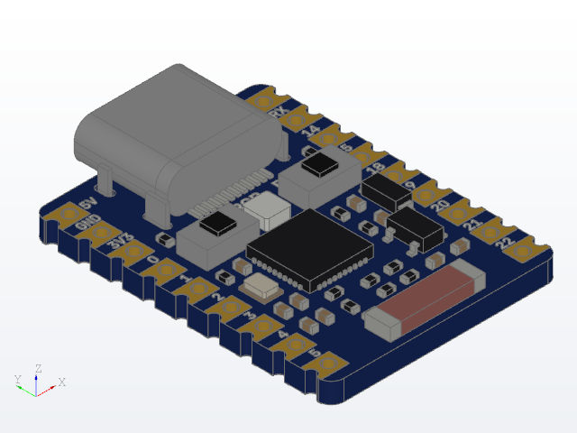 |  | 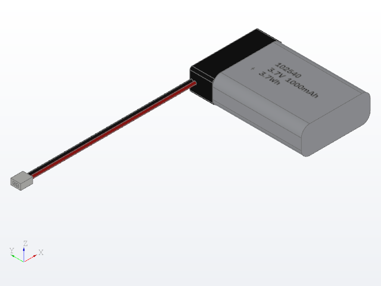 |
| `esp32_c6_zero.step` | `lipo_702030_380mah.step` | `lipo_102540_1000mah.step` |
| 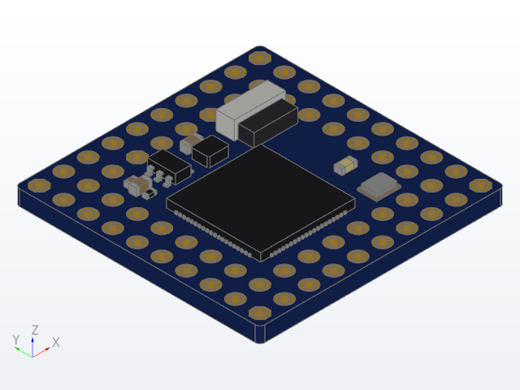 | 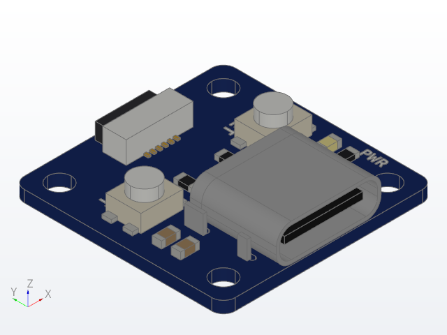 | |
| `core2350b.step` | `core2350b_usb_adapter.step` | |

| File | Content | Size, mm | Origin |
| --- | --- | --- | --- |
| `ina219_cjmcu219.step` | INA219 board, print CJMCU: 12 plated holes, shunt R100 (2512), INA219 (SOT-23-8), 5 chip parts (0805), 4 bridge pads, print of both sides; 225 solids, 3.5MB | 24.2 x 21.9 x 1.6, parts to 1.1 over the board | header hole 1 (Vcc) on the underside; x along the header, y towards the terminal holes |
| `lipo_charger_boost_5v.step` | charger board: 6 plated holes, chip (SOIC-8), inductor, 6 capacitors, 4 resistors, 4 LEDs, side push button, underside's white field with black names; 121 solids, 1.3MB | 15.2 x 24.0 x 1.6, inductor 3.0 over the board, button plunger 1.5 past the edge | hole 1 (OUT 5V) on the underside; x along the row, y from the LEDs to the row |
| `boost_5v_en.step` | boost board: 4 plated corner holes, enable pad, chip (SOIC-8), inductor, 2 diodes (SMA), 3 capacitors, 3 resistors, print, underside's white field; 69 solids, 0.6MB | 13.7 x 21.7 x 1.6, inductor 3.0 over the board | IN+ hole on the underside; x towards IN-, y towards the outputs |
| `esp32_c6_zero.step` | Waveshare ESP32-C6-Zero: 18 edge pads with holes and half holes, 7 underside pads, USB Type-C socket, chip (QFN, 40 leads), antenna, 2 buttons, LED, regulator, diode, crystal, 21 chip parts, print; 263 solids, 2.6MB | 18.0 x 23.5 x 1.6, socket 3.25 over the board and 1.21 past the edge | 5V pad's hole on the underside; x towards the TX pad, y towards the socket |
| `core2350b.step` | Waveshare Core2350B: 64 plated holes (6 GND pads octagonal), RP2350B (QFN, 80 leads), regulator (SOT-23-5), inductor, crystal, LED, 6-way flat cable socket, 4 chip parts on the top side; flash (SOIC-8, 5.3mm body), PSRAM (SOP-8, 3.9 x 4.9mm body), their 16 tinned pads and 29 chip parts on the underside, its print; 445 solids | 25.40 x 25.40 x 1.6, socket 1.9 over the board, flash 1.9 under it | pad 1's hole on the underside; x towards P2's corner GND, y away from P3; flat cable socket at +x +y |
| `core2350b_usb_adapter.step` | the Core2350B's USB adapter board: USB Type-C socket, 6-way flat cable socket, BOOT and RESET buttons, LED, 5 chip parts, 4 holes of 2.0mm at 14.0mm, the slots of the socket's legs, print BOOT, RESET, PWR; 70 solids | 18.0 x 18.0 x 1.0, socket 3.25 over the board, its front 0.02 inside the edge | the board's center on its underside; x towards RESET, y towards the flat cable socket |
| `lipo_702030_380mah.step` | cell, print 702030 3.7V 380mAh 1.406Wh: pouch with folded side seams, head under amber tape, print, 2 wires, plug; 40 solids | 20.0 x 31.0 x 7.0; wires 60 | middle of the width at the end away from the head, on the lower face; y towards the head, wires to -x |
| `lipo_102540_1000mah.step` | cell, print 102540 3.7V 1000mAh: pouch, head under black tape, print, 2 wires, plug; 28 solids | 25.0 x 40.5 x 10.0; wires 60 | as the other cell |

Sources: three owner photos on 5mm squared paper, of the top sides, the
undersides and the cells on edge, which are not in the repository; for the
ESP32-C6-Zero also Waveshare's dimension drawing and STEP file, which are
not in the repository either.

The Core2350B and its adapter come from Waveshare's documents, none of
them in the repository: the Core2350B's dimension drawing (25.40mm
square, 64 holes at 2.54mm) and schematic (the name of each hole);
product photos of its top side and underside, and a photo of the
underside with the PSRAM fitted, whose holes fit the 2.54mm grid within
0.02mm RMS (root mean square), so parts read off them lie within about
0.2mm; these photos show the underside turned by 90 degrees against a
plain flip of the top side; the dimension drawing of the RP2350-Tiny's
adapter board (18.00mm square, holes 14.00mm apart, corner radius
1.00mm) and its STEP file `RP2040-Tiny-Adapter V1.1.step`, which states
no licence: board 1.00mm thick, holes 2.02mm, USB socket 3.25mm high,
buttons 4.65 x 3.00 x 2.50mm, flat cable socket 5.70 x 3.60 x 1.90mm,
the place of every part. A photo of the Core2350B's adapter shows that
board's layout turned by 180 degrees, with a socket of 6 contacts; the
model is drawn in the photo's orientation. Estimated, not measured: the
Core2350B's thickness (1.6mm), corner radius (0.5mm) and holes (1.0mm),
the heights of its inductor (1.0mm), crystal (0.55mm) and flash
(1.9mm), its flat cable socket's height (the adapter's 1.90mm), the
PSRAM's part number (the schematic names none; drawn as a SOP-8 150mil,
as AP Memory's APS1604M-3SQR-SN and APS6404L-3SQR-SN are) and height
(1.5mm) and the buttons' body and cap within the STEP
file's box. Not drawn: the names printed beside the holes, the logo,
the flat cable and the adapter's underside. `_photo_grid.py`'s grid fit lies within
0.20mm of the paper's grid in these photos. The camera stands 171mm over
the paper. The 2.54mm rows of the INA219 board and the charger board read
1.005 times their size, and sizes read off a board's top are divided by
that. A part's top lies further from the point under the camera than its
foot, by 0.155mm to 0.37mm per mm of height on these boards; tall parts
are set back by that.

The print is not traced. `_font.py` holds the outlines of OpenCV's
single-stroke font, strokes 0.11 of the letter height wide; each printed
line is set to the height and width it has in the photo. Print is 0.02mm
thick, copper 0.035mm.

Limits:

- Positions on the boards are within about 0.2mm, the ESP32-C6-Zero's
  chip parts within about 0.3mm, the cells' lengths within about 1mm. No
  dimension is verified with a caliper.
- Not measured: every board's thickness (drawn 1.6mm), the inductors'
  height (3.0mm), the charger's button height (1.8mm), the cells' head
  thickness, the wires' length (about 60mm, drawn straight) and the plug's
  height. The cells' thickness and width are the type numbers' 7.0 x 20
  and 10 x 25; the photos give 6.7 x 20 and 9.7 x 24.8.
- The cells' plug is 3.6 x 4.4mm in the photo. Its type and pitch are not
  identified; the model draws 1.25mm between the wires.
- Part sizes and heights are the packages' nominal ones, by the look of
  each part in the photo. The chips of the charger and the boost board are
  not identified.
- The boost board's round pad is the enable input (owner, 2026-11-19); the
  board does not name it.
- Not modelled: tracks, vias, pads under parts, the frames printed round
  parts (bar those of the INA219 board), solder, the prints 1R0 and 2R2 on
  the inductors, 4 labels left of the charger's LEDs, the maker's name and
  the pad names on the ESP32-C6-Zero's underside, and about 6 of its chip
  parts beside the USB socket, which the photo does not resolve.

```sh
python3 hardware/mechanical/_gen_font.py     # rewrite _font.py; needs OpenCV
```

## Display node board, LCDWIKI ES3C28P

The display node's board and the display of the planned remote servo
node: an ESP32-S3 board of 50.0 x 86.0mm under a 2.8" display of 240 x
320 pixels (ILI9341V) with a capacitive touch panel (FT6336G). The board
is not soldered to a carrier: it reaches the carrier by cables to the
JST PH headers `ES3C28P_PWR`, `_UART`, `_I2C` and `_GPIO` of the
[KiCad library](../kicad/README.md), or sits in a case. So it has no
footprint and no model in the library; `es3c28p.step` is its only model.

| 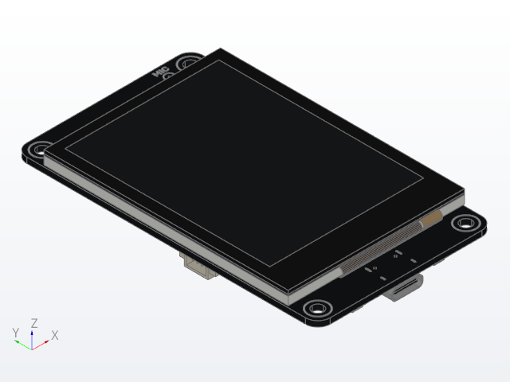 | 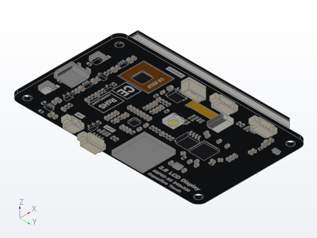 |
| --- | --- |
| front | back |

| File | Content | Origin |
| --- | --- | --- |
| `es3c28p.step` | the ES3C28P: board with 4 holes, window and slot of the touch cable; touch panel with its black border, optical glue, display module, 2 strips of tape, both cables' folds round the display's end and the touch cable's run to its socket; on the back the ESP32-S3, flash, codec, amplifier, RGB LED, crystal, microphone, 6 SOT-23 packages, a diode, 103 chip parts, USB Type-C, microSD, 6-way flat cable socket, 5 wire sockets of 1.25mm pitch, BOOT and RESET, the touch controller and 6 chip parts on its cable; print of both sides; 767 solids, 5.8MB | as `panel_7b.step`: the center of the view area on the touch panel's front face, +z to the viewer; seen from the front x to the right and y up, the USB socket down and the microphone hole at the top right |

Positions in the model frame, mm. Heights are below the board's back
face at z = -5.9. A plug enters from the side named.

| Part | Place | Size, height | Plug from |
| --- | --- | --- | --- |
| Board | x -25.0 to 25.0, y -45.835 to 40.165, z -5.9 to -4.3 | 50.0 x 86.0 x 1.6, corners 3.5 | |
| 4 mounting holes | x -21.0 and 21.0, y -41.835 and 36.165 | 3.2, rings of 5.6 printed on the front | |
| Touch panel | y -37.435 to 31.765, front at z 0 | 50.0 x 69.2 x 1.0 | |
| View area | centered on the origin | 43.6 x 58.05 | |
| Display module | z -3.8 to -1.5 | 50.0 x 69.2 x 2.3 | |
| Cable folds | y -38.705 to -37.435, x -10.65 to 11.75 and 12.3 to 17.5 | 1.27 past the display's end | |
| UART socket, 4 pins | x -24.49 to -20.29, center y -10.85 | 4.2 x 6.75, wings 10.15, 3.4 | -x, face 0.51 inside the edge |
| BAT socket, 2 pins | x -21.94 to -17.74, center y -22.64 | 4.2 x 4.25, wings 7.65, 3.4 | +x, leads towards the edge |
| I2C socket, 4 pins | x 20.29 to 24.49, center y 4.08 | as UART | +x, face 0.51 inside the edge |
| GPIO socket, 4 pins | x 20.29 to 24.49, center y 21.93 | as UART | +x, face 0.51 inside the edge |
| SPEAKER socket, 2 pins | x 20.61 to 24.21, y -13.30 to -5.65 | 3.6 x 7.65, 4.7 | -z |
| USB Type-C | x -4.47 to 4.47, front at y -46.205 | 8.94 x 7.35, shell 0.09 to 3.25 | -y, 0.37 past the edge |
| microSD | x -22.47 to -7.57, y -1.855 to 12.245 | 14.9 x 14.1, 1.85 | -x, 2.53 inside the edge |
| RESET, BOOT | x 11.58 and -11.55, y -42.575 | 4.2 x 3.2, plunger top 2.5 | -z |
| Flat cable socket | x 10.65 to 17.85, y 8.135 to 14.135 | 2.0 | -y |
| Microphone hole | x 15.0, y 36.165 | 0.6 | |
| Over all | z 0 to -10.6 | | |

Sources:

- LCDWIKI's STEP file `ES3C28P_3D.step` (in `ES3C28P_3D.zip` at
  `https://www.lcdwiki.com/res/ES3C28P/`, 1238 solids): the stack, the
  board's outline, holes and cut-outs, the place, size and height of
  every part. It states no licence and is not in the repository.
  `_measure_step.py`'s `measure` and OpenCASCADE's assembly tree read
  it.
- LCDWIKI's outline drawing `ES3C28P_Size.pdf` (V1.0, 2025-06-11): board
  50.00 x 86.00 x 1.60, holes 3.20 on 42.00 x 78.00, display and touch
  panel 50.00 x 69.20 +-0.2, view area 43.60 x 58.05, 10.60 over all,
  parts 4.70 at most. The STEP file agrees.
- 17 tester photos, not in the repository: top side and back on 5mm
  squared paper, edges, angled views, side views against a folding
  rule. The back photos are laid onto the board by its 4 holes.
  `_photo_grid.py`'s grid fit lies within 0.24mm RMS (root mean square)
  of the paper's grid over 1102 crossings; the holes lie 42.35 x 78.73mm
  apart on the paper, so the camera stands about 680mm over it.

Limits:

- The STEP file's parts lie on the photos' within 0.3mm. The folds of
  the cables, which the STEP file does not draw, are read off the front
  photo within 0.3mm. No dimension is verified with a caliper.
- The photos give the top-entry socket 4.5 +-0.3mm high and the
  side-entry sockets 3.6 +-0.3mm; the model keeps the STEP file's 4.7mm
  and 3.4mm.
- The folds are half circles of 1.15mm inner radius drawn as 12 flat
  facets.
- Not measured, estimated: the cables' thickness (0.12mm) and run behind
  the display, the display cable's tail (5.1mm), the pegs of the USB and
  microSD sockets, the wire sockets' walls and pins, the touch
  controller's name (a chip of 5.0 x 5.0mm with 40 pads on the touch
  cable, taken to be the FT6336G).
- `_font.py` has no inch mark and no brackets: the board's `2.8"` is
  drawn as `2.8`, `IO15(SCL)` as `IO15 SCL`.
- Not drawn: the antenna's copper, tracks, vias, pads, frames round chip
  parts, arrows, the microphone symbol, the shapes of the CE and RoHS
  marks (their frames and letters are drawn), the display cable's joint
  to the board, 3 chip parts of 0402 beside RESET that the photos show
  and the STEP file lacks, and the notches the panel's tabs leave in the
  edges.

The display node's printed cases are in [Cases](CASES.md): with
[XT30 openings](CASES.md#case-of-the-display-node-xt30) and with
[screwed XT60](CASES.md#case-of-the-display-node-xt60).

## Remote INA228 sensor node, layout

The boards of the remote sensor node in the places a case will hold
them: the [INA228 module](#ina228-module-with-xt90-connectors) at the
bottom, the [display board](#display-node-board-lcdwiki-es3c28p) on top,
a Matek mBEC12S buck converter between them. The node has no cell and no
charger board: the converter feeds it with 5V from the measured line of
6V to 60V. No part is changed; each is the model of its own spec, moved
and turned. A [case](CASES.md#case-of-the-sensor-node) of 3 printed parts holds
them.

| | |
| --- | --- |
| 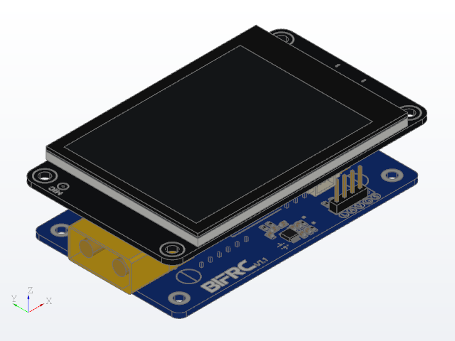 | 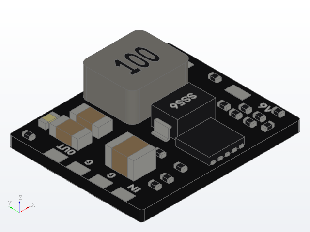 |
| `ina228_node_layout.step` | `matek_mbec12s.step` |

| File | Content | Size, mm | Origin |
| --- | --- | --- | --- |
| `ina228_node_layout.step` | INA228 module, buck converter, display board; 1139 solids, 10.3MB | 86.4 x 50.0 x 23.7 | the INA228 module's: header pin 1 on the board's underside |
| `matek_mbec12s.step` | Matek mBEC12S, black: 4 edge pads OUT, G, G, IN 2.54 apart, inductor with the print 100, diode SS56, converter chip, 3 capacitors, LED, 13 chip parts, 2 voltage pads, the print of both sides; 147 solids, 1.8MB | 18.0 x 15.0, 1.2 thick; 4.5 over all | the pad OUT on the board's edge, on the underside |

| Part | x, mm | y, mm | z, mm |
| --- | --- | --- | --- |
| INA228 module | -58.4 to 25.0 | -4.2 to 44.4 | -1.1 to 11.5 |
| Buck converter | -30.0 to -12.0 | 29.0 to 44.0 | 3.1 to 7.65 |
| Display board | -59.1 to 27.3 | -4.9 to 45.1 | 12.0 to 22.6 |

- The shunt with the minus bar (y 10.0 to 18.1) and the plus bar (y 22.5
  to 27.6, its solder to 28.5 on the underside) carry the whole current.
  The converter lies beside them, 0.5mm past the plus bar's solder and
  1.5mm over the board, between the 2 connector housings. The strip it
  lies in is 15.9mm wide, the converter 15.0mm. Its 4 pads face the plug
  half.
- The display's long side runs along the INA228 board's long side, the
  centers of the 2 boards over each other, its USB Type-C socket at the
  socket half's end. Its lowest part is 0.5mm over the connector
  housings, which end 11.5mm over the board's underside.
- Not drawn: wires and anything that holds the parts.

The converter is drawn from 6 seller pictures, none in the repository:
a top view with the dimensions 18mm, 15mm and 2.54mm printed on it, and
a view of the underside. Part places are read from the top view by eye
at 23px/mm, within about 0.5mm. Sellers' listings give 18 x 15 x 4.5mm
and 2g. No height but the 4.5mm over all is known; the board's thickness
is read off an angled picture. The half holes of the edge pads are not
drawn. Output is 5V as delivered; a solder bridge on the pad 9V or 12V
sets that voltage.

## Module boards of the rbmod carrier

Four module boards drawn part by part with the print of both sides. Each
model is also the 3D model of its footprint in the
[KiCad library](../kicad/README.md), in the same frame and mounted there:
the RP2350-CAN on two pin headers of 20, the INA3221 board on a header of
8, the Mini560 on four headers of 2, the PD trigger board flat on the
carrier. The files here hold the bare boards.

| | |
| --- | --- |
| 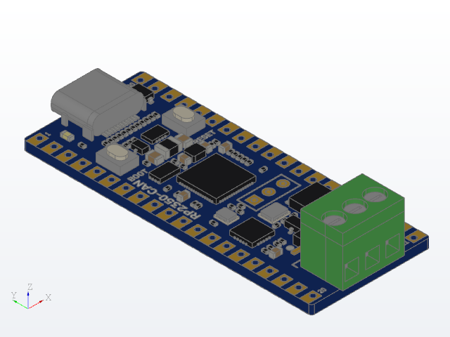 | 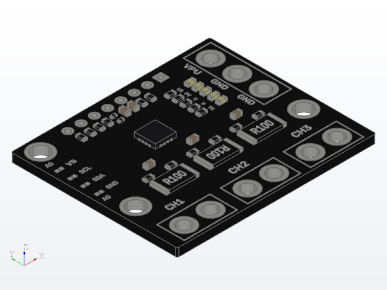 |
| `rp2350_can.step` | `ina3221_module.step` |
| 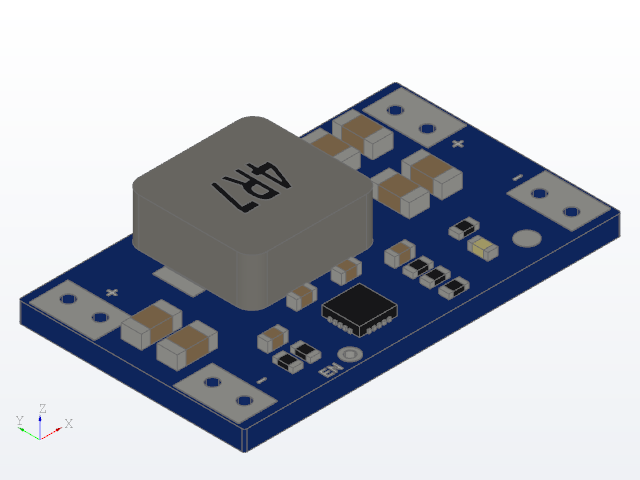 | 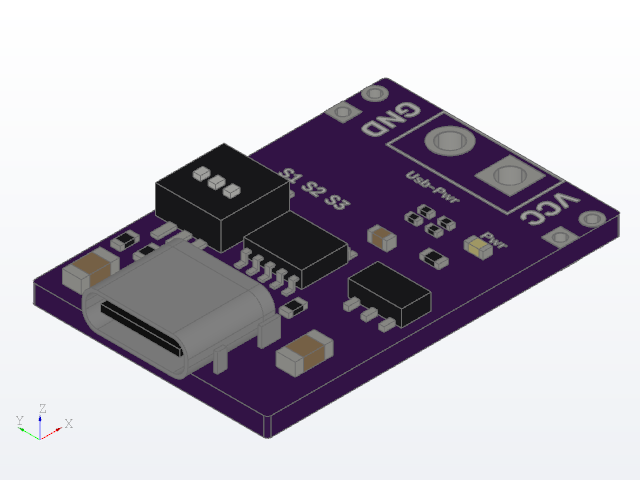 |
| `dcdc_buck_mini.step` | `usbc_pd_trigger.step` |

| File | Content | Size, mm | Sources, none in the repository |
| --- | --- | --- | --- |
| `rp2350_can.step` | Waveshare RP2350-CAN, blue: 40 edge pads, USB-C socket, 2 buttons, RP2350A, XL2515, SIT65HVD230, flash, buck converter, 2 crystals, slide switch, 3-way screw terminal, 52 chip parts, 3 wire openings, pad names on the underside; 632 solids, 7.3MB | 21.0 x 51.0, 1.6 thick; terminal 8.8 over the board; USB-C 1.1 and terminal 0.5 past the ends | Waveshare's product photos of 1600 x 1200px, top side and underside; its schematic; its dimension drawing for the pad grid |
| `ina3221_module.step` | INA3221 board, black: 20 plated holes, INA3221, 3 shunts R100, 5 LEDs, 28 chip parts, 4 pairs of bridge pads, hole names on the underside; 299 solids, 3.3MB | 38.0 x 31.8, 1.6 thick; parts to 0.9 | a seller's pictures of 1024 x 1024px, top side and underside; 2 owner photos for the holes |
| `dcdc_buck_mini.step` | Mini560 buck converter, blue: 4 corner pads with 2 holes each, enable hole, inductor 4R7, 6 capacitors 1206, controller, 10 chip parts, LED; 137 solids, 1.3MB | 30.0 x 18.0, 1.6 thick; inductor 3.8, 5.4 over all | a seller's pictures of 800 x 800px, top side and underside, and its dimension drawing |
| `usbc_pd_trigger.step` | USB-C PD trigger board, purple: USB-C socket, 3-way switch, 10-lead chip, regulator, 2 capacitors 1206, 9 chip parts, LED, the voltage table on the underside; 158 solids, 1.9MB | 30.0 x 20.0, 1.6 thick; USB-C 3.3 over the board and 1.1 past the edge | a seller's picture of 517 x 405px with both sides; a second seller's 3 angled pictures; 3 owner photos |

How the places are found: each straight view is laid onto the board's
frame by known points, the pad holes of the KiCad spec or, for the PD
trigger board, the board's 4 corners. The holes then fit within 0.02mm
(RP2350-CAN, Mini560) and 0.2mm (INA3221 board). Part places are read
from the rectified picture at 30 to 40px/mm.

No maker publishes a 3D file of any of the four. One third-party STEP file
of the Mini560 exists (one solid of 125 faces, in a KiCad library on
GitHub); it is not used.

Limits:

- Part places are within about 0.2mm (RP2350-CAN), 0.3mm (INA3221 board,
  Mini560) and 0.5mm (PD trigger board). No board is measured with a
  caliper.
- No height is measured. Packages have their class figures; the terminal
  is drawn 8.8mm, the Mini560's inductor 3.8mm, the PD trigger board's
  switch 2.5mm. Every board is drawn 1.6mm thick.
- The kinds of the chip parts are read from their colour.
- Not drawn: the half holes at the edges of the RP2350-CAN and the
  Mini560, the maker's sign under the RP2350-CAN, solder, and the print's
  frames round single parts. The print has no underscore.
- The Mini560's enable hole is drawn at the KiCad footprint's place, 9.4mm
  from the input end. The seller's top view gives 9.0mm. Which is right is
  not known.
- The INA3221 board's 6 channel holes and 3 large holes are empty. What
  joins them to a carrier is not drawn.
- The PD trigger board's sliders stand at one end; their real places set
  the voltage.

## rbmod carrier board, version 2

The carrier of the modular bench: a board of 80.0mm x 89.0mm with a notch
of 4.4mm x 13.0mm in its left edge and 6 holes of 3.0mm. It carries an
RP2350-CAN, an INA3221 module, 2 mini buck converters and a USB-C PD
(Power Delivery) trigger board.

| | |
| --- | --- |
| 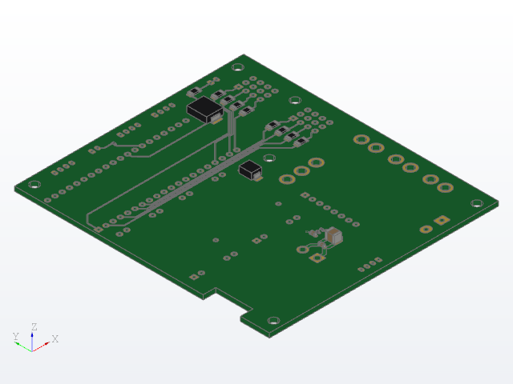 | 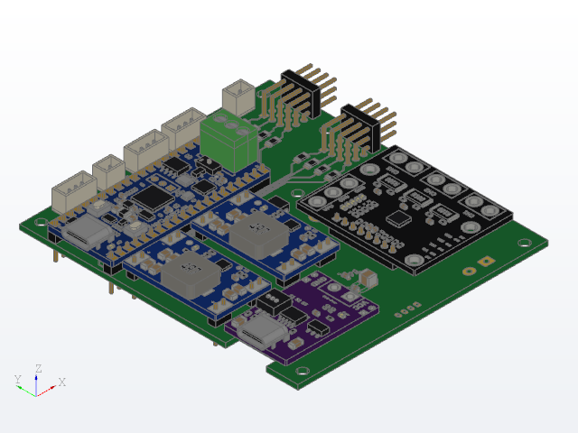 |

| File | Content | Size, mm |
| --- | --- | --- |
| `rbmod_v2_smd.step` | the board with 129 holes, the copper of its 2 outer layers (280 pads, 50 areas of tracks and vias) and its 17 surface-mounted parts: 9 resistors 1206, 3 resistors 0402, 2 capacitors 0603, 1 capacitor 1210, 1 SMB diode, 1 SMC diode; 382 solids, 10.1MB | 80.0 x 89.0, 1.579 thick, parts to 2.5 over the board |
| `rbmod_v2.step` | the same with 3 JST PH headers of 4 pins and 2 of 2 pins, 2 angled pin headers of 3 x 4 pins and the 5 modules, each part by part; 1920 solids, 27.3MB | 85.3 x 89.0; 13.0 over the board, 6.0 under its top side |

Frame: origin at the outline's lower left corner seen from the top side,
x to the right, y up, z = 0 on the top side.

Height over the board's top side, mm:

| Part | Height |
| --- | --- |
| RP2350-CAN, its screw terminal | 13.0 |
| Angled pin headers | 7.6 |
| JST PH headers | 6.0 |
| Mini buck converters | 8.0 |
| INA3221 board, its header pins | 5.5 |
| USB-C PD trigger board | 4.9 |
| SMD parts | 2.5 |

Past the outline: the RP2350-CAN reaches 1.0mm over the left edge, the
angled headers' pins 4.3mm over the right edge.

Not populated (owner, 2026-11-21): J6, a JST PH header of 4 pins at the
lower edge, and J8, a Molex Mini-Fit Jr header of 2 pins beside it. The
board file does not mark them; `DNP` in `rbmod_v2.py` names them. Their
drilled pads are in the board, the parts are in neither model.

Source: `rbmod.kicad_pcb` on the branch `rbmod_v2` of the owner's KiCad
repository, commit `86d2301`, which is not in this repository.
`_read_kicad_pcb.py` reads the outline, the holes, each footprint's
place, turn and drilled pads, and the copper of the 2 outer layers into
`_rbmod_v2_data.py`:

```sh
pip install shapely==2.2.0
python3 hardware/mechanical/_read_kicad_pcb.py \
    path/to/rbmod.kicad_pcb rbmod_v2
```

Copper: the pads of both sides are drawn gold, 0.035mm thick; their finish
is ENEPIG (electroless nickel, electroless palladium, immersion gold;
owner, 2026-11-21). The tracks and the vias are drawn 0.02mm thick in a
lighter green, as copper shows under the solder mask. Every drilled hole is
open in its pads, and every part stands on the pads' top.

The 5 modules are the models of [the KiCad library](../kicad/README.md),
whose footprints the board uses, drawn
[part by part](#module-boards-of-the-rbmod-carrier): each module's drilled
pads on the board agree with its spec, and each header pin stands in a
drilled pad of the carrier. The RP2350-CAN, the INA3221 board and the 2
buck converters stand on pin headers (owner, 2026-11-21). The PD trigger
board lies on the carrier.

Limits:

- The SMD parts and the JST PH headers have their packages' nominal
  sizes. No part is measured on a board; no board is built.
- Estimated, not from a maker's drawing: the angled headers as a plastic
  bar of 2.54mm with pins that end 15.12mm from the first row.
- The filled ground zones of the 2 outer layers, the inner layers, the
  print, the vias' holes and solder are not drawn. A filled zone of this
  board has 9328 corners; with the zones `rbmod_v2.step` is 43MB. The
  board is green.
- Round pads and track ends are polygons of 16 sides to a circle.
- The mini buck converter's enable pad has a hole of 0.8mm in the
  carrier's footprint. A header pin of 0.64mm square is 0.91mm across its
  corners and does not fit it. The model draws no pin there.
- The reader handles lines and circles on Edge.Cuts, footprints on the
  top side and pads that are circle, oval, rect or roundrect. It stops at
  an arc in the outline, a footprint on the underside or another pad
  shape.

## Standard servo

A standard size servo with a round horn: black case of three shells, two
ears with two open mounting holes each, white print "Standard Servo" on
both long sides, white horn.

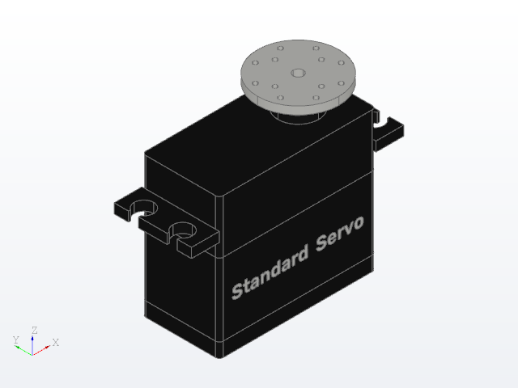

| File | Content | Size, mm | Origin |
| --- | --- | --- | --- |
| `servo_standard.step` | case of 3 shells, 2 ears, boss, shaft hub, horn with 13 holes, print on 2 sides; 34 solids, 0.7MB | case 40.5 x 20.0 x 36.3; 54.9 over the ears; 44.1 over the horn; horn 21.0 across | on the shaft's axis, on the case's underside; x along the case, the long end to -x; z up |

| Dimension | Value | Source |
| --- | --- | --- |
| Mounting holes | 5.0mm across, 49.5mm apart along the case, 10.0mm across it | sketch |
| Ears | 7.2mm long, 2.5mm thick, underside 26.3mm over the case's underside | sketch |
| Shaft axis | 30.4mm from the case's long end, 10.1mm from the short end | sketch |
| Horn | 2.0mm thick, underside 5.8mm over the case | sketch |
| Horn diameter, boss, hub, seams, slots of the holes, corner radius, horn holes | see `servo_standard.py` | scaled from the sketch, not dimensioned |

Source: an owner sketch with three dimensioned views, which is not in the
repository and names neither maker nor type. The sketch gives 55mm over the
ears and 7.2mm + 40.5mm + 7.2mm for its parts; the model is 54.9mm long. The
cable, its plug, the horn's screw and the shaft's splines are not in the
sketch and not drawn. No dimension is verified on a servo.

## Hitec D485HW

The Hitec D485HW, a standard size digital servo: black case of 3 shells,
2 ears with 2 open mounting holes each, the four-arm horn HD-X25 on the
shaft, a silver type plate, and the lead with its 3 wires and 3 pin plug.

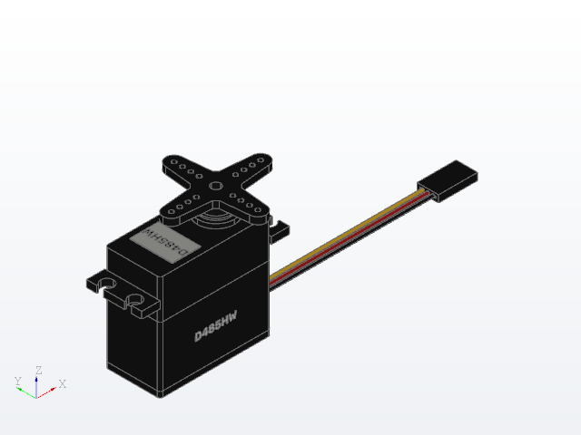

| File | Content | Size, mm | Origin |
| --- | --- | --- | --- |
| `hitec_d485hw.step` | case of 3 shells, 2 ears, boss, shaft, horn HD-X25 with 16 holes, type plate, print "D485HW" on the plate and on 2 sides, lead bushing, 3 wires, plug; 37 solids, 0.6MB | case 39.8 x 19.8 x 37.65; 53.0 over the ears; 46.35 over the horn; 126.4 x 36.0 x 46.35 over all | on the shaft's axis, on the case's underside; x along the case, the long end towards -x, the lead leaves the end at +x; z up |

| Dimension | Value | Source |
| --- | --- | --- |
| Case, ears, mounting holes | 39.8mm x 19.8mm; 53.0mm over the ears; holes of 4.5mm, 48.0mm apart along the case and 10.0mm across; shaft axis 14.0mm from a row of holes; ears 2.5mm thick, underside 28.0mm over the case's underside | the maker's dimension drawing |
| Seams, deck, boss, shaft, type plate, lead bushing, wires | seams 2.05mm and 23.55mm over the underside; deck 37.65mm; boss to 39.85mm; shaft 6.0mm across, to 43.05mm; bushing 9.0mm x 5.0mm, 6.0mm long, its axis 6.25mm over the underside; wires 1.3mm across, 1.8mm apart | the maker's STEP model, read with OpenCASCADE |
| Horn HD-X25 | hub 9.0mm across, 6.2mm high; holes of 1.6mm at 7mm, 10mm, 13mm and 16mm from the axis on one pair of arms and at 6mm, 9mm, 12mm and 15mm on the other; arm ends round with 3.0mm | the maker's horn and spline data sheet, page 43 |
| Lead | 300mm long, 24AWG; minus black, plus red, impulse yellow | the maker's data sheet Ver2.1 and operating instructions |
| Ear slots, corner radius, boss diameters, plug housing, the horn's place on the shaft, its arms' thickness and width | see `hitec_d485hw.py` | estimated |

| Point | x, mm | y, mm | z, mm |
| --- | --- | --- | --- |
| The lead leaves the case | 9.9 | 0.0 | 6.25 |
| Wires | 15.9 to 75.9 | minus -1.8, plus 0.0, signal +1.8 | 6.25 |
| Signal contact in the plug's end face | 89.9 | 2.54 | 6.25 |
| Plus contact | 89.9 | 0.0 | 6.25 |
| Minus contact | 89.9 | -2.54 | 6.25 |

Sources, none in the repository: the maker's dimension drawing and STEP
model of the D485HW (HiTEC Europe shop), its data sheet "D485HW General
Specification" Ver2.1, its "Servo Actuator Horn & Spline Technical Data
Sheet" and its operating instructions. The STEP model is 40.0mm x 20.0mm
where the drawing gives 39.8mm x 19.8mm; the model follows the drawing.

Limits:

- 60mm of the lead's 300mm are drawn, straight.
- Red is the middle wire. Which edge of the band carries the yellow signal
  wire is not in the sources; it is drawn at +y.
- The box holds 4 horns; the model carries the HD-X25. Its height on the
  shaft is estimated: the hub's underside 0.3mm over the boss.
- Not drawn: the spline's 25 teeth, the horn's screw, the case's 4 screws,
  the ribs under the ears, the raised gear cover on the deck, the maker's
  sign. The print is the type as plain text.
- No dimension is verified on a servo.

The ESC, the motor, the set of both and the motor simulator are in
[ESC and motor](ESC_MOTOR.md).

## KST X10 with frame and flap drive

A KST X10 wing servo on a frame with counter bearing, driving a flap
through a pushrod, in a slice of wing. The servo follows a dimension
drawing. The frame, the linkage and the wing are a reference layout:
their kinds of parts and their look follow photos of such a frame, and
every size is chosen in `_gen_flap_drive.py`. No part is measured, made
or tried.

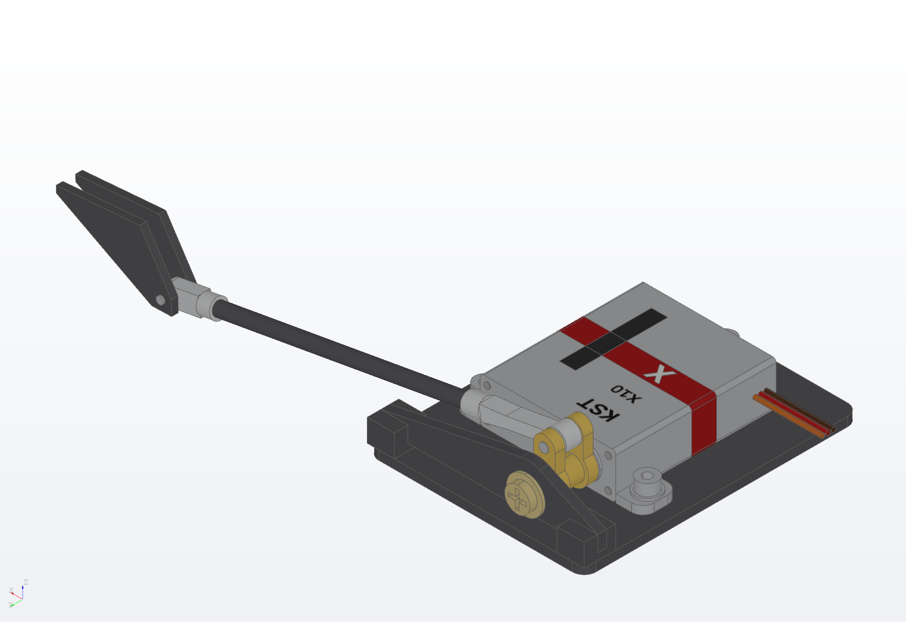

| | |
| --- | --- |
|  | 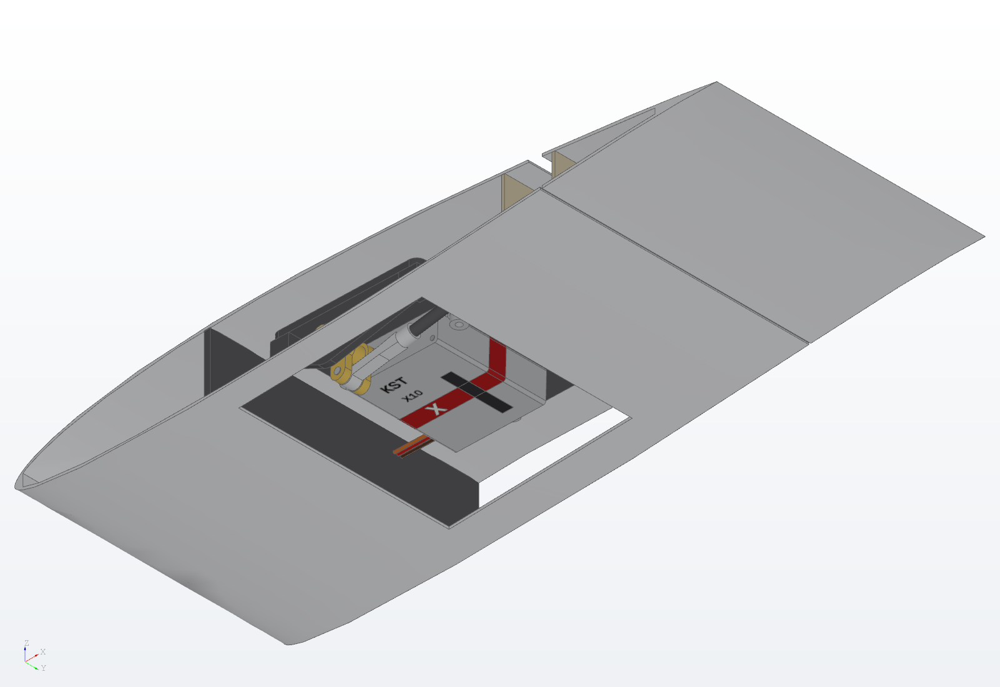 |
| 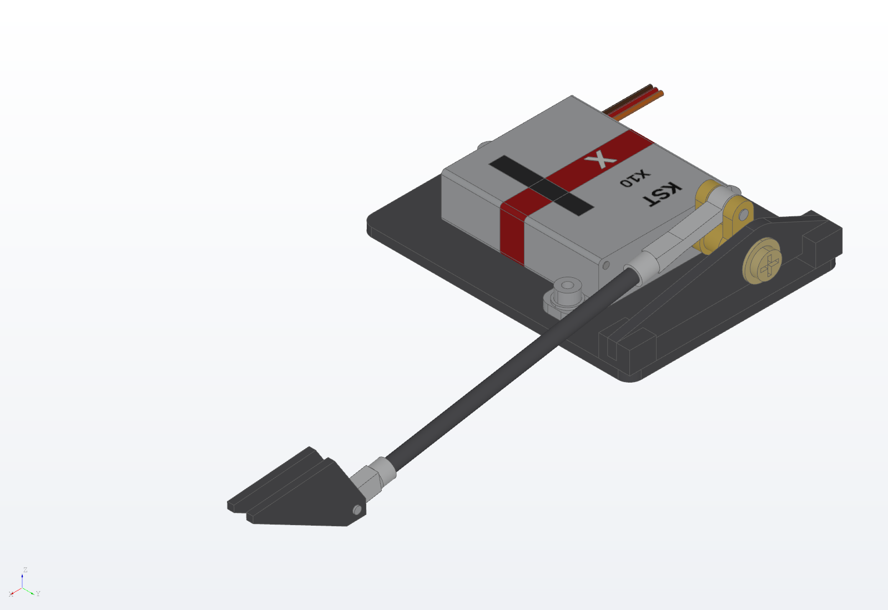 | 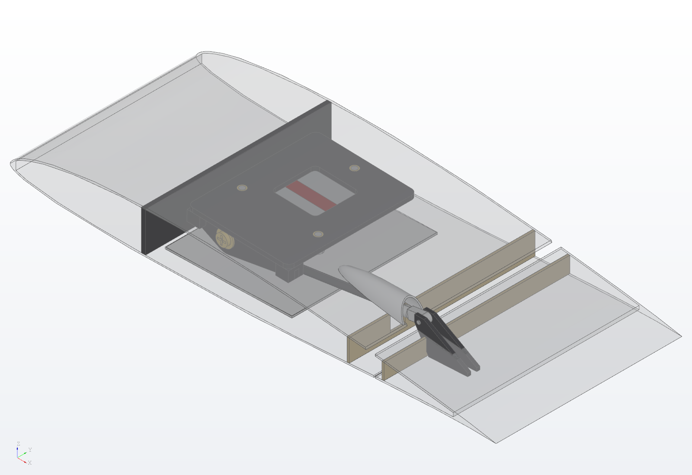 |

| File | Content | Frame |
| --- | --- | --- |
| `kst_x10.step` | the servo: case with red band, 2 ears, tab, shaft, print, 3 wires 15mm long; 25 solids | origin on the shaft's axis at the case's output end, z = 0 on the face the ears lie on; shaft to +y |
| `flap_drive.step` | plate, 3 inserts, 3 washers, 3 screws, 2 blocks, strut, bush and its screw, double arm, pin, rod end, rod, fork, 2 horn plates, horn pin; 23 solids | the wing's: origin at the nose on the chord line, x to the trailing edge, y along the span, z up |
| `flap_drive_wing.step` | wing shell, flap shell, cover of the servo's opening, spar web, rear web, the flap's nose wall, fairing over the rod's slot; 7 solids | the wing's |
| `flap_drive_assembly.step` | the two files above and the servo in its place; 55 solids, 4.0MB | the wing's |

The layout:

- The wing is a slice of 88mm span with the RG-15 airfoil on a chord of
  230mm and skins of 0.8mm. The flap is hinged in the lower skin at 75%
  of the chord. The gap at the hinge is 0.6mm. The wing's upper skin ends
  on a plane through the hinge that leans 22 degrees forward, which
  leaves a gap of 4.45mm at the upper surface for the flap's way up.
- The servo lies flat under the upper skin, its shaft along the span at
  38% of the chord. A carbon plate of 2.0mm is bonded to the skin, turned
  1.6 degrees to the skin's slope and 0.25mm under it at the nearest
  point. The servo's 2 ears and its tab are screwed to brass inserts in
  the plate with 3 M2.5 screws.
- 2 blocks on the plate hold an arched strut of 2.0mm, 11mm in front of
  the servo's output end. A brass bush in the strut, on the shaft's axis,
  carries the outer end of the double arm.
- The arm is 7.0mm from shaft to pin and points to the lower skin. With
  the plate on the upper skin the shaft lies 7.0mm under the plate's
  bonded face, which leaves an arm no room towards that skin.
- The rod is 87.4mm from pin to eye and 3.0mm across. It rises through a
  slot in the rear web and a slot of 7mm width in the upper skin to a fork
  between 2 horn plates of 1.5mm. The plates stand on the flap's lower
  skin and pass through its upper skin. Their eye lies 3.5mm over the
  flap's upper surface and 1.0mm behind the hinge, 12.9mm over the hinge.
- A fairing covers the slot in the upper skin: half an ellipsoid with a
  wall of 0.6mm, 35.5mm long from its nose to the end of the wing's
  upper skin, 10.2mm wide and 8.1mm high there, open to the rear.
- The servo comes out through an opening of 60mm x 69mm in the lower
  skin, which a cover closes.

Flap angle for an angle of the arm, from `travel()`:

| Arm, degrees | -45 | -30 | -15 | 15 | 30 | 45 | 60 | 75 |
| --- | --- | --- | --- | --- | --- | --- | --- | --- |
| Flap, degrees, positive down | -20.3 | -14.7 | -7.8 | 8.4 | 17.1 | 25.5 | 32.8 | 38.0 |

`posed()` gives the parts at an angle of the arm. `--check` builds them at
the 8 angles of the table and fails when two solids share volume. The
smallest distance between a moving part and the fairing is 0.78mm, at
-40 degrees of the arm, between a horn plate and the fairing's wall.
At -50 degrees the arm's barrel meets the rod end's neck.

Dimensions of the servo, mm:

| Dimension | Value | Source |
| --- | --- | --- |
| Case | 30.0 x 10.0 x 35.5 | drawing |
| Over the ears | 42.0; ears 8.0 high, 1.8 thick | drawing |
| Mounting holes | 3.0 across, 36.0 apart; a third in the tab | drawing; the tab's hole is estimated |
| Shaft | 6.6 from the nearer side of the case, 3.3 out of the case | drawing |
| Tab | 10.1 wide, 6.4 long, hole 3.7 past the case | width from the drawing; the rest is the drawing's 39.2 and 41.9 read against its lines, which the drawing does not state |
| Band, slot, corner radii, shaft diameter, cable | see `kst_x10.py` | scaled from the drawing or estimated from photos |

Sources: a dimension drawing of the KST X10, five photos of an X10 on a
frame with counter bearing and one shop photo of such a frame's parts,
none of which is in the repository; the RG-15 coordinates of the airfoil
database of the University of Illinois at Urbana-Champaign.

Limits:

- The files hold the parts at neutral. The collision check covers
  neutral and the 8 angles of the table; no angle between them and no
  angle outside -45 to 75 degrees is checked.
- The gap of 4.45mm in the upper skin is open: no seal or wiper is
  drawn.
- Threads, the servo's splines, the hinge's tape, the adhesive under the
  plate, spar caps and ribs are not drawn.
- The cable ends 15mm from the servo and has no plug.
- Loads, stiffness and the bush's play are not calculated.

## WitMotion inertial sensor

A WitMotion inertial sensor in its black case: a base of 3.0mm with a
slotted ear at each end, a square body, and a white label with blue print
that shows the sensor's axes.

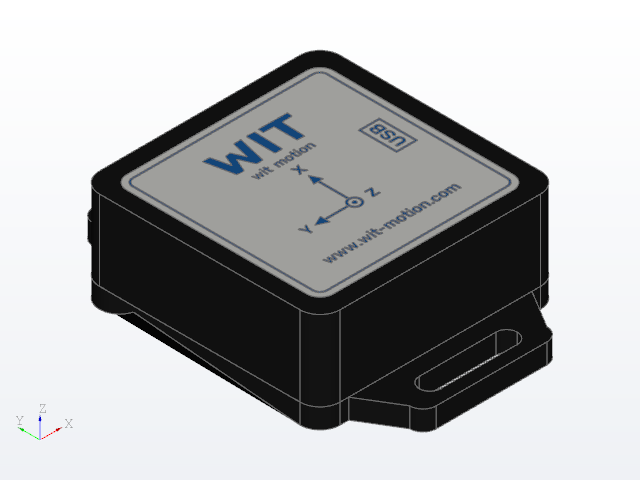

| File | Content | Size, mm | Origin |
| --- | --- | --- | --- |
| `wit_imu.step` | base with 2 slotted ears, body, label with its print; 51 solids | 36.1 x 51.5 x 15.0; base 3.0 thick | middle of the base's underside; x across the 36.1, y along the 51.5 towards the ear the label's X arrow points to, z up |

| Dimension | Value | Source |
| --- | --- | --- |
| Width, length over the ears, height, base | 36.1mm, 51.5mm, 15.0mm, 3.0mm | picture |
| Body | 36.1mm x 36.1mm, corner radius 3.0mm | scaled from the picture's outline |
| Slots | 14.7mm x 3.2mm, 44.5mm apart | scaled from the picture's outline |
| Ears | 7.7mm long, 27.5mm wide at the body, 20.6mm at the end | scaled from the picture's outline |

Source: one product picture with two dimensioned outlines, which is not in
the repository. The picture does not name the sensor's type. The label's
axes are drawn as the picture shows them: X to one ear, Y across, Z out of
the face. The USB socket, the rounding of the body's upper edge and any
lamp or switch are not in the picture and not drawn. The maker's logo is
drawn as the letters "WIT". No dimension is verified on a sensor.

## Round display board, Waveshare ESP32-S3-Touch-LCD-1.85

An ESP32-S3 board behind a round 1.85" display of 360 x 360 pixels with
a capacitive touch panel. Cover glass 55.00mm +/- 0.1mm across, view
area 46.08mm across, 9.70mm over all: 0.70mm glass, 5.70mm from the
glass's front to the board's back, 4.0mm of threaded insert behind it.
The board is held by 3 M2 screws in its brass inserts. It has no
footprint in the KiCad library.

| 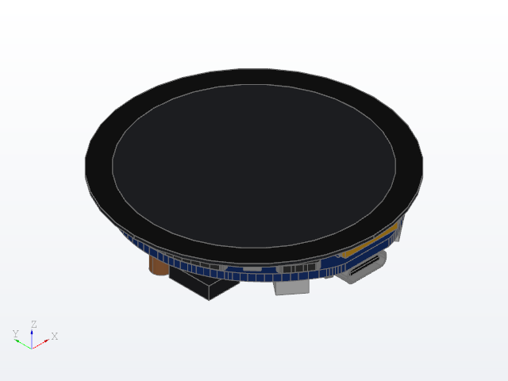 | 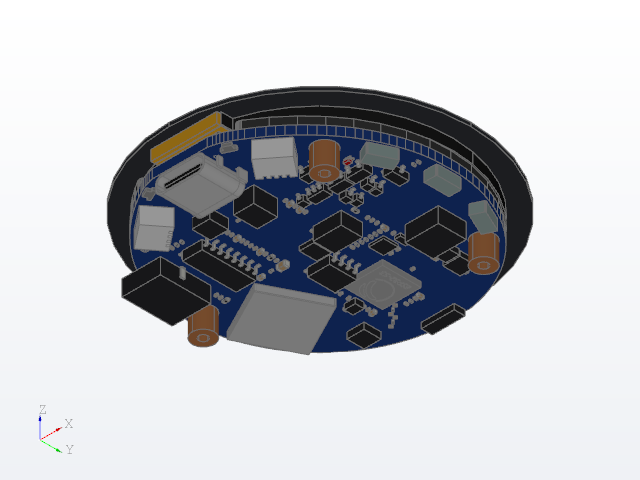 |
| --- | --- |
| front | back |

| File | Content | Origin |
| --- | --- | --- |
| `esp32_s3_lcd_185.step` | the ESP32-S3-Touch-LCD-1.85: glass with its black print round the view area, display with its flat cable folded under it and the stiffener on the cable, foam ring, board with its outline and holes, 3 threaded inserts; on the back the ESP32-S3, 17 leaded packages, 79 chip parts, USB Type-C, microSD slot turned 27 degrees, wire sockets for battery, speaker, RTC (real-time clock) cell, I2C and UART, the PWR, BOOT and RESET buttons; on the front the display socket and 28 chip parts; 491 solids, 3.8MB | the center of the view area on the glass's front face, +z to the viewer; seen from the front x to the right and y up, the USB socket down |

Sources: Waveshare's outline drawing and STEP file of 2026-07-03, both
in `ESP32-S3-Touch-LCD-1.85.rar` ("Mechanical Files" on the board's page
at docs.waveshare.com). Waveshare states no licence for them, so neither
is in this repository. `_measure_esp32_s3_lcd_185.py` reads the STEP
file with OpenCASCADE into `_esp32_s3_lcd_185_data.py`:

```sh
python3 hardware/mechanical/_measure_esp32_s3_lcd_185.py \
    ESP32-S3-Touch-LCD-1_85-20260703.stp
```

The board's outline is a circle of 23.955mm radius over its upper half
with a flat at the top, and two arcs of about 28.8mm radius meeting under
the USB socket with a flat of 10.0mm there. Waveshare's file draws the
lower arcs as short lines; the model keeps them as lines, simplified to
0.01mm. Chip parts, also when turned, are drawn with their end caps, and
leaded packages as a body and its feet. The USB socket and the microSD
slot are shapes of `_parts.py`. Every other part is the outline of its
largest flat face pushed over its height, at its angle on the board.
That includes the turned wire sockets and the side buttons. Parts that
reach into the board in Waveshare's file are cut at the board's face.

Estimated, not in a source: the inserts' neck in the board (2.8mm) and
bore (1.6mm). The USB socket's shell sits on the board; Waveshare's file
sinks it 0.91mm into the board. No dimension is verified with a caliper
on a board.

## Ball bearing 6704-2RS

A thin-section deep-groove ball bearing, sealed on both sides: bore 20mm,
outside diameter 27mm, width 4mm, the ISO 15 boundary dimensions of a
6704, as the seller's listing repeats them.

| File | Content | Origin |
| --- | --- | --- |
| `bearing_6704_2rs.step` | outer ring, inner ring, 2 black seals; 4 solids | on the axis, z = 0 on one side face, the other at z = 4 |

Estimated, not in a source: the inner ring's outside diameter (22.0mm),
the outer ring's bore (25.0mm), the seals' thickness (0.5mm) and their
depth below the side faces (0.15mm). The rings' edge chamfers, 0.2mm at
least by ISO 15, are not drawn. The balls and the cage lie behind the
seals and are not drawn.

## Acrylic disc

A flat round blank of clear acrylic, sold as "50mm": 49.5mm across and
2mm thick by the seller's dimensioned picture.

| File | Content | Origin |
| --- | --- | --- |
| `acrylic_disc_49_5.step` | the disc, 1 solid, drawn pale blue: STEP carries no transparency here | on the axis, z = 0 on one face, the other at z = 2 |

Whether the edges are square, rounded or chamfered is not known; the
model draws them square.

## Licence

CC BY-NC-SA 4.0 (Creative Commons Attribution-NonCommercial-ShareAlike 4.0
International): the STEP and STL models, the renders and the Python scripts
that draw, check and render them. They may be used, changed and shared for
non-commercial purposes, with credit and under the same licence. Commercial
use needs a separate licence from the copyright holder. Terms:
[LICENSE](LICENSE).

Under the MIT (Massachusetts Institute of Technology) licence instead:

- `vendor/m5stack_dial/Dial.stl`, M5Stack's mesh
  ([vendor/m5stack_dial/LICENSE](vendor/m5stack_dial/LICENSE));
- `models/parts/m5dial.step` and `models/parts/m5dial_nut.step`, M5Stack's geometry
  fitted to that mesh ([M5Stack Dial](#m5stack-dial));
- `_font.py`, letter outlines traced from OpenCV's single-stroke Hershey
  font ([LICENSE](../../LICENSE)).
