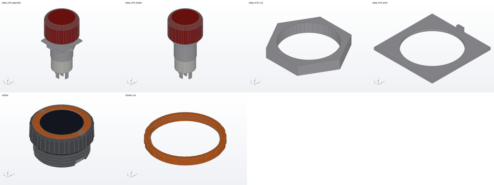

# Mechanical parts

STEP (ISO 10303-21, AP214 automotive design schema) models of the bench's
purchased mechanical parts, for designing the enclosure and panel. Units
are mm. Each part has a spec in this directory; `gen_models.py` writes the
models from the specs with `hardware/kicad/tools/step_gen.py`.

| Path | Content |
| --- | --- |
| `estop_m16.py` | spec of the M16 emergency stop button: dimensions, sources, estimates |
| `m5dial.py` | spec of the M5Stack Dial: dimensions, sources, estimates |
| `gen_models.py` | writes `models/` from the specs; `--check` fails on drift |
| `_stl.py` | reads a binary STL and splits it into its closed parts |
| `_refit.py` | fits planes, cylinders, cones, tori and a thread's surfaces to a mesh part |
| `check_refit.py` | holds the dial's solids, read back with OpenCASCADE, against the mesh |
| `models/` | the generated STEP files |
| `renders/` | OpenCASCADE renders of the models and the contact sheet `all.png` |
| `vendor/` | third-party meshes, unchanged, each with its licence |

```sh
python3 hardware/mechanical/gen_models.py          # write
python3 hardware/mechanical/gen_models.py --check  # CI: exit 1 on drift
pip install cadquery-ocp==8.0.1.1.0 pillow
python3 hardware/kicad/tools/step_check.py         # also checks models/
python3 hardware/mechanical/check_refit.py         # needs numpy; 2 minutes
xvfb-run -a python3 hardware/kicad/tools/step_render.py \
    hardware/mechanical/renders --size 640 480 \
    --step hardware/mechanical/models/*.step
```

## Emergency stop button, M16

A latching mushroom button with a twist release: red head 24.9mm across,
M16 x 1 thread, hex nut, square anti-rotation shim with a bent tab, 5 tabs
2.8 x 0.5mm (C, NO, NC, lamp + and -). Overall length 50.1mm.

| File | Content | Origin |
| --- | --- | --- |
| `estop_m16_button.step` | button without nut and shim | z = 0 on the panel's front face, where the bezel seats; head to +z |
| `estop_m16_nut.step` | hex nut, 19.0mm across flats, 3.0mm | z = 0 on the face towards the panel |
| `estop_m16_shim.step` | square anti-rotation shim, 20.4mm side, bore 16.2mm, 0.8mm, tab 1.4mm tall | z = 0 on the face towards the panel; the tab stands towards it |
| `estop_m16_assembly.step` | all three on a 1.6mm panel | as the button |

Dimensions from the seller's drawing: head 24.9mm with a 19.6mm front face
and 15.7mm long, bezel 2.7mm long, nut front face 29.3mm from the tab
ends, 12mm of thread behind the nut, tabs 7mm long, M16 x 1, overall
50.1mm. The side view's 20.4mm dimension is interpreted as the side of the shim, shown in the rear
view as the square around the nut. Its 19.6mm dimension is interpreted as the bezel
diameter. The rear view's 12.8mm and 13.8mm are not assigned to a part.

The following dimensions are estimated because they are absent from the drawing: the head's front edge radius (2.65mm), the
bezel chamfer, nut across flats and thickness, shim thickness, bore and
tab, switch body diameter (15.0mm) and the tab positions. The spec identifies
each estimate. The thread is represented by a plain 16.0mm cylinder; the tab holes and the head
print are not modelled. The maker and part number are not known.

## M5Stack Dial

A panel-mount rotary encoder with a round 1.28in display, M5Stack SKU
(stock keeping unit) K130: 51.0mm across, 32.3mm long, 46.3g. It mounts in
a 45mm +/- 0.2mm hole in a panel 0 to 6mm thick and is held by a ring nut on
a thread 44.0mm across with a 2.6mm pitch.

| File | Content | Origin |
| --- | --- | --- |
| `m5dial.step` | dial without the nut, 37 solids, 4.4MB | z = 0 on the panel's front face, where the ring on the body's flange seats; knob to +z; the `^` mark at +y |
| `m5dial_nut.step` | ring nut, 50.82mm across, 5.0mm, 20 notches, 0.6MB | z = 0 on the face towards the panel |
| `vendor/m5stack_dial/Dial.stl` | M5Stack's mesh of the plastic parts, 2.9MB | M5Stack's; the bezel's front face at z = -17.32mm, the knob to -z |

No assembly file is written. The nut's place on a panel of thickness t is
its file moved to z = -t.

The 9 plastic parts are M5Stack's geometry: bezel with the `^` and `M5`
marks, knob with 20 grooves, carrier, ring under the bezel's clips, body
with the thread and the `A`, `B`, `+` and `-` marks, ring on the body's
flange, nut, Stamp-S3 and its cover. `Dial.stl` holds them as 29240
triangles, chords of the surfaces M5Stack designed. `m5dial.py` fits the
surfaces again with `_refit.py` and writes 3929 faces on them:

| Part | Triangles | Faces | Planes | of them one triangle | Cylinders | Cones | Tori | Thread surfaces |
| --- | ---: | ---: | ---: | ---: | ---: | ---: | ---: | ---: |
| bezel | 3016 | 650 | 588 | 412 | 9 | 47 | 6 | 0 |
| knob | 5256 | 478 | 333 | 120 | 4 | 120 | 21 | 0 |
| carrier | 2592 | 261 | 178 | 23 | 9 | 74 | 0 | 0 |
| ring under the bezel | 1456 | 97 | 69 | 4 | 5 | 21 | 2 | 0 |
| body | 9970 | 1257 | 1043 | 503 | 59 | 88 | 2 | 65 |
| ring on the flange | 328 | 4 | 2 | 0 | 2 | 0 | 0 | 0 |
| nut | 2690 | 545 | 466 | 354 | 0 | 72 | 0 | 7 |
| Stamp-S3 | 3176 | 456 | 395 | 90 | 56 | 5 | 0 | 0 |
| cover | 756 | 181 | 163 | 80 | 0 | 18 | 0 | 0 |

Cylinders, cones and tori are STEP's own surfaces with an axis and radii;
most walls are cones because the parts have draft. The thread's flanks and
its rounded corners (radius 0.2mm) are B-spline surfaces along the helix,
cut every 120 degrees; a helix follows its curve within 0.02um. Edges are
lines, circles, helices and, for 80 edges, polylines through the mesh's
vertices. By area 51.4% of the 29310mm2 is on curved surfaces and 48.6% on
planes.

A face of one triangle is a triangle no surface took with its neighbours:
the `^` and `M5` marks, the thread's two ends, blends between rounded
corners, the knob's groove walls. These 1586 faces are flat as in the mesh.

The fit works within these limits, and the models have them:

- The mesh's vertices lie within 0.0006mm of the fitted surfaces. The
  mesh's triangles do not: a chord is up to 0.085mm inside its arc, 0.13mm
  in the thread. The models follow the surfaces, so a model is up to
  0.124mm from the mesh.
- A flat face whose corners lie on a round surface cannot be told from one
  chord of it. A face with a single flat step stays a plane, as the floors
  of the knob's 20 grooves do.
- An axis is found along x, y or z of the part. A cylinder or cone about
  another direction stays flat faces.
- OpenCASCADE reads every solid as valid and closed. Its volume from the
  surfaces (`BRepGProp`) is 6.2% high for the bezel and 1.5% for the nut;
  its volume from the mesh it makes of the same solid is within 0.7% of
  `Dial.stl` for every part. Which faces cause this is not known.
- The mesh's axis is 0.0019mm off its own z axis; the models have the axis
  on z.

`check_refit.py` measures the first and the last point for every part and
fails beyond 0.15mm or 1% of volume.

Positions in the model frame, seen from the front:

| Part | Position |
| --- | --- |
| Bezel front face | z = 14.62mm |
| Body rear face | z = -14.2mm |
| Cover over the Stamp-S3 | z = -15.7mm |
| Heads of the 2 M2 cover screws | z = -17.7mm, x = -12mm and 12mm |
| Power terminal, 2 pins, 2.54mm | +y; cut-out 7.8 x 9.03mm, 10.15 to 19.18mm from the axis |
| PORT.A (HY2.0-4P, red) | -x; cut-out 5.2 x 10.2mm, 14.5 to 19.7mm from the axis |
| PORT.B (HY2.0-4P, black) | +x; the mirror of PORT.A |
| USB-C | -y; the shell's opening 18.45mm from the axis, its centre at z = -12.13mm |
| Notch of the body around USB-C | from z = -7.2mm to the rear face |

The mesh agrees with M5Stack's drawing: 14.62mm against 14.6mm from the
front face to the panel seat, 28.82mm against 28.8mm to the body's rear
face, 50.82mm against 51mm across, 24.0mm between the cover screws, and
32.32mm against 32.3mm overall with screw heads 2.0mm tall.

`Dial.stl` lacks the display, the boards, the connectors and the screws.
`m5dial.py` adds them from these sources:

| Part | Source | Estimated |
| --- | --- | --- |
| Power terminal header, KF2EDGV-2.54-2P, 6.88 x 8.1 x 10.1mm | Cixi Kefa's drawing | sockets 2.2mm across and 7.0mm deep, pins 1.0mm square |
| PORT.A and PORT.B, HY2.0-4P vertical, 10.0 x 5.1mm, pins 0.5mm square at 2.0mm | Xunpu's drawing of WAFER-HY2.0-4PZZ | height (top 0.3mm below the rear face; the drawing's part is 8.0mm tall and would end 2.5mm below it), cavity depth 5.0mm; key slots not modelled |
| USB-C receptacle, shell 8.94 x 3.25 x 7.3mm, 1.95mm past the Stamp-S3's edge | M5Stack's `Stamp-S3.step` | shell walls 0.3mm; contacts not modelled |
| 2 M2 socket head screws, heads 3.8 x 2.0mm, hex socket 1.5mm | ISO 4762; the M2 hex key in the box; the drawing's 32.3mm | the screw type; heads only |
| Display lens, 38.0 x 0.68mm | the bezel's pocket in the mesh | the lens's own size is not known |
| Display module, 35.6mm across, 3.02mm | outline of a generic 1.28in GC9A01 module; the carrier's floor in the mesh | M5Stack's module is not published |
| Main board, 40.8mm across, 1.0mm, rear side at z = -3.7mm | the body's ledge with 3 screw bosses and the posts of the ring under the bezel, in the mesh | outline, holes and parts are not known |

The encoder, the springs, the battery connector, the buzzer, the headers
between the Stamp-S3 and the main board and the print on the Stamp-S3 are
not modelled: no geometry of them is published. The colours come from
M5Stack's product photos; the colours of the carrier and of the 2 rings are
assumed. The photos show the `^` and `M5` marks on the orange bezel and the
grey shoulder of the knob outside it, as the mesh has them. No dimension is
verified with a caliper on a part.

The nut covers the front of the body's USB-C notch on a panel thicker than
2.2mm, by the mesh's dimensions (notch 7.2mm behind the panel's front face,
nut 5.0mm). This is not checked on a part.

`Dial.stl` is a copy of `Products/K130_Dial/Structures/Dial.stl` from
[m5stack/M5_Hardware](https://github.com/m5stack/M5_Hardware), commit
`f66b64a1ee5502887d28921f654b24b3b36e9721`, MIT licence
(`vendor/m5stack_dial/LICENSE`), SHA-256
`8032668cd4d31b9dc5b7ce7f900eb0cb0cc96863ff32fe4ddfeb36761db44fcc`. It is a
binary STL of 58480 triangles in mm. It holds each part twice: assembled
about the z axis, and set apart at x from -568mm to -37mm. A viewer that
fits the whole file shows the assembled dial small. The 2 STEP files hold
M5Stack's geometry and are under the same licence.


